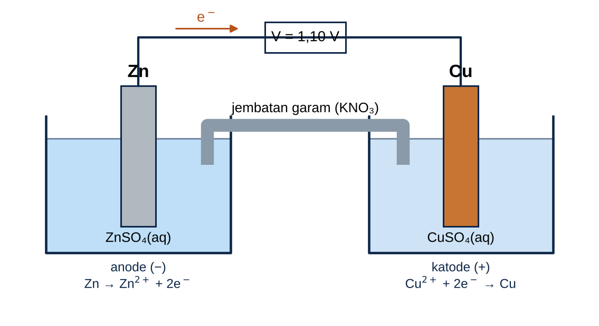
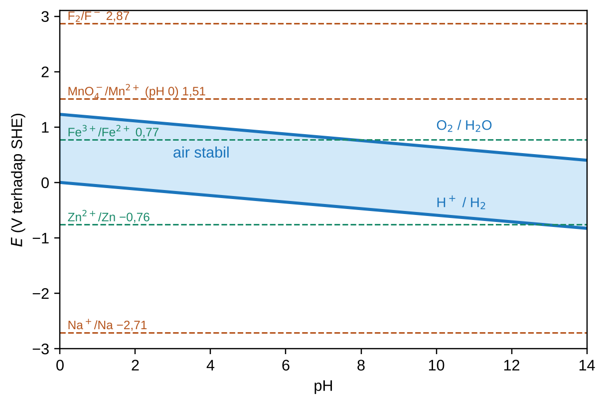

# Bab 9 Oksidasi dan Reduksi

Sepotong besi yang dibiarkan di udara lembap perlahan berubah menjadi karat cokelat yang rapuh. Tidak ada nyala, tidak ada ledakan, tetapi reaksinya sama dengan yang terjadi ketika serbuk besi dibakar: besi memberikan elektron kepada oksigen. Setiap tahun, korosi menghancurkan baja senilai sekitar 3 % produk domestik bruto dunia. Anehnya, sebatang besi yang dilapisi seng (besi galvanis) tidak berkarat walaupun lapisan sengnya tergores sampai besinya terbuka, sedangkan kaleng besi yang dilapisi timah justru berkarat **lebih cepat** di tempat goresan daripada besi tanpa lapisan. Mengapa logam pelindung yang satu menyelamatkan besi, sedangkan yang lain mempercepat kerusakannya?

Jawabannya terletak pada **potensial elektrode**, ukuran kecenderungan suatu zat untuk menerima atau memberikan elektron. Bab ini membangun alat-alat untuk memahami dan meramalkan reaksi redoks: setengah reaksi dan penyetaraan, sel galvani dan potensial elektrode standar, persamaan Nernst yang menghubungkan potensial dengan konsentrasi dan pH, serta batas kestabilan dalam air. Lalu kita mempelajari empat diagram yang dipakai kimiawan anorganik untuk merangkum kimia redoks suatu unsur dalam satu pandangan: diagram Latimer, Frost, Pourbaix, dan Ellingham. Bab ditutup dengan redoks di alam: korosi, lingkungan, dan rantai pernapasan dalam sel hidup.

::: {.kuis}
**Pertanyaan pembuka**

1. Bagaimana menyetarakan reaksi redoks yang rumit, misalnya reaksi permanganat dengan besi(II) dalam asam?
2. Apa arti fisis potensial elektrode standar, dan mengapa potensial elektrode hidrogen ditetapkan nol?
3. Mengapa kalium permanganat merupakan oksidator yang jauh lebih kuat dalam larutan asam daripada dalam larutan netral?
4. Mengapa natrium tidak dapat dibuat dengan elektrolisis larutan NaCl dalam air, padahal seng dapat dielektrolisis dari larutan ZnSO₄?
5. Mengapa ion Cu⁺ tidak stabil dalam air, sedangkan Cu²⁺ stabil?
6. Mengapa besi dapat diperoleh dari bijihnya dengan karbon, sedangkan aluminium tidak?
:::

::: {.tujuan}
**Tujuan belajar**

Setelah mempelajari bab ini, kamu mampu:

1. Menentukan bilangan oksidasi, menuliskan setengah reaksi, dan menyetarakan reaksi redoks dalam suasana asam dan basa.
2. Menjelaskan sel galvani, potensial elektrode standar, dan menghitung Δ*G*° serta *K* dari *E*°.
3. Memakai persamaan Nernst untuk menghitung pengaruh konsentrasi, pH, pengendapan, dan kompleksasi pada potensial.
4. Menjelaskan jendela kestabilan air dan overpotensial.
5. Membaca dan memakai diagram Latimer, termasuk menghitung potensial yang tidak tercantum.
6. Meramalkan disproporsionasi dan komproporsionasi.
7. Menyusun dan menafsirkan diagram Frost.
8. Membaca diagram Pourbaix untuk meramalkan spesies stabil pada pH dan potensial tertentu.
9. Memakai diagram Ellingham untuk menjelaskan ekstraksi logam.
10. Menerapkan prinsip redoks pada korosi, lingkungan, dan biologi.
:::

::: {.mat}
**Prasyarat**

Bab 8 (asam aqua, pH, Δ*G*° = −*RT* ln *K*). Dari Kimia Dasar: bilangan oksidasi dan sel elektrokimia. Dari *Termodinamika Kimia*: energi Gibbs dan persamaan Nernst. Dari *Fisika Umum*: potensial listrik dan kerja listrik.
:::

## 9.1 Bilangan oksidasi, setengah reaksi, dan penyetaraan reaksi redoks

**Oksidasi** adalah pelepasan elektron, dan **reduksi** adalah penerimaan elektron. Keduanya selalu terjadi bersamaan: elektron yang dilepas satu zat harus diterima zat lain. Zat yang menerima elektron (dan karena itu direduksi) disebut **oksidator**; zat yang memberikan elektron disebut **reduktor**.

Untuk melacak elektron dalam senyawa kovalen, dipakai **bilangan oksidasi** (subbab 2.2): muatan yang dimiliki atom bila semua pasangan elektron ikatan diberikan kepada atom yang lebih elektronegatif. Oksidasi menaikkan bilangan oksidasi; reduksi menurunkannya.

### Setengah reaksi

Setiap reaksi redoks dapat dipecah menjadi dua **setengah reaksi**, satu oksidasi dan satu reduksi, masing-masing menampilkan elektron secara eksplisit:

$$\text{Zn(s)} \rightarrow \text{Zn}^{2+}(\text{aq}) + 2e^- \qquad \text{(oksidasi)}$$

$$\text{Cu}^{2+}(\text{aq}) + 2e^- \rightarrow \text{Cu(s)} \qquad \text{(reduksi)}$$

Setengah reaksi bukan sekadar alat pembukuan: dalam sel elektrokimia keduanya benar-benar terjadi di dua tempat yang terpisah, dan elektron berpindah lewat kawat.

::: {.strategi}
**Langkah menyetarakan reaksi redoks (metode setengah reaksi)**

1. Tuliskan kedua setengah reaksi dengan spesies utamanya.
2. Setarakan atom selain O dan H.
3. Setarakan O dengan menambahkan H₂O.
4. Setarakan H dengan menambahkan H⁺ (suasana asam).
5. Setarakan muatan dengan menambahkan elektron.
6. Kalikan kedua setengah reaksi agar jumlah elektron sama, lalu jumlahkan.
7. Untuk suasana basa: tambahkan OH⁻ ke kedua ruas sebanyak H⁺ yang ada, gabungkan H⁺ + OH⁻ menjadi H₂O, dan sederhanakan.
8. Periksa: atom dan muatan harus setara.
:::

::: {.contoh}
**Contoh 9.1 · Permanganat dan dikromat**

Setarakan: (a) MnO₄⁻ + Fe²⁺ → Mn²⁺ + Fe³⁺ (asam); (b) Cr₂O₇²⁻ + I⁻ → Cr³⁺ + I₂ (asam); (c) MnO₄⁻ + SO₃²⁻ → MnO₂ + SO₄²⁻ (basa).

**Penyelesaian.** (a) Reduksi: MnO₄⁻ → Mn²⁺. O: tambah 4H₂O di kanan; H: tambah 8H⁺ di kiri; muatan: kiri +7, kanan +2, tambah 5e⁻ di kiri:

MnO₄⁻ + 8H⁺ + 5e⁻ → Mn²⁺ + 4H₂O

Oksidasi: Fe²⁺ → Fe³⁺ + e⁻, dikalikan 5. Jumlah:

$$\text{MnO}_4^- + 5\text{Fe}^{2+} + 8\text{H}^+ \rightarrow \text{Mn}^{2+} + 5\text{Fe}^{3+} + 4\text{H}_2\text{O}$$

(b) Cr₂O₇²⁻ + 14H⁺ + 6e⁻ → 2Cr³⁺ + 7H₂O; 2I⁻ → I₂ + 2e⁻ (× 3):

$$\text{Cr}_2\text{O}_7^{2-} + 6\text{I}^- + 14\text{H}^+ \rightarrow 2\text{Cr}^{3+} + 3\text{I}_2 + 7\text{H}_2\text{O}$$

(c) Dalam asam dulu: MnO₄⁻ + 4H⁺ + 3e⁻ → MnO₂ + 2H₂O (× 2); SO₃²⁻ + H₂O → SO₄²⁻ + 2H⁺ + 2e⁻ (× 3). Jumlah: 2MnO₄⁻ + 3SO₃²⁻ + 2H⁺ → 2MnO₂ + 3SO₄²⁻ + H₂O. Tambah 2OH⁻ ke kedua ruas: 2H⁺ + 2OH⁻ = 2H₂O, lalu sederhanakan:

$$2\text{MnO}_4^- + 3\text{SO}_3^{2-} + \text{H}_2\text{O} \rightarrow 2\text{MnO}_2 + 3\text{SO}_4^{2-} + 2\text{OH}^-$$

**Memahami hasil.** Reaksi (a) adalah dasar titrasi permanganometri: larutan ungu MnO₄⁻ menjadi tak berwarna ketika direduksi, sehingga berfungsi sebagai indikatornya sendiri. Perhatikan bahwa permanganat menerima lima elektron dalam asam tetapi hanya tiga dalam basa, dan produknya berbeda (Mn²⁺ lawan MnO₂). Pengaruh pH pada redoks akan dijelaskan dengan persamaan Nernst (subbab 9.3) dan diagram Frost (subbab 9.7).
:::

::: {.contoh}
**Contoh 9.2 · Menentukan kadar besi dengan permanganometri**

Sebanyak 25,00 mL larutan Fe²⁺ dalam asam sulfat dititrasi dengan KMnO₄ 0,02000 mol L⁻¹. Warna ungu pertama yang menetap muncul setelah 18,40 mL. Hitung konsentrasi Fe²⁺ dan massa besi dalam sampel.

**Rencana.** Pakai stoikiometri reaksi yang sudah disetarakan pada Contoh 9.1: MnO₄⁻ + 5Fe²⁺ + 8H⁺ → Mn²⁺ + 5Fe³⁺ + 4H₂O.

**Penyelesaian.** Mol MnO₄⁻ = 0,01840 L × 0,02000 mol L⁻¹ = 3,680 × 10⁻⁴ mol. Mol Fe²⁺ = 5 × 3,680 × 10⁻⁴ = 1,840 × 10⁻³ mol. Konsentrasi = 1,840 × 10⁻³/0,02500 = **0,0736 mol L⁻¹**. Massa besi = 1,840 × 10⁻³ × 55,845 g mol⁻¹ = **102,8 mg**.

**Memahami hasil.** Faktor 5 berasal langsung dari jumlah elektron: satu MnO₄⁻ menerima lima elektron (Mn +7 → +2), sedangkan setiap Fe²⁺ hanya memberikan satu. Permanganat menjadi titran yang sekaligus indikator karena ionnya berwarna ungu pekat sedangkan Mn²⁺ hampir tidak berwarna. Penyetaraan redoks yang benar adalah syarat mutlak setiap analisis volumetri redoks: kesalahan satu koefisien berarti kesalahan lima kali lipat dalam hasil.
:::

::: {.kuis}
**Kuis cepat 9.1** Setarakan dalam suasana asam: H₂O₂ + MnO₄⁻ → O₂ + Mn²⁺. Mana oksidator dan mana reduktor?
:::

## 9.2 Sel galvani, potensial elektrode, dan deret elektrokimia

Bila sepotong seng dicelupkan ke larutan CuSO₄, tembaga cokelat mengendap pada seng, dan larutan biru memudar: seng memberikan elektron langsung kepada Cu²⁺. Energi reaksinya terbuang sebagai panas. Bila kedua setengah reaksi dipisahkan dalam dua wadah, dihubungkan dengan kawat untuk elektron dan jembatan garam untuk ion, energi itu dapat diambil sebagai kerja listrik. Susunan ini disebut **sel galvani**; contoh klasiknya adalah **sel Daniell**.

{width=78%}

Elektrode tempat oksidasi terjadi disebut **anode**; tempat reduksi disebut **katode**. Beda potensial antara keduanya ketika tidak ada arus yang mengalir disebut **gaya gerak listrik** sel, *E*~sel~. Gaya gerak listrik berhubungan langsung dengan kerja listrik maksimum yang dapat diperoleh, yaitu energi Gibbs:

$$\Delta G = -nFE_\text{sel} \qquad \text{(9.1)}$$

dengan *n* jumlah elektron yang berpindah per persamaan reaksi dan *F* = 96 485 C mol⁻¹ tetapan Faraday. *E*~sel~ positif berarti Δ*G* negatif: reaksi spontan.

### Potensial elektrode standar

Kita tidak dapat mengukur potensial satu elektrode secara terpisah, hanya beda potensial antara dua elektrode. Karena itu dipilih satu elektrode acuan, **elektrode hidrogen standar** (SHE): kawat platina dalam larutan H⁺ beraktivitas 1 yang dialiri gas H₂ bertekanan 1 bar. Potensialnya ditetapkan **nol** pada semua suhu:

$$2\text{H}^+(\text{aq}) + 2e^- \rightarrow \text{H}_2(\text{g}) \qquad E^\circ = 0$$

**Potensial elektrode standar** *E*° suatu pasangan redoks adalah gaya gerak listrik sel yang terdiri atas elektrode itu (sebagai katode, ditulis sebagai reduksi) dan SHE, dengan semua zat dalam keadaan standar. Gaya gerak listrik sel standar adalah selisih potensial reduksi:

$$E^\circ_\text{sel} = E^\circ_\text{katode} - E^\circ_\text{anode} \qquad \text{(9.2)}$$

Tabel 9.1 Potensial elektrode standar beberapa pasangan redoks pada 25 °C (V terhadap SHE).

| Setengah reaksi reduksi | *E*° | Setengah reaksi reduksi | *E*° |
|---|---|---|---|
| F₂ + 2e⁻ → 2F⁻ | +2,87 | Cu²⁺ + 2e⁻ → Cu | +0,34 |
| Co³⁺ + e⁻ → Co²⁺ | +1,92 | Cu²⁺ + e⁻ → Cu⁺ | +0,15 |
| H₂O₂ + 2H⁺ + 2e⁻ → 2H₂O | +1,78 | 2H⁺ + 2e⁻ → H₂ | 0 |
| MnO₄⁻ + 8H⁺ + 5e⁻ → Mn²⁺ + 4H₂O | +1,51 | Pb²⁺ + 2e⁻ → Pb | −0,13 |
| Cl₂ + 2e⁻ → 2Cl⁻ | +1,36 | Sn²⁺ + 2e⁻ → Sn | −0,14 |
| Cr₂O₇²⁻ + 14H⁺ + 6e⁻ → 2Cr³⁺ + 7H₂O | +1,36 | Ni²⁺ + 2e⁻ → Ni | −0,26 |
| O₂ + 4H⁺ + 4e⁻ → 2H₂O | +1,23 | Fe²⁺ + 2e⁻ → Fe | −0,45 |
| Br₂ + 2e⁻ → 2Br⁻ | +1,09 | Zn²⁺ + 2e⁻ → Zn | −0,76 |
| Ag⁺ + e⁻ → Ag | +0,80 | Al³⁺ + 3e⁻ → Al | −1,66 |
| Fe³⁺ + e⁻ → Fe²⁺ | +0,77 | Mg²⁺ + 2e⁻ → Mg | −2,37 |
| I₂ + 2e⁻ → 2I⁻ | +0,54 | Na⁺ + e⁻ → Na | −2,71 |
| Cu⁺ + e⁻ → Cu | +0,52 | Li⁺ + e⁻ → Li | −3,04 |

Tabel ini disebut **deret elektrokimia**. Di bagian atas: oksidator kuat (F₂, MnO₄⁻) yang mudah menerima elektron. Di bagian bawah: reduktor kuat (Li, Na) yang mudah memberikan elektron. Pasangan yang lebih atas dapat mengoksidasi bentuk tereduksi pasangan yang lebih bawah.

::: {.contoh}
**Contoh 9.3 · Sel Daniell**

Hitung *E*°~sel~, Δ*G*°, dan *K* untuk Zn(s) + Cu²⁺(aq) → Zn²⁺(aq) + Cu(s).

**Penyelesaian.** Katode Cu (+0,340 V), anode Zn (−0,762 V): *E*°~sel~ = 0,340 − (−0,762) = **1,102 V**. Dengan *n* = 2: Δ*G*° = −2 × 96 485 × 1,102 = **−212,7 kJ mol⁻¹**. Dari Δ*G*° = −*RT* ln *K*: log *K* = *nE*°/0,0592 = 37,3, sehingga *K* = **1,8 × 10³⁷**.

**Memahami hasil.** Beda potensial 1,1 V terdengar kecil, tetapi untuk dua elektron setara dengan 213 kJ mol⁻¹ dan tetapan kesetimbangan 10³⁷: reaksi berjalan sempurna. Setiap 0,0592 V dalam *E*° setara dengan faktor 10 dalam *K* per elektron. Karena itu beda potensial yang hanya beberapa persepuluh volt sudah cukup untuk membuat reaksi berjalan praktis tuntas.
:::

### Potensial dari data termodinamika

Persamaan (9.1) dapat dibaca terbalik: bila energi Gibbs pembentukan semua zat diketahui, potensial elektrode dapat **dihitung** tanpa membangun sel. Ini penting untuk pasangan yang tidak dapat diukur langsung, misalnya karena salah satu zat bereaksi dengan air (Na⁺/Na, F₂/F⁻) atau karena elektrodenya tidak reversibel.

::: {.contoh}
**Contoh 9.4 · Potensial sel Daniell dari energi Gibbs pembentukan**

Energi Gibbs pembentukan standar (kJ mol⁻¹): Zn²⁺(aq) −147,1; Cu²⁺(aq) +65,5; Zn(s) dan Cu(s) 0. Hitung *E*° sel Daniell dan bandingkan dengan Contoh 9.3.

**Penyelesaian.** Δ*G*° = Δ~f~*G*°(Zn²⁺) − Δ~f~*G*°(Cu²⁺) = −147,1 − 65,5 = −212,6 kJ mol⁻¹. *E*° = −Δ*G*°/(*nF*) = 212 600/(2 × 96 485) = **1,102 V**, sama dengan hasil dari tabel potensial.

**Memahami hasil.** Tabel potensial elektrode dan tabel energi Gibbs pembentukan ion sebenarnya adalah dua cara menuliskan informasi yang sama. Δ~f~*G*° ion dalam air ditetapkan dengan konvensi Δ~f~*G*°(H⁺, aq) = 0, sama persis dengan konvensi *E*°(SHE) = 0. Siklus Born–Haber (Bab 6) dan potensial elektrode karena itu dapat saling memeriksa: misalnya, potensial Li⁺/Li yang sangat negatif dapat diurai menjadi energi atomisasi Li, energi ionisasi, dan entalpi hidrasi Li⁺ yang sangat besar (soal akhir bab).
:::

### Elektrode acuan dan pengukuran pH

SHE sulit dipakai sehari-hari: memerlukan gas hidrogen dan platina yang bersih. Dalam praktik dipakai **elektrode acuan sekunder** yang potensialnya terhadap SHE diketahui teliti:

* **Elektrode perak–perak klorida**: kawat Ag berlapis AgCl dalam larutan KCl jenuh, *E* = +0,197 V.
* **Elektrode kalomel jenuh** (SCE): Hg/Hg₂Cl₂ dalam KCl jenuh, *E* = +0,241 V.

Potensial yang dilaporkan terhadap SCE dapat diubah ke skala SHE dengan menambahkan 0,241 V. **Elektrode kaca** pengukur pH bekerja dengan prinsip yang sama: membran kaca tipis menghasilkan beda potensial yang bergantung pada aktivitas H⁺ di kedua sisinya, dan pada 25 °C berubah 59,2 mV untuk setiap satuan pH (subbab 9.3). pH meter pada dasarnya adalah voltmeter berimpedans sangat tinggi yang dikalibrasi dengan larutan penyangga.

::: {.awas}
**Awas: potensial tidak dikalikan dengan koefisien.** Untuk menjumlahkan setengah reaksi menjadi reaksi sel, setengah reaksi boleh dikalikan dengan bilangan apa pun agar elektronnya sama, tetapi *E*° **tidak** ikut dikalikan. *E*° adalah sifat intensif (seperti suhu), sedangkan Δ*G*° ekstensif. Namun bila dua setengah reaksi dijumlahkan menjadi **setengah reaksi baru** (bukan reaksi sel), potensialnya harus dihitung lewat Δ*G*° (subbab 9.5).
:::

::: {.kuis}
**Kuis cepat 9.2** Apakah Fe³⁺ dapat mengoksidasi I⁻ menjadi I₂? Apakah dapat mengoksidasi Br⁻ menjadi Br₂? Hitung *E*°~sel~ masing-masing.
:::

## 9.3 Persamaan Nernst: pengaruh konsentrasi, pH, dan kompleksasi

Potensial elektrode standar berlaku untuk semua zat pada keadaan standar. Untuk konsentrasi lain, dipakai **persamaan Nernst**, yang mengikuti dari Δ*G* = Δ*G*° + *RT* ln *Q*:

$$E = E^\circ - \frac{RT}{nF}\ln Q = E^\circ - \frac{0{,}0592\ \text{V}}{n}\log Q \qquad (25\ °\text{C}) \qquad \text{(9.3)}$$

dengan *Q* hasil bagi reaksi, ditulis untuk setengah reaksi reduksi (hasil di pembilang, pereaksi di penyebut).

### Pengaruh pH

Banyak setengah reaksi melibatkan H⁺. Untuk permanganat:

$$E = 1{,}51 - \frac{0{,}0592}{5}\log\frac{[\text{Mn}^{2+}]}{[\text{MnO}_4^-][\text{H}^+]^8}$$

Bila [Mn²⁺] = [MnO₄⁻], potensial turun 8 × 0,0592/5 = 0,095 V setiap kenaikan satu satuan pH. Pada pH 7, *E* = 1,51 − 0,66 = **0,84 V**. Permanganat dalam larutan netral jauh lebih lemah sebagai oksidator daripada dalam asam, dan produknya pun berubah (MnO₂, bukan Mn²⁺). Inilah sebabnya titrasi permanganometri selalu dilakukan dalam asam sulfat.

Pasangan O₂/H₂O dan H⁺/H₂ juga bergantung pH dengan kemiringan sama, −0,0592 V per satuan pH:

$$E(\text{O}_2/\text{H}_2\text{O}) = 1{,}229 - 0{,}0592\,\text{pH} \qquad E(\text{H}^+/\text{H}_2) = -0{,}0592\,\text{pH}$$

Pada pH 7: +0,815 V dan −0,414 V. Nilai-nilai pada pH 7 ini, ditandai *E*°', dipakai dalam biokimia (subbab 9.10).

### Pengaruh pengendapan dan kompleksasi

Bila salah satu bentuk pasangan redoks diikat menjadi endapan atau kompleks yang stabil, konsentrasinya yang bebas turun drastis, dan potensialnya bergeser. Bentuk yang **distabilkan** menjadi lebih sukar diubah.

::: {.contoh}
**Contoh 9.5 · Perak dalam amonia dan klorida**

Hitung *E*° untuk (a) AgCl(s) + e⁻ → Ag(s) + Cl⁻ (*K*~sp~ AgCl = 1,77 × 10⁻¹⁰), (b) [Ag(NH₃)₂]⁺ + e⁻ → Ag + 2NH₃ (β₂ = 1,7 × 10⁷), dari *E*°(Ag⁺/Ag) = 0,7996 V.

**Penyelesaian.** (a) Pada [Cl⁻] = 1, [Ag⁺] = *K*~sp~. Dengan Nernst untuk Ag⁺/Ag: *E* = 0,7996 + 0,0592 log *K*~sp~ = 0,7996 + 0,0592 × (−9,75) = **0,223 V**.

(b) Pada [Ag(NH₃)₂⁺] = [NH₃] = 1, [Ag⁺] = 1/β₂. *E* = 0,7996 − 0,0592 log β₂ = 0,7996 − 0,0592 × 7,23 = **0,372 V**.

**Memahami hasil.** Pengikatan Ag⁺ menurunkan potensial, sehingga Ag⁺ menjadi oksidator yang lebih lemah dan logam Ag menjadi reduktor yang lebih kuat. Elektrode Ag/AgCl dengan *E* = 0,223 V adalah elektrode acuan yang paling banyak dipakai di laboratorium, termasuk di dalam setiap elektrode pH kombinasi. Prinsip yang sama menjelaskan mengapa emas, yang tidak larut dalam asam nitrat, larut dalam air raja (HNO₃ + HCl): ion Cl⁻ mengikat Au³⁺ menjadi [AuCl₄]⁻, menurunkan potensial Au³⁺/Au sampai dapat dicapai oleh HNO₃. Ekstraksi emas dengan sianida dalam pertambangan memakai cara yang sama: [Au(CN)₂]⁻ sangat stabil.
:::

Pengaruh kompleksasi juga bekerja sebaliknya: bila bentuk **teroksidasi** dikomplekskan lebih kuat daripada bentuk tereduksi, potensial turun. Pasangan Fe³⁺/Fe²⁺ (+0,77 V) menjadi [Fe(CN)₆]³⁻/[Fe(CN)₆]⁴⁻ (+0,36 V), karena sianida mengikat Fe³⁺ sekitar 10⁷ kali lebih kuat daripada Fe²⁺.

::: {.kuis}
**Kuis cepat 9.3** Hitung gaya gerak listrik sel Daniell bila [Zn²⁺] = 1,0 mol L⁻¹ dan [Cu²⁺] = 0,010 mol L⁻¹.
:::

::: {.contoh}
**Contoh 9.6 · Amonia menjinakkan kobalt(III)**

Dalam air, Co³⁺ adalah oksidator yang sangat kuat (*E*° = +1,92 V) dan mengoksidasi air. Namun [Co(NH₃)₆]³⁺ adalah garam yang stabil berbulan-bulan, dengan *E*°([Co(NH₃)₆]³⁺/[Co(NH₃)₆]²⁺) = +0,108 V. (a) Berapa perbandingan tetapan kestabilan keseluruhan β₆ kompleks Co(III) dan Co(II)? (b) Mengapa larutan Co²⁺ dalam amonia berubah warna dari merah muda menjadi jingga kecokelatan bila dibiarkan di udara?

**Rencana.** Bayangkan siklus: reduksi kompleks Co(III) sama dengan (i) melepas enam NH₃ dari Co(III), (ii) mereduksi Co³⁺ menjadi Co²⁺, dan (iii) mengikat enam NH₃ pada Co²⁺. Energi Gibbs dijumlahkan, lalu dibagi −*F*.

**Penyelesaian.** (a) Dari siklus itu:

$$E^\circ_\text{kompleks} = E^\circ_\text{aqua} - 0{,}0592\,\log\frac{\beta_6(\text{III})}{\beta_6(\text{II})}$$

sehingga log(β₆(III)/β₆(II)) = (1,92 − 0,108)/0,0592 = **30,6**. Amonia mengikat Co(III) sekitar 10³⁰ kali lebih kuat daripada Co(II). (Tabel tetapan kestabilan memberi log β₆ sekitar 35 untuk Co(III) dan sekitar 5 untuk Co(II), selisih yang sama.)

(b) Dengan *E*° = +0,108 V, kompleks Co(II) amina sekarang berada **di bawah** garis O₂/H₂O pada pH berapa pun. Oksigen udara (*E* = +0,82 V pada pH 7, +0,59 V pada pH 11) dengan mudah mengoksidasinya menjadi [Co(NH₃)₆]³⁺ yang jingga: inilah cara klasik membuat kompleks Co(III) amina di laboratorium, dengan arang aktif sebagai katalis.

**Memahami hasil.** Ligan yang mengikat bentuk teroksidasi lebih kuat **menurunkan** potensial dan menstabilkan bilangan oksidasi tinggi. Untuk kobalt, penyebabnya adalah energi penstabilan medan ligan (Bab 11): Co³⁺ berkonfigurasi d⁶ spin rendah dengan EPML −2,4Δ~o~ yang sangat besar dalam medan amonia, sedangkan Co²⁺ (d⁷ spin tinggi) memperoleh jauh lebih sedikit. Satu bilangan potensial menyimpan informasi kimia koordinasi yang kaya.
:::

::: {.contoh}
**Contoh 9.7 · Sel konsentrasi**

Dua elektrode tembaga dicelupkan ke dalam larutan CuSO₄ 0,0010 mol L⁻¹ dan 1,0 mol L⁻¹, dihubungkan dengan jembatan garam. Elektrode mana yang menjadi katode, dan berapa gaya gerak listriknya pada 25 °C?

**Penyelesaian.** Kedua setengah sel mempunyai *E*° yang sama, sehingga *E*°~sel~ = 0. Reaksi spontan cenderung menyamakan konsentrasi: Cu²⁺ tereduksi di larutan pekat (katode) dan Cu teroksidasi di larutan encer (anode). Reaksi sel: Cu²⁺(1,0) → Cu²⁺(0,0010). *E* = 0 − (0,0592/2) log(0,0010/1,0) = **+0,089 V**.

**Memahami hasil.** Sel konsentrasi menghasilkan tegangan hanya dari perbedaan konsentrasi; tidak ada perubahan kimia bersih. Prinsip yang sama bekerja di setiap sel saraf: perbedaan konsentrasi K⁺ di dalam dan di luar membran (sekitar 30 kali) menghasilkan potensial istirahat sekitar −90 mV (dihitung dengan persamaan Nernst untuk *n* = 1 dan suhu tubuh). Elektrode selektif ion, misalnya elektrode fluorida dan elektrode kaca pH, juga mengukur potensial konsentrasi semacam ini.
:::

## 9.4 Kestabilan dalam air: jendela kestabilan dan overpotensial

Air sendiri dapat dioksidasi (menjadi O₂) maupun direduksi (menjadi H₂). Akibatnya ada batas: oksidator yang terlalu kuat akan mengoksidasi air, dan reduktor yang terlalu kuat akan mereduksinya.

* Spesies dengan *E* > 1,229 − 0,0592 pH dapat mengoksidasi air: 4Co³⁺ + 2H₂O → 4Co²⁺ + O₂ + 4H⁺.
* Spesies dengan *E* < −0,0592 pH dapat mereduksi air: 2Na + 2H₂O → 2NaOH + H₂.

Di antara kedua garis ini terdapat **jendela kestabilan air**, selebar 1,23 V pada pH berapa pun.

{width=78%}

### Overpotensial

Termodinamika menyatakan apa yang **mungkin**, tetapi tidak seberapa cepat. Banyak reaksi yang secara termodinamika dapat mengoksidasi atau mereduksi air berjalan sangat lambat, karena pembentukan gas H₂ atau O₂ di permukaan elektrode memerlukan energi aktivasi. Potensial tambahan yang diperlukan agar reaksi berjalan dengan laju yang berarti disebut **overpotensial** (*overvoltage*). Untuk O₂ di kebanyakan elektrode, overpotensial sekitar 0,6 V; untuk H₂ di seng, timbal, dan raksa, sampai 0,7–1 V. Akibatnya jendela kestabilan **kinetik** air jauh lebih lebar daripada 1,23 V.

::: {.contoh}
**Contoh 9.8 · Mengapa elektrolisis air garam menghasilkan klorin, bukan oksigen?**

Pada industri klor-alkali, larutan NaCl pekat (sekitar 5 mol L⁻¹) dielektrolisis. Di anode, dua reaksi bersaing: 2Cl⁻ → Cl₂ + 2e⁻ (*E*° = 1,358 V) dan 2H₂O → O₂ + 4H⁺ + 4e⁻ (*E*° = 1,229 V). Ruang anode dijaga pada pH sekitar 3. (a) Hitung potensial kedua pasangan pada kondisi ini (gas 1 bar). (b) Mana yang secara termodinamika lebih mudah terjadi? (c) Mengapa yang terbentuk justru klorin?

**Penyelesaian.** (a) Cl₂/Cl⁻: *E* = 1,358 − (0,0592/2) log(5²) = **1,317 V**. O₂/H₂O: *E* = 1,229 − 0,0592 × 3 = **1,052 V**.

(b) Oksidasi berlangsung lebih dulu pada pasangan dengan potensial **lebih rendah** (paling mudah dioksidasi). Air seharusnya teroksidasi lebih dulu, 0,27 V lebih mudah daripada Cl⁻.

(c) Pembentukan O₂ melibatkan empat elektron dan pemutusan beberapa ikatan O–H; overpotensialnya pada anode industri (titanium berlapis RuO₂ dan IrO₂) sekitar 0,4–0,6 V. Pembentukan Cl₂ hanya melibatkan dua elektron dan dua atom yang bergabung; overpotensialnya hanya beberapa puluh milivolt. Setelah overpotensial dijumlahkan, potensial nyata untuk O₂ menjadi lebih tinggi daripada untuk Cl₂, dan klorin yang terbentuk, dengan sedikit O₂ sebagai pengotor (kurang dari 2 %).

**Memahami hasil.** Seluruh industri klor-alkali, yang menghasilkan sekitar 90 juta ton klorin per tahun untuk PVC, pemutih, dan pengolahan air, bergantung pada kinetika, bukan termodinamika. Bahan anode dipilih justru karena **mempercepat** pembentukan Cl₂ sambil tetap lambat untuk O₂. Ini juga peringatan umum: potensial standar memberi tahu arah yang mungkin, sedangkan yang benar-benar terjadi dapat ditentukan oleh laju.
:::

### Elektrolisis kuantitatif: hukum Faraday

Dalam elektrolisis, setiap mol elektron yang melewati sel membawa muatan *F* = 96 485 C. Karena itu jumlah zat yang dihasilkan di elektrode sebanding dengan muatan total *Q* = *It* (arus × waktu):

$$n_\text{zat} = \frac{It}{zF} \qquad \text{(9.4)}$$

dengan *z* jumlah elektron per satuan zat (2 untuk Cu²⁺ → Cu, 3 untuk Al³⁺ → Al). Hukum ini, dirumuskan Michael Faraday pada 1834, adalah dasar pelapisan logam, pemurnian tembaga secara elektrolisis, dan produksi aluminium (Contoh 9.15).

::: {.contoh}
**Contoh 9.9 · Pemurnian tembaga**

Arus 2,00 A dialirkan selama 1,00 jam melalui sel pemurnian tembaga (anode tembaga kotor, katode tembaga murni, larutan CuSO₄ asam). Berapa gram tembaga murni yang terendapkan bila efisiensi arus 100 %?

**Penyelesaian.** *Q* = 2,00 × 3600 = 7200 C. Mol Cu = 7200/(2 × 96 485) = 0,0373 mol, massa = 0,0373 × 63,55 = **2,37 g**.

**Memahami hasil.** Pemurnian tembaga elektrolitik menghasilkan tembaga 99,99 % untuk kabel listrik. Logam yang lebih mudah teroksidasi daripada tembaga (Fe, Zn, Ni) ikut larut di anode tetapi tetap dalam larutan, karena potensialnya terlalu negatif untuk mengendap di katode. Logam mulia (Ag, Au, Pt) tidak teroksidasi dan jatuh ke dasar sebagai **lumpur anode**, yang menjadi sumber penting perak dan emas. Pemisahan ini sepenuhnya mengikuti deret elektrokimia.
:::

::: {.contoh}
**Contoh 9.10 · Elektrolisis seng dan natrium**

(a) Mengapa seng dapat dielektrolisis dari larutan ZnSO₄ dalam air, padahal *E*°(Zn²⁺/Zn) = −0,76 V lebih negatif daripada *E*(H⁺/H₂) pada pH 5 (−0,30 V)? (b) Mengapa natrium tidak dapat dibuat dengan cara yang sama?

**Penyelesaian.** (a) Secara termodinamika, pada katode, H⁺ seharusnya tereduksi lebih dulu daripada Zn²⁺, karena potensialnya 0,46 V lebih positif. Namun pada permukaan seng, pembentukan H₂ mempunyai overpotensial sekitar 0,7 V, sehingga H⁺ baru tereduksi dengan laju berarti di bawah sekitar −1,0 V. Seng mengendap lebih dulu. Hampir semua seng dunia diproduksi dengan elektrolisis seperti ini.

(b) Na⁺/Na berada pada −2,71 V, sekitar 2,4 V di bawah H⁺/H₂. Tidak ada overpotensial yang cukup besar untuk menutup jarak ini; yang terbentuk di katode hanyalah H₂. Natrium dibuat dengan elektrolisis **lelehan** NaCl (proses Downs), tanpa air.

**Memahami hasil.** Overpotensial dapat menjadi penghalang (dalam pemisahan air untuk produksi hidrogen, elektrokatalis platina atau iridium diperlukan untuk menurunkannya) atau justru dimanfaatkan (dalam produksi seng, klorin, dan aki timbal). Pada elektrolisis larutan NaCl pekat, Cl₂ yang terbentuk di anode, bukan O₂, walaupun *E*°(Cl₂/Cl⁻) = 1,36 V lebih positif daripada O₂/H₂O; overpotensial O₂ yang besar membalik urutannya. Industri klor-alkali bergantung pada fakta kinetik ini.
:::

::: {.kuis}
**Kuis cepat 9.4** Apakah ion Co³⁺ (*E*° = 1,92 V) stabil dalam air pada pH 0? Apakah Cr²⁺ (*E*°(Cr³⁺/Cr²⁺) = −0,41 V) stabil pada pH 0 dan pH 7? Jelaskan dengan jendela kestabilan air.
:::
