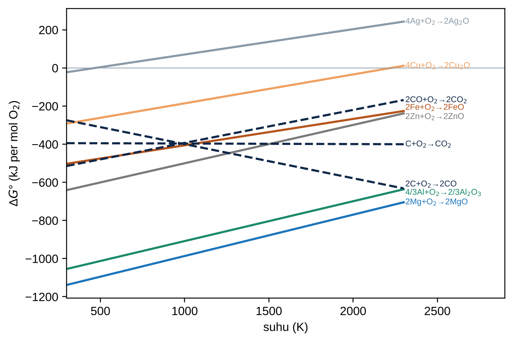
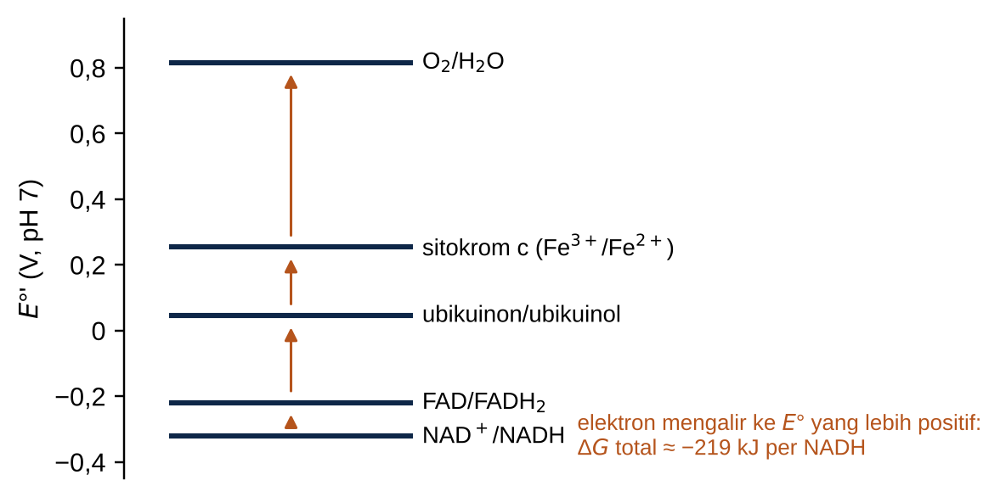

## 9.9 Diagram Ellingham dan ekstraksi logam

Kebanyakan logam di alam berada sebagai oksida, sulfida, atau garam: bentuk teroksidasi. Mengekstraksi logam berarti **mereduksinya**. Pertanyaan pertama setiap ahli metalurgi: reduktor apa yang cukup kuat, dan pada suhu berapa? Untuk reaksi pada suhu tinggi tanpa air, alat yang tepat bukan potensial elektrode, melainkan energi Gibbs pembentukan oksida sebagai fungsi suhu. Harold Ellingham (1944) menggambarkannya dalam satu diagram.

Supaya dapat dibandingkan, setiap reaksi ditulis untuk **satu mol O₂**:

$$\tfrac{2x}{y}\,\text{M} + \text{O}_2 \rightarrow \tfrac{2}{y}\,\text{M}_x\text{O}_y \qquad \Delta G^\circ = \Delta H^\circ - T\Delta S^\circ$$

Karena Δ*H*° dan Δ*S*° hampir tetap terhadap suhu, setiap reaksi tampak sebagai **garis lurus** dengan kemiringan −Δ*S*°.

{width=88%}

Cara membaca diagram Ellingham:

1. **Makin rendah garis, makin stabil oksidanya.** MgO dan Al₂O₃ paling stabil; Ag₂O dan Cu₂O paling mudah direduksi.
2. Sebuah logam dapat mereduksi oksida logam lain yang garisnya berada **di atas** garisnya sendiri. Aluminium mereduksi oksida besi dan kromium (reaksi termit): 2Al + Fe₂O₃ → Al₂O₃ + 2Fe.
3. Kebanyakan garis logam **naik** dengan suhu, karena oksidasi memakan gas O₂ sehingga Δ*S*° negatif (sekitar −200 J K⁻¹ per mol O₂). Pada suhu yang cukup tinggi, oksida logam mulia terurai sendiri: Ag₂O di atas sekitar 470 K, HgO sekitar 800 K.
4. Garis **2C + O₂ → 2CO turun** dengan suhu, karena satu mol gas menjadi dua mol gas (Δ*S*° = +179 J K⁻¹). Garis C + O₂ → CO₂ hampir mendatar (Δ*S*° ≈ 0).

Butir terakhir adalah kunci metalurgi. Karena garis C/CO turun, pada suhu yang cukup tinggi karbon dapat mereduksi oksida **apa pun** yang garisnya ia potong.

::: {.contoh}
**Contoh 9.12 · Pada suhu berapa karbon mereduksi oksida?**

Dengan data per mol O₂ (Δ*H*° dalam kJ, Δ*S*° dalam J K⁻¹): 2C + O₂ → 2CO (−221,0; +178,7); 2Fe + O₂ → 2FeO (−544,0; −138,3); 2Zn + O₂ → 2ZnO (−701,0; −201,1); 4/3Al + O₂ → 2/3Al₂O₃ (−1117,1; −209,0); 2Mg + O₂ → 2MgO (−1203,2; −216,8). Hitung suhu ketika garis C/CO memotong setiap garis logam.

**Penyelesaian.** Kedua garis berpotongan bila Δ*H*₁ − *T*Δ*S*₁ = Δ*H*₂ − *T*Δ*S*₂, yaitu *T* = (Δ*H*₁ − Δ*H*₂)/(Δ*S*₁ − Δ*S*₂). Untuk FeO: *T* = (−544,0 + 221,0)/(−0,1383 − 0,1787) = **1019 K**. Dengan cara sama: ZnO **1264 K**, Al₂O₃ **2311 K**, MgO **2483 K**.

**Memahami hasil.** Di atas sekitar 1000 K, karbon (sebagai kokas) dapat mereduksi oksida besi: dasar tanur tinggi, yang beroperasi pada 1500–2000 K dan menghasilkan lebih dari 1,8 miliar ton besi per tahun. Untuk seng, karbon cukup di atas 1264 K, tetapi seng mendidih pada 1180 K, sehingga ia keluar sebagai uap dan harus diembunkan; banyak seng kini diproduksi dengan elektrolisis (subbab 9.4). Untuk aluminium dan magnesium, suhu yang diperlukan (di atas 2300 K) terlalu tinggi secara teknis dan ekonomis, dan pada suhu itu karbon juga membentuk karbida. Kedua logam ini diproduksi dengan **elektrolisis lelehan**: aluminium dari Al₂O₃ yang dilarutkan dalam kriolit cair (proses Hall–Héroult, 1886), yang memakan sekitar 15 kWh listrik per kilogram. Itulah sebabnya aluminium pernah lebih mahal daripada emas sebelum 1886, dan sebabnya daur ulang aluminium sangat menguntungkan: melelehkan kaleng bekas hanya memerlukan sekitar 5 % energi produksi dari bijih.
:::

### Logam yang lebih reaktif: reduksi dengan logam lain

Untuk logam yang oksidanya sangat stabil, karbon tidak memadai atau membentuk karbida. Ada dua jalan lain. Pertama, elektrolisis lelehan (aluminium, magnesium, natrium, litium). Kedua, reduksi dengan logam yang garisnya pada diagram Ellingham berada lebih rendah. **Proses termit** memakai aluminium untuk mereduksi Cr₂O₃ dan oksida lain: Δ*G*° per mol O₂ sekitar −1055 kJ untuk Al₂O₃ dan −705 kJ untuk Cr₂O₃, sehingga reaksinya melepaskan sekitar 350 kJ per mol O₂ yang dipindahkan. **Proses Kroll** untuk titanium tidak mereduksi TiO₂ langsung (TiO₂ sangat stabil dan Ti membentuk karbida dan nitrida). TiO₂ diubah dulu menjadi TiCl₄ dengan klorin dan karbon, lalu TiCl₄ direduksi dengan magnesium cair di bawah argon: TiCl₄ + 2Mg → Ti + 2MgCl₂. Kerumitan inilah yang membuat titanium mahal, walaupun ia unsur kesembilan terbanyak di kerak bumi.

::: {.kuis}
**Kuis cepat 9.9** Mengapa tembaga dapat diperoleh hanya dengan memanaskan bijihnya bersama arang pada suhu yang relatif rendah, sehingga menjadi salah satu logam pertama yang dikenal manusia? (Lihat garis Cu₂O pada Gambar 9.5.)
:::

## 9.10 Redoks di alam: korosi, lingkungan, dan biologi

### Korosi

Korosi besi adalah sel galvani kecil. Di satu tempat pada permukaan besi (anode), besi teroksidasi: Fe → Fe²⁺ + 2e⁻. Elektron mengalir lewat logam ke tempat lain (katode), biasanya tempat yang lebih banyak terkena oksigen, di mana O₂ direduksi: O₂ + 2H₂O + 4e⁻ → 4OH⁻. Ion Fe²⁺ dan OH⁻ bertemu, dan Fe²⁺ selanjutnya dioksidasi oleh udara menjadi karat, Fe₂O₃·*x*H₂O. Gaya gerak listriknya pada pH 7 sekitar 0,82 − (−0,45) = **1,26 V**, cukup besar. Air dan oksigen sama-sama diperlukan, dan garam terlarut (air laut, garam jalan) mempercepatnya karena menaikkan konduktivitas.

Sekarang teka-teki pembuka dapat dijawab:

* Pada **besi galvanis**, seng (*E*° = −0,76 V) lebih mudah teroksidasi daripada besi (−0,45 V). Bila lapisan tergores, seng menjadi anode dan besi menjadi katode: seng yang berkarat, besi terlindungi. Seng disebut **anode korban**.
* Pada **kaleng timah**, timah (−0,14 V) lebih sukar teroksidasi daripada besi. Selama utuh, lapisan timah melindungi besi secara fisik. Bila tergores, besi menjadi anode dan timah katode: besi di goresan berkarat **lebih cepat** daripada tanpa lapisan.

Prinsip anode korban dipakai secara besar-besaran: balok magnesium atau seng dipasang pada lambung kapal, pipa bawah tanah, dan pemanas air, dan diganti secara berkala ketika habis. Cara lain adalah **proteksi katodik dengan arus paksa**, yaitu memberi tegangan dari luar agar struktur baja selalu menjadi katode.

### Redoks dalam lingkungan

Lingkungan alam adalah jaringan reaksi redoks. Di lapisan atas danau dan tanah yang beroksigen, unsur berada dalam bentuk teroksidasi: nitrat, sulfat, Fe(III), Mn(IV). Di sedimen dan rawa yang anoksik, mikroorganisme memakai oksidator lain secara berurutan setelah O₂ habis, kira-kira menurut urutan potensialnya: nitrat, lalu Mn(IV), Fe(III), sulfat, dan akhirnya CO₂ (menghasilkan metana). Diagram Pourbaix (subbab 9.8) membantu meramalkan bentuk setiap unsur dalam kondisi tersebut, dan dengan itu sifat racun dan mobilitasnya.

### Redoks dalam biologi: rantai pernapasan

Sel hidup memperoleh energi dengan mengoksidasi makanan. Elektron dari glukosa dibawa oleh NADH, lalu diteruskan lewat serangkaian pembawa elektron dalam membran mitokondria, masing-masing dengan potensial yang makin positif, sampai akhirnya diterima oleh O₂.

{width=72%}

::: {.contoh}
**Contoh 9.13 · Energi dari NADH**

Hitung Δ*G*°' untuk NADH + H⁺ + ½O₂ → NAD⁺ + H₂O, dengan *E*°'(NAD⁺/NADH) = −0,320 V dan *E*°'(O₂/H₂O) = +0,816 V. Berapa ATP yang dapat dibuat secara teoretis bila pembentukan satu ATP memerlukan 30,5 kJ mol⁻¹?

**Penyelesaian.** Δ*E*°' = 0,816 − (−0,320) = 1,136 V. Dengan *n* = 2: Δ*G*°' = −2 × 96 485 × 1,136 = **−219 kJ mol⁻¹**. Batas teoretis: 219/30,5 = **7,2 ATP**. Sel sebenarnya menghasilkan sekitar 2,5 ATP per NADH.

**Memahami hasil.** Bila 219 kJ mol⁻¹ dilepas sekaligus, sebagian besar akan terbuang sebagai panas. Rantai pernapasan memecahnya menjadi beberapa langkah kecil dengan selisih potensial 0,1–0,5 V, dan setiap langkah memompa proton melintasi membran; gradien proton itu kemudian dipakai untuk membuat ATP. Efisiensi sekitar 35 % (2,5 dari 7,2) setara dengan mesin terbaik buatan manusia. Pembawa-pembawa elektron itu sebagian besar adalah kompleks logam: sitokrom (besi dalam cincin porfirin), gugus besi–belerang, dan pusat tembaga; ujung terakhirnya, sitokrom c oksidase, mengandung besi dan tembaga yang bersama-sama mereduksi O₂ menjadi air. Sianida dan CO beracun karena mengikat besi di situs ini (subbab 4.3 dan 8.11).
:::

### Redoks dalam teknologi: baterai dan sel bahan bakar

Baterai adalah sel galvani yang dikemas. Kebutuhan modern menuntut tiga hal: tegangan tinggi (selisih *E*° besar antara katode dan anode), kapasitas besar per massa (banyak elektron per gram bahan elektrode), dan dapat diisi ulang (reaksi elektrode reversibel tanpa merusak struktur).

* **Aki timbal** (1859, masih dipakai di setiap mobil): Pb + PbO₂ + 2H₂SO₄ → 2PbSO₄ + 2H₂O, 2,05 V per sel. Murah dan andal, tetapi berat: energi teoretisnya hanya sekitar 170 Wh per kg reaktan.
* **Baterai litium-ion** (Hadiah Nobel 2019 untuk Goodenough, Whittingham, dan Yoshino): ion Li⁺ berpindah bolak-balik antara anode grafit (LiC₆) dan katode oksida logam berlapis (LiCoO₂, dengan Li⁺ di antara lapisan CoO₂), tanpa logam litium bebas. Tegangannya sekitar 3,7 V, karena Li⁺/Li berada di dasar deret elektrokimia dan Co(IV)/Co(III) dalam oksida sangat oksidatif. Elektrolitnya harus organik (garam LiPF₆ dalam karbonat organik), karena 3,7 V jauh melebihi jendela kestabilan air (subbab 9.4).
* **Sel bahan bakar** hidrogen: H₂ + ½O₂ → H₂O, 1,23 V. Reaktan dipasok terus-menerus dari luar, sehingga sel ini tidak "habis". Efisiensi maksimumnya Δ*G*/Δ*H* = 237,1/285,8 = **83 %**, jauh di atas mesin panas yang dibatasi efisiensi Carnot.

::: {.contoh}
**Contoh 9.14 · Kapasitas elektrode baterai litium**

Kapasitas spesifik teoretis elektrode adalah muatan per massa, dinyatakan dalam mA h g⁻¹: *z F*/(3,6 *M*), dengan *M* massa molar satuan yang menyimpan *z* elektron. Hitung kapasitas (a) grafit, LiC₆ (satu Li per enam C); (b) LiCoO₂ bila semua Li dapat dikeluarkan; (c) LiCoO₂ dalam praktik, ketika hanya setengah Li yang dikeluarkan agar strukturnya tidak rusak.

**Penyelesaian.** (a) 96 485/(3,6 × 6 × 12,011) = **372 mA h g⁻¹**. (b) 96 485/(3,6 × 97,87) = **274 mA h g⁻¹**. (c) Setengahnya, **137 mA h g⁻¹**.

**Memahami hasil.** Katode, bukan anode, yang membatasi kapasitas baterai litium-ion. Menghitung energi: 3,7 V × 137 mA h g⁻¹ ≈ 500 Wh per kg bahan katode; setelah memperhitungkan anode, elektrolit, pemisah, dan kemasan, sel nyata memberi sekitar 200–300 Wh kg⁻¹, kira-kira lima kali aki timbal. Penelitian katode baru (NMC, LiFePO₄, katode kaya nikel) berusaha mengeluarkan lebih banyak Li per satuan rumus tanpa merusak kisi, sedangkan anode silikon (sampai sekitar sepuluh kali kapasitas grafit) bergulat dengan pemuaian volume yang sangat besar ketika menyerap litium.
:::

::: {.kuis}
**Kuis cepat 9.10** Mengapa air laut mempercepat korosi kapal? Mengapa anode korban pada kapal dibuat dari seng atau magnesium, bukan tembaga?
:::

## Menuju bab berikutnya

Besi galvanis tidak berkarat karena seng, yang potensial elektrodenya lebih negatif, mengorbankan dirinya; kaleng timah berkarat lebih cepat di goresan karena timah justru menjadikan besi sebagai anode. Potensial elektrode, yang berhubungan langsung dengan Δ*G*° lewat Δ*G*° = −*nFE*°, ternyata cukup untuk meramalkan arah reaksi redoks, kestabilan spesies dalam air, dan cara mengekstraksi logam. Diagram Latimer, Frost, Pourbaix, dan Ellingham merangkum kimia redoks suatu unsur dalam satu gambar.

Hampir semua kimia di Bab 8 dan bab ini terjadi dalam air. Air adalah pelarut yang luar biasa, tetapi juga membatasi: ia melevelkan asam dan basa yang kuat, membatasi potensial redoks pada jendela 1,23 V, dan bereaksi dengan banyak zat. Bab 10 menjelajahi pelarut lain: amonia cair yang dapat melarutkan logam alkali menjadi larutan biru berisi elektron tersolvasi, HF cair dan asam sulfat murni, pelarut aprotik seperti BrF₃, lelehan garam, cairan ionik, dan fluida superkritis.
