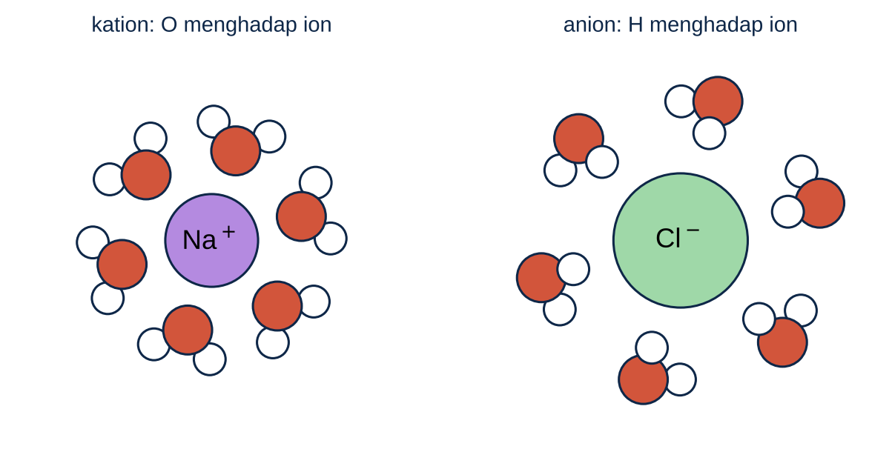
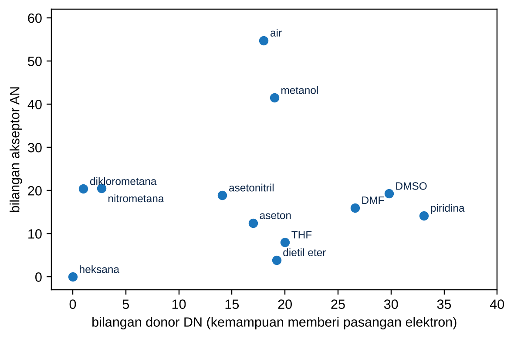
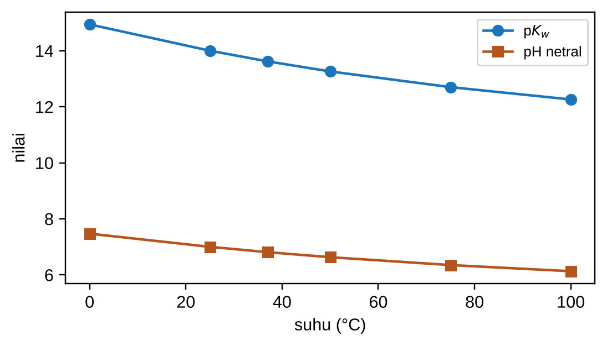

# Bab 10 Kimia dalam Pelarut Tak Berair

Masukkan sepotong kecil logam natrium ke dalam air, dan ia melesat di permukaan, mendesis, melepaskan hidrogen, kadang terbakar. Masukkan potongan natrium yang sama ke dalam amonia cair pada −33 °C, dan yang terjadi sangat berbeda: logam itu larut dengan tenang, dan cairan di sekitarnya berubah menjadi **biru tua** seperti tinta. Bila natrium terus ditambahkan, larutan itu berubah lagi menjadi cairan berkilau keemasan seperti perunggu cair, yang menghantarkan listrik hampir sebaik logam. Bila amonia diuapkan, natrium kembali sebagai logam. Apa yang sebenarnya larut? Bukan atom natrium, bukan pula ion natrium saja. Yang memberi warna biru adalah sesuatu yang tidak pernah kita temui di dalam air: **elektron bebas yang terbungkus molekul pelarut**.

Hampir semua kimia larutan yang dipelajari sejauh ini terjadi di dalam air. Air memang luar biasa: tetapan dielektriknya besar, ia melarutkan garam, ia sekaligus asam dan basa, dan ia murah serta aman. Namun air juga membatasi. Ia bereaksi dengan logam alkali, ia melevelkan asam dan basa yang sangat kuat (subbab 8.8), dan ia hanya memberi jendela redoks selebar 1,23 V (subbab 9.4). Banyak senyawa penting, misalnya logam fluorida tinggi, amida, ion nitronium, dan ion logam alkali negatif, tidak dapat ada di dalam air. Bab ini menjelajahi pelarut lain: amonia cair, hidrogen fluorida cair, asam sulfat murni, pelarut aprotik seperti BrF₃ dan N₂O₄, lelehan garam, cairan ionik, dan fluida superkritis. Kita akan melihat bahwa konsep asam–basa, kelarutan, dan redoks yang dikembangkan untuk air dapat diperluas ke pelarut mana pun, asalkan kita memahami sifat pelarut itu.

::: {.kuis}
**Pertanyaan pembuka**

1. Mengapa garam ionik larut baik dalam air tetapi hampir tidak larut dalam heksana?
2. Apa yang membuat suatu cairan menjadi pelarut yang baik untuk ion?
3. Mengapa asam asetat, asam lemah dalam air, menjadi asam kuat dalam amonia cair?
4. Mengapa asam nitrat berperilaku sebagai **basa** di dalam asam sulfat murni?
5. Apa yang memberi warna biru pada larutan natrium dalam amonia cair?
6. Bagaimana suatu garam dapat cair pada suhu kamar?
7. Bagaimana kafein dikeluarkan dari biji kopi tanpa pelarut organik beracun?
:::

::: {.tujuan}
**Tujuan belajar**

Setelah mempelajari bab ini, kamu mampu:

1. Menjelaskan proses pelarutan dan solvasi ion dengan model Born dan gambaran molekuler.
2. Menghubungkan tetapan dielektrik dengan kemampuan pelarut memisahkan ion, termasuk pembentukan pasangan ion.
3. Memakai bilangan donor dan akseptor Gutmann untuk membandingkan pelarut.
4. Menjelaskan autoionisasi air, pengaruh suhu, hidrolisis senyawa kovalen, dan pengendapan.
5. Memakai konsep sistem pelarut untuk mendefinisikan asam dan basa dalam pelarut non-air.
6. Menjelaskan kimia amonia cair, termasuk elektron tersolvasi, reduksi Birch, alkalida, dan elektrida.
7. Menjelaskan perilaku asam dan basa dalam HF cair dan asam sulfat murni, serta memakai data krioskopi.
8. Menjelaskan kimia pelarut aprotik BrF₃ dan N₂O₄.
9. Menjelaskan sifat dan penggunaan lelehan garam, cairan ionik, dan pelarut eutektik dalam.
10. Membaca diagram fasa untuk menjelaskan fluida superkritis dan penggunaannya.
:::

::: {.mat}
**Prasyarat**

Bab 6 (energi kisi, entalpi hidrasi, siklus pelarutan), Bab 8 (asam dan basa Brønsted dan Lewis, efek pelevelan, keras–lunak), Bab 9 (potensial elektrode dan jendela kestabilan air). Dari *Fisika Umum*: hukum Coulomb dan tetapan dielektrik. Dari *Termodinamika Kimia*: diagram fasa dan sifat koligatif.
:::

## 10.1 Proses pelarutan: energi kisi, hidrasi, dan solvasi ion

Dalam subbab 6.7 kita melihat neraca energi pelarutan garam: entalpi kisi yang harus dibayar untuk membongkar kristal, dan entalpi hidrasi yang diperoleh kembali ketika ion-ion dikelilingi air. Untuk NaCl, entalpi kisi 787 kJ mol⁻¹ hampir seluruhnya diimbangi oleh jumlah entalpi hidrasi Na⁺ dan Cl⁻ (−404 + (−361) = −765 kJ mol⁻¹), dan entalpi pelarutan terukur hanya +3,9 kJ mol⁻¹: selisih kecil dari dua bilangan yang sangat besar. Di sini kita bertanya lebih dalam: **mengapa** air mampu memberikan energi sebesar itu, dan apa yang terjadi bila pelarutnya bukan air?

### Gambaran molekuler solvasi

Molekul air adalah dipol: atom O membawa muatan parsial negatif, kedua atom H positif. Di sekitar kation, molekul-molekul air mengarahkan atom O ke ion; di sekitar anion, mereka mengarahkan atom H ke ion, membentuk ikatan hidrogen O–H···X⁻. Lapisan molekul yang terikat langsung disebut **kulit hidrasi pertama**. Di luar kulit itu, molekul air masih sedikit terarah, dan makin jauh, makin acak.

{width=74%}

Gambaran ini menunjukkan bahwa solvasi kation sebenarnya adalah **interaksi asam–basa Lewis**: atom O air memberikan pasangan elektronnya kepada kation. Untuk ion logam transisi bermuatan tinggi, interaksi ini begitu kuat sehingga kulit pertama berubah menjadi kompleks yang nyata, [M(H₂O)₆]^*n*+^, dengan ikatan koordinasi yang jelas (Bab 11). Laju pertukaran molekul air dalam kulit pertama memperlihatkan rentangnya: di sekitar Na⁺, satu molekul air tinggal sekitar 10⁻⁹ detik sebelum diganti; di sekitar Cr³⁺, berjam-jam sampai berhari-hari.

### Model Born

Max Born (1920) membuat model paling sederhana untuk solvasi: ion adalah bola bermuatan berjari-jari *r*, dan pelarut adalah medium kontinu dengan tetapan dielektrik ε~r~. Energi Gibbs solvasi adalah selisih energi elektrostatik bola bermuatan di dalam medium dan di dalam vakum:

$$\Delta_\text{solv} G = -\frac{N_\text{A} z^2 e^2}{8\pi\varepsilon_0 r}\left(1 - \frac{1}{\varepsilon_\text{r}}\right) \qquad \text{(10.1)}$$

Persamaan (10.1) memuat tiga pelajaran. Pertama, solvasi sebanding dengan ***z*²/*r***: ion kecil bermuatan tinggi disolvasi jauh lebih kuat, sama seperti keasaman ion aqua (subbab 8.6). Kedua, faktor (1 − 1/ε~r~) sudah mendekati 1 untuk semua pelarut dengan ε~r~ di atas sekitar 20: air (0,987), amonia cair (0,955), dan DMSO (0,979) memberikan solvasi Born yang hampir sama. Ketiga, untuk pelarut nonpolar seperti heksana (ε~r~ = 1,9), faktor itu hanya 0,47: separuh energi solvasi hilang, dan itu sudah cukup untuk membuat garam tidak larut.

::: {.contoh}
**Contoh 10.1 · Model Born untuk ion-ion dalam air**

Hitung Δ~solv~*G* untuk Li⁺, Na⁺, K⁺, Mg²⁺, dan Al³⁺ dalam air (ε~r~ = 78,4) dengan model Born. Pakai jari-jari efektif *r* = *r*~ion~ + 85 pm, dengan *r*~ion~ (pm) Li⁺ 76, Na⁺ 102, K⁺ 138, Mg²⁺ 72, Al³⁺ 53. Bandingkan dengan nilai eksperimen: −475, −365, −295, −1830, −4525 kJ mol⁻¹ (Marcus, 1991).

**Rencana.** Hitung tetapan *N*~A~*e*²/(8πε₀) = 6,95 × 10⁴ kJ mol⁻¹ pm, lalu kalikan dengan *z*²/*r* dan (1 − 1/78,4).

**Penyelesaian.** Untuk Na⁺: *r* = 187 pm; Δ~solv~*G* = −6,95 × 10⁴ × 1/187 × 0,987 = **−367 kJ mol⁻¹**. Dengan cara sama: Li⁺ **−426**, K⁺ **−308**, Mg²⁺ **−1747**, Al³⁺ **−4457** kJ mol⁻¹.

| Ion | *r* efektif (pm) | Born | Eksperimen |
|---|---|---|---|
| Li⁺ | 161 | −426 | −475 |
| Na⁺ | 187 | −367 | −365 |
| K⁺ | 223 | −308 | −295 |
| Mg²⁺ | 157 | −1747 | −1830 |
| Al³⁺ | 138 | −4457 | −4525 |

**Memahami hasil.** Model yang memperlakukan air sebagai cairan kontinu tanpa molekul ternyata memberikan hasil dalam beberapa persen untuk ion besar, dan menangkap kenaikan sangat tajam dengan muatan: Al³⁺ disolvasi dua belas kali lebih kuat daripada Na⁺. Mengapa jari-jarinya perlu ditambah 85 pm? Karena muatan ion tidak "melihat" air sebagai medium kontinu sampai ke permukaannya; ada lapisan molekul air pertama yang terarah penuh (dielektriknya jenuh) dan rongga kecil di antara ion dan pusat muatan molekul air. Penambahan itu adalah koreksi empiris yang dikemukakan Latimer, Pitzer, dan Slansky (1939). Untuk ion kecil seperti Li⁺, model meleset lebih jauh, karena di sini ikatan koordinasi dengan molekul air pertama, yang tidak dikenal model Born, menjadi penting.
:::

### Entropi: harga keteraturan

Solvasi tidak hanya melepaskan entalpi; ia juga **menata** molekul pelarut. Molekul air dalam kulit hidrasi kehilangan kebebasannya, sehingga entropi hidrasi ion kecil bermuatan tinggi sangat negatif. Untuk Al³⁺, entropi hidrasinya sekitar −500 J K⁻¹ mol⁻¹, setara dengan "membekukan" belasan molekul air. Itulah sebabnya kelarutan garam ion kecil bermuatan tinggi seperti MgF₂, AlPO₄, dan CaCO₃ sering lebih kecil daripada yang diramalkan dari entalpi saja, dan sebabnya beberapa garam (misalnya Li₂CO₃ dan Ca(OH)₂) **kurang larut** dalam air panas daripada dalam air dingin: pada suhu tinggi, suku −*T*Δ*S* yang positif makin berat.

### Tetapan dielektrik dan pasangan ion

Mengapa garam tidak larut dalam pelarut berdielektrik rendah? Bahkan bila ion-ion berhasil dilepas dari kristal, mereka akan saling menarik kembali. Gaya Coulomb antara dua ion di dalam medium berkurang dengan faktor ε~r~:

$$E_\text{pasangan} = -\frac{N_\text{A} |z_+ z_-| e^2}{4\pi\varepsilon_0 \varepsilon_\text{r}\, d} \qquad \text{(10.2)}$$

{width=84%}

::: {.contoh}
**Contoh 10.2 · Mengapa garam tidak larut dalam heksana**

Hitung energi tarik pasangan Na⁺Cl⁻ yang bersentuhan (*d* = 282 pm) dalam vakum, heksana (ε~r~ = 1,9), THF (7,6), amonia cair (22,4), dan air (78,4). Bandingkan dengan energi termal *RT* = 2,48 kJ mol⁻¹ pada 298 K.

**Penyelesaian.** Dalam vakum: *E* = 2 × 6,95 × 10⁴/282 = **493 kJ mol⁻¹**. Dibagi ε~r~: heksana **259**, THF **65**, NH₃ **22**, air **6,3** kJ mol⁻¹.

**Memahami hasil.** Dalam air, energi yang mengikat pasangan ion hanya sekitar 2,5 kali *RT*, sehingga tumbukan termal dengan mudah memisahkannya: ion-ion bergerak bebas. Dalam heksana, energinya seratus kali *RT*: ion-ion tidak pernah terpisah, dan garam tetap sebagai kristal atau sebagai pasangan ion netral. Dalam THF dan amonia cair, situasinya di tengah: garam dapat larut, tetapi sebagian besar sebagai **pasangan ion** (ion yang bersentuhan atau dipisahkan oleh satu molekul pelarut), bukan ion bebas. Bjerrum (1926) menghitung bahwa ion bermuatan tunggal dianggap berpasangan bila jaraknya kurang dari *q* = *e*²/(8πε₀ε~r~*kT*): dalam air *q* = 357 pm (hanya ion yang bersentuhan), dalam amonia cair 1554 pm, dalam THF 3687 pm. Pembentukan pasangan ion menjelaskan mengapa konduktivitas larutan garam dalam pelarut organik jauh lebih kecil daripada dalam air, dan mengapa kimiawan organik logam sangat peduli pada pelarut: reaktivitas BuLi dalam heksana (berupa agregat) sangat berbeda dengan dalam THF.
:::

::: {.awas}
**Awas: dielektrik tinggi saja tidak cukup.** Tetapan dielektrik mengukur kemampuan pelarut **memisahkan** ion yang sudah ada, tetapi tidak menjamin pelarut itu dapat **membongkar** kristal. Untuk itu pelarut harus menyolvasi kation (sebagai basa Lewis) dan anion (sebagai asam Lewis, biasanya lewat ikatan hidrogen). Asetonitril (ε~r~ = 37,5) dan DMSO (46,7) melarutkan banyak garam, tetapi melarutkan NaCl hanya sedikit, karena keduanya menyolvasi Cl⁻ dengan buruk. Subbab 10.2 memberi ukuran terpisah untuk kedua kemampuan itu.
:::

::: {.kuis}
**Kuis cepat 10.1** Dengan model Born, mengapa Δ~solv~*G* Na⁺ dalam amonia cair (ε~r~ = 22,4) hampir sama dengan dalam air? Hitung rasionya.
:::

## 10.2 Sifat pelarut: tetapan dielektrik, bilangan donor, dan akseptor

Pelarut dapat digolongkan menurut beberapa sifat yang saling melengkapi:

* **Protik** atau **aprotik**: apakah pelarut mempunyai atom H yang dapat dilepas sebagai proton (air, alkohol, NH₃, HF, H₂SO₄) atau tidak (asetonitril, DMSO, THF, BrF₃, N₂O₄).
* **Polaritas**, diukur kasar dengan tetapan dielektrik ε~r~ dan momen dipol.
* **Kemampuan donor**: seberapa kuat pelarut memberikan pasangan elektron, yaitu menyolvasi kation dan asam Lewis.
* **Kemampuan akseptor**: seberapa kuat pelarut menerima pasangan elektron, yaitu menyolvasi anion dan basa Lewis.
* **Rentang cair** dan **jendela elektrokimia**: suhu dan potensial yang dapat dipakai.

Tabel 10.1 Sifat beberapa pelarut. Titik leleh dan didih pada 1 atm; ε~r~ pada 25 °C kecuali disebut lain.

| Pelarut | Titik leleh (°C) | Titik didih (°C) | ε~r~ | DN | AN | Jenis |
|---|---|---|---|---|---|---|
| Air, H₂O | 0 | 100 | 78,4 | 18,0 | 54,8 | protik |
| Amonia, NH₃ | −77,7 | −33,4 | 22,4 (−33 °C) | 59 | — | protik |
| Hidrogen fluorida, HF | −83,6 | 19,5 | 84 (0 °C) | — | — | protik |
| Asam sulfat, H₂SO₄ | 10,4 | ≈ 337 (terurai) | ≈ 100 | — | — | protik |
| Metanol | −98 | 65 | 32,7 | 19,0 | 41,5 | protik |
| Asetonitril, MeCN | −45 | 82 | 37,5 | 14,1 | 18,9 | aprotik |
| DMSO | 18,5 | 189 | 46,7 | 29,8 | 19,3 | aprotik |
| DMF | −61 | 153 | 36,7 | 26,6 | 16,0 | aprotik |
| THF | −108 | 66 | 7,6 | 20,0 | 8,0 | aprotik |
| Diklorometana | −97 | 40 | 8,9 | 1,0 | 20,4 | aprotik |
| Bromin trifluorida, BrF₃ | 8,8 | 125,8 | ≈ 107 | — | — | aprotik |
| Dinitrogen tetroksida, N₂O₄ | −11,2 | 21,2 | 2,4 | — | — | aprotik |
| Heksana | −95 | 69 | 1,9 | 0 | 0 | aprotik |

### Bilangan donor dan akseptor Gutmann

Viktor Gutmann (1966) mengusulkan dua skala empiris. **Bilangan donor** (DN) adalah −Δ*H* (dalam kkal mol⁻¹) reaksi pelarut dengan asam Lewis baku SbCl₅ dalam larutan encer 1,2-dikloroetana:

$$\text{S} + \text{SbCl}_5 \rightarrow \text{S–SbCl}_5 \qquad \text{DN} = -\Delta H\ (\text{kkal mol}^{-1})$$

**Bilangan akseptor** (AN) diukur dari pergeseran kimia ³¹P NMR trietilfosfina oksida, Et₃P=O, yang dilarutkan dalam pelarut. Atom O pada Et₃PO adalah basa Lewis; makin kuat pelarut menariknya, makin besar pergeseran sinyal P. Skalanya ditetapkan nol untuk heksana dan 100 untuk aduk Et₃PO–SbCl₅.

{width=72%}

Gambar 10.3 menjelaskan banyak pengamatan praktis:

1. **Air** adalah akseptor yang sangat kuat (AN 54,8, karena ikatan hidrogen) sekaligus donor sedang. Ia menyolvasi kation dan anion sama baiknya: pelarut garam yang hampir sempurna.
2. **DMSO, DMF, dan piridina** adalah donor kuat tetapi akseptor lemah. Mereka menyolvasi kation dengan baik dan membiarkan anion "telanjang". Anion yang tidak tersolvasi sangat reaktif: reaksi substitusi nukleofil dengan F⁻ atau CN⁻ berjalan ribuan sampai jutaan kali lebih cepat dalam DMSO daripada dalam metanol.
3. **Asetonitril** donor dan akseptor sedang, dengan jendela elektrokimia lebar (sekitar −2,8 sampai +2,5 V terhadap SHE dengan elektrolit yang sesuai): pelarut baku untuk elektrokimia nonair.
4. **Diklorometana dan nitrometana** donor sangat lemah: dipakai ketika kita ingin kation yang sangat elektrofilik tetap tidak tersolvasi.

::: {.contoh}
**Contoh 10.3 · Memilih pelarut untuk asam Lewis**

Kimiawan ingin mereaksikan kation sangat elektrofilik, misalnya ion silil R₃Si⁺, yang harus dibuat dari prekursor dalam suatu pelarut. Ia mempertimbangkan air, asetonitril, DMSO, dan diklorometana. Pakai DN untuk menilai masing-masing; nyatakan dalam kJ mol⁻¹.

**Penyelesaian.** DN dikali 4,184: DMSO **125**, air **75**, asetonitril **59**, diklorometana **sekitar 4** kJ mol⁻¹. Air langsung bereaksi (hidrolisis Si⁺ menjadi silanol). DMSO dan asetonitril mengikat kation itu sebagai aduk, R₃Si–OSMe₂⁺ dan R₃Si–NCMe⁺, sehingga elektrofilisitasnya hilang. Hanya pelarut dengan DN sangat kecil seperti diklorometana, atau lebih baik lagi benzena terhalogenasi, yang memberi peluang kation tetap "bebas".

**Memahami hasil.** Bilangan donor mengukur kekuatan pelarut sebagai **basa Lewis** (Bab 8). Pelarut yang sangat baik untuk melarutkan kation adalah pelarut yang paling buruk untuk mempertahankan reaktivitasnya. Dalam praktik, kation yang sangat elektrofilik hanya dapat diisolasi bersama anion yang sangat lemah koordinasinya (seperti karborana atau [B(C₆F₅)₄]⁻) dalam pelarut ber-DN rendah.
:::

::: {.dalam}
**Skala lain: Kamlet–Taft.** Selain skala Gutmann, kimiawan organik memakai tiga parameter Kamlet–Taft yang diukur dari pergeseran spektrum UV–tampak zat warna: α (keasaman ikatan hidrogen), β (kebasaan ikatan hidrogen), dan π* (polaritas/polarisabilitas). β berhubungan erat dengan DN dan α dengan AN. Semua skala ini lahir dari kenyataan bahwa satu bilangan (ε~r~ atau momen dipol) tidak cukup untuk menggambarkan pelarut; minimal diperlukan dua: kemampuan menyumbangkan dan menerima elektron.
:::

::: {.kuis}
**Kuis cepat 10.2** Natrium sianida hampir tidak larut dalam THF tetapi cukup larut dalam DMSO. Ion CN⁻ dalam DMSO jauh lebih nukleofilik daripada dalam metanol. Jelaskan kedua pengamatan ini dengan DN dan AN.
:::

## 10.3 Reaksi dalam air: autoionisasi, hidrolisis, dan pengendapan

Sebelum meninggalkan air, kita merangkum tiga jenis reaksi yang menjadi pola untuk semua pelarut lain.

### Autoionisasi

Air murni menghantarkan listrik sedikit karena **autoionisasi** (atau autoprotolisis):

$$2\text{H}_2\text{O} \rightleftharpoons \text{H}_3\text{O}^+ + \text{OH}^- \qquad K_w = [\text{H}_3\text{O}^+][\text{OH}^-] = 1{,}0 \times 10^{-14}\ \text{(25 °C)}$$

Satu molekul air memberikan proton kepada molekul air lain: pelarut itu sekaligus asam dan basa. Kation yang terbentuk (H₃O⁺) adalah asam terkuat yang dapat ada di dalam air, dan anionnya (OH⁻) basa terkuat. Asam yang lebih kuat daripada H₃O⁺ atau basa yang lebih kuat daripada OH⁻ dilevelkan (subbab 8.8).

Autoionisasi bersifat endoterm, sehingga *K*~w~ naik dengan suhu.

{width=66%}

::: {.contoh}
**Contoh 10.4 · Air mendidih yang "asam"?**

p*K*~w~ air adalah 14,94 pada 0 °C, 14,00 pada 25 °C, dan 12,26 pada 100 °C. (a) Berapa pH air murni pada ketiga suhu itu? (b) Apakah air mendidih bersifat asam? (c) Perkirakan Δ*H*° autoionisasi dari data 25 °C dan 100 °C.

**Penyelesaian.** (a) Dalam air murni [H₃O⁺] = [OH⁻], jadi pH = p*K*~w~/2: **7,47** pada 0 °C, **7,00** pada 25 °C, **6,13** pada 100 °C.

(b) **Tidak.** Air murni selalu netral, karena [H₃O⁺] = [OH⁻] pada suhu berapa pun. Yang berubah adalah letak titik netral pada skala pH.

(c) Dengan persamaan van 't Hoff, ln(*K*~2~/*K*~1~) = −(Δ*H*°/*R*)(1/*T*~2~ − 1/*T*~1~): ln 10^1,74^ = 4,01 = (Δ*H*°/8,314)(1/298,15 − 1/373,15), sehingga Δ*H*° ≈ **49 kJ mol⁻¹** (rata-rata antara 25 dan 100 °C). Dari data 0 dan 25 °C diperoleh 59 kJ mol⁻¹; nilai baku pada 25 °C adalah 55,8 kJ mol⁻¹. Entalpi autoionisasi sendiri berkurang dengan suhu.

**Memahami hasil.** Pengukur pH yang dikalibrasi pada 25 °C akan menunjukkan angka di bawah 7 untuk air netral yang panas; itu bukan tanda keasaman. Darah (pH 7,4 pada 37 °C) sedikit lebih basa daripada netral pada suhu tubuh (6,81), sedikit lebih jauh daripada yang terkesan dari angka 7. Entalpi autoionisasi yang cukup besar adalah energi yang dibutuhkan untuk memisahkan dua ion berlawanan dari satu sama lain; kebalikannya, netralisasi H₃O⁺ + OH⁻, melepaskan sekitar 56 kJ mol⁻¹, panas netralisasi asam kuat dengan basa kuat yang dikenal dari kimia dasar.
:::

### Hidrolisis senyawa kovalen

Subbab 8.6 membahas hidrolisis **kation**: ion aqua bermuatan tinggi melepas proton. Banyak senyawa kovalen juga bereaksi dengan air, dan polanya mengikuti pertanyaan sederhana: **adakah jalan bagi molekul air untuk menyerang?**

* SiCl₄ berasap di udara lembap dan bereaksi hebat dengan air: SiCl₄ + 2H₂O → SiO₂ + 4HCl. Atom Si mempunyai orbital kosong yang dapat menerima pasangan elektron O air (membentuk zat antara bervalensi lima), dan ikatan Si–O jauh lebih kuat daripada Si–Cl.
* CCl₄ tidak bereaksi dengan air sama sekali dalam kondisi biasa, walaupun reaksi CCl₄ + 2H₂O → CO₂ + 4HCl sangat eksergonik (Δ*G*° sekitar −380 kJ mol⁻¹). Atom C yang kecil sudah dikelilingi rapat oleh empat Cl dan tidak mempunyai orbital kosong yang rendah: tidak ada jalan masuk. CCl₄ **stabil secara kinetik**.
* BCl₃ dan PCl₃ terhidrolisis cepat (B mempunyai orbital p kosong; P mempunyai pasangan bebas dan dapat diserang); SF₆ sangat inert (S terlindung enam F), sedangkan SF₄ terhidrolisis cepat.
* NCl₃ terhidrolisis menjadi NH₃ dan HOCl, bukan HNO₂ dan HCl: atom Cl, bukan N, yang menjadi tempat serangan karena Cl lebih elektropositif daripada yang diperkirakan dalam ikatan N–Cl.

Pola ini, **termodinamika menunjukkan apa yang mungkin, kinetika menentukan apa yang terjadi**, akan berulang dalam kimia golongan utama (Kimia Anorganik 2).

### Pengendapan

Pengendapan adalah kebalikan pelarutan. Garam MX mengendap bila hasil kali konsentrasi ionnya melebihi tetapan hasil kali kelarutan *K*~sp~. Kelarutan bergantung pada keseimbangan energi kisi dan hidrasi (subbab 6.7) serta pada cocoknya kekerasan ion (subbab 8.11): ion keras dengan ion keras (CaF₂, BaSO₄, Mg(OH)₂) dan ion lunak dengan ion lunak (AgI, HgS, PbS) membentuk endapan yang sangat sukar larut.

::: {.contoh}
**Contoh 10.5 · Efek ion senama dan pengendapan selektif**

(a) Hitung kelarutan AgCl (*K*~sp~ = 1,8 × 10⁻¹⁰) dalam air murni dan dalam NaCl 0,10 mol L⁻¹. (b) Larutan mengandung Cl⁻ dan I⁻ masing-masing 0,010 mol L⁻¹. AgNO₃ ditambahkan perlahan. Ion mana yang mengendap lebih dulu, dan berapa [I⁻] yang tersisa ketika AgCl mulai mengendap? (*K*~sp~ AgI = 8,5 × 10⁻¹⁷.)

**Penyelesaian.** (a) Dalam air: *s* = √(1,8 × 10⁻¹⁰) = **1,3 × 10⁻⁵ mol L⁻¹**. Dalam NaCl 0,10 mol L⁻¹: *s* = 1,8 × 10⁻¹⁰/0,10 = **1,8 × 10⁻⁹ mol L⁻¹**, sekitar 7000 kali lebih kecil.

(b) AgI mengendap ketika [Ag⁺] > 8,5 × 10⁻¹⁷/0,010 = 8,5 × 10⁻¹⁵; AgCl ketika [Ag⁺] > 1,8 × 10⁻¹⁰/0,010 = 1,8 × 10⁻⁸ mol L⁻¹. AgI **lebih dulu**. Ketika AgCl mulai mengendap, [I⁻] = 8,5 × 10⁻¹⁷/1,8 × 10⁻⁸ = **4,7 × 10⁻⁹ mol L⁻¹**, kurang dari satu per sejuta konsentrasi awalnya.

**Memahami hasil.** Perbedaan *K*~sp~ yang besar memungkinkan pemisahan ion yang hampir sempurna. Ini dasar titrasi argentometri (metode Mohr dan Fajans) dan analisis kualitatif klasik, yang memisahkan kation dalam kelompok-kelompok menurut kelarutan klorida, sulfida, dan hidroksidanya. Ingat bahwa semua angka ini berlaku **di dalam air**. Dalam pelarut lain, urutan kelarutan dapat berbalik sama sekali, seperti yang akan kita lihat dalam amonia cair.
:::

::: {.kuis}
**Kuis cepat 10.3** (a) Pada suhu berapa pun, mengapa air murni tetap netral walaupun pH-nya bukan 7? (b) Mengapa SiCl₄ berasap di udara lembap tetapi CCl₄ tidak?
:::
