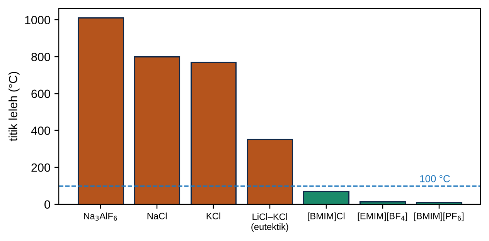
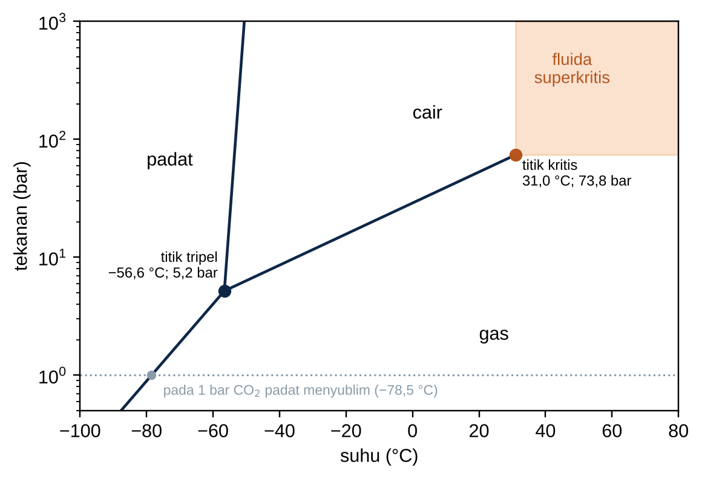

## 10.8 Lelehan garam dan cairan ionik

### Lelehan garam

Pelarut yang paling ekstrem adalah pelarut yang **seluruhnya terdiri atas ion**. Garam yang dilelehkan menghantarkan listrik dengan baik, melarutkan oksida dan logam lain, dan mempunyai jendela elektrokimia yang sangat lebar karena tidak ada air yang dapat direduksi atau dioksidasi. Sisi buruknya: suhunya tinggi. NaCl meleleh pada 801 °C, kriolit (Na₃AlF₆) pada 1012 °C.

Titik leleh dapat diturunkan banyak dengan **campuran eutektik**. Campuran LiCl–KCl (sekitar 59 : 41 mol) meleleh pada 352 °C, jauh di bawah titik leleh kedua komponennya (LiCl 605 °C, KCl 770 °C). Campuran NaCl–CaCl₂ meleleh pada sekitar 600 °C. Campuran NaNO₃–KNO₃ (60 : 40 massa), yang disebut "garam surya", meleleh pada sekitar 220 °C.

Lelehan garam adalah pelarut industri yang sangat penting:

* **Aluminium** diproduksi dengan elektrolisis Al₂O₃ yang dilarutkan (2–8 %) dalam lelehan kriolit pada sekitar 960 °C (proses Hall–Héroult, subbab 9.9). Kriolit melarutkan alumina dengan memecahnya menjadi ion oksofluoroaluminat; tanpa pelarut ini, Al₂O₃ meleleh baru pada 2072 °C.
* **Natrium** diproduksi dengan elektrolisis lelehan NaCl–CaCl₂ (sel Downs), dan **litium** dari LiCl–KCl. Logam yang terlalu reaktif untuk dielektrolisis dari air (subbab 9.4) dibuat dari lelehan garam.
* **Penyimpanan panas** di pembangkit listrik tenaga surya terpusat: garam nitrat dipanaskan sinar matahari sampai sekitar 565 °C, disimpan dalam tangki, dan dipakai membangkitkan uap pada malam hari.
* **Reaktor garam lelehan**, di mana bahan bakar uranium atau torium dilarutkan langsung dalam lelehan fluorida (misalnya LiF–BeF₂), yang dioperasikan secara eksperimen di Oak Ridge pada 1960-an dan kini sedang dikembangkan kembali.

Dalam lelehan garam, kimia asam–basa sering mengikuti konsep **Lux–Flood** (subbab 8.2): asam adalah akseptor ion oksida, basa adalah donornya. SiO₂ adalah asam (SiO₂ + O²⁻ → SiO₃²⁻) dan CaO adalah basa. Prinsip ini dipakai di tanur tinggi: batu kapur ditambahkan agar CaO mengikat SiO₂ pengotor bijih menjadi **terak** kalsium silikat yang cair dan mudah dipisahkan dari besi cair.

### Cairan ionik

Bila garam dapat cair pada 352 °C dengan mencampur dua kation, dapatkah garam cair pada suhu kamar? Jawabannya ya, bila kation dan anionnya dibuat **besar, tidak simetris, dan bermuatan tersebar**. Garam seperti ini disebut **cairan ionik**, yang didefinisikan sebagai garam yang meleleh di bawah 100 °C.

Contoh pertama ditemukan Paul Walden pada 1914: etilamonium nitrat, [EtNH₃][NO₃], yang meleleh pada 12 °C. Generasi modern berbasis kation imidazolium, misalnya 1-etil-3-metilimidazolium [EMIM]⁺ dan 1-butil-3-metilimidazolium [BMIM]⁺, dengan anion seperti Cl⁻, BF₄⁻, PF₆⁻, atau bis(trifluorometilsulfonil)imida [NTf₂]⁻.

{width=84%}

::: {.contoh}
**Contoh 10.9 · Mengapa cairan ionik cair**

Perkirakan energi kisi NaCl dan [BMIM][BF₄] dengan persamaan Kapustinskii (persamaan (6.5), subbab 6.4), dengan jari-jari dalam pm. Pakai *r*(Na⁺) = 102, *r*(Cl⁻) = 181, jari-jari termokimia efektif [BMIM]⁺ sekitar 330 dan BF₄⁻ 232 pm.

**Penyelesaian.** NaCl: *r*₊ + *r*₋ = 283 pm; |*U*| = 1,2025 × 10⁵ × 2/283 × (1 − 0,122) = **746 kJ mol⁻¹**. [BMIM][BF₄]: *r*₊ + *r*₋ = 562 pm; |*U*| = 1,2025 × 10⁵ × 2/562 × (1 − 0,061) = **402 kJ mol⁻¹**, sekitar 54 % energi kisi NaCl.

**Memahami hasil.** Ion yang dua kali lebih besar hanya menurunkan energi kisi separuhnya, tetapi itu belum menjelaskan penurunan titik leleh dari 801 °C ke bawah 0 °C. Faktor kedua dan yang lebih penting adalah **bentuk**: kation imidazolium tidak simetris dan mempunyai rantai alkil yang lentur. Ion-ion seperti itu sukar tersusun rapi dalam kisi kristal, sehingga entalpi pelelehan kecil dan entropi pelelehan besar (cairan mempunyai banyak konformasi yang tersedia). Kedua faktor bersama-sama menurunkan *T*~leleh~ = Δ~leleh~*H*/Δ~leleh~*S*. Mengganti rantai butil dengan metil (kation simetris [MMIM]⁺) menaikkan titik leleh banyak sekali: simetri adalah musuh cairan ionik.
:::

Cairan ionik mempunyai kombinasi sifat yang tidak dimiliki pelarut molekular:

* **Tekanan uap hampir nol**: ion-ion tidak menguap pada suhu biasa, sehingga tidak ada uap pelarut yang mencemari udara atau mudah terbakar.
* **Jendela elektrokimia lebar**, sampai 4–6 V, sehingga dipakai sebagai elektrolit untuk elektrodeposisi logam reaktif (Al, Ti) dan sebagai elektrolit baterai dan superkapasitor yang tidak mudah terbakar.
* **Dapat dirancang**: dengan memilih kation dan anion, sifat seperti kelarutan dalam air, viskositas, dan keasaman dapat diatur. Kombinasi yang mungkin diperkirakan lebih dari sejuta, sehingga cairan ionik disebut "pelarut rancangan".
* **Melarutkan zat yang sukar larut**: [BMIM]Cl melarutkan selulosa (Rogers, 2002), yang hampir tidak larut dalam air dan pelarut organik biasa, karena ion Cl⁻ yang tidak tersolvasi memutus ikatan hidrogen antar-rantai selulosa.

::: {.awas}
**Awas: "hijau" tidak berarti aman.** Cairan ionik sering disebut pelarut hijau karena tidak menguap. Namun beberapa beracun bagi organisme air dan sukar terurai di alam, sintesisnya memakai pelarut organik, dan anion PF₆⁻ terhidrolisis perlahan dalam air lembap menghasilkan HF. Penilaian ramah lingkungan harus mencakup seluruh daur hidup, bukan hanya tekanan uapnya.
:::

**Pelarut eutektik dalam** adalah kerabat murah cairan ionik. Campuran kolin klorida dan urea dengan nisbah 1 : 2 meleleh pada sekitar 12 °C (Abbott, 2003), padahal masing-masing meleleh di atas 130 °C. Ikatan hidrogen antara urea dan ion Cl⁻ mengacaukan kisi kedua komponen. Bahannya murah, mudah terurai di alam, dan dipakai untuk elektroplating, ekstraksi logam dari limbah elektronik, dan pelarutan biomassa.

::: {.kuis}
**Kuis cepat 10.8** Mengapa natrium tidak dapat diproduksi dengan elektrolisis larutan NaCl dalam air, tetapi dapat dari lelehan NaCl–CaCl₂? Apa fungsi CaCl₂?
:::

## 10.9 Fluida superkritis

Setiap zat mempunyai **titik kritis**: suhu dan tekanan di atasnya perbedaan antara cair dan gas lenyap. Di bawah suhu kritis *T*~c~, gas dapat dicairkan dengan menaikkan tekanan, dan terlihat bidang batas yang jelas antara cairan dan uapnya. Di atas *T*~c~ dan tekanan kritis *p*~c~, berapa pun tekanannya, tidak ada pencairan: zat itu menjadi **fluida superkritis**, yang mengisi wadah seperti gas tetapi dapat mempunyai massa jenis seperti cairan.

{width=72%}

Karbon dioksida adalah fluida superkritis yang paling banyak dipakai, karena titik kritisnya mudah dicapai (31,0 °C, 73,8 bar), dan ia murah, tidak beracun, tidak mudah terbakar, dan mudah dihilangkan: cukup turunkan tekanan, dan CO₂ menguap tanpa sisa. Air juga mempunyai titik kritis, tetapi jauh lebih tinggi (374 °C, 221 bar).

Keunggulan utama fluida superkritis adalah bahwa **daya larutnya dapat diatur dengan tekanan**. Di dekat titik kritis, perubahan tekanan yang kecil mengubah massa jenis secara besar, dan daya larut mengikuti massa jenis. Pada saat yang sama, viskositasnya rendah dan difusivitasnya tinggi seperti gas, sehingga ia menembus bahan berpori dengan cepat.

::: {.contoh}
**Contoh 10.10 · CO₂ superkritis jauh dari gas ideal**

Massa jenis CO₂ superkritis pada 40 °C dan 100 bar sekitar 0,63 g mL⁻¹. Hitung massa jenis yang diramalkan persamaan gas ideal pada kondisi yang sama, dan bandingkan.

**Penyelesaian.** ρ = *pM*/(*RT*) = (100 × 10⁵ Pa)(0,04401 kg mol⁻¹)/(8,314 × 313,15) = **169 kg m⁻³ = 0,169 g mL⁻¹**. Massa jenis nyata 0,63 g mL⁻¹, hampir **empat kali** ramalan gas ideal.

**Memahami hasil.** Di dekat titik kritis, tarikan antarmolekul membuat molekul-molekul berkumpul sampai rapat seperti cairan (CO₂ cair pada 20 °C mempunyai massa jenis 0,77 g mL⁻¹), walaupun tidak ada batas fasa. Massa jenis yang tinggi itulah yang memberi daya larut seperti cairan. CO₂ superkritis berperilaku kira-kira seperti heksana: pelarut nonpolar yang baik untuk molekul organik kecil, minyak, dan lemak, tetapi buruk untuk garam. Dengan menurunkan tekanan dari 100 ke 80 bar pada 40 °C, massa jenisnya turun tajam, dan zat yang terlarut mengendap: ekstraksi dan pemisahan dalam satu alat.
:::

::: {.terapan}
**Kopi tanpa kafein.** Kurt Zosel di Max-Planck-Institut für Kohlenforschung mematenkan dekafeinasi dengan CO₂ superkritis pada awal 1970-an, dan pabrik komersial pertama beroperasi di Jerman pada 1978. Biji kopi hijau yang dibasahi diekstraksi dengan CO₂ superkritis pada sekitar 200–300 bar; kafein larut, sedangkan sebagian besar senyawa rasa yang lebih besar tetap di dalam biji. Kafein diambil dari CO₂ dengan air atau karbon aktif, dan CO₂ didaur ulang. Teknik yang sama dipakai untuk mengekstraksi hop untuk bir, minyak atsiri, dan rempah, serta untuk binatu kering tanpa pelarut terklorinasi.
:::

**Air superkritis** sangat berbeda dengan air biasa. Di atas 374 °C dan 221 bar, ikatan hidrogennya sebagian besar putus, dan tetapan dielektriknya turun dari 78 menjadi hanya sekitar 2–10 tergantung massa jenisnya. Akibatnya air superkritis melarutkan zat organik nonpolar dan oksigen dengan sempurna, sedangkan garam justru mengendap. Sifat ini dipakai dalam **oksidasi air superkritis** untuk menghancurkan limbah berbahaya (misalnya senjata kimia dan limbah PCB): zat organik dan O₂ bercampur dalam satu fasa dan teroksidasi sempurna menjadi CO₂ dan air dalam hitungan detik. Pada kondisi sedikit di bawah kritis, air panas bertekanan dipakai dalam **sintesis hidrotermal** kristal kuarsa untuk osilator jam dan zeolit (subbab 8.14): proses yang meniru pembentukan mineral di dalam kerak bumi.

::: {.kuis}
**Kuis cepat 10.9** (a) Mengapa CO₂ padat menyublim pada tekanan atmosfer, sedangkan es air meleleh? Pakai Gambar 10.7. (b) Mengapa CO₂ superkritis tidak cocok untuk mengekstraksi garam anorganik?
:::

## Menuju bab berikutnya

Natrium dalam amonia cair menghasilkan larutan biru karena elektron yang lepas dari atom natrium tidak diterima oleh molekul mana pun, melainkan terperangkap dalam rongga yang dikelilingi molekul amonia. Air tidak dapat menampung elektron seperti itu, karena ia segera mereduksi air menjadi hidrogen. Pelajaran umum bab ini: sifat asam–basa, kelarutan, dan redoks suatu zat bukan miliknya sendiri, melainkan milik **zat bersama pelarutnya**. Tetapan dielektrik menentukan apakah ion-ion dapat terpisah, bilangan donor dan akseptor menentukan seberapa kuat kation dan anion disolvasi, dan autoionisasi pelarut menentukan apa yang disebut asam dan basa.

Sepanjang bab ini, solvasi kation tampil sebagai interaksi asam–basa Lewis: molekul air atau amonia memberikan pasangan elektron kepada ion logam. Untuk ion logam transisi, interaksi itu bukan sekadar "kulit pelarut" yang berganti setiap nanodetik. [Cr(H₂O)₆]³⁺ mempertahankan air-airnya berhari-hari, [Cu(NH₃)₄]²⁺ berwarna biru tua yang berbeda dari Cu²⁺ dalam air, dan [Ag(NH₃)₂]⁺ melarutkan AgCl. Molekul pelarut telah berubah menjadi **ligan**, dan ion logam beserta ligannya menjadi **senyawa koordinasi**. Bab 11 mempelajari dunia senyawa koordinasi: struktur, isomer, nama, dan ikatannya, mulai dari teori Werner sampai teori medan kristal yang menjelaskan warna dan magnetismenya.
