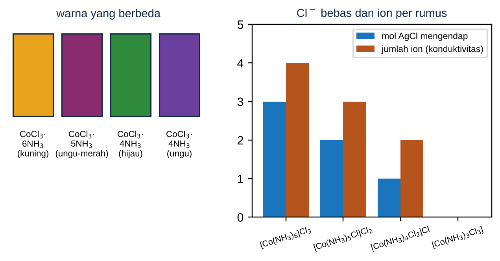
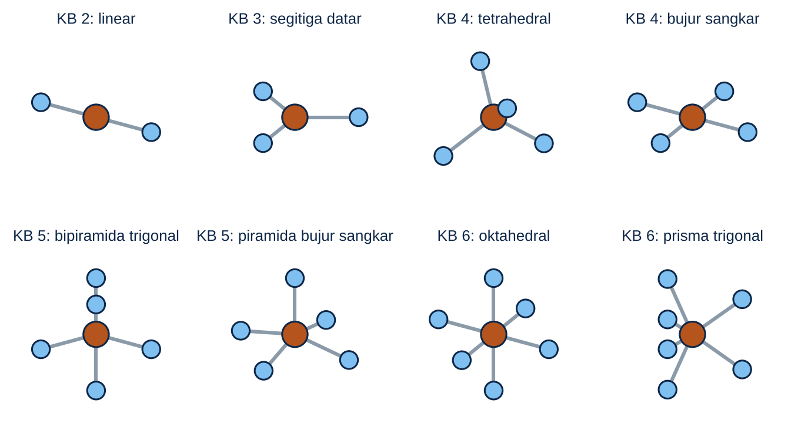
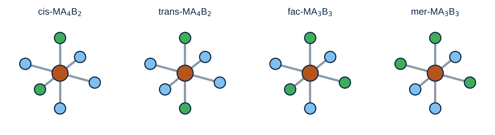
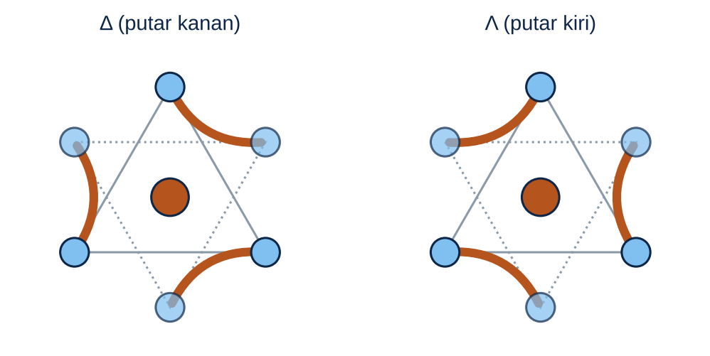

# Bab 11 Pengantar Senyawa Koordinasi

Pada akhir abad ke-19, kimiawan mengenal empat senyawa yang semuanya mengandung kobalt, klor, dan amonia, tetapi warnanya berbeda-beda. Satu berwarna kuning, satu ungu kemerahan, satu hijau, dan satu lagi ungu. Rumus empirisnya CoCl₃·6NH₃, CoCl₃·5NH₃, dan dua senyawa CoCl₃·4NH₃ yang rumusnya sama persis tetapi warnanya berbeda. Bila larutan masing-masing ditambah perak nitrat, senyawa kuning mengendapkan ketiga ion kloridanya sebagai AgCl dengan segera, senyawa ungu kemerahan hanya dua, dan kedua senyawa hijau dan ungu hanya satu. Bagaimana mungkin sebagian klor "terkunci" sehingga tidak bereaksi dengan perak? Mengapa amonia, yang biasanya mudah lepas dari garamnya ketika dipanaskan, tetap terikat erat walaupun senyawanya dididihkan dengan asam? Dan bagaimana dua zat dengan rumus yang sama dapat berbeda warna?

Jawabannya, yang diberikan Alfred Werner pada 1893, melahirkan cabang kimia anorganik yang paling luas: **kimia koordinasi**. Ion logam di pusat dikelilingi sejumlah tertentu molekul atau ion yang terikat langsung kepadanya, membentuk satuan yang utuh dengan bentuk ruang yang pasti. Bab ini memperkenalkan dasar-dasarnya: teori Werner dan buktinya, ligan dan kelat, tata nama, bilangan koordinasi dan geometri, isomer, lalu dua teori ikatan yang menjelaskan magnetisme dan warna kompleks: teori ikatan valensi dan teori medan kristal. Bab ditutup dengan aturan 18 elektron untuk kompleks karbonil dan dengan kestabilan kompleks, termasuk efek kelat yang menjelaskan mengapa EDTA mengikat logam begitu kuat. Bab ini adalah pengantar; teori medan ligan, spektrum elektronik, dan mekanisme reaksi kompleks dibahas di *Kimia Anorganik 2: Kimia Koordinasi*.

::: {.kuis}
**Pertanyaan pembuka**

1. Mengapa sebagian ion klorida dalam senyawa kobalt–amonia tidak dapat diendapkan oleh ion perak?
2. Bagaimana Werner membuktikan bahwa enam ligan di sekitar kobalt tersusun sebagai oktahedron, bertahun-tahun sebelum kristalografi sinar-X?
3. Mengapa sisplatin, *cis*-[PtCl₂(NH₃)₂], adalah obat kanker yang ampuh, sedangkan isomer *trans*-nya tidak?
4. Mengapa sebagian besar kompleks logam transisi berwarna, sedangkan senyawa Zn²⁺ dan Sc³⁺ tidak?
5. Mengapa [Fe(H₂O)₆]²⁺ paramagnetik tetapi [Fe(CN)₆]⁴⁻ diamagnetik, padahal keduanya mengandung Fe(II)?
6. Mengapa Fe(CO)₅ dan Ni(CO)₄ stabil, tetapi Co(CO)₄ tidak ada sebagai molekul tunggal?
7. Mengapa etilenadiamina mengikat ion logam jauh lebih kuat daripada dua molekul amonia, padahal keduanya memberikan dua atom N?
:::

::: {.tujuan}
**Tujuan belajar**

Setelah mempelajari bab ini, kamu mampu:

1. Menjelaskan teori koordinasi Werner dan bukti-buktinya (pengendapan, konduktivitas, jumlah isomer).
2. Menggolongkan ligan menurut atom donor, jumlah gigi, dan sifat ambidentat, serta mengenali kelat.
3. Menamai senyawa koordinasi menurut IUPAC dan menuliskan rumus dari namanya.
4. Menghubungkan bilangan koordinasi dengan geometri dan memberi contoh untuk KB 2–9.
5. Mengenali isomer struktural dan stereoisomer (geometri dan optik), serta menghitung jumlahnya.
6. Memakai teori ikatan valensi untuk meramalkan hibridisasi dan sifat magnet, beserta keterbatasannya.
7. Menjelaskan pemisahan orbital d dalam medan oktahedral, tetrahedral, dan bujur sangkar, serta deret spektrokimia.
8. Menentukan konfigurasi spin tinggi atau spin rendah, menghitung energi penstabilan medan kristal, dan momen magnet spin saja.
9. Menghitung elektron valensi kompleks dan memakai aturan 18 elektron.
10. Menjelaskan tetapan kestabilan, deret Irving–Williams, efek kelat, serta perbedaan kestabilan termodinamika dan kelabilan kinetik.
:::

::: {.mat}
**Prasyarat**

Bab 1 (konfigurasi elektron logam transisi), Bab 2 (VSEPR, hibridisasi), Bab 3 (simetri: label t₂g dan e_g), Bab 4 (diagram MO, CO sebagai ligan), Bab 8 (asam dan basa Lewis, HSAB). Dari *Kimia Kuantum*: bentuk orbital d dan sifat magnet spin elektron. Dari *Termodinamika Kimia*: Δ*G*° = −*RT* ln *K* dan Δ*G* = Δ*H* − *T*Δ*S*.
:::

## 11.1 Werner dan lahirnya kimia koordinasi

### Teka-teki valensi

Bagi kimiawan abad ke-19, senyawa seperti CoCl₃·6NH₃ adalah teka-teki. Kobalt sudah "memakai" valensi tiganya untuk mengikat tiga klor, dan amonia sudah jenuh valensinya. Mengapa keduanya masih dapat bergabung, dan bergabung dengan begitu kuat? Teori yang paling populer saat itu, **teori rantai** Christian Blomstrand dan Sophus Mads Jørgensen, membayangkan molekul amonia tersambung menjadi rantai –NH₃–NH₃–, mirip rantai karbon dalam senyawa organik, dengan klor di ujung rantai (mudah lepas) atau langsung pada kobalt (terikat kuat).

### Teori koordinasi

Alfred Werner, waktu itu berusia 26 tahun, mengusulkan gagasan yang sama sekali lain (1893). Menurutnya ion logam mempunyai dua jenis valensi:

* **Valensi primer** (dapat terionisasi), yang sekarang kita sebut **bilangan oksidasi**: dipenuhi oleh ion negatif.
* **Valensi sekunder** (tidak terionisasi), yang sekarang disebut **bilangan koordinasi** (KB): jumlah atom atau molekul yang terikat **langsung** pada ion logam. Valensi sekunder diarahkan ke titik-titik tertentu di ruang.

Untuk Co(III), valensi primernya 3 dan valensi sekundernya 6. Keempat senyawa di atas menjadi:

Tabel 11.1 Rumus Werner untuk kompleks kobalt(III)–amonia.

| Rumus empiris | Warna (nama lama) | Rumus Werner | Cl⁻ diendapkan Ag⁺ | Ion per rumus |
|---|---|---|---|---|
| CoCl₃·6NH₃ | kuning (*luteo*) | [Co(NH₃)₆]Cl₃ | 3 | 4 |
| CoCl₃·5NH₃ | ungu kemerahan (*purpureo*) | [Co(NH₃)₅Cl]Cl₂ | 2 | 3 |
| CoCl₃·4NH₃ | hijau (*praseo*) | *trans*-[Co(NH₃)₄Cl₂]Cl | 1 | 2 |
| CoCl₃·4NH₃ | ungu (*violeo*) | *cis*-[Co(NH₃)₄Cl₂]Cl | 1 | 2 |
| CoCl₃·3NH₃ | | [Co(NH₃)₃Cl₃] | 0 | 0 |

Kurung siku menandai **ion kompleks** (atau **bulatan koordinasi**): ion logam bersama **ligan**-ligan yang terikat langsung kepadanya. Ion di luar kurung siku adalah **ion lawan**, yang bebas di dalam larutan. Hanya klorida di luar kurung siku yang dapat diendapkan oleh Ag⁺; klorida di dalam kurung siku terikat langsung pada kobalt.

{width=88%}

Werner menguji teorinya dengan **konduktivitas molar** larutan, yang sebanding dengan jumlah ion dalam larutan. Larutan [Co(NH₃)₆]Cl₃ (4 ion: 1 kation 3+ dan 3 anion) mempunyai konduktivitas molar sekitar 430 S cm² mol⁻¹, [Co(NH₃)₅Cl]Cl₂ (3 ion) sekitar 260, [Co(NH₃)₄Cl₂]Cl (2 ion) sekitar 100, dan [Co(NH₃)₃Cl₃] hampir nol: molekul netral. Teori rantai meramalkan bahwa senyawa CoCl₃·3NH₃ masih harus melepaskan satu klorida; kenyataan bahwa ia nonelektrolit adalah salah satu pukulan terakhir bagi teori itu.

::: {.contoh}
**Contoh 11.1 · Menghitung klorida bebas**

Sebanyak 1,00 g kompleks CoCl₃·5NH₃ dilarutkan dalam air dan ditambah AgNO₃ berlebih pada suhu kamar. (a) Berapa gram AgCl yang mengendap? (b) Bila larutan kemudian dididihkan lama, endapan bertambah. Mengapa?

**Rencana.** Tentukan rumus Werner, hitung mol senyawa, kalikan dengan jumlah Cl⁻ di luar kurung siku.

**Penyelesaian.** (a) *M*(CoCl₃·5NH₃) = 58,93 + 3 × 35,45 + 5 × 17,03 = 250,45 g mol⁻¹. Mol senyawa = 1,00/250,45 = 3,99 × 10⁻³ mol. Rumus Werner [Co(NH₃)₅Cl]Cl₂ mempunyai dua Cl⁻ bebas, sehingga mol AgCl = 7,99 × 10⁻³ mol, dan massanya = 7,99 × 10⁻³ × 143,32 = **1,145 g**.

(b) Klorida yang terikat pada kobalt dapat diganti oleh air bila larutan dipanaskan lama: [Co(NH₃)₅Cl]²⁺ + H₂O → [Co(NH₃)₅(H₂O)]³⁺ + Cl⁻. Klorida yang terlepas lalu diendapkan Ag⁺.

**Memahami hasil.** Pada suhu kamar, pertukaran ligan pada Co(III) berlangsung berjam-jam sampai berhari-hari. Kelambatan inilah yang memungkinkan Werner memisahkan klorida "dalam" dan "luar": ion kompleks Co(III) bertahan cukup lama untuk dianalisis. Kompleks seperti ini disebut **inert** (subbab 11.10). Seandainya Werner bekerja dengan kompleks Ni(II) atau Cu(II), yang bertukar ligan dalam milidetik, seluruh klorida akan segera mengendap dan teorinya tidak dapat diuji dengan cara ini.
:::

### Bukti geometri: menghitung isomer

Werner juga mengusulkan bahwa enam ligan di sekitar Co(III) tersusun sebagai **oktahedron**. Bagaimana ia dapat mengetahuinya tanpa kristalografi sinar-X (yang baru tersedia setelah 1913)? Dengan **menghitung isomer**. Untuk kompleks MA₄B₂, tiga susunan enam titik yang wajar memberi jumlah isomer berbeda:

* **Heksagon datar**: B dapat berdampingan (posisi 1,2), berselang satu (1,3), atau berseberangan (1,4): **tiga** isomer.
* **Prisma trigonal**: dua B pada sisi segitiga yang sama, pada rusuk tegak, atau diagonal pada sisi persegi: **tiga** isomer.
* **Oktahedron**: dua B berdampingan (*cis*, sudut 90°) atau berseberangan (*trans*, sudut 180°): hanya **dua** isomer.

[Co(NH₃)₄Cl₂]Cl ditemukan sebagai **dua** isomer, hijau dan ungu, dan tidak pernah tiga. Data ini sesuai dengan oktahedron. Namun bukti negatif ("isomer ketiga belum ditemukan") tidak pernah meyakinkan sepenuhnya. Bukti yang menentukan datang dari **isomer optik**: Werner meramalkan bahwa kompleks *cis*-[Co(en)₂X₂]⁺, dengan dua ligan etilenadiamina (en), harus ada dalam dua bentuk bayangan cermin yang tidak dapat ditumpuk, sedangkan bentuk heksagon dan prisma tidak meramalkan hal itu. Pada 1911 muridnya, Victor King, berhasil memisahkan enantiomer [Co(en)₂(NH₃)Cl]²⁺. Para pengkritik masih berkeras bahwa keaktifan optik berasal dari atom karbon dalam ligan en. Pada 1914 Werner menutup perdebatan dengan memisahkan enantiomer **heksol**, [Co{(OH)₂Co(NH₃)₄}₃]⁶⁺, kompleks yang sama sekali tidak mengandung karbon. Tahun 1913, Werner menjadi kimiawan anorganik pertama yang menerima Hadiah Nobel Kimia.

::: {.kuis}
**Kuis cepat 11.1** Senyawa PtCl₄·2KCl tidak mengendapkan klorida dengan AgNO₃ dan larutannya mengandung tiga ion per satuan rumus. Tuliskan rumus Werner-nya.
:::

## 11.2 Ligan: donor, gigi, dan kelat

**Ligan** adalah molekul atau ion yang memberikan pasangan elektron kepada ion logam pusat. Dalam bahasa Bab 8, ion logam adalah **asam Lewis** dan ligan adalah **basa Lewis**; ikatan logam–ligan disebut ikatan koordinasi. Atom ligan yang memberikan pasangan elektron disebut **atom donor**.

### Jumlah gigi

Ligan digolongkan menurut jumlah atom donor yang dapat terikat sekaligus pada satu ion logam, yang disebut **jumlah gigi** (*denticity*):

Tabel 11.2 Beberapa ligan penting.

| Ligan | Singkatan | Atom donor | Gigi | Nama dalam kompleks |
|---|---|---|---|---|
| H₂O | | O | 1 | akua |
| NH₃ | | N | 1 | amina |
| CO | | C | 1 | karbonil |
| Cl⁻, F⁻, Br⁻, I⁻ | | X | 1 | klorido, fluorido, bromido, iodido |
| CN⁻ | | C | 1 | sianido |
| OH⁻ | | O | 1 | hidroksido |
| piridina, C₅H₅N | py | N | 1 | piridina |
| etilenadiamina, H₂NCH₂CH₂NH₂ | en | 2N | 2 | etilenadiamina |
| oksalat, C₂O₄²⁻ | ox | 2O | 2 | oksalato |
| asetilasetonat, CH₃COCHCOCH₃⁻ | acac | 2O | 2 | asetilasetonato |
| 2,2′-bipiridina | bipy | 2N | 2 | bipiridina |
| dietilenatriamina | dien | 3N | 3 | dietilenatriamina |
| etilenadiaminatetraasetat | EDTA⁴⁻ | 2N, 4O | 6 | etilenadiaminatetraasetato |

Ligan yang terikat lewat dua atom donor atau lebih membentuk cincin yang memuat ion logam. Cincin seperti itu disebut **cincin kelat** (dari bahasa Yunani *chele*, capit kepiting), dan ligannya **ligan kelat**. Cincin beranggota lima (logam + 4 atom ligan, seperti pada en dan oksalat) paling stabil, karena sudut ikatannya hampir tanpa tegangan; cincin beranggota enam (acac) juga umum. Ligan EDTA⁴⁻ dapat membungkus satu ion logam dengan enam atom donornya, membentuk lima cincin kelat sekaligus.

### Ligan ambidentat dan penjembatan

Beberapa ligan mempunyai dua atom donor yang berbeda, tetapi karena bentuknya hanya dapat memakai satu pada satu waktu. Ligan seperti ini disebut **ambidentat**:

* tiosianat: terikat lewat S (tiosianato-κ*S*, –SCN) atau lewat N (isotiosianato, tiosianato-κ*N*, –NCS);
* nitrit: lewat N (nitro, –NO₂) atau lewat O (nitrito, –ONO);
* sianida: biasanya lewat C, tetapi lewat N bila menjembatani dua logam (M–CN–M′, seperti dalam biru Prusia).

Pilihan atom donor mengikuti prinsip HSAB (subbab 8.11): ion lunak seperti Pt(II) dan Hg(II) memilih ujung S tiosianat yang lunak, sedangkan ion keras seperti Co(III) dan Cr(III) memilih ujung N.

Ligan juga dapat **menjembatani** dua atau lebih ion logam. Ligan jembatan ditandai dengan huruf Yunani μ: dalam heksol, setiap gugus OH⁻ menjembatani dua atom Co (μ-OH).

### Ligan makrosiklik di alam

Alam memakai ligan kelat yang sangat besar: **porfirin**, cincin datar dengan empat atom N yang mengikat besi dalam hem (hemoglobin, mioglobin, sitokrom) dan magnesium dalam klorofil; **korin**, yang mengikat kobalt dalam vitamin B₁₂. Ligan seperti ini, yang atom donornya terletak pada satu cincin besar, disebut **makrosiklik**. Kita telah melihat makrosiklik buatan di Bab 10: eter mahkota dan kriptan yang membungkus ion logam alkali. Subbab 11.10 menunjukkan mengapa kelat dan makrosiklik mengikat jauh lebih kuat daripada ligan sederhana.

::: {.kuis}
**Kuis cepat 11.2** Berapa gigi yang dimiliki masing-masing ligan berikut, dan berapa cincin kelat yang terbentuk bila ligan itu terikat penuh pada satu ion logam: (a) en; (b) dien; (c) EDTA⁴⁻?
:::

## 11.3 Tata nama IUPAC

Nama senyawa koordinasi harus menyampaikan tiga hal: ligan apa dan berapa banyak, logam apa dengan bilangan oksidasi berapa, dan apakah kompleksnya kation, anion, atau netral. Aturan berikut mengikuti rekomendasi IUPAC 2005, dengan penyesuaian ke bahasa Indonesia.

::: {.strategi}
**Menamai senyawa koordinasi**

1. **Kation disebut lebih dulu**, lalu anion (seperti NaCl: natrium klorida), baik yang kompleks kation maupun anion.
2. Di dalam ion kompleks, **ligan disebut lebih dulu, menurut urutan abjad** nama ligannya (awalan jumlah tidak dihitung), lalu **nama logam**.
3. Jumlah ligan sederhana dinyatakan dengan awalan di-, tri-, tetra-, penta-, heksa-. Untuk ligan yang namanya sudah mengandung angka atau panjang (etilenadiamina, bipiridina), dipakai bis-, tris-, tetrakis-, dengan nama ligan dalam kurung.
4. Ligan anion berakhiran **-o**: klorido, sianido, hidroksido, oksalato, nitrito. Ligan netral memakai nama molekulnya, kecuali akua (H₂O), amina (NH₃), karbonil (CO), nitrosil (NO).
5. Bila kompleks **anion**, nama logam diberi akhiran **-at**, dengan akar Latin untuk beberapa logam: ferat (Fe), kuprat (Cu), argentat (Ag), aurat (Au), plumbat (Pb), stanat (Sn). Untuk kation atau molekul netral, nama logam tidak berubah.
6. **Bilangan oksidasi** logam ditulis dengan angka Romawi dalam kurung, langsung setelah nama logam, tanpa spasi.
7. Ligan jembatan diberi awalan μ-; isomer diberi awalan *cis*-, *trans*-, *fac*-, *mer*-, Δ-, Λ-.
:::

::: {.contoh}
**Contoh 11.2 · Dari rumus ke nama dan sebaliknya**

Namai: (a) [Co(NH₃)₅Cl]Cl₂; (b) K₄[Fe(CN)₆]; (c) [Cu(NH₃)₄]SO₄; (d) [Pt(NH₃)₂Cl₂] (isomer *cis*); (e) [Co(en)₃]Cl₃; (f) Na[Al(OH)₄]. Tuliskan rumus: (g) tetraklorido­kobaltat(II) tetraetilamonium; (h) diaminaperak(I) nitrat.

**Penyelesaian.**

(a) Ligan: amina (5), klorido (1); abjad a, k: **pentaaminakloridokobalt(III) klorida**. Bilangan oksidasi: *x* + 0 − 1 = +2, *x* = +3.

(b) Anion [Fe(CN)₆]⁴⁻: *x* − 6 = −4, *x* = +2: **kalium heksasianidoferat(II)**. Nama lamanya kalium ferosianida.

(c) **Tetraaminatembaga(II) sulfat**, garam biru tua.

(d) ***cis*-diaminadikloridoplatina(II)**, obat kanker sisplatin.

(e) **Tris(etilenadiamina)kobalt(III) klorida**; kurung dan awalan tris- karena nama ligan sudah panjang.

(f) **Natrium tetrahidroksidoaluminat(III)**, ion yang terbentuk ketika Al(OH)₃ larut dalam basa berlebih.

(g) [N(C₂H₅)₄]₂[CoCl₄]. (h) [Ag(NH₃)₂]NO₃.

**Memahami hasil.** Urutan abjad memakai nama ligan, bukan awalan jumlah: "tetraamina" diurutkan sebagai "amina". Akhiran -at untuk anion penting: "heksasianidoferat(II)" langsung memberi tahu bahwa kompleksnya bermuatan negatif, tanpa perlu melihat rumus. Dalam rumus, IUPAC menuliskan lambang logam lebih dulu, lalu ligan menurut abjad lambangnya; dalam praktik, rumus seperti [Co(NH₃)₅Cl]Cl₂ (ligan netral dulu) masih sangat umum.
:::

::: {.awas}
**Awas: amina dan amina.** IUPAC memakai *ammine* (dua m) untuk ligan NH₃ dan *amine* untuk amina organik. Dalam bahasa Indonesia keduanya sering ditulis "amina". Dalam buku ini, "amina" dalam nama kompleks selalu berarti ligan NH₃; amina organik disebut dengan nama lengkapnya (metilamina, etilenadiamina). Demikian pula, IUPAC 2005 mengganti nama ligan lama *kloro*, *siano*, *hidrokso* dengan *klorido*, *sianido*, *hidroksido*; nama lama masih banyak ditemukan di buku dan katalog bahan kimia.
:::

::: {.kuis}
**Kuis cepat 11.3** Namai [Cr(H₂O)₄Cl₂]Cl dan K₃[Fe(C₂O₄)₃]. Tuliskan rumus kalium heksasianidoferat(III).
:::

## 11.4 Bilangan koordinasi dan geometri

Bilangan koordinasi dalam kompleks berkisar dari 2 sampai 12, tetapi KB 4 dan 6 paling umum. Tiga faktor menentukan KB:

1. **Ukuran ion logam dan ligan.** Ion besar (lantanida, aktinida, logam awal deret 4d dan 5d) dapat menampung lebih banyak ligan; ligan besar (PPh₃, gugus alkil bercabang) membatasi jumlahnya.
2. **Muatan.** Ion bermuatan tinggi menarik lebih banyak ligan, tetapi ligan anion yang banyak saling tolak.
3. **Konfigurasi elektron.** Ion d⁸ seperti Pt(II), Pd(II), dan Au(III) lebih memilih KB 4 bujur sangkar; ion d¹⁰ seperti Ag(I), Au(I), dan Hg(II) sering memilih KB 2 linear (subbab 11.7).

{width=86%}

Tabel 11.3 Bilangan koordinasi, geometri, dan contoh.

| KB | Geometri | Contoh |
|---|---|---|
| 2 | linear | [Ag(NH₃)₂]⁺, [Au(CN)₂]⁻, [CuCl₂]⁻ (semua d¹⁰) |
| 3 | segitiga datar | [HgI₃]⁻, [Cu(CN)₃]²⁻ (jarang) |
| 4 | tetrahedral | [CoCl₄]²⁻, [Zn(NH₃)₄]²⁺, Ni(CO)₄, [MnO₄]⁻ |
| 4 | bujur sangkar | [PtCl₄]²⁻, [Ni(CN)₄]²⁻, [AuCl₄]⁻, sisplatin (semua d⁸) |
| 5 | bipiramida trigonal | Fe(CO)₅, [CuCl₅]³⁻ |
| 5 | piramida bujur sangkar | [VO(acac)₂], [Ni(CN)₅]³⁻ (juga sebagai bipiramida) |
| 6 | oktahedral | [Co(NH₃)₆]³⁺, [Fe(CN)₆]⁴⁻, [Ti(H₂O)₆]³⁺, sangat umum |
| 6 | prisma trigonal | [W(CH₃)₆], Mo dalam MoS₂ (jarang) |
| 7 | bipiramida pentagonal | [UO₂F₅]³⁻, [ZrF₇]³⁻ (juga oktahedron bertopi) |
| 8 | antiprisma bujur sangkar, dodekahedron | [Mo(CN)₈]⁴⁻, [TaF₈]³⁻ |
| 9 | prisma trigonal bertopi tiga | [ReH₉]²⁻, [Nd(H₂O)₉]³⁺ |

Untuk ligan sederhana tanpa pasangan bebas logam yang aktif, geometri dapat diramalkan dengan cara yang mirip VSEPR (subbab 2.4): ligan menempati posisi yang menjauhkan mereka sejauh mungkin satu sama lain (**model Kepert**). KB 4 memberi tetrahedron, KB 5 bipiramida trigonal, KB 6 oktahedron. Namun elektron d logam transisi dapat mengubah pilihan ini, seperti terlihat pada kompleks d⁸ bujur sangkar; penjelasannya ada di subbab 11.7 dan 11.8.

::: {.contoh}
**Contoh 11.3 · Membaca rumus kompleks**

Untuk setiap kompleks, tentukan bilangan oksidasi logam, jumlah elektron d, bilangan koordinasi, dan geometri yang paling mungkin: (a) [PtCl₄]²⁻; (b) [CoCl₄]²⁻; (c) [Fe(C₂O₄)₃]³⁻; (d) [Ag(NH₃)₂]⁺; (e) [Cu(EDTA)]²⁻.

**Penyelesaian.**

(a) Pt(II), Pt golongan 10: d⁸. KB 4, **bujur sangkar** (d⁸ logam berat).

(b) Co(II), Co golongan 9: d⁷. KB 4, **tetrahedral** (Cl⁻ besar dan ligan medan lemah).

(c) Fe(III): d⁵. Tiga oksalat masing-masing dua gigi: KB 6, **oktahedral**.

(d) Ag(I): d¹⁰. KB 2, **linear**.

(e) Cu(II): d⁹. EDTA⁴⁻ enam gigi: KB 6, oktahedral (terdistorsi, subbab 11.8).

**Memahami hasil.** Jumlah elektron d untuk logam transisi dihitung dari nomor golongan dikurangi bilangan oksidasi (Fe golongan 8, Fe(III): 8 − 3 = 5). Cara ini lebih mudah daripada menuliskan konfigurasi atom lalu melepas elektron 4s, dan selalu benar untuk ion kompleks karena orbital s logam dalam kompleks berada di atas orbital d. Bilangan koordinasi dihitung dari **jumlah atom donor**, bukan jumlah ligan: tiga oksalat memberi KB 6.
:::

::: {.kuis}
**Kuis cepat 11.4** Mengapa [NiCl₄]²⁻ tetrahedral, sedangkan [PtCl₄]²⁻ bujur sangkar, padahal Ni dan Pt satu golongan? (Petunjuk: lihat subbab 11.8 setelah membacanya.)
:::

## 11.5 Isomer: struktural dan stereo

Dua senyawa dengan rumus molekul sama tetapi susunan atom berbeda disebut **isomer**. Dalam kimia koordinasi ada dua golongan besar.

### Isomer struktural

Isomer struktural berbeda dalam **ikatan** yang terbentuk:

* **Isomer ionisasi**: ion yang berada di dalam dan di luar bulatan koordinasi bertukar. [Co(NH₃)₅Br]SO₄ (ungu, memberi endapan BaSO₄ dengan Ba²⁺) dan [Co(NH₃)₅(SO₄)]Br (merah, memberi endapan AgBr dengan Ag⁺).
* **Isomer hidrat**: kasus khusus ketika air yang bertukar. CrCl₃·6H₂O dikenal dalam tiga bentuk: [Cr(H₂O)₆]Cl₃ (ungu), [Cr(H₂O)₅Cl]Cl₂·H₂O (hijau kebiruan), dan [Cr(H₂O)₄Cl₂]Cl·2H₂O (hijau tua), yang dapat dibedakan dari jumlah klorida yang diendapkan Ag⁺.
* **Isomer ikatan** (*linkage*): ligan ambidentat terikat lewat atom yang berbeda. [Co(NH₃)₅(NO₂)]²⁺ (nitro, kuning) dan [Co(NH₃)₅(ONO)]²⁺ (nitrito, merah). Isomer nitrito berubah perlahan menjadi nitro yang lebih stabil, bahkan di dalam kristal bila disinari.
* **Isomer koordinasi**: dalam garam yang kation dan anionnya sama-sama kompleks, ligan bertukar antarlogam: [Co(NH₃)₆][Cr(CN)₆] dan [Cr(NH₃)₆][Co(CN)₆].

### Stereoisomer

Stereoisomer mempunyai ikatan yang sama tetapi berbeda dalam **susunan ruang**.

**Isomer geometri.** Pada kompleks bujur sangkar MA₂B₂, dua ligan A dapat bersebelahan (*cis*) atau berseberangan (*trans*). Pada kompleks oktahedral:

* MA₄B₂: *cis* dan *trans*;
* MA₃B₃: *fac* (*facial*: ketiga B menempati satu bidang segitiga oktahedron) dan *mer* (*meridional*: ketiga B pada satu "garis bujur" yang melalui logam, dua di antaranya saling *trans*).

{width=90%}

Kompleks tetrahedral MA₂B₂ tidak mempunyai isomer geometri: semua posisi pada tetrahedron saling bersebelahan.

**Isomer optik.** Kompleks yang tidak dapat ditumpuk dengan bayangan cerminnya disebut **kiral**, dan kedua bentuknya disebut **enantiomer**. Dalam bahasa Bab 3, kompleks kiral bila ia tidak mempunyai sumbu putar tak wajar *S*~n~ (termasuk bidang cermin σ = *S*₁ dan pusat inversi *i* = *S*₂). Contoh paling penting adalah kompleks tris(kelat) [M(AA)₃], misalnya [Co(en)₃]³⁺, yang berbentuk seperti baling-baling tiga daun. Dilihat sepanjang sumbu *C*₃, ketiga cincin kelat berputar ke kanan (Δ, delta) atau ke kiri (Λ, lambda), seperti ulir sekrup.

{width=60%}

Enantiomer mempunyai sifat fisika yang sama, kecuali arah pemutaran bidang cahaya terpolarisasi dan interaksinya dengan molekul kiral lain, termasuk molekul biologis. Inilah sebabnya isomer dapat mempunyai efek biologis yang berbeda.

::: {.contoh}
**Contoh 11.4 · Menghitung stereoisomer**

Berapa stereoisomer yang dimiliki (a) [Co(en)₂Cl₂]⁺; (b) [Pt(NH₃)₂Cl₂] (bujur sangkar); (c) [Co(NH₃)₃Cl₃]; (d) [M(A)₂(B)₂(C)₂] oktahedral?

**Penyelesaian.** (a) Dua Cl dapat *trans* atau *cis*. Isomer *trans* mempunyai bidang cermin (melalui Co dan kedua Cl): tidak kiral. Isomer *cis* tidak mempunyai bidang cermin maupun pusat inversi: kiral, ada Δ dan Λ. Jumlah: **tiga** stereoisomer (*trans*, Δ-*cis*, Λ-*cis*). Isomer *trans* hijau dan *cis* ungu, sama dengan [Co(NH₃)₄Cl₂]⁺.

(b) **Dua**: *cis* dan *trans*. Keduanya datar sehingga bidang molekul adalah bidang cermin: tidak ada yang kiral.

(c) **Dua**: *fac* dan *mer*, keduanya mempunyai bidang cermin.

(d) Susun pasangan yang saling *trans*. Kemungkinannya: (A/A, B/B, C/C) semua pasangan *trans*: 1 isomer. Satu pasangan *trans* dan dua lainnya *cis*: A *trans* dengan B dan C *cis*; atau B *trans*; atau C *trans*: 3 isomer. Tidak ada pasangan sejenis yang *trans*: semua *cis*, 1 isomer, dan isomer ini kiral (Δ dan Λ). Jumlah: **lima** isomer geometri, **enam** stereoisomer.

**Memahami hasil.** Cara sistematis menghitung isomer oktahedral adalah memeriksa ligan mana yang saling *trans*, karena oktahedron mempunyai tepat tiga pasangan posisi *trans*. Setelah isomer geometri ditemukan, setiap isomer diperiksa kekiralannya dengan mencari unsur simetri *S*~n~. Kemampuan menghitung isomer inilah yang dulu memberi Werner bukti geometri oktahedron.
:::

::: {.terapan}
**Sisplatin: geometri yang menentukan hidup.** Pada 1965, Barnett Rosenberg meneliti pengaruh arus listrik pada bakteri *E. coli* dengan elektrode platina dalam larutan yang mengandung amonium klorida. Bakteri berhenti membelah dan tumbuh memanjang. Penyebabnya ternyata bukan arus listrik, melainkan sedikit kompleks platina yang terbentuk dari elektrode: *cis*-[PtCl₂(NH₃)₂]. Senyawa ini, yang pertama kali dibuat Michele Peyrone pada 1844, disetujui sebagai obat kanker pada 1978 dan hingga kini menyembuhkan lebih dari 90 % kanker testis. Di dalam sel, kedua Cl diganti air lalu oleh atom N basa guanina pada DNA. Karena kedua posisi itu bersebelahan (sudut 90°), Pt mengikat dua guanina yang berdampingan pada satu untai DNA dan menekuknya sekitar 45°, sehingga sel kanker tidak dapat menyalin DNA-nya. Isomer *trans*, yang kedua posisinya berseberangan, tidak dapat membentuk tekukan yang sama dan praktis tidak aktif.
:::

::: {.kuis}
**Kuis cepat 11.5** Golongkan pasangan berikut sebagai isomer ionisasi, hidrat, ikatan, koordinasi, geometri, atau optik: (a) [Co(NH₃)₅(SCN)]²⁺ dan [Co(NH₃)₅(NCS)]²⁺; (b) Δ- dan Λ-[Cr(ox)₃]³⁻; (c) [Pt(NH₃)₄][PtCl₄] dan [Pt(NH₃)₃Cl][Pt(NH₃)Cl₃].
:::
