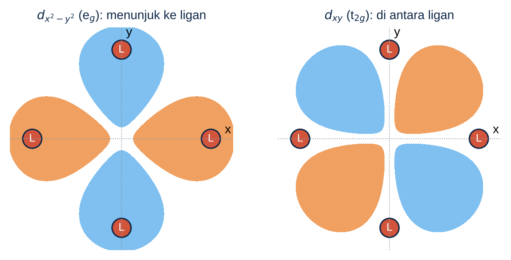
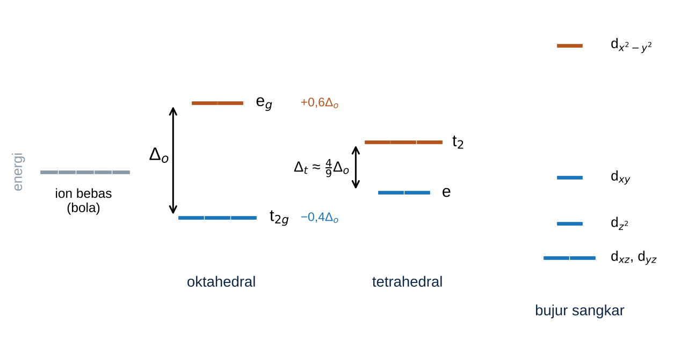

## 11.6 Teori ikatan valensi untuk kompleks

Teori pertama yang menjelaskan **bagaimana** ligan terikat pada logam adalah perluasan teori ikatan valensi (subbab 2.7) oleh Linus Pauling pada 1930-an. Gagasannya sederhana: setiap ligan memberikan satu pasangan elektron ke dalam satu **orbital hibrida kosong** pada logam. Jenis hibrida menentukan geometri:

Tabel 11.4 Hibrida logam dan geometri kompleks dalam teori ikatan valensi.

| KB | Hibrida | Geometri | Contoh |
|---|---|---|---|
| 2 | sp | linear | [Ag(NH₃)₂]⁺ |
| 4 | sp³ | tetrahedral | [Zn(NH₃)₄]²⁺, [NiCl₄]²⁻ |
| 4 | dsp² (d~*x*²−*y*²~, s, p~*x*~, p~*y*~) | bujur sangkar | [Ni(CN)₄]²⁻, [PtCl₄]²⁻ |
| 5 | dsp³ | bipiramida trigonal | Fe(CO)₅ |
| 6 | d²sp³ (3d, 4s, 4p) | oktahedral, "orbital dalam" | [Co(NH₃)₆]³⁺, [Fe(CN)₆]⁴⁻ |
| 6 | sp³d² (4s, 4p, 4d) | oktahedral, "orbital luar" | [CoF₆]³⁻, [Fe(H₂O)₆]²⁺ |

Kekuatan utama teori ini adalah menghubungkan ikatan dengan **sifat magnet**. Elektron d logam yang tidak dipakai untuk ikatan tetap di orbital 3d; jumlah elektron tak berpasangan dapat diukur dari momen magnet (subbab 11.8).

::: {.contoh}
**Contoh 11.5 · Dua kompleks Co(III) yang berbeda**

[Co(NH₃)₆]³⁺ diamagnetik, sedangkan [CoF₆]³⁻ paramagnetik dengan empat elektron tak berpasangan. Jelaskan dengan teori ikatan valensi.

**Penyelesaian.** Co³⁺ adalah d⁶. Dalam ion bebas, menurut aturan Hund, keenam elektron mengisi lima orbital 3d dengan empat elektron tak berpasangan: $[\uparrow\downarrow][\uparrow][\uparrow][\uparrow][\uparrow]$.

*[Co(NH₃)₆]³⁺*: keenam elektron d dipasangkan dalam tiga orbital 3d ($[\uparrow\downarrow][\uparrow\downarrow][\uparrow\downarrow][\ \ ][\ \ ]$), sehingga dua orbital 3d kosong. Bersama 4s dan tiga 4p, keduanya membentuk enam hibrida **d²sp³** yang menerima pasangan elektron dari enam NH₃. Tidak ada elektron tak berpasangan: **diamagnetik**. Kompleks seperti ini disebut kompleks **orbital dalam** atau **spin rendah**.

*[CoF₆]³⁻*: elektron 3d tetap tersebar ($[\uparrow\downarrow][\uparrow][\uparrow][\uparrow][\uparrow]$), sehingga tidak ada orbital 3d kosong. Ikatan memakai 4s, tiga 4p, dan dua 4d: hibrida **sp³d²**. Empat elektron tak berpasangan tetap: **paramagnetik**. Kompleks ini disebut kompleks **orbital luar** atau **spin tinggi**.

**Memahami hasil.** Teori ikatan valensi dapat **menjelaskan** sifat magnet setelah diukur, tetapi tidak dapat **meramalkan** mengapa NH₃ memaksa elektron berpasangan sedangkan F⁻ tidak. Ia juga tidak menjelaskan warna kompleks sama sekali, dan pemakaian orbital 4d untuk unsur periode 4 (kompleks orbital luar) secara energetika meragukan. Teori medan kristal, yang dibahas berikutnya, memecahkan kedua kekurangan itu.
:::

::: {.awas}
**Awas: keterbatasan teori ikatan valensi.** (1) Tidak menjelaskan warna dan spektrum. (2) Tidak meramalkan spin tinggi atau rendah. (3) Untuk [Cu(NH₃)₄]²⁺ (d⁹) yang bujur sangkar, hibrida dsp² memerlukan satu elektron d dipindahkan ke orbital 4p yang tinggi, sehingga kompleks itu seharusnya mudah teroksidasi menjadi Cu(III); kenyataannya tidak. (4) Tidak menjelaskan kestabilan relatif kompleks dan distorsi Jahn–Teller. Teori ini kini dipakai terutama sebagai bahasa deskriptif yang mudah ("hibrida d²sp³"), bukan sebagai alat ramalan.
:::

## 11.7 Teori medan kristal: pemisahan oktahedral dan tetrahedral

### Gagasan dasar

Teori medan kristal (TMK) dikembangkan oleh fisikawan Hans Bethe (1929) dan John Van Vleck (1932) untuk menjelaskan sifat ion logam di dalam kristal, dan baru diterapkan secara luas pada kimia kompleks pada 1950-an. Model ini sangat sederhana: ligan diperlakukan sebagai **muatan titik negatif** (atau ujung negatif dipol), dan ikatan logam–ligan dianggap murni elektrostatik. Yang dipelajari adalah apa yang terjadi pada **lima orbital d logam** ketika dikelilingi muatan-muatan itu.

Dalam ion bebas, kelima orbital d mempunyai energi yang sama (terdegenerasi). Bila ion dikelilingi bola muatan negatif yang seragam, semua orbital d naik energinya sama banyak karena elektron d ditolak, tetapi tetap terdegenerasi. Sekarang bayangkan muatan itu dikumpulkan menjadi enam titik pada sumbu ±*x*, ±*y*, ±*z*: oktahedron. Orbital d~*x*²−*y*²~ dan d~*z*²~ mempunyai cuping yang **mengarah tepat ke ligan**, sehingga elektron di dalamnya ditolak kuat dan energinya naik. Orbital d~*xy*~, d~*xz*~, dan d~*yz*~ mempunyai cuping **di antara sumbu**, menjauhi ligan, sehingga energinya lebih rendah.

{width=74%}

Hasilnya, kelima orbital d terpisah menjadi dua kelompok. Dalam bahasa simetri (Bab 3, grup *O*~h~), kelompok atas disebut **e~g~** (d~*z*²~, d~*x*²−*y*²~; dua orbital) dan kelompok bawah **t₂g** (d~*xy*~, d~*xz*~, d~*yz*~; tiga orbital). Selisih energi keduanya disebut **energi pemisahan medan kristal oktahedral**, **Δ~o~** (atau 10*Dq*).

Pemisahan ini mengikuti **aturan pusat berat** (*barycentre*): energi rata-rata kelima orbital tidak berubah dibandingkan dengan medan bola. Karena e~g~ berisi dua orbital dan t₂g tiga, maka e~g~ naik **+0,6Δ~o~** dan t₂g turun **−0,4Δ~o~** (2 × 0,6 = 3 × 0,4).

{width=92%}

### Medan tetrahedral dan bujur sangkar

Dalam tetrahedron, empat ligan menempati empat sudut kubus yang berselang-seling; tidak ada ligan yang tepat pada sumbu. Orbital d~*xy*~, d~*xz*~, d~*yz*~ (yang mengarah ke tengah rusuk kubus) lebih dekat ke ligan daripada d~*z*²~ dan d~*x*²−*y*²~ (yang mengarah ke pusat sisi kubus). Urutannya **terbalik**: kelompok t₂ (tiga orbital) di atas, e (dua orbital) di bawah. Labelnya tanpa g karena tetrahedron tidak mempunyai pusat inversi. Pemisahannya lebih kecil, **Δ~t~ ≈ 4/9 Δ~o~**, karena ligannya lebih sedikit (empat lawan enam) dan tidak ada yang mengarah tepat ke orbital mana pun.

Bila dua ligan *trans* pada sumbu *z* oktahedron ditarik menjauh, orbital yang mempunyai komponen *z* (d~*z*²~, d~*xz*~, d~*yz*~) turun, sedangkan d~*x*²−*y*²~ dan d~*xy*~ naik. Pada batasnya, kedua ligan itu hilang sama sekali dan diperoleh **bujur sangkar**: d~*x*²−*y*²~ sendirian jauh di atas, dengan empat orbital lainnya di bawah. Ion d⁸ dapat menempatkan kedelapan elektronnya di empat orbital bawah dan membiarkan d~*x*²−*y*²~ yang sangat tinggi itu kosong. Itulah sebabnya ion d⁸ dengan Δ besar (Pt²⁺, Pd²⁺, Au³⁺, dan Ni²⁺ dengan CN⁻) memilih geometri bujur sangkar dan diamagnetik.

### Warna dan pengukuran Δ~o~

Elektron dapat dipindahkan dari t₂g ke e~g~ dengan menyerap foton berenergi Δ~o~. Untuk kebanyakan kompleks, Δ~o~ berada antara 10 000 dan 40 000 cm⁻¹, yaitu di daerah cahaya tampak sampai ultraviolet dekat. Itulah sebabnya kompleks logam transisi berwarna. Warna yang kita lihat adalah **warna komplementer** dari cahaya yang diserap.

::: {.contoh}
**Contoh 11.6 · Mengukur Δ~o~ dari spektrum**

Larutan [Ti(H₂O)₆]³⁺ berwarna ungu dan mempunyai satu pita serapan lebar dengan puncak pada 493 nm. (a) Hitung Δ~o~ dalam cm⁻¹ dan kJ mol⁻¹. (b) Mengapa hanya ada satu pita? (c) Mengapa larutannya ungu?

**Penyelesaian.** (a) Δ~o~ = 1/λ = 1/(493 × 10⁻⁷ cm) = **20 300 cm⁻¹**. Dikalikan 0,01196 kJ mol⁻¹ per cm⁻¹: **243 kJ mol⁻¹**.

(b) Ti³⁺ adalah d¹. Elektron tunggal itu berada di t₂g, dan hanya ada satu transisi yang mungkin: t₂g¹ → e~g~¹. Pita itu sebenarnya sedikit tidak simetris (ada bahu di sisi energi rendah), karena keadaan tereksitasi e~g~¹ mengalami distorsi Jahn–Teller (subbab 11.8).

(c) Kompleks menyerap paling kuat di sekitar 490–500 nm (hijau kebiruan), dan meneruskan merah dan biru-ungu. Campuran keduanya tampak ungu.

**Memahami hasil.** Energi 243 kJ mol⁻¹ setara dengan ikatan kimia yang cukup kuat. Pemisahan medan kristal bukan efek kecil: untuk ion d⁶ spin rendah, ia memberi penstabilan beberapa ratus kJ mol⁻¹ (subbab 11.8). Hanya ion d¹ yang memberi satu pita sederhana; ion dengan elektron d lebih banyak mempunyai beberapa pita yang memerlukan diagram Tanabe–Sugano (*Kimia Anorganik 2*).
:::

![Gambar 11.7 Kiri: spektrum serapan [Ti(H₂O)₆]³⁺ (skematis) dengan warna-warna cahaya tampak di latar. Kanan: Δ~o~ kompleks [CrL₆] untuk beberapa ligan, yang menyusun deret spektrokimia.](fig/c_spektrum.png){width=94%}

### Deret spektrokimia

Ryutaro Tsuchida (1938) menyusun ligan menurut besar Δ~o~ yang dihasilkannya, dan urutannya hampir sama untuk semua logam. Urutan ini disebut **deret spektrokimia**:

$$\text{I}^- < \text{Br}^- < \text{S}^{2-} < \text{SCN}^- < \text{Cl}^- < \text{NO}_3^- < \text{F}^- < \text{OH}^- < \text{ox}^{2-} < \text{H}_2\text{O} < \text{NCS}^- < \text{py} \approx \text{NH}_3 < \text{en} < \text{bipy} < \text{phen} < \text{NO}_2^- < \text{PPh}_3 < \text{CN}^- \approx \text{CO}$$

Ligan di ujung kiri disebut **ligan medan lemah**, di ujung kanan **ligan medan kuat**. Besarnya Δ juga bergantung pada **logam**:

1. **Bilangan oksidasi**: Δ~o~ untuk M³⁺ biasanya 30–80 % lebih besar daripada untuk M²⁺ dengan ligan yang sama, karena ion bermuatan lebih tinggi menarik ligan lebih dekat. [Fe(H₂O)₆]²⁺: 10 400 cm⁻¹; [Fe(H₂O)₆]³⁺: 13 700 cm⁻¹.
2. **Periode**: Δ untuk logam 4d dan 5d sekitar 30–50 % lebih besar daripada logam 3d segolongan, karena orbital 4d dan 5d lebih menjangkau ke arah ligan. Akibatnya kompleks logam 4d dan 5d hampir selalu spin rendah.

::: {.awas}
**Awas: deret spektrokimia membantah model muatan titik.** Bila ligan hanyalah muatan titik, ion bermuatan seperti F⁻ dan Cl⁻ seharusnya memberi Δ lebih besar daripada molekul netral seperti NH₃ dan CO. Kenyataannya terbalik: CO, yang netral dan momen dipolnya sangat kecil, adalah ligan terkuat. Penjelasannya memerlukan **ikatan kovalen**. Ligan seperti CO, CN⁻, dan bipy mempunyai orbital π* kosong yang menerima elektron dari orbital t₂g logam (**ikatan balik π**, subbab 4.3), menurunkan t₂g dan memperbesar Δ. Ligan seperti Cl⁻ dan OH⁻ mempunyai orbital p penuh yang **memberikan** elektron π ke logam, menaikkan t₂g dan memperkecil Δ. Model yang memasukkan ikatan kovalen ini, gabungan TMK dengan teori orbital molekul Bab 4, disebut **teori medan ligan** dan dibahas di *Kimia Anorganik 2*. TMK tetap berguna karena hasil kualitatifnya (pemisahan t₂g/e~g~) sama.
:::

::: {.kuis}
**Kuis cepat 11.7** [Cr(NH₃)₆]³⁺ berwarna kuning dan [Cr(H₂O)₆]³⁺ ungu. Kompleks mana yang menyerap pada panjang gelombang lebih pendek? Hitung λ serapan dari Δ~o~ 21 550 dan 17 400 cm⁻¹.
:::

## 11.8 Spin tinggi, spin rendah, dan energi penstabilan medan kristal

### Mengisi orbital t₂g dan e~g~

Dalam kompleks oktahedral, elektron d diisi ke t₂g lebih dulu. Untuk d¹, d², dan d³ tidak ada pilihan: elektron menempati t₂g satu per satu dengan spin sejajar. Untuk elektron keempat, ada dua pilihan:

* masuk ke e~g~ dengan spin sejajar, membayar energi **Δ~o~**; atau
* berpasangan dengan elektron di t₂g, membayar **energi pemasangan *P***, yaitu tolakan tambahan antara dua elektron dalam satu orbital ditambah hilangnya energi pertukaran spin sejajar.

Bila **Δ~o~ < *P*** (ligan medan lemah), elektron lebih "murah" naik ke e~g~: konfigurasi **spin tinggi**, dengan jumlah elektron tak berpasangan maksimum. Bila **Δ~o~ > *P*** (ligan medan kuat), elektron berpasangan di t₂g: konfigurasi **spin rendah**. Pilihan ini hanya ada untuk d⁴, d⁵, d⁶, dan d⁷ oktahedral.

### Energi penstabilan medan kristal

Setiap elektron di t₂g menurunkan energi sebesar 0,4Δ~o~ dan setiap elektron di e~g~ menaikkannya 0,6Δ~o~, dibandingkan dengan medan bola. Jumlahnya disebut **energi penstabilan medan kristal** (EPMK; bahasa Inggris CFSE):

$$\text{EPMK} = (-0{,}4\,n_{t_{2g}} + 0{,}6\,n_{e_g})\,\Delta_o \qquad \text{(11.1)}$$

Untuk membandingkan spin tinggi dan rendah, ditambahkan *P* untuk setiap **pasangan tambahan** yang terbentuk dibandingkan dengan konfigurasi spin tinggi.

Tabel 11.5 Konfigurasi dan EPMK oktahedral (dalam satuan Δ~o~, tanpa energi pemasangan).

| d^*n*^ | Spin tinggi | EPMK | Tak berpasangan | Spin rendah | EPMK | Tak berpasangan |
|---|---|---|---|---|---|---|
| d¹ | t₂g¹ | −0,4 | 1 | | | |
| d² | t₂g² | −0,8 | 2 | | | |
| d³ | t₂g³ | −1,2 | 3 | | | |
| d⁴ | t₂g³e~g~¹ | −0,6 | 4 | t₂g⁴ | −1,6 | 2 |
| d⁵ | t₂g³e~g~² | 0 | 5 | t₂g⁵ | −2,0 | 1 |
| d⁶ | t₂g⁴e~g~² | −0,4 | 4 | t₂g⁶ | −2,4 | 0 |
| d⁷ | t₂g⁵e~g~² | −0,8 | 3 | t₂g⁶e~g~¹ | −1,8 | 1 |
| d⁸ | t₂g⁶e~g~² | −1,2 | 2 | | | |
| d⁹ | t₂g⁶e~g~³ | −0,6 | 1 | | | |
| d¹⁰ | t₂g⁶e~g~⁴ | 0 | 0 | | | |

### Momen magnet spin saja

Jumlah elektron tak berpasangan *n* diukur dari **momen magnet**. Untuk ion logam 3d, kontribusi gerak orbital elektron sebagian besar "dipadamkan" oleh ligan, sehingga momen magnet hampir hanya berasal dari spin:

$$\mu_\text{so} = \sqrt{n(n+2)}\ \mu_\text{B} \qquad \text{(11.2)}$$

dengan μ~B~ magneton Bohr. Untuk *n* = 1, 2, 3, 4, 5: μ~so~ = 1,73; 2,83; 3,87; 4,90; 5,92 μ~B~. Momen magnet diukur dengan neraca Gouy atau Evans (sampel ditimbang di dalam dan di luar medan magnet) atau dengan metode NMR Evans dalam larutan.

::: {.contoh}
**Contoh 11.7 · Dua kompleks besi(II)**

Δ~o~ untuk [Fe(H₂O)₆]²⁺ adalah 10 400 cm⁻¹ dan untuk [Fe(CN)₆]⁴⁻ 32 850 cm⁻¹. Energi pemasangan Fe²⁺ sekitar 19 150 cm⁻¹. (a) Tentukan konfigurasi spin masing-masing. (b) Hitung EPMK dan momen magnet spin saja. (c) Ramalkan konfigurasi [Co(NH₃)₆]³⁺ (Δ~o~ = 22 900 cm⁻¹, *P* = 21 000 cm⁻¹).

**Penyelesaian.** Fe²⁺ adalah d⁶.

(a) [Fe(H₂O)₆]²⁺: Δ~o~ (10 400) < *P* (19 150): **spin tinggi**, t₂g⁴e~g~². [Fe(CN)₆]⁴⁻: Δ~o~ (32 850) > *P*: **spin rendah**, t₂g⁶.

(b) Spin tinggi: EPMK = 4(−0,4) + 2(0,6) = −0,4Δ~o~ = −4160 cm⁻¹ ≈ **−50 kJ mol⁻¹**; *n* = 4, μ~so~ = **4,90 μ~B~** (terukur sekitar 5,1–5,5 μ~B~). Spin rendah: EPMK = 6(−0,4) = −2,4Δ~o~ = **−943 kJ mol⁻¹**, dikurangi dua pasangan tambahan (2*P* = 458 kJ mol⁻¹) memberi penstabilan bersih sekitar **−485 kJ mol⁻¹**; *n* = 0, **diamagnetik**.

(c) Co³⁺ juga d⁶. Spin rendah: −2,4Δ~o~ + 2*P* = −54 960 + 42 000 = −12 960 cm⁻¹; spin tinggi: −0,4Δ~o~ = −9160 cm⁻¹. Spin rendah lebih stabil sebanyak 3800 cm⁻¹: **spin rendah**, diamagnetik, seperti yang diamati.

**Memahami hasil.** Satu ion logam yang sama dapat bersifat paramagnetik kuat atau diamagnetik sama sekali, tergantung ligannya. Teori medan kristal meramalkan hal ini dari dua bilangan yang dapat diukur (Δ~o~ dari spektrum, *P* dari spektrum ion bebas). Untuk [Co(NH₃)₆]³⁺, selisihnya tipis; untuk [CoF₆]³⁻ (Δ~o~ ≈ 13 000 cm⁻¹ < *P*), kompleksnya spin tinggi, sesuai dengan Contoh 11.5. Penstabilan yang sangat besar pada [Fe(CN)₆]⁴⁻ dan [Co(NH₃)₆]³⁺ (d⁶ spin rendah, t₂g penuh) juga menjelaskan mengapa kompleks d⁶ spin rendah sangat inert terhadap pertukaran ligan.
:::

::: {.terapan}
**Hemoglobin dan peralihan spin.** Dalam hemoglobin tanpa oksigen, Fe(II) di pusat porfirin berkoordinasi lima, spin tinggi, dan sedikit terlalu besar untuk lubang porfirin, sehingga ia menonjol sekitar 40 pm keluar bidang cincin. Ketika O₂ terikat sebagai ligan keenam, medan ligan menguat, besi menjadi spin rendah (diamagnetik secara keseluruhan) dan **mengecil** karena orbital e~g~ yang mengarah ke ligan kini kosong. Atom Fe masuk ke bidang porfirin dan menarik histidina yang terikat di bawahnya. Gerakan kecil ini diteruskan ke seluruh protein dan mempermudah pengikatan O₂ pada tiga subunit lainnya: dasar kooperativitas yang membuat darah mengangkut oksigen dengan efisien.
:::

### Kompleks tetrahedral

Karena Δ~t~ ≈ 4/9 Δ~o~ biasanya jauh lebih kecil daripada *P*, kompleks tetrahedral hampir selalu **spin tinggi**. EPMK tetrahedral dihitung dengan −0,6Δ~t~ untuk setiap elektron di e dan +0,4Δ~t~ untuk setiap elektron di t₂.

{width=94%}

### Bukti EPMK dalam data termodinamika dan struktur

Bila EPMK nyata, ia harus tampak dalam data. Gambar 11.8 (kanan) memperlihatkan jari-jari ion M²⁺ spin tinggi. Ion d⁰ (Ca²⁺), d⁵ (Mn²⁺), dan d¹⁰ (Zn²⁺), yang EPMK-nya nol karena elektronnya tersebar bulat sempurna, terletak pada satu garis yang turun perlahan karena muatan inti efektif naik. Ion-ion lain berada **di bawah** garis itu, dengan dua lembah pada d³ (V²⁺) dan d⁸ (Ni²⁺). Mengapa? Pada V²⁺, ketiga elektron d berada di t₂g, yang menjauhi ligan, sehingga ligan dapat mendekat lebih rapat daripada bila elektron tersebar bulat. Elektron keempat dan kelima (spin tinggi) masuk ke e~g~, yang mengarah ke ligan dan mendorongnya menjauh: jari-jari naik kembali ke Mn²⁺. Pola **dua punuk** yang sama terlihat pada entalpi hidrasi M²⁺ dan M³⁺ serta energi kisi halida logam transisi: setelah EPMK (dihitung dari Δ~o~ spektroskopi) dikurangkan, titik-titik itu kembali ke garis halus.

::: {.contoh}
**Contoh 11.8 · Mengapa magnetit adalah spinel terbalik**

Bab 5 (subbab 5.6) menunjukkan bahwa spinel AB₂O₄ dapat normal, A[B₂]O₄, dengan A²⁺ di rongga tetrahedral, atau terbalik, B[AB]O₄. Magnetit Fe₃O₄ = Fe²⁺Fe³⁺₂O₄ terbalik; Mn₃O₄ = Mn²⁺Mn³⁺₂O₄ normal. Jelaskan dengan **energi preferensi situs oktahedral** (EPSO = EPMK~oktahedral~ − EPMK~tetrahedral~, dengan Δ~t~ = 4/9 Δ~o~; ion spin tinggi karena O²⁻ ligan medan lemah).

**Penyelesaian.** Hitung EPMK tiap ion (dalam Δ~o~):

* Fe³⁺ (d⁵): oktahedral 0, tetrahedral 0: EPSO = **0**.
* Fe²⁺ (d⁶): oktahedral −0,4; tetrahedral −0,6 × 4/9 = −0,27: EPSO = **−0,13Δ~o~**.
* Mn²⁺ (d⁵): EPSO = **0**.
* Mn³⁺ (d⁴): oktahedral −0,6; tetrahedral −0,4 × 4/9 = −0,18: EPSO = **−0,42Δ~o~**.

Dalam Fe₃O₄, Fe³⁺ tidak peduli situsnya, sedangkan Fe²⁺ lebih suka oktahedral. Dengan menukar Fe²⁺ ke situs oktahedral dan satu Fe³⁺ ke situs tetrahedral, struktur memperoleh penstabilan: **spinel terbalik**, Fe³⁺[Fe²⁺Fe³⁺]O₄. Dalam Mn₃O₄, kedua Mn³⁺ sangat menyukai oktahedral dan Mn²⁺ tidak peduli: **spinel normal**, Mn²⁺[Mn³⁺₂]O₄.

**Memahami hasil.** Pertanyaan yang ditinggalkan di Bab 5, mengapa ukuran ion saja tidak cukup untuk meramalkan jenis spinel, kini terjawab. Dengan logika sama, NiFe₂O₄ terbalik (Ni²⁺ d⁸: EPSO = −0,84Δ~o~), dan semua spinel kromium(III) normal (Cr³⁺ d³: EPSO = −0,84Δ~o~). Ferit spinel seperti ini adalah bahan magnet keramik untuk inti transformator frekuensi tinggi dan perekam magnetik; sifat magnetnya ditentukan oleh siapa menempati situs mana.
:::

### Distorsi Jahn–Teller

Teorema Jahn–Teller (1937) menyatakan bahwa molekul nonlinear dengan keadaan elektronik terdegenerasi akan **terdistorsi** untuk menghilangkan degenerasi itu dan menurunkan energinya. Dalam kompleks oktahedral, efek ini paling kuat bila orbital **e~g~ terisi tidak sama**, karena orbital e~g~ mengarah langsung ke ligan: d⁴ spin tinggi (Cr²⁺, Mn³⁺), d⁷ spin rendah, dan d⁹ (Cu²⁺). Pada Cu²⁺ (t₂g⁶e~g~³), satu orbital e~g~ berisi dua elektron dan yang lain satu. Bila dua ligan pada sumbu *z* menjauh, d~*z*²~ turun dan d~*x*²−*y*²~ naik; dengan menempatkan dua elektron di d~*z*²~ yang turun dan satu di d~*x*²−*y*²~ yang naik, energi total berkurang. Hasilnya oktahedron **memanjang**: hampir semua kompleks Cu(II) oktahedral mempunyai empat ikatan pendek (sekitar 200 pm) dan dua ikatan panjang (sekitar 230–260 pm). Pada batas ekstrem, kedua ligan aksial lepas sama sekali, dan Cu(II) menjadi bujur sangkar, seperti [Cu(NH₃)₄]²⁺. Distorsi ini juga menjelaskan mengapa *K*~5~ dan *K*~6~ untuk [Cu(NH₃)₆]²⁺ sangat kecil, dan mengapa Cu²⁺ berada di puncak deret Irving–Williams (subbab 11.10).

::: {.kuis}
**Kuis cepat 11.8** Tentukan konfigurasi, jumlah elektron tak berpasangan, dan μ~so~ untuk (a) [Mn(H₂O)₆]²⁺ (Δ~o~ = 7800 cm⁻¹, *P* = 25 500 cm⁻¹); (b) [Fe(CN)₆]³⁻ (spin rendah). Mengapa larutan Mn²⁺ hampir tidak berwarna?
:::

## 11.9 Aturan 18 elektron

Untuk kompleks logam dengan ligan seperti CO, fosfina, alkena, dan siklopentadienil, yang banyak dipakai dalam katalisis, ada aturan hitung sederhana yang sangat berhasil. Kompleks yang stabil biasanya mempunyai **18 elektron valensi** di sekitar logam: jumlah elektron d logam ditambah elektron yang diberikan ligan. Angka 18 adalah analog oktet (8) untuk unsur golongan utama: logam transisi mempunyai sembilan orbital valensi (lima d, satu s, tiga p), yang dapat menampung 18 elektron.

Dari sudut pandang teori orbital molekul (Bab 4), aturan ini mudah dipahami untuk kompleks oktahedral dengan ligan akseptor π yang kuat seperti CO. Enam ligan membentuk enam orbital ikatan σ; ketiga orbital t₂g menjadi orbital ikatan π karena ikatan balik ke CO; dan Δ~o~ sangat besar sehingga orbital e~g~* (antiikatan) sangat tinggi. Mengisi semua orbital ikatan dan t₂g berarti 6 × 2 + 3 × 2 = **18 elektron**; menambah elektron berarti mengisi orbital antiikatan, dan menguranginya berarti mengosongkan orbital ikatan.

::: {.strategi}
**Menghitung elektron valensi (metode ligan netral)**

1. Hitung elektron valensi atom logam **netral**: sama dengan nomor golongannya (Cr 6, Mn 7, Fe 8, Co 9, Ni 10).
2. Tambahkan elektron dari setiap ligan dihitung sebagai spesies netral: CO, PR₃, NH₃, H₂O: 2; H, Cl, CH₃ (ligan "X"): 1; η⁵-C₅H₅ (siklopentadienil): 5; η⁶-C₆H₆ (benzena): 6; η²-alkena: 2.
3. Kurangi muatan positif kompleks atau tambahkan muatan negatifnya.
4. Tambahkan 1 elektron untuk setiap ikatan logam–logam.
:::

::: {.contoh}
**Contoh 11.9 · Menghitung elektron**

Hitung jumlah elektron valensi: (a) Cr(CO)₆; (b) Fe(CO)₅; (c) Ni(CO)₄; (d) ferosena Fe(η⁵-C₅H₅)₂; (e) Mn₂(CO)₁₀; (f) [Co(CO)₄]⁻; (g) V(CO)₆; (h) [PtCl₄]²⁻.

**Penyelesaian.**

(a) 6 + 6 × 2 = **18**. (b) 8 + 5 × 2 = **18**. (c) 10 + 4 × 2 = **18**. (d) 8 + 2 × 5 = **18**.

(e) Setiap Mn: 7 + 5 × 2 + 1 (ikatan Mn–Mn) = **18**. Satuan Mn(CO)₅ yang mempunyai 17 elektron berpasangan membentuk ikatan Mn–Mn.

(f) 9 + 4 × 2 + 1 (muatan) = **18**. Co(CO)₄ netral (17 elektron) tidak ada sebagai molekul tunggal; ia berdimer menjadi Co₂(CO)₈ (masing-masing Co 18 elektron dengan satu ikatan Co–Co) atau direduksi menjadi [Co(CO)₄]⁻.

(g) 5 + 6 × 2 = **17**. V(CO)₆ adalah pengecualian: ia monomer, paramagnetik, dan mudah direduksi menjadi [V(CO)₆]⁻ (18 elektron). Atom V terlalu kecil untuk mengikat tujuh CO, dan enam CO di sekitarnya menghalangi dimerisasi.

(h) Pt(II) dengan empat Cl⁻: metode ion menghitung d⁸ + 4 × 2 = **16**. Kompleks d⁸ bujur sangkar umumnya stabil dengan **16 elektron**, karena orbital d~*x*²−*y*²~ yang sangat tinggi dibiarkan kosong.

**Memahami hasil.** Aturan 18 elektron meramalkan rumus karbonil logam biner dengan sangat baik: logam dengan jumlah elektron genap membentuk monomer M(CO)~*n*~ (Cr, Fe, Ni), sedangkan logam dengan jumlah elektron ganjil (Mn, Co) membentuk dimer dengan ikatan logam–logam. Dalam katalisis, misalnya hidroformilasi dan hidrogenasi, kompleks berganti-ganti antara 16 dan 18 elektron: kompleks 16 elektron mengikat substrat, kompleks 18 elektron melepaskannya.
:::

::: {.awas}
**Awas: kapan aturan 18 elektron tidak berlaku.** Aturan ini berlaku baik untuk kompleks dengan ligan medan kuat dan akseptor π (CO, PR₃, siklopentadienil) di mana Δ besar. Ia **tidak** berlaku untuk kebanyakan kompleks Werner klasik dengan ligan medan lemah: [Cr(H₂O)₆]³⁺ mempunyai 15 elektron, [Ni(H₂O)₆]²⁺ 20, [Cu(H₂O)₆]²⁺ 21, dan semuanya stabil. Untuk kompleks ini, orbital e~g~* tidak cukup tinggi untuk "melarang" elektron tambahan. Kompleks d⁸ bujur sangkar (16 elektron) dan logam golongan awal dengan ligan besar (sering kurang dari 18) juga pengecualian.
:::

::: {.kuis}
**Kuis cepat 11.9** Hitung elektron valensi Mo(CO)₃(η⁶-C₆H₆) dan [Fe(CO)₄]²⁻. Apakah HMn(CO)₅ memenuhi aturan 18 elektron?
:::
