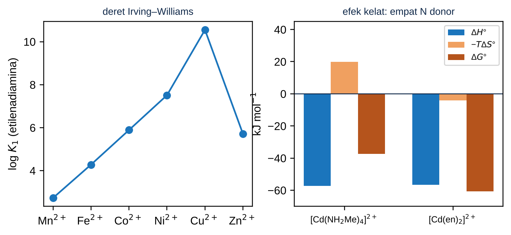

## 11.10 Kestabilan kompleks dan efek kelat

### Tetapan kestabilan

Dalam air, ion logam selalu sudah berupa kompleks akua. Membentuk kompleks dengan ligan L berarti **mengganti** molekul air satu per satu:

$$[\text{M(H}_2\text{O)}_6]^{2+} + \text{L} \rightleftharpoons [\text{M(H}_2\text{O)}_5\text{L}]^{2+} + \text{H}_2\text{O} \qquad K_1 = \frac{[\text{ML}]}{[\text{M}][\text{L}]}$$

dan seterusnya sampai *K*~6~ (air tidak ditulis dalam tetapan karena konsentrasinya tetap). *K*~1~, *K*~2~, … disebut **tetapan kestabilan bertahap**. Hasil kalinya disebut **tetapan kestabilan keseluruhan**:

$$\beta_n = K_1 K_2 \cdots K_n = \frac{[\text{ML}_n]}{[\text{M}][\text{L}]^n} \qquad \text{(11.3)}$$

Karena nilainya sangat besar, tetapan ini biasanya ditulis sebagai log *K* atau log β. Hubungannya dengan energi Gibbs: Δ*G*° = −2,303*RT* log β = −5,71 log β kJ mol⁻¹ pada 25 °C.

Hampir selalu *K*~1~ > *K*~2~ > *K*~3~ > ⋯. Sebagian penurunan ini bersifat **statistik**: pada langkah pertama ada enam molekul air yang dapat diganti dan hanya satu L yang dapat lepas kembali; pada langkah terakhir hanya satu air tersisa dan enam L dapat lepas. Perhitungan peluang memberi *K*~1~/*K*~2~ = 2,4 dan *K*~2~/*K*~3~ = 1,9 untuk kompleks oktahedral, yaitu penurunan log *K* sekitar 0,25–0,4 setiap langkah. Penurunan yang jauh lebih besar dari ini menandakan perubahan struktur, misalnya distorsi Jahn–Teller pada Cu²⁺ (*K*~5~ dan *K*~6~ untuk NH₃ sangat kecil) atau perubahan geometri dari oktahedral ke tetrahedral.

### Deret Irving–Williams

Untuk ion M²⁺ deret 3d spin tinggi, kestabilan kompleks dengan hampir **semua** ligan mengikuti urutan yang sama, yang ditemukan Harry Irving dan Robert Williams (1953):

$$\text{Mn}^{2+} < \text{Fe}^{2+} < \text{Co}^{2+} < \text{Ni}^{2+} < \text{Cu}^{2+} > \text{Zn}^{2+}$$

{width=94%}

Tiga faktor bersama-sama membentuk deret ini: (1) jari-jari ion yang mengecil dari Mn²⁺ ke Ni²⁺ (Gambar 11.8), sehingga ion makin keras dan tarikan elektrostatik makin kuat; (2) EPMK yang naik dari Mn²⁺ (0) ke Ni²⁺ (−1,2Δ~o~), dan bertambah ketika air diganti ligan dengan Δ~o~ lebih besar; (3) distorsi Jahn–Teller pada Cu²⁺ yang memberi empat ikatan ekuatorial yang sangat kuat. Zn²⁺ (d¹⁰, EPMK nol) turun kembali. Deret ini dipakai biokimiawan untuk menjelaskan mengapa enzim tertentu "salah memilih" logam: ion Cu²⁺ yang sedikit saja dapat mengusir Zn²⁺ atau Mn²⁺ dari situs aktif enzim, salah satu sebab keracunan tembaga.

### Efek kelat

Bandingkan dua reaksi, masing-masing mengikat ion logam dengan empat atom N amina:

$$\text{Cd}^{2+} + 4\,\text{CH}_3\text{NH}_2 \rightleftharpoons [\text{Cd(NH}_2\text{CH}_3)_4]^{2+} \qquad \log\beta_4 = 6{,}55$$
$$\text{Cd}^{2+} + 2\,\text{en} \rightleftharpoons [\text{Cd(en)}_2]^{2+} \qquad \log\beta_2 = 10{,}62$$

Kompleks kelat lebih stabil dengan faktor sekitar 10⁴. Fenomena ini, bahwa ligan kelat membentuk kompleks yang jauh lebih stabil daripada sejumlah ligan satu gigi yang setara, disebut **efek kelat**.

::: {.contoh}
**Contoh 11.10 · Dari mana efek kelat berasal?**

Data termodinamika pada 25 °C (Greenwood dan Earnshaw, 1997): [Cd(NH₂CH₃)₄]²⁺: Δ*H*° = −57,3 kJ mol⁻¹, Δ*S*° = −66,7 J K⁻¹ mol⁻¹; [Cd(en)₂]²⁺: Δ*H*° = −56,5 kJ mol⁻¹, Δ*S*° = +14,1 J K⁻¹ mol⁻¹. (a) Hitung Δ*G*° keduanya dan periksa log β. (b) Suku mana yang menyebabkan efek kelat? (c) Untuk nikel, log β₆ [Ni(NH₃)₆]²⁺ = 8,61 dan log β₃ [Ni(en)₃]²⁺ = 18,28. Hitung *K* dan Δ*G*° untuk [Ni(NH₃)₆]²⁺ + 3en → [Ni(en)₃]²⁺ + 6NH₃.

**Penyelesaian.** (a) Δ*G*° = Δ*H*° − *T*Δ*S*°. Metilamina: −57,3 − 298,15 × (−0,0667) = −57,3 + 19,9 = **−37,4 kJ mol⁻¹**, log β = 37,4/5,71 = **6,55**. Etilenadiamina: −56,5 − 298,15 × 0,0141 = −56,5 − 4,2 = **−60,7 kJ mol⁻¹**, log β = **10,64**. Keduanya cocok dengan nilai terukur.

(b) Δ*H*° hampir sama (keduanya membentuk empat ikatan Cd–N yang serupa). Perbedaannya hampir seluruhnya pada **entropi**: −*T*Δ*S*° = +19,9 kJ mol⁻¹ untuk metilamina (melawan) dan −4,2 kJ mol⁻¹ untuk en (mendukung). Efek kelat di sini **sepenuhnya efek entropi**.

(c) log *K* = 18,28 − 8,61 = 9,67, ***K* = 4,7 × 10⁹**; Δ*G*° = −5,71 × 9,67 = **−55,2 kJ mol⁻¹**.

**Memahami hasil.** Hitung partikel yang bebas bergerak. Dengan metilamina: 1 Cd²⁺ + 4 ligan (5 partikel zat terlarut) menjadi 1 kompleks, sambil melepaskan 4 molekul air: tidak ada pertambahan partikel. Dengan en: 1 Cd²⁺ + 2 en (3 partikel) menjadi 1 kompleks + 4 air yang dilepaskan: jumlah partikel **bertambah** dua, entropi naik. Dalam reaksi (c), 4 partikel (1 kompleks + 3 en) menjadi 7 (1 kompleks + 6 NH₃). Ada juga cara pandang yang lebih intuitif. Setelah satu ujung en terikat, ujung yang lain terpaksa berada dekat ion logam, sehingga "konsentrasi efektif"-nya di sekitar logam sangat tinggi. Bila satu ujung lepas, ia hampir pasti terikat kembali sebelum sempat menjauh. Ligan satu gigi yang lepas langsung hanyut ke dalam larutan.
:::

Efek ini lebih kuat lagi pada ligan **makrosiklik**, yang atom donornya sudah tersusun dalam cincin dengan ukuran yang pas, sehingga ligan tidak perlu kehilangan banyak kebebasan konformasi ketika mengikat logam: **efek makrosiklik**. Inilah sebabnya porfirin mengikat besi dan magnesium begitu erat sehingga hem dan klorofil tidak melepaskan logamnya di dalam sel.

::: {.terapan}
**EDTA: dari air sadah sampai keracunan timbal.** EDTA⁴⁻ membentuk kompleks 1 : 1 yang sangat stabil dengan hampir semua ion logam bermuatan 2+ dan 3+: log *K* sekitar 8,8 untuk Mg²⁺, 10,7 untuk Ca²⁺, 18,0 untuk Pb²⁺, dan 25,1 untuk Fe³⁺. Karena selalu 1 : 1, EDTA adalah titran ideal untuk **titrasi kompleksometri**, misalnya penentuan kesadahan air (Ca²⁺ + Mg²⁺) dengan indikator Eriochrome Black T. EDTA juga ditambahkan ke makanan, sampo, dan pupuk untuk mengikat ion logam pengganggu. Dalam kedokteran, keracunan timbal diobati dengan infus **natrium kalsium EDTA**, Na₂[Ca(EDTA)]. Mengapa kalsium, bukan Na₄EDTA? Karena EDTA bebas akan mengikat Ca²⁺ darah dan menyebabkan hipokalsemia yang berbahaya. Dengan Na₂[Ca(EDTA)], Pb²⁺ menggantikan Ca²⁺ di dalam kompleks (*K* = 10^18,0−10,7^ ≈ 2 × 10⁷), dan kompleks timbal dikeluarkan lewat urin.
:::

### Stabil lawan inert

Kestabilan termodinamika (seberapa besar *K*) berbeda dengan **kelabilan kinetik** (seberapa cepat ligan bertukar). Henry Taube (1952, Hadiah Nobel 1983) menyebut kompleks **labil** bila ligannya bertukar dalam waktu kurang dari sekitar satu menit pada 25 °C dan konsentrasi 0,1 mol L⁻¹, dan **inert** bila lebih lambat. Dua contoh memperlihatkan bahwa keduanya tidak berhubungan:

* [Ni(CN)₄]²⁻ sangat **stabil** (log β₄ sekitar 30), tetapi sangat **labil**: ion sianida berlabel ¹⁴C yang ditambahkan ke larutannya tertukar dengan ligan dalam kompleks hampir seketika.
* [Co(NH₃)₆]³⁺ secara termodinamika **tidak stabil** dalam larutan asam (penguraiannya menjadi [Co(H₂O)₆]³⁺ dan NH₄⁺ sangat menguntungkan), tetapi **inert**: larutannya dalam asam dapat disimpan berhari-hari tanpa perubahan berarti.

Teori medan kristal memberi petunjuk mana yang inert: ion dengan konfigurasi **d³** (Cr³⁺) dan **d⁶ spin rendah** (Co³⁺, Rh³⁺, Ir³⁺, Pt⁴⁺, Fe²⁺ dalam [Fe(CN)₆]⁴⁻) mempunyai EPMK besar yang sebagian besar hilang ketika kompleks melewati keadaan transisi dengan KB 5 atau 7. Itulah sebabnya Werner berhasil dengan kompleks Co(III) dan Pt(IV), dan sebabnya hampir semua kompleks yang dipakai untuk mempelajari isomer adalah kompleks Co(III), Cr(III), dan Pt. Mekanisme reaksi pertukaran ligan dibahas di *Kimia Anorganik 2*.

::: {.kuis}
**Kuis cepat 11.10** (a) Hitung Δ*G*° pembentukan [Ni(en)₃]²⁺ dari log β₃ = 18,28. (b) Mengapa [Cr(H₂O)₆]³⁺ inert, sedangkan [Cr(H₂O)₆]²⁺ labil?
:::

## Menuju bab berikutnya

Senyawa kobalt yang membingungkan kimiawan abad ke-19 terjawab ketika Werner memisahkan dua jenis valensi: klorida yang terikat langsung pada kobalt di dalam ion kompleks tidak dapat diendapkan Ag⁺, sedangkan klorida di luar kurung siku dapat. Jumlah isomer yang ditemukan, dua isomer *cis/trans* lalu enantiomer heksol tanpa karbon, membuktikan bahwa enam ligan tersusun sebagai oktahedron. Teori medan kristal kemudian menjelaskan warna (pemisahan Δ~o~ yang berada di daerah cahaya tampak), sifat magnet (persaingan Δ~o~ dan energi pemasangan), dan banyak data termodinamika (jari-jari, entalpi hidrasi, spinel, deret Irving–Williams). Efek kelat menunjukkan bahwa kestabilan tidak hanya ditentukan oleh kekuatan ikatan tetapi juga oleh entropi. Semua ini baru pengantar: medan ligan, spektrum elektronik, magnetokimia, mekanisme reaksi, dan kimia organologam adalah isi *Kimia Anorganik 2*.

Bab-bab sebelumnya membangun teori dasar kimia anorganik: struktur atom, ikatan, simetri, orbital molekul, padatan, asam–basa, redoks, pelarut, dan kini senyawa koordinasi. Bab 12 menerapkan semua teori itu pada dua kelompok unsur yang istimewa. **Hidrogen**, unsur paling sederhana, tidak cocok berada di golongan mana pun: ia dapat kehilangan elektron seperti logam alkali, menerima elektron seperti halogen, atau berbagi elektron seperti karbon, dan membentuk ikatan hidrogen yang membuat air menjadi cairan. **Gas mulia**, yang lama dianggap tidak dapat bereaksi, ternyata membentuk senyawa seperti XeF₂, XeF₄, dan XeO₃, yang bentuknya telah kita ramalkan dengan VSEPR dan ikatannya dengan ikatan tiga pusat di Bab 4.
