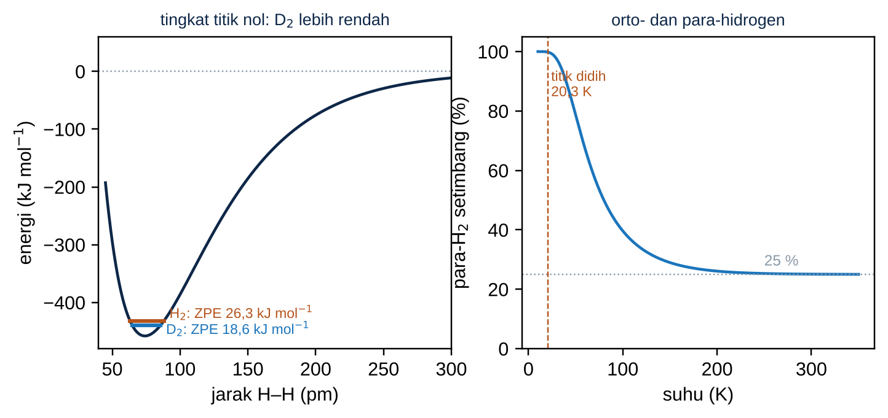
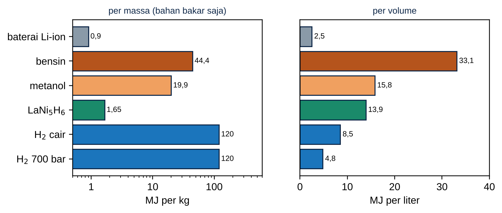
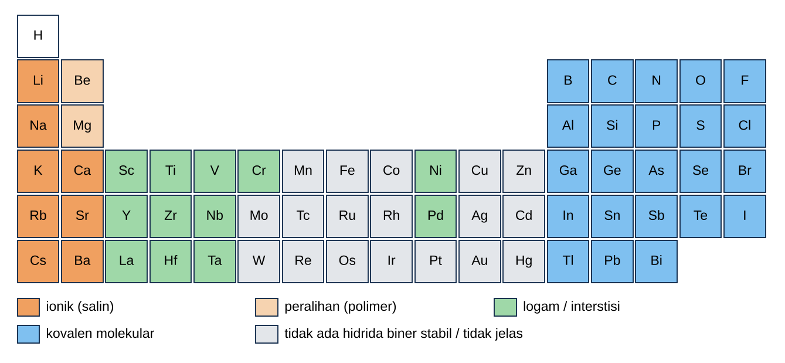
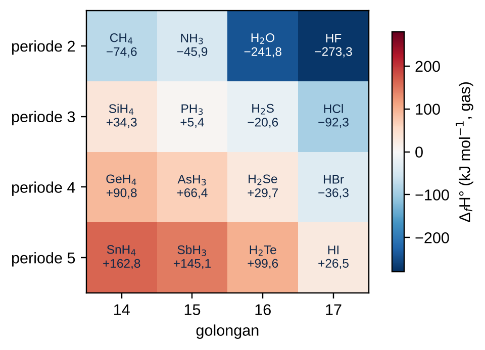

# Bab 12 Hidrogen dan Gas Mulia

Pada 1866, Thomas Graham memanaskan selembar logam paladium dalam atmosfer hidrogen lalu mendinginkannya. Logam itu menyerap hidrogen hampir 900 kali volumenya sendiri, tetap padat dan tetap mengilap seperti logam, hanya sedikit memuai. Bila dipanaskan dalam vakum, seluruh hidrogen itu keluar lagi. Graham sampai menduga bahwa hidrogen sebenarnya adalah logam, "hidrogenium", yang membentuk paduan dengan paladium. Seabad kemudian, gas lain yang lama dianggap tidak dapat bereaksi sama sekali, xenon, ternyata dapat dibakar dengan fluor menjadi kristal tak berwarna XeF₂, XeF₄, dan XeF₆, dan bahkan dapat membius pasien di ruang operasi bila dihirup. Di mana hidrogen "bersembunyi" di dalam paladium? Dan apa yang membuat gas "mulia" mau bereaksi?

Bab ini menerapkan teori dari bab-bab sebelumnya pada dua kelompok unsur yang istimewa. **Hidrogen** adalah unsur paling sederhana dan paling melimpah di alam semesta, tetapi tidak cocok berada di golongan mana pun: ia dapat melepas elektron seperti logam alkali, menerima elektron seperti halogen, atau berbagi elektron seperti karbon. Kita mempelajari isotopnya, cara memproduksinya sebagai bahan kimia dan bahan bakar, tiga jenis hidrida, ikatan hidrogen, dan zat paling penting yang dibentuknya: air. **Gas mulia** di ujung lain tabel periodik mempunyai kulit elektron penuh, energi ionisasi tertinggi, dan kecenderungan bereaksi terendah; kita melihat bagaimana tren periodik (Bab 1), VSEPR (Bab 2), dan ikatan tiga pusat (Bab 4) menjelaskan senyawa xenon, dan bagaimana gas mulia dipakai dari lampu neon sampai magnet MRI.

::: {.kuis}
**Pertanyaan pembuka**

1. Mengapa air berat D₂O mendidih pada 101,4 °C dan membeku pada 3,8 °C, padahal secara kimia sama dengan air biasa?
2. Mengapa hidrogen cair harus disimpan dengan katalis khusus agar tidak mendidih sendiri di dalam tangki?
3. Bagaimana logam paladium dan paduan LaNi₅ dapat menyimpan hidrogen lebih rapat daripada hidrogen cair?
4. Mengapa es mengapung, dan mengapa es masih mempunyai entropi pada suhu nol mutlak?
5. Bagaimana argon ditemukan dari selisih massa jenis nitrogen sebesar setengah persen?
6. Mengapa xenon membentuk senyawa sedangkan helium dan neon tidak?
:::

::: {.tujuan}
**Tujuan belajar**

Setelah mempelajari bab ini, kamu mampu:

1. Menjelaskan letak hidrogen dalam tabel periodik dan sifat-sifat H₂.
2. Menjelaskan efek isotop (H, D, T) dengan energi titik nol, serta orto- dan para-hidrogen.
3. Menjelaskan cara produksi hidrogen dan menghitung energi serta emisi CO₂ yang menyertainya.
4. Menggolongkan hidrida menjadi ionik, kovalen, dan logam, serta meramalkan sifat dan reaksinya.
5. Menjelaskan ikatan hidrogen lebih dalam: bukti spektroskopi, hidrat klatrat, dan ikatan dihidrogen.
6. Menjelaskan struktur es, anomali massa jenis air, kemiringan garis leleh, dan entropi sisa es.
7. Menjelaskan sejarah penemuan, keberadaan, dan tren sifat gas mulia.
8. Menjelaskan pembuatan, bentuk, dan ikatan senyawa xenon dengan VSEPR dan ikatan tiga pusat.
9. Menguraikan penerapan gas mulia dan bahaya radon.
:::

::: {.mat}
**Prasyarat**

Bab 1 (energi ionisasi, afinitas elektron, keelektronegatifan), Bab 2 (VSEPR, senyawa hipervalen, ikatan hidrogen di subbab 2.13), Bab 4 (ikatan tiga pusat pada diborana dan XeF₂), Bab 6 (energi kisi), Bab 9 (elektrolisis air). Dari *Kimia Kuantum*: osilator harmonik dan energi titik nol, rotor tegar, spin inti. Dari *Termodinamika Kimia*: persamaan Clapeyron dan entropi statistik *S* = *k* ln *W*.
:::

## 12.1 Hidrogen: isotop dan sifat H₂

### Unsur tanpa golongan

Atom hidrogen mempunyai satu proton dan satu elektron, konfigurasi 1s¹. Dalam tabel periodik ia biasanya diletakkan di atas litium, tetapi kemiripannya dengan unsur lain terbatas:

Tabel 12.1 Hidrogen dibandingkan dengan tiga golongan.

| Sifat | Seperti golongan 1 (Li, Na) | Seperti golongan 17 (F, Cl) | Seperti golongan 14 (C) |
|---|---|---|---|
| Konfigurasi | satu elektron valensi | kurang satu elektron dari gas mulia | kulit valensi setengah penuh |
| Ion | H⁺ (tidak ada bebas; H₃O⁺ dalam air) | H⁻ dalam hidrida ionik (NaH) | |
| Unsur | | molekul diatomik H₂ | |
| Ikatan | | | kovalen dengan banyak unsur |
| Energi ionisasi (kJ mol⁻¹) | Li 520 | F 1681 | C 1086; **H 1312** |
| Keelektronegatifan Pauling | Li 0,98 | F 3,98 | C 2,55; **H 2,20** |

Energi ionisasi hidrogen (1312 kJ mol⁻¹) jauh lebih besar daripada logam alkali, sehingga H⁺ tidak pernah ada sebagai ion bebas dalam materi; proton yang tidak dikelilingi elektron akan langsung menempel pada pasangan elektron apa pun (H₃O⁺, NH₄⁺). Afinitas elektronnya (73 kJ mol⁻¹) jauh lebih kecil daripada halogen, sehingga H⁻ hanya stabil bersama kation logam yang sangat elektropositif. Keelektronegatifannya di tengah-tengah (2,20), sehingga kebanyakan senyawanya kovalen. Hidrogen paling tepat dipandang sebagai unsur yang **berdiri sendiri**.

### Molekul H₂

Molekul H₂ mempunyai ikatan σ tunggal (orde ikatan 1, subbab 4.1) dengan panjang 74,1 pm dan energi disosiasi 432 kJ mol⁻¹, salah satu ikatan tunggal terkuat. Karena hanya mempunyai dua elektron, gaya dispersinya sangat lemah: H₂ mendidih pada 20,3 K dan membeku pada 14,0 K. Kekuatan ikatan H–H menjelaskan mengapa H₂ kurang reaktif pada suhu kamar walaupun reaksinya dengan O₂ sangat eksoterm: campuran H₂ dan udara dapat disimpan bertahun-tahun, sampai ada percikan api atau katalis (Pt, Pd) yang memutus ikatan H–H.

### Isotop

Hidrogen mempunyai tiga isotop: **protium** ¹H (99,98 %), **deuterium** ²H atau D (0,0156 %, ditemukan Harold Urey pada 1931), dan **tritium** ³H atau T (radioaktif, waktu paruh 12,32 tahun, terbentuk di atmosfer atas oleh sinar kosmik dan dibuat di reaktor dari ⁶Li). Massa isotop hidrogen berbeda dengan faktor 1 : 2 : 3, perbandingan terbesar di antara semua unsur. Akibatnya **efek isotop** pada hidrogen jauh lebih besar daripada pada unsur lain, sampai senyawa D tampak sebagai zat yang berbeda:

Tabel 12.2 Air biasa dan air berat.

| Sifat | H₂O | D₂O |
|---|---|---|
| Titik leleh (°C) | 0,00 | 3,82 |
| Titik didih (°C) | 100,0 | 101,4 |
| Massa jenis 25 °C (g cm⁻³) | 0,997 | 1,107 |
| Suhu massa jenis maksimum (°C) | 4,0 | 11,2 |
| p*K*~w~ (25 °C) | 14,00 | 14,95 |

Sumber efek isotop adalah **energi titik nol**. Molekul diatomik bergetar seperti osilator harmonik, dan tingkat energi terendahnya bukan dasar sumur potensial, melainkan ½*h*ν di atasnya (*Kimia Kuantum*). Frekuensi getaran sebanding dengan √(*k*/μ): kurva potensial (dan tetapan gaya *k*) sama untuk H₂ dan D₂ karena ditentukan oleh elektron, tetapi massa tereduksi μ D₂ dua kali H₂, sehingga frekuensinya √2 kali lebih kecil.

{width=94%}

::: {.contoh}
**Contoh 12.1 · Energi titik nol dan efek isotop kinetik**

Bilangan gelombang getaran H₂ adalah 4401 cm⁻¹ dan D₂ 3116 cm⁻¹. (a) Hitung energi titik nol keduanya. (b) Energi disosiasi terukur *D*₀(H₂) = 432,07 dan *D*₀(D₂) = 439,6 kJ mol⁻¹. Tunjukkan bahwa selisihnya dijelaskan oleh energi titik nol. (c) Ikatan C–H bergetar pada sekitar 2900 cm⁻¹. Perkirakan perbandingan laju reaksi yang memutus ikatan C–H dan C–D pada 25 °C, bila seluruh energi titik nol getaran regang hilang di keadaan transisi.

**Penyelesaian.** (a) ZPE = ½ × 4401 × 0,011963 = **26,3 kJ mol⁻¹** (H₂) dan ½ × 3116 × 0,011963 = **18,6 kJ mol⁻¹** (D₂).

(b) Kedua molekul berada pada sumur potensial yang sama dalamnya. D₂ duduk 26,3 − 18,6 = **7,7 kJ mol⁻¹** lebih dalam, sehingga perlu energi sebanyak itu lebih besar untuk diputus. Selisih terukur 439,6 − 432,1 = 7,5 kJ mol⁻¹, hampir sama.

(c) C–D bergetar pada 2900/√2 = 2051 cm⁻¹. Selisih ZPE = ½ × (2900 − 2051) × 0,011963 = 5,1 kJ mol⁻¹. Bila selisih ini hilang di keadaan transisi, energi aktivasi C–D lebih besar sebanyak itu, dan *k*~H~/*k*~D~ = exp(5080/(8,314 × 298)) ≈ **7,8**.

**Memahami hasil.** Mengganti H dengan D tidak mengubah kurva potensial sama sekali, hanya letak tingkat terbawahnya. Efek kecil ini cukup untuk membuat reaksi pemutusan C–H sekitar tujuh kali lebih cepat daripada C–D. **Efek isotop kinetik** ini dipakai kimiawan untuk mengetahui apakah ikatan C–H putus pada langkah penentu laju, dan oleh industri farmasi untuk membuat obat terdeuterasi yang lebih lambat diuraikan hati (deutetrabenazin, disetujui 2017). Air berat juga dipakai sebagai moderator neutron di reaktor nuklir jenis CANDU (Bab 13), karena D menyerap neutron jauh lebih sedikit daripada H.
:::

### Orto- dan para-hidrogen

Inti hidrogen (proton) mempunyai spin ½. Dalam molekul H₂, kedua spin inti dapat sejajar (spin total *I* = 1, **orto-hidrogen**, tiga keadaan) atau berlawanan (*I* = 0, **para-hidrogen**, satu keadaan). Prinsip Pauli untuk proton (fermion) mengaitkan spin inti dengan rotasi molekul: para-H₂ hanya dapat mempunyai bilangan kuantum rotasi *J* genap (0, 2, 4, …), orto-H₂ hanya *J* ganjil (1, 3, …).

Pada suhu kamar, banyak tingkat rotasi terisi, dan perbandingan orto : para mendekati perbandingan bobot spin, **3 : 1** (25 % para). Pada suhu rendah, hanya *J* = 0 yang terisi, sehingga hidrogen setimbang hampir 100 % para (Gambar 12.1 kanan). Namun perubahan orto ↔ para memerlukan pembalikan spin inti, yang sangat lambat tanpa katalis (berhari-hari sampai berminggu-minggu).

::: {.contoh}
**Contoh 12.2 · Mengapa hidrogen cair dapat mendidih sendiri**

Tetapan rotasi H₂ adalah *B* = 60,85 cm⁻¹, sehingga *E*(*J*) = *BJ*(*J* + 1). (a) Hitung energi yang dilepas ketika satu mol orto-H₂ (*J* = 1) berubah menjadi para-H₂ (*J* = 0). (b) Hidrogen yang baru dicairkan masih mengandung 75 % orto. Bandingkan kalor yang dilepas konversi sempurna dengan kalor penguapan H₂ (0,90 kJ mol⁻¹).

**Penyelesaian.** (a) Δ*E* = *B* × 1 × 2 = 121,7 cm⁻¹ = 121,7 × 0,011963 = **1,46 kJ mol⁻¹**.

(b) 0,75 × 1,46 = **1,09 kJ mol⁻¹**, lebih besar daripada kalor penguapan 0,90 kJ mol⁻¹.

**Memahami hasil.** Hidrogen cair yang belum dikonversi akan perlahan berubah menjadi para-H₂ di dalam tangki dan melepaskan kalor yang cukup untuk menguapkan **seluruh** cairan itu, walaupun tangkinya diisolasi sempurna. Karena itu, dalam pencairan hidrogen industri, gas dialirkan melewati katalis paramagnetik (oksida besi) yang mempercepat konversi selama pendinginan, sehingga yang dimasukkan ke tangki sudah hampir 100 % para. Efek kuantum spin inti, yang tampak sangat abstrak, ternyata menjadi masalah teknik nyata.
:::

::: {.kuis}
**Kuis cepat 12.1** Apakah orto- dan para-deuterium juga ada? (Petunjuk: inti D mempunyai spin 1 dan bersifat boson.) Mengapa helium-4 tidak mempunyai orto dan para?
:::

## 12.2 Produksi dan pemakaian hidrogen

Walaupun hidrogen adalah unsur paling melimpah di alam semesta (sekitar 74 % massa materi biasa), di Bumi hampir semuanya terikat dalam air dan senyawa organik. H₂ bebas harus dibuat, dan pembuatannya selalu memerlukan energi. Produksi dunia sekitar 95 juta ton per tahun.

### Dari bahan bakar fosil

Lebih dari 95 % hidrogen saat ini dibuat dari gas alam dan batu bara. Cara utamanya adalah **reformasi uap metana** (*steam methane reforming*, SMR) pada 700–1000 °C dengan katalis nikel:

$$\text{CH}_4 + \text{H}_2\text{O} \rightarrow \text{CO} + 3\text{H}_2 \qquad \Delta H^\circ = +206\ \text{kJ mol}^{-1}$$

diikuti **reaksi geser air–gas** pada suhu lebih rendah:

$$\text{CO} + \text{H}_2\text{O} \rightarrow \text{CO}_2 + \text{H}_2 \qquad \Delta H^\circ = -41\ \text{kJ mol}^{-1}$$

Reaksi pertama endoterm dan menghasilkan lebih banyak mol gas, sehingga dijalankan pada suhu tinggi (prinsip Le Chatelier); energinya diperoleh dengan membakar sebagian metana. CO₂ dipisahkan dan dibuang ke atmosfer. Hidrogen yang dibuat dengan cara ini disebut "hidrogen abu-abu"; bila CO₂-nya ditangkap dan disimpan di bawah tanah, "hidrogen biru".

### Dari air

**Elektrolisis air** (subbab 9.4) menghasilkan hidrogen yang sangat murni tanpa CO₂, asalkan listriknya berasal dari sumber terbarukan ("hidrogen hijau"):

$$2\text{H}_2\text{O}(\ell) \rightarrow 2\text{H}_2(\text{g}) + \text{O}_2(\text{g}) \qquad \Delta G^\circ = +474{,}2\ \text{kJ},\ \Delta H^\circ = +571{,}7\ \text{kJ}$$

Tegangan minimum termodinamika adalah Δ*G*°/(2*F*) per mol H₂ = **1,23 V**. Tegangan ketika seluruh kalor reaksi juga dipasok sebagai listrik (tegangan termonetral) adalah Δ*H*°/(2*F*) = **1,48 V**. Elektroliser nyata bekerja pada 1,7–2,0 V karena overpotensial elektrode, terutama pada pembentukan O₂ (subbab 9.4).

::: {.contoh}
**Contoh 12.3 · Harga sekilo hidrogen**

(a) Berapa kWh listrik diperlukan untuk menghasilkan 1,00 kg H₂ dengan elektrolisis pada 1,23 V, 1,48 V, dan 1,90 V? (b) Berapa kilogram CO₂ yang dihasilkan per kilogram H₂ menurut stoikiometri reaksi gabungan CH₄ + 2H₂O → CO₂ + 4H₂? (c) Bandingkan dengan energi yang dilepaskan bila 1 kg H₂ dibakar menjadi air cair (Δ~f~*H*° H₂O(ℓ) = −285,8 kJ mol⁻¹).

**Penyelesaian.** (a) 1,00 kg H₂ = 496 mol; muatan = 496 × 2 × 96 485 = 9,57 × 10⁷ C. Energi = *QV*: 1,23 V → 1,18 × 10⁸ J = **32,7 kWh**; 1,48 V → **39,4 kWh**; 1,90 V → **50,5 kWh**.

(b) Per 4 mol H₂ (8,06 g) dihasilkan 1 mol CO₂ (44,01 g): 44,01/8,06 = **5,46 kg CO₂ per kg H₂**. Ditambah metana yang dibakar untuk memasok kalor, SMR nyata menghasilkan sekitar 9–10 kg CO₂ per kg H₂.

(c) 496 × 285,8 kJ = 1,42 × 10⁵ kJ = **39,4 kWh**: tepat sama dengan energi listrik pada tegangan termonetral.

**Memahami hasil.** Hidrogen bukan sumber energi, melainkan **pembawa energi**: energi yang dapat diperoleh kembali tidak pernah melebihi yang dimasukkan. Dengan elektroliser nyata (sekitar 50 kWh per kg) dan sel bahan bakar dengan efisiensi sekitar 50–60 %, hanya sekitar 30–40 % listrik awal yang kembali menjadi listrik. Hidrogen berguna bila energi itu harus disimpan lama, diangkut jauh, atau bila hidrogennya sendiri dibutuhkan sebagai bahan kimia.
:::

### Pemakaian

Hidrogen terutama dipakai sebagai **bahan kimia**, bukan bahan bakar: sekitar 40 % di kilang minyak (menghilangkan belerang dan memecah minyak berat, *hydrocracking*), sekitar sepertiga untuk **sintesis amonia** Haber–Bosch (N₂ + 3H₂ ⇌ 2NH₃), dan sekitar 15 % untuk sintesis metanol (CO + 2H₂ → CH₃OH). Sisanya untuk reduksi bijih besi langsung, hidrogenasi minyak nabati menjadi margarin, dan industri elektronik. Sebagai bahan bakar, H₂ mempunyai energi per massa tertinggi dari semua bahan bakar kimia (120 MJ kg⁻¹, hampir tiga kali bensin), tetapi energi per volumenya sangat rendah (Gambar 12.2): menyimpannya adalah tantangan utama.

{width=94%}

::: {.kuis}
**Kuis cepat 12.2** Mengapa reformasi uap metana dijalankan pada suhu tinggi, sedangkan reaksi geser air–gas dijalankan pada suhu lebih rendah?
:::

## 12.3 Hidrida ionik, kovalen, dan logam

Senyawa biner hidrogen dengan unsur lain disebut **hidrida** (walaupun dalam banyak di antaranya hidrogen bermuatan positif parsial). Berdasarkan jenis ikatannya, hidrida dibagi menjadi tiga golongan besar yang letaknya dalam tabel periodik mengikuti keelektronegatifan unsur pasangannya.

{width=94%}

### Hidrida ionik (salin)

Logam alkali dan logam alkali tanah berat (Ca, Sr, Ba) bereaksi langsung dengan H₂ pada suhu tinggi membentuk padatan putih bertitik leleh tinggi, misalnya LiH, NaH, dan CaH₂. Di dalamnya hidrogen hadir sebagai ion **hidrida H⁻**. LiH dan NaH mempunyai struktur garam batu (subbab 5.5), dan jari-jari H⁻ sekitar 140 pm, hampir sebesar F⁻ (133 pm), walaupun hanya mempunyai dua elektron: inti dengan satu proton tidak dapat menahan dua elektron dengan rapat. Bukti keberadaan H⁻: elektrolisis lelehan LiH melepaskan H₂ di **anode**, tempat anion dioksidasi.

Ion H⁻ adalah basa dan reduktor yang sangat kuat. Hidrida ionik bereaksi hebat dengan air:

$$\text{NaH} + \text{H}_2\text{O} \rightarrow \text{NaOH} + \text{H}_2$$

Kalsium hidrida dipakai sebagai pengering pelarut organik, karena ia mengubah air menjadi H₂ yang menguap dan Ca(OH)₂ yang tidak larut. Natrium hidrida adalah basa kuat dalam sintesis organik. Hidrida kompleks seperti **litium aluminium hidrida** LiAlH₄ dan **natrium borohidrida** NaBH₄, yang mengandung anion tetrahedral [AlH₄]⁻ dan [BH₄]⁻, adalah reduktor baku kimia organik.

### Hidrida kovalen molekular

Unsur blok p membentuk hidrida molekular yang biasanya berupa gas atau cairan mudah menguap. Mereka dibagi menurut jumlah elektron:

* **Kekurangan elektron** (golongan 13): elektron tidak cukup untuk ikatan dua pusat dua elektron biasa. Boron hidrida yang paling sederhana adalah B₂H₆ dengan dua ikatan tiga pusat B–H–B (subbab 4.8).
* **Tepat elektron** (golongan 14): CH₄, SiH₄, GeH₄; semua elektron valensi dipakai untuk ikatan, tanpa pasangan bebas.
* **Kaya elektron** (golongan 15–17): NH₃, H₂O, HF, dan kerabatnya; atom pusat mempunyai pasangan bebas, sehingga bersifat basa Lewis dan membentuk ikatan hidrogen.

Kestabilan termodinamika hidrida blok p mengikuti tren yang sangat jelas.

{width=70%}

Gambar 12.4 menunjukkan dua tren. Ke kanan dalam satu periode, hidrida makin stabil (CH₄ < NH₃ < H₂O < HF, kecuali NH₃ yang sedikit di atas CH₄), karena ikatan E–H makin polar dan kuat. Ke bawah golongan, hidrida makin **tidak stabil**: SnH₄, SbH₃, dan H₂Te mempunyai Δ~f~*H*° positif yang besar dan terurai menjadi unsur-unsurnya bila dipanaskan sedikit. Penyebabnya adalah tumpang tindih yang makin buruk antara orbital 1s hidrogen yang kecil dengan orbital valensi atom besar yang menyebar, sehingga ikatan E–H melemah (Sn–H 251, C–H 414 kJ mol⁻¹). Hidrida yang tidak stabil seperti ini dapat dibuat hanya dengan cara tidak langsung, misalnya dari hidrida kompleks: SnCl₄ + LiAlH₄ → SnH₄ + LiCl + AlCl₃.

Pembagian ini juga menentukan **polaritas** hidrogen. Bila unsur pasangannya lebih elektropositif daripada H (χ < 2,2), hidrogen membawa muatan negatif parsial (**hidridik**): SiH₄, B₂H₆, dan GeH₄ bereaksi dengan air atau basa melepaskan H₂. Bila unsur pasangannya lebih elektronegatif, hidrogen bermuatan positif parsial (**protik**): HF, H₂O, dan HCl adalah asam Brønsted.

### Hidrida logam

Banyak logam transisi, lantanida, dan aktinida menyerap hidrogen membentuk **hidrida logam** (atau hidrida interstisi): atom H menempati rongga tetrahedral dan oktahedral di antara atom logam (subbab 5.2). Senyawanya tetap mengilap dan menghantarkan listrik, dan komposisinya sering **tidak stoikiometris**: PdH~0,7~, TiH~1,7~, LaNi₅H~6~.

Paladium adalah contoh yang paling terkenal. Molekul H₂ terdisosiasi menjadi atom H di permukaan logam, lalu atom-atom H berdifusi ke dalam kisi dan menempati rongga oktahedral. Karena hanya atom H yang dapat menembus logam, lembaran paladium dipakai sebagai **membran pemurni hidrogen**: hidrogen ultramurni untuk industri semikonduktor diperoleh dengan melewatkan gas melalui tabung Pd–Ag panas.

::: {.contoh}
**Contoh 12.4 · Menyimpan hidrogen di dalam logam**

(a) Paladium (ρ = 12,02 g cm⁻³) menyerap hidrogen sampai komposisi PdH~0,7~ pada suhu kamar. Berapa mL H₂ (STP, 22,414 L mol⁻¹) diserap 1,00 cm³ Pd? (b) Paduan LaNi₅ (*M* = 432,4 g mol⁻¹, ρ ≈ 8,3 g cm⁻³) membentuk LaNi₅H₆. Hitung persen massa hidrogen dan massa hidrogen per liter paduan (anggap volume tidak berubah). Bandingkan dengan hidrogen cair (70,8 g L⁻¹).

**Penyelesaian.** (a) 1,00 cm³ Pd = 12,02 g = 0,1129 mol Pd. Atom H = 0,7 × 0,1129 = 0,0791 mol, atau 0,0395 mol H₂ = 0,0395 × 22 414 mL = **886 mL**. Graham menulis "hampir 900 volume".

(b) LaNi₅H₆: *M* = 432,4 + 6,05 = 438,4 g mol⁻¹; persen massa H = 6,05/438,4 = **1,38 %**. Satu liter paduan = 8300 g = 19,2 mol LaNi₅, membawa 115 mol H = **116 g H per liter**, sekitar **1,6 kali** hidrogen cair.

**Memahami hasil.** Di dalam kisi logam, atom-atom H lebih rapat daripada molekul H₂ di dalam hidrogen cair, karena tiap atom H menempati rongga kecil di antara atom logam tanpa memerlukan ruang untuk gerak termal molekul. Namun 1,38 % massa berarti tangki berisi 5 kg hidrogen beratnya hampir 400 kg: hidrida logam unggul per volume, kalah per massa (Gambar 12.2). LaNi₅ dan paduan sejenis kini dipakai sebagai elektrode negatif **baterai nikel–logam hidrida** (NiMH): dalam baterai, hidrogen keluar-masuk paduan sebagai atom H setiap kali pengisian dan pemakaian.
:::

::: {.kuis}
**Kuis cepat 12.3** Golongkan sebagai hidrida ionik, kovalen, atau logam, dan ramalkan reaksinya dengan air: KH, SiH₄, PH₃, TiH₂, HCl.
:::
