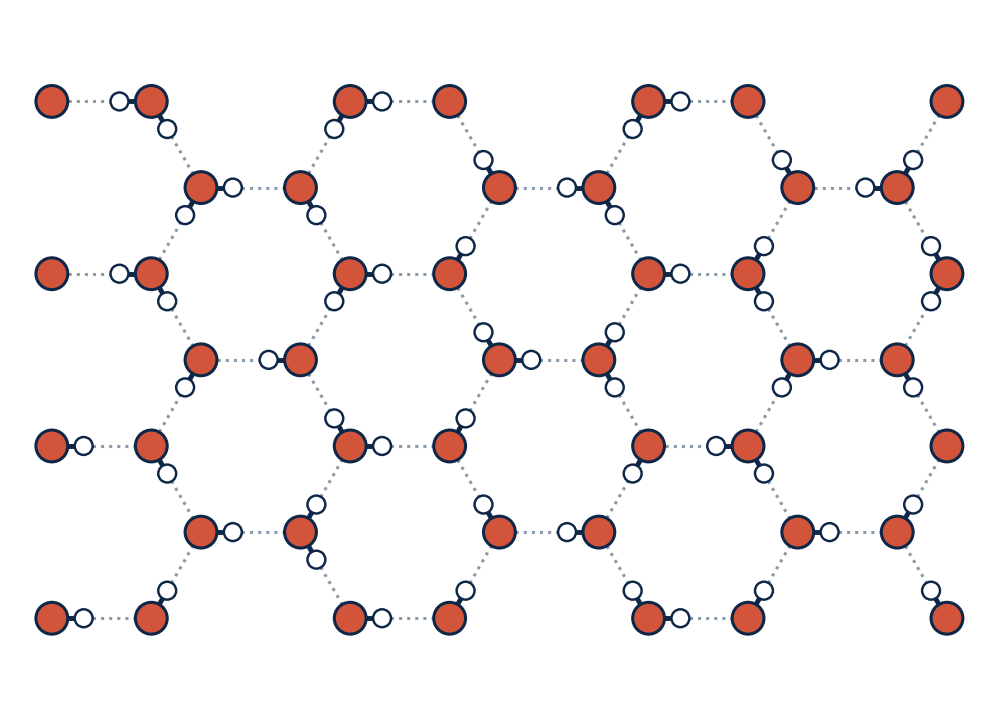
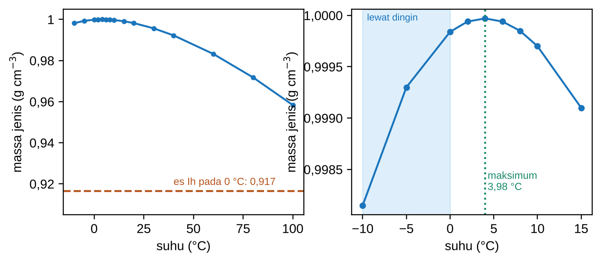

## 12.4 Ikatan hidrogen dan akibatnya

Subbab 2.13 memperkenalkan ikatan hidrogen X–H···Y lewat anomali titik didih NH₃, H₂O, dan HF, serta kekuatannya yang berkisar 10–40 kJ mol⁻¹. Di sini kita melihat bagaimana ikatan hidrogen dideteksi, seberapa beragam kekuatannya, dan senyawa-senyawa yang hanya ada karena ikatan hidrogen.

### Bukti spektroskopi

Bila atom H dari gugus X–H ditarik oleh pasangan bebas Y, ikatan X–H sedikit memanjang dan melemah. Akibatnya terlihat jelas dalam spektrum inframerah:

* Getaran regang O–H molekul air bebas (uap) berada pada sekitar 3700 cm⁻¹. Dalam air cair, pitanya bergeser ke sekitar 3400 cm⁻¹ dan menjadi sangat **lebar**, karena setiap molekul berada dalam lingkungan ikatan hidrogen yang sedikit berbeda dan terus berubah. Dalam es, pitanya bergeser lebih jauh ke sekitar 3200 cm⁻¹.
* Pergeseran makin besar untuk ikatan hidrogen yang makin kuat. Pada dimer asam karboksilat, pitanya turun ke sekitar 3000 cm⁻¹; pada ion bifluorida [F–H–F]⁻ (subbab 10.6), atom H tepat di tengah dan tidak ada lagi getaran "X–H" yang terpisah.
* Dalam spektrum ¹H NMR, proton yang terlibat ikatan hidrogen bergeser ke medan rendah (δ lebih besar), karena kerapatan elektron di sekitarnya berkurang.

Ikatan hidrogen juga terlihat dalam kristalografi: jarak O···O dalam es adalah 276 pm, jauh lebih pendek daripada jumlah jari-jari van der Waals dua atom O (304 pm).

Tabel 12.3 Ikatan hidrogen kuat, sedang, dan lemah.

| Jenis | Energi (kJ mol⁻¹) | Contoh | Ciri |
|---|---|---|---|
| Kuat | 60–170 | [F–H–F]⁻, [H₂O–H–OH₂]⁺ | H hampir di tengah, sebagian kovalen |
| Sedang | 15–60 | air, alkohol, asam karboksilat, DNA | elektrostatik terutama, terarah |
| Lemah | < 15 | C–H···O, O–H···π aromatik | hampir dispersi |

### Ikatan dihidrogen

Hidrogen hidridik (H^δ−^, subbab 12.3) dapat ditarik oleh hidrogen protik (H^δ+^) membentuk **ikatan dihidrogen** X–H^δ+^···^δ−^H–M. Contoh yang paling mencolok adalah amonia borana, H₃N–BH₃, yang isoelektronik dengan etana. Etana mendidih pada −89 °C; amonia borana adalah **padatan** yang meleleh pada sekitar 104 °C. Dalam kristalnya, jarak H···H antara N–H dan H–B hanya sekitar 200 pm, jauh lebih pendek daripada jarak van der Waals (240 pm). Amonia borana, yang mengandung 19,6 % massa hidrogen, diteliti sebagai bahan penyimpan hidrogen.

### Klatrat hidrat

Molekul air dapat membentuk kerangka berbentuk sangkar yang diikat ikatan hidrogen, dan molekul kecil (CH₄, CO₂, Ar, Xe, Cl₂) terperangkap di dalam rongganya. Padatan seperti ini disebut **klatrat hidrat** (atau hidrat gas). Molekul tamu tidak membentuk ikatan kimia dengan air; ia hanya menstabilkan kerangka yang tanpa tamu akan runtuh. Hidrat metana jenis sI mempunyai 46 molekul air yang membentuk 8 rongga per sel satuan, sehingga bila semua rongga terisi rumusnya CH₄·5,75H₂O.

::: {.contoh}
**Contoh 12.5 · Es yang dapat terbakar**

Hidrat metana sI (CH₄·5,75H₂O bila semua rongga terisi) mempunyai massa jenis sekitar 0,91 g cm⁻³. Berapa m³ gas metana (STP) yang dilepaskan 1 m³ hidrat?

**Penyelesaian.** *M*(CH₄·5,75H₂O) = 16,04 + 5,75 × 18,02 = 119,6 g mol⁻¹. Satu m³ hidrat = 910 kg = 7607 mol CH₄. Volume gas pada STP = 7607 × 0,022414 = **170 m³**.

**Memahami hasil.** Satu volume es hidrat menyimpan sekitar 170 volume gas metana (dalam kenyataan sekitar 164, karena tidak semua rongga terisi). Bongkahan hidrat yang dibawa ke permukaan laut dapat dinyalakan dan terbakar sambil meneteskan air: "es yang terbakar". Hidrat metana di dasar laut dan di bawah lapisan es abadi menyimpan karbon dalam jumlah yang sangat besar. Di satu sisi ia sumber energi potensial; di sisi lain, metana yang lepas bila lautan menghangat adalah gas rumah kaca yang kuat. Dalam industri, hidrat yang terbentuk di pipa gas alam bertekanan tinggi dapat menyumbat pipa, sehingga ditambahkan metanol atau glikol untuk mencegahnya.
:::

::: {.kuis}
**Kuis cepat 12.4** Mengapa pita regang O–H dalam spektrum IR air cair jauh lebih lebar daripada dalam uap air?
:::

## 12.5 Air dan es

Air adalah satu-satunya zat yang ditemukan secara alami di Bumi dalam ketiga wujudnya, dan hampir setiap sifatnya menyimpang dari zat sejenis. Kita telah melihat titik didihnya yang tinggi (subbab 2.13), kemampuannya melarutkan ion (subbab 10.1), dan autoionisasinya (subbab 10.3). Semua sifat itu berasal dari jaringan ikatan hidrogen.

### Struktur es

Dalam es biasa (**es Ih**, "h" untuk heksagonal), setiap atom O dikelilingi empat atom O lain secara tetrahedral pada jarak 276 pm. Dua di antaranya terhubung lewat atom H miliknya sendiri, dua lainnya lewat atom H tetangga. Jaringan ini membentuk lapisan-lapisan berlubang heksagonal yang bertumpuk, mirip wurtzit (subbab 5.5) dengan O menempati posisi Zn dan S sekaligus. Kisi tetrahedral seperti ini **terbuka**: bilangan koordinasi hanya 4, jauh dari 12 pada kemasan rapat, sehingga es mempunyai banyak ruang kosong.

{width=62%}

Posisi atom H dalam es mengikuti **aturan es** (Bernal dan Fowler, 1933):

1. Setiap atom O mempunyai tepat dua atom H yang dekat (ikatan kovalen 100 pm), sehingga molekul H₂O tetap utuh.
2. Setiap garis O···O memuat tepat satu atom H.

Aturan ini tidak menentukan posisi H secara unik: ada sangat banyak cara menempatkan atom-atom H yang semuanya memenuhi kedua aturan. Akibatnya, es tetap tidak teratur walaupun didinginkan sampai mendekati nol mutlak.

::: {.contoh}
**Contoh 12.6 · Entropi sisa es**

Linus Pauling (1935) menghitung jumlah susunan atom H yang mungkin dalam es. Setiap ikatan O···O mempunyai dua posisi untuk H (dekat O kiri atau kanan). Untuk *N* molekul air ada 2*N* ikatan, sehingga 2^2*N*^ susunan bila setiap ikatan bebas. Dari 16 cara menempatkan H pada empat ikatan di sekitar satu O, hanya 6 yang memberi tepat dua H dekat O itu. Hitung entropi sisa es, *S* = *k* ln *W*, per mol.

**Penyelesaian.** *W* = 2^2*N*^ × (6/16)^*N*^ = (4 × 6/16)^*N*^ = (3/2)^*N*^. Untuk satu mol, *S* = *k* ln (3/2)^*N*A^ = *R* ln (3/2) = 8,314 × 0,405 = **3,37 J K⁻¹ mol⁻¹**.

**Memahami hasil.** Pengukuran kalorimetri Giauque dan Stout (1936) memberi entropi sisa 3,4 J K⁻¹ mol⁻¹: kesesuaian yang luar biasa untuk perhitungan sesederhana ini. Es adalah contoh baku zat yang tidak memenuhi hukum ketiga termodinamika dalam bentuk sederhananya (*S* = 0 pada 0 K), karena ketidakteraturannya "membeku" sebelum sempat tertata. Ketidakteraturan proton yang sama memungkinkan proton berpindah di dalam es dan air.
:::

### Anomali massa jenis

Ketika es mencair, sebagian ikatan hidrogen putus dan jaringan terbuka sebagian runtuh: molekul-molekul dapat saling mendekat, sehingga air cair **lebih rapat** daripada es (0,9998 lawan 0,9167 g cm⁻³ pada 0 °C). Volume air bertambah sekitar 9 % ketika membeku, cukup untuk memecahkan pipa dan batu. Di atas 0 °C, dua efek bersaing: jaringan yang terus runtuh menaikkan massa jenis, sedangkan gerak termal yang makin kuat menurunkannya. Hasilnya massa jenis maksimum pada **3,98 °C**.

{width=94%}

Akibat bagi kehidupan sangat besar. Di musim dingin, air danau yang mendingin sampai 4 °C tenggelam ke dasar, sedangkan air yang lebih dingin tetap di atas dan membeku menjadi lapisan es yang mengapung dan mengisolasi air di bawahnya. Danau membeku dari atas ke bawah, bukan dari bawah ke atas, sehingga ikan dapat bertahan di dasar yang tetap sekitar 4 °C.

::: {.contoh}
**Contoh 12.7 · Garis leleh yang miring ke kiri**

Persamaan Clapeyron memberi kemiringan garis kesetimbangan padat–cair: d*T*/d*p* = *T*Δ*V*/Δ*H*. Untuk es pada 273,15 K, Δ~leleh~*H* = 6,01 kJ mol⁻¹, massa jenis es 0,9167 dan air 0,9998 g cm⁻³. (a) Hitung Δ~leleh~*V* per mol dan d*T*/d*p*. (b) Berapa tekanan yang diperlukan untuk menurunkan titik leleh 1 °C?

**Penyelesaian.** (a) Δ*V* = 18,015 × (1/0,9998 − 1/0,9167) cm³ = 18,019 − 19,652 = **−1,63 cm³ mol⁻¹** = −1,63 × 10⁻⁶ m³ mol⁻¹. d*T*/d*p* = 273,15 × (−1,63 × 10⁻⁶)/6010 = −7,4 × 10⁻⁸ K Pa⁻¹ = **−0,0074 K bar⁻¹**.

(b) Δ*p* = 1/0,0074 = **135 bar**.

**Memahami hasil.** Untuk hampir semua zat, padatan lebih rapat daripada cairan, Δ*V* positif, dan titik leleh naik dengan tekanan. Air adalah pengecualian: menekan es membuatnya meleleh, karena air cair memakan volume lebih kecil. Namun efeknya kecil: tekanan 135 bar hanya menurunkan titik leleh 1 °C.
:::

::: {.awas}
**Awas: es licin bukan karena tekanan.** Penjelasan populer bahwa sepatu seluncur meleleh es karena tekanan tidak cocok dengan angka. Seorang yang beratnya 70 kg di atas bilah seluas sekitar 2 cm² memberi tekanan sekitar 35 bar, yang hanya menurunkan titik leleh sekitar 0,25 °C; padahal orang dapat berseluncur pada −20 °C. Penyebab utamanya adalah lapisan "kuasi-cair" setebal beberapa nanometer yang selalu ada di permukaan es (molekul permukaan kekurangan tetangga untuk ikatan hidrogen), ditambah pemanasan oleh gesekan.
:::

### Air sebagai bahan kimia

Selain sebagai pelarut, air adalah pereaksi: asam dan basa Brønsted (Bab 8), ligan (Bab 11), oksidator dan reduktor dalam jendela 1,23 V (Bab 9). Proton bergerak di dalam air dengan **mekanisme Grotthuss**: sebuah proton tidak berenang menembus cairan, tetapi ikatan hidrogen dan ikatan kovalen bertukar peran secara berantai, H₃O⁺···OH₂ → H₂O···H–OH₂⁺. Akibatnya konduktivitas molar ion H⁺ (350 S cm² mol⁻¹) sekitar tujuh kali ion Na⁺ (50 S cm² mol⁻¹), walaupun ion H₃O⁺ lebih besar daripada Na⁺. Mekanisme yang sama terjadi pada OH⁻ dan di dalam es, serta dimanfaatkan dalam membran sel bahan bakar.

Air juga mempunyai banyak bentuk padat. Pada tekanan tinggi, ikatan hidrogen dibengkokkan dan jaringan saling menembus, menghasilkan sekitar dua puluh polimorf es yang dikenal (es II sampai es XIX dan seterusnya), dengan massa jenis sampai lebih dari 1,5 g cm⁻³. Es di dalam bulan-bulan es Jupiter dan Saturnus sebagian berada dalam bentuk-bentuk tekanan tinggi ini.

::: {.kuis}
**Kuis cepat 12.5** Mengapa danau membeku dari atas? Apa yang akan terjadi pada kehidupan di danau bila es lebih rapat daripada air?
:::
