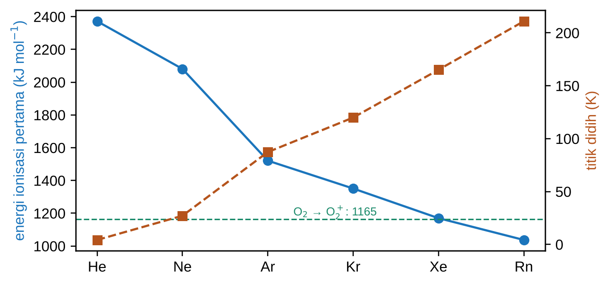
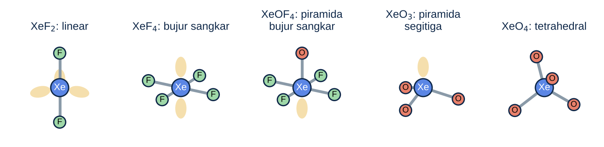

## 12.6 Gas mulia: sifat dan keberadaan

### Penemuan dari angka desimal ketiga

Pada 1892, Lord Rayleigh mengukur massa jenis nitrogen dengan sangat teliti untuk menentukan massa atomnya. Nitrogen yang ia peroleh dari udara (dengan membuang O₂, CO₂, dan uap air) mempunyai massa jenis 1,2572 g L⁻¹ pada STP. Nitrogen yang dibuat secara kimia, misalnya dari penguraian amonium nitrit, hanya 1,2505 g L⁻¹. Selisihnya hanya 0,5 %, tetapi selalu muncul, jauh di atas ketelitian pengukurannya. Rayleigh dan William Ramsay (1894) akhirnya mengisolasi gas berat yang bercampur dengan "nitrogen udara": unsur baru yang sama sekali tidak bereaksi, sehingga dinamai **argon** (Yunani *argos*, malas). Keduanya menerima Hadiah Nobel pada 1904. Satu abad sebelumnya, Henry Cavendish (1785) sudah mencatat gelembung kecil gas yang tidak mau bereaksi setelah nitrogen udara habis dibakar dengan oksigen, "tidak lebih dari 1/120 bagian", tetapi tidak menyelidikinya lebih jauh.

::: {.contoh}
**Contoh 12.8 · Menghitung argon dari selisih massa jenis**

Anggap "nitrogen udara" Rayleigh adalah campuran N₂ (1,2505 g L⁻¹) dan argon (1,7837 g L⁻¹). Berapa fraksi volume argon dalam campuran itu? Bandingkan dengan komposisi udara modern: N₂ 78,084 %, Ar 0,934 %.

**Penyelesaian.** Massa jenis campuran gas ideal adalah rata-rata berbobot fraksi volume *x*: 1,2505(1 − *x*) + 1,7837*x* = 1,2572, sehingga *x* = 0,0067/0,5332 = **1,26 %**. Komposisi modern memberi Ar/(N₂ + Ar) = 0,934/79,018 = **1,18 %**.

**Memahami hasil.** Selisih massa jenis setengah persen, yang mudah dianggap kesalahan percobaan, ternyata menyembunyikan satu persen unsur baru di udara yang kita hirup. Argon sebenarnya **lebih melimpah** di atmosfer daripada CO₂ (sekitar 0,04 %), dan sebagian besar berasal dari peluruhan radioaktif ⁴⁰K di kerak bumi selama miliaran tahun (Bab 13). Pelajaran Rayleigh berlaku untuk setiap kimiawan: angka yang "sedikit meleset" secara konsisten adalah petunjuk, bukan gangguan.
:::

Dalam empat tahun berikutnya, Ramsay dan Morris Travers mengisolasi **neon**, **kripton**, dan **xenon** (1898) dengan distilasi bertingkat udara cair. **Helium** sudah dikenal dari garis kuning 587,6 nm dalam spektrum matahari (1868), dan Ramsay menemukannya di Bumi dalam mineral uranium kleveit (1895). **Radon** ditemukan Friedrich Dorn (1900) sebagai gas radioaktif yang keluar dari radium. Unsur terakhir golongan ini, oganeson (Og, *Z* = 118), dibuat di laboratorium pada 2002 dalam jumlah beberapa atom saja.

### Keberadaan

Tabel 12.4 Sifat dan keberadaan gas mulia.

| Unsur | Titik didih (K) | Energi ionisasi (kJ mol⁻¹) | Kelimpahan di udara (ppm volume) | Sumber utama |
|---|---|---|---|---|
| He | 4,2 | 2372 | 5,24 | gas alam (sampai 7 %) |
| Ne | 27,1 | 2081 | 18,2 | distilasi udara cair |
| Ar | 87,3 | 1521 | 9340 | distilasi udara cair |
| Kr | 119,9 | 1351 | 1,14 | distilasi udara cair |
| Xe | 165,1 | 1170 | 0,087 | distilasi udara cair |
| Rn | 211 | 1037 | jejak | peluruhan radium (radioaktif) |

Helium hampir tidak ada di atmosfer karena terlalu ringan untuk ditahan gravitasi Bumi; ia terus lolos ke angkasa. Helium yang kita pakai berasal dari partikel alfa (inti ⁴He) yang dipancarkan uranium dan torium di kerak bumi (Bab 13), yang terperangkap bersama gas alam di lapisan batuan kedap selama ratusan juta tahun. Helium karena itu adalah sumber daya tak terbarukan: sekali dilepas ke udara, ia hilang selamanya.

### Tren sifat

{width=70%}

Kulit elektron yang penuh memberi gas mulia energi ionisasi tertinggi di setiap periode dan afinitas elektron nol atau negatif. Atom-atomnya hanya saling tarik lewat gaya dispersi London (subbab 2.12), yang makin kuat untuk atom yang lebih besar dan lebih mudah terpolarisasi. Karena itu titik didih naik tajam dari He (4,2 K) ke Rn (211 K), dan kelarutan dalam air juga naik ke bawah golongan.

Helium mempunyai perilaku yang unik. Ia tidak dapat dipadatkan pada tekanan 1 atm berapa pun dinginnya (diperlukan sekitar 25 bar), karena energi titik nol atom yang sangat ringan lebih besar daripada tarikan antaratomnya yang sangat lemah: efek kuantum yang sama dengan subbab 12.1, tetapi dalam skala yang lebih dramatis. Di bawah 2,17 K, helium-4 cair berubah menjadi **superfluida** (He II) yang mengalir tanpa kekentalan sama sekali dan dapat merayap naik ke dinding wadahnya.

::: {.kuis}
**Kuis cepat 12.6** Mengapa titik didih gas mulia naik dari He ke Rn? Mengapa radon, walaupun berbahaya, lebih mudah larut dalam air daripada helium?
:::

## 12.7 Senyawa xenon: fluorida, oksida, dan bentuknya

### Bartlett dan XePtF₆

Pembuka Bab 2 menceritakan percobaan Neil Bartlett (1962). Ia sebelumnya menemukan bahwa PtF₆, oksidator yang sangat kuat, dapat mengoksidasi molekul O₂ menjadi kation dioksigenil: O₂ + PtF₆ → [O₂]⁺[PtF₆]⁻. Energi ionisasi O₂ (1165 kJ mol⁻¹) hampir sama dengan xenon (1170 kJ mol⁻¹), dan jari-jari O₂⁺ dan Xe⁺ juga mirip, sehingga energi kisi garam yang terbentuk akan hampir sama. Bila PtF₆ dapat mengoksidasi O₂, ia seharusnya juga dapat mengoksidasi xenon. Bartlett mencampurkan keduanya dan mendapat padatan jingga-kuning, yang semula ia rumuskan sebagai "Xe⁺[PtF₆]⁻". Strukturnya ternyata lebih rumit (campuran [XeF]⁺[PtF₆]⁻ dan [XeF]⁺[Pt₂F₁₁]⁻), tetapi kesimpulannya tetap: **gas mulia dapat bereaksi**. Penalaran Bartlett adalah contoh indah memakai tren periodik (Gambar 12.7) untuk meramalkan kimia baru.

Mengapa xenon, bukan neon atau helium? Energi ionisasi turun tajam ke bawah golongan (Gambar 12.7): elektron valensi xenon berada jauh dari inti dan diperisai banyak kulit dalam. Kripton hanya membentuk sedikit senyawa (KrF₂ dan turunannya), argon hampir tidak sama sekali, dan untuk neon serta helium tidak ada senyawa netral yang stabil.

### Fluorida xenon

Xenon bereaksi langsung dengan fluor membentuk tiga fluorida. Hasilnya ditentukan oleh perbandingan pereaksi dan kondisi:

$$\text{Xe} + \text{F}_2 \rightarrow \text{XeF}_2 \qquad \text{(Xe berlebih; dipanaskan atau disinari)}$$
$$\text{Xe} + 2\text{F}_2 \rightarrow \text{XeF}_4 \qquad \text{(Xe : F}_2 \approx 1 : 5\text{, 400 °C, 6 atm)}$$
$$\text{Xe} + 3\text{F}_2 \rightarrow \text{XeF}_6 \qquad \text{(Xe : F}_2 \approx 1 : 20\text{, 300 °C, 60 atm)}$$

Ketiganya padatan tak berwarna yang mudah menyublim. Mereka stabil bila kering, tetapi terhidrolisis oleh air dan merupakan oksidator serta agen fluorinasi yang kuat. XeF₂ dijual secara komersial sebagai agen fluorinasi yang bersih (produk sampingannya hanya gas Xe) dan dipakai untuk mengetsa silikon dalam pembuatan sensor mikro.

::: {.contoh}
**Contoh 12.9 · Mengapa fluorida xenon stabil**

Energi ikatan rata-rata Xe–F sekitar 133 kJ mol⁻¹ (XeF₂), 131 (XeF₄), dan 126 (XeF₆); energi ikatan F–F 158,7 kJ mol⁻¹. (a) Perkirakan Δ*H* pembentukan masing-masing dari Xe(g) dan F₂(g). (b) Ramalkan bentuk XeF₂, XeF₄, dan XeF₆ dengan VSEPR.

**Penyelesaian.** (a) Δ*H* ≈ (energi ikatan F–F diputus) − (energi Xe–F dibentuk):

* XeF₂: 158,7 − 2 × 133 = **−107 kJ mol⁻¹**
* XeF₄: 2 × 158,7 − 4 × 131 = **−207 kJ mol⁻¹**
* XeF₆: 3 × 158,7 − 6 × 126 = **−280 kJ mol⁻¹**

(b) Xe mempunyai 8 elektron valensi. XeF₂: 2 ikatan + 3 pasangan bebas = AX₂E₃, **linear** (pasangan bebas di bidang ekuatorial bipiramida trigonal). XeF₄: AX₄E₂, **bujur sangkar** (subbab 2.5). XeF₆: AX₆E, tujuh pasangan elektron; bentuknya **oktahedron terdistorsi** yang berubah-ubah (fluksional), karena pasangan bebas berpindah-pindah di antara sisi oktahedron.

**Memahami hasil.** Ikatan Xe–F tidak kuat (bandingkan C–F 485 kJ mol⁻¹), tetapi ikatan F–F jauh lebih lemah lagi (158,7 kJ mol⁻¹, karena tolakan pasangan bebas pada dua atom F kecil yang berdekatan). Pembentukan fluorida xenon menguntungkan karena memutus ikatan yang lemah, bukan karena membentuk ikatan yang kuat. Inilah sebabnya fluor, bukan klor atau oksigen, yang dapat bereaksi langsung dengan xenon: XeCl₂ dan XeO₃ tidak stabil terhadap unsur-unsurnya. Ikatan dalam XeF₂ paling baik dijelaskan dengan **ikatan tiga pusat empat elektron** (subbab 4.8): satu orbital p Xe dan dua orbital F membentuk orbital ikatan, nonikatan, dan antiikatan, dengan empat elektron mengisi dua orbital terbawah. Muatan negatif terkumpul pada kedua F, sehingga hanya ligan yang sangat elektronegatif yang dapat menstabilkan Xe hipervalen (subbab 2.3).
:::

### Oksida, fluorida okso, dan kation

Fluorida xenon terhidrolisis dalam air. XeF₆ menghasilkan **xenon trioksida**:

$$\text{XeF}_6 + 3\text{H}_2\text{O} \rightarrow \text{XeO}_3 + 6\text{HF}$$

XeO₃ (piramida segitiga, AX₃E) adalah padatan yang **sangat mudah meledak** (Δ~f~*H*° sekitar +400 kJ mol⁻¹), tetapi larutannya dalam air cukup stabil dan merupakan oksidator kuat. Dalam basa kuat, Xe(VI) terdisproporsionasi menjadi gas Xe dan ion **perxenat** [XeO₆]⁴⁻ (Xe +8, oktahedral), salah satu oksidator terkuat dalam air: ia mengoksidasi Mn²⁺ langsung menjadi MnO₄⁻. Dari perxenat dan asam sulfat pekat diperoleh **xenon tetroksida** XeO₄, gas tetrahedral yang juga mudah meledak. Hidrolisis parsial XeF₆ memberi XeOF₄ (piramida bujur sangkar, AX₅E).

{width=96%}

Fluorida xenon juga berperilaku sebagai **donor dan akseptor ion fluorida**, seperti BrF₃ dalam subbab 10.7. Dengan asam Lewis kuat, XeF₂ memberikan F⁻ dan membentuk kation: XeF₂ + SbF₅ → [XeF]⁺[SbF₆]⁻. Dengan donor F⁻, XeF₆ menerima fluorida: XeF₆ + CsF → Cs⁺[XeF₇]⁻. Bahkan xenon dapat menjadi **ligan** bagi ion logam: pada 2000, Konrad Seppelt dan Stefan Seidel membuat kation [AuXe₄]²⁺, dengan empat atom Xe terikat pada Au(II) dalam susunan bujur sangkar, sebuah kompleks koordinasi (Bab 11) dengan gas mulia sebagai basa Lewis.

### Kripton dan argon

KrF₂ (1963) adalah satu-satunya fluorida kripton biner. Ia termodinamika tidak stabil (Δ~f~*H*° positif) dan harus dibuat dengan cara yang memberi energi (lucutan listrik atau penyinaran Kr dan F₂ pada suhu sangat rendah). Justru karena tidak stabil, KrF₂ adalah agen fluorinasi terkuat yang dikenal; ia dapat mengoksidasi emas menjadi AuF₅. Untuk argon, satu-satunya senyawa netral yang diketahui adalah HArF, yang dibuat Markku Räsänen dan rekan (2000) dengan menyinari HF di dalam matriks argon padat pada 7,5 K; ia terurai bila dipanaskan di atas sekitar 27 K.

::: {.kuis}
**Kuis cepat 12.7** Tentukan bilangan oksidasi Xe dan bentuk VSEPR untuk XeF₂, XeO₃, XeOF₄, [XeF]⁺, dan [XeO₆]⁴⁻.
:::

## 12.8 Penerapan gas mulia

Sifat gas mulia, yaitu tidak reaktif, mempunyai garis spektrum yang khas, mudah terionisasi dalam lucutan listrik, dan (untuk He) titik didih sangat rendah, menentukan hampir semua pemakaiannya:

* **Helium.** Pendingin magnet superkonduktor MRI dan akselerator partikel: kawat NbTi baru menjadi superkonduktor di bawah sekitar 9 K, sehingga harus direndam dalam helium cair (4,2 K). Juga sebagai gas pengangkat balon dan kapal udara (tidak terbakar, berbeda dengan hidrogen), gas pembawa kromatografi gas, pendeteksi kebocoran (atomnya kecil dan mudah dideteksi dengan spektrometer massa), dan campuran napas penyelam laut dalam (heliox), karena helium kurang larut dalam darah daripada nitrogen sehingga mengurangi bahaya penyakit dekompresi dan efek narkotik nitrogen.
* **Neon.** Lampu iklan yang berpendar jingga-merah dalam lucutan listrik, dan laser helium–neon (632,8 nm) yang dahulu dipakai di pemindai kode batang.
* **Argon.** Atmosfer pelindung dalam pengelasan, peleburan logam reaktif (Ti), dan pembuatan kristal silikon; pengisi bola lampu pijar (memperlambat penguapan filamen wolfram); atmosfer kotak sarung tangan (*glovebox*) untuk senyawa yang peka udara. Argon dipilih karena murah: ia hasil sampingan produksi oksigen dan nitrogen cair.
* **Kripton dan xenon.** Lampu lucutan berintensitas tinggi (lampu sorot bioskop, lampu depan mobil "xenon"), lampu kilat kamera, dan pendorong ion pada wahana antariksa: ion Xe⁺ yang berat dipercepat medan listrik menghasilkan dorongan yang kecil tetapi sangat efisien selama bertahun-tahun (wahana Dawn ke asteroid Vesta dan Ceres). Xenon juga **obat bius** yang hampir ideal: bekerja cepat, hampir tidak dimetabolisme, dan aman bagi jantung, tetapi mahal karena kelimpahannya hanya 0,087 ppm. Isotop ¹²⁹Xe yang dihiperpolarisasi dengan laser dipakai untuk pencitraan MRI paru-paru.
* **Radon.** Bukan penerapan, melainkan bahaya. Radon-222 (waktu paruh 3,82 hari) terbentuk terus-menerus dari peluruhan uranium di batuan dan tanah, merembes ke dalam ruang bawah tanah, dan terhirup. Di dalam paru-paru, ia dan hasil peluruhannya (isotop polonium dan timbal yang radioaktif) memancarkan partikel alfa yang merusak sel. Menurut WHO, radon adalah penyebab kanker paru-paru terbesar kedua setelah merokok.

::: {.terapan}
**Krisis helium.** Helium cair yang mendinginkan sekitar 50 000 mesin MRI di seluruh dunia, serta banyak spektrometer NMR di laboratorium kimia, berasal dari sedikit ladang gas alam di Amerika Serikat, Qatar, Aljazair, dan Rusia. Ketika pasokan terganggu, harga helium melonjak berlipat dan laboratorium terpaksa mematikan magnet NMR. Karena itu laboratorium modern memasang sistem pemulihan yang menangkap dan mencairkan kembali helium yang menguap, dan generasi baru mesin MRI dirancang dengan helium tertutup yang hanya beberapa liter, bukan ribuan liter seperti dulu.
:::

::: {.kuis}
**Kuis cepat 12.8** Mengapa argon, bukan nitrogen, dipakai untuk melindungi pengelasan titanium? (Petunjuk: titanium bereaksi dengan N₂ pada suhu tinggi.) Mengapa helium, bukan argon, dipakai untuk mendinginkan magnet MRI?
:::

## Menuju bab berikutnya

Paladium menyerap hidrogen sampai hampir 900 kali volumenya karena molekul H₂ terdisosiasi di permukaannya dan atom-atom H menempati rongga oktahedral kisi logam, lebih rapat daripada di dalam hidrogen cair. Xenon bereaksi dengan fluor karena energi ionisasinya cukup rendah dan ikatan F–F cukup lemah; bentuk senyawanya tepat seperti ramalan VSEPR, dan ikatannya dijelaskan oleh orbital tiga pusat. Hidrogen dan gas mulia, dua ujung tabel periodik, ternyata dapat dipahami dengan alat-alat yang sama: tren periodik, ikatan, energetika, dan struktur.

Di beberapa tempat dalam bab ini kita bertemu inti atom: tritium yang radioaktif, air berat sebagai moderator reaktor, helium yang berasal dari partikel alfa, argon dari peluruhan ⁴⁰K, dan radon yang memancarkan alfa di paru-paru. Semua kimia sejauh ini hanya melibatkan elektron; inti dianggap tidak berubah. Bab 13, bab terakhir buku ini, membuka inti itu: kestabilan inti dan energi ikat, jenis-jenis peluruhan radioaktif dan kinetikanya, reaksi inti, fisi dan fusi, serta penggunaan radioisotop dalam kimia, kedokteran, dan penentuan umur.
