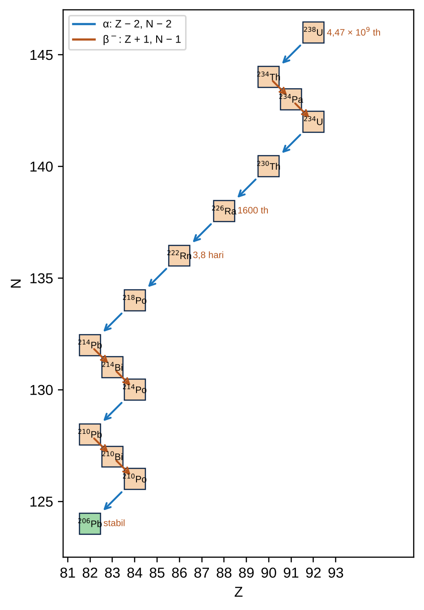
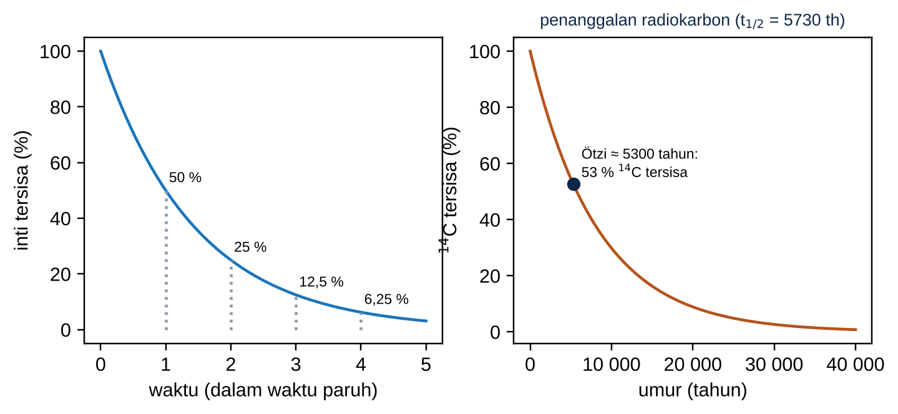

## 13.3 Peluruhan α, β, γ, dan penangkapan elektron

Inti yang tidak stabil berubah dengan sendirinya menjadi inti lain sambil memancarkan partikel atau foton. Proses ini disebut **peluruhan radioaktif**. Ernest Rutherford (1899) membedakan dua jenis pancaran dari uranium menurut daya tembusnya, sinar alfa dan beta; sinar gama ditemukan Paul Villard setahun kemudian. Dalam setiap reaksi inti, **jumlah nomor massa dan jumlah muatan harus sama** di kedua ruas, seperti penyetaraan reaksi kimia.

Energi yang dilepaskan peluruhan disebut **nilai *Q***, dihitung dari selisih massa atom pereaksi dan hasil (prinsipnya sama dengan persamaan (13.2)). Peluruhan hanya dapat terjadi bila *Q* > 0.

### Peluruhan alfa

Inti memancarkan partikel alfa, yaitu inti ⁴He: nomor atom turun 2, nomor massa turun 4.

$${}^{238}_{92}\text{U} \rightarrow {}^{234}_{90}\text{Th} + {}^{4}_{2}\text{He}$$

Peluruhan alfa hampir hanya terjadi pada inti berat (*A* > 150, terutama *Z* > 83), yang terlalu besar untuk diikat sempurna oleh gaya kuat yang berjangkauan pendek. Mengapa yang keluar adalah partikel ⁴He, bukan proton atau neutron tunggal? Karena ⁴He mempunyai energi ikat yang sangat besar (28,3 MeV, Contoh 13.2). Melepaskan satu nukleon dari inti berat memerlukan energi sekitar 6–8 MeV, sedangkan melepaskan empat nukleon yang langsung bergabung menjadi ⁴He **melepaskan** energi.

Partikel alfa harus menembus penghalang Coulomb yang tingginya sekitar 25–30 MeV, padahal energinya hanya 4–9 MeV. Menurut mekanika klasik hal ini mustahil. George Gamow (1928) menjelaskannya dengan **penerowongan kuantum** (*Kimia Kuantum*): peluang menembus sangat peka terhadap energi, sehingga waktu paruh pemancar alfa berkisar dari mikrodetik (²¹²Po, 8,78 MeV) sampai miliaran tahun (²³⁸U, 4,2 MeV).

### Peluruhan beta minus

Inti dengan **kelebihan neutron** (di atas pita kestabilan) mengubah satu neutron menjadi proton, sambil memancarkan elektron (partikel β⁻) dan antineutrino:

$$\text{n} \rightarrow \text{p} + e^- + \bar{\nu}_e \qquad {}^{14}_{6}\text{C} \rightarrow {}^{14}_{7}\text{N} + e^- + \bar{\nu}_e$$

Nomor atom naik 1, nomor massa tetap. Elektron yang dipancarkan tidak berasal dari kulit elektron atom; ia dibuat di dalam inti pada saat peluruhan. Energi elektron beta tersebar kontinu dari nol sampai *Q*, karena energinya dibagi dengan antineutrino yang tidak terlihat. Spektrum kontinu ini membuat Wolfgang Pauli (1930) meramalkan keberadaan neutrino, yang baru terdeteksi pada 1956.

### Peluruhan beta plus dan penangkapan elektron

Inti dengan **kelebihan proton** (di bawah pita) mengubah satu proton menjadi neutron dengan salah satu dari dua cara:

* **Peluruhan β⁺**: memancarkan positron (antipartikel elektron) dan neutrino, misalnya ¹⁸F → ¹⁸O + *e*⁺ + ν~e~. Karena dalam massa atom anak ada satu elektron lebih sedikit dan positron harus diciptakan, peluruhan ini hanya mungkin bila selisih massa atom lebih besar daripada 2*m*~e~*c*² = **1,022 MeV**. Positron yang dipancarkan segera bertemu elektron dan keduanya musnah menjadi dua foton gama 511 keV yang berlawanan arah: dasar pencitraan PET (subbab 13.7).
* **Penangkapan elektron** (EC): inti menangkap satu elektron dari kulit dalam (biasanya kulit K), p + *e*⁻ → n + ν~e~. Elektron kulit luar lalu turun mengisi kekosongan, sehingga atom memancarkan sinar-X khas unsur anak. Penangkapan elektron cukup memerlukan *Q* > 0, sehingga ia satu-satunya jalan bila selisih massa kurang dari 1,022 MeV.

### Peluruhan gama dan isomer

Setelah peluruhan α atau β, inti anak sering berada dalam **keadaan tereksitasi**, sama seperti atom yang elektronnya tereksitasi. Inti turun ke keadaan dasar dengan memancarkan foton **gama** (energi keV–MeV). Nomor atom dan nomor massa tidak berubah. Bila keadaan tereksitasi itu berumur panjang, ia disebut **isomer inti**, ditandai dengan m: ⁹⁹ᵐTc (waktu paruh 6,01 jam) memancarkan gama 140 keV dan menjadi ⁹⁹Tc, radioisotop terpenting dalam kedokteran nuklir.

Tabel 13.2 Ringkasan jenis peluruhan.

| Jenis | Yang dipancarkan | Δ*Z* | Δ*A* | Terjadi pada | Daya tembus |
|---|---|---|---|---|---|
| α | ⁴He²⁺ | −2 | −4 | inti berat | dihentikan kertas atau kulit |
| β⁻ | *e*⁻ + ν̄ | +1 | 0 | kelebihan neutron | beberapa mm aluminium |
| β⁺ | *e*⁺ + ν | −1 | 0 | kelebihan proton, *Q* > 1,022 MeV | beberapa mm (lalu musnah menjadi 2γ) |
| EC | ν (+ sinar-X) | −1 | 0 | kelebihan proton | (sinar-X) |
| γ | foton | 0 | 0 | inti tereksitasi | beberapa cm timbal |

::: {.contoh}
**Contoh 13.4 · Nilai *Q* dan jenis peluruhan**

Massa atom (u): ²³⁸U 238,050 788; ²³⁴Th 234,043 601; ⁴He 4,002 603; ¹⁴C 14,003 242; ¹⁴N 14,003 074; ¹⁸F 18,000 937; ¹⁸O 17,999 160; ⁴⁰K 39,963 998; ⁴⁰Ca 39,962 591; ⁴⁰Ar 39,962 383. Hitung *Q* untuk (a) peluruhan α ²³⁸U; (b) β⁻ ¹⁴C; (c) β⁺ ¹⁸F; (d) ketiga kemungkinan peluruhan ⁴⁰K.

**Penyelesaian.** (a) *Q* = (238,050 788 − 234,043 601 − 4,002 603) × 931,494 = **4,27 MeV**. Partikel alfa membawa 234/238 dari energi ini, **4,20 MeV**; sisanya menjadi energi pentalan inti Th.

(b) Pada β⁻, massa atom anak sudah mengandung elektron tambahan: *Q* = (14,003 242 − 14,003 074) × 931,494 = **0,156 MeV**.

(c) *Q* = (18,000 937 − 17,999 160) × 931,494 − 1,022 = 1,656 − 1,022 = **0,634 MeV**.

(d) ⁴⁰K → ⁴⁰Ca (β⁻): **1,31 MeV**. ⁴⁰K → ⁴⁰Ar (EC): **1,50 MeV**. ⁴⁰K → ⁴⁰Ar (β⁺): 1,50 − 1,02 = **0,48 MeV**. Ketiganya mungkin. Dalam kenyataan sekitar 89 % ⁴⁰K meluruh β⁻ menjadi ⁴⁰Ca, sekitar 11 % menangkap elektron menjadi ⁴⁰Ar, dan sangat sedikit (0,001 %) β⁺.

**Memahami hasil.** ⁴⁰K adalah inti ganjil–ganjil (*Z* = 19, *N* = 21) yang terjepit di antara dua isobar genap–genap yang lebih stabil, sehingga ia dapat meluruh ke dua arah. Peluruhannya, dengan waktu paruh 1,25 miliar tahun, menghasilkan hampir seluruh argon di atmosfer Bumi (subbab 12.6) dan menjadi dasar penanggalan kalium–argon untuk batuan vulkanik. Tubuh manusia mengandung sekitar 140 g kalium, dan ⁴⁰K di dalamnya mengalami sekitar 4400 peluruhan setiap detik.
:::

### Deret peluruhan

Inti anak hasil peluruhan sering juga radioaktif, sehingga terjadi **deret peluruhan** yang panjang sampai mencapai inti stabil. Karena peluruhan α mengurangi *A* sebanyak 4 dan peluruhan β tidak mengubah *A*, semua anggota satu deret mempunyai sisa *A* dibagi 4 yang sama. Ada tiga deret alam: deret **uranium** (*A* = 4*n* + 2, dari ²³⁸U ke ²⁰⁶Pb), deret **aktinium** (4*n* + 3, dari ²³⁵U ke ²⁰⁷Pb), dan deret **torium** (4*n*, dari ²³²Th ke ²⁰⁸Pb). Deret keempat (4*n* + 1, dari ²³⁷Np) sudah punah di alam karena waktu paruh terpanjangnya jauh lebih pendek daripada umur Bumi.

{width=50%}

Deret ini menjelaskan mengapa radium dan radon selalu ada dalam bijih uranium, mengapa helium terkumpul dalam gas alam (delapan partikel alfa per atom ²³⁸U), dan mengapa timbal dalam bijih uranium mempunyai komposisi isotop yang berbeda dari timbal biasa. Pengamatan semacam ini membuat Frederick Soddy dan Kazimierz Fajans (1913) merumuskan **hukum pergeseran** (α: dua tempat ke kiri dalam tabel periodik; β⁻: satu tempat ke kanan) dan membuat Soddy memperkenalkan istilah **isotop** (Yunani: "tempat yang sama").

::: {.kuis}
**Kuis cepat 13.3** Ramalkan jenis peluruhan yang paling mungkin: (a) ³H; (b) ¹¹C; (c) ²²²Rn; (d) ⁶⁰Co; (e) ⁷Be (*Q* = 0,86 MeV). Tuliskan persamaannya.
:::

## 13.4 Kinetika peluruhan dan waktu paruh

### Hukum peluruhan

Peluruhan radioaktif adalah proses acak: setiap inti mempunyai peluang yang sama untuk meluruh dalam selang waktu tertentu, tidak peduli berapa lama ia sudah ada, dan tidak dipengaruhi suhu, tekanan, atau bentuk kimia (kecuali sedikit untuk penangkapan elektron). Akibatnya laju peluruhan sebanding dengan jumlah inti yang ada, kinetika **orde pertama**:

$$A = -\frac{dN}{dt} = \lambda N \qquad N = N_0\,e^{-\lambda t} \qquad t_{1/2} = \frac{\ln 2}{\lambda} \qquad \text{(13.4)}$$

*A* adalah **aktivitas** (jumlah peluruhan per detik), λ tetapan peluruhan, dan *t*~½~ **waktu paruh**: waktu yang diperlukan agar separuh inti meluruh. Satuan SI aktivitas adalah **becquerel** (1 Bq = 1 peluruhan per detik); satuan lama **curie** (1 Ci = 3,7 × 10¹⁰ Bq) didefinisikan dari aktivitas satu gram radium.

{width=94%}

Waktu paruh berkisar dari kurang dari mikrodetik sampai jauh melebihi umur alam semesta (²⁰⁹Bi, 2 × 10¹⁹ tahun, sehingga "stabil" dalam praktik). Setelah 10 waktu paruh, tersisa sekitar 1/1000 (2⁻¹⁰ = 0,098 %), aturan praktis untuk menyatakan suatu radioisotop "habis".

::: {.contoh}
**Contoh 13.5 · Aktivitas satu gram radium**

Hitung aktivitas 1,000 g ²²⁶Ra (*t*~½~ = 1600 tahun; *M* = 226,03 g mol⁻¹) dan bandingkan dengan definisi curie.

**Penyelesaian.** *N* = (1,000/226,03) × 6,022 × 10²³ = 2,664 × 10²¹ atom. λ = 0,6931/(1600 × 3,156 × 10⁷ s) = 1,373 × 10⁻¹¹ s⁻¹. *A* = λ*N* = **3,66 × 10¹⁰ Bq**, sekitar 0,99 Ci.

**Memahami hasil.** Curie didefinisikan dari pengukuran Marie Curie atas radium (3,7 × 10¹⁰ Bq). Hasil hitung sedikit berbeda karena waktu paruh radium kini diketahui lebih teliti. Tiga puluh enam miliar peluruhan setiap detik, masing-masing melepaskan sekitar 4,9 MeV ditambah energi dari anak-anaknya, memberi panas yang ditemukan Pierre Curie: sekitar 0,03 W per gram radium murni, dan beberapa kali lipat lebih bila anak-anak peluruhannya ikut terkumpul.
:::

### Penanggalan radiometrik

Karena laju peluruhan tidak dipengaruhi lingkungan, radioisotop adalah **jam** yang sangat andal.

**Radiokarbon.** Willard Libby (Hadiah Nobel 1960) menyadari bahwa sinar kosmik terus membuat ¹⁴C di atmosfer atas, lewat reaksi neutron dengan nitrogen, ¹⁴N + n → ¹⁴C + p. Karbon-14 teroksidasi menjadi ¹⁴CO₂, bercampur dengan CO₂ atmosfer, dan masuk ke semua makhluk hidup lewat fotosintesis dan rantai makanan. Selama hidup, perbandingan ¹⁴C/¹²C dalam organisme sama dengan atmosfer, sekitar 1,2 × 10⁻¹², yang memberi aktivitas sekitar 0,23 Bq per gram karbon. Setelah mati, pertukaran berhenti dan ¹⁴C meluruh dengan waktu paruh 5730 tahun.

::: {.contoh}
**Contoh 13.6 · Umur manusia es**

Pada 1991, mayat seorang pria yang membeku ditemukan di gletser Pegunungan Alpen di perbatasan Austria–Italia, dan dijuluki Ötzi. Karbon dari jaringan tubuhnya mempunyai sekitar 53 % aktivitas ¹⁴C karbon modern. Berapa umurnya?

**Penyelesaian.** *N*/*N*₀ = 0,53 = *e*^−λ*t*^. *t* = ln(1/0,53) × *t*~½~/ln 2 = 0,635 × 5730/0,693 = **5250 tahun**.

**Memahami hasil.** Ötzi hidup sekitar 3300 SM, pada zaman tembaga; kapak tembaganya, yang ditemukan bersamanya, cocok dengan umur itu. Dalam praktik, umur radiokarbon dikoreksi dengan **kurva kalibrasi** dari lingkaran tahun pohon dan stalaktit, karena kadar ¹⁴C atmosfer tidak benar-benar tetap sepanjang sejarah. Penanggalan radiokarbon berguna sampai sekitar 50 000 tahun (sekitar sembilan waktu paruh); setelah itu ¹⁴C yang tersisa terlalu sedikit untuk diukur. Pengukuran modern tidak lagi menghitung peluruhan, tetapi langsung menghitung atom ¹⁴C dengan **spektrometri massa akselerator**, yang cukup memerlukan beberapa miligram karbon.
:::

**Uranium–timbal.** Untuk batuan yang berumur jutaan sampai miliaran tahun, dipakai isotop berumur panjang. Mineral zirkon (ZrSiO₄) menerima uranium ke dalam kisinya ketika mengkristal, tetapi menolak timbal karena ukuran dan muatannya tidak cocok (Bab 5). Semua timbal di dalam zirkon karena itu berasal dari peluruhan uranium. Bila *N*~Pb~ atom ²⁰⁶Pb terbentuk dari *N*~U~ atom ²³⁸U yang tersisa, maka *N*~Pb~ + *N*~U~ = *N*₀ dan

$$t = \frac{1}{\lambda}\ln\left(1 + \frac{N_\text{Pb}}{N_\text{U}}\right) \qquad \text{(13.5)}$$

Untuk ²³⁸U (*t*~½~ = 4,468 × 10⁹ tahun), perbandingan Pb/U = 1 berarti umur tepat satu waktu paruh. Clair Patterson (1956) memakai isotop timbal meteorit untuk menetapkan umur Bumi **4,55 miliar tahun**. Kristal zirkon tertua dari Jack Hills, Australia, berumur 4,4 miliar tahun: saksi tertua kerak Bumi.

::: {.kuis}
**Kuis cepat 13.4** Sebuah sampel radioisotop mempunyai aktivitas 8000 Bq. Setelah 12 jam, aktivitasnya 1000 Bq. Berapa waktu paruhnya? Berapa aktivitasnya setelah 24 jam?
:::
