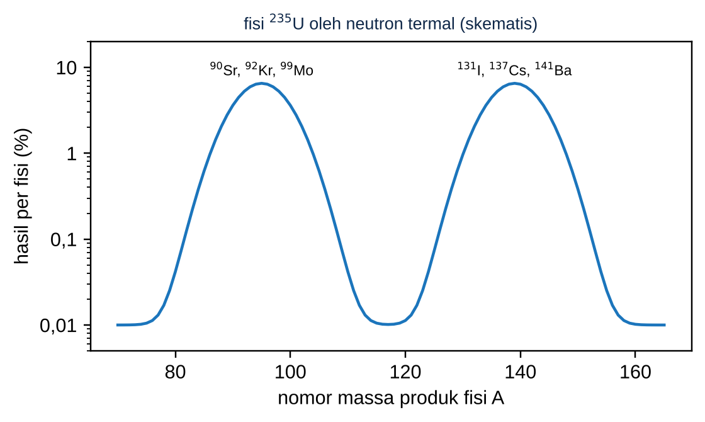

## 13.5 Reaksi inti, fisi, dan fusi

### Transmutasi buatan

Pada 1919, Rutherford menembaki gas nitrogen dengan partikel alfa dari radium dan mendeteksi proton yang keluar. Ia telah melakukan **transmutasi** buatan pertama, mengubah satu unsur menjadi unsur lain:

$${}^{14}_{7}\text{N} + {}^{4}_{2}\text{He} \rightarrow {}^{17}_{8}\text{O} + {}^{1}_{1}\text{H}$$

Reaksi inti ditulis ringkas dalam notasi **sasaran(proyektil, partikel keluar)hasil**: ¹⁴N(α,p)¹⁷O. Penyetaraannya mengikuti kekekalan nomor massa dan muatan. Penemuan neutron oleh James Chadwick (1932) lewat ⁹Be(α,n)¹²C memberi proyektil yang jauh lebih efektif: neutron tidak bermuatan, sehingga tidak ditolak inti dan dapat masuk bahkan dengan energi sangat rendah.

Dengan reaksi inti, kimiawan dapat **membuat unsur baru**. Teknesium, unsur pertama yang dibuat manusia, diperoleh Carlo Perrier dan Emilio Segrè (1937) dari lembaran molibdenum yang ditembaki deuteron di siklotron. Unsur transuranium pertama, neptunium dan plutonium, dibuat pada 1940 dengan penangkapan neutron oleh uranium diikuti peluruhan β⁻:

$${}^{238}_{92}\text{U} + {}^{1}_{0}\text{n} \rightarrow {}^{239}_{92}\text{U} \xrightarrow{\beta^-} {}^{239}_{93}\text{Np} \xrightarrow{\beta^-} {}^{239}_{94}\text{Pu}$$

Glenn Seaborg dan rekan kemudian membuat unsur 95–102 dan menyadari bahwa unsur-unsur itu membentuk deret **aktinida** di bawah lantanida, mengubah bentuk tabel periodik. Unsur terberat yang dikenal kini, oganeson (*Z* = 118), dibuat dengan menembakkan ion ⁴⁸Ca ke sasaran kalifornium, beberapa atom dalam berbulan-bulan percobaan.

### Fisi inti

Pada Desember 1938, Otto Hahn dan Fritz Strassmann menembaki uranium dengan neutron dan, dengan analisis kimia yang teliti, menemukan **barium** di antara hasilnya, unsur yang massanya kira-kira separuh uranium. Lise Meitner dan Otto Frisch menafsirkan hasil itu: inti uranium terbelah menjadi dua, sebuah proses yang mereka namai **fisi**. Inti ²³⁵U yang menangkap neutron lambat menjadi ²³⁶U yang tereksitasi, bergoyang seperti tetes cairan, dan terbelah menjadi dua inti menengah, ditambah 2–3 neutron:

$${}^{235}_{92}\text{U} + {}^{1}_{0}\text{n} \rightarrow {}^{141}_{56}\text{Ba} + {}^{92}_{36}\text{Kr} + 3\,{}^{1}_{0}\text{n}$$

Pembelahan tidak selalu sama: ada puluhan pasangan hasil, dengan distribusi massa berpunuk dua (Gambar 13.5). Hasil fisi kaya neutron (inti berat mempunyai *N*/*Z* lebih besar daripada inti menengah), sehingga mereka berada jauh di atas pita kestabilan dan meluruh β⁻ berturut-turut. Di antara hasil fisi yang penting: ¹³¹I (8,0 hari), ⁹⁰Sr (28,8 tahun), ¹³⁷Cs (30,1 tahun), dan ⁹⁹Mo, induk ⁹⁹ᵐTc untuk kedokteran.

{width=70%}

::: {.contoh}
**Contoh 13.7 · Energi fisi dan fusi**

Massa atom (u): ²³⁵U 235,043 930; ¹⁴¹Ba 140,914 411; ⁹²Kr 91,926 156; n 1,008 665; ²H 2,014 102; ³H 3,016 049; ⁴He 4,002 603. (a) Hitung *Q* untuk fisi di atas. (b) Bila satu fisi rata-rata melepaskan 200 MeV (termasuk peluruhan hasil fisinya), berapa energi dari 1 kg ²³⁵U? Bandingkan dengan pembakaran batu bara (29 MJ kg⁻¹). (c) Hitung *Q* untuk fusi ²H + ³H → ⁴He + n, dan energinya per kg bahan bakar.

**Penyelesaian.** (a) *Q* = (235,043 930 + 1,008 665 − 140,914 411 − 91,926 156 − 3 × 1,008 665) × 931,494 = **173 MeV**.

(b) 1 kg ²³⁵U = 4255 mol = 2,56 × 10²⁷ atom. Energi = 2,56 × 10²⁷ × 200 × 1,602 × 10⁻¹³ J = **8,2 × 10¹³ J**, sekitar **2,8 juta kali** batu bara.

(c) *Q* = (2,014 102 + 3,016 049 − 4,002 603 − 1,008 665) × 931,494 = **17,6 MeV**. Per kg campuran D + T (5,030 g mol⁻¹): 17,6 MeV × 6,022 × 10²³ × 1,602 × 10⁻¹³ J/0,005 03 kg = **3,4 × 10¹⁴ J kg⁻¹**, sekitar empat kali fisi per kg.

**Memahami hasil.** Satu pelet bahan bakar uranium sebesar ujung jari (sekitar 7 g, diperkaya 4 %) memberi energi setara sekitar satu ton batu bara. Fusi memberi lebih banyak energi per massa lagi, karena kurva energi ikat (Gambar 13.2) jauh lebih curam di sisi inti ringan. Sebagian besar energi fisi (sekitar 170 MeV) muncul sebagai energi kinetik kedua pecahan, yang saling tolak dengan gaya Coulomb begitu terpisah; energi ini menjadi panas ketika pecahan-pecahan itu berhenti di dalam bahan bakar.
:::

### Reaksi berantai dan reaktor nuklir

Setiap fisi menghasilkan rata-rata sekitar 2,4 neutron. Bila sedikitnya satu di antaranya menyebabkan fisi berikutnya, terjadi **reaksi berantai** yang berkelanjutan. Dalam **reaktor nuklir**, reaksi berantai dijaga tepat seimbang (setiap fisi menyebabkan tepat satu fisi berikutnya, keadaan **kritis**):

* **Bahan bakar**: uranium oksida UO₂ yang diperkaya menjadi 3–5 % ²³⁵U (uranium alam hanya 0,72 %). Pengayaan dilakukan dengan memutar gas UF₆, yang dibuat dari UO₂ lewat HF dan F₂ (subbab 10.6), di dalam sentrifus berkecepatan tinggi; ²³⁵UF₆ yang sedikit lebih ringan terkumpul di bagian tengah.
* **Moderator**: neutron fisi terlalu cepat untuk ditangkap ²³⁵U secara efisien. Air, air berat (subbab 12.1), atau grafit memperlambatnya lewat tumbukan dengan inti ringan.
* **Batang kendali**: boron atau kadmium, yang menyerap neutron dengan sangat kuat, dimasukkan atau ditarik untuk mengatur laju fisi.

Panas dari reaktor menghasilkan uap yang memutar turbin. Sekitar 9 % listrik dunia kini berasal dari sekitar 400 reaktor nuklir, tanpa emisi CO₂ selama operasi. Tantangan utamanya adalah limbah radioaktif berumur panjang dan keselamatan, seperti diperlihatkan kecelakaan Chernobyl (1986) dan Fukushima (2011).

::: {.terapan}
**Reaktor nuklir alam di Oklo.** Pada 1972, analisis rutin bijih uranium dari tambang Oklo di Gabon menunjukkan kadar ²³⁵U sedikit lebih rendah daripada di tempat lain di Bumi (0,717 % lawan 0,720 %). Selisih kecil itu ternyata disebabkan oleh **reaktor nuklir alam** yang menyala sekitar 2 miliar tahun lalu. Waktu itu ²³⁵U (waktu paruh 704 juta tahun, lebih pendek daripada ²³⁸U) masih sekitar 3,7 %, mirip bahan bakar reaktor modern, dan air tanah yang meresap ke dalam lapisan bijih bertindak sebagai moderator. Reaksi berantai menyala dan padam berkala selama ratusan ribu tahun. Hasil fisinya masih terperangkap di batuan sampai sekarang, sebuah bukti alam bahwa limbah nuklir dapat tertahan dalam formasi geologi yang tepat.
:::

### Fusi inti

Fusi memerlukan dua inti bermuatan positif cukup dekat (beberapa fm) agar gaya kuat bekerja, melawan penghalang Coulomb sekitar 0,4 MeV untuk D + T. Energi itu sesuai dengan suhu miliaran kelvin; berkat penerowongan, fusi D–T berjalan cukup cepat pada sekitar 100–150 juta kelvin. Pada suhu ini materi berupa **plasma**, yang tidak dapat disimpan dalam wadah biasa. Dua pendekatan utama sedang dikembangkan: kurungan magnetik dalam tokamak (ITER di Prancis) dan kurungan inersia dengan laser. Pada Desember 2022, National Ignition Facility di Amerika Serikat untuk pertama kali memperoleh energi fusi lebih besar daripada energi laser yang mengenai butir bahan bakar.

::: {.kuis}
**Kuis cepat 13.5** Setarakan: (a) ²⁷Al(n,α)?; (b) ²⁰⁹Bi + ⁵⁸Fe → ? + n; (c) ²³⁹Pu + n → ¹⁴⁴Ce + ? + 3n.
:::

## 13.6 Nukleosintesis bintang

Subbab 1.2 menceritakan secara garis besar asal unsur: hidrogen dan helium dari Dentuman Besar, unsur sampai besi dari pembakaran di bintang, dan unsur yang lebih berat dari penangkapan neutron. Dengan kurva energi ikat dan reaksi inti, kini kita dapat melihat prosesnya lebih rinci.

### Pembakaran hidrogen

Bintang seperti Matahari bersinar dengan menggabungkan empat proton menjadi satu inti helium. Reaksi bersihnya:

$$4\,{}^{1}\text{H} \rightarrow {}^{4}\text{He} + 2e^+ + 2\nu_e \qquad Q = 26{,}7\ \text{MeV (termasuk anihilasi positron)}$$

Dalam Matahari, reaksi ini berjalan lewat **rantai proton–proton**. Langkah pertamanya, p + p → ²H + *e*⁺ + ν, memerlukan perubahan proton menjadi neutron oleh gaya lemah dan sangat lambat: rata-rata satu proton di inti Matahari menunggu miliaran tahun sebelum bereaksi. Kelambatan inilah yang membuat Matahari dapat bersinar stabil sekitar 10 miliar tahun. Bintang yang lebih berat dan lebih panas memakai **siklus CNO**, di mana inti karbon, nitrogen, dan oksigen bertindak sebagai **katalis** yang menangkap proton satu per satu dan akhirnya melepaskan ⁴He, kembali ke inti karbon semula.

::: {.contoh}
**Contoh 13.8 · Berapa massa yang hilang dari Matahari?**

Luminositas Matahari 3,83 × 10²⁶ W. (a) Berapa kilogram massa diubah menjadi energi setiap detik? (b) Berapa fraksi massa hidrogen yang diubah menjadi energi dalam reaksi 4¹H → ⁴He (massa atom ¹H 1,007 825; ⁴He 4,002 603 u)? (c) Berapa ton hidrogen dibakar setiap detik?

**Penyelesaian.** (a) Δ*m* = *P*/*c*² = 3,83 × 10²⁶/(2,998 × 10⁸)² = **4,26 × 10⁹ kg s⁻¹**, lebih dari 4 juta ton setiap detik.

(b) Fraksi = (4 × 1,007 825 − 4,002 603)/(4 × 1,007 825) = 0,028 697/4,031 300 = **0,71 %**.

(c) 4,26 × 10⁹/0,0071 = **6,0 × 10¹¹ kg s⁻¹**, sekitar 600 juta ton hidrogen setiap detik.

**Memahami hasil.** Angka ini tampak sangat besar, tetapi massa Matahari (2 × 10³⁰ kg) begitu besar sehingga dalam 4,6 miliar tahun ia baru kehilangan sekitar 0,03 % massanya sebagai energi. Fraksi 0,71 % adalah "efisiensi" fusi hidrogen; bandingkan dengan sekitar 0,09 % untuk fisi uranium (200 MeV dari 235 u) dan sekitar 10⁻⁹ % untuk pembakaran kimia.
:::

### Dari helium ke besi

Ketika hidrogen di inti bintang habis, inti mengerut dan memanas sampai sekitar 100 juta kelvin, dan helium mulai terbakar. Masalahnya, tidak ada inti stabil dengan *A* = 5 atau 8: ⁸Be (dari dua ⁴He) terurai dalam 10⁻¹⁶ detik. Karbon terbentuk lewat **proses tiga-alfa**, ketika partikel alfa ketiga menabrak ⁸Be sebelum ia terurai: 3 ⁴He → ¹²C. Fred Hoyle (1953) menyimpulkan bahwa proses ini hanya cukup cepat bila ¹²C mempunyai tingkat tereksitasi pada energi yang tepat (sekitar 7,65 MeV), dan meminta fisikawan nuklir mencarinya. Tingkat itu ditemukan tepat seperti yang ia ramalkan: tanpa "keadaan Hoyle" itu, alam semesta hampir tidak akan mempunyai karbon, dan tidak ada kehidupan.

Penangkapan alfa berikutnya memberi ¹⁶O, ²⁰Ne, ²⁴Mg, dan seterusnya; itulah sebabnya inti dengan *A* kelipatan 4 sangat melimpah di alam semesta. Pada bintang yang lebih dari sekitar delapan kali massa Matahari, pembakaran berlanjut ke karbon, neon, oksigen, dan silikon, sampai inti bintang tersusun atas unsur kelompok besi. Di sini fusi berhenti menghasilkan energi (puncak kurva energi ikat), inti bintang runtuh dalam sepersekian detik, dan bintang meledak sebagai **supernova**.

### Unsur yang lebih berat daripada besi

Unsur di atas besi dibuat dengan **penangkapan neutron**, karena neutron tidak terhalang penghalang Coulomb:

* **Proses s** (*slow*): di bintang raksasa tua, neutron ditangkap jauh lebih lambat daripada peluruhan β⁻, sehingga jalur nukleosintesis mengikuti pita kestabilan sampai ²⁰⁹Bi. Sekitar separuh unsur berat (misalnya barium dan timbal) dibuat dengan cara ini.
* **Proses r** (*rapid*): dalam peristiwa dengan fluks neutron sangat besar, inti menangkap banyak neutron sebelum sempat meluruh, lalu meluruh β⁻ berturut-turut kembali ke pita. Hanya proses ini yang dapat membuat uranium dan torium, serta sebagian besar emas dan platina. Pada 2017, detektor gelombang gravitasi menangkap tabrakan dua bintang neutron (GW170817), dan teleskop mengamati cahaya "kilonova" yang spektrumnya menunjukkan pembentukan unsur berat hasil proses r: bukti langsung pertama tempat lahirnya emas.

::: {.kuis}
**Kuis cepat 13.6** Mengapa unsur dengan *A* kelipatan 4 (¹²C, ¹⁶O, ²⁰Ne, ²⁴Mg, ²⁸Si) termasuk yang paling melimpah di alam semesta? Mengapa unsur litium, berilium, dan boron sangat langka?
:::
