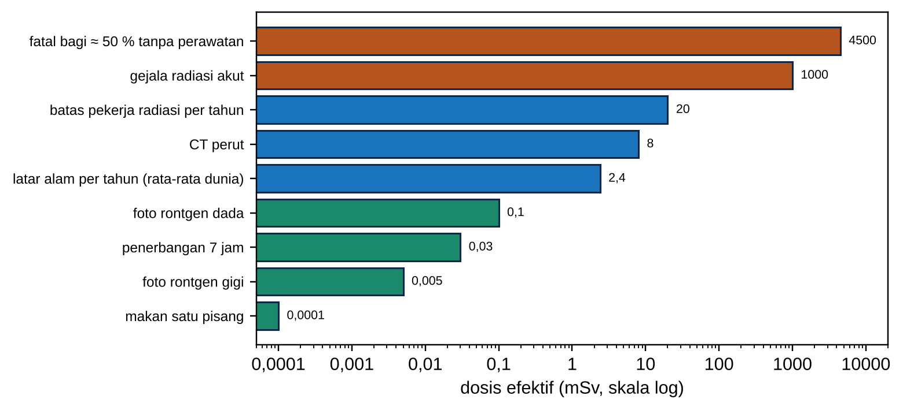

## 13.7 Radioisotop dalam kedokteran, penanggalan, dan analisis

Radioisotop dapat dideteksi dalam jumlah yang luar biasa kecil: satu peluruhan dapat dihitung, sedangkan metode kimia biasa memerlukan sekitar 10¹² atom atau lebih. Selain itu, radioisotop secara kimia hampir sama dengan isotop stabilnya, sehingga ia mengikuti jalan yang sama dalam reaksi kimia dan tubuh. Kedua sifat ini menjadikan radioisotop alat yang sangat kuat.

### Kedokteran nuklir

**Diagnosis** memakai radioisotop yang memancarkan gama (menembus tubuh dan dapat dideteksi kamera dari luar) dengan waktu paruh cukup pendek agar dosis pasien kecil:

* **Teknesium-99m** dipakai dalam sekitar 40 juta pemeriksaan per tahun di seluruh dunia (tulang, jantung, ginjal, tiroid). Gama 140 keV-nya ideal untuk kamera, waktu paruhnya 6,01 jam cukup untuk pemeriksaan, dan ia tidak memancarkan partikel β. ⁹⁹ᵐTc diperoleh di rumah sakit dari **generator**: ion molibdat [⁹⁹MoO₄]²⁻ (waktu paruh 66 jam) diserap pada kolom alumina, dan ion pertek­netat [⁹⁹ᵐTcO₄]⁻ yang terbentuk dari peluruhannya dicuci keluar dengan larutan garam fisiologis. Kimia koordinasi teknesium (Bab 11) lalu dipakai untuk menempelkannya pada ligan yang menuju organ tertentu.
* **Fluorin-18** (109,8 menit) dalam molekul glukosa termodifikasi, fluorodeoksiglukosa (FDG), dipakai dalam **tomografi emisi positron** (PET). Sel kanker yang mengonsumsi banyak glukosa mengumpulkan FDG; positron dari ¹⁸F musnah bersama elektron menjadi dua foton 511 keV yang berlawanan arah, dan detektor yang melingkari pasien merekonstruksi tempat asalnya.

**Terapi** memakai pemancar β⁻ atau α yang dikumpulkan di jaringan sasaran, sehingga energinya diserap dalam jarak pendek: **iodin-131** (8,02 hari) untuk kanker dan hiperaktivitas tiroid, karena tiroid mengumpulkan iodin; radium-223 untuk kanker yang menyebar ke tulang, karena Ra²⁺ mengikuti jalan Ca²⁺; dan lutesium-177 yang diikat pada molekul pencari sel kanker prostat. Sumber ⁶⁰Co dan akselerator elektron dipakai untuk radioterapi dari luar dan untuk **sterilisasi** alat medis dan makanan dengan sinar gama.

::: {.contoh}
**Contoh 13.9 · Merencanakan dosis teknesium**

Sebuah pemeriksaan tulang memerlukan aktivitas ⁹⁹ᵐTc 740 MBq pada saat penyuntikan. Generator dielusi pukul 07.00, dan penyuntikan dijadwalkan pukul 10.00. (a) Berapa aktivitas yang harus disiapkan pukul 07.00? (b) Berapa fraksi aktivitas yang tersisa dalam tubuh (hanya karena peluruhan) 24 jam setelah penyuntikan?

**Penyelesaian.** (a) *A*₀ = *A* × 2^*t*/*t*~½~^ = 740 × 2^3/6,01^ = 740 × 1,413 = **1046 MBq**.

(b) 2^−24/6,01^ = **0,063**, sekitar 6 %. Ekskresi lewat urin menurunkannya lebih jauh.

**Memahami hasil.** Waktu paruh enam jam adalah kompromi yang baik: cukup panjang untuk menyiapkan obat dan melakukan pemindaian, cukup pendek agar dalam sehari aktivitasnya hampir habis. Itulah sebabnya ⁹⁹ᵐTc tidak dapat dikirim jauh, dan rumah sakit menerima generator ⁹⁹Mo setiap minggu. Pasokan ⁹⁹Mo dunia bergantung pada beberapa reaktor riset saja, sehingga gangguan pada satu reaktor dapat mengguncang pelayanan kedokteran nuklir di banyak negara.
:::

### Penanggalan

Selain radiokarbon dan uranium–timbal (subbab 13.4), penanggalan kalium–argon dan argon–argon memakai ⁴⁰K (1,25 miliar tahun) untuk batuan vulkanik, termasuk lapisan abu yang mengapit fosil manusia purba di Afrika Timur. Isotop berumur pendek juga dipakai: ²¹⁰Pb (22,2 tahun) untuk menentukan laju pengendapan sedimen danau dan laut dalam seratus tahun terakhir, dan tritium untuk menentukan umur air tanah.

### Perunut dan analisis kimia

* **Perunut mekanisme.** Mekanisme esterifikasi asam karboksilat dengan alkohol ditentukan dengan isotop: bila alkohol yang dipakai mengandung ¹⁸O, ¹⁸O ditemukan di dalam ester, bukan di dalam air yang dihasilkan. Jadi ikatan C–O asam yang putus, bukan ikatan C–O alkohol. Dengan cara serupa, Melvin Calvin (Hadiah Nobel 1961) memetakan jalur fotosintesis dengan ¹⁴CO₂, dan George de Hevesy (Hadiah Nobel 1943) merintis pemakaian perunut radioaktif untuk mengikuti unsur dalam tubuh tumbuhan dan hewan.
* **Pengenceran isotop.** Untuk mengukur jumlah zat yang sukar dipisahkan seluruhnya, ditambahkan sejumlah diketahui zat yang sama yang ditandai isotop. Dari perubahan aktivitas jenis atau perbandingan isotop sebagian kecil zat yang berhasil diisolasi, jumlah semula dapat dihitung tanpa perlu pemisahan kuantitatif.
* **Analisis aktivasi neutron.** Sampel disinari neutron di reaktor; sebagian kecil inti di dalamnya berubah menjadi radioisotop yang memancarkan gama dengan energi khas. Spektrum gama menunjukkan unsur apa saja yang ada, sampai bagian per miliar, tanpa melarutkan sampel. Teknik ini dipakai dalam arkeologi, forensik, dan pemantauan pencemaran.
* **Spektroskopi Mössbauer.** Penyerapan gama tanpa pentalan oleh inti ⁵⁷Fe peka terhadap bilangan oksidasi dan keadaan spin besi (Bab 11), sehingga dipakai untuk mempelajari mineral, katalis, dan protein besi.

### Sumber energi dan alat sehari-hari

**Detektor asap** ionisasi mengandung sekitar 0,3 μg ²⁴¹Am (waktu paruh 432 tahun), yang partikel alfanya mengionisasi udara di antara dua elektrode; asap yang masuk mengganggu arus ion dan memicu alarm. **Generator termoelektrik radioisotop** memakai panas peluruhan alfa ²³⁸PuO₂ (87,7 tahun) untuk menghasilkan listrik bagi wahana antariksa yang terlalu jauh dari Matahari, seperti Voyager, yang masih mengirim data setelah hampir setengah abad.

::: {.kuis}
**Kuis cepat 13.7** Mengapa pemancar gama, bukan pemancar alfa, dipakai untuk diagnosis, sedangkan pemancar alfa atau beta dipakai untuk terapi?
:::

## 13.8 Keselamatan radiasi

Radiasi alfa, beta, gama, sinar-X, dan neutron disebut **radiasi pengion**: energinya cukup untuk melepaskan elektron dari atom dan molekul yang dilaluinya. Dalam jaringan hidup, ionisasi membentuk radikal (terutama dari air: H₂O → H₂O⁺ + *e*⁻, lalu ·OH) yang merusak molekul biologis, termasuk DNA.

### Satuan dosis

* **Dosis serap** *D*: energi yang diserap per kilogram bahan, dalam **gray** (1 Gy = 1 J kg⁻¹).
* **Dosis ekuivalen**: dosis serap dikalikan faktor bobot radiasi, yang menyatakan seberapa merusak jenis radiasi itu per joule. Untuk foton dan elektron faktornya 1, untuk partikel alfa 20, karena alfa melepaskan seluruh energinya dalam jarak sangat pendek dan merusak DNA secara padat.
* **Dosis efektif**: dosis ekuivalen setiap organ dikalikan faktor bobot jaringan lalu dijumlahkan, dalam **sievert** (Sv). Satuan inilah yang dipakai untuk menyatakan risiko bagi orang.

{width=86%}

Setiap orang terus-menerus menerima radiasi dari sumber alam: radon di udara (subbab 12.8), sinar kosmik, ⁴⁰K dan ¹⁴C di dalam tubuh sendiri, dan uranium serta torium di tanah dan bahan bangunan, rata-rata sekitar **2,4 mSv per tahun**. Dosis di atas sekitar 1 Sv yang diterima sekaligus menyebabkan sindrom radiasi akut; sekitar 4–5 Sv fatal bagi separuh orang tanpa perawatan intensif. Untuk dosis rendah, risiko kanker jangka panjang diperkirakan sekitar 5 % per sievert, dan untuk keperluan keselamatan dianggap sebanding dengan dosis tanpa ambang batas.

### Prinsip perlindungan

Prinsip dasar perlindungan radiasi adalah **ALARA** (*as low as reasonably achievable*): dosis dijaga serendah yang dapat dicapai secara wajar. Tiga cara utamanya:

1. **Waktu**: dosis sebanding dengan lama paparan.
2. **Jarak**: untuk sumber titik, intensitas berbanding terbalik dengan kuadrat jarak. Menjauh dari 1 m menjadi 3 m menurunkan dosis sembilan kali.
3. **Perisai**: kertas untuk alfa, beberapa milimeter aluminium atau plastik untuk beta (plastik lebih baik daripada logam berat, yang membangkitkan sinar-X ketika menghentikan elektron), dan timbal atau beton tebal untuk gama dan sinar-X.

::: {.contoh}
**Contoh 13.10 · Hukum kuadrat terbalik dan waktu**

Laju dosis 0,50 m dari sebuah sumber gama adalah 80 μSv per jam. (a) Berapa laju dosis pada 2,0 m? (b) Seorang teknisi harus bekerja 30 menit di dekat sumber itu dan tidak boleh menerima lebih dari 10 μSv. Pada jarak berapa ia harus bekerja?

**Penyelesaian.** (a) Laju dosis ∝ 1/*r*²: 80 × (0,50/2,0)² = **5,0 μSv per jam**.

(b) Laju dosis maksimum = 10 μSv/0,50 jam = 20 μSv per jam. *r* = 0,50 × √(80/20) = **1,0 m** atau lebih jauh.

**Memahami hasil.** Jarak adalah perlindungan termurah: menggandakan jarak memotong dosis menjadi seperempat tanpa perisai sama sekali. Itulah sebabnya sumber radioaktif selalu ditangani dengan penjepit bergagang panjang, bukan dengan tangan, walaupun memakai sarung tangan.
:::

### Paparan luar lawan paparan dalam

Bahaya radioisotop sangat bergantung pada apakah ia berada **di luar** atau **di dalam** tubuh. Pemancar alfa hampir tidak berbahaya di luar tubuh, karena partikel alfanya dihentikan oleh lapisan kulit mati. Namun bila terhirup atau tertelan, seluruh energinya dilepaskan pada sel-sel hidup di sekitarnya dengan faktor bobot 20. Peracunan dengan ²¹⁰Po (2006) dan bahaya radon di paru-paru adalah contohnya. Kimia unsur juga menentukan ke mana radioisotop pergi: ⁹⁰Sr mengikuti kalsium ke tulang dan bertahan bertahun-tahun, ¹³⁷Cs mengikuti kalium ke otot, dan ¹³¹I terkumpul di kelenjar tiroid. Setelah kecelakaan reaktor, penduduk diberi **tablet kalium iodida**: tiroid dijenuhkan dengan iodin stabil sehingga hampir tidak menyerap ¹³¹I yang terhirup, sebuah tindakan perlindungan yang sepenuhnya didasarkan pada kimia, bukan fisika.

::: {.kuis}
**Kuis cepat 13.8** Mengapa tablet KI melindungi tiroid dari ¹³¹I tetapi tidak dari ¹³⁷Cs atau ⁹⁰Sr? Ke organ mana kedua isotop itu cenderung terkumpul, dan mengapa?
:::

## Penutup buku

Garam uranium Becquerel menghitamkan pelat fotografi di dalam laci yang gelap karena inti uranium meluruh dengan sendirinya, melepaskan energi yang berasal dari defek massa: sebagian kecil massa inti berubah menjadi energi sesuai *E* = *mc*². Energi radium yang mengherankan keluarga Curie, panas Matahari, listrik dari reaktor nuklir, dan emas di dalam cincin semuanya bersumber dari kurva energi ikat per nukleon yang sama.

Dengan bab ini, perjalanan *Kimia Anorganik 1* selesai. Kita mulai dari atom dan tabel periodik (Bab 1), membangun ikatan kovalen dan bentuk molekul (Bab 2), bahasa simetri (Bab 3), dan orbital molekul (Bab 4). Kita menyusun padatan ionik dan menghitung energinya (Bab 5–6), lalu memahami logam dan semikonduktor (Bab 7). Kita mempelajari dua jenis reaksi besar, asam–basa dan redoks (Bab 8–9), serta peran pelarut (Bab 10). Kita masuk ke dunia senyawa koordinasi (Bab 11), menerapkan semua teori pada hidrogen dan gas mulia (Bab 12), dan akhirnya membuka inti atom (Bab 13).

Pola yang muncul berulang-ulang di sepanjang buku ini adalah alat yang akan dipakai sepanjang studi kimia: **lihat data dulu, cari polanya, jelaskan dengan model, lalu uji batas modelnya**. Ukuran dan muatan ion, keelektronegatifan, energi orbital, simetri, dan termodinamika adalah bahasa bersama untuk memahami lebih dari seratus unsur. *Kimia Anorganik 2: Kimia Koordinasi* melanjutkan kisah logam transisi dari Bab 11, dan *Kimia Anorganik 3: Kimia Unsur* menelusuri unsur demi unsur dengan alat-alat yang sudah kamu kuasai di sini.
