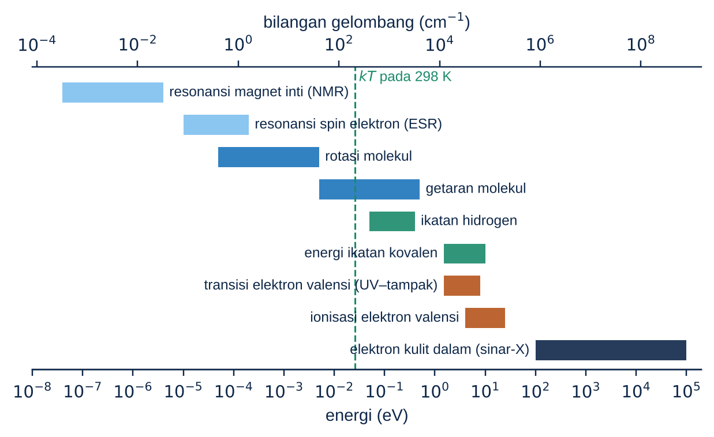

# Bab 1 Lahirnya Mekanika Kuantum

Taburkan sejumput garam dapur ke nyala kompor gas. Api yang biru seketika berubah kuning terang. Ulangi di laboratorium mana pun di dunia, dengan garam dari tambang mana pun, dan warnanya selalu sama: panjang gelombangnya 589 nm, tidak lebih dan tidak kurang. Garis kuning yang sama terlihat dalam cahaya bintang yang berjarak ribuan tahun cahaya. Atom natrium di mana pun tampaknya "tahu" persis berapa energi yang boleh dilepaskannya.

Fisika klasik tidak dapat menjelaskan hal ini. Lebih buruk lagi, fisika klasik meramalkan bahwa atom natrium itu tidak mungkin ada. Menurut teori elektromagnetik Maxwell, elektron yang mengitari inti terus dipercepat, sehingga terus memancarkan gelombang elektromagnetik, kehilangan energi, dan berpilin jatuh ke inti dalam waktu sekitar $10^{-11}$ s (Contoh 1.5). Seandainya fisika klasik benar sampai ke skala atom, tidak akan ada atom yang mantap, tidak ada ikatan kimia, tidak ada molekul, dan tidak ada kimiawan yang bertanya.

Teka-teki ketiga datang dari tabel data termokimia. Kapasitas kalor molar hampir semua logam pada suhu kamar dekat dengan 25 J/(mol·K), persis seperti ramalan fisika klasik. Tetapi intan, yang sama-sama padatan sederhana, hanya 6,1 J/(mol·K), seperempatnya. Mengapa atom karbon dalam intan seolah-olah "menolak" menyerap kalor?

Ketiga teka-teki itu (warna nyala yang tajam, kemantapan atom, dan kapasitas kalor intan) ternyata berakar pada satu fakta: pada skala atom, energi tidak dapat berubah secara malar. Energi berubah dalam lompatan-lompatan, **kuanta**, yang besarnya ditentukan oleh frekuensi. Bab ini menelusuri bagaimana fakta itu ditemukan antara tahun 1900 dan 1927, dari radiasi benda panas sampai asas ketidakpastian, dan mengapa ia menjadi dasar seluruh kimia.

::: {.strategi}
**Pertanyaan pembuka**

1. Mengapa benda yang dipanaskan mula-mula membara merah, lalu jingga, lalu putih kebiruan, dan bagaimana rumus Planck meramalkan warna itu?
2. Mengapa cahaya ultraviolet yang redup dapat memutus ikatan C–Cl dalam freon, sedangkan cahaya merah yang terang tidak?
3. Mengapa atom hidrogen hanya memancarkan cahaya pada panjang gelombang tertentu, dan mengapa atom deuterium memancarkan warna yang sedikit berbeda?
4. Bila elektron adalah partikel, mengapa berkas elektron dapat didifraksikan oleh kristal seperti sinar-X?
5. Mengapa elektron dalam atom tidak jatuh ke inti?
:::

::: {.tujuan}
**Tujuan belajar**

Setelah mempelajari bab ini, kamu mampu:

1. Menjelaskan cakupan kimia kuantum dan menempatkan gejala kimia pada skala energinya.
2. Menunjukkan di mana fisika klasik gagal: radiasi benda hitam, kapasitas kalor, efek fotolistrik, spektrum garis, dan kemantapan atom.
3. Menurunkan rumus Rayleigh–Jeans dari penghitungan mode dan asas ekuipartisi, lalu menurunkan rumus Planck dari kuantisasi energi osilator.
4. Menurunkan hukum Stefan–Boltzmann dan hukum pergeseran Wien dari rumus Planck, serta menerapkan gagasan "pembekuan" mode pada kapasitas kalor padatan dan gas.
5. Menganalisis efek fotolistrik dan spektroskopi fotoelektron dengan konsep foton, dan menghitung energi satu mol foton untuk soal fotokimia.
6. Menurunkan pergeseran Compton dari kekekalan energi dan momentum.
7. Menurunkan tingkat energi model Bohr, memakainya untuk spektrum hidrogen dan ion mirip hidrogen, dan menyebutkan batas-batasnya.
8. Menghitung panjang gelombang de Broglie elektron, neutron, atom, dan molekul, serta menjelaskan pemakaiannya dalam penentuan struktur.
9. Menafsirkan percobaan celah ganda dengan amplitudo peluang dan memakai asas ketidakpastian untuk memperkirakan ukuran atom, energi titik nol, dan lebar garis spektrum.
10. Mengubah energi dengan lancar di antara joule, eV, kJ/mol, kcal/mol, cm⁻¹, kelvin, dan hartree.
:::

::: {.mat}
**Prasyarat**

Dari *Fisika Umum*: Bab 4 dan 5 (energi kinetik, momentum, kekekalannya dalam tumbukan), Bab 9 (gelombang berdiri, interferensi, difraksi), Bab 10 (teori kinetik gas, asas ekuipartisi, faktor Boltzmann), Bab 12 (energi potensial Coulomb, elektronvolt), Bab 14 (gelombang elektromagnetik), dan Bab 15 (pengantar fisika modern). Bab ini mengulang gagasan Bab 15 itu dengan penurunan yang lengkap dan dengan sudut pandang kimia. Dari matematika: turunan, integral, deret geometri, dan deret Taylor $e^x \approx 1 + x$.

Tetapan yang sering dipakai (nilai SI 2019, sebagian eksak): $h = 6{,}626\,070\,15 \times 10^{-34}$ J·s; $\hbar = h/2\pi = 1{,}054\,572 \times 10^{-34}$ J·s; $c = 2{,}997\,924\,58 \times 10^8$ m/s; $e = 1{,}602\,176\,634 \times 10^{-19}$ C; $k = 1{,}380\,649 \times 10^{-23}$ J/K; $N_A = 6{,}022\,140\,76 \times 10^{23}$ mol⁻¹; $m_e = 9{,}109\,38 \times 10^{-31}$ kg; $\varepsilon_0 = 8{,}854\,19 \times 10^{-12}$ C²/(J·m). Kombinasi praktis: $hc = 1239{,}84$ eV·nm; 1 eV $= 96{,}485$ kJ/mol $= 8065{,}54$ cm⁻¹.
:::

## 1.1 Kimia kuantum dan cakupannya

Kimia adalah ilmu tentang elektron. Ketika natrium bereaksi dengan klorin, inti-inti atomnya tidak berubah; yang berubah adalah susunan elektron. Warna senyawa, panjang dan kekuatan ikatan, sudut ikatan, keasaman, laju reaksi, sifat magnet, spektrum inframerah dan NMR, semuanya ditentukan oleh perilaku elektron dan inti dalam molekul. Perilaku itu diatur oleh **mekanika kuantum**. **Kimia kuantum** adalah penerapan mekanika kuantum pada masalah-masalah kimia.

### Apa yang dapat dijawab kimia kuantum

Pertanyaan-pertanyaan berikut tidak dapat dijawab dengan mekanika Newton, tetapi dijawab dengan tuntas oleh kimia kuantum:

- Mengapa atom hidrogen mempunyai energi ionisasi tepat 13,598 eV (Bab 7)?
- Mengapa tabel periodik tersusun dalam periode 2, 8, 8, 18, 18, 32 (Bab 10)?
- Mengapa dua atom hidrogen membentuk molekul H₂, sedangkan dua atom helium tidak membentuk He₂ yang mantap (Bab 12)?
- Mengapa O₂ bersifat paramagnetik, padahal struktur Lewis-nya menunjukkan semua elektron berpasangan (Bab 12)?
- Mengapa metana berbentuk tetrahedron dengan sudut 109,47°, dan air bengkok dengan sudut 104,5° (Bab 14 dan 15)?
- Mengapa benzena luar biasa mantap, dan mengapa siklobutadiena tidak (Bab 15)?
- Mengapa larutan [Ti(H₂O)₆]³⁺ berwarna ungu, sedangkan [Zn(H₂O)₆]²⁺ tidak berwarna (Bab 16)?
- Mengapa ikatan C–H menyerap inframerah di sekitar 3000 cm⁻¹ dan C–D di sekitar 2200 cm⁻¹ (Bab 5 dan 17)?

Lebih jauh lagi, kimia kuantum modern **meramalkan** sifat molekul yang belum pernah dibuat: geometri, energi reaksi, energi pengaktifan, spektrum, bahkan sifat bahan padat. Perhitungan semacam ini kini rutin dilakukan di industri farmasi, katalis, dan bahan. Hadiah Nobel Kimia 1998 diberikan kepada Walter Kohn dan John Pople atas pengembangan metode komputasi yang memungkinkan hal itu.

### Persamaan dasar dan kesulitannya

Semua sifat kimia sebuah molekul pada asasnya terkandung dalam satu persamaan, **persamaan Schrödinger** (Bab 3), yang memuat energi kinetik setiap elektron dan inti serta energi potensial Coulomb setiap pasangan partikel bermuatan. Fisikawan Paul Dirac menulis pada tahun 1929 bahwa hukum-hukum fisika yang mendasari seluruh kimia sudah diketahui sepenuhnya, dan bahwa kesulitannya hanyalah bahwa penerapan hukum itu menghasilkan persamaan yang terlalu rumit untuk diselesaikan. Pernyataan itu masih tepat hingga kini. Sebagian besar buku ini membahas cara-cara cerdik untuk mendekati penyelesaian persamaan yang tidak dapat diselesaikan dengan tepat: pendekatan Born–Oppenheimer, metode variasi, teori perturbasi, orbital molekul, teori fungsional kerapatan.

Hanya sedikit sistem yang dapat diselesaikan dengan tepat: partikel dalam kotak, osilator harmonik, rotor tegar, dan atom hidrogen. Keempatnya bukan sekadar latihan matematika. Masing-masing adalah model dasar bagi gejala kimia yang penting: elektron π dalam zat warna, getaran ikatan, rotasi molekul, dan orbital atom. Itulah sebabnya Bagian II buku ini membahas keempatnya dengan teliti.

### Peta buku

Buku ini terbagi dalam lima bagian. **Bagian I** (Bab 1–4) membangun mekanika kuantum dari percobaan-percobaan yang memaksa lahirnya, sampai ke postulat-postulatnya. **Bagian II** (Bab 5–7) menyelesaikan sistem-sistem yang tepat. **Bagian III** (Bab 8–10) memperkenalkan metode pendekatan dan atom berelektron banyak. **Bagian IV** (Bab 11–16) membahas simetri, ikatan kimia, dan senyawa koordinasi. **Bagian V** (Bab 17–20) membahas spektroskopi dan kimia komputasi.

### Skala energi dalam kimia

Satu gagasan yang akan muncul berulang kali adalah **perbandingan dua energi**: selang antartingkat energi kuantum $\Delta E$ dengan energi termal $kT$. Jika $\Delta E \ll kT$, tingkat-tingkat energi tampak malar dan fisika klasik bekerja baik. Jika $\Delta E \gg kT$, sifat kuantum menonjol dan fisika klasik gagal total. Pada suhu kamar $kT = 4{,}12 \times 10^{-21}$ J, setara dengan 2,48 kJ/mol, 0,0257 eV, atau 207 cm⁻¹. Gambar 1.1 menempatkan gejala-gejala kimia pada skala energi itu. Rotasi molekul berada di sekitar $kT$; getaran ikatan beberapa kali di atasnya; transisi elektron dan energi ikatan ratusan kali di atasnya. Kita akan kembali ke skala ini di subbab 1.10.

{width=88%}

::: {.contoh}
**Contoh 1.1 · Mengapa ikatan kimia tidak putus sendiri**

Energi ikatan C–C rata-rata 348 kJ/mol. (a) Berapa kali lebih besar energi ini dibandingkan energi termal $RT$ pada 298 K? (b) Faktor Boltzmann $e^{-E/RT}$ memperkirakan fraksi molekul yang mempunyai energi sebesar $E$ pada keseimbangan termal. Hitung faktor itu.

**Penyelesaian.** (a) $RT = (8{,}314 \text{ J mol}^{-1}\text{K}^{-1})(298{,}15 \text{ K}) = 2{,}479$ kJ/mol. Perbandingannya

$$
\frac{348}{2{,}479} = 140 .
$$

\(b) $e^{-140} = 1{,}1 \times 10^{-61}$.

**Memahami hasil.** Satu mol zat hanya memuat $6 \times 10^{23}$ molekul, jadi praktis tidak ada satu pun ikatan C–C yang terputus oleh gerak termal pada suhu kamar. Itulah sebabnya senyawa organik mantap pada suhu kamar dan baru terurai pada suhu ratusan derajat. Tetapi satu foton ultraviolet dapat membawa energi sebesar itu sekaligus (subbab 1.4). Perbandingan "energi per kuantum terhadap $kT$" inilah kunci banyak gejala dalam bab ini.
:::

::: {.contoh}
**Contoh 1.2 · Mengapa persamaan Schrödinger tidak diselesaikan "begitu saja"**

Benzena C₆H₆ mempunyai 42 elektron dan 12 inti. Fungsi gelombang elektronnya (Bab 3) bergantung pada tiga koordinat setiap elektron. Seandainya kita menyimpan fungsi itu pada kisi kasar yang hanya berisi 10 titik untuk tiap koordinat, berapa banyak angka yang harus disimpan?

**Penyelesaian.** Banyaknya koordinat elektron $3 \times 42 = 126$. Banyaknya titik kisi $10^{126}$.

**Memahami hasil.** Jumlah atom di alam semesta teramati diperkirakan sekitar $10^{80}$. Penyimpanan langsung fungsi gelombang molekul sekecil benzena pun mustahil, bahkan pada kisi yang sangat kasar. Kimia kuantum karena itu bertumpu pada fungsi gelombang yang disusun dari bagian-bagian sederhana, misalnya hasil kali orbital (Bab 10) atau determinan Slater, dan pada metode yang hanya memerlukan kerapatan elektron, yang bergantung pada tiga koordinat saja (Bab 20).
:::

::: {.terapan}
**Kaitan kimia · Kimia komputasi di laboratorium modern**

Sebelum mensintesis calon obat, kimiawan farmasi kini biasanya menghitung dulu bentuk molekul, distribusi muatan, dan energi ikatnya dengan protein sasaran. Perancang katalis menghitung energi keadaan transisi untuk memilih logam dan ligan yang menurunkan energi pengaktifan. Perancang sel surya organik menghitung celah HOMO–LUMO zat warna sebelum membuatnya. Semua perhitungan itu adalah penerapan langsung bahan yang dibangun dalam buku ini. Perangkat lunak seperti Gaussian, ORCA, Psi4, atau PySCF hanya melakukan, dengan sangat cepat, apa yang akan kita lakukan dengan tangan untuk molekul-molekul kecil.
:::

::: {.kuis}
**Kuis cepat 1.1**

Energi ikatan hidrogen O–H···O dalam air sekitar 20 kJ/mol. Apakah ikatan hidrogen pada suhu kamar terus-menerus putus dan terbentuk kembali, atau hampir selalu utuh seperti ikatan C–C? Bandingkan dengan $RT$.
:::

## 1.2 Krisis fisika klasik

Menjelang tahun 1900, fisika tampak hampir rampung. Mekanika Newton menjelaskan gerak dari peluru sampai planet; elektromagnetisme Maxwell menyatukan listrik, magnet, dan cahaya; termodinamika dan mekanika statistik Boltzmann menjelaskan kalor dari gerak molekul. Tetapi ketika teori-teori yang sangat berhasil ini diterapkan pada atom dan cahaya, muncul kegagalan yang tidak dapat ditambal. Ada lima kegagalan yang penting bagi kimia.

1. **Radiasi benda hitam.** Teori klasik meramalkan bahwa benda panas memancarkan energi tak hingga pada panjang gelombang pendek (subbab 1.3).
2. **Kapasitas kalor.** Teori klasik meramalkan kapasitas kalor yang tidak bergantung pada suhu; kenyataannya kapasitas kalor padatan menuju nol pada suhu rendah, dan getaran molekul gas seolah-olah tidak ikut menyerap kalor.
3. **Efek fotolistrik.** Energi elektron yang dilepaskan cahaya dari logam bergantung pada warna cahaya, bukan pada terangnya (subbab 1.4).
4. **Spektrum garis.** Atom memancarkan dan menyerap cahaya hanya pada panjang gelombang tertentu (subbab 1.6).
5. **Kemantapan atom.** Atom dengan elektron yang mengorbit seharusnya runtuh dalam sepersekian nanodetik.

Dua kegagalan terakhir yang ditambahkan kemudian, yaitu sifat gelombang elektron (subbab 1.7) dan ketidakpastian pengukuran (subbab 1.9), melengkapi gambaran baru.

### Asas ekuipartisi dan kapasitas kalor

Mekanika statistik klasik mempunyai satu hasil yang sangat kuat, **asas ekuipartisi energi**: pada keseimbangan termal pada suhu $T$, setiap suku kuadrat dalam ungkapan energi sebuah molekul menyumbang rata-rata $\tfrac12 kT$ pada energi rata-ratanya. Suku kuadrat artinya suku yang sebanding dengan kuadrat satu kecepatan, satu kecepatan sudut, atau satu simpangan, misalnya $\tfrac12 mv_x^2$ atau $\tfrac12 \kappa x^2$.

Akibatnya mudah dihitung. Satu atom dalam kristal bergetar dalam tiga arah di sekitar kedudukan setimbangnya, seperti osilator harmonik tiga dimensi. Setiap arah mempunyai dua suku kuadrat (kinetik dan potensial), jadi energi rata-rata tiap atom $6 \times \tfrac12 kT = 3kT$. Untuk satu mol, $U_m = 3N_AkT = 3RT$, dan kapasitas kalor molarnya

$$
C_{V,m} = \left(\frac{\partial U_m}{\partial T}\right)_V = 3R = 24{,}9 \text{ J mol}^{-1}\text{K}^{-1}. \qquad \text{(1.1)}
$$

Inilah **hukum Dulong–Petit** (1819), yang ditemukan secara empiris jauh sebelum teori ekuipartisi.

Untuk molekul gas diatomik, ekuipartisi menghitung tiga suku kinetik translasi, dua suku kinetik rotasi (rotasi di sekitar sumbu ikatan tidak dihitung), dan dua suku getaran (kinetik dan potensial ikatan). Jumlahnya tujuh suku, sehingga

$$
C_{V,m} = \tfrac72 R = 29{,}1 \text{ J mol}^{-1}\text{K}^{-1} \quad \text{(ramalan klasik, gas diatomik).} \qquad \text{(1.2)}
$$

Hasil percobaan untuk N₂, O₂, H₂, dan CO pada suhu kamar adalah sekitar $\tfrac52 R = 20{,}8$ J mol⁻¹K⁻¹. Getaran ikatan seolah-olah tidak menyerap kalor sama sekali. Fisikawan abad ke-19 menyadari keganjilan ini. James Clerk Maxwell menyebutnya kesulitan terbesar yang pernah dihadapi teori molekul. Pemecahannya, yang akan kita lihat di subbab 1.3, adalah bahwa getaran ikatan **terkuantisasi** dan selang antartingkatnya jauh lebih besar daripada $kT$.

::: {.contoh}
**Contoh 1.3 · Dulong–Petit: berhasil untuk tembaga, gagal untuk intan**

Kalor jenis tembaga pada 25 °C adalah 0,385 J/(g·K), dan kalor jenis intan 0,509 J/(g·K). Hitung kapasitas kalor molar keduanya dan bandingkan dengan $3R$.

**Penyelesaian.** Kalikan kalor jenis dengan massa molar.

Tembaga: $C_m = (0{,}385)(63{,}55) = 24{,}5$ J mol⁻¹K⁻¹, sekitar 98% dari $3R = 24{,}9$.

Intan: $C_m = (0{,}509)(12{,}01) = 6{,}11$ J mol⁻¹K⁻¹, hanya 25% dari $3R$.

**Memahami hasil.** Selisih kecil antara $C_p$ dan $C_V$ untuk padatan dapat diabaikan di sini. Tembaga mematuhi ramalan klasik, intan tidak. Ikatan C–C dalam intan sangat kaku dan atom karbon ringan, sehingga frekuensi getarannya tinggi. Di subbab 1.3 kita akan melihat bahwa yang menentukan adalah perbandingan kuantum getaran $h\nu$ dengan $kT$. Pada suhu sangat tinggi (sekitar 1500 K) kapasitas kalor intan pun mendekati $3R$.
:::

::: {.contoh}
**Contoh 1.4 · Perbandingan kapasitas kalor gas diatomik**

Perbandingan $\gamma = C_p/C_V$ untuk gas ideal diukur dengan mudah dari kecepatan bunyi. (a) Berapa $\gamma$ yang diramalkan ekuipartisi klasik penuh untuk gas diatomik? (b) Berapa $\gamma$ jika getaran tidak ikut menyerap kalor? (c) Hasil percobaan untuk N₂ pada suhu kamar adalah 1,40. Apa kesimpulannya?

**Penyelesaian.** Untuk gas ideal $C_{p,m} = C_{V,m} + R$.

\(a) $C_{V,m} = \tfrac72R$, $C_{p,m} = \tfrac92R$, sehingga $\gamma = 9/7 = 1{,}286$.

\(b) $C_{V,m} = \tfrac52R$, $C_{p,m} = \tfrac72R$, sehingga $\gamma = 7/5 = 1{,}400$.

\(c) Hasil percobaan cocok dengan (b). Pada suhu kamar getaran N₂ "membeku".

**Memahami hasil.** Hukum klasik tidak sekadar meleset sedikit; ia meleset secara kualitatif, dengan cara yang menunjukkan bahwa sebagian derajat kebebasan tidak aktif. Fisika klasik tidak mempunyai mekanisme untuk "mematikan" satu derajat kebebasan. Mekanika kuantum mempunyainya.
:::

### Atom yang runtuh

Pada tahun 1911 Ernest Rutherford menunjukkan, dari hamburan partikel alfa oleh lembaran emas, bahwa hampir seluruh massa atom terpusat dalam inti yang sangat kecil (sekitar $10^{-15}$ m) bermuatan positif, dikelilingi elektron pada jarak sekitar $10^{-10}$ m. Model yang paling wajar adalah tata surya mini: elektron mengorbit inti karena tarikan Coulomb.

Masalahnya, menurut elektrodinamika klasik, **muatan yang dipercepat memancarkan gelombang elektromagnetik**. Daya pancarnya diberikan oleh rumus Larmor,

$$
P = \frac{e^2 a^2}{6\pi\varepsilon_0 c^3} , \qquad \text{(1.3)}
$$

dengan $a$ besar percepatan. Elektron yang mengorbit mengalami percepatan sentripetal, jadi ia memancar terus, kehilangan energi, dan orbitnya mengecil. Ketika orbit mengecil, frekuensi edar bertambah, sehingga cahaya yang dipancarkan menyapu malar dari frekuensi rendah ke tinggi. Ramalan klasik karena itu gagal dua kali: atom tidak mantap, dan spektrumnya malar, bukan garis.

::: {.dalam}
**Lebih dalam · Berapa lama atom klasik bertahan?**

Tinjau elektron pada orbit lingkaran berjari-jari $r$ di sekitar proton. Tarikan Coulomb memberikan percepatan sentripetal:

$$
\frac{m_e v^2}{r} = \frac{e^2}{4\pi\varepsilon_0 r^2} \quad\Longrightarrow\quad a = \frac{v^2}{r} = \frac{e^2}{4\pi\varepsilon_0 m_e r^2} .
$$

Energi total orbit lingkaran adalah setengah energi potensialnya:

$$
E = \tfrac12 m_e v^2 - \frac{e^2}{4\pi\varepsilon_0 r} = -\frac{e^2}{8\pi\varepsilon_0 r} .
$$

Agar ringkas, pakai **jari-jari elektron klasik** $r_e = e^2/(4\pi\varepsilon_0 m_e c^2) = 2{,}818 \times 10^{-15}$ m. Dengan lambang ini $a = r_e c^2/r^2$, dan rumus Larmor menjadi

$$
P = \frac{e^2}{6\pi\varepsilon_0 c^3}\cdot\frac{r_e^2c^4}{r^4} = \frac{e^2 r_e^2 c}{6\pi\varepsilon_0 r^4} .
$$

Laju perubahan energi $dE/dt = -P$. Karena $dE/dr = e^2/(8\pi\varepsilon_0 r^2)$, aturan rantai memberikan

$$
\frac{dr}{dt} = \frac{dE/dt}{dE/dr} = -\frac{e^2 r_e^2 c}{6\pi\varepsilon_0 r^4}\cdot\frac{8\pi\varepsilon_0 r^2}{e^2} = -\frac{4 r_e^2 c}{3 r^2} .
$$

Pisahkan variabel dan integralkan dari $r = r_0$ pada $t = 0$ sampai $r = 0$ pada $t = \tau$:

$$
\int_{r_0}^{0} r^2\,dr = -\frac{4r_e^2c}{3}\int_0^\tau dt \quad\Longrightarrow\quad -\frac{r_0^3}{3} = -\frac{4r_e^2c}{3}\,\tau \quad\Longrightarrow\quad \tau = \frac{r_0^3}{4r_e^2c} .
$$

Angkanya dihitung di Contoh 1.5.
:::

::: {.contoh}
**Contoh 1.5 · Umur atom hidrogen klasik**

Hitung waktu runtuh $\tau = r_0^3/(4r_e^2c)$ untuk elektron yang mula-mula mengorbit pada $r_0 = 0{,}0529$ nm, jari-jari atom hidrogen. Berapa kali elektron mengedari inti sebelum jatuh?

**Penyelesaian.** 

$$
\tau = \frac{(5{,}292 \times 10^{-11}\text{ m})^3}{4(2{,}818 \times 10^{-15}\text{ m})^2(2{,}998 \times 10^8\text{ m/s})} = 1{,}56 \times 10^{-11}\text{ s}.
$$

Pada jari-jari awal itu kelajuan elektron $v = 2{,}19 \times 10^6$ m/s, sehingga periode edarnya $2\pi r_0/v = 1{,}52 \times 10^{-16}$ s. Banyaknya edaran kira-kira $\tau/T \approx 10^5$ (sebenarnya sedikit lebih kecil, karena periode memendek ketika orbit menyusut).

**Memahami hasil.** Seratus ribu putaran terdengar banyak, tetapi semuanya selesai dalam 16 pikodetik. Semua atom di alam semesta seharusnya sudah runtuh sejak lama. Kenyataan bahwa atom mantap, dan bahwa atom yang tidak tereksitasi sama sekali tidak memancarkan cahaya, adalah bukti terkuat bahwa elektron dalam atom tidak mengikuti hukum klasik.
:::

::: {.awas}
**Awas · Fisika klasik tidak "salah", tetapi terbatas**

Mekanika kuantum tidak membuang fisika klasik. Ketika bilangan kuantum besar, atau ketika selang antartingkat energi jauh lebih kecil daripada $kT$, ramalan kuantum menyatu dengan ramalan klasik. Ini disebut **asas korespondensi** (Bohr, 1920). Rotasi molekul pada suhu kamar, translasi molekul gas dalam wadah, dan getaran atom tembaga pada suhu kamar semuanya berperilaku hampir klasik. Ketika sebuah hasil kuantum diturunkan dalam buku ini, selalu periksa limitnya: apakah ia kembali ke hasil klasik pada kondisi yang tepat? Pemeriksaan itu menangkap banyak kesalahan aljabar.
:::

::: {.contoh}
**Contoh 1.6 · Kapan sebuah derajat kebebasan berperilaku klasik?**

Perbandingan $\Delta E/kT$ menentukan apakah sebuah gerak "klasik" (perbandingan kecil) atau "terkuantisasi" (perbandingan besar). Pada 298 K, $kT/hc = 207$ cm⁻¹. Nilailah apakah gerak berikut klasik atau tidak: (a) rotasi CO, selang tingkat terendah 3,8 cm⁻¹; (b) getaran Cl₂, 560 cm⁻¹; (c) getaran N₂, 2359 cm⁻¹; (d) eksitasi elektron natrium, 16 973 cm⁻¹ (garis kuning 589 nm).

**Penyelesaian.** Hitung $\Delta E/kT$ sebagai perbandingan bilangan gelombang.

\(a) $3{,}8/207 = 0{,}018$: sangat klasik. (b) $560/207 = 2{,}7$: perbatasan, sebagian aktif. (c) $2359/207 = 11{,}4$: membeku. (d) $16\,973/207 = 82$: membeku sepenuhnya.

**Memahami hasil.** Rotasi molekul pada suhu kamar menyumbang penuh $\tfrac12 R$ tiap sumbu, sesuai ekuipartisi; getaran N₂ praktis tidak menyumbang apa-apa. Getaran Cl₂ yang "lunak" menyumbang sebagian, sehingga $C_{V,m}$ Cl₂ pada suhu kamar (25,6 J mol⁻¹K⁻¹) memang di atas $\tfrac52 R$. Elektron dalam atom tidak pernah tereksitasi secara termal pada suhu kamar, dan itu sebabnya garam dapur tidak berwarna kuning sampai dimasukkan ke dalam nyala.
:::

::: {.kuis}
**Kuis cepat 1.2**

Ekuipartisi meramalkan $C_{V,m} = \tfrac32 R$ untuk gas monoatomik seperti argon. Apakah ramalan ini sesuai dengan percobaan pada suhu kamar? Mengapa tingkat energi elektron argon tidak ikut menyumbang?
:::
