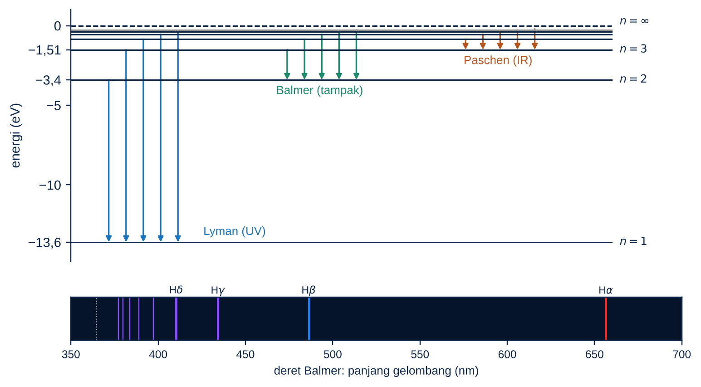
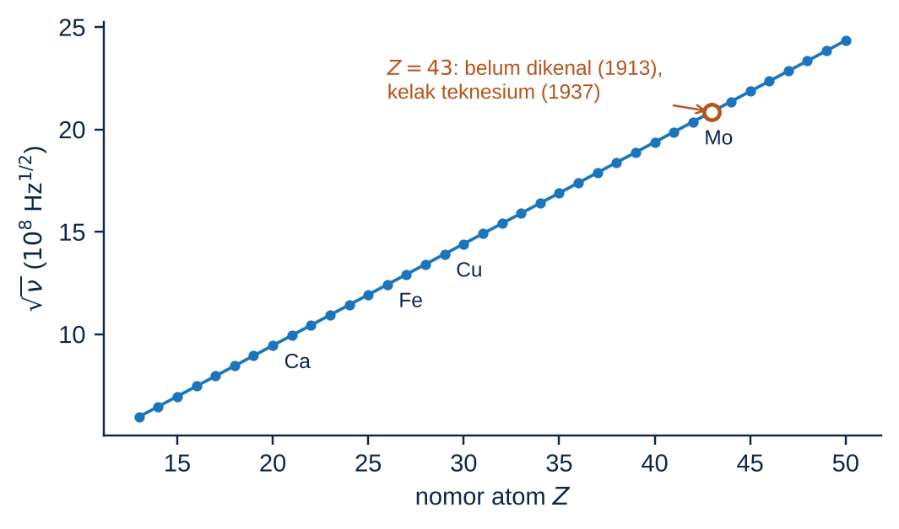

## 1.6 Spektrum atom dan model Bohr

### Spektrum garis: sidik jari unsur

Pada tahun 1859 Gustav Kirchhoff dan Robert Bunsen (penemu pembakar Bunsen) menunjukkan bahwa setiap unsur yang diuapkan dalam nyala memancarkan seperangkat garis spektrum yang khas, seperti sidik jari. Dalam dua tahun mereka menemukan dua unsur baru hanya dari garis spektrumnya: **sesium** (dari kata Latin *caesius*, biru langit, menurut dua garis birunya) dan **rubidium** (*rubidus*, merah tua). Pada tahun 1868 garis kuning yang tidak cocok dengan unsur apa pun terlihat dalam spektrum korona Matahari; unsur itu dinamai **helium** (dari *helios*, matahari) dan baru ditemukan di Bumi 27 tahun kemudian. Analisis spektrum menjadi alat kimia analitik yang sangat kuat, dan kini hidup dalam spektroskopi serapan dan emisi atom (AAS, ICP-OES).

Tetapi mengapa garis-garis itu tajam, dan mengapa letaknya demikian? Spektrum yang paling sederhana, spektrum hidrogen, menjadi kuncinya.

### Rumus Balmer dan Rydberg

Pada tahun 1885 Johann Balmer, guru matematika di sekolah putri di Basel, menemukan bahwa keempat garis tampak hidrogen cocok dengan rumus $\lambda = B\,n^2/(n^2 - 4)$ dengan $n = 3, 4, 5, 6$ dan $B = 364{,}6$ nm. Johannes Rydberg (1888) menuliskannya dalam bentuk bilangan gelombang yang lebih umum:

$$
\boxed{\ \tilde\nu = \frac{1}{\lambda} = R_H\left(\frac{1}{n_1^2} - \frac{1}{n_2^2}\right), \qquad n_2 > n_1\ } \qquad \text{(1.22)}
$$

dengan **tetapan Rydberg** untuk hidrogen $R_H = 1{,}096\,776 \times 10^7$ m⁻¹ $= 109\,678$ cm⁻¹. Setiap nilai $n_1$ memberikan satu **deret**: $n_1 = 1$ deret Lyman (ultraviolet), $n_1 = 2$ deret Balmer (tampak), $n_1 = 3$ deret Paschen (inframerah), lalu Brackett dan Pfund. Garis-garis setiap deret makin rapat ke arah **batas deret** ($n_2 \to \infty$).

Walther Ritz (1908) melihat pola yang lebih dalam: bilangan gelombang setiap garis adalah **selisih dua suku** $T(n) = R_H/n^2$. Ini menunjukkan bahwa atom mempunyai tingkat-tingkat energi tertentu, dan setiap garis spektrum adalah lompatan di antara dua tingkat. Pertanyaannya: dari mana tingkat-tingkat itu?

### Postulat Bohr

Niels Bohr, fisikawan Denmark yang saat itu bekerja di laboratorium Rutherford, mengajukan model atom hidrogen pada tahun 1913 dengan tiga postulat:

1. **Keadaan stasioner.** Elektron hanya dapat menempati orbit-orbit tertentu dan, selama berada di orbit itu, tidak memancarkan radiasi, bertentangan dengan elektrodinamika klasik.
2. **Syarat frekuensi.** Ketika elektron berpindah dari keadaan berenergi $E_i$ ke keadaan berenergi lebih rendah $E_f$, dipancarkan satu foton dengan

$$
h\nu = E_i - E_f . \qquad \text{(1.23)}
$$

3. **Kuantisasi momentum sudut.** Orbit yang diperbolehkan adalah orbit lingkaran yang momentum sudut elektronnya kelipatan bulat $\hbar$:

$$
m_evr = n\hbar, \qquad n = 1, 2, 3, \ldots
$$

Postulat pertama mengakui terus terang bahwa fisika klasik gagal di dalam atom. Postulat kedua menghubungkan atom dengan foton Einstein. Postulat ketiga adalah tebakan cerdik yang dipilih agar hasilnya cocok dengan rumus Rydberg; makna fisisnya baru jelas dengan gelombang de Broglie (subbab 1.7).

### Penurunan tingkat energi

Tinjau atom **mirip hidrogen**: satu elektron mengitari inti bermuatan $+Ze$ (hidrogen $Z = 1$, He⁺ $Z = 2$, Li²⁺ $Z = 3$). Anggap dulu inti diam.

**Langkah 1: gaya sentripetal dari tarikan Coulomb.**

$$
\frac{m_ev^2}{r} = \frac{Ze^2}{4\pi\varepsilon_0r^2} . \qquad \text{(a)}
$$

**Langkah 2: syarat kuantum.** Dari $m_evr = n\hbar$, kelajuan $v = n\hbar/(m_er)$. Masukkan ke (a):

$$
\frac{m_e}{r}\cdot\frac{n^2\hbar^2}{m_e^2r^2} = \frac{Ze^2}{4\pi\varepsilon_0r^2} \quad\Longrightarrow\quad r = \frac{4\pi\varepsilon_0\hbar^2}{m_ee^2}\cdot\frac{n^2}{Z} .
$$

Jadi jari-jari orbit

$$
\boxed{\ r_n = \frac{n^2}{Z}\,a_0, \qquad a_0 = \frac{4\pi\varepsilon_0\hbar^2}{m_ee^2} = 52{,}92\ \text{pm}\ } \qquad \text{(1.24)}
$$

Besaran $a_0$ disebut **jari-jari Bohr**. Ia akan menjadi satuan panjang atom (bohr) sejak Bab 7.

**Langkah 3: kelajuan.** Dari $v = n\hbar/(m_er_n)$:

$$
v_n = \frac{Ze^2}{4\pi\varepsilon_0\hbar}\cdot\frac{1}{n} = \frac{Z\alpha c}{n}, \qquad \alpha = \frac{e^2}{4\pi\varepsilon_0\hbar c} = \frac{1}{137{,}036} . \qquad \text{(1.25)}
$$

Bilangan tak berdimensi $\alpha$ disebut **tetapan struktur halus**. Elektron dalam orbit pertama hidrogen bergerak dengan $c/137$, cukup lambat sehingga mekanika nonrelativistik masuk akal untuk atom ringan. Untuk atom berat ($Z \approx 80$), $Z\alpha$ mendekati 0,6, dan efek relativistik menjadi penting; inilah sebabnya emas berwarna kuning dan raksa berwujud cair (Bab 20).

**Langkah 4: energi.** Energi total adalah kinetik ditambah potensial. Dari (a), $\tfrac12m_ev^2 = Ze^2/(8\pi\varepsilon_0r)$, sehingga

$$
E = \frac{Ze^2}{8\pi\varepsilon_0r} - \frac{Ze^2}{4\pi\varepsilon_0r} = -\frac{Ze^2}{8\pi\varepsilon_0r} .
$$

Masukkan $r_n$:

$$
\boxed{\ E_n = -\frac{Z^2}{n^2}\cdot\frac{m_ee^4}{8\varepsilon_0^2h^2} = -\frac{Z^2}{2n^2}\,E_h = -\frac{Z^2}{n^2}\,(13{,}606\ \text{eV})\ } \qquad \text{(1.26)}
$$

dengan $E_h = m_ee^4/(4\pi\varepsilon_0\hbar)^2 = 27{,}211$ eV, satuan energi atom yang disebut **hartree**. Energi negatif berarti elektron terikat; $E = 0$ adalah elektron yang diam jauh tak hingga dari inti. Perhatikan pula bahwa energi kinetik sama dengan $-E$ dan energi potensial sama dengan $2E$; ini adalah contoh **teorema virial** untuk potensial Coulomb (Bab 7 dan 13).

**Langkah 5: rumus Rydberg.** Masukkan (1.26) ke syarat frekuensi (1.23) dengan $\tilde\nu = \nu/c = (E_{n_2} - E_{n_1})/hc$:

$$
\tilde\nu = \frac{m_ee^4}{8\varepsilon_0^2h^3c}\,Z^2\left(\frac{1}{n_1^2} - \frac{1}{n_2^2}\right) .
$$

Ini persis bentuk (1.22), dengan tetapan Rydberg yang kini dihitung dari tetapan dasar:

$$
R_\infty = \frac{m_ee^4}{8\varepsilon_0^2h^3c} = 1{,}097\,373 \times 10^7\ \text{m}^{-1} . \qquad \text{(1.27)}
$$

Kecocokan dengan nilai percobaan $R_H$ sampai tiga angka bena adalah kemenangan besar model Bohr. Sisa selisih pada angka keempat ternyata juga bermakna.

{width=90%}

### Koreksi massa tereduksi

Inti tidak benar-benar diam; elektron dan inti sama-sama mengitari pusat massanya. Dalam masalah dua benda (Bab 6), gerak relatifnya setara dengan satu partikel bermassa **massa tereduksi**

$$
\mu = \frac{m_eM}{m_e + M} , \qquad \text{(1.28)}
$$

dengan $M$ massa inti. Semua rumus di atas tetap berlaku asalkan $m_e$ diganti $\mu$. Untuk hidrogen, $\mu/m_e = 0{,}999\,456$, sehingga $R_H = R_\infty\,\mu/m_e = 1{,}096\,776 \times 10^7$ m⁻¹, cocok dengan percobaan sampai angka keenam. Koreksi ini kecil tetapi bergantung pada **massa inti**, sehingga isotop yang berbeda memancarkan garis yang sedikit berbeda.

::: {.contoh}
**Contoh 1.28 · Garis-garis Balmer**

Hitung panjang gelombang (dalam hampa) empat garis pertama deret Balmer dan batas deretnya.

**Penyelesaian.** Dengan $n_1 = 2$ dan $R_H = 1{,}096\,776 \times 10^7$ m⁻¹, misalnya untuk $n_2 = 3$:

$$
\frac{1}{\lambda} = R_H\left(\frac14 - \frac19\right) = \frac{5R_H}{36} = 1{,}5233 \times 10^6\ \text{m}^{-1} \quad\Longrightarrow\quad \lambda = 656{,}47\ \text{nm}.
$$

| Garis | $n_2$ | $\lambda$ (nm) | Warna |
|---|---|---|---|
| Hα | 3 | 656,47 | merah |
| Hβ | 4 | 486,27 | biru-hijau |
| Hγ | 5 | 434,17 | ungu |
| Hδ | 6 | 410,29 | ungu |
| batas deret | ∞ | 364,71 | ultraviolet dekat |

**Memahami hasil.** Tabel spektroskopi sering mencantumkan panjang gelombang dalam udara, yang sedikit lebih pendek karena indeks bias udara 1,0003 (misalnya Hα = 656,28 nm dalam udara). Warna merah muda tabung lucutan hidrogen berasal terutama dari Hα. Batas deret Balmer, $4/R_H = 364{,}7$ nm, sama dengan tetapan $B$ dalam rumus Balmer.
:::

::: {.contoh}
**Contoh 1.29 · Energi ionisasi hidrogen**

Hitung energi ionisasi atom hidrogen dalam eV dan kJ/mol, dengan memperhitungkan massa tereduksi.

**Penyelesaian.** Ionisasi adalah perpindahan dari $n = 1$ ke $n = \infty$, sehingga $I = hcR_H$:

$$
I = (6{,}626 \times 10^{-34})(2{,}998 \times 10^8)(1{,}096\,776 \times 10^7) = 2{,}1787 \times 10^{-18}\ \text{J} = 13{,}598\ \text{eV}.
$$

Dalam kJ/mol: $(2{,}1787 \times 10^{-18})(6{,}022 \times 10^{23})/1000 = 1312{,}0$ kJ/mol.

**Memahami hasil.** Nilai yang tercantum di tabel energi ionisasi untuk hidrogen adalah 1312,0 kJ/mol, tepat sama. Energi ionisasi atom-atom lain tidak dapat dihitung dengan model Bohr, karena atom-atom itu mempunyai lebih dari satu elektron yang saling tolak.
:::

::: {.contoh}
**Contoh 1.30 · Orbit pertama dan atom Rydberg**

\(a) Untuk hidrogen pada $n = 1$, hitung kelajuan elektron dan periode edarnya. (b) Atom dengan elektron pada $n$ sangat besar disebut **atom Rydberg**. Berapa jari-jari orbit $n = 100$? Berapa frekuensi foton pada transisi $n = 101 \to 100$?

**Penyelesaian.** (a) $v_1 = \alpha c = 2{,}998 \times 10^8/137{,}04 = 2{,}19 \times 10^6$ m/s. Periode $T = 2\pi a_0/v_1 = 2\pi(5{,}292 \times 10^{-11})/(2{,}19 \times 10^6) = 1{,}52 \times 10^{-16}$ s.

\(b) $r_{100} = 100^2a_0 = 10^4 \times 52{,}92$ pm $= 0{,}529$ µm, seukuran bakteri kecil. Frekuensinya

$$
\nu = cR_H\left(\frac{1}{100^2} - \frac{1}{101^2}\right) = (2{,}998 \times 10^8)(1{,}0968 \times 10^7)(1{,}970 \times 10^{-6}) = 6{,}48\ \text{GHz}.
$$

**Memahami hasil.** Transisi antara keadaan Rydberg jatuh dalam daerah gelombang mikro. Astronom radio mengamati "garis rekombinasi" semacam ini dari awan hidrogen terionisasi di galaksi. Atom Rydberg, yang ukurannya mendekati mikrometer, kini dipakai dalam penelitian komputasi kuantum dan dalam kimia ion–molekul pada suhu sangat rendah.
:::

::: {.contoh}
**Contoh 1.31 · Penemuan deuterium**

Pada tahun 1932 Harold Urey memekatkan hidrogen berat dengan menguapkan hidrogen cair dan mendapati garis Hα "kembar" yang lemah di sisi panjang gelombang pendek. Hitung selisih panjang gelombang Hα antara H dan D. Massa deuteron 2,013 55 u, massa proton 1,007 28 u, massa elektron $5{,}485\,80 \times 10^{-4}$ u.

**Penyelesaian.** $R_D = R_\infty\,\mu_D/m_e$, dengan $\mu_D/m_e = 1/(1 + m_e/M_D) = 1/(1 + 2{,}7244 \times 10^{-4}) = 0{,}999\,728$. Jadi $R_D = 1{,}097\,074 \times 10^7$ m⁻¹ dan

$$
\lambda_D(\text{H}\alpha) = \frac{36}{5R_D} = 656{,}29\ \text{nm}.
$$

Selisihnya dengan hidrogen biasa $656{,}47 - 656{,}29 = 0{,}179$ nm.

**Memahami hasil.** Pergeseran 0,18 nm mudah dipisahkan oleh spektrograf kisi yang baik. Urey menerima Hadiah Nobel Kimia 1934 untuk penemuan deuterium, yang kemudian menjadi perunut tak ternilai dalam kimia organik dan biokimia. Efek isotop pada spektrum dan pada laju reaksi akan muncul lagi di Bab 5 dan 6.
:::

### Ion mirip hidrogen

Rumus (1.26) berlaku untuk setiap sistem satu elektron dengan inti bermuatan $Ze$. Energi ionisasi He⁺ seharusnya $2^2 = 4$ kali hidrogen, dan Li²⁺ sembilan kali. Nilai percobaan, yang sama dengan energi ionisasi kedua He dan ketiga Li, cocok sempurna: 54,42 eV dan 122,45 eV. Inilah satu-satunya energi ionisasi atom berelektron banyak yang dapat dihitung dengan tepat dari teori sederhana: begitu tinggal satu elektron, masalahnya menjadi masalah hidrogen.

::: {.contoh}
**Contoh 1.32 · Ion He⁺ menyamar sebagai hidrogen**

Pada tahun 1896 astronom Edward Pickering mengamati dalam spektrum bintang panas sebuah deret garis yang mirip deret Balmer, tetapi dengan garis tambahan di antaranya. Garis-garis itu mula-mula dikira berasal dari hidrogen. (a) Tunjukkan bahwa transisi $n = 4 \to 2$ dalam He⁺ mempunyai bilangan gelombang yang hampir sama dengan Lyman-α hidrogen ($n = 2 \to 1$). (b) Hitung kedua panjang gelombang dengan memperhitungkan massa tereduksi ($R_{\text{He}^+} = 1{,}097\,222 \times 10^7$ m⁻¹).

**Penyelesaian.** (a) Untuk He⁺, $Z^2(1/n_1^2 - 1/n_2^2) = 4(1/4 - 1/16) = 3/4$. Untuk Lyman-α hidrogen, $1 - 1/4 = 3/4$. Faktornya sama.

\(b) He⁺: $\lambda = 1/[(1{,}097\,222 \times 10^7)(3/4)] = 121{,}52$ nm. H: $\lambda = 1/[(1{,}096\,776 \times 10^7)(3/4)] = 121{,}57$ nm.

**Memahami hasil.** Setiap garis He⁺ dengan $n$ genap berimpit, kecuali selisih kecil akibat massa tereduksi, dengan garis hidrogen; garis dengan $n$ ganjil "menyisip" di antaranya. Bohr menunjukkan bahwa deret Pickering berasal dari He⁺, dan pengukuran teliti selisih kecil itu (0,05 nm) menegaskan koreksi massa tereduksi. Model Bohr lulus ujian yang tidak dirancang untuknya.
:::

### Hukum Moseley: nomor atom

Pada tahun 1913 Henry Moseley, yang berusia 26 tahun, mengukur panjang gelombang sinar-X karakteristik (garis Kα) yang dipancarkan berbagai unsur bila ditembaki elektron. Ia mendapati bahwa akar frekuensi garis Kα berbanding lurus dengan nomor urut unsur dalam tabel periodik (Gambar 1.8). Model Bohr menjelaskannya. Garis Kα terjadi ketika sebuah elektron dari kulit $n = 2$ jatuh mengisi lowongan di kulit $n = 1$. Elektron yang jatuh itu "melihat" muatan inti $Z$ dikurangi satu elektron $1s$ yang tersisa, jadi muatan efektifnya kira-kira $Z - 1$. Dari (1.26):

$$
\nu_{K\alpha} \approx cR_\infty(Z - 1)^2\left(1 - \frac14\right) = \frac34\,cR_\infty(Z - 1)^2 . \qquad \text{(1.29)}
$$

Akibatnya bagi kimia sangat besar. Sebelum Moseley, unsur diurutkan menurut massa atom, dengan beberapa pengecualian yang diputuskan berdasarkan sifat kimia (kobalt sebelum nikel, telurium sebelum iodin, argon sebelum kalium). Moseley menunjukkan bahwa urutan yang benar adalah urutan **muatan inti** $Z$, dan bahwa pengecualian-pengecualian Mendeleev itu tepat. Celah dalam garis lurusnya menunjukkan unsur yang belum ditemukan: $Z = 43$, 61, 72, dan 75. Keempatnya ditemukan kemudian: hafnium (1923), renium (1925), teknesium (1937, unsur buatan pertama), dan prometium (1945). Moseley gugur dalam Perang Dunia I pada tahun 1915.

{width=66%}

::: {.contoh}
**Contoh 1.33 · Sinar-X tembaga untuk kristalografi**

\(a) Ramalkan energi dan panjang gelombang garis Kα tembaga ($Z = 29$) dengan hukum Moseley. (b) Sebuah unsur memancarkan Kα pada 71,07 pm. Unsur apakah itu?

**Penyelesaian.** (a) $E = \tfrac34(13{,}606\ \text{eV})(28)^2 = 8{,}00$ keV, sehingga $\lambda = 1239{,}8\ \text{eV·nm}/8000\ \text{eV} = 0{,}155$ nm $= 155$ pm.

\(b) Balikkan (1.29): $Z - 1 = \sqrt{4/(3R_\infty\lambda)} = \sqrt{4/[3(1{,}0974 \times 10^7)(7{,}107 \times 10^{-11})]} = 41{,}3$, jadi $Z \approx 42$: molibdenum.

**Memahami hasil.** Panjang gelombang Cu Kα yang terukur adalah 154,06 pm; ramalan sederhana meleset kurang dari 1%. Sinar-X Cu Kα dan Mo Kα adalah dua sumber yang paling banyak dipakai dalam difraktometer sinar-X di laboratorium kimia. Panjang gelombangnya sebanding dengan jarak antaratom (100–300 pm), sehingga kristal berperilaku sebagai kisi difraksi.
:::

### Percobaan Franck–Hertz

Spektrum garis adalah bukti tidak langsung tingkat energi atom: yang diamati adalah cahaya. James Franck dan Gustav Hertz (1914) memberikan bukti langsung dengan menembakkan elektron melalui uap raksa. Arus elektron yang sampai ke pengumpul naik dengan tegangan pemercepat, lalu turun tajam setiap kali tegangan bertambah sekitar 4,9 V. Elektron yang energinya kurang dari 4,9 eV hanya terpantul lenting dari atom raksa; begitu mencapai 4,9 eV, elektron dapat menyerahkan tepat 4,9 eV untuk mengeksitasi atom, lalu kehilangan hampir seluruh energinya. Pada saat yang sama, uap raksa mulai memancarkan ultraviolet pada 253,7 nm. Atom menerima energi dari elektron pun hanya dalam porsi tertentu.

::: {.contoh}
**Contoh 1.34 · Lampu raksa dan Franck–Hertz**

\(a) Berapa panjang gelombang foton yang dipancarkan atom raksa yang kembali dari keadaan tereksitasi 4,886 eV ke keadaan dasar? (b) Mengapa lampu germisida memakai raksa?

**Penyelesaian.** (a) $\lambda = 1239{,}8/4{,}886 = 253{,}7$ nm.

\(b) Garis 253,7 nm berada dalam ultraviolet C, dekat puncak serapan DNA (sekitar 260 nm), sehingga efektif membunuh mikroorganisme. Raksa mudah diuapkan pada tekanan rendah dan garis 253,7 nm-nya sangat kuat.

**Memahami hasil.** Lampu neon (fluoresen) biasa juga berisi uap raksa yang memancarkan 253,7 nm. Lapisan "fosfor" di dinding tabung menyerap ultraviolet itu dan memancarkan kembali cahaya tampak berenergi lebih rendah. Energi yang hilang dalam pergeseran itu adalah alasan lain lampu fluoresen kurang efisien dibandingkan LED.
:::

::: {.dalam}
**Lebih dalam · Asas korespondensi dalam model Bohr**

Menurut fisika klasik, elektron yang mengorbit memancarkan cahaya dengan frekuensi edarnya, $f = v/2\pi r$. Untuk orbit Bohr ke-$n$, dengan (1.24) dan (1.25),

$$
f_n = \frac{Z\alpha c/n}{2\pi n^2a_0/Z} = \frac{Z^2\alpha c}{2\pi a_0}\cdot\frac{1}{n^3} = \frac{Z^2E_h}{h}\cdot\frac{1}{n^3} ,
$$

karena $\alpha c/(2\pi a_0) = E_h/h$. Menurut Bohr, transisi $n \to n - 1$ memancarkan foton dengan

$$
\nu = \frac{Z^2E_h}{2h}\left[\frac{1}{(n - 1)^2} - \frac{1}{n^2}\right] = \frac{Z^2E_h}{2h}\cdot\frac{2n - 1}{n^2(n - 1)^2} \;\xrightarrow{\ n\,\gg\,1\ }\; \frac{Z^2E_h}{h}\cdot\frac{1}{n^3} .
$$

Untuk $n$ besar keduanya sama. Perbandingan $\nu/f_n$ adalah 3,00 untuk $n = 2$, 1,17 untuk $n = 10$, dan 1,015 untuk $n = 100$. Teori kuantum menyatu dengan teori klasik pada bilangan kuantum besar. Bohr sebenarnya memakai syarat ini untuk menebak postulat ketiganya.
:::

### Keberhasilan dan kegagalan model Bohr

Model Bohr menjelaskan spektrum hidrogen dan ion mirip hidrogen, menghitung $R_\infty$ dan $a_0$ dari tetapan dasar, menjelaskan hukum Moseley, dan memberi gambaran tingkat energi yang dipakai kimiawan sampai sekarang. Sommerfeld (1916) memperluasnya dengan orbit elips dan koreksi relativistik, yang menjelaskan sebagian struktur halus spektrum hidrogen. Gabungan gagasan ini kini disebut **teori kuantum lama**.

Tetapi kegagalannya mendasar:

- Model ini gagal untuk atom helium, atom netral paling sederhana berikutnya, dan untuk semua atom berelektron banyak.
- Model ini tidak dapat meramalkan **intensitas** garis spektrum, dan tidak menjelaskan mengapa sebagian transisi tidak teramati.
- Model ini meramalkan momentum sudut $\hbar$ untuk keadaan dasar hidrogen; mekanika kuantum yang benar (Bab 7) memberikan **nol**.
- Model ini menggambarkan atom hidrogen sebagai cakram datar, padahal atom hidrogen bulat.
- Model ini tidak dapat menjelaskan ikatan kimia, bahkan untuk ion H₂⁺ yang hanya mempunyai satu elektron.
- Postulat-postulatnya tidak mempunyai dasar; mengapa momentum sudut yang dikuantisasi, dan mengapa orbit stasioner tidak memancar?

Jawaban atas pertanyaan terakhir datang dari arah yang tak terduga: elektron adalah gelombang.

::: {.awas}
**Awas · "Orbit" bukan "orbital"**

Dalam model Bohr, elektron bergerak pada lintasan lingkaran tertentu dengan jari-jari dan kelajuan tertentu. Dalam mekanika kuantum, elektron tidak mempunyai lintasan. **Orbital** (Bab 7) adalah fungsi gelombang yang kuadratnya memberikan peluang menemukan elektron di setiap titik ruang. Jari-jari Bohr $a_0$ tetap bermakna, tetapi sebagai jarak yang paling mungkin dari inti untuk elektron 1s, bukan jari-jari lintasan. Jangan menggambar orbital sebagai lintasan, dan jangan menyebut kulit $n = 2$ sebagai "orbit kedua".
:::

::: {.kuis}
**Kuis cepat 1.6**

\(a) Berapa banyak garis spektrum yang mungkin dipancarkan sekumpulan atom hidrogen yang semula tereksitasi ke $n = 4$? (b) Mengapa energi ionisasi kedua helium dapat dihitung dengan tepat dengan model Bohr, sedangkan energi ionisasi pertamanya tidak?
:::
