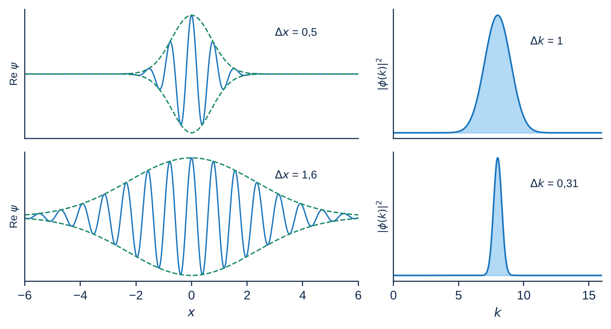
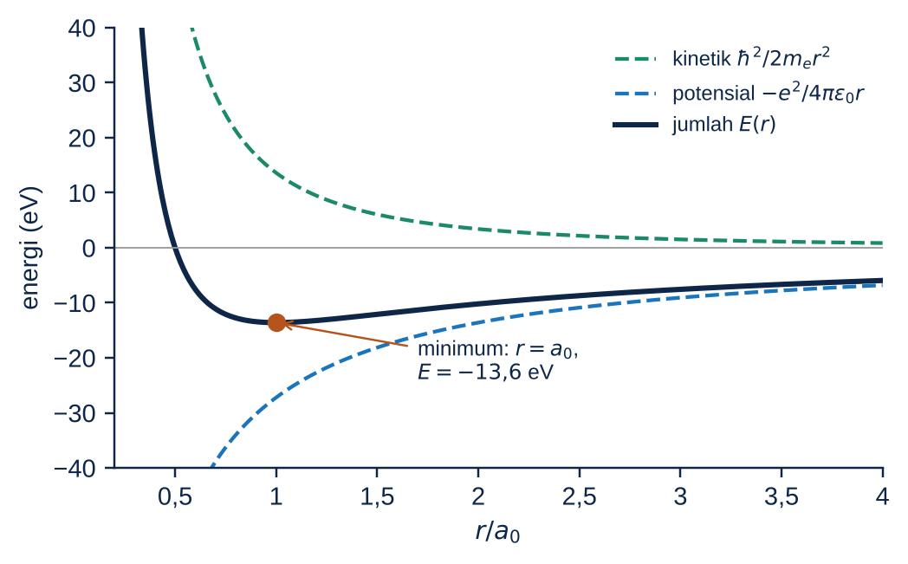

## 1.7 Hipotesis de Broglie dan difraksi elektron

### Gelombang materi

Pada tahun 1924 Louis de Broglie, bangsawan Prancis yang semula belajar sejarah, menulis disertasi dengan gagasan sederhana yang mengubah fisika. Cahaya, yang lama dianggap gelombang, ternyata juga berperilaku sebagai partikel dengan momentum $p = h/\lambda$. Alam gemar akan simetri; mungkinkah partikel, misalnya elektron, juga berperilaku sebagai gelombang? De Broglie mengusulkan bahwa setiap partikel bermomentum $p$ disertai gelombang dengan panjang gelombang

$$
\boxed{\ \lambda = \frac{h}{p} = \frac{h}{mv}\ } \qquad \text{(1.30)}
$$

Hubungan ini, dan pasangannya $E = h\nu$, kini disebut **hubungan de Broglie**. Penguji disertasinya tidak yakin dan meminta pendapat Einstein, yang menjawab bahwa de Broglie telah "menyingkap ujung tirai yang besar".

### Penjelasan syarat Bohr

Gagasan de Broglie langsung memberi makna pada postulat ketiga Bohr yang tampak sewenang-wenang. Jika elektron dalam orbit adalah gelombang, gelombang itu harus "cocok" mengelilingi orbit: setelah satu putaran, ia harus kembali sefase dengan dirinya sendiri. Kalau tidak, gelombang pada putaran-putaran berikutnya saling meniadakan (Gambar 1.9). Syaratnya, keliling orbit harus kelipatan bulat panjang gelombang:

$$
2\pi r = n\lambda = n\frac{h}{m_ev} \quad\Longrightarrow\quad m_evr = n\frac{h}{2\pi} = n\hbar .
$$

Inilah tepat syarat kuantisasi Bohr. Orbit stasioner adalah **gelombang berdiri**, dan bilangan kuantum $n$ adalah banyaknya panjang gelombang yang muat dalam satu keliling. Kuantisasi energi dalam atom ternyata saudara dekat kuantisasi nada pada tali gitar. Gagasan ini dikembangkan Schrödinger menjadi persamaan gelombang pada tahun 1926 (Bab 3).

{width=74%}

### Panjang gelombang elektron yang dipercepat

Elektron yang dipercepat dari diam melalui beda potensial $V$ memperoleh energi kinetik $K = eV$. Selama $eV \ll m_ec^2 = 511$ keV, momentumnya $p = \sqrt{2m_eK} = \sqrt{2m_eeV}$, sehingga

$$
\lambda = \frac{h}{\sqrt{2m_eeV}} = \frac{1{,}226\ \text{nm}}{\sqrt{V/\text{volt}}} . \qquad \text{(1.31)}
$$

Elektron 100 eV mempunyai panjang gelombang 0,123 nm, seukuran jarak antaratom dalam kristal. Untuk tegangan tinggi, misalnya dalam mikroskop elektron, momentum harus dihitung secara relativistik: $p = \sqrt{2m_eeV(1 + eV/2m_ec^2)}$.

### Percobaan Davisson–Germer

Di Bell Telephone Laboratories, Clinton Davisson dan Lester Germer menembakkan berkas elektron pada permukaan kristal nikel dan mengukur arah elektron yang terpantul. Pada tahun 1925 sebuah kecelakaan (tabung pecah dan nikel teroksidasi) memaksa mereka memanaskan sampel, yang tanpa sengaja mengubah nikel polikristal menjadi beberapa kristal besar. Sesudah itu muncul pola pantulan dengan puncak yang tajam. Setelah mendengar gagasan de Broglie, mereka menyadari bahwa itu adalah difraksi. Pada tahun 1927 mereka melaporkan bahwa elektron 54 eV dipantulkan paling kuat pada sudut 50° dari arah datang. Barisan atom di permukaan nikel berperilaku seperti kisi difraksi dengan jarak $d = 0{,}215$ nm, dan syarat difraksinya $d\sin\theta = \lambda$.

Pada tahun yang sama George Paget Thomson di Aberdeen melewatkan elektron berenergi puluhan keV menembus lapisan logam tipis dan memperoleh pola cincin difraksi yang sama dengan pola sinar-X. Ironinya, ayahnya, J. J. Thomson, menerima Nobel 1906 karena membuktikan bahwa elektron adalah partikel; sang anak menerima Nobel 1937 (bersama Davisson) karena membuktikan bahwa elektron adalah gelombang. Keduanya benar.

::: {.contoh}
**Contoh 1.35 · Memeriksa hasil Davisson–Germer**

\(a) Hitung panjang gelombang de Broglie elektron 54 eV. (b) Bandingkan dengan panjang gelombang yang diturunkan dari puncak difraksi pada 50° dengan $d = 0{,}215$ nm.

**Penyelesaian.** (a) Dengan (1.31): $\lambda = 1{,}226/\sqrt{54} = 0{,}167$ nm. Secara lengkap,

$$
\lambda = \frac{6{,}626 \times 10^{-34}}{\sqrt{2(9{,}109 \times 10^{-31})(1{,}602 \times 10^{-19})(54)}} = 1{,}67 \times 10^{-10}\ \text{m}.
$$

\(b) $\lambda = d\sin\theta = (0{,}215\ \text{nm})\sin 50° = 0{,}165$ nm.

**Memahami hasil.** Kecocokan dalam 1,3% sangat meyakinkan untuk percobaan tahun 1927. Elektron berenergi rendah (20–200 eV) hanya menembus beberapa lapis atom teratas, sehingga difraksi elektron energi rendah (LEED) menjadi alat baku untuk menentukan struktur permukaan dan susunan molekul yang teradsorpsi pada katalis.
:::

::: {.contoh}
**Contoh 1.36 · Mengapa bola kasti tidak terdifraksi**

Bandingkan panjang gelombang de Broglie bola kasti 145 g yang dilempar 40 m/s dengan panjang gelombang elektron yang bergerak 40 m/s.

**Penyelesaian.** Bola: $\lambda = h/mv = 6{,}626 \times 10^{-34}/[(0{,}145)(40)] = 1{,}1 \times 10^{-34}$ m. Elektron: $\lambda = 6{,}626 \times 10^{-34}/[(9{,}109 \times 10^{-31})(40)] = 1{,}8 \times 10^{-5}$ m $= 18$ µm.

**Memahami hasil.** Panjang gelombang bola kasti $10^{19}$ kali lebih kecil dari inti atom; tidak ada celah atau kisi yang dapat mendifraksikannya, dan sifat gelombangnya tidak pernah teramati. Massa yang kecil itulah yang membuat elektron "kuantum". Untuk elektron yang lambat, panjang gelombangnya bahkan makroskopik.
:::

::: {.contoh}
**Contoh 1.37 · Mikroskop elektron transmisi**

Mikroskop elektron transmisi (TEM) bekerja pada 200 kV. (a) Hitung panjang gelombang elektronnya tanpa dan dengan koreksi relativistik. (b) Berapa kelajuan elektron?

**Penyelesaian.** (a) Tanpa koreksi: $\lambda = 1{,}226/\sqrt{200\,000}$ nm $= 2{,}74$ pm. Dengan koreksi, faktor $1 + eV/2m_ec^2 = 1 + 200/1022 = 1{,}196$, sehingga $\lambda = 2{,}74/\sqrt{1{,}196} = 2{,}51$ pm.

\(b) $\gamma = 1 + eV/m_ec^2 = 1 + 200/511 = 1{,}391$; $v/c = \sqrt{1 - 1/\gamma^2} = 0{,}695$.

**Memahami hasil.** Koreksi relativistik mengubah panjang gelombang 9%, jadi tidak boleh diabaikan. Panjang gelombang 2,5 pm jauh lebih kecil daripada jarak antaratom, sehingga resolusi TEM dibatasi oleh cacat lensa magnetnya, bukan oleh difraksi; mikroskop modern dengan koreksi aberasi dapat melihat kolom-kolom atom secara langsung (resolusi sekitar 50 pm). Teknik cryo-EM, yang memotret molekul protein yang dibekukan cepat, menerima Hadiah Nobel Kimia 2017.
:::

### Neutron, atom, dan molekul

Hubungan de Broglie berlaku untuk semua partikel. **Neutron** termal dari reaktor nuklir, dengan energi sekitar $kT$ pada suhu kamar, mempunyai panjang gelombang sekitar 0,1–0,2 nm dan dipakai untuk difraksi kristal. Neutron dihamburkan oleh inti, bukan oleh elektron, sehingga ia "melihat" atom hidrogen hampir sama baiknya dengan atom berat. Sinar-X dihamburkan oleh elektron dan hampir tidak melihat hidrogen, yang hanya mempunyai satu elektron. Itulah sebabnya kedudukan proton dalam ikatan hidrogen dan dalam hidrida logam ditentukan dengan difraksi neutron.

Pada tahun 1930 Otto Stern dan Immanuel Estermann mendifraksikan atom helium dan molekul H₂ dari permukaan kristal LiF. Pada tahun 1999 Anton Zeilinger dan Markus Arndt di Wina menunjukkan interferensi molekul fulerena C₆₀; sejak itu molekul dengan massa lebih dari 25 000 u pun telah diinterferensikan. Tidak ada batas yang diketahui antara dunia "kuantum" dan "klasik"; yang ada hanya panjang gelombang yang makin kecil dan makin sulit diamati.

::: {.contoh}
**Contoh 1.38 · Neutron termal**

Hitung panjang gelombang de Broglie neutron yang energi kinetiknya sama dengan energi kinetik translasi rata-rata $\tfrac32kT$ pada 300 K. Massa neutron $1{,}675 \times 10^{-27}$ kg.

**Penyelesaian.** $K = \tfrac32(1{,}381 \times 10^{-23})(300) = 6{,}21 \times 10^{-21}$ J (0,039 eV).

$$
\lambda = \frac{h}{\sqrt{2m_nK}} = \frac{6{,}626 \times 10^{-34}}{\sqrt{2(1{,}675 \times 10^{-27})(6{,}21 \times 10^{-21})}} = 1{,}45 \times 10^{-10}\ \text{m} = 0{,}145\ \text{nm}.
$$

**Memahami hasil.** Panjang gelombang ini cocok untuk difraksi kristal. Energi neutron termal (puluhan meV) juga sebanding dengan energi getaran kisi dan getaran molekul berfrekuensi rendah, sehingga hamburan neutron tak lenting dipakai sebagai spektroskopi getaran yang tidak terikat aturan seleksi optik.
:::

::: {.contoh}
**Contoh 1.39 · Interferensi fulerena**

Dalam percobaan Wina, molekul C₆₀ (massa 720 u) bergerak dengan kelajuan sekitar 220 m/s. Hitung panjang gelombang de Broglie-nya dan bandingkan dengan diameter molekul (sekitar 1 nm).

**Penyelesaian.** $m = 720 \times 1{,}661 \times 10^{-27} = 1{,}196 \times 10^{-24}$ kg.

$$
\lambda = \frac{6{,}626 \times 10^{-34}}{(1{,}196 \times 10^{-24})(220)} = 2{,}5 \times 10^{-12}\ \text{m} = 2{,}5\ \text{pm}.
$$

**Memahami hasil.** Panjang gelombangnya sekitar 400 kali lebih kecil daripada ukuran molekul itu sendiri. Gelombang de Broglie bukan "ukuran" partikel; ia menyatakan sesuatu tentang gerak pusat massanya. Molekul C₆₀ pada percobaan itu bahkan panas (sekitar 900 K) dan memancarkan foton inframerah, tetapi tetap berinterferensi, selama foton itu tidak membocorkan informasi tentang jalan yang ditempuh molekul (subbab 1.8).
:::

::: {.contoh}
**Contoh 1.40 · Kapan gas berperilaku kuantum?**

Sifat kuantum gerak translasi molekul gas menjadi penting jika panjang gelombang de Broglie termal $\Lambda = h/\sqrt{2\pi mkT}$ sebanding dengan jarak rata-rata antarmolekul. (a) Hitung $\Lambda$ untuk N₂ dan He pada 298 K. (b) Hitung $\Lambda$ untuk He pada 2,17 K. (c) Jarak antarmolekul gas pada 1 bar dan 298 K sekitar 3,5 nm, dan dalam helium cair sekitar 0,36 nm. Apa kesimpulannya?

**Penyelesaian.** (a) N₂: $\Lambda = 6{,}626 \times 10^{-34}/\sqrt{2\pi(28{,}0 \times 1{,}661 \times 10^{-27})(1{,}381 \times 10^{-23})(298)} = 0{,}019$ nm. He: 0,051 nm.

\(b) He pada 2,17 K: $\Lambda$ sebanding dengan $T^{-1/2}$, sehingga $\Lambda = 0{,}0505\sqrt{298/2{,}17} = 0{,}59$ nm.

\(c) Pada suhu kamar $\Lambda$ ratusan kali lebih kecil dari jarak antarmolekul: gerak translasi molekul gas sepenuhnya klasik, dan teori kinetik gas berlaku. Dalam helium cair pada 2,17 K, $\Lambda$ melampaui jarak antaratom: gelombang-gelombang atom saling bertumpang tindih.

**Memahami hasil.** Tepat pada 2,17 K helium-4 cair berubah menjadi **superfluida** yang mengalir tanpa kekentalan. Ini adalah gejala kuantum makroskopik, akibat langsung gelombang de Broglie atom-atom yang saling bertumpang tindih. Untuk kimia biasa, gerak translasi molekul hampir selalu klasik; yang kuantum adalah gerak elektron, getaran, dan (pada suhu rendah) rotasi.
:::

::: {.terapan}
**Kaitan kimia · Menentukan struktur molekul dengan gelombang materi**

Difraksi elektron fase gas (GED), yang dikembangkan antara lain oleh Linus Pauling pada tahun 1930-an, memberikan panjang ikatan dan sudut ikatan molekul bebas tanpa pengaruh kristal: CCl₄, benzena, dan banyak molekul anorganik pertama kali diukur strukturnya dengan cara ini. Difraksi neutron menempatkan atom hidrogen dengan teliti, misalnya dalam es, dalam ikatan hidrogen protein, dan dalam hidrida logam untuk penyimpanan hidrogen. Mikroskop elektron dan cryo-EM memotret partikel nano dan protein. Semua alat ini bertumpu pada satu persamaan, $\lambda = h/p$.
:::

::: {.kuis}
**Kuis cepat 1.7**

Elektron dan proton mempunyai energi kinetik yang sama. Mana yang panjang gelombang de Broglie-nya lebih panjang, dan berapa kali?
:::

## 1.8 Percobaan celah ganda dan dualisme

Kita sekarang mempunyai dua fakta yang tampak bertentangan. Cahaya terdiri atas foton yang tiba satu per satu sebagai paket, tetapi cahaya juga berinterferensi seperti gelombang. Elektron adalah partikel yang dapat dihitung satu per satu dengan pencacah, tetapi elektron juga terdifraksi seperti gelombang. Percobaan celah ganda memperlihatkan pertentangan ini dalam bentuk paling tajam. Richard Feynman menyebutnya fenomena yang "mustahil dijelaskan secara klasik, dan yang memuat inti mekanika kuantum".

### Gelombang melalui dua celah

Ingat kembali percobaan Young (*Fisika Umum*, Bab 9). Gelombang dengan panjang gelombang $\lambda$ melewati dua celah sempit berjarak $d$. Pada layar sejauh $L$, gelombang dari kedua celah tiba dengan selisih lintasan $d\sin\theta$. Terang terjadi bila selisih itu kelipatan bulat $\lambda$:

$$
d\sin\theta = m\lambda, \qquad m = 0, \pm1, \pm2, \ldots
$$

Untuk sudut kecil, jarak antarpita terang pada layar

$$
\Delta y = \frac{\lambda L}{d} . \qquad \text{(1.32)}
$$

### Elektron satu per satu

Claus Jönsson (1961) melakukan percobaan celah ganda yang sesungguhnya dengan elektron, memakai celah selebar sekitar setengah mikrometer yang dibuat pada lapisan tembaga. Pada tahun 1989 Akira Tonomura dan rekan-rekannya di Hitachi melakukan versi yang lebih menakjubkan: berkas elektron dibuat sangat lemah sehingga rata-rata hanya ada satu elektron di dalam alat pada satu waktu, dan setiap elektron yang sampai ke layar dicatat sebagai satu titik.

Hasilnya (Gambar 1.10): setiap elektron tiba sebagai **satu titik** di tempat yang tampaknya acak, persis seperti partikel. Tetapi setelah ribuan elektron terkumpul, titik-titik itu membentuk **pola interferensi** pita terang dan gelap. Elektron-elektron itu tidak saling berinteraksi; masing-masing melewati alat sendirian. Pola interferensi karena itu bukan hasil interaksi antarelektron. Setiap elektron "berinterferensi dengan dirinya sendiri".

Yang lebih aneh: ada tempat-tempat di layar (pita gelap) yang **tidak pernah** dicapai elektron bila kedua celah terbuka, padahal tempat yang sama dicapai elektron bila hanya satu celah yang terbuka. Membuka celah kedua **mengurangi** peluang elektron sampai ke titik itu. Partikel klasik tidak dapat berperilaku demikian: jalan tambahan selalu menambah peluang, tidak pernah mengurangi.

{width=92%}

### Amplitudo peluang

Penjelasan mekanika kuantum adalah sebagai berikut. Setiap kemungkinan jalan dikaitkan dengan sebuah **amplitudo peluang**, bilangan kompleks yang kini kita sebut fungsi gelombang $\psi$. Peluang adalah kuadrat besar amplitudo. Jika ada dua jalan yang tidak dapat dibedakan, yang dijumlahkan adalah **amplitudonya**, bukan peluangnya:

$$
\psi = \psi_1 + \psi_2, \qquad P = |\psi_1 + \psi_2|^2 = |\psi_1|^2 + |\psi_2|^2 + 2\,\text{Re}\left(\psi_1^*\psi_2\right) . \qquad \text{(1.33)}
$$

Suku terakhir, **suku interferensi**, dapat positif atau negatif. Misalkan kedua amplitudo sama besar tetapi berbeda fase: $\psi_1 = Ae^{i\phi_1}$ dan $\psi_2 = Ae^{i\phi_2}$. Dengan $\psi_1^*\psi_2 = A^2e^{i(\phi_2 - \phi_1)}$ dan $\text{Re}\,e^{i\delta} = \cos\delta$:

$$
P = A^2 + A^2 + 2A^2\cos\delta = 2A^2(1 + \cos\delta) = 4A^2\cos^2\frac{\delta}{2}, \qquad \delta = \frac{2\pi d\sin\theta}{\lambda} .
$$

Ketika $\delta$ kelipatan $2\pi$, $P = 4A^2$: empat kali peluang satu celah, bukan dua kali. Ketika $\delta$ kelipatan ganjil $\pi$, $P = 0$. Bilangan kompleks dan rumus Euler $e^{i\delta} = \cos\delta + i\sin\delta$ dibahas di Bab 2; untuk sekarang cukup diingat bahwa amplitudo mempunyai besar dan fase, dan fase itulah yang membuat interferensi.

Tafsiran bahwa $|\psi|^2$ adalah peluang dikemukakan Max Born pada tahun 1926 (Bab 3). Menurut tafsiran ini, mekanika kuantum tidak meramalkan di mana satu elektron tertentu akan mendarat; ia meramalkan **sebaran peluang** pendaratan, dengan tepat.

::: {.contoh}
**Contoh 1.41 · Peluang dengan dan tanpa interferensi**

Pada sebuah titik layar, amplitudo dari celah 1 dan celah 2 mempunyai besar yang sama. Bila hanya satu celah terbuka, peluang elektron tiba di titik itu $P_1 = P_2 = 0{,}010$ (dalam satuan sembarang). Hitung peluang bila kedua celah terbuka dan beda fasenya (a) 0, (b) $\pi/2$, (c) $\pi$. (d) Ulangi (a) dan (c) bila besar amplitudo celah 1 dua kali celah 2, dengan $|\psi_2|^2 = 0{,}010$.

**Penyelesaian.** Dengan $P = 2A^2(1 + \cos\delta)$ dan $A^2 = 0{,}010$:

\(a) $P = 0{,}040$. (b) $P = 0{,}020$. (c) $P = 0$.

\(d) $|\psi_1| = 2|\psi_2|$. Untuk $\delta = 0$: $P = (2 + 1)^2(0{,}010) = 0{,}090$. Untuk $\delta = \pi$: $P = (2 - 1)^2(0{,}010) = 0{,}010$. Tanpa interferensi $P_1 + P_2 = 0{,}050$.

**Memahami hasil.** Pada beda fase $\pi/2$ suku interferensi lenyap, dan peluangnya kebetulan sama dengan jumlah klasik. Bila amplitudo tidak sama, pita gelap tidak benar-benar gelap; **kontras** pola $(P_\text{maks} - P_\text{min})/(P_\text{maks} + P_\text{min}) = (0{,}090 - 0{,}010)/0{,}100 = 0{,}80$. Kontras pola interferensi dipakai fisikawan untuk mengukur seberapa "kuantum" sebuah sistem.
:::

::: {.contoh}
**Contoh 1.42 · Ukuran pola interferensi elektron**

Dalam percobaan Jönsson, elektron dipercepat 50 kV, jarak celah 2,0 µm, dan jarak celah ke layar 0,35 m. (a) Hitung jarak antarpita. (b) Hitung jarak antarpita untuk percobaan C₆₀ dengan kisi berperiode 100 nm, layar 1,25 m, dan $\lambda = 2{,}5$ pm.

**Penyelesaian.** (a) Panjang gelombang relativistik elektron 50 keV: faktor koreksi $1 + 50/1022 = 1{,}049$, sehingga $\lambda = (1{,}226/\sqrt{50\,000})/\sqrt{1{,}049}$ nm $= 5{,}36$ pm. Dengan (1.32):

$$
\Delta y = \frac{(5{,}36 \times 10^{-12})(0{,}35)}{2{,}0 \times 10^{-6}} = 9{,}4 \times 10^{-7}\ \text{m} \approx 1\ \text{µm}.
$$

\(b) $\Delta y = (2{,}5 \times 10^{-12})(1{,}25)/(100 \times 10^{-9}) = 3{,}1 \times 10^{-5}$ m $= 31$ µm.

**Memahami hasil.** Pita-pita berjarak 1 µm tidak dapat dilihat dengan mata; Jönsson memperbesarnya dengan lensa elektron sebelum memotretnya. Dalam percobaan C₆₀, molekul-molekul dideteksi dengan mengionkannya memakai laser lalu mencacah ionnya, sambil menggeser detektor sedikit demi sedikit.
:::

### Jalan mana yang ditempuh?

Bagaimana jika kita berusaha mengetahui lewat celah mana setiap elektron lewat, misalnya dengan menyinari celah agar elektron yang lewat memantulkan foton? Hasilnya selalu sama: **begitu informasi jalan tersedia, pola interferensi lenyap**, dan distribusinya menjadi jumlah biasa $P_1 + P_2$ (garis putus-putus pada Gambar 1.10). Untuk mengetahui celah mana yang dilewati, foton harus mempunyai panjang gelombang lebih kecil dari jarak celah, sehingga momentumnya cukup besar untuk mengacak arah elektron dan menghapus pola. Tidak ada cara cerdik untuk menghindarinya; batas ini dirumuskan secara umum sebagai asas ketidakpastian (subbab 1.9).

Niels Bohr menyebut keadaan ini **komplementaritas**: sifat gelombang dan sifat partikel adalah dua aspek yang saling melengkapi; percobaan yang menampakkan satu aspek pasti menyembunyikan aspek yang lain. Cara yang lebih modern untuk mengatakannya: elektron bukan gelombang dan bukan partikel. Ia adalah objek kuantum yang **merambat seperti gelombang** (amplitudo yang berinterferensi) dan **terdeteksi seperti partikel** (satu titik, satu cacah, satu foton yang diserap utuh). Hal yang sama berlaku untuk foton, neutron, atom, dan molekul.

::: {.inti}
**Dualisme gelombang–partikel.** Objek kuantum merambat sebagai amplitudo peluang $\psi$ yang dapat berinterferensi, dan terdeteksi sebagai kejadian lokal tunggal dengan peluang $|\psi|^2$. Bila beberapa jalan tidak dapat dibedakan, jumlahkan amplitudonya; bila dapat dibedakan (walaupun hanya secara asas), jumlahkan peluangnya.
:::

::: {.contoh}
**Contoh 1.43 · Ikatan kimia sebagai interferensi**

Dalam molekul H₂⁺ (satu elektron, dua proton A dan B), fungsi gelombang elektron dapat didekati sebagai jumlah atau selisih dua orbital atom: $\psi_\pm = \psi_A \pm \psi_B$ (normalisasi diabaikan dulu). Di titik tengah antara kedua inti, $\psi_A = \psi_B = a$. Bandingkan rapat peluang di titik tengah untuk $\psi_+$, $\psi_-$, dan untuk "campuran klasik" yang hanya menjumlahkan peluang.

**Penyelesaian.** $|\psi_+|^2 = (a + a)^2 = 4a^2$. $|\psi_-|^2 = (a - a)^2 = 0$. Campuran klasik: $|\psi_A|^2 + |\psi_B|^2 = 2a^2$.

**Memahami hasil.** Interferensi konstruktif menumpuk kerapatan elektron di antara inti, dua kali lipat dari penjumlahan biasa. Elektron di daerah itu ditarik oleh kedua proton sekaligus dan "merekatkan" keduanya: inilah **orbital ikatan**. Interferensi destruktif membuat simpul di tengah: **orbital antiikatan**. Ikatan kovalen, dalam arti yang sangat nyata, adalah pola interferensi elektron. Gagasan ini dikembangkan secara kuantitatif di Bab 11.
:::

::: {.kuis}
**Kuis cepat 1.8**

Dalam percobaan celah ganda dengan elektron, apa yang terjadi pada jarak antarpita bila tegangan pemercepat dinaikkan empat kali? Apa yang terjadi pada pola bila detektor jalan dipasang di salah satu celah?
:::

## 1.9 Asas ketidakpastian

### Pernyataan

Pada tahun 1927 Werner Heisenberg menunjukkan bahwa sifat gelombang materi membawa batas mendasar pada ketelitian kita mengetahui posisi dan momentum sebuah partikel **secara bersamaan**. Jika $\Delta x$ adalah simpangan baku posisi dan $\Delta p_x$ simpangan baku komponen momentum ke arah yang sama, maka

$$
\boxed{\ \Delta x\,\Delta p_x \ge \frac{\hbar}{2}\ } \qquad \text{(1.34)}
$$

Hubungan yang sama berlaku untuk $y$ dan $p_y$, dan untuk $z$ dan $p_z$. Tidak ada batas untuk pasangan $x$ dan $p_y$. Bukti umumnya, untuk setiap pasangan besaran yang operatornya tidak komut, diberikan di Bab 4.

### Asal-usul: paket gelombang

Asas ketidakpastian bukan keterbatasan alat ukur; ia adalah sifat gelombang. Gelombang dengan satu panjang gelombang yang tepat, $\psi = e^{ikx}$ dengan $k = 2\pi/\lambda$, mempunyai momentum yang tepat $p = \hbar k$ (dari $p = h/\lambda$), tetapi gelombang itu membentang sama rata dari $-\infty$ sampai $+\infty$: posisinya sama sekali tidak tentu. Untuk membuat partikel yang terlokalisasi, kita harus menjumlahkan banyak gelombang dengan $k$ yang berbeda-beda sehingga saling menguatkan di satu daerah dan saling meniadakan di tempat lain. Hasilnya adalah **paket gelombang** (Gambar 1.11). Makin sempit paket, makin banyak panjang gelombang yang diperlukan, makin lebar sebaran momentumnya.

Untuk paket berbentuk Gauss, analisis Fourier (Bab 2 dan 3) memberikan $\Delta x\,\Delta k = \tfrac12$ tepat, nilai terkecil yang mungkin. Untuk bentuk lain hasil kalinya lebih besar. Dengan $p = \hbar k$, $\Delta x\,\Delta p = \hbar\,\Delta x\,\Delta k \ge \hbar/2$.

{width=86%}

::: {.dalam}
**Lebih dalam · Mikroskop Heisenberg**

Heisenberg sendiri menjelaskan asasnya dengan percobaan pikiran. Untuk "melihat" posisi elektron, kita sinari dengan cahaya berpanjang gelombang $\lambda$ dan menangkap foton terhambur dengan lensa mikroskop yang setengah sudut bukaannya $\alpha$. Daya pisah mikroskop membatasi ketelitian posisi: $\Delta x \approx \lambda/\sin\alpha$. Foton yang terhambur dan masuk lensa dapat berasal dari arah mana saja dalam kerucut bukaan, sehingga komponen-$x$ momentumnya tidak tentu sebesar sekitar $(h/\lambda)\sin\alpha$. Karena momentum kekal (efek Compton), ketidakpastian yang sama berpindah ke elektron: $\Delta p_x \approx (h/\lambda)\sin\alpha$. Hasil kalinya

$$
\Delta x\,\Delta p_x \approx \frac{\lambda}{\sin\alpha}\cdot\frac{h\sin\alpha}{\lambda} = h ,
$$

tidak bergantung pada $\lambda$ maupun $\alpha$. Memperpendek panjang gelombang memperbaiki posisi tetapi memperbesar tendangan foton. Argumen ini menunjukkan bahwa asas ketidakpastian melindungi dirinya dari setiap cara pengukuran. Tetapi berhati-hatilah: asas ketidakpastian tidak **disebabkan** oleh gangguan pengukuran. Elektron dalam atom yang tidak diukur pun tidak mempunyai posisi dan momentum yang tajam secara bersamaan.
:::

::: {.contoh}
**Contoh 1.44 · Elektron dalam atom dan kelereng dalam kotak**

\(a) Sebuah elektron terkurung dalam daerah selebar ikatan kimia, $\Delta x = 0{,}10$ nm. Berapa ketidakpastian kecepatan minimumnya? (b) Ulangi untuk kelereng 1,0 g yang posisinya diketahui dalam 1,0 cm.

**Penyelesaian.** (a) $\Delta p \ge \hbar/(2\Delta x) = 1{,}055 \times 10^{-34}/(2 \times 1{,}0 \times 10^{-10}) = 5{,}3 \times 10^{-25}$ kg·m/s, sehingga $\Delta v \ge \Delta p/m_e = 5{,}8 \times 10^5$ m/s.

\(b) $\Delta p \ge 1{,}055 \times 10^{-34}/(2 \times 0{,}010) = 5{,}3 \times 10^{-33}$ kg·m/s; $\Delta v \ge 5{,}3 \times 10^{-30}$ m/s.

**Memahami hasil.** Untuk elektron dalam molekul, ketidakpastian kecepatannya sebanding dengan kecepatan Bohr ($2{,}2 \times 10^6$ m/s): gagasan lintasan elektron sama sekali tidak bermakna. Untuk kelereng, ketidakpastian $10^{-30}$ m/s tidak akan pernah terdeteksi; kelereng bergerak di lintasan klasik yang tegas.
:::

### Mengapa atom tidak runtuh

Asas ketidakpastian menjelaskan, secara kualitatif, teka-teki di awal bab. Elektron yang terkurung dalam daerah berukuran $r$ mempunyai ketidakpastian momentum sekitar $\hbar/r$, sehingga energi kinetiknya sedikitnya kira-kira $\hbar^2/(2m_er^2)$. Makin dekat elektron ke inti, makin besar energi kinetik yang "dipaksakan" padanya. Energi totalnya kira-kira

$$
E(r) \approx \frac{\hbar^2}{2m_er^2} - \frac{e^2}{4\pi\varepsilon_0r} .
$$

Suku pertama naik sebanding $1/r^2$ ketika $r$ mengecil, suku kedua turun sebanding $1/r$. Untuk $r$ kecil suku kinetik menang, sehingga $E(r)$ mempunyai minimum (Gambar 1.12). Turunkan dan samakan dengan nol:

$$
\frac{dE}{dr} = -\frac{\hbar^2}{m_er^3} + \frac{e^2}{4\pi\varepsilon_0r^2} = 0 \quad\Longrightarrow\quad r = \frac{4\pi\varepsilon_0\hbar^2}{m_ee^2} = a_0 .
$$

Masukkan kembali: $E(a_0) = \dfrac{\hbar^2}{2m_ea_0^2} - \dfrac{e^2}{4\pi\varepsilon_0a_0} = -\dfrac{e^2}{8\pi\varepsilon_0a_0} = -13{,}6$ eV.

Bahwa perkiraan kasar ini memberikan jari-jari Bohr dan energi keadaan dasar yang tepat sebagian adalah keberuntungan (faktor-faktor numeriknya kebetulan cocok), tetapi pesannya kokoh: **ukuran atom adalah keseimbangan antara tarikan Coulomb dan "tekanan" kinetik kuantum**. Elektron tidak jatuh ke inti bukan karena ada gaya yang menahannya, melainkan karena mengurungnya di daerah yang lebih kecil memerlukan energi kinetik yang lebih besar daripada energi potensial yang diperoleh. Kemantapan atom, dan karena itu seluruh kimia, adalah gejala kuantum.

{width=64%}

::: {.contoh}
**Contoh 1.45 · Mengapa elektron tidak ada di dalam inti**

Dalam peluruhan beta, inti memancarkan elektron dengan energi beberapa MeV atau kurang. Dahulu orang menduga elektron itu sudah ada di dalam inti. Hitung energi kinetik minimum elektron yang terkurung dalam inti berukuran $\Delta x = 5$ fm. Karena hasilnya besar, pakai $E \approx pc$.

**Penyelesaian.** $\Delta p \ge \hbar/(2\Delta x) = 1{,}055 \times 10^{-34}/(1{,}0 \times 10^{-14}) = 1{,}05 \times 10^{-20}$ kg·m/s. Energinya $pc = (1{,}05 \times 10^{-20})(2{,}998 \times 10^8) = 3{,}2 \times 10^{-12}$ J $= 20$ MeV.

**Memahami hasil.** Elektron dengan energi kinetik 20 MeV tidak dapat ditahan oleh gaya inti mana pun dan jauh melampaui energi elektron beta yang teramati. Kesimpulannya: elektron beta tidak tinggal di dalam inti; ia **diciptakan** pada saat peluruhan, ketika neutron berubah menjadi proton. Bandingkan dengan elektron dalam atom: ruang selebar 0,1 nm hanya memaksakan energi kinetik sekitar 1 eV, sebanding dengan energi ikatan kimia.
:::

### Energi titik nol

Akibat lain yang sangat penting bagi kimia: partikel yang terkurung **tidak pernah diam**. Jika partikel diam, $\Delta p = 0$, dan asas ketidakpastian menuntut $\Delta x = \infty$, bertentangan dengan anggapan bahwa ia terkurung. Jadi energi terendah partikel terkurung selalu lebih besar daripada energi minimum potensialnya. Kelebihan itu disebut **energi titik nol**. Untuk osilator harmonik (Bab 5) energi titik nolnya $\tfrac12h\nu$, bukan nol seperti yang diandaikan Planck pada (1.10). Atom-atom dalam molekul terus bergetar bahkan pada nol mutlak. Energi titik nol berbeda untuk isotop yang berbeda, dan inilah sumber utama **efek isotop kinetik** dan **efek isotop kesetimbangan** dalam kimia.

::: {.contoh}
**Contoh 1.46 · Getaran titik nol molekul hidrogen**

Getaran H₂ mempunyai bilangan gelombang 4401 cm⁻¹ dan massa tereduksi $\mu = 8{,}37 \times 10^{-28}$ kg. Untuk osilator harmonik, energi titik nolnya $\tfrac12h\nu$ dan simpangan baku panjang ikatannya $\Delta x = \sqrt{\hbar/(2\mu\omega)}$ dengan $\omega = 2\pi\nu$. (a) Hitung energi titik nol dalam eV dan kJ/mol. (b) Hitung $\Delta x$ dan bandingkan dengan panjang ikatan 74 pm. (c) Periksa bahwa $\Delta x\,\Delta p = \hbar/2$ bila $\Delta p = \sqrt{\mu\hbar\omega/2}$.

**Penyelesaian.** (a) $\nu = c\tilde\nu = (2{,}998 \times 10^{10}\ \text{cm/s})(4401\ \text{cm}^{-1}) = 1{,}319 \times 10^{14}$ Hz. $E_0 = \tfrac12h\nu = 4{,}37 \times 10^{-20}$ J $= 0{,}273$ eV $= 26{,}3$ kJ/mol.

\(b) $\omega = 8{,}29 \times 10^{14}$ s⁻¹. $\Delta x = \sqrt{1{,}055 \times 10^{-34}/[2(8{,}37 \times 10^{-28})(8{,}29 \times 10^{14})]} = 8{,}7 \times 10^{-12}$ m $= 8{,}7$ pm, sekitar 12% panjang ikatan.

\(c) $\Delta x\,\Delta p = \sqrt{\hbar/(2\mu\omega)}\sqrt{\mu\hbar\omega/2} = \sqrt{\hbar^2/4} = \hbar/2$.

**Memahami hasil.** Energi titik nol H₂ (26 kJ/mol) sekitar 6% energi ikatnya: tidak kecil sama sekali. Keadaan dasar osilator harmonik adalah paket Gauss, sehingga ia memenuhi asas ketidakpastian dengan tanda sama dengan. Karena energi disosiasi diukur dari tingkat titik nol, dan D₂ yang lebih berat mempunyai energi titik nol lebih kecil, ikatan D–D sedikit lebih sukar diputus daripada H–H.
:::

### Energi dan waktu

Pasangan kedua yang penting adalah energi dan waktu:

$$
\Delta E\,\Delta t \gtrsim \frac{\hbar}{2} . \qquad \text{(1.35)}
$$

Hubungan ini berbeda wataknya dari (1.34) karena waktu bukan besaran yang diukur pada partikel; $\Delta t$ adalah waktu khas perubahan sistem. Bagi kimia, maknanya yang paling penting menyangkut **lebar garis spektrum**. Keadaan tereksitasi dengan umur rata-rata $\tau$ tidak mempunyai energi yang tajam; ketidakpastian energinya sekitar $\hbar/\tau$, sehingga garis spektrumnya mempunyai lebar frekuensi

$$
\delta\nu = \frac{1}{2\pi\tau} \qquad\text{atau}\qquad \delta\tilde\nu = \frac{5{,}31\ \text{cm}^{-1}}{\tau/\text{ps}} . \qquad \text{(1.36)}
$$

Lebar ini, yang tidak dapat dihilangkan oleh spektrometer sebaik apa pun, disebut **pelebaran umur** atau lebar alami. Sebaliknya, pulsa laser yang sangat singkat tidak dapat sangat monokromatis. Ahmed Zewail menerima Nobel Kimia 1999 untuk **femtokimia**: memotret pemutusan dan pembentukan ikatan dengan pulsa laser selama puluhan femtodetik, lebih singkat dari periode getaran molekul.

::: {.contoh}
**Contoh 1.47 · Lebar alami garis D natrium**

Keadaan tereksitasi 3p natrium berumur 16,2 ns. (a) Hitung lebar alami garis 589 nm dalam MHz dan cm⁻¹. (b) Bandingkan dengan lebar Doppler dalam nyala 500 K (sekitar 1,7 GHz).

**Penyelesaian.** (a) $\delta\nu = 1/(2\pi \times 16{,}2 \times 10^{-9}\ \text{s}) = 9{,}8 \times 10^6$ Hz $= 9{,}8$ MHz. Dalam bilangan gelombang, $\delta\tilde\nu = \delta\nu/c = 9{,}8 \times 10^6/(2{,}998 \times 10^{10}\ \text{cm/s}) = 3{,}3 \times 10^{-4}$ cm⁻¹.

\(b) Lebar Doppler sekitar 170 kali lebih besar.

**Memahami hasil.** Dalam spektroskopi atom biasa (misalnya AAS), lebar garis ditentukan oleh gerak termal atom (Doppler) dan tumbukan, bukan oleh lebar alami. Lebar alami baru terlihat dengan teknik bebas-Doppler. Tetapi untuk keadaan yang berumur sangat pendek, misalnya keadaan tereksitasi yang segera terdisosiasi, pelebaran umur menjadi dominan.
:::

::: {.contoh}
**Contoh 1.48 · Pulsa femtodetik**

Sebuah percobaan femtokimia memakai pulsa berdurasi $\Delta t = 20$ fs. (a) Berapa ketidakpastian energi minimumnya menurut (1.35), dalam eV dan cm⁻¹? (b) Periode getaran H₂ adalah 7,6 fs dan periode getaran I₂ sekitar 156 fs. Getaran mana yang dapat "difoto" dengan pulsa ini?

**Penyelesaian.** (a) $\Delta E \ge \hbar/(2\Delta t) = 1{,}055 \times 10^{-34}/(4{,}0 \times 10^{-14}) = 2{,}6 \times 10^{-21}$ J $= 0{,}016$ eV $= 133$ cm⁻¹.

\(b) Pulsa 20 fs jauh lebih singkat dari periode getaran I₂, sehingga gerak atom iodin dapat diikuti tahap demi tahap. Getaran H₂ terlalu cepat untuk pulsa ini.

**Memahami hasil.** Sebaran energi 133 cm⁻¹ jauh lebih besar daripada selang antartingkat rotasi (beberapa cm⁻¹) dan sebanding dengan selang getaran I₂ (sekitar 214 cm⁻¹). Pulsa singkat semacam ini mengeksitasi beberapa tingkat getaran sekaligus secara koheren, dan superposisi tingkat-tingkat itu adalah paket gelombang yang berayun seperti atom-atom klasik. Kita tidak dapat sekaligus mengetahui tingkat energi dengan tepat dan mengikuti gerak dalam waktu dengan tepat.
:::

::: {.awas}
**Awas · Salah kaprah tentang asas ketidakpastian**

(1) Asas ketidakpastian **tidak** berarti bahwa semua besaran kabur. Energi atom hidrogen pada keadaan dasar diketahui sampai 12 angka bena; yang tidak dapat sekaligus tajam adalah posisi dan momentum. (2) Ia **tidak** sekadar akibat alat ukur yang kasar; ia akibat sifat gelombang. (3) $\Delta x$ dan $\Delta p$ adalah simpangan baku hasil pengukuran berulang pada sistem yang disiapkan sama, bukan "kesalahan" satu pengukuran. (4) Untuk benda makroskopik ketidakpastian itu ada, tetapi terlalu kecil untuk berarti.
:::

::: {.kuis}
**Kuis cepat 1.9**

Sebuah proton dan sebuah elektron masing-masing terkurung dalam daerah yang sama lebarnya. Mana yang energi kinetik minimumnya lebih besar, dan berapa kali? Apa artinya bagi energi titik nol ikatan O–H dibandingkan O–D?
:::
