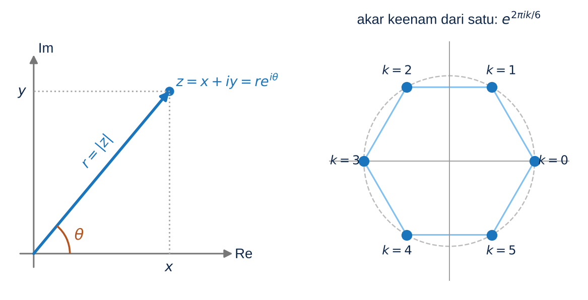
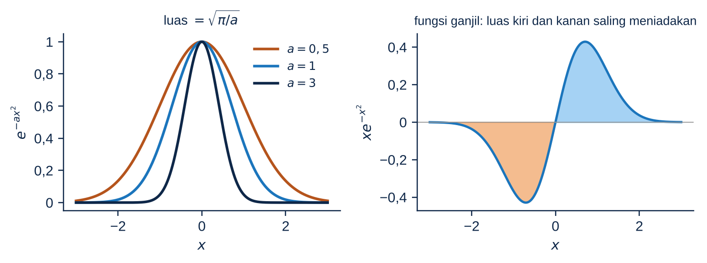

# Bab 2 Matematika untuk Kimia Kuantum

Spektrometer NMR 600 MHz di laboratorium kimia organik tidak pernah "memindai" frekuensi satu per satu. Ia memberi sampel satu pulsa gelombang radio selama beberapa mikrodetik, lalu merekam sinyal yang berayun dan meluruh selama sekitar satu detik. Rekaman itu tampak seperti coretan acak; tidak ada puncak, tidak ada geseran kimia. Kemudian komputer menjalankan satu operasi matematika, dan coretan itu berubah menjadi spektrum yang tajam, lengkap dengan multiplet dan integralnya. Spektrometer FT-IR bekerja dengan cara yang sama.

Operasi itu adalah **transformasi Fourier**. Ia memakai bilangan kompleks, deret, integral, dan gagasan bahwa fungsi dapat diuraikan atas fungsi-fungsi lain yang saling "tegak lurus". Matematika yang sama persis dipakai untuk menuliskan fungsi gelombang elektron, menyelesaikan persamaan Schrödinger, menghitung energi orbital π benzena dari sebuah determinan, dan menghitung peluang menemukan elektron di dekat inti. Bab ini mengumpulkan semua alat itu di satu tempat, masing-masing dengan contoh kimia yang akan muncul lagi di bab-bab berikutnya.

Mengapa satu bab penuh untuk matematika? Karena dalam kimia kuantum, kesulitan konsep dan kesulitan aljabar sering bercampur. Mahasiswa yang lancar mengintegralkan $x^2e^{-ax^2}$ atau mencari nilai eigen matriks 3 × 3 dapat memusatkan perhatian pada fisikanya. Kamu boleh membaca bab ini sekaligus, atau kembali ke subbabnya ketika alat itu pertama kali diperlukan.

::: {.strategi}
**Pertanyaan pembuka**

1. Mengapa mekanika kuantum memerlukan bilangan "khayal" $i = \sqrt{-1}$, padahal semua hasil pengukuran berupa bilangan riil?
2. Bagaimana integral $\int_{-\infty}^{\infty}e^{-x^2}\,dx = \sqrt\pi$ dapat dihitung, padahal $e^{-x^2}$ tidak mempunyai antiturunan dalam bentuk fungsi biasa?
3. Mengapa syarat batas pada persamaan diferensial menghasilkan bilangan kuantum?
4. Bagaimana enam tingkat energi elektron π benzena muncul dari akar-akar sebuah polinom derajat enam?
5. Mengapa spektrum dan sinyal waktu adalah dua wajah dari informasi yang sama?
:::

::: {.tujuan}
**Tujuan belajar**

Setelah mempelajari bab ini, kamu mampu:

1. Menghitung dengan bilangan kompleks dalam bentuk Kartesius dan kutub, menurunkan rumus Euler, dan memakai akar satuan.
2. Menghitung turunan parsial, mengintegralkan secara parsial, dan menghitung integral Gauss serta integral $\int_0^\infty x^ne^{-ax}\,dx$.
3. Menyelesaikan persamaan diferensial linear orde dua berkoefisien tetap dan memakai syarat batas untuk memperoleh nilai-nilai yang diizinkan.
4. Menyelesaikan persamaan diferensial dengan deret pangkat dan memahami mengapa deret harus berhenti.
5. Memakai koordinat bola dan silinder beserta elemen volumenya untuk normalisasi dan nilai harap.
6. Memperlakukan fungsi sebagai vektor: hasil kali dalam, ortogonalitas, ortonormalisasi, dan ekspansi.
7. Menghitung dengan matriks dan determinan, serta mencari nilai eigen dan vektor eigen, termasuk dengan Python.
8. Menguraikan fungsi menjadi deret Taylor dan deret Fourier, dan menafsirkan transformasi Fourier dalam spektroskopi.
9. Menghitung rata-rata, simpangan baku, dan peluang untuk sebaran diskret dan malar.
10. Memakai satuan atom dan mengubahnya ke satuan SI.
:::

::: {.mat}
**Prasyarat**

Kalkulus satu variabel (turunan, integral tentu dan tak tentu, aturan rantai), trigonometri dasar, dan aljabar vektor tiga dimensi dari *Fisika Umum* Bab 1. Dari Bab 1 buku ini: amplitudo peluang dan interferensi (subbab 1.8), asas ketidakpastian dan paket gelombang (subbab 1.9), dan satuan energi (subbab 1.10). Untuk contoh numerik, pasang Python dengan NumPy dan SciPy.
:::

## 2.1 Bilangan kompleks dan rumus Euler

### Mengapa bilangan kompleks?

Di subbab 1.8 kita melihat bahwa interferensi memerlukan amplitudo yang mempunyai **besar** dan **fase**. Bilangan riil hanya mempunyai besar dan tanda; tanda adalah fase yang hanya dapat bernilai 0 atau 180°. Untuk fase sembarang diperlukan bilangan yang hidup di bidang, bukan di garis: bilangan kompleks. Persamaan Schrödinger bergantung waktu (Bab 3) bahkan memuat $i$ secara eksplisit, sehingga fungsi gelombang yang berubah terhadap waktu pada umumnya bernilai kompleks. Yang selalu riil adalah besaran yang terukur, misalnya rapat peluang $|\psi|^2$.

### Definisi dan aritmetika

**Satuan khayal** $i$ didefinisikan dengan $i^2 = -1$. Bilangan kompleks berbentuk

$$
z = x + iy, \qquad x = \text{Re}\,z, \quad y = \text{Im}\,z ,
$$

dengan $x$ dan $y$ riil. Penjumlahan dan perkalian mengikuti aljabar biasa dengan aturan $i^2 = -1$:

$$
(a + ib)(c + id) = (ac - bd) + i(ad + bc) .
$$

**Konjugat kompleks** $z^*$ diperoleh dengan mengganti $i$ menjadi $-i$: $z^* = x - iy$. Hasil kali bilangan dengan konjugatnya selalu riil dan tak negatif:

$$
z^*z = (x - iy)(x + iy) = x^2 + y^2 = |z|^2 . \qquad \text{(2.1)}
$$

Besaran $|z| = \sqrt{x^2 + y^2}$ disebut **modulus** atau nilai mutlak. Pembagian dilakukan dengan mengalikan pembilang dan penyebut dengan konjugat penyebut:

$$
\frac{a + ib}{c + id} = \frac{(a + ib)(c - id)}{c^2 + d^2} .
$$

Dalam kimia kuantum, konjugat muncul di mana-mana. Rapat peluang adalah $\psi^*\psi = |\psi|^2$, dan nilai harap ditulis $\int\psi^*\hat A\psi\,d\tau$. Aturan praktisnya: untuk mengambil konjugat sebuah ungkapan, ganti setiap $i$ dengan $-i$, termasuk $i$ yang tersembunyi di dalam eksponen.

### Bentuk kutub dan rumus Euler

Bilangan kompleks dapat digambar sebagai titik $(x, y)$ pada **bidang kompleks** (Gambar 2.1 kiri). Dengan koordinat kutub, $x = r\cos\theta$ dan $y = r\sin\theta$, sehingga

$$
z = r(\cos\theta + i\sin\theta), \qquad r = |z|, \quad \theta = \arg z .
$$

Sudut $\theta$ disebut **argumen** atau **fase**. Hubungan yang paling penting dalam bab ini menyatakan bagian dalam kurung sebagai satu eksponen:

$$
\boxed{\ e^{i\theta} = \cos\theta + i\sin\theta\ } \qquad \text{(2.2)}
$$

Inilah **rumus Euler**. Bukti paling langsung memakai deret Taylor (subbab 2.9). Masukkan $x = i\theta$ ke deret $e^x = \sum x^n/n!$ dan pakai $i^2 = -1$, $i^3 = -i$, $i^4 = 1$:

$$
e^{i\theta} = 1 + i\theta - \frac{\theta^2}{2!} - i\frac{\theta^3}{3!} + \frac{\theta^4}{4!} + i\frac{\theta^5}{5!} - \cdots = \left(1 - \frac{\theta^2}{2!} + \frac{\theta^4}{4!} - \cdots\right) + i\left(\theta - \frac{\theta^3}{3!} + \frac{\theta^5}{5!} - \cdots\right) .
$$

Kurung pertama adalah deret $\cos\theta$, kurung kedua deret $\sin\theta$. Jadi setiap bilangan kompleks dapat ditulis

$$
z = re^{i\theta} , \qquad z^* = re^{-i\theta} . \qquad \text{(2.3)}
$$

Bentuk kutub membuat perkalian dan pemangkatan sangat mudah: modulus dikalikan, fase dijumlahkan.

$$
z_1z_2 = r_1r_2\,e^{i(\theta_1 + \theta_2)}, \qquad z^n = r^ne^{in\theta} .
$$

Dari (2.2) dan konjugatnya diperoleh pula ungkapan cos dan sin sebagai eksponen kompleks:

$$
\cos\theta = \frac{e^{i\theta} + e^{-i\theta}}{2}, \qquad \sin\theta = \frac{e^{i\theta} - e^{-i\theta}}{2i} . \qquad \text{(2.4)}
$$

Keduanya sering dipakai untuk mengubah orbital kompleks menjadi orbital riil (Bab 6 dan 7).

{width=80%}

### Faktor fase

Bilangan $e^{i\theta}$ dengan $\theta$ riil mempunyai modulus satu, sebab $|e^{i\theta}|^2 = e^{-i\theta}e^{i\theta} = 1$. Mengalikan fungsi gelombang dengan **faktor fase** semacam ini tidak mengubah rapat peluangnya: $|e^{i\theta}\psi|^2 = |\psi|^2$. Karena itu fungsi gelombang hanya ditentukan sampai faktor fase global. Tetapi **fase relatif** antara dua bagian fungsi gelombang sangat bermakna. Pada percobaan celah ganda, $|\psi_1 + e^{i\delta}\psi_2|^2$ bergantung pada $\delta$. Pada molekul H₂⁺, $\psi_A + \psi_B$ mengikat sedangkan $\psi_A - \psi_B = \psi_A + e^{i\pi}\psi_B$ tidak.

Gelombang bidang yang merambat ke arah $+x$ ditulis $\psi = Ae^{i(kx - \omega t)}$. Bagian riilnya $A\cos(kx - \omega t)$ adalah gelombang yang kita kenal, tetapi bentuk kompleks lebih mudah diturunkan: $\partial\psi/\partial x = ik\psi$ dan $\partial\psi/\partial t = -i\omega\psi$. Turunan berubah menjadi perkalian.

### Akar satuan

Persamaan $z^N = 1$ mempunyai tepat $N$ akar. Dengan bentuk kutub, $z = e^{i\theta}$ memenuhi $e^{iN\theta} = 1$ jika $N\theta$ kelipatan $2\pi$, jadi

$$
z_k = e^{2\pi ik/N}, \qquad k = 0, 1, \ldots, N - 1 . \qquad \text{(2.5)}
$$

Akar-akar ini membentuk segi-$N$ beraturan pada lingkaran satuan (Gambar 2.1 kanan). Ini bukan sekadar hiasan. Di Bab 13 kita akan melihat bahwa orbital π molekul siklik C$_N$H$_N$ mempunyai energi $E_k = \alpha + 2\beta\cos(2\pi k/N)$, yaitu $\alpha$ ditambah $2\beta$ kali bagian riil akar satuan. Segi enam benzena dalam gambar itu menyimpan pola tingkat energi benzena.

::: {.contoh}
**Contoh 2.1 · Aritmetika kompleks**

Untuk $z_1 = 3 + 4i$ dan $z_2 = 1 - 2i$, hitung $z_1z_2$, $z_1/z_2$, $|z_1|$, dan nyatakan $z_1$ dan $z_2$ dalam bentuk kutub.

**Penyelesaian.** $z_1z_2 = 3 - 6i + 4i - 8i^2 = 11 - 2i$.

$$
\frac{z_1}{z_2} = \frac{(3 + 4i)(1 + 2i)}{(1 - 2i)(1 + 2i)} = \frac{3 + 6i + 4i - 8}{5} = \frac{-5 + 10i}{5} = -1 + 2i .
$$

$|z_1| = \sqrt{9 + 16} = 5$ dan $\theta_1 = \arctan(4/3) = 53{,}13°$, jadi $z_1 = 5e^{i(0{,}9273)}$. Untuk $z_2$: $|z_2| = \sqrt5 = 2{,}236$ dan $\theta_2 = -63{,}43°$ (kuadran keempat), jadi $z_2 = 2{,}236\,e^{-i(1{,}1071)}$.

**Memahami hasil.** Periksa perkalian dengan bentuk kutub: modulus $5 \times 2{,}236 = 11{,}18 = \sqrt{11^2 + 2^2}$, dan fase $53{,}13° - 63{,}43° = -10{,}30°$, sesuai dengan $\arctan(-2/11)$. Hati-hati menghitung argumen: $\arctan(y/x)$ hanya memberi sudut di kuadran I atau IV, jadi tanda $x$ dan $y$ harus diperiksa. Fungsi `numpy.angle` atau `cmath.phase` melakukannya dengan benar.
:::

::: {.contoh}
**Contoh 2.2 · Pangkat dengan bentuk kutub**

Hitung (a) $(1 + i)^8$, (b) $i^i$.

**Penyelesaian.** (a) $1 + i = \sqrt2\,e^{i\pi/4}$, sehingga $(1 + i)^8 = (\sqrt2)^8e^{i2\pi} = 16$.

(b) $i = e^{i\pi/2}$, sehingga $i^i = e^{i \cdot i\pi/2} = e^{-\pi/2} = 0{,}2079$.

**Memahami hasil.** Mengalikan delapan kali dengan cara biasa melelahkan dan rawan galat; bentuk kutub menyelesaikannya dalam satu baris. Hasil (b) mengejutkan: bilangan "khayal" dipangkatkan bilangan "khayal" menghasilkan bilangan riil. (Sebenarnya $i = e^{i(\pi/2 + 2\pi m)}$ untuk setiap bulat $m$, sehingga $i^i$ mempunyai tak hingga banyak nilai riil $e^{-\pi/2 - 2\pi m}$; 0,2079 adalah nilai utamanya.)
:::

::: {.contoh}
**Contoh 2.3 · Rapat peluang fungsi gelombang kompleks**

Fungsi gelombang sebuah partikel pada cincin adalah $\psi(\phi) = Ae^{2i\phi}$, dengan $0 \le \phi < 2\pi$. (a) Hitung $|\psi|^2$. (b) Tentukan $A$ agar $\int_0^{2\pi}|\psi|^2\,d\phi = 1$. (c) Bandingkan dengan $\chi(\phi) = A'\cos 2\phi$.

**Penyelesaian.** (a) $|\psi|^2 = \psi^*\psi = A^*e^{-2i\phi}Ae^{2i\phi} = |A|^2$, tetap untuk semua $\phi$.

(b) $\int_0^{2\pi}|A|^2\,d\phi = 2\pi|A|^2 = 1$, sehingga $A = 1/\sqrt{2\pi}$ (sampai faktor fase).

(c) $|\chi|^2 = |A'|^2\cos^22\phi$, yang berayun dengan empat puncak dan empat titik nol di sekeliling cincin. Normalisasi: $\int_0^{2\pi}\cos^22\phi\,d\phi = \pi$, sehingga $A' = 1/\sqrt\pi$.

**Memahami hasil.** Fungsi kompleks $e^{2i\phi}$ menyatakan partikel yang **berputar** mengelilingi cincin dengan momentum sudut tertentu, dan rapat peluangnya merata. Fungsi riil $\cos 2\phi = \tfrac12(e^{2i\phi} + e^{-2i\phi})$ adalah superposisi putaran searah dan berlawanan arah jarum jam: gelombang berdiri dengan simpul. Hubungan yang sama menghubungkan orbital $p_{\pm1}$ yang kompleks dengan orbital $p_x$ dan $p_y$ yang riil (Bab 7).
:::

::: {.contoh}
**Contoh 2.4 · Identitas trigonometri dari rumus Euler**

Turunkan $\cos^2\theta = \tfrac12(1 + \cos 2\theta)$ dan $\cos(\alpha + \beta) = \cos\alpha\cos\beta - \sin\alpha\sin\beta$ dengan rumus Euler.

**Penyelesaian.** Dari (2.4):

$$
\cos^2\theta = \left(\frac{e^{i\theta} + e^{-i\theta}}{2}\right)^2 = \frac{e^{2i\theta} + 2 + e^{-2i\theta}}{4} = \frac12 + \frac12\cos 2\theta .
$$

Untuk rumus jumlah, tulis $e^{i(\alpha + \beta)} = e^{i\alpha}e^{i\beta} = (\cos\alpha + i\sin\alpha)(\cos\beta + i\sin\beta)$ dan samakan bagian riil kedua ruas: $\cos(\alpha + \beta) = \cos\alpha\cos\beta - \sin\alpha\sin\beta$. Bagian khayal sekaligus memberi $\sin(\alpha + \beta) = \sin\alpha\cos\beta + \cos\alpha\sin\beta$.

**Memahami hasil.** Tidak perlu menghafal puluhan identitas trigonometri; cukup rumus Euler dan aturan pangkat. Identitas $\cos^2\theta = \tfrac12(1 + \cos 2\theta)$ akan dipakai berulang kali untuk menormalisasi fungsi gelombang partikel dalam kotak.
:::

::: {.contoh}
**Contoh 2.5 · Akar keenam dari satu dan benzena**

(a) Tuliskan keenam akar $z^6 = 1$. (b) Hitung $2\cos(2\pi k/6)$ untuk $k = 0, \ldots, 5$ dan kelompokkan nilai yang sama.

**Penyelesaian.** (a) $z_k = e^{i\pi k/3}$: $1$, $\tfrac12 + \tfrac{\sqrt3}{2}i$, $-\tfrac12 + \tfrac{\sqrt3}{2}i$, $-1$, $-\tfrac12 - \tfrac{\sqrt3}{2}i$, $\tfrac12 - \tfrac{\sqrt3}{2}i$.

(b) $2\cos(2\pi k/6) = 2\,\text{Re}\,z_k$: untuk $k = 0$ nilainya 2; $k = 1$ dan $5$: 1; $k = 2$ dan $4$: $-1$; $k = 3$: $-2$.

**Memahami hasil.** Jadi energi Hückel benzena adalah $\alpha + 2\beta$ (satu tingkat), $\alpha + \beta$ (dua tingkat), $\alpha - \beta$ (dua tingkat), dan $\alpha - 2\beta$ (satu). Pasangan $k$ dan $N - k$ yang merupakan konjugat satu sama lain memberikan energi sama: **degenerasi** di benzena berasal dari simetri akar-akar satuan terhadap sumbu riil. Enam elektron π mengisi tiga orbital terbawah; pola "1 + 2 terisi penuh" inilah yang kelak menjelaskan aromatisitas (Bab 13).
:::

### Layangan: superposisi dua frekuensi

Rapat peluang keadaan stasioner tidak berubah terhadap waktu (Bab 3), karena faktor waktunya, $e^{-iEt/\hbar}$, hanyalah faktor fase. Tetapi superposisi dua keadaan dengan energi berbeda berubah. Misalkan $\Psi = c_1\psi_1e^{-iE_1t/\hbar} + c_2\psi_2e^{-iE_2t/\hbar}$ dengan $c_1$, $c_2$, $\psi_1$, $\psi_2$ riil. Dengan (2.1),

$$
|\Psi|^2 = c_1^2\psi_1^2 + c_2^2\psi_2^2 + 2c_1c_2\psi_1\psi_2\cos\left(\frac{(E_2 - E_1)t}{\hbar}\right) .
$$

Suku silangnya berayun dengan frekuensi $\nu = (E_2 - E_1)/h$, tepat frekuensi foton yang dipancarkan pada transisi antara kedua keadaan itu. Inilah gambaran kuantum tentang "muatan yang bergetar" dan memancarkan cahaya, dan dasar spektroskopi resolusi waktu: paket gelombang yang terdiri atas beberapa tingkat getaran berayun dengan frekuensi selisih-selisih energinya (Bab 15).

::: {.contoh}
**Contoh 2.6 · Elektron yang berayun dalam kotak**

Elektron dalam kotak 1,00 nm disiapkan dalam superposisi sama besar keadaan $n = 1$ ($E_1 = 0{,}376$ eV) dan $n = 2$ ($E_2 = 1{,}504$ eV). (a) Berapa periode ayunan rapat peluangnya? (b) Panjang gelombang foton berapa yang bersesuaian?

**Penyelesaian.** (a) $T = h/(E_2 - E_1) = (4{,}136 \times 10^{-15}\ \text{eV·s})/(1{,}128\ \text{eV}) = 3{,}67 \times 10^{-15}$ s.

(b) $\lambda = hc/(E_2 - E_1) = 1239{,}8/1{,}128 = 1099$ nm.

**Memahami hasil.** Karena $\psi_1$ genap dan $\psi_2$ ganjil terhadap tengah kotak, suku silangnya membuat "gumpalan" peluang bergoyang dari kiri ke kanan dengan periode 3,7 fs: dipol listrik yang berosilasi pada frekuensi inframerah dekat. Satuan waktu atom (24 as) dan femtodetik adalah skala alami gerak elektron.
:::

::: {.kuis}
**Kuis cepat 2.1**

(a) Berapa $|e^{i\pi/3}|$? (b) Sederhanakan $e^{i\pi} + 1$. (c) Jika $\psi = (2 + i)\phi$ dengan $\phi$ riil, berapa $|\psi|^2$?
:::

## 2.2 Turunan, integral parsial, integral Gauss

### Turunan parsial

Fungsi gelombang umumnya bergantung pada beberapa variabel: $\psi(x, y, z)$ atau $\Psi(x, t)$. **Turunan parsial** $\partial\psi/\partial x$ dihitung dengan menganggap semua variabel lain tetap. Misalnya, untuk $f(x, y) = x^2y + e^{xy}$:

$$
\frac{\partial f}{\partial x} = 2xy + ye^{xy}, \qquad \frac{\partial f}{\partial y} = x^2 + xe^{xy}, \qquad \frac{\partial^2 f}{\partial x\,\partial y} = 2x + e^{xy} + xye^{xy} .
$$

Untuk fungsi yang cukup mulus, urutan penurunan campuran tidak berpengaruh. Jumlah turunan kedua terhadap ketiga koordinat Kartesius disebut **laplasian**:

$$
\nabla^2 = \frac{\partial^2}{\partial x^2} + \frac{\partial^2}{\partial y^2} + \frac{\partial^2}{\partial z^2} . \qquad \text{(2.6)}
$$

Energi kinetik dalam mekanika kuantum sebanding dengan $-\nabla^2$ (Bab 4). Aturan-aturan turunan satu variabel tetap berlaku: aturan hasil kali $(fg)' = f'g + fg'$, aturan rantai $\tfrac{d}{dx}f(g(x)) = f'(g)\,g'(x)$, dan turunan baku $\tfrac{d}{dx}e^{ax} = ae^{ax}$, $\tfrac{d}{dx}\sin ax = a\cos ax$.

### Integral parsial

Dari aturan hasil kali, $\int(fg)'\,dx = \int f'g\,dx + \int fg'\,dx$. Untuk integral tentu:

$$
\boxed{\ \int_a^b f\,\frac{dg}{dx}\,dx = \Big[fg\Big]_a^b - \int_a^b\frac{df}{dx}\,g\,dx\ } \qquad \text{(2.7)}
$$

Strateginya: pilih $f$ yang menjadi lebih sederhana bila diturunkan (misalnya pangkat $x^n$), dan $dg/dx$ yang mudah diintegralkan (misalnya eksponen atau sinus). Dalam mekanika kuantum suku batas $[fg]$ sangat sering nol, karena fungsi gelombang nol di dinding kotak atau menuju nol di tak hingga. Integral parsial dengan suku batas nol adalah inti bukti bahwa operator momentum Hermitian (Bab 4).

### Integral $\int_0^\infty x^ne^{-ax}\,dx$

Integral ini muncul pada setiap perhitungan atom hidrogen, karena fungsi radial berbentuk polinom dikali $e^{-r/a_0}$. Misalkan $I_n = \int_0^\infty x^ne^{-ax}\,dx$ dengan $a > 0$. Untuk $n = 0$, $I_0 = 1/a$. Untuk $n \ge 1$, integralkan secara parsial dengan $f = x^n$ dan $dg/dx = e^{-ax}$, $g = -e^{-ax}/a$:

$$
I_n = \Big[-\frac{x^ne^{-ax}}{a}\Big]_0^\infty + \frac{n}{a}\int_0^\infty x^{n-1}e^{-ax}\,dx = 0 + \frac{n}{a}I_{n-1} .
$$

Suku batas nol karena eksponen menang atas pangkat pada $x \to \infty$, dan $x^n = 0$ di $x = 0$. Pakai berulang:

$$
\boxed{\ \int_0^\infty x^ne^{-ax}\,dx = \frac{n!}{a^{n+1}}\ } \qquad (a > 0,\ n = 0, 1, 2, \ldots) \qquad \text{(2.8)}
$$

### Integral Gauss

Fungsi $e^{-ax^2}$ adalah keadaan dasar osilator harmonik (Bab 5) dan dasar dari hampir semua fungsi basis dalam kimia komputasi (Bab 17). Ia tidak mempunyai antiturunan dalam bentuk fungsi dasar, tetapi integralnya dari $-\infty$ sampai $\infty$ dapat dihitung dengan sebuah tipuan yang indah.

::: {.dalam}
**Lebih dalam · Menghitung integral Gauss**

Misalkan $G = \int_{-\infty}^\infty e^{-ax^2}\,dx$. Kuadratkan, dengan variabel integrasi kedua dinamai $y$:

$$
G^2 = \int_{-\infty}^\infty e^{-ax^2}\,dx\int_{-\infty}^\infty e^{-ay^2}\,dy = \iint e^{-a(x^2 + y^2)}\,dx\,dy .
$$

Integral rangkap atas seluruh bidang $xy$ dapat dihitung dalam koordinat kutub, dengan $x^2 + y^2 = r^2$ dan elemen luas $dx\,dy = r\,dr\,d\phi$:

$$
G^2 = \int_0^{2\pi}d\phi\int_0^\infty e^{-ar^2}r\,dr = 2\pi\left[-\frac{e^{-ar^2}}{2a}\right]_0^\infty = \frac{\pi}{a} .
$$

Faktor $r$ dari elemen luas itulah yang membuat integralnya mudah: $re^{-ar^2}$ mempunyai antiturunan. Jadi $G = \sqrt{\pi/a}$.
:::

Hasil-hasil yang diperlukan, untuk $a > 0$:

$$
\int_{-\infty}^\infty e^{-ax^2}\,dx = \sqrt{\frac{\pi}{a}}, \qquad \int_{-\infty}^\infty x^2e^{-ax^2}\,dx = \frac{1}{2a}\sqrt{\frac{\pi}{a}}, \qquad \int_{-\infty}^\infty x^{2n+1}e^{-ax^2}\,dx = 0 . \qquad \text{(2.9)}
$$

Rumus kedua diperoleh dengan **menurunkan terhadap parameter**: $\int x^2e^{-ax^2}dx = -\dfrac{d}{da}\int e^{-ax^2}dx = -\dfrac{d}{da}\sqrt\pi\,a^{-1/2} = \dfrac{\sqrt\pi}{2}a^{-3/2}$. Teknik yang sama memberikan momen-momen yang lebih tinggi, misalnya $\int x^4e^{-ax^2}dx = \tfrac34\sqrt\pi\,a^{-5/2}$.

### Fungsi genap dan ganjil

Rumus ketiga dalam (2.9) mengikuti dari **paritas**. Fungsi disebut **genap** jika $f(-x) = f(x)$ dan **ganjil** jika $f(-x) = -f(x)$. Integral fungsi ganjil pada selang simetris $[-L, L]$ selalu nol, karena luas di kiri dan kanan saling meniadakan (Gambar 2.2 kanan). Hasil kali dua fungsi genap atau dua fungsi ganjil adalah genap; hasil kali genap dan ganjil adalah ganjil. Aturan sederhana ini menghemat banyak sekali perhitungan: banyak integral dalam kimia kuantum dapat dinyatakan nol tanpa dihitung. Di Bab 10, gagasan ini diperluas menjadi teori grup.

{width=86%}

::: {.contoh}
**Contoh 2.7 · Integral parsial dalam kotak**

Hitung $\int_0^L x\sin^2\left(\dfrac{\pi x}{L}\right)dx$. Integral ini memberi posisi rata-rata partikel dalam kotak (Bab 3).

**Penyelesaian.** Dengan $\sin^2u = \tfrac12(1 - \cos 2u)$:

$$
\int_0^L x\sin^2\frac{\pi x}{L}\,dx = \frac12\int_0^L x\,dx - \frac12\int_0^L x\cos\frac{2\pi x}{L}\,dx .
$$

Integral pertama $L^2/2$. Integral kedua dengan integral parsial, $f = x$, $dg/dx = \cos(2\pi x/L)$, $g = \tfrac{L}{2\pi}\sin(2\pi x/L)$:

$$
\int_0^L x\cos\frac{2\pi x}{L}\,dx = \Big[\frac{xL}{2\pi}\sin\frac{2\pi x}{L}\Big]_0^L - \frac{L}{2\pi}\int_0^L\sin\frac{2\pi x}{L}\,dx = 0 - 0 = 0 .
$$

Jadi hasilnya $L^2/4$.

**Memahami hasil.** Dengan faktor normalisasi $2/L$ (Contoh 2.9), posisi rata-ratanya $\tfrac{2}{L}\cdot\tfrac{L^2}{4} = L/2$, tepat di tengah kotak, sesuai dengan simetri. Seringkali jawaban dapat ditebak dari simetri dulu, lalu perhitungan menjadi pemeriksaan.
:::

::: {.contoh}
**Contoh 2.8 · Integral radial atom hidrogen**

Hitung (a) $\int_0^\infty r^2e^{-2r/a_0}\,dr$ dan (b) $\int_0^\infty r^3e^{-2r/a_0}\,dr$. (c) Perbandingan (b) terhadap (a) adalah jarak rata-rata elektron 1s dari inti. Berapa?

**Penyelesaian.** Pakai (2.8) dengan $a = 2/a_0$.

(a) $n = 2$: $\dfrac{2!}{(2/a_0)^3} = \dfrac{2a_0^3}{8} = \dfrac{a_0^3}{4}$.

(b) $n = 3$: $\dfrac{3!}{(2/a_0)^4} = \dfrac{6a_0^4}{16} = \dfrac{3a_0^4}{8}$.

(c) $\langle r\rangle = \dfrac{3a_0^4/8}{a_0^3/4} = \dfrac32a_0 = 79{,}4$ pm.

**Memahami hasil.** Jarak rata-rata elektron 1s (1,5 $a_0$) lebih besar daripada jari-jari Bohr. Sebaran peluang radialnya tidak simetris: ia naik cepat dari nol, berpuncak di $a_0$, lalu turun dengan ekor eksponensial yang panjang, yang menarik rata-ratanya keluar (Gambar 2.4 kanan).
:::

::: {.contoh}
**Contoh 2.9 · Normalisasi dan lebar fungsi Gauss**

Fungsi $\psi(x) = Ne^{-ax^2}$ dengan $a > 0$. (a) Tentukan $N$ agar $\int_{-\infty}^\infty\psi^2\,dx = 1$. (b) Hitung $\langle x\rangle$ dan $\langle x^2\rangle$. (c) Normalisasi juga $\sqrt{2/L}\,\sin(n\pi x/L)$ pada $[0, L]$.

**Penyelesaian.** (a) $\psi^2 = N^2e^{-2ax^2}$. Dengan (2.9) dan $a \to 2a$: $N^2\sqrt{\pi/2a} = 1$, sehingga $N = (2a/\pi)^{1/4}$.

(b) $\langle x\rangle = \int x\psi^2\,dx = 0$ karena integrannya ganjil. $\langle x^2\rangle = N^2\int x^2e^{-2ax^2}dx = N^2\cdot\dfrac{1}{4a}\sqrt{\dfrac{\pi}{2a}} = \dfrac{1}{4a}$.

(c) $\int_0^L\sin^2(n\pi x/L)\,dx = \tfrac12\int_0^L[1 - \cos(2n\pi x/L)]\,dx = L/2$, karena integral kosinus atas sejumlah bulat periode nol. Jadi $\tfrac{2}{L}\cdot\tfrac{L}{2} = 1$: faktor $\sqrt{2/L}$ memang benar.

**Memahami hasil.** Simpangan baku posisi Gauss adalah $\Delta x = \sqrt{\langle x^2\rangle - \langle x\rangle^2} = 1/(2\sqrt a)$. Makin besar $a$, makin sempit fungsi itu. Dalam kimia komputasi, eksponen $a$ fungsi basis Gauss menentukan seberapa "ketat" fungsi itu di sekitar inti: eksponen besar untuk elektron inti, eksponen kecil (fungsi "difus") untuk anion dan keadaan tereksitasi.
:::

::: {.contoh}
**Contoh 2.10 · Menyatakan nol tanpa menghitung**

Manakah integral berikut yang pasti nol? (a) $\int_{-\infty}^\infty x^3e^{-x^2}dx$; (b) $\int_{-\infty}^\infty x^2e^{-x^2}dx$; (c) $\int_{-L/2}^{L/2}\cos\frac{\pi x}{L}\cdot x\cdot\sin\frac{2\pi x}{L}\,dx$; (d) $\int_{-L/2}^{L/2}\cos\frac{\pi x}{L}\cdot x\cdot\cos\frac{3\pi x}{L}\,dx$.

**Penyelesaian.** (a) $x^3$ ganjil, $e^{-x^2}$ genap: ganjil, jadi nol. (b) Genap kali genap: tidak nol (nilainya $\sqrt\pi/2$). (c) Genap × ganjil × ganjil = genap: tidak nol secara umum. (d) Genap × ganjil × genap = ganjil: nol.

**Memahami hasil.** Integral (c) dan (d) berbentuk $\int\psi_m\,x\,\psi_n\,dx$, yaitu **momen dipol transisi** antara dua keadaan partikel dalam kotak yang dipusatkan di titik nol. Transisi dari keadaan genap ke keadaan genap tidak dapat menyerap cahaya. Itulah **aturan seleksi paritas**, yang diturunkan di sini dalam satu baris tanpa menghitung integral apa pun (Bab 3 dan 8).
:::

::: {.contoh}
**Contoh 2.11 · Menurunkan terhadap parameter**

Hitung $\int_{-\infty}^\infty x^4e^{-ax^2}\,dx$ dan $\int_0^\infty xe^{-ax^2}\,dx$.

**Penyelesaian.** Turunkan $\int x^2e^{-ax^2}dx = \tfrac{\sqrt\pi}{2}a^{-3/2}$ sekali lagi terhadap $a$ dan beri tanda minus:

$$
\int_{-\infty}^\infty x^4e^{-ax^2}\,dx = -\frac{d}{da}\left(\frac{\sqrt\pi}{2}a^{-3/2}\right) = \frac{3\sqrt\pi}{4}a^{-5/2} .
$$

Integral kedua dapat diintegralkan langsung dengan substitusi $u = ax^2$: $\int_0^\infty xe^{-ax^2}dx = \left[-\dfrac{e^{-ax^2}}{2a}\right]_0^\infty = \dfrac{1}{2a}$.

**Memahami hasil.** Integral Gauss dengan pangkat ganjil pada setengah garis $[0, \infty)$ tidak nol dan justru mudah; pada garis penuh ia nol karena paritas. Untuk fungsi gelombang osilator ternormalisasi $N = (2a/\pi)^{1/4}$, perbandingan $\langle x^4\rangle/\langle x^2\rangle^2 = 3$, sifat khas sebaran Gauss yang dipakai untuk menguji apakah suatu sebaran berbentuk Gauss.
:::

### Teorema hasil kali fungsi Gauss

Fungsi basis dalam hampir semua program kimia kuantum (Bab 17) adalah fungsi Gauss yang berpusat di inti-inti atom. Alasannya adalah satu sifat istimewa: **hasil kali dua fungsi Gauss yang berpusat di titik berbeda adalah satu fungsi Gauss** yang berpusat di titik di antara keduanya. Untuk satu dimensi, dengan pusat $A$ dan $B$:

$$
e^{-a(x - A)^2}\,e^{-b(x - B)^2} = K\,e^{-(a + b)(x - P)^2}, \qquad P = \frac{aA + bB}{a + b}, \qquad K = e^{-\frac{ab}{a + b}(A - B)^2} . \qquad \text{(2.10)}
$$

Buktinya cukup dengan melengkapkan kuadrat pada jumlah eksponen. Di tiga dimensi rumus yang sama berlaku untuk setiap koordinat. Akibatnya, integral yang melibatkan dua, tiga, atau empat fungsi Gauss pada atom-atom berbeda selalu dapat diubah menjadi integral atas satu pusat, yang mempunyai bentuk tertutup. Fungsi eksponen $e^{-\zeta r}$ (bentuk orbital atom yang sebenarnya) tidak mempunyai sifat ini, sehingga integral multipusatnya jauh lebih sulit. Inilah alasan praktis mengapa kimia komputasi modern dibangun di atas fungsi Gauss, walaupun fungsi Gauss tidak mempunyai "taring" yang benar di inti.

::: {.contoh}
**Contoh 2.12 · Tumpang tindih dua fungsi Gauss**

(a) Dengan (2.10), tentukan pusat dan faktor $K$ hasil kali $e^{-0{,}5x^2}$ dan $e^{-1{,}5(x - 1)^2}$. (b) Dua fungsi Gauss s tiga dimensi yang ternormalisasi, $(2a/\pi)^{3/4}e^{-ar^2}$, dengan eksponen sama $a = 1$ bohr⁻², berpusat pada dua inti berjarak $R = 1{,}4$ bohr. Tumpang tindihnya $S = e^{-aR^2/2}$. Hitung $S$.

**Penyelesaian.** (a) $P = (0{,}5 \cdot 0 + 1{,}5 \cdot 1)/2{,}0 = 0{,}75$; $K = e^{-(0{,}5)(1{,}5)/2{,}0} = e^{-0{,}375} = 0{,}687$. Hasil kalinya $0{,}687\,e^{-2{,}0(x - 0{,}75)^2}$.

(b) $S = e^{-1 \cdot 1{,}96/2} = e^{-0{,}98} = 0{,}375$.

**Memahami hasil.** Pusat hasil kali terletak lebih dekat ke fungsi yang lebih sempit (eksponen lebih besar). Tumpang tindih 0,375 pada jarak ikatan H₂ menunjukkan bahwa kedua fungsi berbagi sebagian besar ruangnya, yang menurut subbab 2.6 menandakan interaksi ikatan yang kuat.
:::

::: {.kuis}
**Kuis cepat 2.2**

(a) Berapa $\int_0^\infty x^5e^{-x}\,dx$? (b) Apakah $\int_{-\infty}^\infty xe^{-(x - 1)^2}\,dx$ nol? Jelaskan. (c) Berapa $\partial^2/\partial y^2$ dari $\sin(ax)\sin(by)$?
:::
