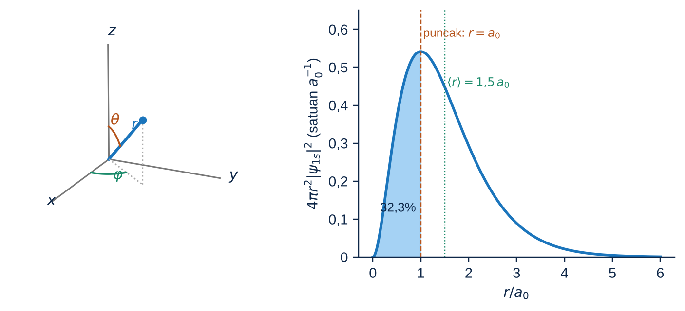

## 2.3 Persamaan diferensial orde dua

Persamaan Schrödinger tak bergantung waktu untuk satu partikel dalam satu dimensi berbentuk

$$
-\frac{\hbar^2}{2m}\frac{d^2\psi}{dx^2} + V(x)\psi = E\psi ,
$$

yaitu **persamaan diferensial biasa linear orde dua**. Hampir seluruh Bagian II buku ini adalah cara-cara menyelesaikan persamaan semacam ini untuk berbagai bentuk $V(x)$. Subbab ini membahas kasus yang paling sederhana dan paling sering: koefisien tetap.

### Linear dan homogen

Persamaan

$$
y'' + p\,y' + q\,y = 0 \qquad \text{(2.11)}
$$

dengan $p$ dan $q$ tetapan disebut **linear** (y dan turunannya muncul berpangkat satu, tidak dikalikan satu sama lain) dan **homogen** (ruas kanan nol). Sifat terpentingnya adalah **asas superposisi**: jika $y_1$ dan $y_2$ penyelesaian, maka $c_1y_1 + c_2y_2$ juga penyelesaian untuk sembarang tetapan $c_1$, $c_2$. Buktinya cukup dengan memasukkan: setiap suku linear terhadap $y$. Persamaan orde dua mempunyai tepat dua penyelesaian yang bebas linear, dan **penyelesaian umumnya** adalah kombinasi linear keduanya. Dua tetapan sembarang $c_1$ dan $c_2$ ditentukan oleh dua syarat tambahan.

Asas superposisi untuk persamaan diferensial inilah asal-usul matematis superposisi kuantum: jika $\psi_1$ dan $\psi_2$ keadaan yang mungkin, kombinasi linearnya juga keadaan yang mungkin, dan amplitudo-amplitudonya berinterferensi.

### Persamaan karakteristik

Coba $y = e^{sx}$. Karena $y' = sy$ dan $y'' = s^2y$, persamaan (2.11) menjadi $(s^2 + ps + q)e^{sx} = 0$. Eksponen tidak pernah nol, jadi

$$
s^2 + ps + q = 0 . \qquad \text{(2.12)}
$$

Persamaan kuadrat ini disebut **persamaan karakteristik**. Akarnya $s_{1,2} = \tfrac12\left(-p \pm \sqrt{p^2 - 4q}\right)$. Ada tiga kasus:

1. **Dua akar riil berbeda** ($p^2 > 4q$): $y = c_1e^{s_1x} + c_2e^{s_2x}$.
2. **Akar kembar** ($p^2 = 4q$): $y = (c_1 + c_2x)e^{sx}$.
3. **Akar kompleks** $s = -\gamma \pm i\omega$ ($p^2 < 4q$): $y = e^{-\gamma x}\left(c_1e^{i\omega x} + c_2e^{-i\omega x}\right) = e^{-\gamma x}(A\cos\omega x + B\sin\omega x)$.

Pada kasus 3, rumus Euler mengubah eksponen kompleks menjadi kosinus dan sinus. Penyelesaian riil diperoleh dengan memilih $c_2 = c_1^*$.

### Dua persamaan yang paling penting

Dalam mekanika kuantum, kasus yang paling sering adalah $p = 0$:

$$
y'' = -k^2y \;\Longrightarrow\; y = A\sin kx + B\cos kx = Ce^{ikx} + De^{-ikx} , \qquad \text{(2.13)}
$$

$$
y'' = +\kappa^2y \;\Longrightarrow\; y = Fe^{\kappa x} + Ge^{-\kappa x} . \qquad \text{(2.14)}
$$

Persamaan Schrödinger dengan potensial tetap $V$ mempunyai bentuk (2.13) jika $E > V$, dengan $k = \sqrt{2m(E - V)}/\hbar$: penyelesaiannya berayun, seperti gelombang. Jika $E < V$, ia berbentuk (2.14) dengan $\kappa = \sqrt{2m(V - E)}/\hbar$: penyelesaiannya tumbuh atau meluruh secara eksponensial (Gambar 2.3). Daerah pertama "diizinkan secara klasik", daerah kedua "terlarang secara klasik". Penerobosan (Bab 3) terjadi karena penyelesaian yang meluruh di daerah terlarang tidak langsung nol.

{width=92%}

### Syarat awal dan syarat batas

Dua tetapan penyelesaian umum dapat ditentukan dengan dua cara. **Syarat awal** menetapkan $y$ dan $y'$ pada satu titik; ini khas masalah gerak klasik (posisi dan kecepatan awal) dan kinetika kimia (konsentrasi awal). **Syarat batas** menetapkan nilai $y$ di dua titik berbeda; ini khas masalah gelombang berdiri dan mekanika kuantum.

Perbedaannya besar. Masalah syarat awal **selalu** mempunyai penyelesaian tunggal, berapa pun parameter persamaannya. Masalah syarat batas yang homogen hanya mempunyai penyelesaian tak nol untuk nilai-nilai parameter tertentu. Contoh terpenting adalah $y'' = -k^2y$ dengan $y(0) = 0$ dan $y(L) = 0$. Syarat pertama memaksa $B = 0$. Syarat kedua memaksa $A\sin kL = 0$. Jika $A = 0$ kita mendapat penyelesaian nol yang tidak berguna, jadi harus $\sin kL = 0$:

$$
k = \frac{n\pi}{L}, \qquad n = 1, 2, 3, \ldots \qquad \text{(2.15)}
$$

Inilah **asal matematis kuantisasi**. Bukan postulat tambahan, melainkan akibat langsung dari persamaan gelombang ditambah syarat bahwa gelombang terkurung. Di Bab 3, $k = \sqrt{2mE}/\hbar$, sehingga (2.15) langsung memberikan tingkat-tingkat energi partikel dalam kotak.

::: {.contoh}
**Contoh 2.13 · Tiga jenis akar**

Selesaikan (a) $y'' - 5y' + 6y = 0$; (b) $y'' + 4y' + 4y = 0$; (c) $y'' + 2y' + 5y = 0$.

**Penyelesaian.** (a) $s^2 - 5s + 6 = (s - 2)(s - 3) = 0$: $y = c_1e^{2x} + c_2e^{3x}$.

(b) $s^2 + 4s + 4 = (s + 2)^2 = 0$, akar kembar $-2$: $y = (c_1 + c_2x)e^{-2x}$.

(c) $s = \tfrac12(-2 \pm \sqrt{4 - 20}) = -1 \pm 2i$: $y = e^{-x}(A\cos 2x + B\sin 2x)$.

**Memahami hasil.** Kasus (c) adalah osilator teredam: ia berayun dengan frekuensi sudut 2 sambil amplitudonya meluruh sebagai $e^{-x}$. Sinyal FID dalam NMR (subbab 2.9) mempunyai bentuk persis seperti ini, dengan waktu sebagai variabel.
:::

::: {.contoh}
**Contoh 2.14 · Syarat awal: pegas dan ikatan**

Simpangan ikatan yang dimodelkan sebagai osilator memenuhi $\ddot x = -\omega^2x$. Pada $t = 0$, $x = x_0$ dan $\dot x = 0$. Tentukan $x(t)$.

**Penyelesaian.** Penyelesaian umum $x = A\sin\omega t + B\cos\omega t$. Dari $x(0) = x_0$: $B = x_0$. Dari $\dot x(0) = A\omega = 0$: $A = 0$. Jadi $x(t) = x_0\cos\omega t$.

**Memahami hasil.** Masalah syarat awal memberikan satu penyelesaian untuk **setiap** $\omega$; tidak ada kuantisasi. Mekanika klasik menghubungkan masa kini dengan masa depan. Mekanika kuantum keadaan stasioner menghubungkan apa yang terjadi di dinding kiri dengan apa yang terjadi di dinding kanan, dan hanya nilai tertentu yang cocok.
:::

::: {.contoh}
**Contoh 2.15 · Syarat batas: kotak dengan dinding di $\pm L/2$**

Selesaikan $y'' = -k^2y$ dengan $y(-L/2) = y(L/2) = 0$. Nilai $k$ mana yang diizinkan, dan bagaimana bentuk penyelesaiannya?

**Penyelesaian.** Penyelesaian umum $y = A\sin kx + B\cos kx$. Syarat batas memberikan dua persamaan:

$$
-A\sin\frac{kL}{2} + B\cos\frac{kL}{2} = 0, \qquad A\sin\frac{kL}{2} + B\cos\frac{kL}{2} = 0 .
$$

Jumlahkan: $B\cos(kL/2) = 0$. Kurangkan: $A\sin(kL/2) = 0$. Ada dua keluarga penyelesaian tak nol. Jika $A = 0$, $B \ne 0$: $\cos(kL/2) = 0$, jadi $k = \pi/L, 3\pi/L, 5\pi/L, \ldots$ dengan $y = \cos kx$ (genap). Jika $B = 0$, $A \ne 0$: $\sin(kL/2) = 0$, jadi $k = 2\pi/L, 4\pi/L, \ldots$ dengan $y = \sin kx$ (ganjil). Gabungannya $k = n\pi/L$, $n = 1, 2, 3, \ldots$

**Memahami hasil.** Nilai $k$ yang diizinkan sama dengan (2.15), seperti seharusnya: menggeser kotak tidak mengubah fisikanya. Tetapi dengan kotak simetris, penyelesaiannya otomatis terbagi menjadi fungsi **genap** ($n$ ganjil) dan **ganjil** ($n$ genap). Memilih titik asal di pusat simetri hampir selalu memudahkan, dan paritas penyelesaian langsung terlihat.
:::

::: {.contoh}
**Contoh 2.16 · Kinetika reaksi berurutan**

Reaksi $\text{A} \xrightarrow{k_1} \text{B} \xrightarrow{k_2} \text{C}$ dengan $[\text{A}]_0 = 1$, $[\text{B}]_0 = 0$. Diketahui $[\text{A}] = e^{-k_1t}$. Selesaikan $d[\text{B}]/dt = k_1[\text{A}] - k_2[\text{B}]$, lalu hitung waktu dan nilai $[\text{B}]$ maksimum untuk $k_1 = 0{,}10$ min⁻¹ dan $k_2 = 0{,}050$ min⁻¹.

**Rencana.** Ini persamaan orde satu tak homogen: $[\text{B}]' + k_2[\text{B}] = k_1e^{-k_1t}$. Coba penyelesaian khusus $Ce^{-k_1t}$, lalu tambahkan penyelesaian homogen $De^{-k_2t}$.

**Penyelesaian.** Masukkan $Ce^{-k_1t}$: $-k_1C + k_2C = k_1$, jadi $C = k_1/(k_2 - k_1)$. Syarat $[\text{B}]_0 = 0$ memberi $D = -C$:

$$
[\text{B}] = \frac{k_1}{k_2 - k_1}\left(e^{-k_1t} - e^{-k_2t}\right) .
$$

Maksimum bila $d[\text{B}]/dt = 0$: $k_1e^{-k_1t} = k_2e^{-k_2t}$, sehingga $t_\text{maks} = \dfrac{\ln(k_1/k_2)}{k_1 - k_2} = \dfrac{\ln 2}{0{,}050} = 13{,}9$ min. Di situ $[\text{B}] = \dfrac{0{,}10}{-0{,}05}\left(e^{-1{,}386} - e^{-0{,}693}\right) = (-2)(0{,}25 - 0{,}50) = 0{,}50$.

**Memahami hasil.** Teknik "penyelesaian homogen + penyelesaian khusus" berlaku untuk semua persamaan linear tak homogen, termasuk osilator yang dipaksa oleh medan listrik cahaya. Kimiawan yang ingin memanen zat antara B tahu kapan harus menghentikan reaksi.
:::

### Persamaan tak homogen: osilator yang dipaksa

Jika ruas kanan (2.11) tidak nol, persamaannya **tak homogen**. Penyelesaian umumnya adalah penyelesaian homogen ditambah **satu** penyelesaian khusus apa saja. Kasus terpenting bagi spektroskopi adalah osilator teredam yang dipaksa oleh gaya periodik, misalnya muatan dalam molekul yang digoyang medan listrik cahaya:

$$
\ddot x + \gamma\dot x + \omega_0^2x = \frac{F_0}{m}\cos\omega t . \qquad \text{(2.16)}
$$

Coba penyelesaian khusus $x = \text{Re}\left(Xe^{i\omega t}\right)$. Turunan menjadi perkalian dengan $i\omega$, sehingga $(-\omega^2 + i\gamma\omega + \omega_0^2)X = F_0/m$, dan

$$
|X| = \frac{F_0/m}{\sqrt{(\omega_0^2 - \omega^2)^2 + \gamma^2\omega^2}} .
$$

Amplitudo melonjak tajam ketika $\omega$ mendekati frekuensi alami $\omega_0$: inilah **resonansi**. Penyelesaian homogen meluruh sebagai $e^{-\gamma t/2}$ dan lenyap setelah beberapa kali $1/\gamma$, sehingga yang tersisa hanyalah gerak terpaksa pada frekuensi pemaksa. Daya yang diserap dari medan berbentuk lorentzian di sekitar $\omega_0$ dengan lebar $\gamma$, yaitu bentuk garis serapan spektrum yang sama dengan subbab 2.9. Model "elektron pada pegas" ini (model Lorentz) adalah gambaran klasik serapan cahaya oleh molekul; mekanika kuantum (Bab 8) menggantinya dengan transisi antartingkat, tetapi bentuk resonansinya tetap sama.

::: {.contoh}
**Contoh 2.17 · Ketajaman resonansi**

Sebuah ikatan dimodelkan sebagai osilator dengan redaman $\gamma = 10^{-3}\omega_0$. Bandingkan amplitudo terpaksa pada $\omega = \omega_0$ dengan amplitudo pada $\omega = 0{,}9\omega_0$, dan pada $\omega = 1{,}001\omega_0$.

**Penyelesaian.** Dalam satuan $\omega_0 = 1$: pada resonansi $|X| \propto 1/\gamma = 1000$. Pada $\omega = 0{,}9$: $1/\sqrt{(1 - 0{,}81)^2 + (0{,}0009)^2} = 5{,}26$. Perbandingannya 190. Pada $\omega = 1{,}001$: $(1 - 1{,}002)^2 = 4{,}0 \times 10^{-6}$ dan $(0{,}001)^2 = 1{,}0 \times 10^{-6}$, sehingga $|X| = 1/\sqrt{5{,}0 \times 10^{-6}} = 447$, kurang dari setengah nilai puncak.

**Memahami hasil.** Menggeser frekuensi hanya 0,1% sudah memotong amplitudo lebih dari separuh. Itulah sebabnya pita serapan inframerah sempit dan setiap ikatan menyerap pada frekuensinya sendiri, sehingga spektrum IR dapat dipakai sebagai sidik jari gugus fungsi.
:::

::: {.kuis}
**Kuis cepat 2.3**

(a) Apa penyelesaian umum $y'' = 9y$? (b) Jika $y'' = -k^2y$ dengan $y(0) = 0$ dan $y'(L) = 0$ (turunan nol di ujung kanan), nilai $k$ mana yang diizinkan?
:::

## 2.4 Penyelesaian dengan deret pangkat

Persamaan berkoefisien tetap selalu dapat diselesaikan dengan $e^{sx}$. Tetapi persamaan Schrödinger untuk osilator harmonik, rotor, dan atom hidrogen mempunyai koefisien yang bergantung pada $x$. Untuk persamaan semacam itu ada metode umum yang sangat kuat: menebak penyelesaian berbentuk **deret pangkat**

$$
y(x) = \sum_{k=0}^\infty a_kx^k = a_0 + a_1x + a_2x^2 + \cdots \qquad \text{(2.17)}
$$

lalu mencari koefisien $a_k$.

### Contoh pemanasan: $y'' + y = 0$

Kita sudah tahu jawabannya ($\sin x$ dan $\cos x$), jadi cocok untuk berlatih. Turunkan deret suku demi suku:

$$
y'' = \sum_{k=2}^\infty k(k - 1)a_kx^{k-2} = \sum_{k=0}^\infty (k + 2)(k + 1)a_{k+2}x^k .
$$

Pada langkah kedua, indeks digeser ($k \to k + 2$) agar pangkat $x$ sama dengan pada deret $y$. Masukkan ke $y'' + y = 0$:

$$
\sum_{k=0}^\infty\left[(k + 2)(k + 1)a_{k+2} + a_k\right]x^k = 0 .
$$

Deret pangkat bernilai nol untuk semua $x$ hanya jika **setiap koefisiennya nol**. Jadi diperoleh **hubungan rekursi**

$$
a_{k+2} = -\frac{a_k}{(k + 2)(k + 1)} .
$$

Koefisien genap ditentukan oleh $a_0$, koefisien ganjil oleh $a_1$: $a_2 = -a_0/2!$, $a_4 = a_0/4!$, ..., dan $a_3 = -a_1/3!$, $a_5 = a_1/5!$, .... Hasilnya $y = a_0(1 - x^2/2! + x^4/4! - \cdots) + a_1(x - x^3/3! + \cdots) = a_0\cos x + a_1\sin x$. Dua tetapan sembarang muncul sendiri, sebagai $a_0$ dan $a_1$.

### Persamaan Hermite dan mengapa deret harus berhenti

Di Bab 5, persamaan Schrödinger osilator harmonik akan disederhanakan menjadi **persamaan Hermite**

$$
y'' - 2xy' + 2\nu y = 0 , \qquad \text{(2.18)}
$$

dengan $\nu$ parameter yang berkaitan dengan energi. Dengan cara yang sama (lakukan sebagai latihan), suku $-2xy'$ menyumbang $-2ka_kx^k$, dan rekursinya

$$
a_{k+2} = \frac{2(k - \nu)}{(k + 2)(k + 1)}\,a_k . \qquad \text{(2.19)}
$$

Untuk $k$ besar, $a_{k+2}/a_k \approx 2/k$, sama dengan perbandingan koefisien deret $e^{x^2} = \sum x^{2j}/j!$. Jadi untuk nilai $\nu$ sembarang, deret tak hingga itu tumbuh seperti $e^{x^2}$. Fungsi gelombang osilator adalah $y(x)e^{-x^2/2}$; jika $y \sim e^{x^2}$, fungsi gelombangnya meledak seperti $e^{x^2/2}$ dan tidak dapat dinormalisasi. Satu-satunya jalan keluar: **deret harus berhenti**. Dari (2.19), jika $\nu$ bilangan bulat tak negatif $n$, maka $a_{n+2} = 0$, dan semua koefisien berikutnya pada deret itu juga nol. Deret yang lain (genap atau ganjil) dibuang dengan memilih $a_0 = 0$ atau $a_1 = 0$. Penyelesaiannya menjadi polinom, yaitu **polinom Hermite** $H_n(x)$, dan energi osilator terkuantisasi.

::: {.inti}
**Pola kuantisasi lewat deret.** Persamaan dengan koefisien bergantung pada $x$ diselesaikan dengan deret pangkat → hubungan rekursi → untuk parameter sembarang, deret tak hingga tumbuh terlalu cepat sehingga fungsi gelombang tidak dapat dinormalisasi → deret harus berhenti → parameter (energi) hanya boleh bernilai tertentu. Pola yang sama memberikan tingkat energi osilator harmonik (Bab 5), rotor tegar dan harmonik bola (Bab 6), dan atom hidrogen (Bab 7).
:::

::: {.contoh}
**Contoh 2.18 · Polinom Hermite dari rekursi**

Dengan (2.19), tentukan penyelesaian polinom untuk $\nu = 2$, $3$, dan $4$. Normalkan sehingga koefisien pangkat tertinggi $2^n$.

**Penyelesaian.** $\nu = 2$ (deret genap, $a_1 = 0$): $a_2 = \dfrac{2(0 - 2)}{2}a_0 = -2a_0$; $a_4 = \dfrac{2(2 - 2)}{12}a_2 = 0$. Jadi $y = a_0(1 - 2x^2)$. Dengan koefisien $x^2$ sama dengan $4$: $a_0 = -2$, sehingga $H_2 = 4x^2 - 2$.

$\nu = 3$ (deret ganjil, $a_0 = 0$): $a_3 = \dfrac{2(1 - 3)}{6}a_1 = -\dfrac23a_1$; $a_5 = 0$. $y = a_1(x - \tfrac23x^3)$; koefisien $x^3$ sama dengan 8 memberi $a_1 = -12$: $H_3 = 8x^3 - 12x$.

$\nu = 4$: $a_2 = -4a_0$, $a_4 = \dfrac{2(2 - 4)}{12}a_2 = -\tfrac13a_2 = \tfrac43a_0$, $a_6 = 0$. $y = a_0(1 - 4x^2 + \tfrac43x^4)$; koefisien $x^4$ sama dengan 16 memberi $a_0 = 12$: $H_4 = 16x^4 - 48x^2 + 12$.

**Memahami hasil.** Polinom-polinom ini berganti-ganti genap dan ganjil, dan $H_n$ mempunyai tepat $n$ akar riil. Di Bab 5, akar-akar itu menjadi **simpul** fungsi gelombang getaran: keadaan getaran ke-$n$ mempunyai $n$ simpul.
:::

::: {.contoh}
**Contoh 2.19 · Deret yang tidak berhenti**

Untuk persamaan Hermite dengan $\nu = 0{,}5$ (bukan bilangan bulat), hitung koefisien deret genap sampai $a_8$ dengan $a_0 = 1$, dan bandingkan perbandingan $a_{k+2}/a_k$ untuk $k = 20$ dengan perbandingan koefisien $e^{x^2}$.

**Penyelesaian.** Dengan (2.19): $a_2 = \dfrac{2(-0{,}5)}{2} = -0{,}5$; $a_4 = \dfrac{2(1{,}5)}{12}a_2 = -0{,}125$; $a_6 = \dfrac{2(3{,}5)}{30}a_4 = -0{,}0292$; $a_8 = \dfrac{2(5{,}5)}{56}a_6 = -0{,}00573$.

Untuk $k = 20$: $a_{22}/a_{20} = \dfrac{2(19{,}5)}{22 \times 21} = 0{,}0844$. Untuk $e^{x^2}$, koefisien $x^{2j}$ adalah $1/j!$, dan perbandingan suku $x^{22}$ terhadap $x^{20}$ adalah $1/11 = 0{,}0909$.

**Memahami hasil.** Untuk $k$ besar kedua perbandingan mendekati $2/k$; deret yang tidak berhenti berperilaku seperti $e^{x^2}$ (dengan tanda tetap, karena semua koefisien sesudah $a_2$ bertanda sama). Dikali $e^{-x^2/2}$, fungsi itu tetap meledak. Alam "menolak" energi yang tidak memberi $\nu$ bulat.
:::

::: {.contoh}
**Contoh 2.20 · Persamaan Airy**

Persamaan $y'' = xy$ muncul untuk partikel dalam medan seragam, misalnya elektron dekat permukaan elektrode bermuatan, dan di dekat titik balik klasik. Tentukan rekursinya dan tiga suku pertama penyelesaian dengan $y(0) = 1$, $y'(0) = 0$.

**Penyelesaian.** $y'' = \sum(k + 2)(k + 1)a_{k+2}x^k$ dan $xy = \sum a_kx^{k+1} = \sum a_{k-1}x^k$. Untuk $k = 0$: $2a_2 = 0$. Untuk $k \ge 1$: $a_{k+2} = \dfrac{a_{k-1}}{(k + 2)(k + 1)}$. Dengan $a_0 = 1$, $a_1 = 0$: $a_3 = a_0/6 = 1/6$, $a_6 = a_3/30 = 1/180$. Jadi

$$
y = 1 + \frac{x^3}{6} + \frac{x^6}{180} + \cdots
$$

**Memahami hasil.** Rekursinya menghubungkan koefisien yang berselisih tiga, bukan dua, karena faktor $x$ menggeser pangkat satu tingkat. Penyelesaian ini (salah satu fungsi Airy) berayun untuk $x < 0$ dan tumbuh untuk $x > 0$, sesuai dengan daerah yang diizinkan dan terlarang secara klasik.
:::

::: {.kuis}
**Kuis cepat 2.4**

Dalam persamaan Hermite, mengapa untuk $\nu = 3$ koefisien $a_0$ harus dipilih nol? Apa yang terjadi pada deret genap jika $a_0 \ne 0$?
:::

## 2.5 Koordinat bola dan silinder, elemen volume

Atom berbentuk bulat, dan potensial Coulomb $-Ze^2/4\pi\varepsilon_0r$ hanya bergantung pada jarak dari inti. Dalam koordinat Kartesius, $r = \sqrt{x^2 + y^2 + z^2}$ mencampur ketiga koordinat; dalam koordinat yang sesuai dengan simetri bola, masalahnya terpisah menjadi bagian radial dan bagian sudut. Itulah sebabnya atom hidrogen diselesaikan dalam **koordinat bola**.

### Koordinat bola

Titik dalam ruang dinyatakan dengan jarak $r$ dari titik asal, **sudut polar** $\theta$ dari sumbu $+z$, dan **sudut azimut** $\phi$ dari sumbu $+x$ pada bidang $xy$ (Gambar 2.4 kiri):

$$
x = r\sin\theta\cos\phi, \qquad y = r\sin\theta\sin\phi, \qquad z = r\cos\theta , \qquad \text{(2.20)}
$$

dengan $0 \le r < \infty$, $0 \le \theta \le \pi$, $0 \le \phi < 2\pi$. Kebalikannya:

$$
r = \sqrt{x^2 + y^2 + z^2}, \qquad \cos\theta = \frac{z}{r}, \qquad \tan\phi = \frac{y}{x} .
$$

### Elemen volume

Ketika $r$, $\theta$, $\phi$ masing-masing bertambah sedikit, titik itu menyapu kotak kecil yang sisi-sisinya $dr$ (ke arah radial), $r\,d\theta$ (busur lingkaran berjari-jari $r$), dan $r\sin\theta\,d\phi$ (busur lingkaran berjari-jari $r\sin\theta$, yaitu jarak titik ke sumbu $z$). Volumenya

$$
\boxed{\ d\tau = r^2\sin\theta\,dr\,d\theta\,d\phi\ } \qquad \text{(2.21)}
$$

Faktor $r^2\sin\theta$ adalah **jakobian** transformasi koordinat. Tanpa faktor ini integral dalam koordinat bola salah. Pemeriksaan cepat: volume bola berjari-jari $R$ adalah $\int_0^R r^2dr\int_0^\pi\sin\theta\,d\theta\int_0^{2\pi}d\phi = \tfrac{R^3}{3}\cdot 2\cdot 2\pi = \tfrac43\pi R^3$.

Untuk fungsi yang hanya bergantung pada $r$, integral sudutnya memberikan $4\pi$, sehingga

$$
\int f(r)\,d\tau = 4\pi\int_0^\infty f(r)\,r^2\,dr . \qquad \text{(2.22)}
$$

Besaran $4\pi r^2\,dr$ adalah volume kulit bola tipis berjari-jari $r$ dan tebal $dr$. Untuk elektron dengan rapat peluang $|\psi(r)|^2$, peluang menemukannya dalam kulit itu adalah $4\pi r^2|\psi|^2\,dr$. Fungsi $P(r) = 4\pi r^2|\psi|^2$ disebut **fungsi distribusi radial** (Bab 7). Ia nol di inti, walaupun $|\psi|^2$ terbesar di inti, karena volume kulit di dekat inti sangat kecil.

### Laplasian dalam koordinat bola

Laplasian (2.6), ditulis dalam koordinat bola, menjadi

$$
\nabla^2 = \frac{1}{r^2}\frac{\partial}{\partial r}\left(r^2\frac{\partial}{\partial r}\right) + \frac{1}{r^2\sin\theta}\frac{\partial}{\partial\theta}\left(\sin\theta\frac{\partial}{\partial\theta}\right) + \frac{1}{r^2\sin^2\theta}\frac{\partial^2}{\partial\phi^2} . \qquad \text{(2.23)}
$$

Penurunannya panjang tetapi lurus, dengan aturan rantai; ia akan dipakai di Bab 6 dan 7. Yang penting sekarang adalah strukturnya: bagian radial terpisah dari bagian sudut, dan bagian sudut dikalikan $1/r^2$. Bagian sudut itulah, kelak, operator momentum sudut kuadrat.

### Koordinat silinder

Untuk sistem dengan simetri terhadap satu sumbu, misalnya partikel pada cincin, molekul linear, atau orbital molekul diatom, dipakai **koordinat silinder** $(\rho, \phi, z)$: $x = \rho\cos\phi$, $y = \rho\sin\phi$, $z = z$, dengan elemen volume $d\tau = \rho\,d\rho\,d\phi\,dz$. Koordinat **elips** yang berpusat di dua inti dipakai untuk menyelesaikan ion H₂⁺ secara tepat (Bab 11).

{width=88%}

::: {.contoh}
**Contoh 2.21 · Mengubah koordinat**

(a) Nyatakan titik $(x, y, z) = (1, 1, 1)$ dalam koordinat bola. (b) Nyatakan $(r, \theta, \phi) = (2, 60°, 135°)$ dalam koordinat Kartesius.

**Penyelesaian.** (a) $r = \sqrt3 = 1{,}732$; $\cos\theta = 1/\sqrt3$, $\theta = 54{,}74°$; $\tan\phi = 1$ dengan $x, y > 0$, $\phi = 45°$.

(b) $x = 2\sin 60°\cos 135° = 2(0{,}866)(-0{,}707) = -1{,}225$; $y = 2(0{,}866)(0{,}707) = 1{,}225$; $z = 2\cos 60° = 1$.

**Memahami hasil.** Sudut 54,74° (arccos $1/\sqrt3$) adalah setengah sudut tetrahedral 109,47°: ikatan C–H metana menunjuk ke arah sudut-sudut kubus, yaitu ke titik-titik seperti $(1, 1, 1)$ dan $(1, -1, -1)$. Sudut ini muncul lagi di Bab 12 (hibrida sp³) dan Bab 16 (sudut ajaib dalam NMR zat padat).
:::

::: {.contoh}
**Contoh 2.22 · Normalisasi orbital 1s**

Orbital 1s hidrogen adalah $\psi = Ne^{-r/a_0}$. Tentukan $N$.

**Penyelesaian.** Syarat normalisasi $\int|\psi|^2\,d\tau = 1$. Dengan (2.22) dan Contoh 2.8:

$$
N^2 \cdot 4\pi\int_0^\infty r^2e^{-2r/a_0}\,dr = N^2 \cdot 4\pi\cdot\frac{a_0^3}{4} = N^2\pi a_0^3 = 1 \quad\Longrightarrow\quad N = \frac{1}{\sqrt{\pi a_0^3}} .
$$

**Memahami hasil.** Satuan $N$ adalah panjang$^{-3/2}$, sehingga $|\psi|^2$ bersatuan per volume, sebagaimana seharusnya rapat peluang. Pemeriksaan satuan seperti ini menangkap banyak kesalahan normalisasi. Di Bab 7 kita akan memperoleh faktor ini dari penyelesaian persamaan Schrödinger.
:::

::: {.contoh}
**Contoh 2.23 · Peluang di dalam bola**

Hitung peluang elektron 1s berada di dalam bola berjari-jari (a) $a_0$, (b) $2a_0$, (c) $3a_0$. (d) Berapa peluang elektron berada di dalam proton (jari-jari $0{,}88$ fm)?

**Penyelesaian.** $P(R) = \dfrac{4}{a_0^3}\int_0^R r^2e^{-2r/a_0}\,dr$. Dengan integral parsial dua kali (atau substitusi $u = 2r/a_0$):

$$
P(R) = 1 - e^{-2\rho}\left(1 + 2\rho + 2\rho^2\right), \qquad \rho = R/a_0 .
$$

(a) $\rho = 1$: $1 - 5e^{-2} = 0{,}323$. (b) $\rho = 2$: $1 - 13e^{-4} = 0{,}762$. (c) $\rho = 3$: $1 - 25e^{-6} = 0{,}938$.

(d) Untuk $\rho \ll 1$, $|\psi|^2 \approx 1/\pi a_0^3$ hampir tetap di dalam bola kecil, sehingga $P \approx \dfrac{1}{\pi a_0^3}\cdot\dfrac43\pi R^3 = \dfrac43\left(\dfrac{R}{a_0}\right)^3 = \dfrac43\left(\dfrac{0{,}88 \times 10^{-15}}{5{,}29 \times 10^{-11}}\right)^3 = 6 \times 10^{-15}$.

**Memahami hasil.** Elektron 1s tidak "mengorbit pada $a_0$": ia lebih sering berada di luar bola itu daripada di dalamnya. Peluang menemukannya di dalam inti amat kecil tetapi tidak nol; peluang inilah yang mengatur **penangkapan elektron** oleh inti radioaktif dan **kopling kontak Fermi** yang menghasilkan pemisahan hiperhalus dalam ESR dan kopling $J$ dalam NMR (Bab 16).
:::

::: {.contoh}
**Contoh 2.24 · Normalisasi orbital 2p$_z$**

Orbital 2p$_z$ hidrogen dalam satuan $a_0 = 1$ adalah $\psi = Nre^{-r/2}\cos\theta$. Tentukan $N$.

**Penyelesaian.** $|\psi|^2\,d\tau = N^2r^2e^{-r}\cos^2\theta\cdot r^2\sin\theta\,dr\,d\theta\,d\phi$. Integralnya terpisah menjadi tiga faktor:

$$
\int_0^\infty r^4e^{-r}\,dr = 4! = 24, \qquad \int_0^\pi\cos^2\theta\sin\theta\,d\theta = \left[-\frac{\cos^3\theta}{3}\right]_0^\pi = \frac23, \qquad \int_0^{2\pi}d\phi = 2\pi .
$$

Hasil kalinya $32\pi$, sehingga $N = 1/\sqrt{32\pi} = 0{,}0997$ (dalam satuan $a_0^{-3/2}$).

**Memahami hasil.** Integral sudut diselesaikan dengan substitusi $u = \cos\theta$, $du = -\sin\theta\,d\theta$; faktor $\sin\theta$ dari elemen volume justru yang membuatnya mudah, persis seperti faktor $r$ pada integral Gauss. Karena fungsi sudut dan fungsi radial terpisah, normalisasi dapat dilakukan terpisah: inilah keuntungan memilih koordinat yang cocok dengan simetri.
:::

::: {.dalam}
**Lebih dalam · Bagian radial laplasian**

Untuk fungsi yang hanya bergantung pada $r = \sqrt{x^2 + y^2 + z^2}$, aturan rantai memberi $\partial r/\partial x = x/r$, sehingga

$$
\frac{\partial f}{\partial x} = f'(r)\frac{x}{r}, \qquad \frac{\partial^2f}{\partial x^2} = f''\frac{x^2}{r^2} + f'\left(\frac1r - \frac{x^2}{r^3}\right) ,
$$

dengan menurunkan $x/r$ memakai aturan hasil bagi. Jumlahkan untuk $x$, $y$, $z$ dan pakai $x^2 + y^2 + z^2 = r^2$:

$$
\nabla^2f = f'' + f'\left(\frac3r - \frac1r\right) = f'' + \frac2rf' = \frac{1}{r^2}\frac{d}{dr}\left(r^2\frac{df}{dr}\right) .
$$

Inilah suku pertama (2.21). Suku-suku sudut diturunkan dengan cara yang sama untuk fungsi yang juga bergantung pada $\theta$ dan $\phi$, dengan tambahan $\partial\theta/\partial x$ dan seterusnya. Penurunan lengkapnya panjang tetapi tidak sulit; yang perlu diingat adalah strukturnya. Bentuk $f'' + (2/r)f'$ menyatakan bahwa dalam tiga dimensi, "gelombang" yang menyebar ke segala arah melemah dengan jarak; substitusi $f = u/r$ menghilangkan suku turunan pertama, sehingga $\nabla^2f = u''/r$. Substitusi ini akan dipakai untuk persamaan radial atom hidrogen (Bab 7).
:::

::: {.kuis}
**Kuis cepat 2.5**

(a) Berapa $\int_0^{2\pi}\int_0^\pi\sin\theta\,d\theta\,d\phi$, dan apa makna geometrinya? (b) Mengapa fungsi distribusi radial $4\pi r^2|\psi_{1s}|^2$ nol di inti, padahal $|\psi_{1s}|^2$ terbesar di sana?
:::
