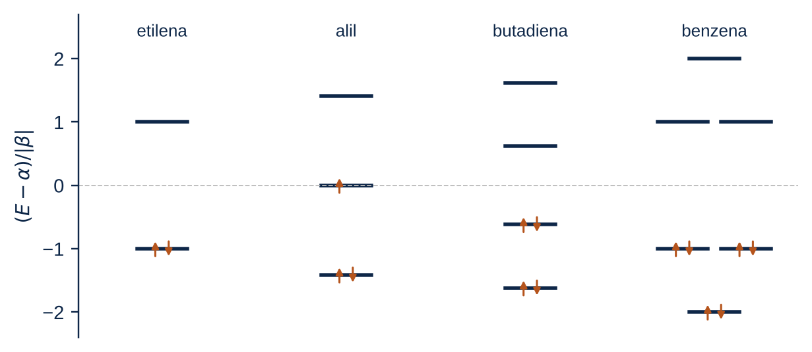

## 2.6 Vektor dan hasil kali dalam fungsi

### Vektor dalam ruang tiga dimensi

Vektor $\vec a = (a_x, a_y, a_z)$ dapat ditulis sebagai kombinasi vektor satuan: $\vec a = a_x\hat i + a_y\hat j + a_z\hat k$. **Hasil kali titik** (hasil kali skalar) dua vektor adalah

$$
\vec a \cdot \vec b = a_xb_x + a_yb_y + a_zb_z = |\vec a|\,|\vec b|\cos\theta . \qquad \text{(2.24)}
$$

Dua vektor **ortogonal** (tegak lurus) jika hasil kali titiknya nol. Panjang vektor adalah $|\vec a| = \sqrt{\vec a \cdot \vec a}$. Komponen $a_x$ diperoleh dengan **memproyeksikan** vektor pada vektor satuan basis: $a_x = \hat i \cdot \vec a$. Karena vektor-vektor basis $\hat i, \hat j, \hat k$ saling ortogonal dan panjangnya satu (**ortonormal**), setiap vektor dapat diuraikan dengan cara yang sama.

**Hasil kali silang** menghasilkan vektor yang tegak lurus kedua vektor asal:

$$
\vec a \times \vec b = (a_yb_z - a_zb_y)\,\hat i + (a_zb_x - a_xb_z)\,\hat j + (a_xb_y - a_yb_x)\,\hat k . \qquad \text{(2.25)}
$$

Momentum sudut $\vec L = \vec r \times \vec p$ adalah hasil kali silang, dan ketiga komponennya akan menjadi operator di Bab 6.

### Fungsi sebagai vektor

Lompatan konseptual yang paling berguna dalam matematika kuantum adalah ini: **fungsi dapat diperlakukan sebagai vektor**. Vektor tiga dimensi adalah daftar tiga bilangan $a_1, a_2, a_3$. Fungsi $f(x)$ pada selang $[a, b]$ adalah "daftar" tak hingga banyak bilangan, satu untuk setiap $x$. Jumlah $\sum_i a_ib_i$ menjadi integral. Kita definisikan **hasil kali dalam** dua fungsi (yang mungkin kompleks):

$$
\boxed{\ \langle f|g\rangle = \int f^*(x)\,g(x)\,dx\ } \qquad \text{(2.26)}
$$

Konjugat pada fungsi pertama menjamin bahwa $\langle f|f\rangle = \int|f|^2dx$ selalu riil dan tak negatif, sehingga dapat dipakai sebagai kuadrat "panjang" fungsi, yaitu **norma** $\|f\| = \sqrt{\langle f|f\rangle}$. Fungsi gelombang yang ternormalisasi adalah vektor satuan. Notasi kurung sudut ini adalah notasi Dirac, yang akan dikembangkan di Bab 4; untuk fungsi tiga dimensi, $dx$ diganti $d\tau$.

Sifat-sifat hasil kali dalam:

- $\langle g|f\rangle = \langle f|g\rangle^*$;
- linear pada argumen kedua: $\langle f|c_1g_1 + c_2g_2\rangle = c_1\langle f|g_1\rangle + c_2\langle f|g_2\rangle$;
- $\langle f|f\rangle \ge 0$, dan sama dengan nol hanya jika $f = 0$.

Dua fungsi **ortogonal** jika $\langle f|g\rangle = 0$. Himpunan fungsi $\{\phi_n\}$ disebut **ortonormal** jika

$$
\langle\phi_m|\phi_n\rangle = \delta_{mn} = \begin{cases} 1, & m = n\\ 0, & m \ne n\end{cases} \qquad \text{(2.27)}
$$

dengan $\delta_{mn}$ **delta Kronecker**.

### Ekspansi dalam basis ortonormal

Jika himpunan ortonormal $\{\phi_n\}$ cukup "lengkap", setiap fungsi yang wajar dapat diuraikan sebagai $f = \sum_nc_n\phi_n$. Koefisiennya diperoleh dengan memproyeksikan, persis seperti komponen vektor. Ambil hasil kali dalam kedua ruas dengan $\phi_m$:

$$
\langle\phi_m|f\rangle = \sum_nc_n\langle\phi_m|\phi_n\rangle = \sum_nc_n\delta_{mn} = c_m . \qquad \text{(2.28)}
$$

Ortonormalitas menyaring semua suku kecuali satu. Jika $f$ ternormalisasi, $\sum_n|c_n|^2 = 1$ (teorema Pythagoras dalam ruang fungsi). Di Bab 4, $|c_n|^2$ akan ditafsirkan sebagai **peluang** pengukuran memberikan nilai yang bersesuaian dengan $\phi_n$. Ekspansi seperti ini juga dasar metode LCAO dan semua perhitungan kimia komputasi: orbital molekul diuraikan atas fungsi-fungsi basis.

### Ketaksamaan Schwarz dan integral tumpang tindih

Untuk vektor biasa, $|\vec a \cdot \vec b| \le |\vec a|\,|\vec b|$ karena $|\cos\theta| \le 1$. Pasangannya untuk fungsi adalah **ketaksamaan Schwarz**:

$$
|\langle f|g\rangle|^2 \le \langle f|f\rangle\langle g|g\rangle . \qquad \text{(2.29)}
$$

Untuk dua fungsi ternormalisasi, $S = \langle f|g\rangle$ memenuhi $|S| \le 1$ dan berperan seperti kosinus sudut di antara keduanya. Dalam kimia, $S = \int\phi_A^*\phi_B\,d\tau$ antara dua orbital atom disebut **integral tumpang tindih**: $S = 1$ jika kedua orbital sama, $S = 0$ jika ortogonal. Kekuatan ikatan kovalen, secara kasar, sebanding dengan tumpang tindih (Bab 11 dan 12). Ketaksamaan Schwarz juga merupakan inti bukti umum asas ketidakpastian (Bab 4).

### Proses Gram–Schmidt

Dari himpunan fungsi yang bebas linear tetapi tidak ortogonal, kita dapat membangun himpunan ortonormal dengan **proses Gram–Schmidt**: ambil fungsi pertama dan normalkan; dari fungsi kedua kurangkan proyeksinya pada fungsi pertama, lalu normalkan; dari fungsi ketiga kurangkan proyeksinya pada dua fungsi pertama; dan seterusnya. Dalam kimia komputasi, orbital atom pada atom-atom yang berbeda tidak ortogonal, dan prosedur semacam ini (atau ortogonalisasi Löwdin) dipakai sebelum persamaan diselesaikan.

::: {.contoh}
**Contoh 2.25 · Vektor biasa**

Untuk $\vec a = (1, 2, 2)$ dan $\vec b = (2, -1, 0)$, hitung $\vec a \cdot \vec b$, $|\vec a|$, dan $\vec a \times \vec b$. Periksa bahwa $\vec a \times \vec b$ tegak lurus kedua vektor.

**Penyelesaian.** $\vec a \cdot \vec b = 2 - 2 + 0 = 0$: kedua vektor ortogonal. $|\vec a| = \sqrt{1 + 4 + 4} = 3$. Dengan (2.25):

$$
\vec a \times \vec b = (2\cdot0 - 2\cdot(-1),\ 2\cdot2 - 1\cdot0,\ 1\cdot(-1) - 2\cdot2) = (2, 4, -5) .
$$

Periksa: $(2, 4, -5)\cdot(1, 2, 2) = 2 + 8 - 10 = 0$ dan $(2, 4, -5)\cdot(2, -1, 0) = 4 - 4 = 0$.

**Memahami hasil.** Karena $\vec a$ dan $\vec b$ tegak lurus, $|\vec a \times \vec b| = |\vec a|\,|\vec b| = 3\sqrt5 = 6{,}71$, dan memang $\sqrt{4 + 16 + 25} = 6{,}71$. Periksa ortogonalitas selalu dengan hasil kali titik; ia murah dan menangkap kesalahan tanda.
:::

::: {.contoh}
**Contoh 2.26 · Fungsi sinus yang ortonormal**

Tunjukkan bahwa $\phi_n(x) = \sqrt{2/L}\sin(n\pi x/L)$, $n = 1, 2, \ldots$, ortonormal pada $[0, L]$.

**Penyelesaian.** Dengan identitas $\sin A\sin B = \tfrac12[\cos(A - B) - \cos(A + B)]$:

$$
\langle\phi_m|\phi_n\rangle = \frac{2}{L}\int_0^L\sin\frac{m\pi x}{L}\sin\frac{n\pi x}{L}\,dx = \frac1L\int_0^L\left[\cos\frac{(m - n)\pi x}{L} - \cos\frac{(m + n)\pi x}{L}\right]dx .
$$

Jika $m \ne n$, kedua kosinus mempunyai bilangan bulat setengah-periode tak nol dalam $[0, L]$, dan integralnya $\left[\tfrac{L}{k\pi}\sin\tfrac{k\pi x}{L}\right]_0^L = 0$ untuk $k = m \pm n$. Jika $m = n$, suku pertama menjadi $\cos 0 = 1$ dan integralnya $L$, sedangkan suku kedua nol; hasilnya $\tfrac1L \cdot L = 1$.

**Memahami hasil.** Fungsi-fungsi ini adalah fungsi gelombang partikel dalam kotak (Bab 3). Ortogonalitasnya bukan kebetulan: fungsi eigen operator Hermitian dengan nilai eigen berbeda selalu ortogonal (Bab 4). Himpunan ini juga lengkap: setiap fungsi wajar yang nol di kedua ujung dapat diuraikan atasnya, dan uraian itu adalah deret Fourier sinus (subbab 2.9).
:::

::: {.contoh}
**Contoh 2.27 · Mengurai fungsi parabola**

Fungsi ternormalisasi $f(x) = \sqrt{30/L^5}\,x(L - x)$ pada $[0, L]$ diuraikan atas fungsi sinus Contoh 2.26. Koefisiennya $c_n = \sqrt{60}\cdot 4/(n\pi)^3$ untuk $n$ ganjil dan nol untuk $n$ genap (hitunglah sebagai latihan). Hitung $c_1$, $c_3$, $c_5$ dan $|c_1|^2 + |c_3|^2 + |c_5|^2$.

**Penyelesaian.** $c_1 = 4\sqrt{60}/\pi^3 = 0{,}9993$; $c_3 = c_1/27 = 0{,}0370$; $c_5 = c_1/125 = 0{,}0080$. Kuadratnya 0,998 56; 0,001 37; 0,000 064. Jumlahnya 0,999 99.

**Memahami hasil.** Parabola dan sinus pertama hampir identik: tumpang tindihnya 0,9993. Jika partikel dalam kotak disiapkan dengan fungsi gelombang parabola ini lalu energinya diukur, hasilnya $E_1$ dengan peluang 99,86%, $E_3$ dengan peluang 0,14%, dan tidak pernah $E_2$. Koefisien genap nol karena parabola simetris terhadap tengah kotak, sedangkan $\phi_2, \phi_4, \ldots$ antisimetris.
:::

::: {.contoh}
**Contoh 2.28 · Gram–Schmidt menghasilkan polinom Legendre**

Ortogonalkan $\{1, x, x^2\}$ pada selang $[-1, 1]$.

**Penyelesaian.** $u_0 = 1$, dengan $\langle u_0|u_0\rangle = \int_{-1}^1dx = 2$.

$u_1 = x - \dfrac{\langle u_0|x\rangle}{\langle u_0|u_0\rangle}u_0 = x - 0 = x$ (karena $\int_{-1}^1x\,dx = 0$), dengan $\langle u_1|u_1\rangle = 2/3$.

$u_2 = x^2 - \dfrac{\langle u_0|x^2\rangle}{2}\cdot 1 - \dfrac{\langle u_1|x^2\rangle}{2/3}\,x = x^2 - \dfrac{2/3}{2} - 0 = x^2 - \dfrac13$.

**Memahami hasil.** Dikali $3/2$, $u_2 = \tfrac12(3x^2 - 1)$, yaitu **polinom Legendre** $P_2(x)$. Dengan $x = \cos\theta$, polinom Legendre adalah bagian sudut orbital s, p$_z$, dan d$_{z^2}$: $P_2(\cos\theta) = \tfrac12(3\cos^2\theta - 1)$ adalah bentuk sudut orbital d$_{z^2}$ (Bab 6 dan 7). Kerucut simpul d$_{z^2}$ terletak di $\cos^2\theta = 1/3$, yaitu $\theta = 54{,}74°$, sudut yang sama dengan Contoh 2.21.
:::

### Fungsi delta Dirac

Pasangan malar dari delta Kronecker adalah **fungsi delta Dirac** $\delta(x - a)$: "fungsi" yang nol di mana-mana kecuali di $x = a$, dengan luas satu. Sifat penentunya adalah

$$
\int_{-\infty}^\infty f(x)\,\delta(x - a)\,dx = f(a) . \qquad \text{(2.30)}
$$

Delta Dirac dapat dibayangkan sebagai limit fungsi Gauss ternormalisasi yang makin sempit: $\delta(x) = \lim_{\sigma\to0}e^{-x^2/2\sigma^2}/(\sigma\sqrt{2\pi})$. Ia menyatakan partikel dengan posisi yang tepat, yaitu keadaan dengan $\Delta x = 0$ dan, menurut asas ketidakpastian, momentum yang sama sekali tidak tentu. Gelombang bidang $e^{ikx}$, sebaliknya, mempunyai momentum tepat dan posisi tak tentu; keduanya dihubungkan oleh $\int_{-\infty}^\infty e^{i(k - k')x}\,dx = 2\pi\,\delta(k - k')$, versi malar dari ortonormalitas.

::: {.contoh}
**Contoh 2.29 · Menghitung dengan fungsi delta**

Hitung (a) $\int_{-\infty}^\infty e^{-x^2}\delta(x - 1)\,dx$; (b) $\int_0^\infty\cos x\,\delta(x - \pi)\,dx$; (c) $\int_{-\infty}^\infty x^2\,\delta(x)\,dx$.

**Penyelesaian.** (a) $e^{-1} = 0{,}368$. (b) $\cos\pi = -1$. (c) $0^2 = 0$.

**Memahami hasil.** Fungsi delta "memetik" nilai fungsi lain di satu titik. Dalam kimia kuantum ia muncul pada interaksi kontak, misalnya kopling kontak Fermi antara spin elektron dan spin inti (Bab 16), yang sebanding dengan $|\psi(0)|^2$, yaitu nilai rapat elektron tepat di inti.
:::

::: {.kuis}
**Kuis cepat 2.6**

(a) Apakah $\sin x$ dan $\cos x$ ortogonal pada $[0, 2\pi]$? Pada $[0, \pi/2]$? (b) Jika $f = 0{,}6\phi_1 + 0{,}8i\phi_2$ dengan $\phi_1$, $\phi_2$ ortonormal, apakah $f$ ternormalisasi?
:::

## 2.7 Matriks dan determinan

### Operasi matriks

Matriks adalah susunan bilangan berbentuk persegi panjang. Matriks $\mathbf A$ berukuran $m \times n$ mempunyai unsur $A_{ij}$ pada baris $i$ dan kolom $j$. Penjumlahan dilakukan unsur demi unsur. **Perkalian** $\mathbf C = \mathbf{AB}$ didefinisikan sebagai

$$
C_{ij} = \sum_kA_{ik}B_{kj} , \qquad \text{(2.31)}
$$

yaitu hasil kali titik baris $i$ dari $\mathbf A$ dengan kolom $j$ dari $\mathbf B$. Perkalian matriks **tidak komutatif**: pada umumnya $\mathbf{AB} \ne \mathbf{BA}$. Selisihnya, $[\mathbf A, \mathbf B] = \mathbf{AB} - \mathbf{BA}$, disebut **komutator**. Dalam mekanika kuantum, besaran-besaran fisis dinyatakan oleh operator yang dapat ditulis sebagai matriks, dan komutator tak nol antara posisi dan momentum adalah asal asas ketidakpastian (Bab 4).

Beberapa matriks khusus:

- **Matriks satuan** $\mathbf I$: $I_{ij} = \delta_{ij}$, sehingga $\mathbf{AI} = \mathbf{IA} = \mathbf A$.
- **Transpos** $\mathbf A^T$: $(A^T)_{ij} = A_{ji}$. Matriks **simetris** jika $\mathbf A^T = \mathbf A$.
- **Konjugat Hermitian** (adjoin) $\mathbf A^\dagger = (\mathbf A^T)^*$. Matriks **Hermitian** jika $\mathbf A^\dagger = \mathbf A$, yaitu $A_{ij} = A_{ji}^*$. Matriks riil simetris adalah kasus khusus.
- **Invers** $\mathbf A^{-1}$: $\mathbf{AA}^{-1} = \mathbf I$. Ada jika dan hanya jika $\det\mathbf A \ne 0$.
- Matriks **ortogonal** ($\mathbf A^T = \mathbf A^{-1}$) atau **uniter** ($\mathbf A^\dagger = \mathbf A^{-1}$): menyatakan rotasi dan perubahan basis yang mempertahankan panjang dan sudut.

Untuk matriks 2 × 2, inversnya mempunyai rumus sederhana:

$$
\begin{pmatrix} a & b\\ c & d\end{pmatrix}^{-1} = \frac{1}{ad - bc}\begin{pmatrix} d & -b\\ -c & a\end{pmatrix} .
$$

### Determinan

**Determinan** matriks persegi adalah satu bilangan yang dihitung dari unsur-unsurnya. Untuk 2 × 2 dan 3 × 3:

$$
\begin{vmatrix} a & b\\ c & d\end{vmatrix} = ad - bc, \qquad \begin{vmatrix} a_1 & a_2 & a_3\\ b_1 & b_2 & b_3\\ c_1 & c_2 & c_3\end{vmatrix} = a_1\begin{vmatrix} b_2 & b_3\\ c_2 & c_3\end{vmatrix} - a_2\begin{vmatrix} b_1 & b_3\\ c_1 & c_3\end{vmatrix} + a_3\begin{vmatrix} b_1 & b_2\\ c_1 & c_2\end{vmatrix} . \qquad \text{(2.32)}
$$

Rumus kedua adalah **ekspansi kofaktor** sepanjang baris pertama, dengan tanda berganti $+, -, +$; ia berlaku untuk determinan berukuran berapa pun, dan untuk sembarang baris atau kolom. Sifat-sifat determinan yang terpenting:

1. Menukar dua baris (atau dua kolom) **mengubah tanda** determinan.
2. Jika dua baris (atau kolom) sama, determinan **nol**.
3. Menambahkan kelipatan satu baris ke baris lain tidak mengubah determinan.
4. $\det(\mathbf{AB}) = \det\mathbf A\,\det\mathbf B$, dan $\det\mathbf A^T = \det\mathbf A$.

Sifat 1 dan 2 adalah inti asas larangan Pauli. Fungsi gelombang banyak elektron ditulis sebagai **determinan Slater** (Bab 9), dengan baris-baris berisi elektron dan kolom-kolom berisi orbital. Menukar dua elektron menukar dua baris dan mengubah tanda fungsi gelombang; menempatkan dua elektron pada spin-orbital yang sama membuat dua kolom sama dan fungsi gelombangnya nol.

### Sistem persamaan linear

Sistem $n$ persamaan linear dengan $n$ peubah dapat ditulis $\mathbf{Ax} = \mathbf b$. Jika $\det\mathbf A \ne 0$, penyelesaiannya tunggal, $\mathbf x = \mathbf A^{-1}\mathbf b$; untuk sistem kecil dapat dipakai **aturan Cramer**: $x_i = \det\mathbf A_i/\det\mathbf A$, dengan $\mathbf A_i$ adalah $\mathbf A$ yang kolom ke-$i$-nya diganti $\mathbf b$. Kasus yang paling penting dalam kimia kuantum adalah sistem **homogen** $\mathbf{Ax} = \mathbf 0$. Sistem ini selalu mempunyai penyelesaian trivial $\mathbf x = \mathbf 0$. Ia mempunyai penyelesaian **tak trivial** jika dan hanya jika

$$
\det\mathbf A = 0 . \qquad \text{(2.33)}
$$

Di Bab 8 kita akan melihat bahwa metode variasi linear menghasilkan sistem homogen untuk koefisien orbital, dan syarat (2.33) menjadi **persamaan sekuler** yang akarnya adalah energi orbital.

::: {.contoh}
**Contoh 2.30 · Matriks Pauli tidak komut**

Matriks spin Pauli adalah $\sigma_x = \begin{pmatrix}0 & 1\\ 1 & 0\end{pmatrix}$, $\sigma_y = \begin{pmatrix}0 & -i\\ i & 0\end{pmatrix}$, $\sigma_z = \begin{pmatrix}1 & 0\\ 0 & -1\end{pmatrix}$. Hitung $\sigma_x\sigma_y$, $\sigma_y\sigma_x$, dan komutatornya. Apakah $\sigma_y$ Hermitian?

**Penyelesaian.**

$$
\sigma_x\sigma_y = \begin{pmatrix}0\cdot0 + 1\cdot i & 0\cdot(-i) + 1\cdot0\\ 1\cdot0 + 0\cdot i & 1\cdot(-i) + 0\end{pmatrix} = \begin{pmatrix}i & 0\\ 0 & -i\end{pmatrix} = i\sigma_z , \qquad \sigma_y\sigma_x = \begin{pmatrix}-i & 0\\ 0 & i\end{pmatrix} = -i\sigma_z .
$$

Jadi $[\sigma_x, \sigma_y] = 2i\sigma_z$. Transpos $\sigma_y$ adalah $\begin{pmatrix}0 & i\\ -i & 0\end{pmatrix}$; konjugatnya $\begin{pmatrix}0 & -i\\ i & 0\end{pmatrix} = \sigma_y$. Jadi $\sigma_y$ Hermitian.

**Memahami hasil.** Komponen-komponen spin tidak dapat diukur serempak dengan tajam, karena matriksnya tidak komut. Matriks Hermitian, walaupun unsurnya kompleks, mempunyai nilai eigen riil ($\pm1$ untuk ketiga matriks Pauli), sebagaimana seharusnya besaran yang terukur (Bab 9).
:::

::: {.contoh}
**Contoh 2.31 · Determinan 3 × 3 dan aturan Cramer**

(a) Hitung $\det\begin{pmatrix}2 & 1 & 0\\ 1 & 2 & 1\\ 0 & 1 & 2\end{pmatrix}$. (b) Selesaikan $2x + y = 5$, $x + 3y = 10$ dengan aturan Cramer.

**Penyelesaian.** (a) Ekspansi pada baris pertama: $2(2\cdot2 - 1\cdot1) - 1(1\cdot2 - 1\cdot0) + 0 = 6 - 2 = 4$.

(b) $\det\mathbf A = 2\cdot3 - 1\cdot1 = 5$. $x = \begin{vmatrix}5 & 1\\ 10 & 3\end{vmatrix}/5 = (15 - 10)/5 = 1$; $y = \begin{vmatrix}2 & 5\\ 1 & 10\end{vmatrix}/5 = (20 - 5)/5 = 3$.

**Memahami hasil.** Matriks di (a) mempunyai bentuk tridiagonal yang khas untuk rantai tiga atom yang hanya berinteraksi dengan tetangga terdekat, seperti matriks Hückel alil (subbab 2.8). Untuk matriks besar, aturan Cramer dan ekspansi kofaktor terlalu lambat (jumlah operasinya tumbuh seperti $n!$); komputer memakai eliminasi Gauss, yang tumbuh seperti $n^3$.
:::

::: {.contoh}
**Contoh 2.32 · Determinan Slater dua elektron**

Dua elektron menempati spin-orbital $a$ dan $b$. Fungsi gelombangnya (tanpa faktor normalisasi) adalah determinan

$$
\Psi(1, 2) = \begin{vmatrix} a(1) & b(1)\\ a(2) & b(2)\end{vmatrix} .
$$

(a) Uraikan determinannya. (b) Tunjukkan bahwa menukar elektron 1 dan 2 mengubah tanda $\Psi$. (c) Apa yang terjadi jika $a = b$?

**Penyelesaian.** (a) $\Psi = a(1)b(2) - b(1)a(2)$.

(b) Tukar label: $\Psi(2, 1) = a(2)b(1) - b(2)a(1) = -[a(1)b(2) - b(1)a(2)] = -\Psi(1, 2)$. Dalam bahasa determinan, menukar elektron menukar dua baris.

(c) $\Psi = a(1)a(2) - a(1)a(2) = 0$: dua kolom sama, determinan nol.

**Memahami hasil.** Fungsi gelombang nol berarti keadaan itu tidak ada. Dua elektron tidak dapat menempati spin-orbital yang sama: itulah **asas larangan Pauli**, yang di sini tampil sebagai sifat aljabar determinan. Seluruh struktur tabel periodik bertumpu pada sifat ini (Bab 9).
:::

::: {.contoh}
**Contoh 2.33 · Matriks operasi simetri**

Dalam bidang $xy$, rotasi sebesar $\theta$ di sekitar sumbu $z$ dinyatakan oleh $\mathbf R(\theta) = \begin{pmatrix}\cos\theta & -\sin\theta\\ \sin\theta & \cos\theta\end{pmatrix}$, dan pencerminan pada bidang $xz$ oleh $\boldsymbol\sigma = \begin{pmatrix}1 & 0\\ 0 & -1\end{pmatrix}$. (a) Tunjukkan bahwa $\mathbf R(90°)\mathbf R(90°) = \mathbf R(180°)$. (b) Hitung $\mathbf R(90°)\boldsymbol\sigma$ dan $\boldsymbol\sigma\mathbf R(90°)$. (c) Hitung determinan $\mathbf R$ dan $\boldsymbol\sigma$.

**Penyelesaian.** (a) $\mathbf R(90°) = \begin{pmatrix}0 & -1\\ 1 & 0\end{pmatrix}$, dan kuadratnya $\begin{pmatrix}-1 & 0\\ 0 & -1\end{pmatrix} = \mathbf R(180°)$.

(b) $\mathbf R(90°)\boldsymbol\sigma = \begin{pmatrix}0 & 1\\ 1 & 0\end{pmatrix}$ dan $\boldsymbol\sigma\mathbf R(90°) = \begin{pmatrix}0 & -1\\ -1 & 0\end{pmatrix}$. Keduanya berbeda.

(c) $\det\mathbf R = \cos^2\theta + \sin^2\theta = 1$; $\det\boldsymbol\sigma = -1$.

**Memahami hasil.** Hasil (b) adalah matriks pencerminan terhadap garis $y = x$ dan $y = -x$: dua operasi simetri yang dilakukan dalam urutan berbeda memberikan operasi yang berbeda. Rotasi mempunyai determinan $+1$, pencerminan $-1$; ini membedakan operasi "sejati" dari operasi yang mengubah kiri menjadi kanan, dan menjadi dasar konsep kiralitas. Teori grup (Bab 10) dibangun dari matriks-matriks semacam ini.
:::

### Perubahan basis

Vektor yang sama mempunyai komponen yang berbeda dalam basis yang berbeda, dan matriks yang menyatakan sebuah operasi juga berubah. Jika kolom-kolom matriks uniter $\mathbf U$ adalah vektor-vektor basis baru (dinyatakan dalam basis lama), maka komponen vektor dalam basis baru adalah $\mathbf c' = \mathbf U^\dagger\mathbf c$, dan matriks operator berubah menurut **transformasi kesamaan**

$$
\mathbf A' = \mathbf U^\dagger\mathbf A\mathbf U . \qquad \text{(2.34)}
$$

Teras, determinan, dan nilai eigen tidak berubah oleh transformasi kesamaan; besaran fisis tidak bergantung pada basis yang kita pilih. Mendiagonalkan matriks berarti mencari basis yang membuat $\mathbf A'$ diagonal.

::: {.contoh}
**Contoh 2.34 · Orbital p riil dan kompleks**

Dalam basis orbital riil $\{p_x, p_y\}$, operator komponen-$z$ momentum sudut (dalam satuan $\hbar$) mempunyai matriks $\mathbf L_z = \begin{pmatrix}0 & -i\\ i & 0\end{pmatrix}$. (a) Apakah matriks ini Hermitian? (b) Cari nilai eigen dan vektor eigennya. (c) Tafsirkan hasilnya.

**Penyelesaian.** (a) Transpos konjugatnya: $\begin{pmatrix}0 & i\\ -i & 0\end{pmatrix}^* = \begin{pmatrix}0 & -i\\ i & 0\end{pmatrix}$, sama. Hermitian.

(b) $\det\begin{pmatrix}-\lambda & -i\\ i & -\lambda\end{pmatrix} = \lambda^2 - 1 = 0$, $\lambda = \pm1$. Untuk $\lambda = +1$: $-c_1 - ic_2 = 0$, jadi $c_2 = ic_1$ dan $\mathbf c = \tfrac{1}{\sqrt2}(1, i)$. Untuk $\lambda = -1$: $\mathbf c = \tfrac{1}{\sqrt2}(1, -i)$.

(c) Fungsi eigennya $\tfrac{1}{\sqrt2}(p_x \pm ip_y)$, yang (sampai faktor fase) adalah orbital kompleks $p_{\pm1} \propto \sin\theta\,e^{\pm i\phi}$ dengan $m_\ell = \pm1$.

**Memahami hasil.** Orbital $p_x$ dan $p_y$ yang riil bukan keadaan momentum sudut-$z$ tertentu; masing-masing adalah campuran sama besar $m_\ell = +1$ dan $-1$. Kimiawan memilih basis riil karena bentuknya terarah dan cocok untuk ikatan; fisikawan atom memilih basis kompleks karena diagonal terhadap $L_z$ dan cocok untuk medan magnet. Keduanya menjangkau ruang yang sama, dan transformasi uniter menghubungkannya (Bab 6 dan 7).
:::

::: {.kuis}
**Kuis cepat 2.7**

(a) Berapa determinan matriks satuan 3 × 3? (b) Jika dua baris sebuah matriks berbanding (misalnya baris kedua = 2 × baris pertama), berapa determinannya? (c) Apakah $\begin{pmatrix}1 & 2i\\ -2i & 3\end{pmatrix}$ Hermitian?
:::

## 2.8 Nilai eigen dan vektor eigen matriks

### Persamaan nilai eigen

Matriks persegi $\mathbf A$ bekerja pada vektor dan pada umumnya mengubah arah dan panjangnya. Tetapi untuk vektor-vektor khusus, $\mathbf A$ hanya mengubah panjang:

$$
\boxed{\ \mathbf A\mathbf c = \lambda\mathbf c\ } \qquad \text{(2.35)}
$$

Vektor $\mathbf c \ne \mathbf 0$ disebut **vektor eigen** dan bilangan $\lambda$ **nilai eigen**. Persamaan Schrödinger, bila fungsi gelombang diuraikan atas basis, berubah menjadi persamaan nilai eigen matriks semacam ini: $\mathbf H\mathbf c = E\mathbf c$. Nilai eigen adalah energi, vektor eigen adalah koefisien orbital. Hampir semua kimia kuantum komputasi pada akhirnya adalah mencari nilai eigen matriks yang besar.

### Persamaan karakteristik

Tulis (2.35) sebagai $(\mathbf A - \lambda\mathbf I)\mathbf c = \mathbf 0$. Ini sistem homogen; menurut (2.33), penyelesaian tak trivial ada hanya jika

$$
\det(\mathbf A - \lambda\mathbf I) = 0 . \qquad \text{(2.36)}
$$

Untuk matriks $n \times n$, ruas kiri adalah polinom derajat $n$ dalam $\lambda$, **polinom karakteristik**, dengan $n$ akar (mungkin ada yang kembar). Setelah setiap $\lambda$ ditemukan, vektor eigennya dicari dengan menyelesaikan $(\mathbf A - \lambda\mathbf I)\mathbf c = \mathbf 0$; vektor eigen hanya tertentu sampai faktor pengali, jadi biasanya dinormalisasi.

Dua pemeriksaan murah: **jumlah nilai eigen sama dengan teras** (jumlah unsur diagonal), dan **hasil kali nilai eigen sama dengan determinan**.

### Matriks Hermitian

Matriks Hermitian (termasuk matriks riil simetris) mempunyai tiga sifat yang menjadi pondasi mekanika kuantum:

1. Semua nilai eigennya **riil**.
2. Vektor-vektor eigen dengan nilai eigen berbeda **ortogonal**.
3. Matriks itu dapat **didiagonalkan** oleh matriks uniter $\mathbf U$ yang kolom-kolomnya adalah vektor eigen ternormalisasi: $\mathbf U^\dagger\mathbf A\mathbf U = \text{diag}(\lambda_1, \ldots, \lambda_n)$.

Bukti sifat 1: kalikan $\mathbf{Ac} = \lambda\mathbf c$ dari kiri dengan $\mathbf c^\dagger$, sehingga $\mathbf c^\dagger\mathbf{Ac} = \lambda\,\mathbf c^\dagger\mathbf c$. Ambil konjugat Hermitian kedua ruas: $\mathbf c^\dagger\mathbf A^\dagger\mathbf c = \lambda^*\mathbf c^\dagger\mathbf c$. Karena $\mathbf A^\dagger = \mathbf A$, ruas kiri kedua persamaan sama, jadi $\lambda = \lambda^*$. Bukti yang sama, untuk operator, diberikan di Bab 4.

### Metode Hückel sebagai contoh

Teori orbital molekul Hückel (Bab 13) memodelkan elektron π hidrokarbon terkonjugasi dengan matriks yang unsur diagonalnya $\alpha$ (energi orbital p karbon) dan unsur di luar diagonal $\beta$ untuk pasangan atom yang terikat (negatif), selain itu nol. Dengan menulis $E = \alpha + x\beta$, matriks $\mathbf H - E\mathbf I$ dibagi $\beta$ menjadi matriks dengan $-x$ di diagonal dan 1 untuk atom bertetangga. Untuk etilena:

$$
\begin{vmatrix} -x & 1\\ 1 & -x\end{vmatrix} = x^2 - 1 = 0 \;\Longrightarrow\; x = \pm1, \quad E = \alpha \pm \beta .
$$

Karena $\beta < 0$, $E = \alpha + \beta$ adalah orbital ikatan (lebih rendah). Pola tingkat-tingkat energi untuk etilena, alil, butadiena, dan benzena diperlihatkan pada Gambar 2.5.

{width=80%}

::: {.mat}
**Matematika · Nilai eigen dengan Python**

```python
import numpy as np
# matriks Hückel butadiena (dalam satuan beta, alpha = 0)
H = np.array([[0, 1, 0, 0],
              [1, 0, 1, 0],
              [0, 1, 0, 1],
              [0, 0, 1, 0]], dtype=float)
x, C = np.linalg.eigh(H)     # eigh: untuk matriks simetris/Hermitian
print(x)                      # [-1.618 -0.618  0.618  1.618]
print(C[:, -1])               # vektor eigen untuk x = 1.618
```

Fungsi `eigh` mengembalikan nilai eigen yang terurut naik dan vektor eigen ternormalisasi sebagai **kolom** matriks `C`. Untuk matriks yang tidak simetris pakai `eig`, yang dapat menghasilkan nilai kompleks.
:::

::: {.contoh}
**Contoh 2.35 · Nilai eigen matriks 2 × 2**

Cari nilai eigen dan vektor eigen ternormalisasi dari $\mathbf A = \begin{pmatrix}2 & 1\\ 1 & 2\end{pmatrix}$, lalu periksa teras dan determinannya.

**Penyelesaian.** $\det(\mathbf A - \lambda\mathbf I) = (2 - \lambda)^2 - 1 = 0$, sehingga $2 - \lambda = \pm1$, $\lambda = 1$ atau $3$.

Untuk $\lambda = 3$: $\begin{pmatrix}-1 & 1\\ 1 & -1\end{pmatrix}\mathbf c = \mathbf 0$ memberikan $c_1 = c_2$; dinormalisasi $\mathbf c = \tfrac{1}{\sqrt2}(1, 1)$. Untuk $\lambda = 1$: $c_1 = -c_2$, $\mathbf c = \tfrac{1}{\sqrt2}(1, -1)$.

Teras $2 + 2 = 4 = 3 + 1$. Determinan $4 - 1 = 3 = 3 \times 1$.

**Memahami hasil.** Kedua vektor eigen ortogonal, sesuai sifat 2. Pola "jumlah dan selisih" ini adalah pola orbital ikatan dan antiikatan untuk dua atom yang sama: kombinasi sefase dan berlawanan fase dengan koefisien sama besar. Setiap matriks 2 × 2 simetris dengan unsur diagonal sama mempunyai vektor eigen yang persis seperti ini, apa pun nilai unsurnya.
:::

::: {.contoh}
**Contoh 2.36 · Radikal alil**

Matriks Hückel alil (tiga karbon dalam rantai) adalah matriks tridiagonal $3 \times 3$. (a) Tuliskan dan selesaikan persamaan sekulernya. (b) Hitung energi π total radikal alil (tiga elektron) dan bandingkan dengan satu ikatan π terlokalisasi ditambah satu elektron pada orbital p bebas. (c) Tentukan vektor eigen untuk $x = 0$.

**Penyelesaian.** (a)

$$
\begin{vmatrix} -x & 1 & 0\\ 1 & -x & 1\\ 0 & 1 & -x\end{vmatrix} = -x(x^2 - 1) - 1(-x - 0) = -x^3 + 2x = 0 ,
$$

sehingga $x = 0$ atau $x = \pm\sqrt2$, dan $E = \alpha + \sqrt2\beta$, $\alpha$, $\alpha - \sqrt2\beta$.

(b) Dua elektron pada $\alpha + \sqrt2\beta$ dan satu pada $\alpha$: $E_\pi = 3\alpha + 2\sqrt2\beta = 3\alpha + 2{,}828\beta$. Struktur terlokalisasi: $2(\alpha + \beta) + \alpha = 3\alpha + 2\beta$. Selisihnya $0{,}828\beta$ (negatif, jadi lebih stabil).

(c) Untuk $x = 0$: baris pertama memberi $c_2 = 0$, baris kedua $c_1 + c_3 = 0$. Ternormalisasi: $\mathbf c = \tfrac{1}{\sqrt2}(1, 0, -1)$.

**Memahami hasil.** Selisih $0{,}828\beta$ adalah **energi delokalisasi** radikal alil, yang menjelaskan mengapa ikatan C–H alilik lemah dan radikal alil mudah terbentuk. Orbital $x = 0$ mempunyai simpul tepat di atom tengah: elektron tak berpasangan radikal alil berada di kedua ujung, bukan di tengah. Itulah sebabnya kedua struktur resonansi radikal alil menempatkan titik radikal di ujung, dan ESR menunjukkan kerapatan spin terbesar di C1 dan C3.
:::

::: {.contoh}
**Contoh 2.37 · Butadiena dengan Python**

Gunakan kode di kotak Matematika untuk butadiena. (a) Berapa energi π total? (b) Bandingkan dengan dua ikatan π etilena yang terisolasi. (c) Periksa jumlah nilai eigen.

**Penyelesaian.** Nilai eigen $x = \pm1{,}618$, $\pm0{,}618$. (a) Empat elektron mengisi $x = 1{,}618$ dan $0{,}618$: $E_\pi = 4\alpha + 2(1{,}618 + 0{,}618)\beta = 4\alpha + 4{,}472\beta$. (b) Dua etilena: $4\alpha + 4\beta$. Energi delokalisasi $0{,}472\beta$. (c) $1{,}618 + 0{,}618 - 0{,}618 - 1{,}618 = 0$, sama dengan teras matriks (semua unsur diagonal nol).

**Memahami hasil.** Nilai $1{,}618$ adalah nisbah emas $(1 + \sqrt5)/2$; untuk rantai lurus $N$ atom, nilai eigennya $x_k = 2\cos[k\pi/(N + 1)]$ (Bab 13). Vektor eigen orbital terendah, $(0{,}372;\ 0{,}602;\ 0{,}602;\ 0{,}372)$, lebih besar di atom tengah. Akibatnya ikatan C2–C3 butadiena mempunyai sedikit karakter ikatan rangkap: panjangnya 146 pm, lebih pendek dari ikatan tunggal C–C biasa (154 pm).
:::

::: {.contoh}
**Contoh 2.38 · Orbital ikatan heteronuklir**

Dua orbital atom yang berbeda energinya, $\alpha_A = -13{,}6$ eV dan $\alpha_B = -10{,}0$ eV, berinteraksi dengan $\beta = -3{,}0$ eV. Matriksnya $\begin{pmatrix}-13{,}6 & -3{,}0\\ -3{,}0 & -10{,}0\end{pmatrix}$. Cari energi dan komposisi orbital ikatan.

**Penyelesaian.** $\lambda = \tfrac12(\alpha_A + \alpha_B) \pm \sqrt{\tfrac14(\alpha_A - \alpha_B)^2 + \beta^2} = -11{,}8 \pm \sqrt{3{,}24 + 9} = -11{,}8 \pm 3{,}50$ eV. Jadi $E = -15{,}30$ eV (ikatan) dan $-8{,}30$ eV (antiikatan). Vektor eigen ikatan (dengan `eigh`): $(0{,}870;\ 0{,}493)$, sehingga $c_A^2 = 0{,}757$ dan $c_B^2 = 0{,}243$.

**Memahami hasil.** Orbital ikatan turun 1,70 eV di bawah orbital A dan didominasi orbital A (76%): elektron ikatan lebih banyak berada di atom yang orbitalnya lebih rendah, yaitu atom yang lebih elektronegatif. Ikatan menjadi **polar**. Jika selisih $\alpha_A - \alpha_B$ jauh lebih besar daripada $|\beta|$, campurannya makin kecil, dan ikatan berubah menjadi ionik (Bab 11).
:::

::: {.contoh}
**Contoh 2.39 · Mode normal CO₂**

Model CO₂ sebagai tiga massa ($m_\text{O} = 15{,}995$ u, $m_\text{C} = 12{,}000$ u, $m_\text{O}$) pada satu garis yang dihubungkan dua pegas sama ($k$). Persamaan geraknya $\mathbf M\ddot{\mathbf x} = -\mathbf K\mathbf x$ dengan $\mathbf K = k\begin{pmatrix}1 & -1 & 0\\ -1 & 2 & -1\\ 0 & -1 & 1\end{pmatrix}$. Dengan $\mathbf x \propto e^{i\omega t}$, frekuensi diperoleh dari nilai eigen $\mathbf M^{-1/2}\mathbf K\mathbf M^{-1/2}$. Hasilnya $\omega^2 = 0$, $k/m_\text{O}$, dan $(k/m_\text{O})(1 + 2m_\text{O}/m_\text{C})$. (a) Kenali ketiga mode. (b) Jika ulur asimetris teramati pada 2349 cm⁻¹, ramalkan ulur simetris dan hitung $k$.

**Penyelesaian.** (a) $\omega = 0$: ketiga atom bergeser bersama (translasi, bukan getaran). $\omega^2 = k/m_\text{O}$: kedua O bergerak berlawanan, C diam (ulur simetris). Yang ketiga: kedua O searah, C berlawanan (ulur asimetris).

(b) $\tilde\nu_\text{as}/\tilde\nu_\text{s} = \sqrt{1 + 2(15{,}995)/12{,}000} = 1{,}915$, sehingga $\tilde\nu_\text{s} = 2349/1{,}915 = 1227$ cm⁻¹. Dari $\omega_\text{as} = 2\pi c\tilde\nu_\text{as}$: $k = \omega_\text{as}^2m_\text{O}/(1 + 2m_\text{O}/m_\text{C}) = 1418$ N/m.

**Memahami hasil.** Pita ulur simetris CO₂ teramati dalam spektrum Raman sebagai pasangan pita 1285 dan 1388 cm⁻¹, karena bercampur dengan nada tekukan (resonansi Fermi); posisi "tak terganggunya" sekitar 1333 cm⁻¹. Model dua pegas meleset sekitar 8% karena mengabaikan interaksi antara kedua ikatan. Yang penting adalah metodenya: getaran molekul poliatom diperoleh sebagai nilai eigen matriks (Bab 5 dan 10). Ulur simetris tidak mengubah momen dipol sehingga tidak tampak di IR; ulur asimetris (2349 cm⁻¹) adalah pita IR CO₂ yang kuat.
:::

### Masalah nilai eigen umum

Jika fungsi basis tidak ortonormal, misalnya orbital atom pada dua atom yang bertumpang tindih, persamaan nilai eigen berubah menjadi **masalah nilai eigen umum**

$$
\mathbf H\mathbf c = E\,\mathbf S\mathbf c, \qquad \det(\mathbf H - E\mathbf S) = 0 , \qquad \text{(2.37)}
$$

dengan $\mathbf S$ matriks tumpang tindih ($S_{ij} = \langle\phi_i|\phi_j\rangle$, unsur diagonal 1). Untuk dua orbital sama dengan $H_{11} = H_{22} = \alpha$, $H_{12} = \beta$, dan tumpang tindih $S$, persamaan sekulernya $(\alpha - E)^2 - (\beta - ES)^2 = 0$, sehingga

$$
E_\pm = \frac{\alpha \pm \beta}{1 \pm S} . \qquad \text{(2.38)}
$$

Persamaan inilah yang akan muncul untuk H₂⁺ di Bab 11. Dengan Python, `scipy.linalg.eigh(H, S)` menyelesaikan (2.37) secara langsung.

::: {.contoh}
**Contoh 2.40 · Pengaruh tumpang tindih**

Dua orbital sama dengan $\alpha = -15{,}0$ eV, $\beta = -12{,}0$ eV, dan $S = 0{,}60$. (a) Hitung energi orbital ikatan dan antiikatan dengan (2.38). (b) Seberapa jauh masing-masing bergeser dari $\alpha$? (c) Bandingkan dengan perhitungan yang mengabaikan $S$.

**Penyelesaian.** (a) $E_+ = (-15{,}0 - 12{,}0)/1{,}60 = -16{,}88$ eV; $E_- = (-15{,}0 + 12{,}0)/0{,}40 = -7{,}50$ eV.

(b) Orbital ikatan turun 1,88 eV; orbital antiikatan naik 7,50 eV.

(c) Tanpa $S$: $\alpha \pm \beta = -27{,}0$ dan $-3{,}0$ eV, simetris di sekitar $\alpha$.

**Memahami hasil.** Dengan tumpang tindih, orbital antiikatan **lebih tidak stabil** daripada kestabilan orbital ikatan. Itulah sebabnya He₂ (dua elektron ikatan, dua antiikatan) tidak terikat: pengisian kedua orbital memberi kenaikan energi bersih. Vektor eigen ikatan yang ternormalisasi terhadap $\mathbf S$ adalah $c_1 = c_2 = 1/\sqrt{2(1 + S)} = 0{,}559$, bukan $1/\sqrt2$.
:::

::: {.kuis}
**Kuis cepat 2.8**

(a) Matriks $\begin{pmatrix}5 & 0\\ 0 & -2\end{pmatrix}$: apa nilai eigen dan vektor eigennya? (b) Sebuah matriks 3 × 3 simetris mempunyai teras 6 dan dua nilai eigennya 1 dan 2. Berapa nilai eigen ketiga?
:::
