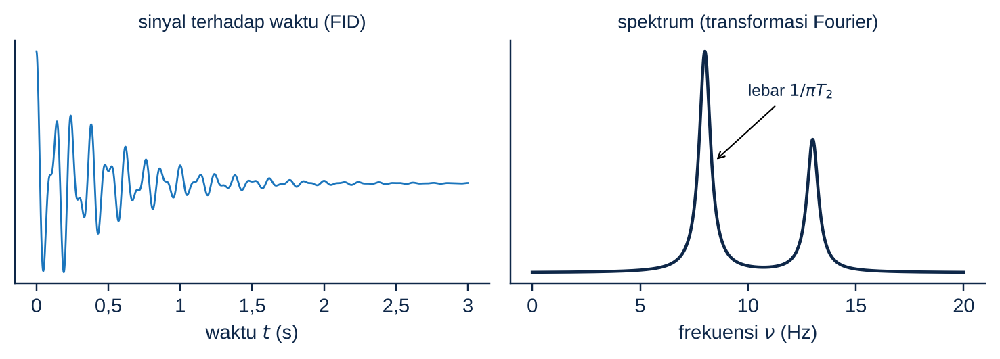

## 2.9 Deret Taylor dan deret Fourier

### Deret Taylor

Fungsi yang mulus di sekitar titik $x_0$ dapat ditulis sebagai deret pangkat dari $(x - x_0)$:

$$
\boxed{\ f(x) = f(x_0) + f'(x_0)(x - x_0) + \frac{f''(x_0)}{2!}(x - x_0)^2 + \frac{f'''(x_0)}{3!}(x - x_0)^3 + \cdots\ } \qquad \text{(2.39)}
$$

Koefisien-koefisiennya diperoleh dengan menurunkan kedua ruas $n$ kali lalu memasukkan $x = x_0$. Untuk $x_0 = 0$ deret ini disebut deret Maclaurin. Beberapa deret yang harus dikenal:

$$
e^x = 1 + x + \frac{x^2}{2!} + \frac{x^3}{3!} + \cdots, \qquad \ln(1 + x) = x - \frac{x^2}{2} + \frac{x^3}{3} - \cdots \quad (|x| < 1),
$$

$$
\sin x = x - \frac{x^3}{3!} + \cdots, \qquad \cos x = 1 - \frac{x^2}{2!} + \cdots, \qquad (1 + x)^n = 1 + nx + \frac{n(n - 1)}{2}x^2 + \cdots
$$

Deret Taylor adalah alat kerja sehari-hari fisikawan dan kimiawan untuk dua keperluan. Pertama, **hampiran**: jika $x$ kecil, cukup ambil beberapa suku pertama. Kedua, **pemeriksaan limit**: mengecek apakah rumus baru kembali ke rumus lama dalam limit tertentu, seperti rumus Planck ke Rayleigh–Jeans di subbab 1.3.

### Hampiran harmonik

Penerapan terpenting deret Taylor dalam kimia adalah pada kurva energi potensial molekul. Di sekitar panjang ikatan setimbang $r_e$, $V'(r_e) = 0$ (minimum), sehingga

$$
V(r) = V(r_e) + \frac12V''(r_e)(r - r_e)^2 + \frac16V'''(r_e)(r - r_e)^3 + \cdots
$$

Jika simpangan kecil, suku kuadrat mendominasi, dan molekul bergetar seperti pegas dengan **tetapan gaya** $k = V''(r_e)$. Inilah **hampiran harmonik**, dasar Bab 5. Suku kubik dan seterusnya menyatakan **anharmonisitas**, yang menyebabkan ikatan dapat putus dan menggeser nada atas getaran.

::: {.contoh}
**Contoh 2.41 · Tetapan gaya dari potensial Morse**

Potensial Morse $V = D_e\left[1 - e^{-a(r - r_e)}\right]^2$ adalah model realistis untuk ikatan. Untuk HCl, $D_e = 4{,}618$ eV, $a = 1{,}869$ Å⁻¹, dan massa tereduksi $\mu = 0{,}9798$ u. (a) Uraikan $V$ sampai suku $x^3$, dengan $x = r - r_e$. (b) Hitung $k$ dan bilangan gelombang harmonik $\tilde\nu = \sqrt{k/\mu}/2\pi c$.

**Penyelesaian.** (a) $e^{-ax} = 1 - ax + \tfrac12a^2x^2 - \cdots$, sehingga $1 - e^{-ax} = ax - \tfrac12a^2x^2 + \cdots$. Kuadratkan: $a^2x^2 - a^3x^3 + \cdots$. Jadi

$$
V \approx D_ea^2x^2 - D_ea^3x^3 .
$$

(b) Dengan $V \approx \tfrac12kx^2$: $k = 2D_ea^2 = 2(4{,}618 \times 1{,}602 \times 10^{-19}\ \text{J})(1{,}869 \times 10^{10}\ \text{m}^{-1})^2 = 517$ N/m. Lalu

$$
\tilde\nu = \frac{1}{2\pi c}\sqrt{\frac{517}{0{,}9798 \times 1{,}6605 \times 10^{-27}}} = 2993\ \text{cm}^{-1} .
$$

**Memahami hasil.** Nilai spektroskopis $\omega_e$ HCl adalah 2991 cm⁻¹. Suku kubik bertanda negatif: kurva Morse lebih landai di sisi regang daripada di sisi tekan (Gambar 2.6 kiri). Akibatnya panjang ikatan rata-rata sedikit bertambah ketika molekul bergetar lebih kuat, dan itulah asal pemuaian termal zat padat.
:::

{width=90%}

::: {.contoh}
**Contoh 2.42 · Seberapa baik hampiran orde satu?**

(a) Bandingkan $\sqrt{1{,}1}$, $e^{0{,}1}$, dan $\ln 1{,}1$ dengan hampiran dua suku pertama deretnya. (b) Energi kinetik relativistik adalah $K = mc^2(\gamma - 1)$ dengan $\gamma = (1 - v^2/c^2)^{-1/2}$. Uraikan sampai suku $v^4$ dan hitung $K/(\tfrac12mv^2)$ untuk elektron 1s hidrogen ($v = c/137$) dan untuk $v = 0{,}1c$.

**Penyelesaian.** (a) $\sqrt{1{,}1} = 1{,}048\,81$ lawan $1 + 0{,}05 - 0{,}00125 = 1{,}048\,75$; $e^{0{,}1} = 1{,}105\,17$ lawan $1 + 0{,}1 + 0{,}005 = 1{,}105$; $\ln 1{,}1 = 0{,}095\,31$ lawan $0{,}1 - 0{,}005 = 0{,}095$.

(b) $(1 - u)^{-1/2} = 1 + \tfrac12u + \tfrac38u^2 + \cdots$ dengan $u = v^2/c^2$, sehingga $K = \tfrac12mv^2\left(1 + \tfrac34v^2/c^2 + \cdots\right)$. Untuk $v = c/137$: koreksi $\tfrac34(1/137)^2 = 4{,}0 \times 10^{-5}$. Untuk $v = 0{,}1c$: $1{,}0075$ (nilai tepat 1,00756).

**Memahami hasil.** Untuk elektron valensi atom ringan, koreksi relativistik berorde $10^{-5}$ dan dapat diabaikan dalam kimia biasa. Untuk elektron 1s atom berat, $v/c \approx Z/137$ mendekati 0,6, dan koreksinya besar. Itulah asal "efek relativistik" pada emas dan raksa (Bab 17).
:::

### Deret Fourier

Deret Taylor menguraikan fungsi atas pangkat-pangkat $x$. **Deret Fourier** menguraikan fungsi periodik atas sinus dan kosinus. Untuk $f(x)$ dengan periode $2\pi$:

$$
f(x) = \frac{a_0}{2} + \sum_{n=1}^\infty\left(a_n\cos nx + b_n\sin nx\right), \qquad a_n = \frac1\pi\int_{-\pi}^\pi f(x)\cos nx\,dx, \quad b_n = \frac1\pi\int_{-\pi}^\pi f(x)\sin nx\,dx . \qquad \text{(2.40)}
$$

Rumus koefisien itu tidak perlu dihafal: ia adalah **proyeksi** (2.28), karena fungsi-fungsi $\cos nx$ dan $\sin nx$ saling ortogonal pada satu periode. Dalam bentuk kompleks yang lebih ringkas, $f(x) = \sum_{n=-\infty}^\infty c_ne^{inx}$ dengan $c_n = \tfrac{1}{2\pi}\int_{-\pi}^\pi f(x)e^{-inx}\,dx$. Fungsi $e^{inx}$ adalah fungsi gelombang partikel pada cincin (Bab 6), sehingga deret Fourier kompleks adalah ekspansi atas keadaan-keadaan momentum sudut.

### Transformasi Fourier

Jika periodenya dibuat tak hingga, jumlah atas $n$ menjadi integral atas bilangan gelombang $k$, dan deret Fourier menjadi **transformasi Fourier**:

$$
\phi(k) = \frac{1}{\sqrt{2\pi}}\int_{-\infty}^\infty\psi(x)\,e^{-ikx}\,dx, \qquad \psi(x) = \frac{1}{\sqrt{2\pi}}\int_{-\infty}^\infty\phi(k)\,e^{ikx}\,dk . \qquad \text{(2.41)}
$$

Fungsi $\phi(k)$ menyatakan "berapa banyak" gelombang $e^{ikx}$ yang diperlukan untuk menyusun $\psi(x)$. Karena $p = \hbar k$, $\phi(k)$ adalah fungsi gelombang dalam **ruang momentum**. Paket gelombang pada Gambar 1.11 adalah pasangan $\psi(x)$ dan $|\phi(k)|^2$. Untuk paket Gauss, transformasi Fourier-nya juga Gauss, dengan lebar berbanding terbalik:

$$
\psi(x) \propto e^{-x^2/4\sigma^2} \quad\longleftrightarrow\quad \phi(k) \propto e^{-\sigma^2k^2}, \qquad \Delta x = \sigma,\ \Delta k = \frac{1}{2\sigma} . \qquad \text{(2.42)}
$$

Hasil kali $\Delta x\,\Delta k = \tfrac12$ inilah yang, dengan $p = \hbar k$, menjadi $\Delta x\,\Delta p = \hbar/2$.

Pasangan yang sama berlaku antara **waktu** dan **frekuensi**. Sinyal $s(t)$ dan spektrumnya $S(\nu)$ adalah pasangan Fourier. Sinyal yang berayun dengan frekuensi $\nu_0$ dan meluruh eksponensial dengan tetapan waktu $T_2$,

$$
s(t) = e^{-t/T_2}\cos(2\pi\nu_0t), \qquad t \ge 0,
$$

mempunyai spektrum berbentuk **lorentzian** yang berpuncak di $\nu_0$ dengan lebar penuh setengah tinggi

$$
\Delta\nu_{1/2} = \frac{1}{\pi T_2} . \qquad \text{(2.43)}
$$

Peluruhan yang cepat berarti garis yang lebar; ini adalah wajah lain dari pelebaran umur di subbab 1.9.

{width=88%}

::: {.contoh}
**Contoh 2.43 · Deret Fourier gelombang persegi**

Gelombang persegi $f(x) = -1$ untuk $-\pi < x < 0$ dan $+1$ untuk $0 < x < \pi$. (a) Hitung koefisien Fourier-nya. (b) Hitung jumlah parsial di $x = \pi/2$ dengan 1, 3, 10, dan 50 suku tak nol.

**Penyelesaian.** (a) $f$ ganjil, jadi semua $a_n = 0$. Untuk $b_n$:

$$
b_n = \frac{2}{\pi}\int_0^\pi\sin nx\,dx = \frac{2}{n\pi}\left(1 - \cos n\pi\right) = \begin{cases}4/n\pi, & n\ \text{ganjil}\\ 0, & n\ \text{genap}\end{cases}
$$

Jadi $f(x) = \dfrac4\pi\left(\sin x + \dfrac{\sin 3x}{3} + \dfrac{\sin 5x}{5} + \cdots\right)$.

(b) Di $x = \pi/2$, $\sin(n\pi/2) = +1, -1, +1, \ldots$ untuk $n = 1, 3, 5, \ldots$ Jumlah parsialnya 1,273; 1,103; 0,968; 0,994.

**Memahami hasil.** Deret konvergen ke 1, tetapi lambat: koefisiennya hanya turun sebanding $1/n$ karena fungsi melompat. Fungsi yang mulus mempunyai koefisien Fourier yang turun jauh lebih cepat; bandingkan Contoh 2.27, yang koefisiennya turun sebanding $1/n^3$. Makin tajam struktur sebuah fungsi, makin banyak komponen frekuensi tinggi yang diperlukan. Dalam bahasa kuantum: fungsi gelombang yang bersudut tajam memerlukan momentum besar, dan energi kinetiknya besar.
:::

::: {.contoh}
**Contoh 2.44 · Lebar garis NMR dari FID**

Sinyal FID sebuah proton meluruh dengan $T_2 = 0{,}50$ s. (a) Berapa lebar garisnya? (b) Pada spektrometer 400 MHz, berapa lebar itu dalam satuan ppm? (c) Berapa lama sinyal harus direkam agar resolusi frekuensinya 0,1 Hz?

**Penyelesaian.** (a) $\Delta\nu_{1/2} = 1/(\pi \times 0{,}50) = 0{,}64$ Hz.

(b) $0{,}64/(400 \times 10^6) = 1{,}6 \times 10^{-9} = 0{,}0016$ ppm.

(c) Resolusi transformasi Fourier sekitar $1/T_\text{rekam}$, jadi $T_\text{rekam} \approx 10$ s.

**Memahami hasil.** Garis NMR molekul kecil dalam larutan sangat tajam karena $T_2$ panjang, sehingga kopling $J$ beberapa hertz mudah terpisah. Makromolekul dan zat padat mempunyai $T_2$ jauh lebih pendek dan garis yang lebar. Hubungan waktu–frekuensi yang sama menentukan mengapa spektrum FT-IR resolusi tinggi memerlukan cermin yang bergerak jauh: cermin yang menempuh 0,5 cm (beda lintasan optis 1 cm) memberikan resolusi sekitar 1 cm⁻¹.
:::

### Transformasi Fourier diskret dan FFT

Spektrometer merekam sinyal pada titik-titik waktu yang berjarak tetap $\Delta t$ (waktu tinggal), bukan sebagai fungsi malar. Transformasinya dihitung sebagai **transformasi Fourier diskret**, dan algoritme **FFT** (*fast Fourier transform*, Cooley dan Tukey 1965) menghitungnya dalam waktu sebanding $N\log N$ untuk $N$ titik, alih-alih $N^2$. Dua aturan praktis menghubungkan cara merekam dengan spektrum yang diperoleh:

- **Lebar spektrum** yang dapat diwakili adalah $1/\Delta t$ (frekuensi Nyquist $\pm1/2\Delta t$). Sinyal di luar rentang itu "terlipat" ke dalam spektrum.
- **Resolusi** frekuensi sekitar $1/(N\Delta t)$, kebalikan lama perekaman.

```python
import numpy as np
dt, N, T2 = 1e-3, 4096, 0.5                 # s, banyak titik, s
t = np.arange(N) * dt
fid = np.exp(-t/T2) * (np.cos(2*np.pi*80*t) + 0.6*np.cos(2*np.pi*130*t))
spek = np.abs(np.fft.rfft(fid))              # spektrum (besar)
nu = np.fft.rfftfreq(N, dt)                  # sumbu frekuensi, Hz
print(nu[np.argmax(spek)])                   # sekitar 80 Hz
```

::: {.contoh}
**Contoh 2.45 · Memilih waktu tinggal NMR**

Pada spektrometer ¹H 400 MHz, sinyal direkam dengan waktu tinggal 100 µs dan 32 768 titik. (a) Berapa lebar spektrum dalam Hz dan ppm? (b) Berapa resolusi digitalnya? (c) Cukupkah untuk memisahkan kopling $J = 0{,}5$ Hz?

**Penyelesaian.** (a) $1/\Delta t = 10\,000$ Hz; dibagi 400 MHz: 25 ppm, cukup untuk seluruh rentang geseran kimia proton (sekitar 0–15 ppm).

(b) Lama perekaman $N\Delta t = 3{,}28$ s, resolusi $1/3{,}28 = 0{,}31$ Hz.

(c) Hampir; dua garis berjarak 0,5 Hz hanya terpisah sekitar 1,6 titik data. Perekaman yang lebih panjang (atau penambahan nol, *zero filling*) diperlukan, dan $T_2$ harus cukup panjang agar garisnya sendiri tidak lebih lebar dari 0,5 Hz.

**Memahami hasil.** Setiap pilihan parameter perekaman adalah pilihan tentang transformasi Fourier. Hubungan $\Delta\nu \approx 1/T$ yang sama mengikat lama perekaman dengan resolusi, persis seperti asas ketidakpastian energi–waktu.
:::

::: {.kuis}
**Kuis cepat 2.9**

(a) Tuliskan tiga suku pertama deret Taylor $\cos x$ di sekitar $x = 0$, lalu hitung $\cos 0{,}2$ dengannya. (b) Jika $T_2$ diperpendek setengahnya, apa yang terjadi pada lebar garis?
:::

## 2.10 Peluang, nilai rata-rata, simpangan baku

Mekanika kuantum meramalkan peluang, bukan kepastian. Hasil-hasilnya dinyatakan dengan bahasa statistik: sebaran peluang, nilai rata-rata, dan simpangan baku. Subbab ini menyiapkan bahasa itu.

### Sebaran diskret

Misalkan sebuah besaran dapat bernilai $x_1, x_2, \ldots$ dengan peluang $P_1, P_2, \ldots$, dengan $\sum_iP_i = 1$. **Nilai rata-rata** (nilai harap) dan rata-rata kuadratnya:

$$
\langle x\rangle = \sum_ix_iP_i, \qquad \langle x^2\rangle = \sum_ix_i^2P_i . \qquad \text{(2.44)}
$$

Lebar sebaran diukur dengan **simpangan baku** $\sigma_x$ (dalam mekanika kuantum ditulis $\Delta x$):

$$
\sigma_x^2 = \left\langle(x - \langle x\rangle)^2\right\rangle = \langle x^2\rangle - \langle x\rangle^2 . \qquad \text{(2.45)}
$$

Bentuk kedua diperoleh dengan menguraikan kuadrat: $\langle x^2 - 2x\langle x\rangle + \langle x\rangle^2\rangle = \langle x^2\rangle - 2\langle x\rangle^2 + \langle x\rangle^2$. Simpangan baku nol jika dan hanya jika semua pengukuran memberikan nilai yang sama.

### Sebaran malar

Untuk besaran malar seperti posisi, peluang menemukan nilai di antara $x$ dan $x + dx$ adalah $P(x)\,dx$, dengan $P(x)$ **rapat peluang** yang memenuhi $\int P(x)\,dx = 1$. Jumlah menjadi integral:

$$
\langle f(x)\rangle = \int f(x)\,P(x)\,dx . \qquad \text{(2.46)}
$$

Dalam mekanika kuantum, rapat peluang posisi adalah $P(x) = |\psi(x)|^2$ (tafsir Born, Bab 3). Satuan $P(x)$ adalah per panjang; peluang hanya bermakna untuk selang, bukan titik.

Tiga sebaran yang sering muncul:

- **Seragam** pada $[0, L]$: $P = 1/L$, $\langle x\rangle = L/2$, $\sigma = L/\sqrt{12}$.
- **Gauss** (normal): $P(x) = \dfrac{1}{\sigma\sqrt{2\pi}}e^{-(x - \mu)^2/2\sigma^2}$, dengan $\langle x\rangle = \mu$ dan simpangan baku $\sigma$. Peluang berada dalam $\mu \pm \sigma$ adalah 68,3%, dalam $\mu \pm 2\sigma$ 95,4%.
- **Eksponensial**: $P(t) = ke^{-kt}$ untuk $t \ge 0$, sebaran umur molekul dalam reaksi orde satu atau keadaan tereksitasi yang meluruh. $\langle t\rangle = 1/k = \tau$ dan $\sigma_t = \tau$.

{width=94%}

::: {.contoh}
**Contoh 2.46 · Dadu**

Hitung $\langle x\rangle$, $\langle x^2\rangle$, dan $\sigma$ untuk lemparan satu dadu jujur.

**Penyelesaian.** $P_i = 1/6$ untuk $x = 1, \ldots, 6$. $\langle x\rangle = 21/6 = 3{,}5$. $\langle x^2\rangle = (1 + 4 + 9 + 16 + 25 + 36)/6 = 91/6 = 15{,}17$. $\sigma^2 = 15{,}17 - 12{,}25 = 2{,}917$, $\sigma = 1{,}71$.

**Memahami hasil.** Nilai rata-rata 3,5 tidak pernah muncul dalam satu lemparan. Begitu pula dalam mekanika kuantum: nilai harap sebuah besaran tidak harus sama dengan salah satu hasil pengukuran yang mungkin. Momentum sudut rata-rata dapat bernilai di antara nilai-nilai yang diizinkan, walaupun setiap pengukuran tunggal memberi nilai yang terkuantisasi.
:::

::: {.contoh}
**Contoh 2.47 · Partikel dalam kotak lawan bola biliar**

Partikel dalam kotak $[0, L]$ pada keadaan $n$ mempunyai $P(x) = \tfrac2L\sin^2(n\pi x/L)$. (a) Hitung $\langle x\rangle$ dan $\sigma_x$ untuk $n = 1$ dan $n = 2$. (b) Bandingkan dengan sebaran seragam, yang merupakan sebaran waktu tinggal sebuah bola yang memantul bolak-balik dengan laju tetap.

**Penyelesaian.** (a) $\langle x\rangle = L/2$ untuk semua $n$ (simetri; Contoh 2.7). Integral $\langle x^2\rangle$ dengan integral parsial dua kali memberikan $\langle x^2\rangle = L^2\left(\dfrac13 - \dfrac{1}{2n^2\pi^2}\right)$. Jadi

$$
\sigma_x = L\sqrt{\frac{1}{12} - \frac{1}{2n^2\pi^2}} ,
$$

yaitu $0{,}181L$ untuk $n = 1$ dan $0{,}266L$ untuk $n = 2$.

(b) Sebaran seragam: $\sigma = L/\sqrt{12} = 0{,}289L$.

**Memahami hasil.** Pada keadaan dasar, partikel kuantum lebih sering berada di tengah kotak daripada bola klasik, yang menghabiskan waktu sama di setiap bagian kotak (Gambar 2.8 kiri). Ketika $n$ bertambah, $\sigma_x$ mendekati $L/\sqrt{12}$: sebaran kuantum mendekati sebaran klasik pada bilangan kuantum besar, sesuai asas korespondensi.
:::

::: {.contoh}
**Contoh 2.48 · Kelajuan molekul nitrogen**

Sebaran kelajuan Maxwell adalah $f(v) = 4\pi\left(\dfrac{m}{2\pi kT}\right)^{3/2}v^2e^{-mv^2/2kT}$. Dengan integral subbab 2.2, ketiga kelajuan khasnya adalah $v_p = \sqrt{2kT/m}$, $\langle v\rangle = \sqrt{8kT/\pi m}$, dan $v_\text{rms} = \sqrt{3kT/m}$. Hitung ketiganya untuk N₂ (28,01 u) pada 298 K.

**Penyelesaian.** $kT/m = (1{,}381 \times 10^{-23})(298{,}15)/(28{,}01 \times 1{,}6605 \times 10^{-27}) = 8{,}85 \times 10^4$ m²/s². Jadi $v_p = 421$ m/s, $\langle v\rangle = 475$ m/s, $v_\text{rms} = 515$ m/s.

**Memahami hasil.** Ketiganya berbeda karena sebarannya tidak simetris: ekor ke arah kelajuan tinggi menarik rata-rata ke atas, persis seperti ekor fungsi distribusi radial 1s yang menarik $\langle r\rangle$ menjadi $1{,}5a_0$ walaupun puncaknya di $a_0$. Sebaran Maxwell sendiri adalah contoh sebaran Boltzmann (subbab 1.10) untuk energi kinetik malar.
:::

::: {.contoh}
**Contoh 2.49 · Umur keadaan tereksitasi**

Keadaan tereksitasi sebuah molekul zat warna meluruh secara orde satu dengan $k = 2{,}5 \times 10^8$ s⁻¹. (a) Berapa umur rata-ratanya dan simpangan bakunya? (b) Berapa fraksi molekul yang masih tereksitasi setelah 10 ns?

**Penyelesaian.** (a) $\tau = 1/k = 4{,}0$ ns, dan $\sigma_t = \tau = 4{,}0$ ns.

(b) Peluang bertahan sampai $t$ adalah $\int_t^\infty ke^{-kt'}dt' = e^{-kt} = e^{-2{,}5} = 0{,}082$.

**Memahami hasil.** Simpangan baku sama dengan rata-rata: umur satu molekul sangat tidak tentu. Sebagian molekul memancar dalam pikodetik, sebagian bertahan puluhan nanodetik. Yang tajam hanyalah rata-ratanya. Umur rata-rata inilah $\tau$ dalam rumus pelebaran umur di subbab 1.9.
:::

### Sebaran binomial dan fluktuasi

Jika $N$ kejadian bebas masing-masing berhasil dengan peluang $p$ (misalnya $N$ spin yang masing-masing "atas" dengan peluang $p$), peluang tepat $k$ yang berhasil adalah

$$
P(k) = \binom{N}{k}p^k(1 - p)^{N-k}, \qquad \langle k\rangle = Np, \qquad \sigma_k = \sqrt{Np(1 - p)} . \qquad \text{(2.47)}
$$

Fluktuasi relatifnya $\sigma_k/\langle k\rangle$ sebanding dengan $1/\sqrt N$. Untuk sistem makroskopik dengan $N \sim 10^{20}$, fluktuasi relatif hanya $10^{-10}$; itulah sebabnya besaran termodinamika tampak tajam walaupun dibangun dari kejadian-kejadian kuantum yang acak.

::: {.contoh}
**Contoh 2.50 · Seratus spin dan satu mol spin**

(a) Untuk 100 spin dengan $p = \tfrac12$, hitung $\langle k\rangle$, $\sigma_k$, peluang tepat 50 spin atas, dan peluang 60 atau lebih. (b) Berapa fluktuasi relatif untuk $10^{20}$ spin?

**Penyelesaian.** (a) $\langle k\rangle = 50$, $\sigma_k = \sqrt{100 \cdot \tfrac14} = 5$. $P(50) = \binom{100}{50}2^{-100} = 0{,}0796$. Penjumlahan numerik memberikan $P(k \ge 60) = 0{,}028$.

(b) $\sigma_k/\langle k\rangle = \sqrt{N}/2\big/(N/2) = 1/\sqrt N = 10^{-10}$.

**Memahami hasil.** Untuk 100 spin, nilai yang "paling mungkin" (tepat 50) hanya muncul 8% dari waktu, dan penyimpangan dua simpangan baku cukup sering. Untuk sampel NMR yang berisi $10^{20}$ proton, perbedaan populasi kecil $3 \times 10^{-5}$ yang dihitung di Contoh 1.53 jauh lebih besar dari fluktuasi acak $10^{-10}$, sehingga sinyalnya dapat diukur dengan andal.
:::

::: {.kuis}
**Kuis cepat 2.10**

Sebuah besaran selalu terukur bernilai 5,0 setiap kali diukur. Berapa $\langle x\rangle$, $\langle x^2\rangle$, dan $\sigma$-nya?
:::

## 2.11 Satuan atom

Persamaan Schrödinger atom hidrogen dalam satuan SI,

$$
-\frac{\hbar^2}{2m_e}\nabla^2\psi - \frac{e^2}{4\pi\varepsilon_0r}\psi = E\psi ,
$$

dipenuhi tetapan-tetapan yang mengaburkan strukturnya. Kimiawan teori karena itu memakai **satuan atom** (disingkat a.u., *atomic units*): empat besaran dasar diberi nilai satu,

$$
m_e = 1, \qquad e = 1, \qquad \hbar = 1, \qquad 4\pi\varepsilon_0 = 1 . \qquad \text{(2.48)}
$$

Persamaan di atas menjadi jauh lebih bersih:

$$
-\tfrac12\nabla^2\psi - \frac1r\psi = E\psi . \qquad \text{(2.49)}
$$

Satuan-satuan turunan dibentuk dari keempat besaran itu dengan analisis dimensi. Yang terpenting adalah satuan panjang, **bohr** ($a_0$), dan satuan energi, **hartree** ($E_h$):

| Besaran | Satuan atom | Nilai SI | Makna |
|---|---|---|---|
| panjang | $a_0 = 4\pi\varepsilon_0\hbar^2/m_ee^2$ | $5{,}2918 \times 10^{-11}$ m | jari-jari Bohr |
| energi | $E_h = \hbar^2/m_ea_0^2$ | $4{,}3597 \times 10^{-18}$ J = 27,211 eV | 2 × energi ionisasi H |
| waktu | $\hbar/E_h$ | $2{,}4189 \times 10^{-17}$ s | periode orbit Bohr dibagi $2\pi$ |
| kecepatan | $a_0E_h/\hbar$ | $2{,}1877 \times 10^6$ m/s | kelajuan elektron orbit pertama, $\alpha c$ |
| medan listrik | $E_h/ea_0$ | $5{,}1422 \times 10^{11}$ V/m | medan proton di jarak $a_0$ |
| momen dipol | $ea_0$ | $8{,}4784 \times 10^{-30}$ C·m = 2,5417 D | |
| gaya | $E_h/a_0$ | $8{,}2387 \times 10^{-8}$ N | |

Dalam satuan atom, energi atom hidrogen adalah $E_n = -1/2n^2$ dan laju cahaya $c = 1/\alpha = 137{,}036$. Hasil perhitungan dengan program kimia kuantum (Bab 17) hampir selalu dicetak dalam satuan atom: energi dalam hartree, panjang dalam bohr (kadang angstrom), momen dipol dalam a.u. atau debye.

::: {.awas}
**Awas · Satuan atom bukan "tanpa satuan"**

Menulis $\hbar = 1$ bukan berarti tetapan Planck lenyap; artinya semua besaran diukur dalam kelipatan satuan-satuan atom. Sebelum membandingkan dengan percobaan, kalikan kembali dengan faktor konversinya. Perhatikan juga dua definisi yang beredar: sebagian buku lama memakai rydberg ($\tfrac12E_h = 13{,}606$ eV) sebagai satuan energi. Satu hartree sama dengan dua rydberg.
:::

::: {.contoh}
**Contoh 2.51 · Konversi ke satuan atom**

(a) Panjang ikatan H₂ adalah 74,14 pm; nyatakan dalam bohr. (b) Momen dipol HCl 1,08 D; nyatakan dalam a.u. (c) Energi ionisasi helium 24,587 eV; nyatakan dalam hartree.

**Penyelesaian.** (a) $74{,}14/52{,}918 = 1{,}401$ bohr. (b) $1{,}08/2{,}5417 = 0{,}425$ a.u. (c) $24{,}587/27{,}211 = 0{,}9036\ E_h$.

**Memahami hasil.** Angka-angka dalam satuan atom berorde satu: ikatan sekitar 1–4 bohr, energi ikatan beberapa per sepuluh hartree, momen dipol beberapa per sepuluh a.u. Itulah tanda sistem satuan yang "alami" untuk sebuah masalah. Angka 1,401 bohr untuk H₂ akan muncul lagi sebagai jarak setimbang dalam perhitungan Bab 11.
:::

::: {.contoh}
**Contoh 2.52 · Medan listrik dalam atom dan dalam laboratorium**

(a) Berapa medan listrik yang dirasakan elektron 1s hidrogen pada jarak $a_0$, dalam V/m? (b) Medan terkuat yang dapat dibuat antara elektrode di laboratorium sekitar $10^8$ V/m. Berapa fraksinya dari medan atom? (c) Laser berdenyut dengan intensitas $3{,}5 \times 10^{16}$ W/cm² mempunyai amplitudo medan satu satuan atom. Mengapa laser semacam itu dapat mengionkan atom secara langsung?

**Penyelesaian.** (a) Medan pada $a_0$ adalah satu satuan atom medan: $E = e/(4\pi\varepsilon_0a_0^2) = 5{,}14 \times 10^{11}$ V/m.

(b) $10^8/5{,}14 \times 10^{11} = 2 \times 10^{-4}$.

(c) Medan laser sebanding dengan medan yang mengikat elektron, sehingga ia dapat "menarik" elektron keluar tanpa harus diserap sebagai foton tunggal yang cukup energinya.

**Memahami hasil.** Medan laboratorium biasa hanya mengganggu atom sedikit (efek Stark, Bab 8), sehingga teori perturbasi berlaku. Medan laser yang sangat kuat tidak lagi "kecil", dan fisika interaksinya berubah total: ionisasi medan kuat dan pembangkitan harmonik tinggi yang menghasilkan pulsa attodetik (Hadiah Nobel Fisika 2023).
:::

::: {.contoh}
**Contoh 2.53 · Persamaan Schrödinger dalam satuan atom**

Tunjukkan bahwa $\psi = e^{-r}$ (satuan atom) memenuhi (2.49) untuk fungsi yang hanya bergantung pada $r$, dan tentukan $E$. Untuk fungsi radial, $\nabla^2\psi = \dfrac{1}{r^2}\dfrac{d}{dr}\left(r^2\dfrac{d\psi}{dr}\right)$.

**Penyelesaian.** $d\psi/dr = -e^{-r}$; $r^2\,d\psi/dr = -r^2e^{-r}$; turunannya $-2re^{-r} + r^2e^{-r}$. Dibagi $r^2$: $\nabla^2\psi = \left(1 - \dfrac2r\right)e^{-r}$. Maka

$$
-\tfrac12\nabla^2\psi - \frac1r\psi = \left(-\frac12 + \frac1r - \frac1r\right)e^{-r} = -\frac12\,\psi .
$$

Jadi $E = -\tfrac12$ hartree $= -13{,}606$ eV.

**Memahami hasil.** Suku $1/r$ dari energi kinetik dan dari energi potensial saling meniadakan dengan tepat; itulah yang membuat $e^{-r}$ menjadi penyelesaian yang tepat. Dengan fungsi $e^{-\zeta r}$ untuk $\zeta \ne 1$, suku-suku $1/r$ tidak meniadakan, dan fungsi itu bukan fungsi eigen. Hitungan tiga baris ini adalah keadaan dasar atom hidrogen, yang akan diturunkan secara sistematis di Bab 7.
:::

::: {.kuis}
**Kuis cepat 2.11**

(a) Berapa energi atom hidrogen pada $n = 2$ dalam hartree? (b) Berapa panjang 1,00 Å dalam bohr? (c) Dalam satuan atom, berapa nilai $\hbar^2/m_e$?
:::
