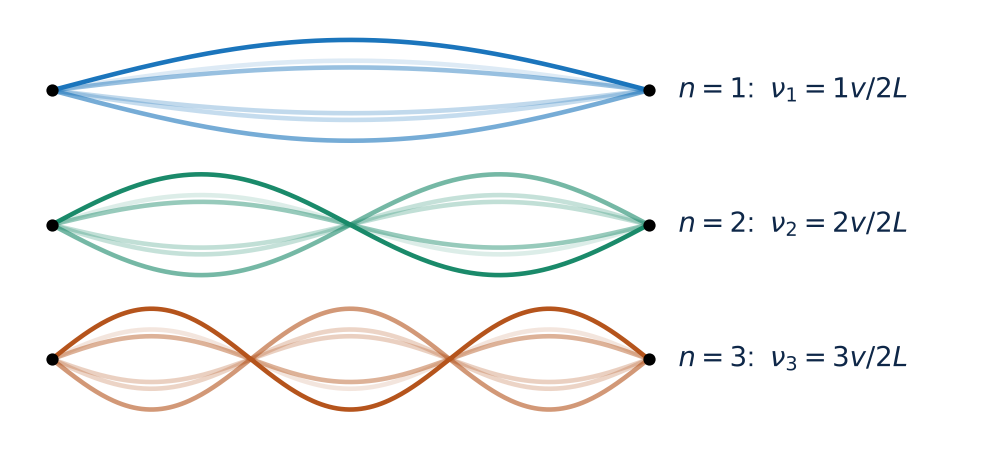

# Bab 3 Persamaan Schrödinger dan Partikel dalam Kotak

Ambil empat zat warna dari keluarga yang sama: kation sianin dengan dua gugus amino di ujung-ujung rantai karbon terkonjugasi. Yang rantainya paling pendek menyerap ultraviolet dan tampak tidak berwarna. Tambahkan satu gugus CH=CH, dan pita serapannya bergeser sekitar 100 nm ke arah merah. Tambahkan lagi, bergeser 100 nm lagi. Larutan berubah dari tak berwarna menjadi kuning, merah, lalu biru kehijauan, dengan langkah yang hampir sama setiap kali rantai bertambah dua karbon. Dari mana keteraturan seindah itu?

Jawabannya ternyata dapat dihitung di atas sepotong kertas, dengan model yang terdengar terlalu sederhana untuk benar: anggap elektron π bergerak bebas di sepanjang rantai, seperti manik-manik dalam pipa yang tertutup di kedua ujungnya. Model "partikel dalam kotak" ini meramalkan panjang gelombang serapan zat warna sianin dalam 10–15%, dan meramalkan pergeseran tiap gugus vinilena dengan baik (Contoh 3.27). Model yang sama menjelaskan mengapa titik kuantum CdSe berpendar biru ketika kecil dan merah ketika besar, dan, dengan sedikit perubahan, mengapa mikroskop penerobosan dapat "melihat" atom tunggal.

Bab ini memperkenalkan persamaan yang menjadi pusat seluruh buku: **persamaan Schrödinger**. Kita akan menebaknya dari hubungan de Broglie, menafsirkan penyelesaiannya sebagai amplitudo peluang, lalu menyelesaikannya untuk sistem-sistem satu dimensi yang paling sederhana. Dari sistem sederhana itu muncul hampir semua gagasan kuantum yang penting: tingkat energi diskret, energi titik nol, simpul, ortogonalitas, pantulan oleh tangga yang lebih rendah dari energi partikel, dan penerobosan melalui dinding yang lebih tinggi.

::: {.strategi}
**Pertanyaan pembuka**

1. Mengapa persamaan gelombang materi harus orde satu terhadap waktu, padahal persamaan gelombang tali orde dua?
2. Apa arti fisis fungsi gelombang, dan mengapa yang terukur adalah kuadrat besarnya?
3. Mengapa partikel yang terkurung tidak pernah diam, dan mengapa energinya hanya boleh bernilai tertentu?
4. Bagaimana panjang rantai terkonjugasi menentukan warna zat warna?
5. Bagaimana elektron dapat menembus penghalang yang energinya lebih tinggi daripada energi elektron itu sendiri, dan mengapa proton melakukannya jauh lebih jarang?
:::

::: {.tujuan}
**Tujuan belajar**

Setelah mempelajari bab ini, kamu mampu:

1. Menurunkan persamaan gelombang klasik untuk tali dan menyelesaikannya dengan pemisahan variabel.
2. Memotivasi persamaan Schrödinger bergantung waktu dari hubungan de Broglie dan menjelaskan peran bilangan kompleks.
3. Menerapkan tafsir Born: menormalkan fungsi gelombang, menghitung peluang, dan memakai kekekalan peluang.
4. Memisahkan persamaan bergantung waktu menjadi persamaan tak bergantung waktu dan menjelaskan keadaan stasioner.
5. Menjelaskan partikel bebas, kecepatan grup, dan pelebaran paket gelombang.
6. Menyelesaikan partikel dalam kotak satu dimensi secara lengkap dan menghitung energi, peluang, dan nilai harap.
7. Menjelaskan simpul, ortogonalitas, paritas, dan limit klasik fungsi gelombang.
8. Menerapkan model elektron bebas untuk memperkirakan serapan poliena, zat warna sianin, dan titik kuantum.
9. Menyelesaikan sumur potensial terhingga dan tangga potensial, termasuk pantulan kuantum.
10. Menghitung peluang penerobosan dan menjelaskan peranannya dalam STM, transfer proton, efek isotop kinetik, dan inversi amonia.
:::

::: {.mat}
**Prasyarat**

Dari Bab 1: hubungan de Broglie $\lambda = h/p$ dan $E = h\nu$ (subbab 1.4 dan 1.7), amplitudo dan interferensi (subbab 1.8), asas ketidakpastian (subbab 1.9). Dari Bab 2: bilangan kompleks dan rumus Euler (subbab 2.1), integral dan paritas (subbab 2.2), persamaan diferensial orde dua dan syarat batas (subbab 2.3), ortonormalitas dan ekspansi (subbab 2.6), transformasi Fourier (subbab 2.9), dan statistik (subbab 2.10). Dari *Fisika Umum*: gelombang pada tali dan gelombang berdiri (Bab 9).
:::

## 3.1 Persamaan gelombang klasik

Sebelum menebak persamaan untuk gelombang materi, kita lihat dulu persamaan gelombang yang sudah dikenal dan cara menyelesaikannya. Metode penyelesaiannya, **pemisahan variabel**, akan dipakai berkali-kali dalam buku ini.

### Penurunan untuk tali

Tinjau tali lentur bermassa $\mu$ tiap satuan panjang yang ditegangkan dengan gaya $T$ dan disimpangkan sedikit dari garis lurus. Simpangan tegak $u(x, t)$ bergantung pada posisi dan waktu. Ambil potongan kecil tali antara $x$ dan $x + \Delta x$. Gaya tegang pada kedua ujungnya menyinggung tali; komponen tegaknya adalah $T$ dikali kemiringan, $T\,\partial u/\partial x$, sepanjang simpangan kecil. Gaya tegak bersih pada potongan itu adalah selisih kedua ujung:

$$
F = T\left.\frac{\partial u}{\partial x}\right|_{x+\Delta x} - T\left.\frac{\partial u}{\partial x}\right|_x \approx T\frac{\partial^2u}{\partial x^2}\Delta x .
$$

Hukum Newton $F = (\mu\Delta x)\,\partial^2u/\partial t^2$ memberikan, setelah dibagi $\mu\Delta x$,

$$
\boxed{\ \frac{\partial^2u}{\partial x^2} = \frac{1}{v^2}\frac{\partial^2u}{\partial t^2}, \qquad v = \sqrt{T/\mu}\ } \qquad \text{(3.1)}
$$

Inilah **persamaan gelombang klasik**. Ia linear, sehingga superposisi penyelesaian juga penyelesaian. Fungsi apa pun berbentuk $f(x - vt)$ atau $f(x + vt)$ memenuhinya: gelombang yang merambat dengan laju $v$ tanpa berubah bentuk. Persamaan yang sama, dengan $v = c$, berlaku untuk medan listrik gelombang elektromagnetik.

### Pemisahan variabel

Untuk tali yang terikat di $x = 0$ dan $x = L$, kita cari penyelesaian berbentuk hasil kali

$$
u(x, t) = X(x)\,\mathcal T(t) .
$$

Masukkan ke (3.1): $X''\mathcal T = X\ddot{\mathcal T}/v^2$. Bagi kedua ruas dengan $X\mathcal T$:

$$
\frac{X''(x)}{X(x)} = \frac{1}{v^2}\frac{\ddot{\mathcal T}(t)}{\mathcal T(t)} .
$$

Ruas kiri hanya bergantung pada $x$, ruas kanan hanya pada $t$. Satu-satunya cara keduanya sama untuk semua $x$ dan semua $t$ adalah jika keduanya sama dengan **tetapan** yang sama, sebut saja $-k^2$. Persamaan diferensial parsial terpecah menjadi dua persamaan biasa:

$$
X'' = -k^2X, \qquad \ddot{\mathcal T} = -k^2v^2\mathcal T .
$$

Persamaan pertama, dengan syarat batas $X(0) = X(L) = 0$, adalah persis masalah di subbab 2.3: $X_n = \sin(n\pi x/L)$ dengan $k_n = n\pi/L$. Persamaan kedua memberikan ayunan $\mathcal T_n = \cos(\omega_nt + \varphi_n)$ dengan $\omega_n = k_nv$. Frekuensinya

$$
\nu_n = \frac{\omega_n}{2\pi} = \frac{nv}{2L}, \qquad n = 1, 2, 3, \ldots \qquad \text{(3.2)}
$$

Setiap $n$ adalah **mode normal** tali (Gambar 3.1): gelombang berdiri yang semua titiknya berayun dengan frekuensi yang sama. Gerak umum tali adalah superposisi mode-mode normal. Perhatikan bahwa frekuensi tali gitar "terkuantisasi" oleh syarat batas, tanpa mekanika kuantum. Yang baru dalam mekanika kuantum adalah bahwa **energi** dihubungkan dengan frekuensi lewat $E = h\nu$.

{width=64%}

::: {.contoh}
**Contoh 3.1 · Senar gitar**

Senar E rendah gitar panjangnya 0,648 m dan bergetar pada 82,4 Hz. Kerapatan massanya $6{,}2 \times 10^{-3}$ kg/m. Hitung laju gelombang, tegangan senar, dan frekuensi mode kedua dan ketiga.

**Penyelesaian.** Dari (3.2) dengan $n = 1$: $v = 2L\nu_1 = 2(0{,}648)(82{,}4) = 106{,}8$ m/s. Tegangan $T = \mu v^2 = (6{,}2 \times 10^{-3})(106{,}8)^2 = 71$ N. Mode kedua dan ketiga: 164,8 Hz dan 247,2 Hz.

**Memahami hasil.** Nada atas senar adalah kelipatan bulat nada dasar, sehingga bunyinya "harmonis". Dalam partikel dalam kotak (subbab 3.6), energi tidak sebanding dengan $n$ melainkan dengan $n^2$, karena hubungan antara frekuensi dan bilangan gelombang gelombang materi berbeda dari gelombang pada tali (subbab 3.2).
:::

::: {.contoh}
**Contoh 3.2 · Pemisahan variabel dan syarat awal**

Tali dengan $L = 1$ dan $v = 1$ (satuan sembarang) dilepas dari diam dengan bentuk awal $u(x, 0) = \sin\pi x + 0{,}5\sin 3\pi x$. Tuliskan $u(x, t)$. Kapan bentuk awal itu terulang?

**Penyelesaian.** Karena bentuk awal sudah berupa jumlah dua mode, dan tali dilepas dari diam (fase kosinus), setiap mode berayun sendiri dengan frekuensi sudutnya $\omega_n = n\pi$:

$$
u(x, t) = \sin\pi x\cos\pi t + 0{,}5\sin 3\pi x\cos 3\pi t .
$$

Bentuk awal terulang ketika kedua kosinus kembali bernilai 1, yaitu ketika $\pi t$ dan $3\pi t$ kelipatan $2\pi$: $t = 2, 4, \ldots$

**Memahami hasil.** Superposisi mode-mode berbeda frekuensi tidak "stasioner": bentuknya berubah, dan baru berulang setelah periode bersama. Hal yang sama terjadi pada superposisi keadaan kuantum dengan energi berbeda (subbab 3.4): rapat peluangnya berubah terhadap waktu dengan frekuensi selisih energinya.
:::

### Superposisi mode untuk bentuk awal sembarang

Bentuk awal tali yang sembarang, $u(x, 0) = f(x)$, diuraikan atas mode-mode normal dengan deret Fourier sinus: $f(x) = \sum_nb_n\sin(n\pi x/L)$, dengan $b_n = \tfrac2L\int_0^Lf(x)\sin(n\pi x/L)\,dx$ (proyeksi, subbab 2.6). Jika tali dilepas dari diam, setiap mode berayun sendiri: $u(x, t) = \sum_nb_n\sin(n\pi x/L)\cos(\omega_nt)$. Resep "uraikan atas mode, beri setiap mode faktor waktunya sendiri, jumlahkan kembali" adalah persis resep evolusi waktu dalam mekanika kuantum (subbab 3.4); hanya faktor waktunya yang berbeda, $\cos\omega_nt$ untuk tali dan $e^{-iE_nt/\hbar}$ untuk fungsi gelombang.

::: {.contoh}
**Contoh 3.3 · Tali yang dipetik di tengah**

Tali sepanjang $L$ ditarik di tengahnya setinggi $h_0$ sehingga berbentuk segitiga, lalu dilepas. Koefisien Fourier-nya $b_n = \dfrac{8h_0}{n^2\pi^2}\sin\dfrac{n\pi}{2}$. Hitung $b_1$ sampai $b_5$ dan tafsirkan.

**Penyelesaian.** $b_1 = 8h_0/\pi^2 = 0{,}811h_0$; $b_2 = 0$; $b_3 = -8h_0/9\pi^2 = -0{,}090h_0$; $b_4 = 0$; $b_5 = 0{,}032h_0$.

**Memahami hasil.** Mode genap tidak tereksitasi karena tali dipetik tepat di simpul mode-mode itu (di tengah), sebuah aturan seleksi oleh simetri. Koefisien turun sebanding $1/n^2$ karena bentuk segitiga mempunyai sudut tajam. Pemain gitar mengubah warna bunyi dengan memetik di tempat lain: memetik dekat ujung membangkitkan lebih banyak nada atas. Dalam spektroskopi, cara molekul "dipetik" oleh cahaya (bentuk dan simetri gangguan) juga menentukan keadaan mana yang tereksitasi.
:::

::: {.kuis}
**Kuis cepat 3.1**

Jika tegangan senar dijadikan empat kali, apa yang terjadi pada frekuensi dasarnya? Jika panjangnya dijadikan setengah?
:::

## 3.2 Persamaan Schrödinger bergantung waktu

Persamaan Schrödinger tidak diturunkan dari sesuatu yang lebih mendasar; ia adalah postulat, sama seperti hukum Newton. Tetapi kita dapat **menebaknya** dengan nalar yang kuat, seperti yang dilakukan Erwin Schrödinger pada akhir tahun 1925.

### Menebak persamaannya

Untuk partikel bebas dengan momentum $p$ dan energi $E$, de Broglie dan Einstein memberikan $p = h/\lambda = \hbar k$ dan $E = h\nu = \hbar\omega$. Gelombang yang paling sederhana dengan $k$ dan $\omega$ tertentu adalah gelombang bidang. Kita pakai bentuk kompleks (subbab 2.1):

$$
\Psi(x, t) = Ae^{i(kx - \omega t)} .
$$

Turunan terhadap $x$ dan $t$ menjadi perkalian:

$$
\frac{\partial\Psi}{\partial x} = ik\Psi, \qquad \frac{\partial^2\Psi}{\partial x^2} = -k^2\Psi, \qquad \frac{\partial\Psi}{\partial t} = -i\omega\Psi .
$$

Jadi $p\Psi = \hbar k\Psi = -i\hbar\,\partial\Psi/\partial x$, $p^2\Psi = -\hbar^2\,\partial^2\Psi/\partial x^2$, dan $E\Psi = \hbar\omega\Psi = i\hbar\,\partial\Psi/\partial t$. Energi partikel bebas bermassa $m$ adalah $E = p^2/2m$. Tuliskan hubungan ini sebagai persamaan untuk $\Psi$:

$$
i\hbar\frac{\partial\Psi}{\partial t} = -\frac{\hbar^2}{2m}\frac{\partial^2\Psi}{\partial x^2} .
$$

Untuk partikel dalam medan gaya dengan energi potensial $V(x)$, energinya $E = p^2/2m + V$, dan langkah yang wajar adalah menambahkan $V\Psi$:

$$
\boxed{\ i\hbar\frac{\partial\Psi}{\partial t} = -\frac{\hbar^2}{2m}\frac{\partial^2\Psi}{\partial x^2} + V(x, t)\Psi\ } \qquad \text{(3.3)}
$$

Inilah **persamaan Schrödinger bergantung waktu** dalam satu dimensi. Ruas kanan biasa ditulis $\hat H\Psi$, dengan $\hat H = -\tfrac{\hbar^2}{2m}\tfrac{\partial^2}{\partial x^2} + V$ **operator Hamilton**, yang menyatakan energi total. Dalam tiga dimensi, $\partial^2/\partial x^2$ diganti laplasian $\nabla^2$, dan untuk banyak partikel dijumlahkan suku kinetik setiap partikel (Bab 4).

### Mengapa orde satu terhadap waktu, dan mengapa ada $i$

Persamaan gelombang tali (3.1) orde dua terhadap waktu, sehingga keadaan awal tali harus dinyatakan dengan dua fungsi: simpangan dan kecepatan. Schrödinger menginginkan bahwa **fungsi gelombang pada satu saat menentukan seluruh masa depannya**. Itu menuntut turunan pertama terhadap waktu. Tetapi persamaan riil yang orde satu terhadap waktu dan orde dua terhadap ruang adalah persamaan difusi, yang penyelesaiannya meluruh dan menyebar, bukan berayun. Satuan khayal $i$ mengubah peluruhan menjadi ayunan: penyelesaian dengan $E$ tertentu berperilaku sebagai $e^{-iEt/\hbar}$, berayun dengan frekuensi $E/h$ tanpa meluruh. Inilah alasan paling mendasar mengapa fungsi gelombang kompleks.

Dengan (3.3), hubungan antara frekuensi dan bilangan gelombang partikel bebas adalah

$$
\omega = \frac{\hbar k^2}{2m} , \qquad \text{(3.4)}
$$

bukan $\omega = vk$ seperti pada tali. Hubungan semacam ini disebut **hubungan dispersi**. Karena $\omega$ tidak sebanding dengan $k$, gelombang dengan $k$ berbeda merambat dengan laju berbeda, dan paket gelombang materi melebar ketika merambat (subbab 3.5).

### Kecepatan fase dan kecepatan grup

Puncak gelombang bidang bergerak dengan **kecepatan fase** $v_\text{fase} = \omega/k = \hbar k/2m = p/2m$, setengah kecepatan klasik partikel. Itu tampak janggal, tetapi puncak gelombang bidang tidak dapat diamati. Yang dapat diamati adalah paket gelombang, yang bergerak dengan **kecepatan grup**

$$
v_\text{grup} = \frac{d\omega}{dk} = \frac{\hbar k}{m} = \frac{p}{m} , \qquad \text{(3.5)}
$$

tepat kecepatan klasik partikel. Mekanika kuantum dengan demikian memuat mekanika klasik untuk gerak pusat paket.

::: {.contoh}
**Contoh 3.4 · Memeriksa gelombang bidang**

Tunjukkan bahwa $\Psi = Ae^{i(kx - \omega t)}$ memenuhi (3.3) dengan $V = 0$ jika dan hanya jika $\omega = \hbar k^2/2m$. Lalu hitung, untuk elektron dengan $k = 1{,}00 \times 10^{10}$ m⁻¹: energinya (eV), $v_\text{fase}$, dan $v_\text{grup}$.

**Penyelesaian.** Ruas kiri: $i\hbar(-i\omega)\Psi = \hbar\omega\Psi$. Ruas kanan: $-\tfrac{\hbar^2}{2m}(-k^2)\Psi = \tfrac{\hbar^2k^2}{2m}\Psi$. Keduanya sama jika $\hbar\omega = \hbar^2k^2/2m$.

Dengan angka: $\omega = \hbar k^2/2m_e = (1{,}0546 \times 10^{-34})(10^{20})/(2 \times 9{,}109 \times 10^{-31}) = 5{,}79 \times 10^{15}$ s⁻¹; $E = \hbar\omega = 3{,}81$ eV; $v_\text{fase} = \omega/k = 5{,}79 \times 10^5$ m/s; $v_\text{grup} = \hbar k/m_e = 1{,}16 \times 10^6$ m/s.

**Memahami hasil.** Elektron 3,8 eV dengan panjang gelombang $2\pi/k = 0{,}63$ nm bergerak dengan kecepatan klasik $\sqrt{2E/m_e} = 1{,}16 \times 10^6$ m/s, sama dengan kecepatan grup. Energi beberapa eV dan panjang gelombang beberapa per sepuluh nanometer adalah skala khas elektron valensi dalam molekul.
:::

::: {.contoh}
**Contoh 3.5 · Linearitas dan superposisi**

Jika $\Psi_1$ dan $\Psi_2$ memenuhi (3.3), tunjukkan bahwa $c_1\Psi_1 + c_2\Psi_2$ juga memenuhinya. Apakah $\Psi_1\Psi_2$ memenuhinya?

**Penyelesaian.** Setiap suku (3.3) linear dalam $\Psi$: $i\hbar\,\partial_t(c_1\Psi_1 + c_2\Psi_2) = c_1(i\hbar\,\partial_t\Psi_1) + c_2(i\hbar\,\partial_t\Psi_2) = c_1\hat H\Psi_1 + c_2\hat H\Psi_2 = \hat H(c_1\Psi_1 + c_2\Psi_2)$. Untuk hasil kali, $\partial_t(\Psi_1\Psi_2) = \Psi_2\partial_t\Psi_1 + \Psi_1\partial_t\Psi_2$, sedangkan $\partial_x^2(\Psi_1\Psi_2)$ memuat suku silang $2\,\partial_x\Psi_1\,\partial_x\Psi_2$ yang tidak meniadakan. Pada umumnya hasil kali bukan penyelesaian.

**Memahami hasil.** Linearitas adalah alasan mengapa amplitudo berinterferensi (subbab 1.8) dan mengapa keadaan kuantum dapat berupa superposisi. Persamaan Schrödinger linear secara tepat; tidak ada percobaan yang pernah menemukan penyimpangan dari linearitas ini.
:::

### Tiga dimensi dan banyak partikel

Untuk satu partikel dalam tiga dimensi, turunan kedua diganti laplasian: $i\hbar\,\partial_t\Psi = -\tfrac{\hbar^2}{2m}\nabla^2\Psi + V(\mathbf r)\Psi$. Untuk $N$ partikel, fungsi gelombang bergantung pada semua koordinat sekaligus, $\Psi(\mathbf r_1, \ldots, \mathbf r_N, t)$, dan operator Hamilton menjumlahkan energi kinetik setiap partikel dan energi potensial semua pasangan. Untuk molekul, energi potensialnya adalah jumlah semua interaksi Coulomb: elektron–inti (tarik), elektron–elektron (tolak), dan inti–inti (tolak). Persamaan ini, ditulis di Bab 4 dan disederhanakan dengan pendekatan Born–Oppenheimer di Bab 11, adalah persamaan yang dimaksud Dirac (subbab 1.1).

::: {.contoh}
**Contoh 3.6 · Menuliskan operator Hamilton**

Tuliskan operator Hamilton (tak bergantung waktu) untuk (a) atom hidrogen dengan inti dianggap diam, (b) atom helium dengan inti diam. Berapa banyak koordinat yang dimiliki fungsi gelombangnya?

**Penyelesaian.** (a) $\hat H = -\dfrac{\hbar^2}{2m_e}\nabla^2 - \dfrac{e^2}{4\pi\varepsilon_0r}$; tiga koordinat.

(b) $\hat H = -\dfrac{\hbar^2}{2m_e}\left(\nabla_1^2 + \nabla_2^2\right) - \dfrac{2e^2}{4\pi\varepsilon_0r_1} - \dfrac{2e^2}{4\pi\varepsilon_0r_2} + \dfrac{e^2}{4\pi\varepsilon_0r_{12}}$; enam koordinat (ditambah spin, Bab 9).

**Memahami hasil.** Suku tolakan $1/r_{12}$ menggandeng kedua elektron: fungsi gelombang helium tidak dapat dipisahkan menjadi hasil kali dua fungsi satu elektron secara tepat. Satu suku kecil inilah yang membuat atom helium tidak mempunyai penyelesaian analitis, dan yang membuat seluruh kimia kuantum atom dan molekul memerlukan metode pendekatan (Bab 8 dan 9).
:::

::: {.kuis}
**Kuis cepat 3.2**

Untuk partikel bebas, jika panjang gelombang de Broglie dibuat setengahnya, berapa kali lipat energinya? Berapa kali lipat kecepatan grupnya?
:::

## 3.3 Tafsir Born dan normalisasi

### Apa yang "bergelombang"?

Schrödinger mula-mula membayangkan $|\Psi|^2$ sebagai kerapatan muatan elektron yang benar-benar tersebar. Tafsiran itu gagal: elektron selalu terdeteksi utuh di satu tempat (subbab 1.8), dan paket gelombang melebar tanpa batas walaupun elektronnya tidak. Max Born (1926) mengusulkan tafsiran yang kini diterima: fungsi gelombang adalah **amplitudo peluang**. Untuk satu partikel dalam satu dimensi,

$$
\boxed{\ P(x, t)\,dx = |\Psi(x, t)|^2\,dx\ } \qquad \text{(3.6)}
$$

adalah peluang menemukan partikel antara $x$ dan $x + dx$ pada waktu $t$, jika posisinya diukur. Peluang menemukannya di antara $a$ dan $b$ adalah $\int_a^b|\Psi|^2dx$. Dalam tiga dimensi, $|\Psi(x, y, z)|^2\,d\tau$ adalah peluang dalam elemen volume $d\tau$. Untuk banyak partikel, $|\Psi(\mathbf r_1, \mathbf r_2, \ldots)|^2\,d\tau_1d\tau_2\cdots$ adalah peluang gabungan semua partikel berada di elemen volume masing-masing.

Kerapatan elektron yang dipakai kimiawan, yang diukur dengan difraksi sinar-X dan yang menjadi dasar teori fungsional kerapatan, adalah besaran turunan: $\rho(\mathbf r) = N\int|\Psi|^2\,d\tau_2\cdots d\tau_N$, peluang menemukan elektron mana saja di $\mathbf r$ dikali banyaknya elektron (Bab 17).

### Normalisasi

Karena partikel pasti berada di suatu tempat, peluang totalnya harus satu:

$$
\int_{-\infty}^\infty|\Psi(x, t)|^2\,dx = 1 . \qquad \text{(3.7)}
$$

Fungsi yang memenuhi syarat ini disebut **ternormalisasi**. Karena persamaan Schrödinger linear, jika $\Psi$ penyelesaian maka $N\Psi$ juga penyelesaian; kita selalu dapat memilih tetapan $N$ agar (3.7) terpenuhi, asalkan integral $\int|\Psi|^2dx$ berhingga. Fungsi yang integral kuadratnya berhingga disebut **dapat diintegralkan kuadrat**; hanya fungsi semacam ini yang menyatakan partikel terlokalisasi. Gelombang bidang $e^{ikx}$ tidak dapat dinormalisasi; ia adalah idealisasi yang berguna, bukan keadaan fisis yang sesungguhnya.

### Kekekalan peluang

Normalisasi tidak ada artinya jika peluang total berubah ketika fungsi gelombang berevolusi. Persamaan Schrödinger menjamin bahwa peluang total kekal.

::: {.dalam}
**Lebih dalam · Persamaan kontinuitas**

Tulis (3.3) dan konjugat kompleksnya ($V$ riil):

$$
\frac{\partial\Psi}{\partial t} = \frac{i\hbar}{2m}\Psi'' - \frac{i}{\hbar}V\Psi, \qquad \frac{\partial\Psi^*}{\partial t} = -\frac{i\hbar}{2m}\Psi^{*\prime\prime} + \frac{i}{\hbar}V\Psi^* .
$$

Turunan waktu rapat peluang $P = \Psi^*\Psi$ adalah $\Psi^*\partial_t\Psi + \Psi\,\partial_t\Psi^*$. Suku-suku $V$ saling meniadakan, sisanya

$$
\frac{\partial P}{\partial t} = \frac{i\hbar}{2m}\left(\Psi^*\Psi'' - \Psi\Psi^{*\prime\prime}\right) = \frac{i\hbar}{2m}\frac{\partial}{\partial x}\left(\Psi^*\Psi' - \Psi\Psi^{*\prime}\right) .
$$

Langkah terakhir diperiksa dengan menurunkan: suku $\Psi^{*\prime}\Psi'$ saling meniadakan. Definisikan **rapat arus peluang**

$$
j(x, t) = \frac{\hbar}{2mi}\left(\Psi^*\frac{\partial\Psi}{\partial x} - \Psi\frac{\partial\Psi^*}{\partial x}\right) = \frac{\hbar}{m}\,\text{Im}\left(\Psi^*\frac{\partial\Psi}{\partial x}\right) .
$$

Maka $\partial P/\partial t + \partial j/\partial x = 0$: **persamaan kontinuitas**, persis seperti untuk muatan atau massa yang kekal. Integralkan atas seluruh $x$: $\tfrac{d}{dt}\int P\,dx = -[j]_{-\infty}^{\infty} = 0$, karena $\Psi$ ternormalisasi menuju nol di tak hingga. Peluang dapat "mengalir" dari satu tempat ke tempat lain, tetapi tidak dapat diciptakan atau dimusnahkan. Untuk gelombang bidang $Ae^{ikx}$, $j = |A|^2\hbar k/m = |A|^2v$: kerapatan dikali kecepatan, seperti fluks partikel klasik. Rumus $j$ ini dipakai untuk menghitung koefisien pantulan dan transmisi di subbab 3.10 dan 3.11.
:::

::: {.contoh}
**Contoh 3.7 · Menormalkan dan menghitung peluang**

Fungsi gelombang sebuah partikel pada $t = 0$ adalah $\Psi = Ae^{-|x|/a}$ dengan $a > 0$. (a) Tentukan $A$. (b) Berapa peluang partikel ditemukan pada $|x| < a$? (c) Berapa peluang pada $x > 2a$?

**Penyelesaian.** (a) $\int_{-\infty}^\infty A^2e^{-2|x|/a}dx = 2A^2\int_0^\infty e^{-2x/a}dx = 2A^2\cdot\dfrac a2 = A^2a = 1$, jadi $A = 1/\sqrt a$.

(b) $\dfrac{2}{a}\int_0^ae^{-2x/a}dx = 1 - e^{-2} = 0{,}865$.

(c) $\dfrac1a\int_{2a}^\infty e^{-2x/a}dx = \tfrac12e^{-4} = 0{,}0092$.

**Memahami hasil.** Satuan $A$ adalah panjang$^{-1/2}$, sehingga $|\Psi|^2dx$ tak berdimensi, sebagaimana peluang. Fungsi berbentuk $e^{-|x|}$ adalah keadaan terikat potensial berbentuk "sumur delta" yang sangat sempit, model sederhana untuk elektron yang terikat lemah pada ion negatif.
:::

::: {.contoh}
**Contoh 3.8 · Peluang di tengah kotak**

Fungsi gelombang partikel dalam kotak $[0, L]$ (subbab 3.6) adalah $\psi_n = \sqrt{2/L}\sin(n\pi x/L)$. Hitung peluang partikel berada di sepertiga tengah kotak untuk $n = 1$, 2, 3, dan 100.

**Penyelesaian.** $P = \dfrac2L\displaystyle\int_{L/3}^{2L/3}\sin^2\dfrac{n\pi x}{L}\,dx = \dfrac13 - \dfrac{1}{2n\pi}\left[\sin\dfrac{4n\pi}{3} - \sin\dfrac{2n\pi}{3}\right]$. Hasilnya: $n = 1$: 0,609; $n = 2$: 0,196; $n = 3$: 0,333; $n = 100$: 0,336.

**Memahami hasil.** Pada keadaan dasar partikel lebih sering di tengah (61%, bukan 33%). Pada $n = 2$ ada simpul tepat di tengah, sehingga peluangnya kecil. Untuk $n$ besar peluangnya mendekati 1/3, nilai klasik untuk partikel yang bergerak dengan kelajuan tetap. Ini contoh lagi asas korespondensi (Gambar 3.5).
:::

::: {.contoh}
**Contoh 3.9 · Arus peluang**

Hitung rapat arus peluang untuk (a) $\Psi = Ae^{ikx}$, (b) $\Psi = A\sin kx$, (c) $\Psi = Ae^{ikx} + Be^{-ikx}$ dengan $A$, $B$ riil.

**Penyelesaian.** (a) $\Psi^*\Psi' = A^2ik$; bagian khayal $A^2k$; $j = A^2\hbar k/m$.

(b) $\Psi$ riil, sehingga $\Psi^*\Psi'$ riil dan $j = 0$.

(c) Suku silang memberi bagian riil saja, sehingga $j = (\hbar k/m)(A^2 - B^2)$.

**Memahami hasil.** Gelombang berdiri riil tidak membawa arus: gelombang ke kanan dan ke kiri saling meniadakan. Keadaan stasioner partikel dalam kotak, yang semuanya riil, tidak mempunyai aliran peluang bersih. Hasil (c) menunjukkan bahwa dalam soal hamburan, arus datang dan arus pantul dapat dipisahkan dengan bersih: $|A|^2$ dan $|B|^2$ menyatakan intensitas gelombang datang dan gelombang pantul.
:::

::: {.awas}
**Awas · Fungsi gelombang bukan peluang**

$\Psi$ sendiri bukan peluang: ia dapat negatif atau kompleks, dan satuannya per akar panjang. Yang bermakna peluang adalah $|\Psi|^2$, dan itu pun **rapat** peluang; peluang hanya diperoleh setelah dikali selang $dx$ atau diintegralkan. Kalimat "peluang elektron berada di titik $x = 0{,}3$ nm" tidak bermakna; yang bermakna adalah "peluang elektron berada antara 0,30 dan 0,31 nm".
:::

::: {.contoh}
**Contoh 3.10 · Peluang dari fungsi Gauss**

Elektron mempunyai fungsi gelombang $\psi = (2\alpha/\pi)^{1/4}e^{-\alpha x^2}$ dengan $\alpha = 25$ nm⁻². (a) Berapa simpangan baku posisinya? (b) Berapa peluang elektron berada dalam $|x| < 0{,}10$ nm? (c) Berapa peluang $|x| > 0{,}30$ nm?

**Penyelesaian.** (a) $|\psi|^2 \propto e^{-2\alpha x^2} = e^{-x^2/2\sigma^2}$ dengan $\sigma^2 = 1/4\alpha$, sehingga $\sigma = 1/(2\sqrt{25})$ nm $= 0{,}10$ nm.

(b) $|x| < \sigma$: 68,3% (subbab 2.10).

(c) $|x| > 3\sigma$: $1 - 0{,}9973 = 0{,}0027$.

**Memahami hasil.** Karena $|\psi|^2$ fungsi Gauss, semua peluang dapat dibaca dari tabel sebaran normal. Rapat peluang ini adalah keadaan dasar osilator harmonik (Bab 5); untuk getaran ikatan H₂, $\sigma \approx 8{,}7$ pm (Contoh 1.46 di Bab 1).
:::

::: {.kuis}
**Kuis cepat 3.3**

Fungsi $\Psi(x)$ ternormalisasi. Apakah $e^{i\pi/4}\Psi$ ternormalisasi? Apakah $2\Psi$? Apakah peluang dan arus peluangnya sama dengan milik $\Psi$?
:::
