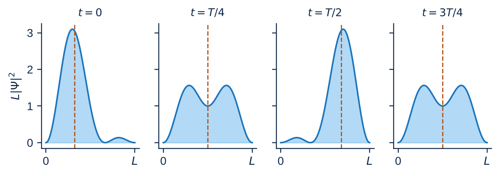

## 3.4 Persamaan tak bergantung waktu dan keadaan stasioner

### Pemisahan variabel

Jika energi potensial tidak bergantung pada waktu, $V = V(x)$, persamaan (3.3) dapat dipisahkan seperti persamaan tali. Coba $\Psi(x, t) = \psi(x)f(t)$:

$$
i\hbar\,\psi\frac{df}{dt} = f\left(-\frac{\hbar^2}{2m}\psi'' + V\psi\right) .
$$

Bagi dengan $\psi f$:

$$
i\hbar\frac{1}{f}\frac{df}{dt} = \frac{1}{\psi}\left(-\frac{\hbar^2}{2m}\psi'' + V\psi\right) .
$$

Ruas kiri hanya bergantung pada $t$ dan ruas kanan hanya pada $x$, jadi keduanya sama dengan satu tetapan, yang kita namai $E$. Persamaan waktu, $i\hbar\,df/dt = Ef$, penyelesaiannya $f(t) = e^{-iEt/\hbar}$. Persamaan ruangnya adalah

$$
\boxed{\ -\frac{\hbar^2}{2m}\frac{d^2\psi}{dx^2} + V(x)\psi = E\psi, \qquad \text{atau}\qquad \hat H\psi = E\psi\ } \qquad \text{(3.8)}
$$

Inilah **persamaan Schrödinger tak bergantung waktu**. Ia adalah persamaan **nilai eigen**: operator $\hat H$ bekerja pada fungsi $\psi$ dan menghasilkan fungsi yang sama dikali bilangan $E$ (bandingkan dengan nilai eigen matriks, subbab 2.8). Tetapan pemisah $E$ ternyata adalah energi: untuk partikel bebas, (3.8) dengan $V = 0$ dan $\psi = e^{ikx}$ memberikan $E = \hbar^2k^2/2m = p^2/2m$.

Hampir seluruh kimia kuantum adalah penyelesaian persamaan (3.8), dalam tiga dimensi dan untuk banyak partikel: mencari fungsi eigen $\psi$ (orbital, fungsi gelombang molekul) dan nilai eigen $E$ (tingkat energi).

### Keadaan stasioner

Penyelesaian berbentuk

$$
\Psi_n(x, t) = \psi_n(x)\,e^{-iE_nt/\hbar} \qquad \text{(3.9)}
$$

disebut **keadaan stasioner**. Namanya berasal dari sifat terpentingnya: rapat peluangnya tidak bergantung pada waktu,

$$
|\Psi_n|^2 = \psi_n^*e^{+iE_nt/\hbar}\,\psi_ne^{-iE_nt/\hbar} = |\psi_n(x)|^2 .
$$

Fungsi gelombangnya "berputar" di bidang kompleks dengan frekuensi $E_n/h$, tetapi semua besaran terukur (peluang, nilai harap posisi, momentum, energi) tetap. Inilah jawaban kuantum atas teka-teki atom yang runtuh: elektron dalam keadaan stasioner atom tidak mempunyai muatan yang bergerak dalam arti yang memancarkan cahaya, sehingga keadaan itu mantap. "Orbit stasioner" Bohr mendapat landasan.

Keadaan stasioner mempunyai energi yang **tepat**: setiap pengukuran energi memberikan $E_n$ dengan pasti. Itulah sebabnya kimiawan dapat membicarakan "energi orbital" dan "tingkat energi molekul" sebagai bilangan tertentu.

### Superposisi dan gerak

Karena persamaan bergantung waktu linear, kombinasi linear keadaan stasioner juga penyelesaian:

$$
\Psi(x, t) = \sum_nc_n\psi_n(x)e^{-iE_nt/\hbar} . \qquad \text{(3.10)}
$$

Jika keadaan stasioner yang dipakai lengkap (Bab 4), **setiap** penyelesaian dapat ditulis dengan cara ini; koefisien $c_n$ ditentukan oleh fungsi gelombang awal lewat proyeksi $c_n = \langle\psi_n|\Psi(x, 0)\rangle$ (subbab 2.6). Inilah resep umum untuk evolusi waktu: uraikan keadaan awal atas keadaan stasioner, lalu beri setiap suku faktor fasenya sendiri. Superposisi keadaan dengan energi berbeda **tidak** stasioner: rapat peluangnya berayun dengan frekuensi $(E_m - E_n)/h$ (subbab 2.1). Partikel yang bergerak, misalnya elektron yang berpindah dari satu sisi molekul ke sisi lain, selalu dinyatakan dengan superposisi semacam ini.

::: {.contoh}
**Contoh 3.11 · Superposisi dua keadaan dalam kotak**

Partikel dalam kotak $[0, L]$ pada $t = 0$ berada dalam keadaan $\Psi(x, 0) = \tfrac{1}{\sqrt2}(\psi_1 + \psi_2)$. (a) Tuliskan $\Psi(x, t)$. (b) Hitung $|\Psi|^2$. (c) Berapa periode ayunannya untuk elektron dalam kotak 1,00 nm?

**Penyelesaian.** (a) $\Psi = \tfrac{1}{\sqrt2}\left(\psi_1e^{-iE_1t/\hbar} + \psi_2e^{-iE_2t/\hbar}\right)$.

(b) $|\Psi|^2 = \tfrac12\left[\psi_1^2 + \psi_2^2 + 2\psi_1\psi_2\cos\dfrac{(E_2 - E_1)t}{\hbar}\right]$.

(c) $E_2 - E_1 = 3E_1 = 3(0{,}376\ \text{eV}) = 1{,}128$ eV (subbab 3.6), sehingga $T = h/(E_2 - E_1) = 3{,}67$ fs.

**Memahami hasil.** Pada $t = 0$ suku silang positif: $\psi_1\psi_2$ positif di separuh kiri kotak (keduanya positif) dan negatif di separuh kanan, sehingga peluang menumpuk di kiri. Setengah periode kemudian kosinus bernilai $-1$ dan peluang menumpuk di kanan. Partikel "bolak-balik" dengan periode 3,67 fs. Pusat muatan yang berayun memancarkan atau menyerap cahaya dengan frekuensi $(E_2 - E_1)/h$: inilah hubungan antara gerak kuantum dan spektroskopi.
:::

::: {.contoh}
**Contoh 3.12 · Nilai energi dalam superposisi**

Keadaan $\Psi = \sqrt{0{,}7}\,\psi_1 + \sqrt{0{,}3}\,\psi_3$ (partikel dalam kotak) diukur energinya berkali-kali pada salinan-salinan yang disiapkan sama. (a) Nilai apa saja yang muncul, dengan peluang berapa? (b) Berapa energi rata-ratanya dalam satuan $E_1$? (c) Apakah nilai rata-rata itu pernah muncul dalam satu pengukuran?

**Penyelesaian.** (a) $E_1$ dengan peluang $|c_1|^2 = 0{,}7$ dan $E_3 = 9E_1$ dengan peluang $0{,}3$.

(b) $\langle E\rangle = 0{,}7E_1 + 0{,}3(9E_1) = 3{,}4E_1$.

(c) Tidak. Setiap pengukuran memberi $E_1$ atau $9E_1$.

**Memahami hasil.** Dalam superposisi, energi tidak tajam; yang ditentukan dengan pasti adalah peluang setiap hasil. Hal ini dijadikan postulat di Bab 4: hasil pengukuran selalu salah satu nilai eigen, dengan peluang $|c_n|^2$. Bandingkan dengan dadu (Contoh 2.46): rata-rata 3,5 tidak pernah keluar dalam satu lemparan.
:::

::: {.contoh}
**Contoh 3.13 · Memeriksa fungsi eigen**

Manakah dari fungsi berikut yang merupakan fungsi eigen operator $\hat H = -\tfrac{\hbar^2}{2m}\tfrac{d^2}{dx^2}$ (partikel bebas), dan berapa nilai eigennya? (a) $e^{3ix}$; (b) $\cos 3x$; (c) $e^{3ix} + e^{-2ix}$; (d) $x^2$.

**Penyelesaian.** (a) $\tfrac{d^2}{dx^2}e^{3ix} = -9e^{3ix}$: fungsi eigen dengan $E = 9\hbar^2/2m$. (b) $-9\cos 3x$: fungsi eigen, $E = 9\hbar^2/2m$. (c) Turunan kedua $-9e^{3ix} - 4e^{-2ix}$, bukan kelipatan fungsi semula: bukan fungsi eigen. (d) Turunan kedua 2, bukan kelipatan $x^2$: bukan.

**Memahami hasil.** Fungsi (a) dan (b) mempunyai energi sama: degenerasi. Fungsi (a) juga fungsi eigen momentum ($p = 3\hbar$), sedangkan (b) bukan; (b) adalah campuran $p = +3\hbar$ dan $-3\hbar$. Fungsi (c) adalah superposisi dua energi berbeda, sehingga tidak stasioner.
:::

{width=90%}

::: {.contoh}
**Contoh 3.14 · Energi rata-rata keadaan parabola**

Partikel dalam kotak disiapkan dengan fungsi gelombang parabola ternormalisasi $\sqrt{30/L^5}\,x(L - x)$ (Contoh 2.27 di Bab 2), yang koefisien ekspansinya $c_n = 4\sqrt{60}/(n\pi)^3$ untuk $n$ ganjil. (a) Hitung $\langle E\rangle = \sum|c_n|^2E_n$ dalam satuan $E_1$, dengan tiga suku pertama. (b) Hitung $\langle E\rangle$ langsung dari $\langle E\rangle = \tfrac{\hbar^2}{2m}\int_0^L|\psi'|^2dx$ dan bandingkan.

**Penyelesaian.** (a) $|c_1|^2 = 0{,}998\,56$, $|c_3|^2 = 0{,}001\,37$, $|c_5|^2 = 0{,}000\,064$. $\langle E\rangle/E_1 = 0{,}998\,56 + 9(0{,}001\,37) + 25(0{,}000\,064) = 1{,}0131$.

(b) $\psi' = \sqrt{30/L^5}(L - 2x)$; $\int_0^L(L - 2x)^2dx = L^3/3$. Jadi $\langle E\rangle = \dfrac{\hbar^2}{2m}\cdot\dfrac{30}{L^5}\cdot\dfrac{L^3}{3} = \dfrac{5\hbar^2}{mL^2} = \dfrac{10}{\pi^2}E_1 = 1{,}0132E_1$.

**Memahami hasil.** Kedua cara cocok. Energi rata-ratanya hanya 1,3% di atas $E_1$, walaupun fungsi parabola bukan fungsi eigen; dan seperti yang akan dibuktikan oleh teorema variasi (Bab 8), energi rata-rata fungsi uji apa pun **tidak pernah** di bawah energi keadaan dasar yang sebenarnya. Fungsi tebakan yang "hampir benar" memberi energi yang lebih tepat lagi, karena galatnya muncul hanya pada orde kedua.
:::

::: {.kuis}
**Kuis cepat 3.4**

Fungsi gelombang $\Psi(x, t) = \psi_2(x)e^{-iE_2t/\hbar}$. Apakah nilai harap posisinya berubah terhadap waktu? Bagaimana dengan $\Psi = \psi_2e^{-iE_2t/\hbar} + \psi_3e^{-iE_3t/\hbar}$?
:::

## 3.5 Partikel bebas dan paket gelombang

### Gelombang bidang dan energi malar

Untuk $V = 0$ di mana-mana, persamaan (3.8) adalah $\psi'' = -k^2\psi$ dengan $k = \sqrt{2mE}/\hbar$. Penyelesaiannya $e^{ikx}$ dan $e^{-ikx}$, gelombang yang merambat ke kanan dan ke kiri dengan momentum $\pm\hbar k$. Tidak ada syarat batas yang membatasi $k$, sehingga **energi partikel bebas malar**: setiap $E \ge 0$ diperbolehkan. Kuantisasi selalu datang dari pengurungan; partikel yang tidak terkurung tidak terkuantisasi.

Gelombang bidang mempunyai momentum yang tepat, tetapi $|\psi|^2$ tetap di seluruh ruang: posisinya sama sekali tidak tentu, sesuai asas ketidakpastian. Ia tidak dapat dinormalisasi. Partikel nyata dinyatakan dengan **paket gelombang**, superposisi gelombang bidang dengan rentang $k$ di sekitar $k_0$:

$$
\Psi(x, t) = \frac{1}{\sqrt{2\pi}}\int_{-\infty}^\infty\phi(k)\,e^{i(kx - \omega(k)t)}\,dk . \qquad \text{(3.11)}
$$

Pada $t = 0$ ini adalah transformasi Fourier (subbab 2.9), dan $\phi(k)$ adalah fungsi gelombang dalam ruang momentum.

### Pelebaran paket Gauss

Untuk paket Gauss dengan lebar awal $\sigma_0$ (simpangan baku posisi), integral (3.11) dapat dihitung secara tepat dengan teknik integral Gauss. Hasilnya: pusat paket bergerak dengan kecepatan grup $\hbar k_0/m$, dan lebarnya bertambah menurut

$$
\sigma(t) = \sigma_0\sqrt{1 + \left(\frac{\hbar t}{2m\sigma_0^2}\right)^2} . \qquad \text{(3.12)}
$$

Untuk $t$ besar, $\sigma \approx \hbar t/(2m\sigma_0) = \Delta v\cdot t$, dengan $\Delta v = \hbar/(2m\sigma_0)$ ketidakpastian kecepatan awal menurut asas ketidakpastian. Paket melebar karena komponen-komponennya bergerak dengan kecepatan berbeda (Gambar 3.3). Paket yang mula-mula **makin sempit melebar makin cepat**: menyempitkan posisi memperbesar sebaran kecepatan.

{width=72%}

::: {.contoh}
**Contoh 3.15 · Seberapa cepat paket melebar?**

Hitung lebar paket Gauss setelah waktu $t$ untuk (a) elektron dengan $\sigma_0 = 0{,}10$ nm setelah 0,1 fs dan 1 fs; (b) molekul N₂ dengan $\sigma_0 = 0{,}10$ nm setelah 1 ps dan 1 ns; (c) butir debu 1 mg dengan $\sigma_0 = 1$ µm setelah satu tahun.

**Penyelesaian.** Hitung dulu $\hbar/2m\sigma_0^2$. (a) Untuk elektron: $5{,}79 \times 10^{15}$ s⁻¹. Setelah 0,1 fs: faktor $\sqrt{1 + 0{,}579^2} = 1{,}16$, $\sigma = 0{,}116$ nm. Setelah 1 fs: $\sqrt{1 + 5{,}79^2} = 5{,}87$, $\sigma = 0{,}59$ nm.

(b) Untuk N₂ (28 u): $1{,}13 \times 10^{11}$ s⁻¹. Setelah 1 ps: $\sigma = 0{,}1006$ nm (hampir tidak berubah). Setelah 1 ns: $\sigma = 0{,}1 \times 113 = 11{,}3$ nm.

(c) Untuk debu: $5{,}3 \times 10^{-20}$ s⁻¹; setelah $3{,}15 \times 10^7$ s, $\hbar t/2m\sigma_0^2 = 1{,}7 \times 10^{-12}$: perubahannya tidak terukur.

**Memahami hasil.** Elektron yang dilokalisasi dalam ukuran ikatan kimia "membuyar" dalam femtodetik; itulah sebabnya elektron dalam molekul tidak dapat dibayangkan sebagai titik yang bergerak pada lintasan. Molekul N₂ di dalam gas bertumbukan setiap sekitar 0,1 ns, sebelum paketnya sempat melebar banyak, sehingga gerak translasinya dapat diperlakukan klasik. Benda makroskopik tidak pernah melebar secara kuantum dalam waktu yang berarti.
:::

::: {.contoh}
**Contoh 3.16 · Energi partikel bebas tidak terkuantisasi**

Sebuah elektron bebas mempunyai panjang gelombang de Broglie 0,50 nm. (a) Berapa energinya? (b) Bila elektron itu dikurung dalam kotak 1,00 nm, apakah energinya masih boleh sama?

**Penyelesaian.** (a) $p = h/\lambda = 1{,}325 \times 10^{-24}$ kg·m/s; $E = p^2/2m_e = 9{,}64 \times 10^{-19}$ J $= 6{,}02$ eV.

(b) Dalam kotak 1,00 nm, energi yang diperbolehkan adalah $n^2(0{,}376\ \text{eV})$. Untuk $n = 4$: $16 \times 0{,}376 = 6{,}02$ eV. Ya, karena $\lambda = 0{,}50$ nm tepat memuat empat setengah-gelombang dalam 1 nm ($L = n\lambda/2$).

**Memahami hasil.** Partikel bebas boleh mempunyai panjang gelombang berapa saja; partikel dalam kotak hanya panjang gelombang yang memenuhi $L = n\lambda/2$. Energi 6,02 eV kebetulan diperbolehkan; energi 6,00 eV tidak.
:::

::: {.contoh}
**Contoh 3.17 · Energi paket yang bergerak**

Paket Gauss elektron dengan momentum pusat $\hbar k_0$, $k_0 = 1{,}0 \times 10^{10}$ m⁻¹, dan lebar $\sigma_0 = 0{,}10$ nm. Untuk paket semacam ini $\langle p^2\rangle = (\hbar k_0)^2 + (\Delta p)^2$ dengan $\Delta p = \hbar/2\sigma_0$. Hitung energi kinetik rata-ratanya dan bagian yang berasal dari sebaran momentum.

**Penyelesaian.** $(\hbar k_0)^2/2m_e = 3{,}81$ eV (Contoh 3.4). $(\Delta p)^2/2m_e = (\hbar/2\sigma_0)^2/2m_e = 0{,}95$ eV. Jadi $\langle E\rangle = 4{,}76$ eV, 20% di antaranya dari sebaran momentum.

**Memahami hasil.** Melokalisasi elektron selalu "mahal": energi kinetiknya bertambah sebesar energi titik nol kurungan, $\hbar^2/8m\sigma_0^2$. Elektron yang terkurung dalam ruang 0,1 nm membayar hampir 1 eV hanya karena terkurung. Itulah harga yang dibayar elektron di dekat inti, dan yang membuat atom tidak runtuh (subbab 1.9).
:::

::: {.kuis}
**Kuis cepat 3.5**

Dua paket Gauss mula-mula selebar 0,1 nm dan 1 nm, keduanya untuk elektron. Mana yang lebih cepat melebar? Berapa kira-kira perbandingan kecepatan pelebarannya?
:::
