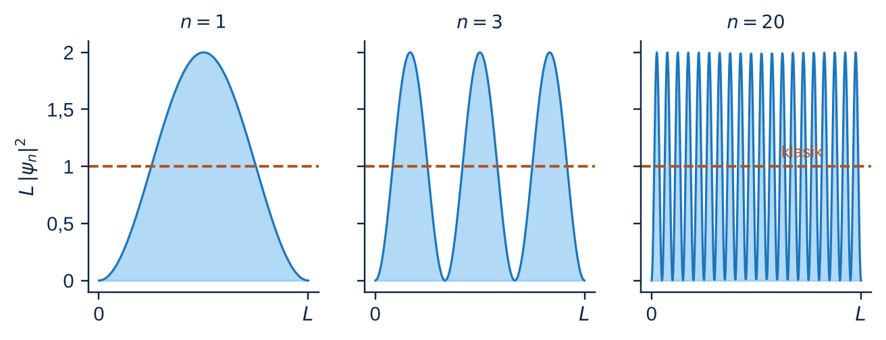

## 3.6 Partikel dalam kotak satu dimensi

Sistem kuantum paling sederhana yang terkurung adalah partikel bermassa $m$ yang bergerak bebas di antara dua dinding tak tertembus pada $x = 0$ dan $x = L$:

$$
V(x) = \begin{cases}0, & 0 < x < L\\ \infty, & x \le 0\ \text{atau}\ x \ge L\end{cases}
$$

Model ini kasar, tetapi ia memuat hampir semua ciri khas sistem kuantum terikat, dan dapat diselesaikan sepenuhnya dalam beberapa baris.

### Penyelesaian

**Di luar kotak.** Di daerah $V = \infty$, persamaan (3.8) hanya dapat dipenuhi oleh $\psi = 0$; partikel tidak pernah berada di sana.

**Di dalam kotak.** $V = 0$, sehingga

$$
\frac{d^2\psi}{dx^2} = -k^2\psi, \qquad k = \frac{\sqrt{2mE}}{\hbar} .
$$

Penyelesaian umumnya $\psi = A\sin kx + B\cos kx$ (subbab 2.3).

**Syarat batas.** Fungsi gelombang harus malar. Karena $\psi = 0$ di luar, harus $\psi(0) = 0$ dan $\psi(L) = 0$. Syarat pertama memberikan $B = 0$. Syarat kedua memberikan $A\sin kL = 0$; agar $\psi$ tidak nol di mana-mana, harus $\sin kL = 0$, yaitu $kL = n\pi$. Nilai $n = 0$ menghasilkan $\psi = 0$ (tidak ada partikel), dan $n$ negatif hanya mengubah tanda $\psi$, yang tidak menghasilkan keadaan baru. Jadi $n = 1, 2, 3, \ldots$

**Energi.** Dari $k = n\pi/L$ dan $E = \hbar^2k^2/2m$:

$$
\boxed{\ E_n = \frac{n^2h^2}{8mL^2}, \qquad n = 1, 2, 3, \ldots\ } \qquad \text{(3.13)}
$$

**Normalisasi.** $\int_0^LA^2\sin^2(n\pi x/L)\,dx = A^2L/2 = 1$ (Contoh 2.9), sehingga

$$
\boxed{\ \psi_n(x) = \sqrt{\frac{2}{L}}\,\sin\frac{n\pi x}{L}, \qquad 0 \le x \le L\ } \qquad \text{(3.14)}
$$

Tingkat-tingkat energi dan fungsi gelombangnya digambar pada Gambar 3.4.

{width=84%}

### Empat pelajaran dari kotak

**1. Energi terkuantisasi.** Hanya nilai-nilai (3.13) yang mungkin. Kuantisasi berasal dari syarat batas, tepat seperti frekuensi senar gitar. Tetapi karena $E \propto k^2$ (bukan $\nu \propto k$), selang antartingkat **membesar** dengan $n$: $E_{n+1} - E_n = (2n + 1)h^2/8mL^2$.

**2. Energi titik nol.** Energi terendah $E_1 = h^2/8mL^2$ tidak nol. Partikel yang terkurung tidak dapat diam; ini adalah asas ketidakpastian dalam bentuk paling sederhana (subbab 1.9). Energi titik nol makin besar untuk partikel ringan dan kotak sempit.

**3. Ketergantungan pada $m$ dan $L$.** $E \propto 1/mL^2$. Efek kuantum menonjol untuk partikel ringan dalam ruang kecil. Elektron dalam ruang seukuran molekul mempunyai selang energi elektronvolt, sebanding dengan energi ikatan dan energi foton tampak. Molekul gas dalam wadah laboratorium mempunyai selang energi yang luar biasa kecil.

**4. Spektrum.** Partikel bermuatan dapat berpindah antartingkat dengan menyerap atau memancarkan foton $h\nu = E_m - E_n$. Tidak semua transisi diizinkan: momen dipol transisi $\int\psi_m\,x\,\psi_n\,dx$ nol jika $\psi_m$ dan $\psi_n$ mempunyai paritas sama terhadap tengah kotak (Contoh 2.10). Aturan seleksinya: **$m + n$ harus ganjil**.

::: {.inti}
**Partikel dalam kotak.** $E_n = n^2h^2/8mL^2$, $\psi_n = \sqrt{2/L}\sin(n\pi x/L)$, $n = 1, 2, \ldots$ Energi titik nol $E_1 > 0$; selang antartingkat bertambah dengan $n$; keadaan ke-$n$ mempunyai $n - 1$ simpul; transisi dipol listrik hanya antara keadaan dengan $m + n$ ganjil.
:::

::: {.contoh}
**Contoh 3.21 · Elektron dalam kotak seukuran molekul**

(a) Hitung $E_1$, $E_2$, dan panjang gelombang transisi $1 \to 2$ untuk elektron dalam kotak 1,00 nm. (b) Ulangi $E_1$ untuk kotak 0,100 nm.

**Penyelesaian.** (a)

$$
E_1 = \frac{(6{,}626 \times 10^{-34})^2}{8(9{,}109 \times 10^{-31})(1{,}00 \times 10^{-9})^2} = 6{,}02 \times 10^{-20}\ \text{J} = 0{,}376\ \text{eV} .
$$

$E_2 = 4E_1 = 1{,}504$ eV. Transisi menyerap $3E_1 = 1{,}128$ eV, sehingga $\lambda = 1239{,}8/1{,}128 = 1099$ nm.

(b) Kotak sepuluh kali lebih sempit: energi seratus kali lebih besar, $E_1 = 37{,}6$ eV.

**Memahami hasil.** Elektron yang terkurung sepanjang 1 nm, kira-kira panjang rantai enam atom karbon, menyerap di inframerah dekat. Elektron yang terkurung dalam satu ikatan (0,1 nm) mempunyai energi puluhan eV, sebanding dengan energi ionisasi. Model kasar ini sudah memberikan skala energi kimia yang benar.
:::

::: {.contoh}
**Contoh 3.22 · Molekul gas dalam wadah**

Hitung $E_1$ untuk molekul N₂ (28,0 u) dalam kotak satu dimensi 1,00 cm, lalu bandingkan dengan $kT$ pada 298 K. Kira-kira berapa bilangan kuantum $n$ yang khas pada suhu kamar (energi translasi satu dimensi rata-rata $\tfrac12kT$)?

**Penyelesaian.** $E_1 = (6{,}626 \times 10^{-34})^2/[8(4{,}652 \times 10^{-26})(0{,}0100)^2] = 1{,}18 \times 10^{-38}$ J. $E_1/kT = 1{,}18 \times 10^{-38}/4{,}12 \times 10^{-21} = 2{,}9 \times 10^{-18}$. Bilangan kuantum khas: $n^2E_1 = \tfrac12kT$, $n = \sqrt{0{,}5/2{,}9 \times 10^{-18}} \approx 4 \times 10^8$.

**Memahami hasil.** Tingkat-tingkat translasi molekul gas berjarak $10^{-18}kT$: sepenuhnya malar untuk semua keperluan praktis, sehingga gas mematuhi teori kinetik klasik (bandingkan Contoh 1.40 di Bab 1). Tetapi dalam termodinamika statistik, **banyaknya** tingkat translasi yang dapat diisi menentukan entropi gas; rumus Sackur–Tetrode untuk entropi gas ideal memuat $h$ justru karena tingkat-tingkat ini terkuantisasi.
:::

::: {.contoh}
**Contoh 3.23 · Proton dan atom helium**

Hitung $E_1$ untuk (a) proton dalam kotak 0,100 nm (kira-kira ruang gerak proton dalam ikatan hidrogen), (b) atom helium dalam kotak 1,00 nm. Bandingkan masing-masing dengan $kT$ pada 298 K (0,0257 eV).

**Penyelesaian.** (a) Massa proton 1836 kali massa elektron, sehingga $E_1 = 37{,}6/1836 = 0{,}0205$ eV, hampir sama dengan $kT$. (b) $E_1 = (0{,}376\ \text{eV})(m_e/m_\text{He}) = 0{,}376/7294 = 5{,}2 \times 10^{-5}$ eV, sekitar $0{,}002\,kT$.

**Memahami hasil.** Proton yang terkurung dalam ruang seukuran ikatan mempunyai energi titik nol sebanding dengan $kT$: gerak proton dalam ikatan hidrogen adalah gerak kuantum, dan itulah sebabnya efek isotop H/D penting dalam kimia ikatan hidrogen. Atom helium dalam pori zeolit berukuran nanometer masih berperilaku hampir klasik pada suhu kamar, tetapi tidak lagi pada beberapa kelvin.
:::

::: {.contoh}
**Contoh 3.24 · Aturan seleksi dan intensitas**

Untuk partikel bermuatan dalam kotak, momen dipol transisi $\mu_{mn} \propto \langle m|x|n\rangle = \int_0^L\psi_m\,x\,\psi_n\,dx$. Untuk $m + n$ ganjil, $\langle m|x|n\rangle = -\dfrac{8Lmn}{\pi^2(m^2 - n^2)^2}$. (a) Hitung $\langle 1|x|2\rangle$, $\langle 1|x|3\rangle$, dan $\langle 1|x|4\rangle$ dalam satuan $L$. (b) Intensitas sebanding dengan kuadratnya. Berapa perbandingan intensitas transisi $1 \to 2$ terhadap $1 \to 4$?

**Penyelesaian.** (a) $\langle 1|x|2\rangle = -16/(9\pi^2) = -0{,}180L$. $\langle 1|x|3\rangle = 0$ (paritas sama). $\langle 1|x|4\rangle = -32/(225\pi^2) = -0{,}0144L$.

(b) $(0{,}180/0{,}0144)^2 = 156$.

**Memahami hasil.** Transisi ke tingkat terdekat yang diizinkan jauh lebih kuat dari transisi yang melompat lebih jauh. Pada zat warna terkonjugasi, pita serapan utama adalah transisi HOMO → LUMO, dan pita-pita yang lebih tinggi jauh lebih lemah, sesuai dengan pola ini.
:::

::: {.contoh}
**Contoh 3.25 · Banyaknya tingkat dalam kawat nano**

Elektron bergerak dalam kawat sepanjang 1,00 µm, dimodelkan sebagai kotak satu dimensi. (a) Berapa banyak tingkat dengan energi di bawah 1,0 eV? (b) Berapa banyak tingkat tiap eV di sekitar 1,0 eV?

**Penyelesaian.** (a) $E_n < E$ jika $n < L\sqrt{8mE}/h = (10^{-6})\sqrt{8(9{,}109 \times 10^{-31})(1{,}602 \times 10^{-19})}/(6{,}626 \times 10^{-34}) = 1631$. Jadi 1630 tingkat.

(b) $N(E) = L\sqrt{8mE}/h \propto E^{1/2}$, sehingga $dN/dE = N/2E = 815$ tingkat tiap eV.

**Memahami hasil.** Dalam kawat sepanjang mikrometer, tingkat-tingkat berjarak sekitar 1 meV: jauh di bawah $kT$, sehingga tampak malar. Fungsi $dN/dE$ disebut **rapat keadaan**; dalam satu dimensi ia sebanding $E^{-1/2}$, dalam tiga dimensi $E^{1/2}$. Rapat keadaan menentukan kapasitas kalor elektron dalam logam, kepekaan detektor, dan bentuk spektrum serapan padatan (Bab 13).
:::

::: {.kuis}
**Kuis cepat 3.6**

Jika panjang kotak dijadikan dua kali, apa yang terjadi pada $E_1$ dan pada panjang gelombang transisi $1 \to 2$? Jika partikelnya diganti dengan partikel yang massanya dua kali?
:::

## 3.7 Sifat fungsi gelombang: simpul, ortogonalitas, batas klasik

Partikel dalam kotak memperlihatkan sifat-sifat umum fungsi gelombang keadaan terikat satu dimensi. Sifat-sifat ini akan kita temui lagi pada osilator, atom hidrogen, dan orbital molekul.

### Simpul

Fungsi $\psi_n$ mempunyai $n - 1$ **simpul**, titik di dalam kotak tempat $\psi_n = 0$. Simpul tidak sama dengan dinding: di dinding $\psi$ nol karena dipaksa oleh potensial tak hingga. Teorema umum untuk masalah satu dimensi menyatakan bahwa **keadaan dasar tidak mempunyai simpul, dan keadaan ke-$n$ mempunyai $n - 1$ simpul**. Makin banyak simpul, makin tajam lengkungan fungsi gelombang, makin besar $|\psi''|$, dan makin besar energi kinetiknya. Aturan "lebih banyak simpul, lebih tinggi energi" adalah alat penalaran yang sangat berguna: orbital 2s di atas 1s, orbital antiikatan (dengan simpul di antara inti) di atas orbital ikatan, orbital π tertinggi butadiena dengan tiga simpul.

### Ortogonalitas dan kelengkapan

Fungsi-fungsi $\psi_n$ ortonormal (Contoh 2.26): $\int_0^L\psi_m\psi_n\,dx = \delta_{mn}$. Mereka juga **lengkap**: setiap fungsi wajar pada $[0, L]$ yang nol di kedua ujung dapat diuraikan sebagai $\sum c_n\psi_n$ (deret Fourier sinus). Di Bab 4 kita akan melihat bahwa ortogonalitas ini bukan kebetulan: fungsi eigen operator Hermitian dengan nilai eigen berbeda selalu ortogonal.

### Paritas

Jika titik asal dipindahkan ke tengah kotak, potensial menjadi simetris, $V(-x) = V(x)$, dan setiap fungsi eigen menjadi genap atau ganjil (Contoh 2.15). Fungsi dengan $n$ ganjil genap terhadap tengah kotak (kosinus), dengan $n$ genap ganjil (sinus). Ini berlaku umum: untuk potensial yang simetris, keadaan stasioner yang tidak terdegenerasi mempunyai paritas tertentu, dan paritas berganti setiap kali naik satu tingkat. Paritas menentukan aturan seleksi (Contoh 3.24) dan sangat menyederhanakan perhitungan.

### Nilai harap

Dengan rapat peluang $|\psi_n|^2$ dan statistik di subbab 2.10:

$$
\langle x\rangle = \frac L2, \qquad \langle x^2\rangle = L^2\left(\frac13 - \frac{1}{2n^2\pi^2}\right) . \qquad \text{(3.15)}
$$

Untuk momentum, kita gunakan operator $\hat p = -i\hbar\,d/dx$ yang muncul ketika menebak persamaan Schrödinger (subbab 3.2). Nilai harapnya $\langle p\rangle = \int\psi_n^*\hat p\psi_n\,dx$; untuk fungsi riil dengan ujung nol, integral ini sama dengan $-i\hbar[\psi_n^2/2]_0^L = 0$. Untuk $p^2$: $\hat p^2\psi_n = -\hbar^2\psi_n'' = \hbar^2k_n^2\psi_n$, sehingga

$$
\langle p\rangle = 0, \qquad \langle p^2\rangle = \left(\frac{n\pi\hbar}{L}\right)^2 = 2mE_n . \qquad \text{(3.16)}
$$

Momentum rata-rata nol karena partikel sama mungkinnya bergerak ke kiri dan ke kanan ($\sin kx = (e^{ikx} - e^{-ikx})/2i$ adalah campuran sama besar $p = +\hbar k$ dan $-\hbar k$). Tetapi besar momentumnya tertentu: $|p| = n\pi\hbar/L$.

### Batas klasik

Partikel klasik dalam kotak bergerak bolak-balik dengan kelajuan tetap, sehingga peluang menemukannya sama di setiap bagian kotak: $P_\text{klasik} = 1/L$. Rapat peluang kuantum $\tfrac2L\sin^2(n\pi x/L)$ berayun di antara 0 dan $2/L$. Untuk $n$ besar, ayunannya begitu rapat sehingga setiap selang berukuran berhingga memuat banyak puncak dan lembah, dan rata-ratanya $1/L$ (Gambar 3.5). Inilah **asas korespondensi**: pada bilangan kuantum besar, ramalan kuantum menyatu dengan ramalan klasik. Pemeriksaan ini berguna untuk setiap hasil kuantum.

{width=84%}

::: {.contoh}
**Contoh 3.26 · Asas ketidakpastian dalam kotak**

Dengan (3.15) dan (3.16), hitung $\Delta x\,\Delta p$ untuk $n = 1$, 2, dan 10, dalam satuan $\hbar$.

**Penyelesaian.** $\Delta x = L\sqrt{1/12 - 1/2n^2\pi^2}$ dan $\Delta p = \sqrt{\langle p^2\rangle} = n\pi\hbar/L$. Hasil kalinya

$$
\Delta x\,\Delta p = \hbar\,n\pi\sqrt{\frac{1}{12} - \frac{1}{2n^2\pi^2}} = \hbar\sqrt{\frac{n^2\pi^2}{12} - \frac12} .
$$

$n = 1$: $0{,}568\hbar$; $n = 2$: $1{,}67\hbar$; $n = 10$: $9{,}04\hbar$.

**Memahami hasil.** Semua nilai di atas $\hbar/2$, sesuai asas ketidakpastian; keadaan dasar paling dekat ke batas itu. Fungsi sinus tidak dapat mencapai batas $\hbar/2$ karena hanya fungsi Gauss yang mencapainya (subbab 2.9). Ketidakpastian meningkat dengan $n$ karena momentum tidak tentu arahnya: $\pm n\pi\hbar/L$.
:::

::: {.contoh}
**Contoh 3.27 · Ortogonalitas dan peluang dalam kotak**

(a) Periksa langsung bahwa $\int_0^L\psi_1\psi_3\,dx = 0$. (b) Berapa peluang partikel pada keadaan $n = 1$ berada di seperempat kiri kotak? (c) Berapa peluang yang sama untuk partikel klasik?

**Penyelesaian.** (a) $\dfrac2L\int_0^L\sin\dfrac{\pi x}{L}\sin\dfrac{3\pi x}{L}dx = \dfrac1L\int_0^L\left[\cos\dfrac{2\pi x}{L} - \cos\dfrac{4\pi x}{L}\right]dx = 0$, karena keduanya kosinus atas bilangan bulat periode.

(b) $\dfrac2L\int_0^{L/4}\sin^2\dfrac{\pi x}{L}\,dx = \dfrac14 - \dfrac{1}{2\pi} = 0{,}0908$.

(c) $1/4 = 0{,}25$.

**Memahami hasil.** Partikel kuantum pada keadaan dasar "menghindari" dinding: peluangnya di seperempat dekat dinding hanya sepertiga nilai klasik. Ini akibat syarat batas $\psi = 0$ di dinding. Elektron dalam molekul juga cenderung menjauhi daerah tempat energi potensial naik tajam.
:::

::: {.contoh}
**Contoh 3.28 · Menghitung energi dari $\langle p^2\rangle$**

Tunjukkan bahwa $\langle p^2\rangle/2m$ untuk keadaan $n$ sama dengan $E_n$. Lalu hitung $\sqrt{\langle p^2\rangle}/m$ untuk elektron pada $n = 1$ dalam kotak 1,00 nm dan bandingkan dengan kecepatan Bohr.

**Penyelesaian.** $\langle p^2\rangle/2m = n^2\pi^2\hbar^2/(2mL^2) = n^2h^2/(8mL^2) = E_n$, karena $\pi^2\hbar^2 = h^2/4$. Untuk elektron: $\sqrt{\langle p^2\rangle} = \pi\hbar/L = 3{,}31 \times 10^{-25}$ kg·m/s, sehingga kelajuannya $3{,}6 \times 10^5$ m/s.

**Memahami hasil.** Di dalam kotak $V = 0$, jadi seluruh energi adalah kinetik, dan $E = \langle p^2\rangle/2m$ tepat seperti klasik. Kelajuan $3{,}6 \times 10^5$ m/s sekitar seperenam kecepatan Bohr ($2{,}2 \times 10^6$ m/s), wajar untuk elektron yang terkurung lebih longgar daripada elektron 1s hidrogen.
:::

::: {.kuis}
**Kuis cepat 3.7**

(a) Berapa banyak simpul yang dimiliki $\psi_5$? (b) Untuk partikel pada keadaan $n = 2$, di mana peluang terbesar menemukannya? (c) Apakah $\psi_2$ genap atau ganjil terhadap tengah kotak?
:::

## 3.8 Model elektron bebas untuk poliena dan zat warna sianin

### Gagasan

Dalam molekul terkonjugasi, elektron π bergerak di sepanjang rantai atom karbon yang berikatan rangkap dan tunggal berselang-seling. Hans Kuhn dan John Platt (sekitar 1948–1949) mengusulkan model yang sangat sederhana: abaikan struktur atom-atom, dan anggap elektron π bergerak bebas dalam kotak satu dimensi sepanjang rantai. Panjang kotak $L$ diperkirakan dari jumlah panjang ikatan di sepanjang jalur konjugasi, ditambah sekitar satu panjang ikatan di kedua ujung karena elektron "meluber" sedikit melewati atom terakhir.

Elektron π mengisi tingkat-tingkat kotak dari bawah, dua elektron (spin berlawanan) tiap tingkat (asas Pauli, Bab 9). Dengan $N$ elektron π ($N$ genap), tingkat terisi tertinggi (**HOMO**) adalah $n = N/2$ dan tingkat kosong terendah (**LUMO**) adalah $n = N/2 + 1$. Serapan cahaya terpanjang bersesuaian dengan transisi HOMO → LUMO:

$$
\Delta E = \frac{h^2}{8mL^2}\left[\left(\frac N2 + 1\right)^2 - \left(\frac N2\right)^2\right] = \frac{h^2(N + 1)}{8mL^2}, \qquad \lambda = \frac{8mcL^2}{h(N + 1)} . \qquad \text{(3.17)}
$$

Transisi ini diizinkan karena $N/2 + (N/2 + 1) = N + 1$ ganjil (subbab 3.6).

### Zat warna sianin

Zat warna sianin dan kerabatnya mempunyai rantai polimetina di antara dua atom nitrogen, misalnya kation R₂N–(CH=CH)$_k$–CH=NR₂⁺. Muatan positif terdelokalisasi merata, dan dua struktur resonansi yang setara menjamin bahwa semua ikatan di sepanjang rantai sama panjang (sekitar 139 pm). Inilah keadaan ideal untuk model elektron bebas: potensial di sepanjang rantai benar-benar hampir rata. Rantai dengan $k$ gugus vinilena mempunyai $2k + 1$ atom karbon dan, bersama dua atom N, memuat $N = 2k + 4$ elektron π. Dengan $L = N \times 139$ pm (jalur $2k + 2$ ikatan N–C–...–N ditambah satu ikatan di tiap ujung), (3.17) memberikan hasil pada Gambar 3.6.

{width=92%}

::: {.contoh}
**Contoh 3.29 · Butadiena dan heksatriena**

Butadiena mempunyai 4 elektron π dan heksatriena 6. Dengan panjang kotak $L = N \times 140$ pm, hitung $\lambda_\text{maks}$ masing-masing. Nilai teramati 217 nm dan 258 nm.

**Penyelesaian.** Butadiena: $L = 560$ pm,

$$
\lambda = \frac{8(9{,}109 \times 10^{-31})(2{,}998 \times 10^8)(5{,}60 \times 10^{-10})^2}{(6{,}626 \times 10^{-34})(5)} = 2{,}07 \times 10^{-7}\ \text{m} = 207\ \text{nm}.
$$

Heksatriena: $L = 840$ pm, $N + 1 = 7$: $\lambda = 332$ nm.

**Memahami hasil.** Untuk butadiena model ini meleset hanya 5%, tetapi untuk heksatriena 29%. Kecenderungannya benar: rantai yang lebih panjang menyerap pada panjang gelombang yang lebih panjang. Namun model elektron bebas makin melebih-lebihkan pergeserannya untuk poliena panjang. Alasannya dibahas di kotak Awas berikut.
:::

::: {.contoh}
**Contoh 3.30 · Deret zat warna sianin**

Untuk kation Me₂N–(CH=CH)$_k$–CH=NMe₂⁺ dengan $k = 1$ sampai 5, hitung $\lambda$ menurut model elektron bebas dengan $N = 2k + 4$ dan $L = N \times 139$ pm. Nilai teramati sekitar 313, 416, 519, 625, dan 734 nm.

**Penyelesaian.** Untuk $k = 3$: $N = 10$, $L = 1{,}39$ nm,

$$
\lambda = \frac{8(9{,}109 \times 10^{-31})(2{,}998 \times 10^8)(1{,}39 \times 10^{-9})^2}{(6{,}626 \times 10^{-34})(11)} = 579\ \text{nm}.
$$

Dengan cara yang sama: $k = 1$: 328 nm; $k = 2$: 453 nm; $k = 4$: 706 nm; $k = 5$: 832 nm.

**Memahami hasil.** Model meleset 5–13%, dan meramalkan pergeseran tiap gugus vinilena 125 nm (teramati sekitar 105 nm). Untuk model tanpa parameter yang dicocokkan, ini kecocokan yang luar biasa. Karena $L \propto N$, $\lambda \propto N^2/(N + 1) \approx N$: pergeseran tiap tambahan dua karbon hampir tetap, persis keteraturan yang disebut di awal bab. Dengan membalik rumus, data 519 nm memberikan $L = 1{,}32$ nm, yaitu 132 pm tiap elektron; panjang efektif ini dapat dipakai untuk meramalkan anggota deret lainnya.
:::

::: {.awas}
**Awas · Mengapa model gagal untuk poliena panjang**

Untuk β-karotena (22 elektron π, 11 ikatan rangkap terkonjugasi), model elektron bebas meramalkan $\lambda \approx 1360$ nm, padahal β-karotena menyerap di 450 nm (itulah sebabnya wortel jingga, bukan tak berwarna di mata kita). Pada poliena, ikatan rangkap dan tunggal **tidak sama panjang** (sekitar 134 dan 146 pm), sehingga elektron π merasakan potensial yang naik-turun di sepanjang rantai. Potensial berkala ini membuka **celah energi** yang tidak menutup ketika rantai diperpanjang; untuk rantai tak hingga, celahnya tetap sekitar 2 eV. Kuhn sendiri memperbaiki modelnya dengan menambahkan potensial sinusoidal. Di Bab 13, teori Hückel dengan integral resonansi berselang-seling menjelaskan hal yang sama, dan di subbab 13.13 kita akan melihat bahwa ini adalah cikal bakal teori pita semikonduktor. Pada sianin, dua struktur resonansi yang setara meratakan panjang ikatan, sehingga celah itu hilang dan model elektron bebas berhasil.
:::

### Titik kuantum

Gagasan yang sama berlaku untuk elektron dalam nanokristal semikonduktor. Dalam kristal besar CdSe, selisih energi antara pita valensi dan pita konduksi (celah pita) adalah 1,74 eV, sehingga CdSe bubuk berwarna merah tua kehitaman. Dalam nanokristal berjari-jari beberapa nanometer, elektron yang tereksitasi dan "lubang" yang ditinggalkannya terkurung, dan energi kurungan seperti (3.13) menambah energi celah. Makin kecil kristalnya, makin besar celahnya, makin biru pendarannya. Hadiah Nobel Kimia 2023 (Bawendi, Brus, Ekimov) diberikan untuk penemuan dan sintesis titik kuantum; pemakaiannya kini meliputi layar televisi dan pencitraan biologi.

::: {.contoh}
**Contoh 3.31 · Warna titik kuantum CdSe**

Model Brus yang disederhanakan memberikan energi celah nanokristal bola berjari-jari $R$:

$$
E_g(R) = E_g(\text{padat}) + \frac{h^2}{8R^2}\left(\frac{1}{m_e^*} + \frac{1}{m_h^*}\right) - \frac{1{,}8e^2}{4\pi\varepsilon_0\varepsilon_rR} ,
$$

dengan massa efektif elektron $m_e^* = 0{,}13m_e$, lubang $m_h^* = 0{,}45m_e$, dan $\varepsilon_r = 10{,}6$ untuk CdSe. Suku kedua adalah energi kurungan, suku ketiga tarikan Coulomb elektron–lubang. Hitung $E_g$ dan panjang gelombang pancaran untuk $R = 1{,}5$, 2,0, dan 3,0 nm.

**Penyelesaian.** Untuk $R = 2{,}0$ nm: suku kurungan $\dfrac{(6{,}626 \times 10^{-34})^2}{8(2{,}0 \times 10^{-9})^2}\left(\dfrac{1}{0{,}13} + \dfrac{1}{0{,}45}\right)\dfrac{1}{9{,}109 \times 10^{-31}} = 0{,}932$ eV; suku Coulomb $0{,}122$ eV. $E_g = 1{,}74 + 0{,}932 - 0{,}122 = 2{,}55$ eV, $\lambda = 486$ nm. Dengan cara sama, $R = 1{,}5$ nm: $E_g = 3{,}23$ eV (383 nm); $R = 3{,}0$ nm: $E_g = 2{,}07$ eV (598 nm).

**Memahami hasil.** Satu bahan, satu rumus kimia, tetapi warnanya dapat diatur dari ultraviolet sampai merah hanya dengan mengubah ukuran butir. Energi kurungan sebanding $1/R^2$ dan mendominasi untuk butir kecil; tarikan Coulomb sebanding $1/R$. Model ini melebih-lebihkan pergeseran untuk butir terkecil (massa efektif tidak tetap pada energi tinggi), tetapi kecenderungannya tepat.
:::

::: {.kuis}
**Kuis cepat 3.8**

Menurut model elektron bebas, jika jumlah elektron π dan panjang kotak sama-sama dilipatduakan, apa yang terjadi pada panjang gelombang serapan? Mengapa molekul kecil seperti etilena tidak berwarna?
:::
