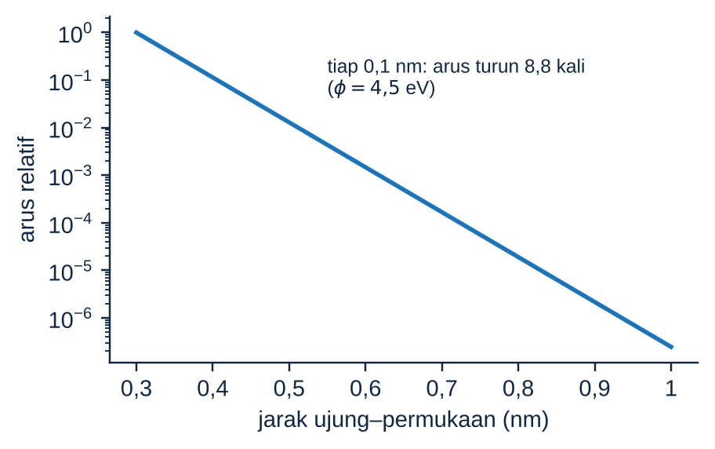

## 3.11 Penerobosan

### Penghalang persegi

Sekarang daerah terlarang dibuat berhingga lebarnya: penghalang setinggi $V_0$ dan selebar $a$, dengan $V = 0$ di kedua sisi. Partikel datang dari kiri dengan $E < V_0$. Secara klasik partikel pasti dipantulkan. Dalam mekanika kuantum, fungsi gelombang yang meluruh di dalam penghalang belum nol ketika mencapai sisi kanan, dan di sana ia menyambung dengan gelombang yang merambat terus. Partikel mempunyai peluang tak nol untuk muncul di seberang. Gejala ini disebut **penerobosan** atau efek terowongan (Gambar 3.9 kiri).

Di ketiga daerah fungsi gelombangnya:

$$
\psi = \begin{cases} e^{ikx} + re^{-ikx}, & x < 0\\ Ce^{\kappa x} + De^{-\kappa x}, & 0 < x < a\\ te^{ikx}, & x > a\end{cases}
\qquad k = \frac{\sqrt{2mE}}{\hbar}, \quad \kappa = \frac{\sqrt{2m(V_0 - E)}}{\hbar} .
$$

Kesinambungan $\psi$ dan $\psi'$ di $x = 0$ dan $x = a$ memberikan empat persamaan linear untuk empat bilangan $r$, $C$, $D$, $t$. Penyelesaiannya (lihat kotak berikut) memberikan peluang penerobosan

$$
\boxed{\ T = |t|^2 = \left[1 + \frac{V_0^2\sinh^2(\kappa a)}{4E(V_0 - E)}\right]^{-1}\ } \qquad \text{(3.20)}
$$

Untuk penghalang yang lebar atau tinggi ($\kappa a \gg 1$), $\sinh\kappa a \approx \tfrac12e^{\kappa a}$, dan

$$
T \approx 16\frac{E}{V_0}\left(1 - \frac{E}{V_0}\right)e^{-2\kappa a} . \qquad \text{(3.21)}
$$

Faktor eksponensialnya yang menentukan. Peluang penerobosan turun secara eksponensial terhadap **lebar penghalang** dan terhadap **akar massa** dikali akar tinggi penghalang di atas energi partikel. Faktor di depan eksponen biasanya berorde satu.

::: {.dalam}
**Lebih dalam · Aljabar penghalang persegi**

Kesinambungan di $x = 0$: $1 + r = C + D$ dan $ik(1 - r) = \kappa(C - D)$. Kesinambungan di $x = a$: $Ce^{\kappa a} + De^{-\kappa a} = te^{ika}$ dan $\kappa(Ce^{\kappa a} - De^{-\kappa a}) = ikte^{ika}$.

Dari dua persamaan terakhir, nyatakan $C$ dan $D$ dalam $t$:

$$
C = \frac{t}{2}\left(1 + \frac{ik}{\kappa}\right)e^{(ik - \kappa)a}, \qquad D = \frac{t}{2}\left(1 - \frac{ik}{\kappa}\right)e^{(ik + \kappa)a} .
$$

Dari dua persamaan pertama, hilangkan $r$: jumlahkan $(1 + r)$ dengan $(1 - r) = (\kappa/ik)(C - D)$ sehingga $2 = (C + D) + (\kappa/ik)(C - D)$. Masukkan $C$ dan $D$, kumpulkan suku $e^{\pm\kappa a}$, dan pakai $\cosh\kappa a = (e^{\kappa a} + e^{-\kappa a})/2$, $\sinh\kappa a = (e^{\kappa a} - e^{-\kappa a})/2$:

$$
\frac{e^{-ika}}{t} = \cosh\kappa a + \frac{i(\kappa^2 - k^2)}{2k\kappa}\sinh\kappa a .
$$

Kuadrat modulus ruas kanan adalah $\cosh^2\kappa a + \tfrac{(\kappa^2 - k^2)^2}{4k^2\kappa^2}\sinh^2\kappa a = 1 + \tfrac{(\kappa^2 + k^2)^2}{4k^2\kappa^2}\sinh^2\kappa a$, dengan $\cosh^2 = 1 + \sinh^2$. Karena $\hbar^2(k^2 + \kappa^2)/2m = V_0$, $\hbar^2k^2/2m = E$, dan $\hbar^2\kappa^2/2m = V_0 - E$, diperoleh (3.20).

Untuk penghalang yang bentuknya sembarang, $V(x)$, ada hampiran yang sangat berguna, **hampiran WKB** (Wentzel–Kramers–Brillouin):

$$
T \approx \exp\left[-2\int_{x_1}^{x_2}\kappa(x)\,dx\right], \qquad \kappa(x) = \frac{\sqrt{2m[V(x) - E]}}{\hbar} ,
$$

dengan $x_1$ dan $x_2$ titik-titik balik klasik. Penghalang persegi hanyalah kasus $\kappa$ tetap. George Gamow memakai rumus ini pada tahun 1928 untuk menjelaskan peluruhan alfa: partikel alfa menerobos penghalang Coulomb inti, dan perbedaan kecil energinya mengubah umur paruh sampai puluhan orde besaran.
:::

{width=92%}

::: {.contoh}
**Contoh 3.37 · Elektron melewati penghalang tipis**

Elektron berenergi 1,0 eV menumbuk penghalang 5,0 eV. Hitung $T$ dengan (3.20) dan (3.21) untuk lebar 0,10; 0,30; 0,50; dan 1,0 nm.

**Penyelesaian.** $\kappa = 1{,}025 \times 10^{10}$ m⁻¹ (Contoh 3.34) dan $16(E/V_0)(1 - E/V_0) = 16(0{,}2)(0{,}8) = 2{,}56$.

| $a$ (nm) | 0,10 | 0,30 | 0,50 | 1,0 |
|---|---|---|---|---|
| $\kappa a$ | 1,02 | 3,07 | 5,12 | 10,2 |
| $T$ tepat (3.20) | 0,30 | $5{,}5 \times 10^{-3}$ | $9{,}1 \times 10^{-5}$ | $3{,}2 \times 10^{-9}$ |
| $T$ hampiran (3.21) | 0,33 | $5{,}5 \times 10^{-3}$ | $9{,}1 \times 10^{-5}$ | $3{,}2 \times 10^{-9}$ |

**Memahami hasil.** Menambah lebar penghalang 0,2 nm menurunkan peluang sekitar 60 kali. Hampiran (3.21) sudah sangat baik untuk $\kappa a > 2$. Penghalang setebal satu ikatan kimia hampir "tembus pandang" bagi elektron; penghalang setebal 1 nm sudah memotong arus miliaran kali. Ketergantungan ini yang dimanfaatkan mikroskop penerobosan (subbab 3.12).
:::

::: {.contoh}
**Contoh 3.38 · Massa menentukan segalanya**

Partikel berenergi 0,10 eV menumbuk penghalang 0,50 eV selebar 0,10 nm. Hitung $T$ untuk elektron, atom H (1,008 u), atom D (2,014 u), dan gugus seberat atom karbon (12 u).

**Penyelesaian.** Dengan (3.20): elektron $T = 0{,}85$; H $T = 2{,}2 \times 10^{-12}$; D $T = 2{,}3 \times 10^{-17}$; massa 12 u: $T = 6 \times 10^{-42}$.

**Memahami hasil.** Elektron hampir tidak merasakan penghalang ini; atom hidrogen jarang, tetapi pada laju tumbukan $10^{12}$–$10^{13}$ s⁻¹ yang khas untuk getaran molekul, penerobosan H tetap terjadi. Deuterium seratus ribu kali lebih jarang, dan atom berat praktis tidak pernah. Karena eksponennya sebanding $\sqrt m\,a$, penerobosan dalam kimia hampir selalu menyangkut elektron dan atom hidrogen (H⁺, H•, H⁻).
:::

::: {.contoh}
**Contoh 3.39 · Efek isotop karena penerobosan**

Untuk transfer atom hidrogen melalui penghalang $V_0 = 0{,}50$ eV dengan energi 0,20 eV, hitung $T_\text{H}/T_\text{D}$ untuk lebar penghalang 0,030 nm dan 0,050 nm.

**Penyelesaian.** Dengan (3.20): untuk $a = 0{,}030$ nm, $T_\text{H} = 2{,}8 \times 10^{-3}$ dan $T_\text{D} = 1{,}4 \times 10^{-4}$, perbandingan 20. Untuk $a = 0{,}050$ nm, $T_\text{H} = 2{,}3 \times 10^{-5}$ dan $T_\text{D} = 1{,}6 \times 10^{-7}$, perbandingan 145.

**Memahami hasil.** Efek isotop kinetik "klasik", yang berasal dari selisih energi titik nol ikatan C–H dan C–D, paling besar sekitar 6–7 pada suhu kamar. Perbandingan laju yang jauh lebih besar, dan yang hampir tidak bergantung pada suhu, adalah tanda penerobosan. Beberapa enzim, misalnya lipoksigenase kedelai, menunjukkan efek isotop H/D sekitar 80: enzim itu tampaknya "menekan" penghalang menjadi sempit agar proton dapat menerobos.
:::

::: {.contoh}
**Contoh 3.40 · Emisi medan dari jarum tungsten**

Medan listrik kuat $F$ di permukaan logam membuat penghalang berbentuk segitiga bagi elektron: $V(x) = \phi - eFx$. Dengan hampiran WKB, $T \approx \exp\left[-\dfrac{4\sqrt{2m_e}\,\phi^{3/2}}{3\hbar eF}\right]$. Untuk $\phi = 4{,}5$ eV, hitung eksponen dan $T$ untuk $F = 3{,}0 \times 10^9$ V/m dan $5{,}0 \times 10^9$ V/m.

**Penyelesaian.** Untuk $F = 3{,}0 \times 10^9$ V/m: eksponen $= \dfrac{4\sqrt{2(9{,}109 \times 10^{-31})}\,(4{,}5 \times 1{,}602 \times 10^{-19})^{3/2}}{3(1{,}0546 \times 10^{-34})(1{,}602 \times 10^{-19})(3{,}0 \times 10^9)} = 21{,}7$, $T = 3{,}6 \times 10^{-10}$. Untuk $F = 5{,}0 \times 10^9$ V/m: eksponen 13,0, $T = 2{,}2 \times 10^{-6}$.

**Memahami hasil.** Medan yang hanya 1,7 kali lebih kuat menaikkan peluang penerobosan enam ribu kali. Emisi medan dipakai sebagai sumber elektron yang sangat terang dalam mikroskop elektron, dan versi atomnya, **ionisasi medan**, dipakai dalam spektrometri massa dan dalam mikroskop ion medan yang pertama kali memperlihatkan atom secara langsung (1955).
:::

::: {.kuis}
**Kuis cepat 3.11**

Menurut (3.21), jika lebar penghalang dilipatduakan, apa yang terjadi pada $T$? Jika massa partikel dijadikan empat kali (energi dan penghalang sama)?
:::

## 3.12 Penerobosan dalam kimia: STM, transfer proton, inversi amonia

### Mikroskop penerobosan payar (STM)

Pada tahun 1981 Gerd Binnig dan Heinrich Rohrer di IBM Zürich membawa jarum logam yang sangat runcing sampai beberapa per sepuluh nanometer dari permukaan penghantar, lalu memberi beda potensial kecil. Celah vakum di antara jarum dan permukaan adalah penghalang bagi elektron, setinggi kira-kira fungsi kerja logam $\phi$. Elektron menerobos, dan arus yang terukur sebanding dengan

$$
I \propto Ve^{-2\kappa d}, \qquad \kappa = \frac{\sqrt{2m_e\phi}}{\hbar} , \qquad \text{(3.22)}
$$

dengan $d$ lebar celah. Karena ketergantungan eksponensial ini sangat tajam, hampir seluruh arus mengalir melalui satu atom paling ujung jarum, dan perubahan ketinggian permukaan sebesar satu atom mengubah arus berlipat-lipat. Dengan memayar jarum sambil menjaga arus tetap, diperoleh peta permukaan dengan resolusi atom. Binnig dan Rohrer menerima Nobel Fisika 1986. STM kini dipakai untuk mencitrakan molekul yang teradsorpsi pada katalis, mengamati reaksi kimia pada satu molekul, dan bahkan memindahkan atom satu per satu.

{width=56%}

::: {.contoh}
**Contoh 3.41 · Kepekaan STM**

Fungsi kerja jarum dan permukaan sekitar 4,5 eV. (a) Hitung $\kappa$. (b) Berapa kali arus berubah bila jarak bertambah 0,10 nm? (c) Bila bertambah 0,010 nm?

**Penyelesaian.** (a) $\kappa = \sqrt{2(9{,}109 \times 10^{-31})(4{,}5 \times 1{,}602 \times 10^{-19})}/(1{,}0546 \times 10^{-34}) = 1{,}087 \times 10^{10}$ m⁻¹ $= 1{,}087$ Å⁻¹.

(b) $e^{2\kappa d} = e^{2(1{,}087)(1{,}0)} = 8{,}8$.

(c) $e^{0{,}217} = 1{,}24$, perubahan 24%.

**Memahami hasil.** Perubahan ketinggian 0,01 nm (1 pm, seperseratus diameter atom) mengubah arus 24%, yang mudah diukur. Itulah sebabnya STM dapat membedakan atom-atom di permukaan dan bahkan bentuk orbital molekul yang teradsorpsi. Penguat arus dan pengatur posisi piezoelektrik melakukan sisanya.
:::

### Transfer elektron jarak jauh

Dalam protein dan dalam molekul donor–jembatan–akseptor, elektron berpindah dari donor ke akseptor yang terpisah 1–2 nm tanpa ada ikatan langsung, dengan menerobos melalui "penghalang" berupa jembatan molekul atau pelarut. Laju transfernya meluruh secara eksponensial terhadap jarak, $k_\text{ET} \propto e^{-\beta r}$, dengan $\beta \approx 1{,}0$–$1{,}4$ Å⁻¹ untuk protein. Inilah mekanisme transfer elektron dalam rantai respirasi dan fotosintesis.

::: {.contoh}
**Contoh 3.42 · Jarak dalam rantai transfer elektron**

Dengan $\beta = 1{,}1$ Å⁻¹, (a) berapa kali laju transfer elektron berkurang bila jarak donor–akseptor bertambah 1 Å? (b) Bandingkan laju pada jarak 10 Å dan 20 Å.

**Penyelesaian.** (a) $e^{1{,}1} = 3{,}0$ kali. (b) $e^{-1{,}1 \times 10} = 1{,}7 \times 10^{-5}$: laju pada 20 Å sekitar enam puluh ribu kali lebih lambat.

**Memahami hasil.** Laju transfer elektron yang cepat (nanodetik atau lebih cepat) hanya mungkin pada jarak sekitar 14 Å atau kurang. Itulah sebabnya kofaktor redoks dalam protein (heme, gugus besi–belerang, klorofil) tersusun berderet dengan jarak kurang dari 14 Å, seperti batu loncatan bagi elektron.
:::

### Transfer proton dan atom hidrogen

Atom hidrogen cukup ringan untuk menerobos penghalang reaksi kimia, terutama bila penghalangnya sempit (Contoh 3.38 dan 3.39). Tanda-tanda penerobosan dalam kinetika adalah: efek isotop H/D yang lebih besar dari sekitar 7 pada suhu kamar; grafik Arrhenius yang melengkung pada suhu rendah, karena laju tidak lagi turun mengikuti $e^{-E_a/RT}$ tetapi mendatar pada nilai penerobosan; dan reaksi yang tetap berlangsung pada suhu yang sangat rendah. Di awan antarbintang pada 10 K, atom H yang menerobos penghalang membangun molekul seperti formaldehida dan metanol di permukaan butir es, reaksi yang secara klasik terlalu lambat untuk terjadi dalam umur alam semesta.

### Inversi amonia

Molekul NH₃ berbentuk piramida. Atom N dapat berada di atas atau di bawah bidang ketiga atom H, dan kedua bentuk itu dipisahkan oleh penghalang setinggi sekitar 2023 cm⁻¹ (24,2 kJ/mol) ketika molekul melewati bentuk datar. Energi potensial sepanjang koordinat inversi berbentuk **sumur ganda** (Gambar 3.11).

{width=88%}

Jika penghalangnya tak tertembus, setiap tingkat energi akan terdegenerasi dua kali: satu keadaan dengan N di atas ($|\text{A}\rangle$) dan satu di bawah ($|\text{B}\rangle$). Penerobosan menggandeng kedua keadaan itu. Seperti dua orbital atom yang sama dalam molekul diatom (Contoh 2.35 dan 2.40 di Bab 2), keadaan stasionernya menjadi kombinasi simetris dan antisimetris, dengan energi yang terpisah sebesar $\Delta$:

$$
\psi_\pm = \frac{1}{\sqrt2}\left(|\text{A}\rangle \pm |\text{B}\rangle\right), \qquad E_\pm = E_0 \mp \frac{\Delta}{2} .
$$

Untuk keadaan dasar NH₃, $\Delta = 0{,}793$ cm⁻¹, frekuensi $23{,}79$ GHz di daerah gelombang mikro. Molekul yang disiapkan dengan N "di atas" adalah superposisi $\psi_+$ dan $\psi_-$, dan seperti dalam Contoh 3.11, ia berayun bolak-balik antara atas dan bawah dengan periode $h/\Delta$.

::: {.contoh}
**Contoh 3.43 · Jam amonia**

(a) Hitung frekuensi dan periode inversi NH₃ dari $\Delta = 0{,}7934$ cm⁻¹. (b) Untuk ND₃, $\Delta = 0{,}053$ cm⁻¹. Hitung frekuensinya dan jelaskan perbedaannya. (c) Nyatakan tinggi penghalang 2023 cm⁻¹ dalam kJ/mol.

**Penyelesaian.** (a) $\nu = c\Delta = (2{,}998 \times 10^{10}\ \text{cm/s})(0{,}7934\ \text{cm}^{-1}) = 2{,}379 \times 10^{10}$ Hz $= 23{,}79$ GHz. Periode $1/\nu = 42$ ps.

(b) $\nu = (2{,}998 \times 10^{10})(0{,}053) = 1{,}59$ GHz, lima belas kali lebih lambat.

(c) $2023 \times 0{,}011\,963 = 24{,}2$ kJ/mol.

**Memahami hasil.** Atom N menerobos bolak-balik 24 miliar kali tiap detik, walaupun penghalangnya sepuluh kali $RT$. Deuterasi memperbesar massa efektif gerak inversi, dan karena penerobosan bergantung eksponensial pada akar massa, laju inversinya turun lima belas kali. Garis 23,79 GHz amonia dipakai untuk jam atom pertama (1949) dan maser pertama (Townes, 1954), dan kini dipakai astronom untuk mengukur suhu awan antarbintang.
:::

::: {.contoh}
**Contoh 3.44 · Mengapa molekul kiral tidak berubah menjadi bayangannya**

Molekul kiral seperti alanin, atau amina tersier dengan tiga gugus berbeda, juga mempunyai dua bentuk (enantiomer) yang dipisahkan penghalang. (a) Untuk amina NHDCl atau NRR′R″, penghalang inversinya mirip amonia tetapi massa efektifnya jauh lebih besar. Apa akibatnya? (b) Untuk alanin, mengubah satu enantiomer menjadi yang lain memerlukan pemutusan ikatan C–H atau C–C (penghalang sekitar 400 kJ/mol). Perkirakan secara kualitatif waktu penerobosannya.

**Penyelesaian.** (a) Gugus yang berat memperbesar $\sqrt m$ dalam eksponen penerobosan, sehingga laju inversi turun berorde-orde besaran. Amina tersier sederhana tetap bertukar enantiomer dengan cepat pada suhu kamar karena **lompatan termal** melewati penghalang ~25 kJ/mol, bukan karena penerobosan; itulah sebabnya amina tersier biasa tidak dapat dipisahkan menjadi enantiomernya.

(b) Penghalang 400 kJ/mol dan gugus berat membuat eksponen penerobosan sangat besar; waktu penerobosannya jauh melampaui umur alam semesta.

**Memahami hasil.** Pertanyaan "mengapa molekul kiral mantap, padahal keadaan stasionernya seharusnya kombinasi simetris kedua enantiomer?" dikenal sebagai **paradoks Hund**. Jawabannya: pemisahan $\Delta$ untuk molekul kiral nyata begitu kecil sehingga setiap gangguan dari lingkungan (tumbukan, pelarut) jauh lebih besar dan "mengunci" molekul pada salah satu enantiomer. Amonia, dengan $\Delta$ yang besar, adalah kasus khusus yang memperlihatkan penerobosan dengan jelas.
:::

::: {.contoh}
**Contoh 3.45 · Proton yang menerobos dalam malonaldehida**

Dalam malonaldehida, HO–CH=CH–CHO, proton enol dapat berpindah ke oksigen karbonil sehingga molekulnya berubah menjadi bayangan cerminnya sendiri. Spektroskopi gelombang mikro menunjukkan bahwa keadaan dasar terpecah menjadi dua tingkat yang berjarak 21,58 cm⁻¹. (a) Berapa frekuensi dan periode pindahnya proton? (b) Bandingkan dengan inversi amonia.

**Penyelesaian.** (a) $\nu = c\Delta = (2{,}998 \times 10^{10})(21{,}58) = 6{,}47 \times 10^{11}$ Hz; periode $1/\nu = 1{,}55$ ps.

(b) Pemisahan 27 kali lebih besar daripada NH₃ (0,79 cm⁻¹), sehingga proton malonaldehida berpindah 27 kali lebih cepat.

**Memahami hasil.** Proton berpindah bolak-balik melalui ikatan hidrogen intramolekul setiap 1,5 ps, bahkan pada nol mutlak, tanpa energi pengaktifan. Malonaldehida adalah sistem baku untuk menguji teori transfer proton kuantum; versi deuteriumnya mempunyai pemisahan hanya sekitar 3 cm⁻¹, tanda jelas penerobosan.
:::

### Penerobosan dalam teori laju reaksi

Teori keadaan transisi menganggap reaksi terjadi hanya jika molekul melompati puncak penghalang. Penerobosan menambah jalur di bawah puncak. Untuk penghalang yang di dekat puncaknya berbentuk parabola terbalik, frekuensi "getaran" sepanjang koordinat reaksi bernilai khayal, $i\nu^\ddagger$; nilai ini dihitung oleh program kimia komputasi pada geometri keadaan transisi (Bab 17). Koreksi penerobosan orde terendah, yang diturunkan Eugene Wigner pada tahun 1932, adalah faktor pengali laju

$$
\kappa_W = 1 + \frac{1}{24}\left(\frac{h\nu^\ddagger}{kT}\right)^2 .
$$

Koreksi ini hanya berlaku bila penerobosan kecil ($\kappa_W$ tidak jauh di atas 1); untuk penerobosan yang besar diperlukan perlakuan yang lebih lengkap, misalnya hampiran WKB di sepanjang jalur reaksi.

::: {.contoh}
**Contoh 3.46 · Koreksi Wigner untuk transfer atom H**

Keadaan transisi sebuah reaksi abstraksi atom hidrogen mempunyai frekuensi khayal $1500i$ cm⁻¹. Hitung $\kappa_W$ pada 298 K dan 200 K. Ulangi untuk $1000i$ cm⁻¹ pada 298 K.

**Penyelesaian.** $h\nu^\ddagger/kT = 1{,}4388\tilde\nu^\ddagger/T$. Untuk 1500 cm⁻¹ pada 298 K: $7{,}24$, sehingga $\kappa_W = 1 + 52{,}4/24 = 3{,}2$. Pada 200 K: $10{,}8$, $\kappa_W = 5{,}9$. Untuk 1000 cm⁻¹ pada 298 K: $4{,}83$, $\kappa_W = 2{,}0$.

**Memahami hasil.** Penghalang yang sempit (frekuensi khayal besar) dan suhu rendah memperbesar peran penerobosan. Faktor 3 pada suhu kamar sudah setara dengan menurunkan energi pengaktifan sekitar 2,8 kJ/mol. Untuk reaksi yang memindahkan atom berat, $\nu^\ddagger$ biasanya beberapa ratus cm⁻¹ dan koreksinya kecil; untuk transfer H, ia hampir selalu harus diperhitungkan.
:::

::: {.kuis}
**Kuis cepat 3.12**

(a) Dalam STM, mengapa hampir seluruh arus melewati satu atom paling ujung jarum? (b) Mengapa pemisahan inversi NH₃ jauh lebih besar daripada ND₃, padahal permukaan energi potensialnya hampir sama?
:::
