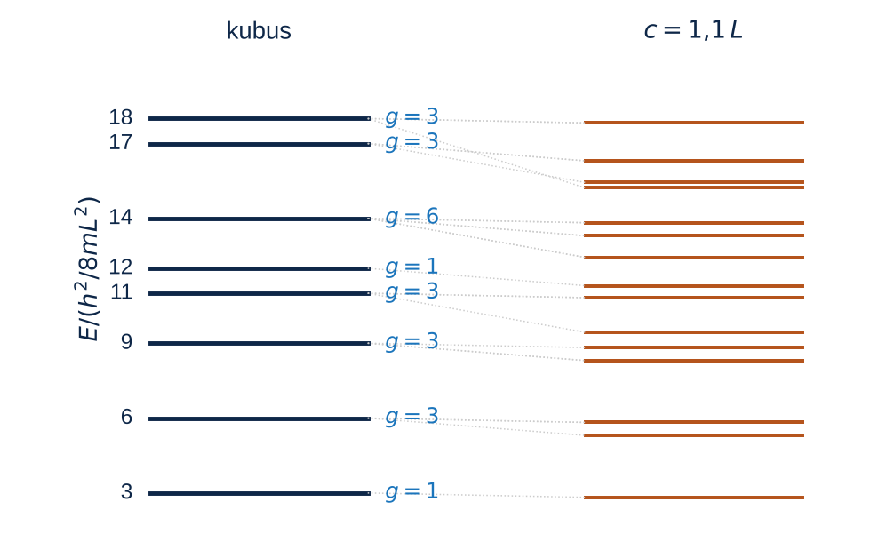
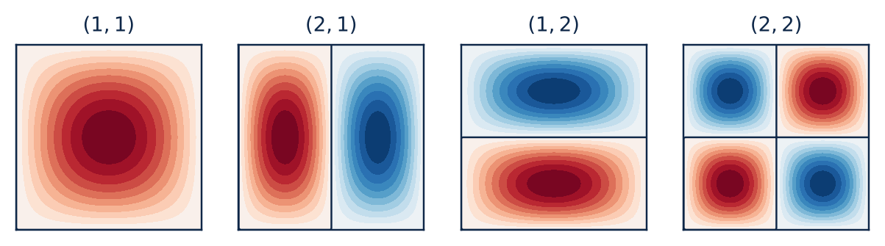

## 4.4 Persamaan Schrödinger tiga dimensi dan banyak partikel

### Satu partikel dalam tiga dimensi

Dengan aturan subbab 4.3, operator Hamilton satu partikel dalam tiga dimensi adalah

$$
\hat H = -\frac{\hbar^2}{2m}\nabla^2 + V(x, y, z), \qquad \nabla^2 = \frac{\partial^2}{\partial x^2} + \frac{\partial^2}{\partial y^2} + \frac{\partial^2}{\partial z^2} , \qquad \text{(4.5)}
$$

dan persamaan Schrödinger tak bergantung waktu $\hat H\psi(x, y, z) = E\psi(x, y, z)$ adalah persamaan diferensial parsial. Rapat peluangnya $|\psi|^2$ per satuan volume, dan normalisasinya $\int|\psi|^2\,d\tau = 1$ atas seluruh ruang.

### Banyak partikel

Untuk $N$ partikel, fungsi gelombang bergantung pada semua koordinat sekaligus, $\psi(\mathbf r_1, \mathbf r_2, \ldots, \mathbf r_N)$, dan

$$
\hat H = -\sum_{i=1}^N\frac{\hbar^2}{2m_i}\nabla_i^2 + V(\mathbf r_1, \ldots, \mathbf r_N) . \qquad \text{(4.6)}
$$

Untuk molekul dengan inti-inti $A$ (muatan $Z_Ae$, massa $M_A$) dan elektron-elektron $i$, energi potensialnya hanyalah jumlah interaksi Coulomb semua pasangan. Dengan menulis $k = 1/4\pi\varepsilon_0$:

$$
\hat H = -\sum_A\frac{\hbar^2}{2M_A}\nabla_A^2 - \sum_i\frac{\hbar^2}{2m_e}\nabla_i^2 - \sum_{A,i}\frac{kZ_Ae^2}{r_{Ai}} + \sum_{i<j}\frac{ke^2}{r_{ij}} + \sum_{A<B}\frac{kZ_AZ_Be^2}{R_{AB}} . \qquad \text{(4.7)}
$$

Lima suku itu adalah energi kinetik inti, energi kinetik elektron, tarikan elektron–inti, tolakan elektron–elektron, dan tolakan inti–inti. Inilah **operator Hamilton molekul**, satu-satunya masukan fisis seluruh kimia kuantum (efek relativistik dan spin kecil, kecuali untuk atom berat). Bab 11 menyederhanakannya dengan memisahkan gerak inti dari gerak elektron.

### Partikel yang tidak berinteraksi: pemisahan variabel

Jika Hamiltonian adalah **jumlah** suku-suku yang masing-masing hanya bergantung pada satu set koordinat, $\hat H = \hat H_1(1) + \hat H_2(2)$, maka fungsi eigennya adalah **hasil kali** fungsi eigen masing-masing suku, dan energinya **jumlah** energi masing-masing:

$$
\psi(1, 2) = \psi_a(1)\,\psi_b(2), \qquad E = E_a + E_b . \qquad \text{(4.8)}
$$

Bukti: $\hat H\psi = [\hat H_1\psi_a(1)]\psi_b(2) + \psi_a(1)[\hat H_2\psi_b(2)] = (E_a + E_b)\psi_a\psi_b$, karena $\hat H_1$ tidak menyentuh koordinat 2, dan sebaliknya. Hal yang sama berlaku untuk Hamiltonian satu partikel yang dapat dipisah menurut koordinat, misalnya $\hat H = \hat H_x + \hat H_y + \hat H_z$. Pemisahan variabel adalah alat utama untuk menyelesaikan kotak tiga dimensi (subbab 4.5), atom hidrogen (Bab 7), dan, sebagai **pendekatan**, atom dan molekul berelektron banyak: pendekatan orbital (Bab 9) memperlakukan setiap elektron seolah-olah bergerak sendiri dalam medan rata-rata elektron lain.

::: {.contoh}
**Contoh 4.11 · Helium tanpa tolakan antarelektron**

Jika suku tolakan $ke^2/r_{12}$ dihapus dari Hamiltonian helium (Contoh 3.6), Hamiltoniannya menjadi jumlah dua Hamiltonian ion He⁺. (a) Berapa energi keadaan dasarnya? (b) Bandingkan dengan energi percobaan $-79{,}0$ eV.

**Penyelesaian.** (a) Setiap elektron dalam keadaan 1s ion mirip hidrogen dengan $Z = 2$: $E = -Z^2(13{,}606\ \text{eV}) = -54{,}42$ eV. Dengan (4.8): $E = 2(-54{,}42) = -108{,}8$ eV. Fungsi gelombangnya $\psi_{1s}(1)\psi_{1s}(2)$.

(b) Meleset 29,8 eV, sekitar 38%.

**Memahami hasil.** Tolakan antarelektron jauh dari kecil: ia menaikkan energi hampir 30 eV. Mengabaikannya memberi jawaban yang salah secara kuantitatif, tetapi fungsi hasil kali $\psi_{1s}\psi_{1s}$ ternyata titik awal yang baik. Di Bab 8, perturbasi orde pertama dari fungsi ini memberi $-74{,}8$ eV, dan metode variasi dengan muatan efektif memberi $-77{,}5$ eV.
:::

::: {.contoh}
**Contoh 4.12 · Dua partikel dalam satu kotak**

Dua partikel bermassa sama yang tidak berinteraksi berada dalam kotak satu dimensi sepanjang $L$. (a) Tuliskan fungsi gelombang dan energi keadaan dasar dan keadaan tereksitasi pertama. (b) Berapa degenerasi keadaan tereksitasi pertama jika kedua partikel dapat dibedakan?

**Penyelesaian.** (a) $\psi_{n_1n_2} = \psi_{n_1}(x_1)\psi_{n_2}(x_2)$, $E = (n_1^2 + n_2^2)E_1$. Keadaan dasar $(1, 1)$: $2E_1$. Tereksitasi pertama $(1, 2)$ dan $(2, 1)$: $5E_1$.

(b) Dua: partikel 1 di $n = 1$ dan partikel 2 di $n = 2$, atau sebaliknya.

**Memahami hasil.** Untuk elektron, yang identik dan tidak dapat dibedakan, fungsi gelombangnya harus berubah tanda bila kedua elektron dipertukarkan (Bab 9). Kombinasi yang diizinkan adalah $\psi_1(x_1)\psi_2(x_2) \pm \psi_2(x_1)\psi_1(x_2)$, dikombinasikan dengan fungsi spin yang sesuai. Degenerasi ini, dan pecahnya oleh tolakan elektron, adalah asal mula keadaan singlet dan triplet.
:::

::: {.contoh}
**Contoh 4.13 · Menghitung suku-suku Hamiltonian benzena**

Hitung banyaknya suku setiap jenis dalam (4.7) untuk benzena C₆H₆ (12 inti, 42 elektron).

**Penyelesaian.** Kinetik inti: 12. Kinetik elektron: 42. Tarikan elektron–inti: $12 \times 42 = 504$. Tolakan elektron–elektron: $\binom{42}{2} = 861$. Tolakan inti–inti: $\binom{12}{2} = 66$. Jumlahnya 1485 suku.

**Memahami hasil.** Suku yang paling banyak, dan paling sulit, adalah tolakan elektron–elektron: ia menggandeng setiap pasangan elektron dan mencegah pemisahan variabel. Pada program kimia komputasi, jumlah integral tolakan elektron bertambah kira-kira sebanding pangkat empat ukuran basis; untuk benzena dengan basis sedang, ratusan juta integral.
:::

::: {.kuis}
**Kuis cepat 4.4**

Tiga partikel identik yang tidak berinteraksi, masing-masing berperilaku sebagai osilator dengan energi $(v + \tfrac12)h\nu$. Berapa energi total keadaan dasarnya?
:::

## 4.5 Kotak tiga dimensi dan degenerasi

### Pemisahan variabel

Partikel bermassa $m$ dalam kotak persegi panjang dengan sisi $a$, $b$, $c$ (potensial nol di dalam, tak hingga di luar) mempunyai Hamiltonian yang terpisah: $\hat H = \hat H_x + \hat H_y + \hat H_z$, dengan masing-masing persis seperti kotak satu dimensi. Dengan subbab 4.4, fungsi eigen dan energinya adalah hasil kali dan jumlah:

$$
\psi_{n_xn_yn_z} = \sqrt{\frac{8}{abc}}\,\sin\frac{n_x\pi x}{a}\sin\frac{n_y\pi y}{b}\sin\frac{n_z\pi z}{c} , \qquad \text{(4.9)}
$$

$$
E_{n_xn_yn_z} = \frac{h^2}{8m}\left(\frac{n_x^2}{a^2} + \frac{n_y^2}{b^2} + \frac{n_z^2}{c^2}\right), \qquad n_x, n_y, n_z = 1, 2, 3, \ldots \qquad \text{(4.10)}
$$

Tiga dimensi membutuhkan tiga bilangan kuantum: aturan umum, satu bilangan kuantum untuk setiap derajat kebebasan.

### Degenerasi dari simetri

Untuk kubus ($a = b = c = L$), energi hanya bergantung pada $n_x^2 + n_y^2 + n_z^2$:

$$
E = \frac{h^2}{8mL^2}\left(n_x^2 + n_y^2 + n_z^2\right) .
$$

Keadaan $(1, 1, 2)$, $(1, 2, 1)$, dan $(2, 1, 1)$ semuanya berenergi $6h^2/8mL^2$: tingkat itu terdegenerasi tiga kali. Fungsi-fungsi gelombangnya adalah fungsi yang sama yang "menunjuk" ke tiga arah sumbu, dan memutar kubus 90° mengubah satu menjadi yang lain. Degenerasi ini adalah akibat **simetri**: operasi simetri kubus memetakan setiap fungsi eigen ke fungsi eigen lain dengan energi yang sama. Pola tingkat-tingkatnya diperlihatkan pada Gambar 4.1.

Jika kubus sedikit diregangkan ke arah $z$, simetrinya turun, dan tingkat $(1, 1, 2)$ yang "menunjuk" ke arah sumbu panjang turun lebih banyak daripada $(2, 1, 1)$ dan $(1, 2, 1)$: degenerasi tiga pecah menjadi satu dan dua. Pemecahan degenerasi oleh penurunan simetri adalah tema yang muncul berulang kali dalam kimia: orbital d dalam medan ligan (Bab 14), efek Jahn–Teller, dan pemecahan garis spektrum dalam medan listrik atau magnet.

Kadang-kadang dua tingkat berenergi sama tanpa alasan simetri yang jelas, misalnya $(3, 3, 3)$ dan $(1, 1, 5)$ yang keduanya memberi $n_x^2 + n_y^2 + n_z^2 = 27$. Ini disebut **degenerasi kebetulan**.

{width=66%}

{width=88%}

::: {.contoh}
**Contoh 4.14 · Elektron dalam kubus nanometer**

Elektron berada dalam kubus bersisi 1,00 nm. (a) Hitung energi keadaan dasar dan keadaan tereksitasi pertama. (b) Berapa panjang gelombang transisinya? (c) Jika sisi $z$ diperpanjang menjadi 1,10 nm, berapa energi keadaan $(1, 1, 2)$ dan $(2, 1, 1)$?

**Penyelesaian.** (a) $h^2/8m_eL^2 = 0{,}376$ eV. $E_{111} = 3(0{,}376) = 1{,}128$ eV; $E_{112} = 6(0{,}376) = 2{,}256$ eV (terdegenerasi tiga).

(b) $\Delta E = 1{,}128$ eV, $\lambda = 1239{,}8/1{,}128 = 1099$ nm.

(c) $E_{112} = 0{,}376(1 + 1 + 4/1{,}21) = 1{,}995$ eV; $E_{211} = E_{121} = 0{,}376(4 + 1 + 1/1{,}21) = 2{,}191$ eV.

**Memahami hasil.** Peregangan 10% memecah tingkat tiga-ganda menjadi satu tingkat di 2,00 eV dan dua tingkat di 2,19 eV, selisih 0,20 eV: transisi dari keadaan dasar kini memberi dua pita serapan. Pengukuran pemecahan semacam ini dalam nanokristal memberi tahu bentuk kristal itu.
:::

::: {.contoh}
**Contoh 4.15 · Kotak persegi panjang dua dimensi**

Partikel dalam kotak dua dimensi bersisi $a = L$ dan $b = 2L$. Urutkan enam tingkat terendah dan tentukan degenerasinya.

**Penyelesaian.** $E/(h^2/8mL^2) = n_x^2 + n_y^2/4$. Nilai-nilai terkecil: $(1, 1)$: 1,25; $(1, 2)$: 2,00; $(1, 3)$: 3,25; $(2, 1)$: 4,25; $(1, 4)$ dan $(2, 2)$: 5,00 (degenerasi kebetulan); $(2, 3)$: 6,25.

**Memahami hasil.** Karena sisi $y$ dua kali lebih panjang, eksitasi sepanjang $y$ jauh lebih murah: tiga keadaan terendah semuanya mempunyai $n_x = 1$. Dalam molekul terkonjugasi yang panjang dan sempit, keadaan tereksitasi terendah juga terkait dengan gerak elektron sepanjang sumbu panjang molekul, dan itulah sebabnya serapan terkuat zat warna linear terpolarisasi sepanjang sumbu panjangnya.
:::

::: {.contoh}
**Contoh 4.16 · Gas elektron dalam natrium**

Elektron valensi logam natrium dapat dimodelkan sebagai gas elektron dalam kubus besar (model elektron bebas Sommerfeld). Dengan dua elektron (spin berlawanan) tiap keadaan, elektron mengisi keadaan dari bawah sampai **energi Fermi**

$$
E_F = \frac{\hbar^2}{2m_e}\left(3\pi^2n\right)^{2/3} ,
$$

dengan $n$ kerapatan elektron. Untuk natrium, $n = 2{,}65 \times 10^{28}$ m⁻³ (satu elektron tiap atom). Hitung $E_F$, kelajuan Fermi $v_F = \hbar(3\pi^2n)^{1/3}/m_e$, dan "suhu Fermi" $E_F/k$.

**Penyelesaian.** $(3\pi^2n)^{1/3} = (7{,}85 \times 10^{29})^{1/3} = 9{,}22 \times 10^9$ m⁻¹. $E_F = (1{,}0546 \times 10^{-34})^2(9{,}22 \times 10^9)^2/(2 \times 9{,}109 \times 10^{-31}) = 5{,}19 \times 10^{-19}$ J $= 3{,}24$ eV. $v_F = 1{,}07 \times 10^6$ m/s. $E_F/k = 37\,600$ K.

**Memahami hasil.** Rumus $E_F$ diperoleh dengan menghitung titik-titik kisi $(n_x, n_y, n_z)$ dalam seperdelapan bola, persis seperti penghitungan mode rongga Rayleigh–Jeans (subbab 1.3). Energi Fermi 3,24 eV jauh di atas $kT$ pada suhu kamar: hampir semua elektron "membeku" di keadaan terisi, dan hanya sedikit di dekat $E_F$ yang dapat menyerap kalor. Itulah sebabnya elektron logam hampir tidak menyumbang pada kapasitas kalor, teka-teki lain yang dipecahkan oleh kuantisasi.
:::

### Dari kotak tiga dimensi ke entropi gas

Kotak tiga dimensi bukan sekadar latihan: ia adalah model kuantum untuk gerak translasi molekul gas, dan dari tingkat-tingkat energinya termodinamika statistik menghitung sifat makroskopik. Besaran kuncinya adalah **fungsi partisi translasi**, jumlah faktor Boltzmann atas semua keadaan. Karena tingkat-tingkatnya sangat rapat (Contoh 3.19), jumlah itu dapat diganti integral, dan hasilnya sederhana:

$$
q_\text{trans} = \sum_{n_x, n_y, n_z}e^{-E_{n_xn_yn_z}/kT} = \frac{V}{\Lambda^3}, \qquad \Lambda = \frac{h}{\sqrt{2\pi mkT}} ,
$$

dengan $\Lambda$ panjang gelombang de Broglie termal (Contoh 1.40). Fungsi partisi ini kira-kira sama dengan banyaknya keadaan translasi yang dapat diisi pada suhu $T$. Dari $q$, termodinamika statistik memberikan entropi molar gas ideal monoatomik, **persamaan Sackur–Tetrode** (1912):

$$
S_m = R\left[\ln\frac{V}{N\Lambda^3} + \frac52\right] , \qquad V/N = kT/p .
$$

Persamaan ini memuat tetapan Planck: entropi absolut gas, yang dapat diukur secara kalorimetri dari nol mutlak, ternyata bergantung pada $h$. Sackur dan Tetrode memakainya untuk menentukan $h$ dari data entropi raksa, beberapa tahun sebelum Bohr.

::: {.contoh}
**Contoh 4.17 · Entropi argon dari partikel dalam kotak**

Hitung entropi molar standar argon (39,948 u) pada 298,15 K dan 1 bar dengan persamaan Sackur–Tetrode, dan bandingkan dengan nilai kalorimetri 154,8 J mol⁻¹K⁻¹. Ulangi untuk helium (nilai tabel 126,2) dan xenon (169,7).

**Penyelesaian.** Untuk Ar: $\Lambda = h/\sqrt{2\pi mkT} = 6{,}626 \times 10^{-34}/\sqrt{2\pi(6{,}634 \times 10^{-26})(4{,}116 \times 10^{-21})} = 1{,}600 \times 10^{-11}$ m. $V/N = kT/p = 4{,}116 \times 10^{-26}$ m³. Jadi $V/N\Lambda^3 = 1{,}006 \times 10^7$, $\ln = 16{,}12$, dan

$$
S_m = 8{,}314(16{,}12 + 2{,}5) = 154{,}8\ \text{J mol}^{-1}\text{K}^{-1} .
$$

Dengan cara yang sama: He 126,2 dan Xe 169,7 J mol⁻¹K⁻¹.

**Memahami hasil.** Kecocokannya sempurna sampai angka terakhir. Entropi gas mulia sepenuhnya entropi translasi, dan entropi itu dihitung dari tingkat-tingkat energi partikel dalam kotak. Gas yang lebih berat mempunyai $\Lambda$ lebih kecil, lebih banyak keadaan yang dapat diisi, dan entropi lebih besar. Untuk molekul, rotasi (Bab 6), getaran (Bab 5), dan keadaan elektronik menambahkan sumbangannya masing-masing.
:::

::: {.kuis}
**Kuis cepat 4.5**

Berapa degenerasi tingkat $n_x^2 + n_y^2 + n_z^2 = 14$ dalam kubus? Tuliskan semua keadaannya.
:::

## 4.6 Nilai harap

### Definisi

Jika sebuah sistem berada dalam keadaan $\psi$, rata-rata hasil pengukuran besaran $A$ atas banyak salinan sistem yang disiapkan sama adalah **nilai harap**

$$
\boxed{\ \langle A\rangle = \frac{\int\psi^*\hat A\psi\,d\tau}{\int\psi^*\psi\,d\tau}\ } \qquad \text{(4.11)}
$$

Untuk $\psi$ yang ternormalisasi, penyebutnya satu. Urutan penulisan penting: $\hat A$ bekerja pada $\psi$ di sebelah kanannya, lalu hasilnya dikalikan dengan $\psi^*$ dan diintegralkan. Untuk operator perkalian, misalnya $\hat x$ atau $V(\mathbf r)$, (4.11) menjadi rata-rata biasa dengan rapat peluang $|\psi|^2$ (subbab 2.10). Untuk operator turunan, urutannya tidak boleh dibalik.

Dua kasus khusus yang penting:

- Jika $\psi$ fungsi eigen $\hat A$ dengan nilai eigen $a$, maka $\langle A\rangle = a$, dan setiap pengukuran memberi $a$ dengan pasti.
- Jika $\psi = \sum c_n\phi_n$ dengan $\phi_n$ fungsi eigen ortonormal $\hat A$, maka $\langle A\rangle = \sum|c_n|^2a_n$: rata-rata nilai eigen dengan bobot peluang (subbab 3.4).

### Teorema Ehrenfest

Bagaimana nilai harap berubah terhadap waktu? Dengan persamaan Schrödinger bergantung waktu dan sifat Hermitian (subbab 4.8), untuk operator yang tidak bergantung eksplisit pada waktu:

$$
\frac{d}{dt}\langle A\rangle = \frac{i}{\hbar}\left\langle[\hat H, \hat A]\right\rangle . \qquad \text{(4.12)}
$$

Untuk $\hat A = \hat x$ dan $\hat A = \hat p_x$ dengan $\hat H = \hat p_x^2/2m + V(x)$, komutator dari Contoh 4.2 memberikan

$$
\frac{d\langle x\rangle}{dt} = \frac{\langle p_x\rangle}{m}, \qquad \frac{d\langle p_x\rangle}{dt} = -\left\langle\frac{dV}{dx}\right\rangle . \qquad \text{(4.13)}
$$

Inilah **teorema Ehrenfest**: nilai harap mematuhi persamaan gerak klasik, dengan gaya rata-rata $\langle F\rangle$. Jika paket gelombang sempit dibandingkan jarak perubahan gaya, $\langle F(x)\rangle \approx F(\langle x\rangle)$, dan pusat paket bergerak persis seperti partikel klasik. Mekanika Newton adalah limit mekanika kuantum untuk paket yang sempit.

Persamaan (4.12) juga memberi tahu **hukum kekekalan**: jika $\hat A$ komut dengan $\hat H$, nilai harapnya tetap untuk keadaan apa pun. Untuk partikel bebas, $[\hat H, \hat p_x] = 0$: momentum kekal. Untuk potensial yang simetris bola, $[\hat H, \hat L_z] = 0$: momentum sudut kekal.

::: {.contoh}
**Contoh 4.18 · Energi kinetik dan potensial elektron 1s**

Untuk atom hidrogen dengan $\psi_{1s} = (\pi a_0^3)^{-1/2}e^{-r/a_0}$, hitung $\langle V\rangle = -ke^2\langle 1/r\rangle$, lalu $\langle T\rangle = E - \langle V\rangle$ dengan $E = -13{,}606$ eV.

**Penyelesaian.** $\langle 1/r\rangle = \dfrac{4\pi}{\pi a_0^3}\int_0^\infty\dfrac1re^{-2r/a_0}r^2dr = \dfrac{4}{a_0^3}\cdot\dfrac{a_0^2}{4} = \dfrac{1}{a_0}$, dengan (2.8). Jadi $\langle V\rangle = -ke^2/a_0 = -27{,}211$ eV $= -E_h$. Lalu $\langle T\rangle = -13{,}606 + 27{,}211 = 13{,}606$ eV.

**Memahami hasil.** $\langle T\rangle = -E$ dan $\langle V\rangle = 2E$, tepat seperti dalam model Bohr. Hubungan $2\langle T\rangle = -\langle V\rangle$ ini adalah **teorema virial** untuk potensial Coulomb, yang berlaku untuk keadaan stasioner atom dan molekul mana pun (Bab 7 dan 11). Ia menunjukkan bahwa ketika ikatan kimia terbentuk dan energi total turun, energi potensial turun dua kali lebih banyak sementara energi kinetik **naik**.
:::

::: {.contoh}
**Contoh 4.19 · Momentum rata-rata gelombang yang bergerak**

(a) Hitung $\langle p_x\rangle$ untuk $\psi = Ne^{-x^2/4\sigma^2}e^{ik_0x}$. (b) Hitung $\langle p_x\rangle$ untuk $\psi = N'e^{-x^2/4\sigma^2}\cos k_0x$.

**Penyelesaian.** (a) $\hat p_x\psi = -i\hbar\left(-\dfrac{x}{2\sigma^2} + ik_0\right)\psi$. Maka

$$
\langle p_x\rangle = \int\psi^*\hat p_x\psi\,dx = \hbar k_0\int|\psi|^2dx + \frac{i\hbar}{2\sigma^2}\int x|\psi|^2dx = \hbar k_0 + 0 .
$$

Suku kedua nol karena $x|\psi|^2$ ganjil.

(b) $\psi$ riil. Untuk fungsi riil yang menuju nol di tak hingga, $\int\psi\psi'dx = [\psi^2/2] = 0$, jadi $\langle p_x\rangle = 0$.

**Memahami hasil.** Faktor fase $e^{ik_0x}$ adalah yang memberi momentum; fungsi gelombang riil selalu mempunyai momentum rata-rata nol. Fungsi (b) adalah superposisi paket yang bergerak ke kanan dan ke kiri. Hal yang sama berlaku untuk momentum sudut: orbital riil ($p_x$, $d_{xy}$, ...) mempunyai $\langle L_z\rangle = 0$.
:::

::: {.contoh}
**Contoh 4.20 · Nilai harap dalam superposisi**

Partikel dalam kotak berada dalam keadaan $\psi = 0{,}6\psi_1 + 0{,}8\psi_2$ (dengan $\psi_n$ riil, $t = 0$). Hitung $\langle E\rangle$, $\langle x\rangle$, dan $\langle p_x\rangle$.

**Penyelesaian.** Normalisasi: $0{,}36 + 0{,}64 = 1$. $\langle E\rangle = 0{,}36E_1 + 0{,}64(4E_1) = 2{,}92E_1$.

$\langle x\rangle = 0{,}36\langle 1|x|1\rangle + 0{,}64\langle 2|x|2\rangle + 2(0{,}6)(0{,}8)\langle 1|x|2\rangle = \tfrac L2 + 0{,}96\left(-\tfrac{16L}{9\pi^2}\right) = 0{,}5L - 0{,}173L = 0{,}327L$.

$\langle p_x\rangle = 0$ karena $\psi$ riil pada $t = 0$.

**Memahami hasil.** Pada $t = 0$ partikel cenderung di kiri, tetapi belum bergerak. Menurut teorema Ehrenfest, $\langle x\rangle$ akan mulai bergerak ke kanan karena dinding kiri "mendorong". Suku silang $\langle 1|x|2\rangle$ inilah yang membuat superposisi bergerak (Contoh 3.11 dan Gambar 3.2).
:::

::: {.contoh}
**Contoh 4.21 · Ehrenfest untuk osilator**

Untuk $V = \tfrac12\kappa x^2$, tunjukkan dengan (4.13) bahwa $\langle x\rangle$ berayun persis seperti osilator klasik.

**Penyelesaian.** $-dV/dx = -\kappa x$, sehingga $d\langle p\rangle/dt = -\kappa\langle x\rangle$ (di sini $\langle F\rangle = F(\langle x\rangle)$ tepat, karena gayanya linear). Bersama $d\langle x\rangle/dt = \langle p\rangle/m$: $d^2\langle x\rangle/dt^2 = -(\kappa/m)\langle x\rangle$, penyelesaiannya $\langle x\rangle = A\cos(\omega t + \varphi)$ dengan $\omega = \sqrt{\kappa/m}$.

**Memahami hasil.** Untuk osilator harmonik, pusat setiap paket gelombang bergerak tepat seperti partikel klasik, berapa pun lebarnya. Itulah sebabnya getaran molekul dalam spektroskopi resolusi waktu dapat diikuti dengan bahasa klasik: paket gelombang berayun bolak-balik dengan frekuensi getaran (Bab 15).
:::

::: {.contoh}
**Contoh 4.22 · Seberapa tajam jarak elektron 1s?**

Untuk orbital 1s hidrogen, $\langle r\rangle = 1{,}5a_0$ (Contoh 2.8) dan $\langle r^2\rangle = 3a_0^2$. (a) Hitung simpangan baku $\Delta r$. (b) Hitung $\langle x^2\rangle$ dengan simetri bola. (c) Apa artinya bagi gambaran "jari-jari atom"?

**Penyelesaian.** (a) $\Delta r = \sqrt{3a_0^2 - 2{,}25a_0^2} = 0{,}866a_0 = 45{,}8$ pm.

(b) Karena simetri bola, $\langle x^2\rangle = \langle y^2\rangle = \langle z^2\rangle = \tfrac13\langle r^2\rangle = a_0^2$.

(c) Jarak elektron dari inti tersebar dengan simpangan baku lebih dari separuh nilai rata-ratanya.

**Memahami hasil.** Atom tidak mempunyai tepi yang tajam; "jari-jari atom" dalam tabel periodik adalah konvensi (setengah jarak antarinti dalam ikatan, atau jari-jari yang memuat 90% rapat elektron). Nilai harap $\langle x^2\rangle = a_0^2$ akan muncul dalam polarisabilitas dan dalam gaya dispersi London antarmolekul.
:::

::: {.kuis}
**Kuis cepat 4.6**

Jika $\psi$ adalah fungsi eigen $\hat A$, berapa simpangan baku $\Delta A$? Mengapa?
:::
