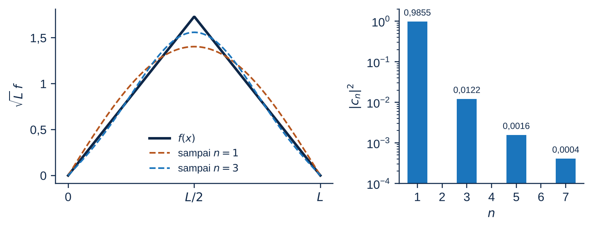

## 4.7 Syarat fungsi gelombang yang dapat diterima

Tidak setiap penyelesaian matematis persamaan Schrödinger menyatakan keadaan fisis. Sebuah fungsi gelombang **dapat diterima** (sering disebut "berperilaku baik") jika memenuhi syarat-syarat berikut:

1. **Bernilai tunggal.** Pada setiap titik ruang, $\psi$ hanya mempunyai satu nilai, karena peluang menemukan partikel di sana harus tertentu. Syarat ini menguantisasi momentum sudut (Contoh 4.10).
2. **Malar.** $\psi$ tidak boleh melompat; lompatan berarti $\psi''$ tak hingga dan energi kinetik tak hingga.
3. **Turunan pertama malar**, kecuali di titik-titik tempat potensial tak hingga (dinding kotak, atau inti titik pada potensial Coulomb, tempat orbital s mempunyai "taring").
4. **Dapat diintegralkan kuadrat**: $\int|\psi|^2d\tau$ berhingga, agar $\psi$ dapat dinormalisasi. Untuk keadaan terikat ini berarti $\psi \to 0$ cukup cepat di tak hingga.

Syarat 4 menghasilkan kuantisasi energi untuk keadaan terikat: pada sumur terhingga (subbab 3.9) dan osilator harmonik (subbab 2.4), hanya energi tertentu yang memberi penyelesaian yang menuju nol di kedua sisi. Keadaan hamburan (partikel bebas, $E > V$ di tak hingga) melanggar syarat 4, tetapi tetap dipakai sebagai idealisasi; partikel nyata adalah paket gelombang yang dapat dinormalisasi.

Syarat-syarat ini tidak menuntut $\psi$ berhingga di mana-mana; yang dituntut adalah $\int|\psi|^2$ berhingga. Misalnya $|x|^{-1/4}$ tak hingga di $x = 0$, tetapi kuadratnya, $|x|^{-1/2}$, dapat diintegralkan di sekitar titik itu. Sebaliknya $|x|^{-1/2}$ tidak dapat diterima, karena $\int dx/|x|$ divergen secara logaritmik. Dalam atom, beberapa fungsi gelombang relativistik memang tak hingga di inti, tetapi integral kuadratnya berhingga.

::: {.contoh}
**Contoh 4.25 · Dapat diterima atau tidak?**

Manakah fungsi berikut yang dapat diterima sebagai fungsi gelombang pada daerah yang disebutkan? (a) $e^{-x}$ pada $-\infty < x < \infty$; (b) $e^{-|x|}$ pada seluruh garis; (c) $e^{-x^2}$; (d) $\sin x$ pada seluruh garis; (e) $e^{i\phi/2}$ untuk $0 \le \phi < 2\pi$; (f) $1/r$ dalam tiga dimensi untuk $r > 0$; (g) $e^{-r}/r$ dalam tiga dimensi.

**Penyelesaian.** (a) Tidak: meledak untuk $x \to -\infty$. (b) Ya: malar, dapat dinormalisasi; turunannya melompat di $x = 0$, yang hanya boleh jika potensial di sana tak hingga (potensial delta). (c) Ya. (d) Tidak dapat dinormalisasi, tetapi berguna sebagai idealisasi gelombang berdiri. (e) Tidak: $e^{i(\phi + 2\pi)/2} = -e^{i\phi/2}$, tidak bernilai tunggal. (f) $\int(1/r^2)4\pi r^2dr$ divergen di tak hingga: tidak. (g) $\int(e^{-2r}/r^2)4\pi r^2dr = 4\pi\int e^{-2r}dr = 2\pi$: dapat dinormalisasi, walaupun tak hingga di $r = 0$.

**Memahami hasil.** Fungsi (g) dapat dinormalisasi, tetapi bukan penyelesaian yang dapat diterima untuk atom hidrogen, karena $\nabla^2(1/r)$ menghasilkan fungsi delta di titik asal, sehingga persamaan Schrödinger dengan potensial Coulomb tidak terpenuhi di sana. Syarat-syarat di atas perlu, tetapi bersama persamaan itu sendiri barulah cukup.
:::

::: {.contoh}
**Contoh 4.26 · Spin dan putaran 4π**

Fungsi $e^{i\phi/2}$ tidak dapat diterima sebagai fungsi gelombang ruang (Contoh 4.25, butir e). Tetapi fungsi spin elektron ternyata berubah tanda ketika diputar 360° dan baru kembali ke semula setelah 720°. Mengapa hal itu tidak melanggar syarat bernilai tunggal?

**Penyelesaian.** Fungsi spin bukan fungsi koordinat ruang, sehingga syarat kebernilaian tunggal di ruang tidak berlaku padanya. Faktor $-1$ adalah faktor fase global yang tidak mengubah peluang apa pun, kecuali bila dibandingkan dengan bagian lain sistem yang tidak diputar. Percobaan interferometri neutron (1975) mengamati tanda minus itu secara langsung.

**Memahami hasil.** Momentum sudut orbital hanya boleh bernilai bulat ($m = 0, \pm1, \ldots$) karena syarat kebernilaian tunggal; momentum sudut spin boleh setengah bulat karena tidak terikat syarat itu. Perbedaan ini mempunyai akibat kimia yang sangat besar: elektron (spin ½) mematuhi asas Pauli (Bab 9).
:::

::: {.contoh}
**Contoh 4.27 · Fungsi gelombang mana yang dapat diterima?**

Untuk partikel yang bergerak di seluruh sumbu $x$ ($-\infty < x < \infty$), mana yang dapat menjadi fungsi gelombang: (a) $e^{-x^2}$, (b) $e^{x}$, (c) $\sin x$, (d) $1/x$, (e) $e^{-|x|}$?

**Penyelesaian.**

(a) Dapat diterima: kontinu, bernilai tunggal, dan dapat dinormalkan.

(b) Tidak: membesar tanpa batas untuk $x \to \infty$, jadi tidak dapat dinormalkan.

(c) Tidak sebagai keadaan terikat: tidak dapat dinormalkan di seluruh sumbu (integral $\sin^2$ tak hingga), walaupun dapat menyatakan keadaan hamburan seperti gelombang bidang.

(d) Tidak: tak hingga di $x = 0$ dan $\int|1/x|^2dx$ divergen di sana.

(e) Dapat diterima: kontinu dan dapat dinormalkan. Turunannya melompat di $x = 0$, yang hanya diperbolehkan bila potensial di titik itu tak hingga, misalnya potensial fungsi delta $V = -\alpha\delta(x)$, yang keadaan dasarnya memang berbentuk $e^{-\kappa|x|}$.

**Memahami hasil.** Syarat-syarat ini bukan aturan formal belaka. Fungsi yang tidak dapat dinormalkan tidak dapat ditafsirkan sebagai peluang; fungsi yang turunannya melompat memberi energi kinetik tak hingga kecuali dibayar oleh potensial yang juga tak hingga. "Puncak" (*cusp*) fungsi 1s atom hidrogen di inti adalah contoh nyata: potensial Coulomb tak hingga di $r = 0$ mengizinkan turunan yang patah.
:::

::: {.kuis}
**Kuis cepat 4.7**

Fungsi $\psi = \cos(3\phi/2)$ untuk partikel pada cincin: dapat diterima atau tidak? Bagaimana dengan $\cos 3\phi$?
:::

## 4.8 Operator Hermitian

### Mengapa Hermitian?

Hasil pengukuran adalah bilangan riil, sehingga nilai harap setiap besaran fisis harus riil untuk keadaan **apa pun**. Syarat $\langle A\rangle = \langle A\rangle^*$ untuk setiap $\psi$ adalah

$$
\int\psi^*\hat A\psi\,d\tau = \int\psi\left(\hat A\psi\right)^*d\tau .
$$

Dari syarat ini (dengan memakai $\psi = f + g$ dan $\psi = f + ig$) dapat ditunjukkan bentuk yang lebih umum, yang dijadikan definisi: operator $\hat A$ **Hermitian** jika untuk setiap pasangan fungsi $f$, $g$ yang berperilaku baik,

$$
\boxed{\ \int f^*\,\hat Ag\,d\tau = \int g\,\left(\hat Af\right)^*d\tau\ } \qquad \text{(4.14)}
$$

Dengan notasi Dirac (subbab 4.14): $\langle f|\hat A|g\rangle = \langle g|\hat A|f\rangle^*$. Untuk matriks, ini persis syarat $A_{ij} = A_{ji}^*$ di subbab 2.7.

### Dua teorema dasar

**Teorema 1. Nilai eigen operator Hermitian riil.** Misalkan $\hat Af = af$. Pakai (4.14) dengan $g = f$: ruas kiri $\int f^*af\,d\tau = a\int|f|^2d\tau$; ruas kanan $\int f(af)^*d\tau = a^*\int|f|^2d\tau$. Karena $\int|f|^2 > 0$, $a = a^*$.

**Teorema 2. Fungsi eigen dengan nilai eigen berbeda ortogonal.** Misalkan $\hat Af = af$ dan $\hat Ag = bg$ dengan $a \ne b$ (keduanya riil menurut Teorema 1). Dari (4.14): $\int f^*bg\,d\tau = \int g(af)^*d\tau$, yaitu $b\int f^*g\,d\tau = a\int f^*g\,d\tau$. Jadi $(b - a)\int f^*g\,d\tau = 0$, dan karena $a \ne b$, $\int f^*g\,d\tau = 0$.

Untuk fungsi eigen yang **terdegenerasi**, ortogonalitas tidak otomatis, tetapi kita selalu dapat memilih kombinasi linear yang ortogonal (proses Gram–Schmidt, subbab 2.6). Dengan pilihan itu, fungsi eigen operator Hermitian membentuk himpunan ortonormal. Ortogonalitas fungsi sinus partikel dalam kotak, orbital-orbital atom hidrogen, dan orbital-orbital molekul semuanya adalah kasus teorema ini.

::: {.inti}
**Operator Hermitian.** $\int f^*\hat Ag\,d\tau = \int g(\hat Af)^*d\tau$. Nilai eigennya riil; fungsi eigennya dengan nilai eigen berbeda ortogonal; fungsi eigennya dapat dipilih ortonormal dan (postulat) lengkap. Semua besaran teramati dinyatakan oleh operator Hermitian.
:::

::: {.contoh}
**Contoh 4.28 · Momentum Hermitian, turunan tidak**

Tunjukkan bahwa $\hat p_x = -i\hbar\,d/dx$ Hermitian dan $\hat D = d/dx$ tidak, untuk fungsi yang menuju nol di $\pm\infty$.

**Penyelesaian.** Integral parsial:

$$
\int_{-\infty}^\infty f^*\left(-i\hbar\frac{dg}{dx}\right)dx = -i\hbar\Big[f^*g\Big]_{-\infty}^\infty + i\hbar\int g\frac{df^*}{dx}dx = \int g\left(-i\hbar\frac{df}{dx}\right)^*dx .
$$

Suku batas nol, dan $i\hbar\,df^*/dx = (-i\hbar\,df/dx)^*$. Jadi $\hat p_x$ Hermitian. Untuk $\hat D$ tanpa $-i\hbar$: $\int f^*g'dx = -\int gf^{*\prime}dx = -\int g(f')^*dx$. Ada tanda minus: $\hat D$ **anti-Hermitian**.

**Memahami hasil.** Faktor $i$ dalam operator momentum bukan hiasan: tanpanya, momentum akan mempunyai nilai eigen khayal (fungsi eigen $d/dx$ adalah $e^{ax}$ dengan $a$ sembarang). Integral parsial dengan suku batas nol adalah inti hampir semua bukti kehermitan.
:::

::: {.contoh}
**Contoh 4.29 · Energi kinetik Hermitian**

Tunjukkan bahwa $\hat T = -\tfrac{\hbar^2}{2m}\tfrac{d^2}{dx^2}$ Hermitian, dan bahwa $\langle T\rangle \ge 0$ untuk setiap keadaan.

**Penyelesaian.** Integral parsial dua kali (suku batas nol):

$$
\int f^*g''dx = -\int f^{*\prime}g'dx = \int f^{*\prime\prime}g\,dx = \int g(f'')^*dx .
$$

Dikali $-\hbar^2/2m$ (riil): $\hat T$ Hermitian. Untuk nilai harapnya, integral parsial sekali: $\langle T\rangle = -\tfrac{\hbar^2}{2m}\int\psi^*\psi''dx = \tfrac{\hbar^2}{2m}\int|\psi'|^2dx \ge 0$.

**Memahami hasil.** Bentuk $\langle T\rangle = \tfrac{\hbar^2}{2m}\int|\psi'|^2dx$ sering lebih mudah dihitung, dan memperlihatkan dengan jelas bahwa energi kinetik mengukur "kecuraman" fungsi gelombang. Fungsi yang berliku-liku tajam atau yang terkurung sempit mempunyai energi kinetik besar. Bentuk inilah yang kita pakai di Contoh 3.14 untuk fungsi parabola.
:::

::: {.contoh}
**Contoh 4.30 · Hasil kali operator Hermitian**

Jika $\hat A$ dan $\hat B$ Hermitian, apakah $\hat A\hat B$ Hermitian? Periksa untuk $\hat x\hat p_x$.

**Penyelesaian.** $\int f^*\hat A\hat Bg = \int(\hat Bg)(\hat Af)^* = \int(\hat Af)^*\hat Bg$, dan dengan kehermitan $\hat B$: $= \int g(\hat B\hat Af)^*$. Jadi $\hat A\hat B$ "memindah" menjadi $\hat B\hat A$, dan $\hat A\hat B$ Hermitian hanya jika $\hat A\hat B = \hat B\hat A$, yaitu jika keduanya komut. Karena $[\hat x, \hat p_x] = i\hbar \ne 0$, $\hat x\hat p_x$ tidak Hermitian. Kombinasi simetris $\tfrac12(\hat x\hat p_x + \hat p_x\hat x)$ Hermitian.

**Memahami hasil.** Ketika membangun operator dari besaran klasik seperti $xp_x$, urutan harus dipilih agar operatornya Hermitian; resep yang umum adalah simetrisasi. Dalam kimia kuantum masalah ini jarang muncul, karena Hamiltonian molekul hanya memuat $p^2$ dan fungsi posisi.
:::

::: {.contoh}
**Contoh 4.31 · Nilai eigen operator anti-Hermitian**

Tunjukkan bahwa nilai eigen operator anti-Hermitian ($\int f^*\hat Ag = -\int g(\hat Af)^*$) adalah khayal murni, dan periksa dengan $\hat D = d/dx$ pada cincin ($0 \le \phi < 2\pi$, fungsi bernilai tunggal).

**Penyelesaian.** Dengan $\hat Af = af$ dan $g = f$: $a\int|f|^2 = -a^*\int|f|^2$, jadi $a = -a^*$: khayal murni. Pada cincin, fungsi eigen $d/d\phi$ yang bernilai tunggal adalah $e^{im\phi}$ dengan nilai eigen $im$: khayal murni, sesuai.

**Memahami hasil.** Operator $\hat D$ anti-Hermitian, sehingga $i\hat D$ dan $-i\hbar\hat D$ Hermitian. Komutator dua operator Hermitian selalu anti-Hermitian; karena itu $[\hat x, \hat p_x] = i\hbar$ memuat $i$, dan relasi ketidakpastian umum (subbab 4.10) memakai $\tfrac{1}{2i}[\hat A, \hat B]$ yang Hermitian.
:::

::: {.kuis}
**Kuis cepat 4.8**

Apakah operator $\hat x^2$ Hermitian? Apakah $i\hat x$? Apakah $\hat p_x^2$?
:::

## 4.9 Ekspansi dalam fungsi eigen; kelengkapan

### Kelengkapan

Himpunan fungsi eigen $\{\phi_n\}$ sebuah operator disebut **lengkap** jika setiap fungsi berperilaku baik (yang memenuhi syarat batas yang sama) dapat diuraikan sebagai

$$
\psi = \sum_nc_n\phi_n, \qquad c_n = \int\phi_n^*\psi\,d\tau . \qquad \text{(4.15)}
$$

Untuk beberapa operator kelengkapan dapat dibuktikan secara matematis, misalnya untuk fungsi sinus partikel dalam kotak (teorema deret Fourier). Dalam mekanika kuantum, kelengkapan fungsi eigen setiap operator teramati dijadikan **postulat**. Jika spektrum operator mempunyai bagian malar (misalnya keadaan tak terikat atom hidrogen di atas energi ionisasi), jumlah dalam (4.15) harus disertai integral atas bagian malar itu.

Jika $\psi$ dan $\phi_n$ ternormalisasi, koefisiennya memenuhi

$$
\sum_n|c_n|^2 = 1 , \qquad \text{(4.16)}
$$

hasil yang disebut identitas Parseval. Postulat pengukuran (subbab 4.12) menafsirkan $|c_n|^2$ sebagai peluang. Persamaan (4.16) memastikan bahwa peluang-peluang itu berjumlah satu.

### Ekspansi dalam kimia

Ekspansi atas fungsi lengkap adalah tulang punggung kimia kuantum praktis. Orbital molekul diuraikan atas fungsi-fungsi basis yang berpusat di atom (LCAO, Bab 11). Fungsi gelombang banyak elektron diuraikan atas determinan Slater (interaksi konfigurasi, Bab 17). Dalam praktik, basis selalu berhingga, sehingga ekspansinya terpotong; kualitas hasil bergantung pada seberapa cepat koefisien $c_n$ mengecil. Fungsi yang mulus mempunyai koefisien yang cepat mengecil; fungsi yang bersudut tajam memerlukan banyak suku (subbab 2.9).

{width=88%}

::: {.contoh}
**Contoh 4.32 · Mengurai fungsi segitiga**

Fungsi $f(x) = \sqrt{12/L^3}\,x$ untuk $0 \le x \le L/2$ dan $\sqrt{12/L^3}\,(L - x)$ untuk $L/2 \le x \le L$ ternormalisasi. Koefisien ekspansinya atas fungsi eigen kotak adalah $c_n = \dfrac{4\sqrt6}{n^2\pi^2}\sin\dfrac{n\pi}{2}$. (a) Hitung $|c_n|^2$ untuk $n = 1$ sampai 7. (b) Jika energi partikel diukur, berapa peluang hasilnya $E_1$, $E_2$, $E_3$? (c) Hitung $\langle E\rangle$ dari ekspansi (sampai konvergen) dan langsung dari $\tfrac{\hbar^2}{2m}\int|f'|^2dx$.

**Penyelesaian.** (a) $|c_1|^2 = 96/\pi^4 = 0{,}9855$; $|c_3|^2 = 0{,}0122$; $|c_5|^2 = 0{,}0016$; $|c_7|^2 = 0{,}0004$; koefisien genap nol.

(b) $E_1$: 98,6%; $E_2$: 0; $E_3$: 1,2%.

(c) $\langle E\rangle/E_1 = \sum|c_n|^2n^2 = \tfrac{96}{\pi^4}\sum_{n\ \text{ganjil}}\tfrac{1}{n^2} = \tfrac{96}{\pi^4}\cdot\tfrac{\pi^2}{8} = \tfrac{12}{\pi^2} = 1{,}216$. Langsung: $|f'|^2 = 12/L^3$ di seluruh kotak, sehingga $\langle E\rangle = \tfrac{\hbar^2}{2m}\cdot\tfrac{12}{L^2} = \tfrac{12}{\pi^2}E_1$. Sama.

**Memahami hasil.** Fungsi segitiga "lebih runcing" daripada parabola (Contoh 3.14), sehingga energi rata-ratanya lebih jauh di atas $E_1$ (22% lawan 1,3%) dan koefisien suku tingginya lebih besar ($1/n^2$ lawan $1/n^3$). Sudut tajam di puncak segitiga menuntut momentum tinggi.
:::

::: {.contoh}
**Contoh 4.33 · Mengurai gelombang bidang atas gelombang berdiri**

Uraikan $e^{ikx}$ atas fungsi eigen $\hat T = -\tfrac{\hbar^2}{2m}\tfrac{d^2}{dx^2}$ yang berbentuk $\cos kx$ dan $\sin kx$, lalu jelaskan mengapa $\cos kx$ dapat ditulis sebagai superposisi keadaan momentum.

**Penyelesaian.** $e^{ikx} = \cos kx + i\sin kx$; kedua fungsi mempunyai energi kinetik $\hbar^2k^2/2m$. Sebaliknya, $\cos kx = \tfrac12e^{ikx} + \tfrac12e^{-ikx}$: superposisi sama besar momentum $+\hbar k$ dan $-\hbar k$.

**Memahami hasil.** Dalam ruang fungsi eigen yang terdegenerasi (energi $\hbar^2k^2/2m$, degenerasi dua), basis $\{e^{ikx}, e^{-ikx}\}$ dan basis $\{\cos kx, \sin kx\}$ sama-sama sah. Pengukuran momentum pada keadaan $\cos kx$ memberi $+\hbar k$ atau $-\hbar k$ dengan peluang masing-masing ½. Ini adalah versi satu dimensi teka-teki $p_x$ lawan $p_{\pm1}$.
:::

::: {.contoh}
**Contoh 4.34 · Basis terpotong**

Fungsi parabola Contoh 2.27 diuraikan atas basis kotak, tetapi hanya suku $n = 1$ yang dipakai: $\tilde f = c_1\psi_1$. (a) Berapa normanya? (b) Jika dinormalkan ulang, berapa energinya? (c) Bandingkan dengan energi rata-rata parabola yang sebenarnya, $1{,}0132E_1$.

**Penyelesaian.** (a) $\|\tilde f\|^2 = |c_1|^2 = 0{,}9986$. (b) Dinormalkan ulang, $\tilde f$ adalah $\psi_1$ dengan energi tepat $E_1$. (c) Selisihnya 1,3%.

**Memahami hasil.** Pemotongan basis membuang 0,14% "isi" fungsi, tetapi mengubah energinya 1,3%, karena suku-suku yang dibuang berenergi tinggi ($9E_1$, $25E_1$, ...). Dalam kimia komputasi, ini adalah inti masalah **ketidaklengkapan basis**: energi konvergen lebih lambat daripada fungsi gelombang, dan dibutuhkan basis yang makin besar untuk mencapai ketelitian kimia.
:::

::: {.contoh}
**Contoh 4.35 · Mengekspansi fungsi parabola dalam keadaan kotak**

Partikel dalam kotak $0 \le x \le L$ berada dalam keadaan ternormalkan $\psi = \sqrt{30/L^5}\,x(L - x)$. Koefisien ekspansinya dalam keadaan eigen kotak adalah $c_n = 8\sqrt{15}/(n\pi)^3$ untuk $n$ ganjil dan 0 untuk $n$ genap. Hitung peluang pengukuran energi memberi $E_1$ dan $E_3$, periksa bahwa jumlah semua peluang 1, dan hitung $\langle E\rangle$ dalam satuan $E_1$.

**Penyelesaian.** $c_1 = 0{,}99928$, sehingga $P_1 = 0{,}99856$. $c_3 = 0{,}03701$, $P_3 = 0{,}00137$. Jumlah $\sum_{n\ \text{ganjil}}960/(n\pi)^6 = 1$ (dengan $\sum 1/n^6$ untuk $n$ ganjil $= \pi^6/960$). Energi rata-rata:

$$
\langle E\rangle = \sum_nP_nn^2E_1 = \frac{960}{\pi^6}E_1\sum_{n\ \text{ganjil}}\frac{1}{n^4} = \frac{960}{\pi^6}\cdot\frac{\pi^4}{96}E_1 = \frac{10}{\pi^2}E_1 = 1{,}0132\,E_1 .
$$

**Memahami hasil.** Parabola sangat mirip dengan gelombang sinus keadaan dasar, sehingga 99,86% peluangnya jatuh di $n = 1$, dan energi rata-ratanya hanya 1,3% di atas $E_1$. Koefisien genap nol karena parabola simetris terhadap tengah kotak, sedangkan keadaan $n$ genap antisimetris. Perhitungan yang sama, tetapi untuk fungsi uji dan Hamiltonian yang lebih rumit, adalah inti metode variasi (Bab 8): energi rata-rata fungsi uji selalu di atas energi keadaan dasar.
:::

::: {.kuis}
**Kuis cepat 4.9**

Sebuah keadaan ternormalisasi mempunyai $|c_1|^2 = 0{,}50$ dan $|c_2|^2 = 0{,}30$ atas fungsi eigen ortonormal sebuah operator. Berapa jumlah $|c_n|^2$ untuk semua $n \ge 3$?
:::
