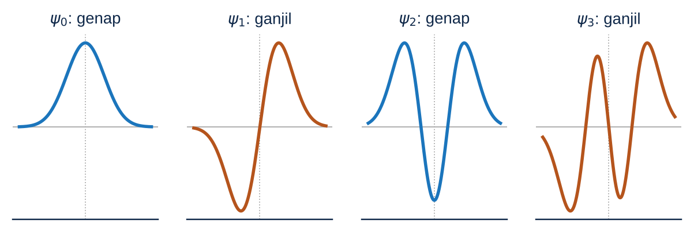

## 4.10 Komutator dan pengukuran serentak

### Fungsi eigen bersama

Kapan dua besaran dapat mempunyai nilai tajam secara bersamaan? Jawabannya adalah salah satu teorema terpenting mekanika kuantum:

::: {.inti}
**Teorema.** Dua operator Hermitian $\hat A$ dan $\hat B$ mempunyai himpunan lengkap fungsi eigen bersama jika dan hanya jika keduanya komut, $[\hat A, \hat B] = 0$.
:::

Bukti untuk arah "komut ⇒ fungsi eigen bersama", untuk kasus tanpa degenerasi: misalkan $\hat Af = af$. Kerjakan $\hat B$ lalu pakai $\hat A\hat B = \hat B\hat A$:

$$
\hat A(\hat Bf) = \hat B\hat Af = a(\hat Bf) .
$$

Jadi $\hat Bf$ juga fungsi eigen $\hat A$ dengan nilai eigen $a$. Karena nilai eigen $a$ tidak terdegenerasi, $\hat Bf$ harus kelipatan $f$: $\hat Bf = bf$. Jadi $f$ juga fungsi eigen $\hat B$. Jika $a$ terdegenerasi, $\hat B$ memetakan ruang fungsi eigen $a$ ke dirinya sendiri, dan di dalam ruang itu kita selalu dapat memilih kombinasi yang sekaligus fungsi eigen $\hat B$ (dengan mendiagonalkan $\hat B$ di ruang itu).

Akibat fisisnya: besaran-besaran yang operatornya komut dapat **diukur serentak dengan tajam**; keadaan yang mempunyai nilai tertentu untuk yang satu dapat sekaligus mempunyai nilai tertentu untuk yang lain. Besaran yang operatornya tidak komut tidak mempunyai fungsi eigen bersama yang lengkap, dan pada umumnya tidak dapat sekaligus tajam.

Teorema ini adalah alat kerja utama untuk **memberi label keadaan**. Untuk atom hidrogen, $\hat H$, $\hat L^2$, dan $\hat L_z$ saling komut, sehingga setiap keadaan dapat diberi label tiga bilangan kuantum $n$, $\ell$, $m_\ell$ sekaligus (Bab 7). Himpunan operator yang saling komut dan yang nilai eigennya cukup untuk membedakan semua keadaan disebut **himpunan lengkap teramati yang komut**. Kembali ke teka-teki pembuka: $p_{+1}$, $p_0$, $p_{-1}$ adalah fungsi eigen bersama $\hat H$, $\hat L^2$, $\hat L_z$; $p_x$, $p_y$, $p_z$ adalah fungsi eigen bersama $\hat H$, $\hat L^2$, dan operator-operator simetri yang lain (misalnya pencerminan), tetapi bukan $\hat L_z$.

### Relasi ketidakpastian umum

Untuk dua teramati sembarang, simpangan baku hasil pengukurannya pada keadaan $\psi$ memenuhi

$$
\boxed{\ \Delta A\,\Delta B \ge \frac12\left|\left\langle[\hat A, \hat B]\right\rangle\right|\ } \qquad \text{(4.17)}
$$

Untuk $\hat x$ dan $\hat p_x$, $[\hat x, \hat p_x] = i\hbar$, sehingga $\Delta x\,\Delta p_x \ge \hbar/2$: asas ketidakpastian Heisenberg (subbab 1.9) kini menjadi teorema.

::: {.dalam}
**Lebih dalam · Bukti relasi Robertson**

Definisikan operator yang digeser ke rata-ratanya, $\hat a = \hat A - \langle A\rangle$ dan $\hat b = \hat B - \langle B\rangle$; keduanya Hermitian, $[\hat a, \hat b] = [\hat A, \hat B]$, dan $(\Delta A)^2 = \langle\hat a^2\rangle = \int|\hat a\psi|^2d\tau$ (dengan kehermitan). Misalkan $f = \hat a\psi$ dan $g = \hat b\psi$. Ketaksamaan Schwarz (subbab 2.6) memberikan

$$
(\Delta A)^2(\Delta B)^2 = \langle f|f\rangle\langle g|g\rangle \ge |\langle f|g\rangle|^2 \ge \left(\text{Im}\langle f|g\rangle\right)^2 .
$$

Sekarang $\langle f|g\rangle = \langle\psi|\hat a\hat b|\psi\rangle$ dan $\langle g|f\rangle = \langle\psi|\hat b\hat a|\psi\rangle = \langle f|g\rangle^*$, sehingga

$$
\text{Im}\langle f|g\rangle = \frac{1}{2i}\left(\langle f|g\rangle - \langle f|g\rangle^*\right) = \frac{1}{2i}\left\langle[\hat A, \hat B]\right\rangle .
$$

Akar kedua ruas memberikan (4.17). Buktinya hanya memakai kehermitan dan ketaksamaan Schwarz: asas ketidakpastian adalah sifat geometri ruang fungsi.
:::

Relasi waktu–energi tidak termasuk dalam (4.17), karena waktu bukan operator; ia adalah parameter. Relasi $\Delta E\,\Delta t \gtrsim \hbar/2$ (subbab 1.9) mempunyai makna lain: $\Delta t$ adalah waktu khas yang diperlukan nilai harap suatu besaran untuk berubah berarti.

::: {.contoh}
**Contoh 4.36 · Komutator dengan Hamiltonian**

Untuk $\hat H = \hat p_x^2/2m + V(x)$, hitung $[\hat H, \hat x]$ dan $[\hat H, \hat p_x]$. Kapan momentum kekal?

**Penyelesaian.** $V(x)$ komut dengan $\hat x$, dan $[\hat p_x^2, \hat x] = -[\hat x, \hat p_x^2] = -2i\hbar\hat p_x$ (Contoh 4.2). Jadi $[\hat H, \hat x] = -i\hbar\hat p_x/m$.

$\hat p_x^2$ komut dengan $\hat p_x$, dan $[V, \hat p_x] = -[\hat p_x, V]$. Pada fungsi uji: $\hat p_x(Vf) - V\hat p_xf = -i\hbar V'f$. Jadi $[\hat H, \hat p_x] = i\hbar\,dV/dx$.

Dengan (4.12), momentum kekal jika $dV/dx = 0$: tidak ada gaya.

**Memahami hasil.** Komutator dengan $\hat H$ menghasilkan persamaan gerak Ehrenfest (4.13). Secara umum, besaran yang operatornya komut dengan $\hat H$ adalah **tetapan gerak**, dan bilangan kuantumnya adalah "bilangan kuantum yang baik", yang tidak berubah selama sistem dibiarkan.
:::

::: {.contoh}
**Contoh 4.37 · Memeriksa relasi ketidakpastian dalam kotak**

Untuk partikel dalam kotak pada keadaan $n = 1$, $\Delta x\,\Delta p_x = 0{,}568\hbar$ (Contoh 3.26). (a) Periksa terhadap (4.17). (b) Apakah $\hat H$ dan $\hat p_x$ komut di dalam kotak? Mengapa $\psi_1$ bukan fungsi eigen $\hat p_x$?

**Penyelesaian.** (a) $\tfrac12|\langle i\hbar\rangle| = \hbar/2 = 0{,}5\hbar$, dan $0{,}568\hbar \ge 0{,}5\hbar$: dipenuhi.

(b) Di dalam kotak $V = 0$, sehingga secara lokal $\hat H = \hat p_x^2/2m$ komut dengan $\hat p_x$. Tetapi dinding (potensial tak hingga di batas) membuat $[\hat H, \hat p_x] \ne 0$ secara keseluruhan; fungsi eigen $\hat p_x$, yaitu $e^{\pm ikx}$, tidak memenuhi syarat $\psi = 0$ di dinding. Fungsi eigen energi $\sin kx$ adalah campuran $p = \pm\hbar k$.

**Memahami hasil.** Dinding memantulkan partikel, sehingga momentum tidak kekal; yang kekal hanyalah besar momentum. Pertanyaan "apakah dua operator komut" harus selalu menyertakan syarat batas sistem.
:::

::: {.contoh}
**Contoh 4.38 · Partikel pada cincin**

Partikel pada cincin berjari-jari $R$ mempunyai $\hat H = \hat L_z^2/2I$ dengan $I = mR^2$. (a) Apakah $\hat H$ dan $\hat L_z$ komut? (b) Tuliskan fungsi eigen bersamanya dan energinya. (c) Fungsi $\cos 2\phi$: apakah fungsi eigen $\hat H$? $\hat L_z$? Jika $L_z$ diukur, apa hasilnya?

**Penyelesaian.** (a) Ya: setiap operator komut dengan pangkatnya sendiri.

(b) $\psi_m = e^{im\phi}/\sqrt{2\pi}$, $L_z = m\hbar$, $E_m = m^2\hbar^2/2I$, $m = 0, \pm1, \pm2, \ldots$ Tingkat $m \ne 0$ terdegenerasi dua ($\pm m$).

(c) $\cos 2\phi = (e^{2i\phi} + e^{-2i\phi})/2$: fungsi eigen $\hat H$ (energi $4\hbar^2/2I$), bukan fungsi eigen $\hat L_z$. Pengukuran $L_z$ memberi $+2\hbar$ atau $-2\hbar$, masing-masing dengan peluang ½.

**Memahami hasil.** Dalam ruang terdegenerasi $\{e^{2i\phi}, e^{-2i\phi}\}$, kita dapat memilih fungsi eigen bersama $\hat H$ dan $\hat L_z$ (kompleks) atau fungsi eigen bersama $\hat H$ dan pencerminan $\phi \to -\phi$ (riil, $\cos 2\phi$ dan $\sin 2\phi$). Model ini, dengan elektron π benzena pada cincin, memberi pola tingkat energi yang sama dengan teori Hückel (Bab 6 dan 13).
:::

::: {.contoh}
**Contoh 4.39 · Ketidakpastian komponen momentum sudut**

Komponen-komponen momentum sudut memenuhi $[\hat L_x, \hat L_y] = i\hbar\hat L_z$ (Bab 6). Untuk elektron pada orbital $p_{+1}$ ($L_z = +\hbar$), berapa batas bawah $\Delta L_x\,\Delta L_y$? Untuk orbital $p_0$?

**Penyelesaian.** Dengan (4.17): $\Delta L_x\Delta L_y \ge \tfrac12|i\hbar\langle L_z\rangle| = \tfrac12\hbar|\langle L_z\rangle|$. Untuk $p_{+1}$: $\ge \hbar^2/2$. Untuk $p_0$: $\langle L_z\rangle = 0$, batas bawahnya nol.

**Memahami hasil.** Pada keadaan $p_{+1}$, $L_x$ dan $L_y$ tidak mungkin keduanya tajam: vektor momentum sudut "berpresesi" di sekitar sumbu $z$ (model vektor, Bab 6). Batas bawah nol untuk $p_0$ tidak berarti $L_x$ dan $L_y$ tajam di sana; ketidakpastiannya justru $\Delta L_x = \Delta L_y = \hbar$. Relasi (4.17) hanya memberi batas bawah.
:::

::: {.kuis}
**Kuis cepat 4.10**

Apakah $\hat x$ dan $\hat p_y$ komut? Apakah posisi $x$ dan momentum $p_y$ dapat diketahui serentak dengan tajam?
:::

## 4.11 Paritas

### Operator paritas

Operator paritas (inversi) dalam tiga dimensi membalik semua koordinat terhadap titik asal:

$$
\hat\Pi\psi(x, y, z) = \psi(-x, -y, -z) . \qquad \text{(4.18)}
$$

Seperti dalam satu dimensi (Contoh 4.6), $\hat\Pi^2 = 1$ dan nilai eigennya $\pm1$. Fungsi dengan nilai eigen $+1$ disebut **genap** atau *gerade* (g), dengan $-1$ **ganjil** atau *ungerade* (u). Operator paritas linear dan Hermitian.

Jika energi potensial simetris terhadap inversi, $V(-\mathbf r) = V(\mathbf r)$, maka $[\hat H, \hat\Pi] = 0$, karena laplasian juga tidak berubah oleh pembalikan semua koordinat. Menurut teorema subbab 4.10, fungsi eigen $\hat H$ dapat dipilih sekaligus genap atau ganjil; untuk tingkat yang tidak terdegenerasi, setiap fungsi eigen **pasti** mempunyai paritas tertentu. Partikel dalam kotak simetris, osilator harmonik (Gambar 4.4), atom bebas, dan molekul dengan pusat inversi (H₂, N₂, CO₂, benzena, kompleks oktahedral) semuanya mempunyai sifat ini.

{width=88%}

### Paritas orbital atom

Dalam koordinat bola, inversi berarti $r \to r$, $\theta \to \pi - \theta$, $\phi \to \phi + \pi$. Bagian sudut orbital dengan bilangan kuantum $\ell$ berubah menjadi $(-1)^\ell$ kali dirinya sendiri (Bab 6). Jadi orbital s dan d genap, orbital p dan f ganjil:

$$
\hat\Pi\,\psi_{n\ell m} = (-1)^\ell\psi_{n\ell m} .
$$

### Aturan seleksi Laporte

Intensitas transisi dipol listrik sebanding dengan kuadrat $\int\psi_f^*\,\hat{\boldsymbol\mu}\,\psi_i\,d\tau$. Operator momen dipol $\hat{\boldsymbol\mu} \propto \mathbf r$ ganjil. Jika $\psi_i$ dan $\psi_f$ berparitas sama, integrannya ganjil dan integralnya nol (subbab 2.2). Jadi untuk atom dan molekul yang mempunyai pusat inversi:

::: {.inti}
**Aturan Laporte.** Transisi dipol listrik hanya diizinkan antara keadaan dengan paritas berbeda: g ↔ u. Transisi g ↔ g dan u ↔ u terlarang.
:::

::: {.contoh}
**Contoh 4.40 · Integral yang nol karena paritas**

Untuk atom hidrogen, manakah integral berikut yang pasti nol? (a) $\langle 1s|z|2s\rangle$; (b) $\langle 1s|z|2p_z\rangle$; (c) $\langle 2p_x|z|3d_{xz}\rangle$; (d) $\langle 2s|z^2|3d_{z^2}\rangle$.

**Penyelesaian.** $z$ ganjil, $z^2$ genap. (a) g × u × g = u: nol. (b) g × u × u = g: tidak nol (secara umum). (c) u × u × g = g: tidak nol secara paritas. (d) g × g × g = g: tidak nol secara paritas.

**Memahami hasil.** Transisi 1s → 2s dalam atom hidrogen terlarang (keadaan 2s berumur sekitar 0,12 s, sangat panjang untuk keadaan tereksitasi atom), sedangkan 1s → 2p diizinkan dan menghasilkan garis Lyman-α. Paritas hanya syarat perlu: integral (c) dan (d) dapat tetap nol karena alasan simetri lain (momentum sudut), yang dibahas di Bab 7 dan 10.
:::

::: {.contoh}
**Contoh 4.41 · Warna pucat kompleks oktahedral**

Larutan $[\text{Ti}(\text{H}_2\text{O})_6]^{3+}$ berwarna ungu pucat, dengan koefisien absorpsi molar pada 500 nm hanya sekitar 5 M⁻¹cm⁻¹. Ion $[\text{CoCl}_4]^{2-}$ (tetrahedral) biru tua, dengan $\varepsilon \approx 600$ M⁻¹cm⁻¹. Ion permanganat ungu pekat dengan $\varepsilon \approx 2400$ M⁻¹cm⁻¹. Jelaskan dengan paritas.

**Penyelesaian.** Kompleks oktahedral mempunyai pusat inversi; transisi d → d adalah g → g (orbital d genap), sehingga terlarang menurut Laporte dan hanya menjadi sedikit diizinkan karena getaran yang sesaat merusak simetri. Kompleks tetrahedral tidak mempunyai pusat inversi; label g/u tidak berlaku, dan pencampuran orbital d dengan orbital p membuat transisi lebih kuat. Warna permanganat berasal dari transfer muatan ligan → logam yang diizinkan penuh.

**Memahami hasil.** Perbedaan intensitas tiga orde besaran ini dapat dilihat dengan mata. Itulah sebabnya kimiawan dapat menebak geometri kompleks kobalt(II) dari pekatnya warna: biru tua untuk tetrahedral, merah muda pucat untuk oktahedral $[\text{Co}(\text{H}_2\text{O})_6]^{2+}$ (Bab 14).
:::

::: {.contoh}
**Contoh 4.42 · Paritas orbital molekul**

Dalam molekul H₂ (berpusat di tengah ikatan), orbital $\sigma = (1s_A + 1s_B)/\sqrt{2(1 + S)}$ dan $\sigma^* = (1s_A - 1s_B)/\sqrt{2(1 - S)}$. Tentukan paritasnya. Apakah transisi $\sigma \to \sigma^*$ diizinkan?

**Penyelesaian.** Inversi menukar posisi kedua atom: $1s_A \leftrightarrow 1s_B$. Jadi $\sigma \to \sigma$ (g) dan $\sigma^* \to -\sigma^*$ (u). Transisi g → u diizinkan.

**Memahami hasil.** Orbital ikatan dan antiikatan homonuklir diberi label $\sigma_g$ dan $\sigma_u^*$. Transisi elektron $\sigma_g \to \sigma_u^*$ dalam H₂ menghasilkan pita serapan kuat di ultraviolet vakum (sekitar 110 nm). Label g/u menempel pada setiap orbital dan keadaan molekul homonuklir (Bab 11).
:::

::: {.contoh}
**Contoh 4.43 · Aturan seleksi getaran dari paritas**

Fungsi gelombang osilator harmonik bergantian genap dan ganjil (Gambar 4.4). Momen dipol molekul diatom di sekitar panjang setimbang dapat diuraikan $\mu(x) = \mu_0 + \mu_1x + \mu_2x^2 + \cdots$ dengan $x = r - r_e$. (a) Dengan paritas saja, transisi $v = 0 \to v'$ mana yang diizinkan oleh suku $\mu_1x$? (b) Oleh suku $\mu_2x^2$?

**Penyelesaian.** (a) $\langle 0|x|v'\rangle$: $\psi_0$ genap, $x$ ganjil, sehingga integrannya genap hanya bila $\psi_{v'}$ ganjil: $v' = 1, 3, 5, \ldots$ (b) $\langle 0|x^2|v'\rangle$: $v'$ genap, $v' = 2, 4, \ldots$ (selain $v' = 0$).

**Memahami hasil.** Paritas saja mengizinkan $v = 0 \to 3$ melalui $\mu_1x$; perhitungan lengkap dengan operator tangga (Bab 5) menunjukkan bahwa $\langle 0|x|v'\rangle$ hanya tidak nol untuk $v' = 1$. Aturan seleksi $\Delta v = \pm1$ untuk osilator harmonik lebih ketat daripada aturan paritas. Pita nada atas pertama ($0 \to 2$) dalam spektrum IR muncul lemah, terutama dari suku $\mu_2x^2$ dan anharmonisitas. Paritas memberi syarat perlu yang murah; momentum sudut dan struktur lain memberi syarat tambahan.
:::

::: {.kuis}
**Kuis cepat 4.11**

Apa paritas orbital 4f? Apakah transisi 3d → 4s dalam atom bebas diizinkan oleh aturan Laporte? Transisi 3d → 4p?
:::

## 4.12 Pengukuran dan superposisi

### Apa yang terjadi saat mengukur

Mekanika kuantum menggabungkan dua jenis perubahan keadaan. Selama tidak diukur, fungsi gelombang berubah secara deterministik dan malar menurut persamaan Schrödinger. Ketika sebuah besaran $A$ diukur, terjadi sesuatu yang lain:

1. Hasil pengukuran **selalu salah satu nilai eigen** $a_n$ operator $\hat A$.
2. Jika keadaan sebelum pengukuran adalah $\psi = \sum c_n\phi_n$ (dengan $\phi_n$ fungsi eigen ternormalisasi $\hat A$), peluang memperoleh $a_n$ adalah $|c_n|^2$.
3. Segera setelah pengukuran yang memberi $a_n$, keadaan sistem adalah $\phi_n$ (atau, jika $a_n$ terdegenerasi, proyeksi $\psi$ pada ruang fungsi eigen $a_n$, dinormalkan ulang).

Butir 3, yang sering disebut **runtuhnya fungsi gelombang**, menjamin konsistensi: jika $A$ diukur lagi segera, hasilnya pasti $a_n$ lagi. Ia juga menjelaskan mengapa pengukuran **mengganggu**: mengukur $A$ menghapus informasi tentang besaran yang tidak komut dengan $A$.

### Superposisi bukan campuran

Keadaan $\psi = (\phi_1 + \phi_2)/\sqrt2$ tidak sama dengan "setengah sistem di $\phi_1$ dan setengah di $\phi_2$". Pengukuran $A$ memang memberi $a_1$ dan $a_2$ dengan peluang sama pada keduanya. Tetapi pengukuran besaran lain $B$ yang tidak komut dengan $A$ membedakannya: pada superposisi muncul suku interferensi $2\,\text{Re}(c_1^*c_2\langle\phi_1|\hat B|\phi_2\rangle)$, pada campuran tidak. Celah ganda (subbab 1.8) adalah contoh paling terkenal. Dalam praktik, interaksi sistem dengan lingkungan (tumbukan, foton, getaran pelarut) dengan cepat mengubah superposisi menjadi campuran secara efektif; proses ini disebut **dekoherensi**, dan itulah sebabnya benda besar tidak terlihat dalam superposisi.

::: {.contoh}
**Contoh 4.44 · Mengukur energi lalu posisi**

Partikel dalam kotak berada dalam keadaan segitiga Contoh 4.32. (a) Energi diukur dan hasilnya $E_3$. Apa keadaannya sesaat sesudahnya? (b) Energi diukur lagi segera. Apa hasilnya? (c) Lalu posisi diukur. Berapa peluang partikel ditemukan di sepertiga tengah kotak?

**Penyelesaian.** (a) $\psi_3$. (b) $E_3$ dengan pasti. (c) Untuk $\psi_3$, peluang di sepertiga tengah adalah $1/3$ (Contoh 3.8 di Bab 3: nilai 0,333 untuk $n = 3$).

**Memahami hasil.** Sebelum pengukuran pertama, peluang mendapat $E_3$ hanya 1,2%. Begitu hasil itu muncul, sejarah sebelumnya "terhapus": keadaannya adalah $\psi_3$ murni, dan semua ramalan berikutnya dihitung dari $\psi_3$. Peluang posisi pada keadaan segitiga asli (sebelum pengukuran energi) berbeda.
:::

::: {.contoh}
**Contoh 4.45 · Mengukur $L_z$ pada orbital $p_x$**

Elektron hidrogen berada pada orbital $2p_x$. (a) $L_z$ diukur. Hasil apa yang mungkin, dengan peluang berapa? (b) Hasilnya $+\hbar$. Lalu $L_z$ diukur lagi. (c) Apakah elektron masih "pada orbital $2p_x$"? Apakah energinya berubah?

**Penyelesaian.** (a) $2p_x = (2p_{-1} - 2p_{+1})/\sqrt2$: hasil $+\hbar$ atau $-\hbar$, masing-masing ½. Nilai 0 tidak mungkin.

(b) $+\hbar$ dengan pasti; keadaannya kini $2p_{+1}$.

(c) Tidak; ia kini pada $2p_{+1} = -(2p_x + i\,2p_y)/\sqrt2$, yang rapat peluangnya berbentuk donat di sekitar sumbu $z$. Energinya tidak berubah, karena $2p_{\pm1}$ dan $2p_x$ terdegenerasi dan $\hat L_z$ komut dengan $\hat H$.

**Memahami hasil.** Pengukuran $L_z$ mengubah bentuk distribusi elektron tanpa mengubah energinya. Dalam medan magnet sepanjang $z$, $2p_{+1}$ dan $2p_{-1}$ mempunyai energi berbeda (efek Zeeman, Bab 7), dan basis kompleks menjadi basis yang "alami".
:::

::: {.contoh}
**Contoh 4.46 · Dua pengukuran yang tidak komut**

Sebuah sistem dua keadaan (misalnya spin elektron, Bab 9) diukur dengan operator $\hat A = \begin{pmatrix}1 & 0\\ 0 & -1\end{pmatrix}$ dan $\hat B = \begin{pmatrix}0 & 1\\ 1 & 0\end{pmatrix}$ (keduanya dalam satuan $\hbar/2$). Sistem mula-mula pada vektor eigen $\hat A$ dengan nilai $+1$. (a) $\hat B$ diukur: hasil dan peluangnya? (b) Hasilnya $+1$; lalu $\hat A$ diukur lagi: peluang hasil $+1$?

**Penyelesaian.** (a) Vektor eigen $\hat B$: $(1, \pm1)/\sqrt2$ dengan nilai $\pm1$. Keadaan $(1, 0) = \tfrac{1}{\sqrt2}\left[\tfrac{(1, 1)}{\sqrt2} + \tfrac{(1, -1)}{\sqrt2}\right]$: hasil $\pm1$ masing-masing ½.

(b) Keadaan kini $(1, 1)/\sqrt2$, yang sama dengan $\tfrac{1}{\sqrt2}[(1, 0) + (0, 1)]$: peluang $\hat A = +1$ adalah ½.

**Memahami hasil.** Sebelum $\hat B$ diukur, hasil $\hat A = +1$ pasti. Pengukuran $\hat B$ di antaranya menghapus kepastian itu. Inilah percobaan Stern–Gerlach berurutan (Bab 9) dalam bentuk matriks 2 × 2, dan inti dari teknologi kriptografi kuantum.
:::

::: {.contoh}
**Contoh 4.47 · Mengukur superposisi dua keadaan**

Partikel dalam kotak berada dalam keadaan $\Psi = (\psi_1 + \psi_2)/\sqrt2$. (a) Apa saja hasil pengukuran energi yang mungkin dan berapa peluangnya? (b) Berapa $\langle E\rangle$? (c) Bila pengukuran memberi $E_2$, dalam keadaan apa partikel sesudahnya, dan apa hasil pengukuran energi berikutnya?

**Penyelesaian.**

(a) Hanya $E_1$ atau $E_2$, masing-masing dengan peluang $|1/\sqrt2|^2 = \tfrac12$.

(b) $\langle E\rangle = \tfrac12E_1 + \tfrac12(4E_1) = 2{,}5\,E_1$, nilai yang tidak pernah teramati dalam satu pengukuran.

(c) Sesudah memberi $E_2$, keadaannya $\psi_2$; pengukuran berikutnya pasti memberi $E_2$ lagi.

**Memahami hasil.** Nilai harap adalah rata-rata banyak pengukuran pada sistem yang disiapkan sama, bukan hasil satu pengukuran. Pengukuran juga mengubah keadaan: sebelum diukur partikel berada dalam superposisi, sesudahnya berada dalam keadaan eigen yang sesuai dengan hasilnya. Inilah perbedaan mendasar antara superposisi kuantum dan ketidaktahuan biasa (campuran statistik).
:::

::: {.kuis}
**Kuis cepat 4.12**

Sebuah keadaan mempunyai $|c_1|^2 = 0{,}9$ dan $|c_2|^2 = 0{,}1$ atas fungsi eigen energi. Energi diukur 1000 kali pada salinan-salinan yang disiapkan sama. Kira-kira berapa kali hasilnya $E_2$? Berapa kali hasilnya nilai di antara $E_1$ dan $E_2$?
:::
