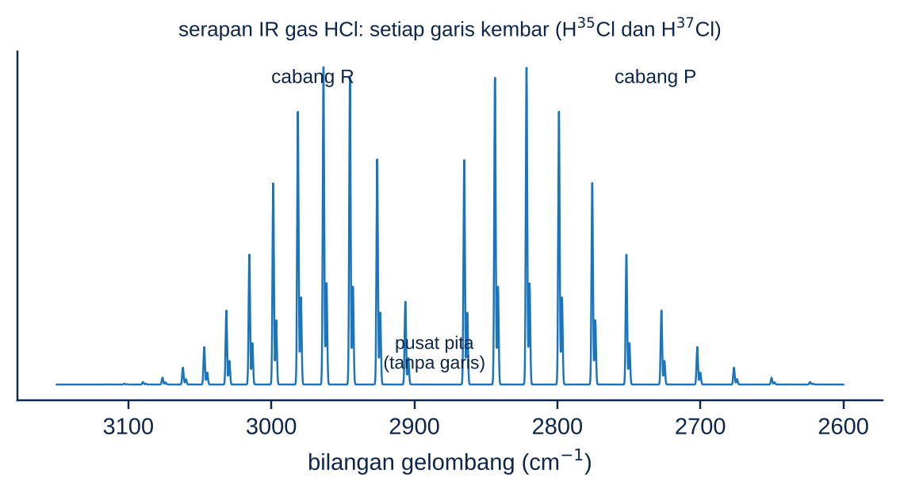

## 5.7 Getaran molekul diatom dan massa tereduksi

Pemisahan gerak pusat massa dan gerak relatif yang menghasilkan massa tereduksi $\mu$ dibuktikan secara lengkap di subbab 6.8; di sini kita memakai hasilnya.

### Dari dua benda ke satu

Molekul diatom AB terdiri atas dua inti bermassa $m_A$ dan $m_B$ yang dihubungkan oleh "pegas" elektronik. Energi potensialnya hanya bergantung pada jarak $r = |\mathbf r_A - \mathbf r_B|$. Seperti pada masalah dua benda dalam mekanika klasik, gerak dapat dipisah menjadi gerak pusat massa (translasi molekul utuh, yang tidak menarik di sini) dan gerak relatif. Gerak relatif setara dengan satu partikel bermassa **massa tereduksi** $\mu = m_Am_B/(m_A + m_B)$, persamaan (5.4), yang bergerak dalam potensial $V(r)$. Penurunannya: dengan $M = m_A + m_B$, $\mathbf R = (m_A\mathbf r_A + m_B\mathbf r_B)/M$, dan $\mathbf r = \mathbf r_A - \mathbf r_B$, energi kinetik $\tfrac12m_A\dot{\mathbf r}_A^2 + \tfrac12m_B\dot{\mathbf r}_B^2$ dapat ditulis ulang sebagai $\tfrac12M\dot{\mathbf R}^2 + \tfrac12\mu\dot{\mathbf r}^2$ (soal di akhir bab). Gerak relatif tiga dimensi kemudian terpisah lagi menjadi rotasi (Bab 6) dan getaran sepanjang $r$. Dalam bab ini kita hanya membahas getaran, dengan $x = r - r_e$.

Massa tereduksi selalu lebih kecil daripada massa yang lebih ringan. Untuk hidrida HX dengan X berat, $\mu \approx m_H$ (Contoh 5.2): hidrogen bergetar, X hampir diam.

### Tetapan gaya dari spektrum

Dari bilangan gelombang getaran $\tilde\nu$ (cm⁻¹), tetapan gaya adalah

$$
k = \mu\omega^2 = \mu(2\pi c\tilde\nu)^2 . \qquad \text{(5.21)}
$$

Tetapan gaya mengukur **kelengkungan** kurva potensial di dasarnya, bukan kedalamannya. Kedua besaran ini biasanya sejalan (ikatan yang kuat juga kaku), tetapi tidak selalu.

| Molekul | $\tilde\nu$ (cm⁻¹) | $\mu$ (u) | $k$ (N/m) | Orde ikatan |
|---|---|---|---|---|
| H₂ | 4401 | 0,504 | 575 | 1 |
| HF | 4138 | 0,957 | 966 | 1 |
| HCl | 2991 | 0,980 | 516 | 1 |
| HI | 2309 | 1,000 | 314 | 1 |
| N₂ | 2359 | 7,00 | 2295 | 3 |
| CO | 2170 | 6,86 | 1902 | 3 |
| O₂ | 1580 | 8,00 | 1177 | 2 |
| F₂ | 917 | 9,50 | 470 | 1 |
| Cl₂ | 560 | 17,5 | 323 | 1 |
| I₂ | 214,5 | 63,5 | 172 | 1 |

::: {.contoh}
**Contoh 5.26 · Tetapan gaya dan orde ikatan**

Dari tabel, bandingkan tetapan gaya N₂, O₂, dan F₂. Apakah perbandingannya mendekati perbandingan orde ikatan 3 : 2 : 1?

**Penyelesaian.** $k(\text{N}_2)/k(\text{F}_2) = 2295/470 = 4{,}9$ dan $k(\text{O}_2)/k(\text{F}_2) = 1177/470 = 2{,}5$. Perbandingannya 4,9 : 2,5 : 1, bukan 3 : 2 : 1.

**Memahami hasil.** Tetapan gaya naik lebih cepat daripada orde ikatan, karena ikatan berorde tinggi juga lebih pendek, dan kelengkungan potensial naik tajam ketika inti makin dekat. Meskipun begitu, urutannya benar, dan tetapan gaya menjadi ukuran kekuatan ikatan yang dapat diukur dengan teliti. Teori orbital molekul diatom (Bab 11) menjelaskan mengapa orde ikatannya 3, 2, dan 1.
:::

::: {.contoh}
**Contoh 5.27 · Menghitung tetapan gaya CO**

Pita getaran CO di $\omega_e = 2169{,}8$ cm⁻¹. Hitung massa tereduksi dan tetapan gayanya.

**Penyelesaian.** $\mu = (12{,}000)(15{,}995)/(27{,}995) = 6{,}856$ u $= 1{,}1385 \times 10^{-26}$ kg. $\omega = 2\pi(2{,}9979 \times 10^{10}\ \text{cm/s})(2169{,}8\ \text{cm}^{-1}) = 4{,}087 \times 10^{14}$ s⁻¹. $k = \mu\omega^2 = 1902$ N/m.

**Memahami hasil.** Pegas CO 3,7 kali lebih kaku daripada pegas HCl, tetapi frekuensinya lebih rendah karena massa tereduksinya 7 kali lebih besar. Frekuensi ditentukan oleh perbandingan $k/\mu$, dan kedua faktor itu sama penting. Ketika CO terikat pada logam (karbonil logam, Bab 14), $\tilde\nu$ turun ke 1850–2100 cm⁻¹ karena tetapan gaya C–O melemah: frekuensi ulur CO adalah "sensor" kerapatan elektron pada logam.
:::

::: {.contoh}
**Contoh 5.28 · Mengapa hidrida bergetar cepat**

HCl dan Cl₂ sama-sama berikatan tunggal dengan klorin. Mengapa $\tilde\nu(\text{HCl}) = 2991$ cm⁻¹ jauh di atas $\tilde\nu(\text{Cl}_2) = 560$ cm⁻¹?

**Penyelesaian.** $\tilde\nu(\text{HCl})/\tilde\nu(\text{Cl}_2) = 5{,}34$. Perbandingan massa tereduksi $\mu(\text{Cl}_2)/\mu(\text{HCl}) = 17{,}48/0{,}980 = 17{,}85$, akarnya 4,225. Perbandingan tetapan gaya $516/323 = 1{,}60$, akarnya 1,265. Hasil kalinya $4{,}225 \times 1{,}265 = 5{,}34$.

**Memahami hasil.** Empat perlima dari perbedaan frekuensi berasal dari massa. Inilah sebabnya pita ulur X–H (O–H 3600, N–H 3400, C–H 2900 cm⁻¹) terpisah jauh di atas pita ulur antaratom berat dalam spektrum IR senyawa organik: atom H yang ringan membuat getaran ini praktis terisolasi dari sisa molekul, sehingga menjadi **frekuensi gugus** yang andal (subbab 5.11).
:::

::: {.contoh}
**Contoh 5.29 · Ramalan untuk isotopolog CO**

Dengan tetapan gaya yang sama (aproksimasi Born–Oppenheimer: elektron tidak "tahu" massa inti), ramalkan $\omega_e$ untuk ¹²C¹⁸O dan ¹³C¹⁸O.

**Penyelesaian.** $\omega_e \propto \mu^{-1/2}$. $\mu(^{12}\text{C}^{18}\text{O}) = 7{,}200$ u, $\mu(^{13}\text{C}^{18}\text{O}) = 7{,}549$ u. $\omega_e = 2169{,}8\sqrt{6{,}856/7{,}200} = 2117{,}4$ cm⁻¹ dan $2169{,}8\sqrt{6{,}856/7{,}549} = 2067{,}8$ cm⁻¹.

**Memahami hasil.** Pergeseran 50–100 cm⁻¹ mudah diukur. Pelabelan isotop dipakai untuk menetapkan pita IR: bila pita bergeser ketika ¹⁶O diganti ¹⁸O, getaran itu melibatkan atom O. Dalam katalisis heterogen, ¹³CO dan C¹⁸O dipakai untuk membedakan CO yang terikat di situs yang berbeda.
:::

::: {.kuis}
**Kuis cepat 5.7**

Massa tereduksi molekul homonuklir A₂ sama dengan berapa kali massa satu atom? Molekul mana yang mempunyai frekuensi lebih tinggi, H₂ atau HD?
:::

## 5.8 Aturan seleksi inframerah

### Momen dipol transisi

Molekul menyerap foton inframerah bila medan listrik foton dapat "menggoyang" muatan molekul. Teori gangguan bergantung waktu (Bab 15) menunjukkan bahwa laju serapan antara keadaan $v$ dan $v'$ sebanding dengan kuadrat **momen dipol transisi**

$$
\mu_{v'v} = \langle v'|\hat\mu|v\rangle = \int\psi_{v'}^*\,\mu(x)\,\psi_v\,dx . \qquad \text{(5.22)}
$$

Momen dipol molekul bergantung pada panjang ikatan. Uraikan dalam deret Taylor di sekitar $x = 0$:

$$
\mu(x) = \mu_0 + \left(\frac{d\mu}{dx}\right)_0x + \tfrac12\left(\frac{d^2\mu}{dx^2}\right)_0x^2 + \cdots
$$

Masukkan ke (5.22). Suku pertama memberi $\mu_0\langle v'|v\rangle = 0$ untuk $v' \ne v$ (ortogonalitas). Suku kedua memberi $(d\mu/dx)_0\langle v'|x|v\rangle$, yang menurut (5.20) tidak nol hanya bila $v' = v \pm 1$. Jadi, dalam pendekatan harmonik dan dipol linear:

$$
\boxed{\ \text{aturan seleksi kasar: } \left(\frac{d\mu}{dx}\right)_0 \ne 0; \qquad \text{aturan seleksi spesifik: } \Delta v = \pm1\ } \qquad \text{(5.23)}
$$

Aturan seleksi kasar menyatakan bahwa **momen dipol harus berubah selama getaran**; molekul tidak perlu mempunyai dipol permanen. Molekul diatom homonuklir (H₂, N₂, O₂, Cl₂) mempunyai $\mu = 0$ pada setiap panjang ikatan, sehingga tidak menyerap IR. Getaran mereka teramati dengan spektroskopi Raman, yang aturan seleksinya menyangkut perubahan **polarisabilitas** (Bab 15).

Aturan $\Delta v = \pm1$ tidak mutlak. Bila potensial anharmonik (subbab 5.9) atau momen dipol tidak linear dalam $x$, transisi $\Delta v = \pm2, \pm3, \ldots$ (**nada atas**, *overtones*) muncul, tetapi jauh lebih lemah.

::: {.dalam}
**Mengapa ortogonalitas dan paritas cukup**

Tanpa operator tangga, aturan seleksi dapat dibaca dari paritas. $\psi_v$ berparitas $(-1)^v$ dan $x$ ganjil, sehingga $\psi_{v'}x\psi_v$ ganjil (integral nol) bila $v$ dan $v'$ sama paritas. Ini hanya melarang $\Delta v$ genap. Larangan $\Delta v = \pm3, \pm5, \ldots$ berasal dari sifat khusus polinom Hermite: $xH_v$ adalah kombinasi $H_{v+1}$ dan $H_{v-1}$ saja (rumus rekursi), sehingga $x\psi_v$ hanya tumpang tindih dengan $\psi_{v\pm1}$. Operator tangga menyatakan hal yang sama dalam satu baris: $\hat x \propto \hat a + \hat a^\dagger$, yang hanya naik atau turun satu anak tangga.
:::

### Spektrum rotasi–getaran

Dalam fase gas, molekul juga berotasi, dan setiap transisi getaran disertai perubahan bilangan kuantum rotasi $J$ sebesar $\Delta J = \pm1$ (Bab 6). Hasilnya adalah pita yang terdiri atas dua cabang: **cabang R** ($\Delta J = +1$) di sisi bilangan gelombang tinggi dan **cabang P** ($\Delta J = -1$) di sisi rendah, dengan celah di pusat pita tempat garis $\Delta J = 0$ terlarang (Gambar 5.3). Jarak antargaris kira-kira $2B$, dengan $B$ tetapan rotasi.

{width=92%}

::: {.contoh}
**Contoh 5.30 · Siapa yang aktif IR?**

Manakah getaran berikut yang aktif IR: (a) N₂, (b) CO, (c) NO, (d) Cl₂, (e) HCl, (f) ulur simetris CO₂, (g) ulur asimetris CO₂?

**Penyelesaian.** Aktif bila momen dipol berubah selama getaran. (a) dan (d): molekul homonuklir, dipol selalu nol, tidak aktif. (b), (c), (e): heteronuklir, dipol berubah dengan panjang ikatan, aktif. (f) Ulur simetris O=C=O: kedua ikatan memanjang bersama, molekul tetap simetris, dipol tetap nol, tidak aktif. (g) Ulur asimetris: satu ikatan memanjang sementara yang lain memendek, muncul dipol sesaat, aktif.

**Memahami hasil.** Molekul tanpa dipol permanen (CO₂) tetap dapat menyerap IR melalui getaran yang membuat dipol sesaat. Analisis ini akan disistemkan dengan teori grup (Bab 10): sebuah mode aktif IR bila ia bertransformasi seperti $x$, $y$, atau $z$.
:::

::: {.contoh}
**Contoh 5.31 · Membaca spektrum HCl**

Dengan $\tilde\nu_0 = 2885{,}98$ cm⁻¹, $B_0 = 10{,}44$ cm⁻¹ (tetapan rotasi di $v = 0$), dan $B_1 = 10{,}14$ cm⁻¹ (di $v = 1$), garis cabang R dan P adalah $R(J) = \tilde\nu_0 + 2B_1 + (3B_1 - B_0)J + (B_1 - B_0)J^2$ dan $P(J) = \tilde\nu_0 - (B_1 + B_0)J + (B_1 - B_0)J^2$. Hitung $R(0)$, $R(1)$, $P(1)$, $P(2)$, dan lebar celah di pusat pita.

**Penyelesaian.** $R(0) = 2906{,}26$; $R(1) = 2925{,}94$; $P(1) = 2865{,}10$; $P(2) = 2843{,}62$ cm⁻¹. Celah $R(0) - P(1) = 41{,}16$ cm⁻¹ $\approx 4B$.

**Memahami hasil.** Jarak antargaris di cabang R mengecil ($19{,}7$, lalu $19{,}1$ cm⁻¹) dan di cabang P membesar ($21{,}5$, lalu $22{,}1$ cm⁻¹), karena $B_1 < B_0$: dalam keadaan tereksitasi getaran, ikatan rata-rata sedikit lebih panjang. Dari satu spektrum, kita mendapat panjang ikatan di dua tingkat getaran.
:::

::: {.contoh}
**Contoh 5.32 · Doblet isotop klorin**

Hitung pergeseran pusat pita H³⁷Cl terhadap H³⁵Cl ($\tilde\nu_0 = 2885{,}98$ cm⁻¹), dan bandingkan dengan perbandingan intensitas yang diharapkan.

**Penyelesaian.** $\mu(\text{H}^{35}\text{Cl}) = 0{,}97959$ u; $\mu(\text{H}^{37}\text{Cl}) = 0{,}98105$ u. $\tilde\nu_{37} = 2885{,}98\sqrt{0{,}97959/0{,}98105} = 2883{,}80$ cm⁻¹, pergeseran 2,18 cm⁻¹. Intensitas sebanding dengan kelimpahan, 75,8 : 24,2, atau sekitar 3 : 1.

**Memahami hasil.** Setiap garis tampak sebagai pasangan dengan perbandingan tinggi 3 : 1, yang terang di sisi bilangan gelombang tinggi. Pengamatan doblet ini pada awal abad ke-20 adalah salah satu bukti paling langsung bahwa getaran ditentukan oleh massa inti, dan bahwa isotop klorin benar-benar ada sebagai molekul yang berbeda.
:::

::: {.contoh}
**Contoh 5.33 · Pita panas CO di nyala api**

Intensitas serapan bersih antara $v$ dan $v + 1$ sebanding dengan $(N_v - N_{v+1})|\langle v+1|x|v\rangle|^2$. Hitung perbandingan intensitas pita panas $2 \leftarrow 1$ terhadap pita dasar $1 \leftarrow 0$ untuk CO ($\tilde\nu = 2143$ cm⁻¹) pada 298 K, 1000 K, dan 2000 K, dalam pendekatan harmonik.

**Penyelesaian.** $|\langle 2|x|1\rangle|^2 = 2|\langle 1|x|0\rangle|^2$ menurut (5.20). Dengan $q = e^{-hc\tilde\nu/kT}$, $N_v \propto q^v$, perbandingannya $2(q - q^2)/(1 - q) = 2q$. Hasilnya: 298 K: $6{,}5 \times 10^{-5}$; 1000 K: 0,092; 2000 K: 0,43.

**Memahami hasil.** Pada suhu nyala, pita panas hampir separuh pita dasar. Karena anharmonisitas, pita panas CO berada 27 cm⁻¹ di bawah pita dasar ($2\omega_ex_e$, subbab 5.9), sehingga terpisah dan dapat dipakai untuk mengukur suhu gas buang mesin dari jarak jauh: perbandingan intensitasnya adalah termometer.
:::

::: {.terapan}
**Efek rumah kaca dan aturan seleksi**

Atmosfer Bumi terdiri atas 99% N₂ dan O₂, dua molekul homonuklir yang tidak menyerap IR. Seandainya hanya ada kedua gas itu, radiasi inframerah dari permukaan Bumi (puncaknya sekitar 10 µm, atau 1000 cm⁻¹; subbab 1.3) akan lolos ke ruang angkasa. Gas rumah kaca adalah molekul dengan getaran yang aktif IR di daerah itu: CO₂ (tekuk 667 cm⁻¹, tepat di dekat puncak radiasi Bumi), H₂O (tekuk 1595 cm⁻¹ dan pita rotasi), CH₄ (1306 cm⁻¹), N₂O, dan O₃. Aturan seleksi kasar (5.23), yang lahir dari integral $\langle v'|\mu|v\rangle$, dengan demikian menentukan neraca energi planet kita.
:::

### Spektroskopi Raman

Getaran yang tidak aktif IR dapat diamati melalui **hamburan Raman**. Cahaya tampak berfrekuensi $\tilde\nu_0$ (jauh dari serapan elektronik) menginduksi dipol $\boldsymbol\mu_\text{ind} = \alpha\boldsymbol{\mathcal E}$ dalam molekul, dengan $\alpha$ polarisabilitas. Bila $\alpha$ berubah selama getaran, $\alpha = \alpha_0 + (d\alpha/dx)_0x$, maka dipol terinduksi memuat komponen berfrekuensi $\tilde\nu_0 \pm \tilde\nu_\text{vib}$. Dengan penalaran yang sama seperti (5.22):

* aturan seleksi kasar Raman: $(d\alpha/dx)_0 \ne 0$;
* aturan seleksi spesifik: $\Delta v = \pm1$ (dalam pendekatan harmonik).

Garis yang bergeser ke frekuensi lebih rendah ($\tilde\nu_0 - \tilde\nu_\text{vib}$, molekul naik dari $v = 0$ ke 1) disebut garis **Stokes**; yang bergeser ke frekuensi lebih tinggi (molekul turun dari $v = 1$ ke 0) disebut **anti-Stokes**, dan lemah karena populasi $v = 1$ kecil. Polarisabilitas molekul homonuklir berubah ketika ikatan meregang (awan elektron yang lebih panjang lebih mudah dipolarisasi), sehingga H₂, N₂, dan O₂ aktif Raman. Untuk molekul yang mempunyai pusat inversi berlaku **aturan saling meniadakan**: mode yang aktif IR tidak aktif Raman, dan sebaliknya (contohnya CO₂, Gambar 5.5; alasannya diberikan teori grup di Bab 10).

::: {.contoh}
**Contoh 5.34 · Spektrum Raman udara**

Udara disinari laser hijau 532 nm. Pita dasar N₂ berada di 2329,9 cm⁻¹ dan O₂ di 1556,2 cm⁻¹. Hitung panjang gelombang garis Stokes keduanya dan garis anti-Stokes N₂, serta perbandingan intensitas anti-Stokes/Stokes N₂ pada 298 K (intensitas hamburan sebanding dengan $\tilde\nu^4$).

**Penyelesaian.** $\tilde\nu_0 = 10^7/532 = 18\,797$ cm⁻¹. Stokes N₂: $18\,797 - 2330 = 16\,467$ cm⁻¹, yaitu 607,3 nm; Stokes O₂: 580,0 nm; anti-Stokes N₂: $21\,127$ cm⁻¹, yaitu 473,3 nm. Perbandingan anti-Stokes/Stokes $= (21\,127/16\,467)^4e^{-hc\tilde\nu/kT} = 2{,}71 \times 1{,}31 \times 10^{-5} = 3{,}5 \times 10^{-5}$.

**Memahami hasil.** Laser hijau menghasilkan cahaya Raman jingga (O₂) dan merah (N₂). Lidar Raman memakai garis-garis ini untuk mengukur kadar uap air dan suhu atmosfer dari jarak jauh: perbandingan anti-Stokes/Stokes bergantung hanya pada suhu, seperti termometer pita panas di Contoh 5.33.
:::

::: {.kuis}
**Kuis cepat 5.8**

Molekul HD mempunyai momen dipol permanen yang sangat kecil (sekitar $10^{-3}$ D) akibat perbedaan gerak titik nol kedua inti. Apakah HD menyerap IR? Kira-kira seberapa kuat dibandingkan dengan HCl?
:::

## 5.9 Anharmonisitas dan potensial Morse

### Ikatan yang dapat putus

Potensial harmonik naik tanpa batas, sedangkan ikatan sungguhan putus bila diregangkan cukup jauh: kurva energi potensial mendatar ke $D_e$ untuk $r \to \infty$, dan naik lebih curam daripada parabola untuk $r < r_e$ (tolakan inti). Parabola hanya cocok di dekat dasar. Akibatnya, tingkat-tingkat getaran sungguhan makin rapat ke atas dan berakhir pada batas disosiasi.

Secara empiris, tingkat energi molekul diatom ditulis sebagai deret (dalam cm⁻¹, dengan simbol $G$ untuk suku getaran):

$$
G(v) = \omega_e\left(v + \tfrac12\right) - \omega_ex_e\left(v + \tfrac12\right)^2 + \cdots \qquad \text{(5.24)}
$$

$\omega_e$ adalah bilangan gelombang harmonik (kelengkungan di dasar) dan $\omega_ex_e$ adalah **tetapan anharmonisitas**, biasanya 1–3% dari $\omega_e$. Selisih antartingkat menurun secara linear:

$$
\Delta G_{v+1/2} = G(v + 1) - G(v) = \omega_e - 2\omega_ex_e(v + 1) . \qquad \text{(5.25)}
$$

Pita dasar ($1 \leftarrow 0$) berada di $\omega_e - 2\omega_ex_e$, nada atas pertama ($2 \leftarrow 0$) di $2\omega_e - 6\omega_ex_e$, nada atas kedua ($3 \leftarrow 0$) di $3\omega_e - 12\omega_ex_e$.

### Potensial Morse

Fungsi sederhana yang meniru bentuk kurva potensial sungguhan diusulkan Philip Morse tahun 1929:

$$
V(r) = D_e\left[1 - e^{-a(r - r_e)}\right]^2 . \qquad \text{(5.26)}
$$

Untuk $r \to \infty$, $V \to D_e$; di $r = r_e$, $V = 0$; untuk $r < r_e$, $V$ naik secara eksponensial. Uraian Taylor di dekat $r_e$ memberi $V \approx D_ea^2(r - r_e)^2$, jadi $k = 2D_ea^2$. Keistimewaan potensial Morse adalah bahwa persamaan Schrödingernya dapat diselesaikan secara eksak, dan tingkat energinya **tepat** berbentuk (5.24) dengan dua suku saja:

$$
\omega_ex_e = \frac{\omega_e^2}{4D_e} \qquad (\text{semua dalam cm}^{-1}) . \qquad \text{(5.27)}
$$

Jumlah tingkat terikatnya terbatas: $\Delta G$ menjadi nol pada $v_\text{maks} \approx \omega_e/2\omega_ex_e - \tfrac12$.

{width=78%}

### Ekstrapolasi Birge–Sponer

Bila beberapa selisih $\Delta G_{v+1/2}$ terukur, grafik $\Delta G$ terhadap $v$ dapat diekstrapolasikan ke nol. Luas di bawah garis itu adalah energi untuk naik dari $v = 0$ ke batas disosiasi, yaitu $D_0$. Untuk potensial Morse, hasilnya

$$
D_e = \frac{\omega_e^2}{4\omega_ex_e}, \qquad D_0 = D_e - G(0) . \qquad \text{(5.28)}
$$

Ekstrapolasi linear biasanya **melebih-lebihkan** energi disosiasi, karena kurva potensial sungguhan di dekat batas disosiasi mendatar lebih lambat (gaya van der Waals jangkauan panjang) daripada eksponensial Morse.

::: {.contoh}
**Contoh 5.35 · Tetapan dari pita dasar dan nada atas**

Spektrum IR HCl memperlihatkan pita dasar di 2885,9 cm⁻¹ dan nada atas pertama di 5668,0 cm⁻¹. Tentukan $\omega_e$ dan $\omega_ex_e$, lalu ramalkan nada atas kedua.

**Penyelesaian.** $\omega_e - 2\omega_ex_e = 2885{,}9$ dan $2\omega_e - 6\omega_ex_e = 5668{,}0$. Kalikan persamaan pertama dengan 2 dan kurangkan: $2\omega_ex_e = 5771{,}8 - 5668{,}0 = 103{,}8$, jadi $\omega_ex_e = 51{,}9$ cm⁻¹ dan $\omega_e = 2989{,}7$ cm⁻¹. Nada atas kedua: $3\omega_e - 12\omega_ex_e = 8969{,}1 - 622{,}8 = 8346{,}3$ cm⁻¹.

**Memahami hasil.** Nilai terukur nada atas kedua adalah 8347,0 cm⁻¹; ramalan dua parameter tepat sampai 1 cm⁻¹. Perhatikan bahwa nada atas pertama **tidak** tepat dua kali pita dasar: $2 \times 2885{,}9 = 5771{,}8$, lebih tinggi 104 cm⁻¹. Selisih ini adalah sidik jari anharmonisitas.
:::

::: {.contoh}
**Contoh 5.36 · Energi disosiasi HCl dari Birge–Sponer**

Dengan hasil Contoh 5.35, perkirakan $D_e$ dan $D_0$ HCl. Bandingkan dengan nilai terukur $D_0 = 4{,}43$ eV.

**Penyelesaian.** $D_e = \omega_e^2/4\omega_ex_e = (2989{,}7)^2/207{,}6 = 43\,056$ cm⁻¹ $= 5{,}34$ eV. $G(0) = \tfrac12(2989{,}7) - \tfrac14(51{,}9) = 1481{,}9$ cm⁻¹ $= 0{,}18$ eV. $D_0 = 5{,}15$ eV.

**Memahami hasil.** Ekstrapolasi melebih-lebihkan $D_0$ sebesar 16%. Untuk HCl, tingkat-tingkat yang terukur hanya menjangkau bagian bawah sumur, dan ekstrapolasi dari sana ke batas disosiasi terlalu jauh. Meskipun demikian, dengan dua angka dari spektrum IR kita mendapat energi ikatan dengan kesalahan seperenam, sesuatu yang mustahil tanpa teori kuantum getaran.
:::

::: {.contoh}
**Contoh 5.37 · Potensial Morse untuk H₂**

Untuk H₂, $D_e = 4{,}747$ eV dan $\omega_e = 4401{,}2$ cm⁻¹. Hitung parameter Morse $a$, ramalkan $\omega_ex_e$ dan jumlah tingkat terikat, lalu bandingkan dengan nilai sebenarnya $\omega_ex_e = 121{,}3$ cm⁻¹ dan 15 tingkat ($v = 0$ sampai 14).

**Penyelesaian.** $D_e = 38\,288$ cm⁻¹. Dari $k = 2D_ea^2$ dan $k = \mu\omega^2$: $a = \omega\sqrt{\mu/2D_e} = 1{,}944$ Å⁻¹. $\omega_ex_e = (4401{,}2)^2/(4 \times 38\,288) = 126{,}5$ cm⁻¹. $v_\text{maks} = 4401{,}2/253{,}0 - 0{,}5 = 16{,}9$, jadi 17 tingkat ($v = 0$ sampai 16).

**Memahami hasil.** Potensial Morse dengan hanya tiga parameter ($D_e$, $r_e$, $\omega_e$) meramalkan anharmonisitas dengan kesalahan 4% dan jumlah tingkat terikat yang hampir benar. Untuk HCl, Morse meramalkan $\omega_ex_e = 60{,}0$ cm⁻¹ terhadap 52,8 terukur. Morse adalah pendekatan pertama yang baik, dan karena dapat diselesaikan eksak, ia dipakai luas dalam simulasi dinamika molekul dan sebagai uji metode numerik (subbab 5.12).
:::

::: {.contoh}
**Contoh 5.38 · Seberapa salah parabola?**

Untuk H₂ (parameter Morse di atas), bandingkan $V_\text{Morse}$ dan $V_\text{harmonik} = D_ea^2(r - r_e)^2$ pada $r - r_e = -0{,}2$, $+0{,}2$, $+0{,}5$, dan $+1{,}0$ Å.

**Penyelesaian.** 

| $r - r_e$ (Å) | $-0{,}2$ | $+0{,}2$ | $+0{,}5$ | $+1{,}0$ |
|---|---|---|---|---|
| Morse (eV) | 1,07 | 0,49 | 1,84 | 3,49 |
| Harmonik (eV) | 0,72 | 0,72 | 4,49 | 17,9 |

**Memahami hasil.** Pada simpangan 0,2 Å, parabola sudah salah sekitar 50% ke dua arah: terlalu lunak di sisi pemampatan dan terlalu keras di sisi peregangan. Untuk keadaan dasar H₂, simpangan khas hanya 0,09 Å (Contoh 5.18), sehingga pendekatan harmonik cukup baik; untuk tingkat tinggi dan untuk reaksi kimia (ikatan yang benar-benar putus), parabola tidak dapat dipakai.
:::

::: {.awas}
**$\omega_e$ bukan frekuensi pita yang terlihat**

Dalam tabel tetapan molekul, $\omega_e$ adalah frekuensi harmonik "di dasar sumur", yang tidak pernah diamati langsung. Yang terlihat di spektrum IR adalah pita dasar $\omega_e - 2\omega_ex_e$. Untuk H₂ selisihnya 243 cm⁻¹ (4401 terhadap 4158), untuk HCl 106 cm⁻¹. Program kimia komputasi menghitung frekuensi harmonik; karena itu frekuensi hasil hitungan biasanya dikalikan dengan **faktor skala** sekitar 0,95–0,97 sebelum dibandingkan dengan spektrum (Bab 17).
:::

::: {.contoh}
**Contoh 5.39 · Tangga yang makin rapat**

Untuk HCl ($\omega_e = 2990{,}95$, $\omega_ex_e = 52{,}82$ cm⁻¹), hitung $\Delta G_{v+1/2}$ untuk $v = 0$ dan $v = 10$, dan bandingkan dengan $\omega_e$.

**Penyelesaian.** Dengan (5.25): $\Delta G_{1/2} = 2990{,}95 - 105{,}64 = 2885{,}3$ cm⁻¹; $\Delta G_{21/2} = 2990{,}95 - 2(52{,}82)(11) = 1828{,}9$ cm⁻¹, yaitu 61% dari $\omega_e$.

**Memahami hasil.** Pada $v = 10$, anak tangga sudah 39% lebih pendek daripada di dasar. Akibat praktisnya: sinar laser IR yang bertepatan dengan pita dasar tidak dapat menaikkan molekul ke tingkat tinggi dengan menyerap foton demi foton yang sama, karena setelah beberapa langkah foton itu tidak lagi resonan. Pemutusan ikatan selektif dengan laser IR karena itu jauh lebih sulit daripada yang diharapkan model harmonik.
:::

::: {.kuis}
**Kuis cepat 5.9**

Dalam potensial Morse, apakah energi titik nol lebih besar atau lebih kecil daripada $\tfrac12\hbar\omega$? Mengapa nada atas lebih lemah daripada pita dasar?
:::
