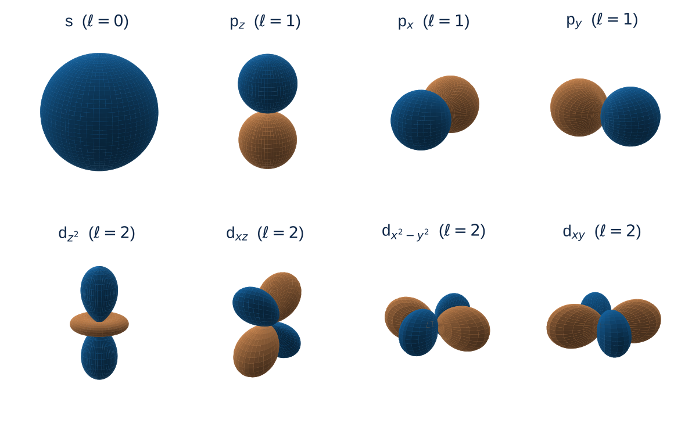

## 6.3 Partikel pada cincin

### Persamaan dan penyelesaiannya

Model paling sederhana untuk rotasi adalah partikel bermassa $m$ yang bergerak bebas pada lingkaran berjari-jari $R$ di bidang $xy$. Satu-satunya koordinat adalah sudut $\phi$; jari-jari tetap dan energi potensial nol di sepanjang cincin. Energi kinetik klasiknya $L_z^2/2I$ dengan $I = mR^2$, sehingga

$$
\hat H = \frac{\hat L_z^2}{2I} = -\frac{\hbar^2}{2I}\frac{d^2}{d\phi^2} . \qquad \text{(6.9)}
$$

Persamaan Schrödinger $-\tfrac{\hbar^2}{2I}\psi'' = E\psi$ mempunyai penyelesaian $\psi = Ae^{im\phi}$ dengan $E = m^2\hbar^2/2I$. Yang menentukan nilai $m$ bukan dinding, melainkan **syarat bernilai tunggal** (Contoh 4.9): titik $\phi$ dan $\phi + 2\pi$ adalah titik yang sama, sehingga $e^{im(\phi + 2\pi)} = e^{im\phi}$, yaitu $e^{2\pi im} = 1$. Jadi $m$ harus bilangan bulat. Normalisasi $\int_0^{2\pi}|\psi|^2d\phi = 1$ memberi $A = 1/\sqrt{2\pi}$:

$$
\boxed{\ \psi_m(\phi) = \frac{1}{\sqrt{2\pi}}e^{im\phi}, \qquad E_m = \frac{m^2\hbar^2}{2I}, \qquad L_z = m\hbar, \qquad m = 0, \pm1, \pm2, \ldots\ } \qquad \text{(6.10)}
$$

Tiga sifat menonjol:

1. **Tidak ada energi titik nol.** Keadaan $m = 0$ mempunyai energi nol dan fungsi gelombang tetap. Ini tidak melanggar asas ketidakpastian: posisi sudutnya sama sekali tidak diketahui ($\Delta\phi$ maksimum), sehingga momentum sudutnya boleh tepat nol.
2. **Degenerasi rangkap dua** untuk $m \ne 0$: $+m$ dan $-m$ (putaran berlawanan arah) berenergi sama.
3. **Rapat peluang seragam**: $|\psi_m|^2 = 1/2\pi$ untuk setiap $m$. Kombinasi riil $\cos m\phi$ dan $\sin m\phi$ (juga fungsi eigen $\hat H$, bukan $\hat L_z$) mempunyai $2|m|$ simpul (Gambar 6.1).

{width=95%}

### Elektron π pada cincin aromatik

Elektron π benzena terdelokalisasi di sekeliling cincin enam atom karbon. Model elektron bebas pada cincin, seperti model kotak untuk poliena (subbab 3.8), mengisi tingkat-tingkat (6.10) dengan dua elektron per keadaan. Untuk $4n + 2$ elektron, kulit-kulit terisi penuh: $m = 0$ (2 elektron), $m = \pm1$ (4 elektron), $m = \pm2$ (4 elektron), dan seterusnya. Sistem dengan 2, 6, 10, 14, ... elektron π mempunyai kulit tertutup yang stabil. Inilah versi paling sederhana **aturan Hückel** $4n + 2$ untuk aromatisitas, yang akan diturunkan lebih teliti dengan teori orbital molekul di Bab 13.

::: {.contoh}
**Contoh 6.8 · Serapan benzena menurut model cincin**

Perlakukan elektron π benzena sebagai elektron bebas pada cincin berjari-jari 139 pm (sama dengan panjang ikatan C–C pada heksagon beraturan). Hitung energi transisi dari tingkat terisi tertinggi ke tingkat kosong terendah dan panjang gelombangnya.

**Penyelesaian.** Satuan energi $\hbar^2/2m_eR^2 = (1{,}0546 \times 10^{-34})^2/[2(9{,}109 \times 10^{-31})(1{,}39 \times 10^{-10})^2] = 3{,}16 \times 10^{-19}$ J $= 1{,}97$ eV. Enam elektron mengisi $m = 0$ dan $\pm1$. Transisi $|m| = 1 \to 2$: $\Delta E = (4 - 1)(1{,}97) = 5{,}92$ eV, $\lambda = hc/\Delta E = 210$ nm.

**Memahami hasil.** Benzena menyerap kuat di 180 dan 204 nm, dan lemah di 255 nm. Model sederhana tanpa parameter jatuh tepat di daerah yang benar. Transisi $|m| = 1 \to 2$ sebenarnya menghasilkan beberapa keadaan tereksitasi (karena tolakan elektron), dan aturan seleksi momentum sudut ($\Delta m = \pm1$) membuat sebagian di antaranya terlarang: itulah asal pita lemah 255 nm.
:::

::: {.contoh}
**Contoh 6.9 · Rotor metil bebas**

Gugus metil berputar terhadap sumbu C–C (atau C–X). Jarak setiap atom H dari sumbu adalah $r = (109\ \text{pm})\sin 70{,}5° = 102{,}8$ pm. Hitung momen inersia dan tetapan rotasi $\hbar^2/2I$ (dalam cm⁻¹), dengan mengabaikan penghalang rotasi.

**Penyelesaian.** $I = 3m_Hr^2 = 3(1{,}0078)(1{,}6605 \times 10^{-27})(1{,}028 \times 10^{-10})^2 = 5{,}30 \times 10^{-47}$ kg m². Dalam cm⁻¹, $\hbar^2/2I$ dibagi $hc$ adalah $h/(8\pi^2cI) = 5{,}28$ cm⁻¹. Tingkat-tingkatnya $5{,}28\,m^2$ cm⁻¹: 0; 5,3; 21,1; 47,5; ... cm⁻¹.

**Memahami hasil.** Selisihnya jauh di bawah $kT$ (207 cm⁻¹), sehingga pada suhu kamar banyak tingkat terisi dan rotasi metil hampir klasik. Dalam etana, penghalang rotasi sekitar 1000 cm⁻¹ (12 kJ/mol) mengubah rotasi bebas menjadi **torsi** (getaran sudut) di dasar sumur, dengan penerobosan antara tiga sumur. Model cincin bebas adalah limit penghalang rendah; untuk metil pada toluena (penghalang hanya sekitar 5 cm⁻¹), model ini hampir tepat.
:::

::: {.contoh}
**Contoh 6.10 · Mengukur $L_z$ pada superposisi**

Partikel pada cincin berada dalam keadaan $\psi = N\cos^2\phi$. Tentukan $N$, hasil-hasil pengukuran $L_z$ yang mungkin beserta peluangnya, dan $\langle E\rangle$.

**Penyelesaian.** $\cos^2\phi = \tfrac12 + \tfrac14e^{2i\phi} + \tfrac14e^{-2i\phi}$. Dalam basis $\psi_m = e^{im\phi}/\sqrt{2\pi}$, koefisiennya sebanding dengan $\tfrac12$, $\tfrac14$, $\tfrac14$ (untuk $m = 0$, $+2$, $-2$). Kuadratnya $\tfrac14$, $\tfrac1{16}$, $\tfrac1{16}$, jumlah $\tfrac38$. Peluang: $m = 0$: $\tfrac{1/4}{3/8} = \tfrac23$; $m = \pm2$: $\tfrac16$ masing-masing. Normalisasi: $N^2\int_0^{2\pi}\cos^4\phi\,d\phi = N^2(3\pi/4) = 1$, jadi $N = \sqrt{4/3\pi}$. $\langle E\rangle = \tfrac23(0) + \tfrac13(4)\tfrac{\hbar^2}{2I} = \tfrac43\cdot\tfrac{\hbar^2}{2I}$.

**Memahami hasil.** Fungsi yang "menumpuk" di $\phi = 0$ dan $\pi$ (dua arah berlawanan) memuat komponen $m = \pm2$ tetapi tidak $\pm1$: fungsi itu tidak berubah ketika diputar 180°, sehingga hanya memuat $m$ genap. Hubungan antara simetri rotasi fungsi dan nilai $m$ yang dikandungnya adalah dasar teori grup untuk molekul simetris (Bab 10).
:::

::: {.terapan}
**Arus cincin dan aromatisitas dalam NMR**

Dalam medan magnet yang tegak lurus bidang cincin, tingkat $m = +1$ dan $m = -1$ benzena tidak lagi berenergi sama, dan elektron π membentuk **arus cincin** diamagnetik. Arus ini menghasilkan medan magnet kecil yang memperkuat medan luar di luar cincin dan melemahkannya di dalam cincin. Akibatnya proton benzena (di luar cincin) bergeser ke medan rendah (7,3 ppm, dibandingkan 5,6 ppm untuk proton alkena), sedangkan proton di dalam cincin [18]anulena bergeser jauh ke medan tinggi (sekitar −3 ppm). Pergeseran kimia ini dipakai sebagai kriteria eksperimental aromatisitas (Bab 16).
:::

::: {.contoh}
**Contoh 6.11 · Dari rotasi bebas ke torsi: etana**

Rotasi gugus metil dalam etana dihambat potensial $V(\phi) = \tfrac12V_0(1 - \cos3\phi)$ dengan $V_0 = 1024$ cm⁻¹. Tetapan rotasi tereduksi untuk dua gugus metil yang berputar berlawanan adalah $B_\text{red} = 2 \times 5{,}28 = 10{,}56$ cm⁻¹ (Contoh 6.9). Perkirakan frekuensi getaran torsi di dasar sumur.

**Penyelesaian.** Di dekat minimum, $1 - \cos3\phi \approx \tfrac92\phi^2$, sehingga $V \approx \tfrac94V_0\phi^2$. Hamiltonian $-B_\text{red}\,d^2/d\phi^2 + \tfrac94V_0\phi^2$ (dalam cm⁻¹) adalah osilator harmonik dengan $\tilde\omega = 2\sqrt{B_\text{red}\cdot\tfrac94V_0} = 3\sqrt{B_\text{red}V_0} = 3\sqrt{(10{,}56)(1024)} = 312$ cm⁻¹.

**Memahami hasil.** Pita torsi etana terukur di 289 cm⁻¹; selisihnya berasal dari anharmonisitas potensial kosinus. Satu molekul memperlihatkan dua limit: bila $V_0 \gg kT$, gugus metil bergetar di salah satu dari tiga sumur (subbab 5.1 sampai 5.6); bila $V_0 \ll kT$, ia berputar hampir bebas (subbab 6.3). Di antara keduanya, tingkat-tingkat torsi terpecah oleh penerobosan antarsumur, seperti inversi amonia (subbab 3.12).
:::

::: {.kuis}
**Kuis cepat 6.3**

Mengapa partikel pada cincin tidak mempunyai energi titik nol, padahal partikel dalam kotak mempunyai? Berapa banyak elektron yang mengisi tingkat sampai $|m| = 3$?
:::

## 6.4 Partikel pada bola

### Pemisahan variabel

Sekarang partikel bebas bergerak pada permukaan bola berjari-jari $R$. Koordinatnya $\theta$ dan $\phi$, dan Hamiltoniannya adalah energi kinetik rotasi:

$$
\hat H = \frac{\hat L^2}{2I}, \qquad I = mR^2 . \qquad \text{(6.11)}
$$

Persamaan Schrödinger $\hat H Y = EY$ dengan (6.7), dikalikan $\sin^2\theta$ dan ditulis $\beta = 2IE/\hbar^2$, menjadi

$$
\sin\theta\frac{\partial}{\partial\theta}\left(\sin\theta\frac{\partial Y}{\partial\theta}\right) + \frac{\partial^2Y}{\partial\phi^2} + \beta\sin^2\theta\,Y = 0 .
$$

Coba $Y(\theta, \phi) = \Theta(\theta)\Phi(\phi)$ dan bagi dengan $\Theta\Phi$. Suku yang hanya bergantung pada $\phi$ adalah $\Phi''/\Phi$, sisanya hanya pada $\theta$. Keduanya harus sama dengan tetapan, yang kita tulis $-m^2$:

$$
\frac{d^2\Phi}{d\phi^2} = -m^2\Phi, \qquad \frac{1}{\sin\theta}\frac{d}{d\theta}\left(\sin\theta\frac{d\Theta}{d\theta}\right) - \frac{m^2}{\sin^2\theta}\Theta + \beta\Theta = 0 . \qquad \text{(6.12)}
$$

Persamaan pertama adalah partikel pada cincin: $\Phi = e^{im\phi}/\sqrt{2\pi}$ dengan $m$ bulat.

### Persamaan Legendre terasosiasi

Dengan $x = \cos\theta$ (sehingga $\tfrac{d}{d\theta} = -\sin\theta\tfrac{d}{dx}$ dan $\sin^2\theta = 1 - x^2$), persamaan kedua menjadi **persamaan Legendre terasosiasi**:

$$
(1 - x^2)\frac{d^2\Theta}{dx^2} - 2x\frac{d\Theta}{dx} + \left[\beta - \frac{m^2}{1 - x^2}\right]\Theta = 0 . \qquad \text{(6.13)}
$$

Untuk $m = 0$, ini persamaan Legendre yang sudah kita temui dalam soal Bab 2. Penyelesaian deret pangkatnya mempunyai rekursi $a_{k+2} = \tfrac{k(k+1) - \beta}{(k+1)(k+2)}a_k$. Untuk $k$ besar, $a_{k+2}/a_k \to 1$, sehingga deret tak hingga berperilaku seperti $\sum x^k$, yang divergen di $x = \pm1$, yaitu di kutub bola. Fungsi gelombang yang tak hingga di kutub tidak dapat diterima. Deret harus berhenti, dan itu terjadi bila $\beta = \ell(\ell + 1)$ dengan $\ell$ bilangan bulat tak negatif. Penyelesaiannya adalah **polinom Legendre** $P_\ell(x)$:

$$
P_0 = 1, \quad P_1 = x, \quad P_2 = \tfrac12(3x^2 - 1), \quad P_3 = \tfrac12(5x^3 - 3x) .
$$

Untuk $m \ne 0$, penyelesaiannya adalah **fungsi Legendre terasosiasi**

$$
P_\ell^{|m|}(x) = (1 - x^2)^{|m|/2}\frac{d^{|m|}}{dx^{|m|}}P_\ell(x) . \qquad \text{(6.14)}
$$

Karena $P_\ell$ polinom berderajat $\ell$, turunan ke-$|m|$ menjadi nol bila $|m| > \ell$. Jadi $m$ hanya boleh bernilai $-\ell, -\ell + 1, \ldots, \ell$.

### Tingkat energi

Dari $\beta = 2IE/\hbar^2 = \ell(\ell + 1)$:

$$
\boxed{\ E_\ell = \frac{\ell(\ell + 1)\hbar^2}{2I}, \qquad L^2 = \ell(\ell + 1)\hbar^2, \qquad L_z = m\hbar, \qquad m = -\ell, \ldots, +\ell\ } \qquad \text{(6.15)}
$$

Energi bergantung hanya pada $\ell$, sehingga setiap tingkat berdegenerasi $2\ell + 1$: semua orientasi ruang momentum sudut berenergi sama karena bola tidak mempunyai arah istimewa. Degenerasi ini pecah bila ada medan luar yang menentukan arah (efek Zeeman, efek Stark).

::: {.contoh}
**Contoh 6.12 · Tingkat energi dan degenerasi**

Daftarkan lima tingkat terendah partikel pada bola dalam satuan $\hbar^2/2I$, beserta degenerasinya, dan jumlah elektron yang dapat mengisinya sampai tingkat tertentu.

**Penyelesaian.**

| $\ell$ | 0 | 1 | 2 | 3 | 4 |
|---|---|---|---|---|---|
| $E/(\hbar^2/2I)$ | 0 | 2 | 6 | 12 | 20 |
| $2\ell + 1$ | 1 | 3 | 5 | 7 | 9 |
| elektron kumulatif | 2 | 8 | 18 | 32 | 50 |

**Memahami hasil.** Barisan 2, 8, 18, 32, 50 adalah $2(\ell + 1)^2$. Angka 2, 8, 18, dan 32 juga panjang periode dalam tabel periodik; kesamaan ini bukan kebetulan, karena bagian sudut orbital atom adalah fungsi-fungsi partikel pada bola ini (Bab 7 dan 9). Selisih $E_{\ell+1} - E_\ell = 2(\ell + 1)$ makin besar, berbeda dari osilator.
:::

::: {.contoh}
**Contoh 6.13 · Fulerena sebagai elektron pada bola**

Molekul C₆₀ adalah bola berongga berjari-jari 355 pm dengan 60 elektron π. Perlakukan elektron itu sebagai partikel bebas pada bola. Tingkat mana yang terisi, dan berapa energi transisi dari $\ell = 5$ ke $\ell = 6$?

**Penyelesaian.** Satuan energi $\hbar^2/2m_eR^2 = 0{,}302$ eV. Dari Contoh 6.12, tingkat $\ell = 0$ sampai 4 memuat 50 elektron; sisanya 10 elektron masuk ke $\ell = 5$, yang dapat memuat 22. Transisi $\ell = 5 \to 6$: $\Delta E = (42 - 30)(0{,}302) = 3{,}63$ eV, $\lambda = 342$ nm.

**Memahami hasil.** C₆₀ mempunyai pita serapan kuat di sekitar 330 nm, sangat dekat dengan ramalan. Model bola tentu terlalu sederhana: kulit $\ell = 5$ yang terisi sebagian dipecah oleh simetri ikosahedral molekul menjadi beberapa tingkat, sehingga C₆₀ sebenarnya berkulit tertutup. Tetapi gagasan "atom super" dengan kulit-kulit $\ell$ ini dipakai luas untuk gugus logam (misalnya Na₈, Na₂₀, Na₄₀ yang sangat stabil, sesuai angka 8, 20, 40 dari model bola dengan sumur).
:::

::: {.contoh}
**Contoh 6.14 · Polinom Legendre dari rekursi**

Dengan rekursi $a_{k+2} = \tfrac{k(k+1) - \ell(\ell+1)}{(k+1)(k+2)}a_k$, bangun penyelesaian untuk $\ell = 2$ mulai dari $a_0 = 1$, dan bandingkan dengan $P_2$.

**Penyelesaian.** $a_2 = \tfrac{0 - 6}{2}a_0 = -3$, $a_4 = \tfrac{6 - 6}{12}a_2 = 0$. Jadi $\Theta = 1 - 3x^2 = -2P_2(x)$.

**Memahami hasil.** Bagian sudut $3\cos^2\theta - 1$ adalah bentuk orbital $d_{z^2}$. Nilai $\ell = 2$ membuat rekursi berhenti tepat setelah suku $x^2$; nilai $\beta$ lain (misalnya $\beta = 5$) tidak pernah menghentikan deret dan memberi fungsi yang tak hingga di kutub.
:::

::: {.kuis}
**Kuis cepat 6.4**

Berapa degenerasi tingkat dengan $E = 12\hbar^2/2I$? Mengapa $|m|$ tidak boleh lebih besar daripada $\ell$?
:::

## 6.5 Harmonik bola

### Definisi dan tabel

Penyelesaian ternormalisasi partikel pada bola disebut **harmonik bola**:

$$
Y_\ell^m(\theta, \phi) = N_{\ell m}P_\ell^{|m|}(\cos\theta)\,e^{im\phi}, \qquad \int_0^{2\pi}\!\!\int_0^\pi Y_{\ell'}^{m'*}Y_\ell^m\sin\theta\,d\theta\,d\phi = \delta_{\ell\ell'}\delta_{mm'} . \qquad \text{(6.16)}
$$

Faktor $\sin\theta\,d\theta\,d\phi$ adalah elemen luas pada bola satuan (bagian sudut dari (2.21)). Ortogonalitas untuk $m$ berbeda berasal dari integral $\phi$; untuk $\ell$ berbeda dan $m$ sama, dari kehermitan $\hat L^2$. Dengan konvensi fase Condon–Shortley yang dipakai di seluruh buku ini:

| $\ell$ | $m$ | $Y_\ell^m$ |
|---|---|---|
| 0 | 0 | $\dfrac{1}{\sqrt{4\pi}}$ |
| 1 | 0 | $\sqrt{\dfrac{3}{4\pi}}\cos\theta$ |
| 1 | $\pm1$ | $\mp\sqrt{\dfrac{3}{8\pi}}\sin\theta\,e^{\pm i\phi}$ |
| 2 | 0 | $\sqrt{\dfrac{5}{16\pi}}(3\cos^2\theta - 1)$ |
| 2 | $\pm1$ | $\mp\sqrt{\dfrac{15}{8\pi}}\sin\theta\cos\theta\,e^{\pm i\phi}$ |
| 2 | $\pm2$ | $\sqrt{\dfrac{15}{32\pi}}\sin^2\theta\,e^{\pm2i\phi}$ |

### Bentuk riil: orbital p dan d

Harmonik bola dengan $m \ne 0$ kompleks. Karena $Y_\ell^m$ dan $Y_\ell^{-m}$ berdegenerasi, kombinasi linearnya juga fungsi eigen $\hat H$ dan $\hat L^2$ (meskipun bukan $\hat L_z$). Kombinasi riil yang dipakai dalam kimia:

$$
p_x = \tfrac{1}{\sqrt2}(Y_1^{-1} - Y_1^1) = \sqrt{\tfrac{3}{4\pi}}\sin\theta\cos\phi \propto \frac xr, \qquad p_y = \tfrac{i}{\sqrt2}(Y_1^{-1} + Y_1^1) = \sqrt{\tfrac{3}{4\pi}}\sin\theta\sin\phi \propto \frac yr, \qquad p_z = Y_1^0 \propto \frac zr . \qquad \text{(6.17)}
$$

Untuk $\ell = 2$: $d_{z^2} \propto (3z^2 - r^2)/r^2$, $d_{xz} \propto xz/r^2$, $d_{yz} \propto yz/r^2$, $d_{x^2-y^2} \propto (x^2 - y^2)/r^2$, dan $d_{xy} \propto xy/r^2$. Nama-nama orbital ini tidak lain adalah polinom Kartesius yang sebanding dengan harmonik bola riil (Gambar 6.2).

{width=95%}

### Sifat-sifat penting

1. **Simpul sudut.** $Y_\ell^m$ mempunyai $\ell$ bidang atau kerucut simpul: $|m|$ bidang simpul yang memuat sumbu $z$ (dari $\cos m\phi$ atau $\sin m\phi$) dan $\ell - |m|$ kerucut simpul (dari akar $P_\ell^{|m|}$).
2. **Paritas.** Pada inversi $\mathbf r \to -\mathbf r$, $\theta \to \pi - \theta$ dan $\phi \to \phi + \pi$, dan $Y_\ell^m \to (-1)^\ell Y_\ell^m$. Orbital s dan d genap (g), p dan f ganjil (u); inilah dasar aturan Laporte (subbab 4.11).
3. **Teorema Unsöld.** $\sum_{m=-\ell}^{\ell}|Y_\ell^m|^2 = (2\ell + 1)/4\pi$, tidak bergantung pada sudut. Subkulit yang terisi penuh berbentuk bola sempurna.

::: {.contoh}
**Contoh 6.15 · Normalisasi $Y_1^0$**

Tunjukkan bahwa $N\cos\theta$ ternormalisasi bila $N = \sqrt{3/4\pi}$.

**Penyelesaian.** $\int_0^{2\pi}d\phi\int_0^\pi N^2\cos^2\theta\sin\theta\,d\theta$. Dengan $x = \cos\theta$, $dx = -\sin\theta\,d\theta$: $\int_0^\pi\cos^2\theta\sin\theta\,d\theta = \int_{-1}^1x^2dx = \tfrac23$. Jadi $N^2(2\pi)(\tfrac23) = 1$, $N^2 = 3/4\pi$.

**Memahami hasil.** Substitusi $x = \cos\theta$ mengubah integral sudut menjadi integral polinom pada $[-1, 1]$. Karena itu ortogonalitas polinom Legendre pada selang ini (Contoh 2.28, dengan Gram–Schmidt) sama dengan ortogonalitas harmonik bola dengan $m = 0$.
:::

::: {.contoh}
**Contoh 6.16 · Membangun $p_x$ dari harmonik kompleks**

Tunjukkan $\tfrac{1}{\sqrt2}(Y_1^{-1} - Y_1^1) = \sqrt{3/4\pi}\sin\theta\cos\phi$ dan bahwa fungsi ini bukan fungsi eigen $\hat L_z$.

**Penyelesaian.** $Y_1^{-1} - Y_1^1 = \sqrt{\tfrac{3}{8\pi}}\sin\theta(e^{-i\phi} + e^{i\phi}) = \sqrt{\tfrac{3}{8\pi}}\sin\theta\cdot2\cos\phi$. Dibagi $\sqrt2$: $\sqrt{\tfrac{3}{4\pi}}\sin\theta\cos\phi$. Lalu $\hat L_z(\sin\theta\cos\phi) = -i\hbar\sin\theta(-\sin\phi) = i\hbar\sin\theta\sin\phi$, yang sebanding dengan $p_y$, bukan $p_x$.

**Memahami hasil.** $\hat L_z$ mengubah $p_x$ menjadi $p_y$ (dikali $i\hbar$): rotasi infinitesimal terhadap $z$ memutar orbital $p_x$ ke arah $p_y$, sesuai Contoh 6.5. Orbital riil cocok untuk menggambarkan ikatan berarah; orbital kompleks cocok bila ada medan magnet atau bila momentum sudut perlu dihitung.
:::

::: {.contoh}
**Contoh 6.17 · Kerucut simpul $d_{z^2}$**

Tentukan sudut kerucut simpul orbital $d_{z^2}$ dan perbandingan nilai $|Y_2^0|$ di sumbu $z$ dan di bidang $xy$.

**Penyelesaian.** Simpul: $3\cos^2\theta - 1 = 0$, $\cos\theta = \pm1/\sqrt3$, $\theta = 54{,}7°$ dan $125{,}3°$. Di $\theta = 0$: $3 - 1 = 2$; di $\theta = 90°$: $-1$. Perbandingannya 2 : 1, dengan tanda berlawanan.

**Memahami hasil.** Sudut 54,7° ini disebut **sudut ajaib**. Dalam NMR padatan, sampel diputar dengan sumbu miring 54,7° terhadap medan (*magic-angle spinning*) karena interaksi dipol–dipol antar spin inti sebanding dengan $3\cos^2\theta - 1$ dan menjadi nol rata-ratanya pada sudut ini (Bab 16). Bentuk "cincin" $d_{z^2}$ adalah daerah bertanda negatif di sekitar bidang $xy$.
:::

::: {.contoh}
**Contoh 6.18 · Subkulit penuh berbentuk bola**

Periksa teorema Unsöld untuk $\ell = 1$.

**Penyelesaian.** $|Y_1^0|^2 + |Y_1^1|^2 + |Y_1^{-1}|^2 = \tfrac{3}{4\pi}\cos^2\theta + 2\cdot\tfrac{3}{8\pi}\sin^2\theta = \tfrac{3}{4\pi}(\cos^2\theta + \sin^2\theta) = \tfrac{3}{4\pi}$.

**Memahami hasil.** Enam elektron p (subkulit p⁶) membentuk distribusi muatan bola, walaupun setiap orbital p berarah. Karena itu atom gas mulia dan ion dengan subkulit penuh (Na⁺, Cl⁻) bersimetri bola, dan atom dengan satu subkulit penuh ditambah satu elektron (Na) dapat diperlakukan sebagai satu elektron di luar teras bola (Bab 9).
:::

::: {.contoh}
**Contoh 6.19 · Donat dan halter**

Hitung peluang menemukan elektron di dalam kerucut 30° di sekitar sumbu $z$ (kedua belahan), untuk bagian sudut $p_z$ ($|Y_1^0|^2$) dan $p_{+1}$ ($|Y_1^1|^2$).

**Penyelesaian.** Dengan $c = \cos30° = 0{,}866$. Untuk $p_z$: $2 \times 2\pi\cdot\tfrac{3}{4\pi}\int_0^{\pi/6}\cos^2\theta\sin\theta\,d\theta = 1 - c^3 = 0{,}350$. Untuk $p_{+1}$: $2 \times 2\pi\cdot\tfrac{3}{8\pi}\int_0^{\pi/6}\sin^3\theta\,d\theta = \tfrac32\left[\tfrac23 - c + \tfrac{c^3}{3}\right] = 0{,}026$.

**Memahami hasil.** Kerucut itu hanya 13% dari luas bola, tetapi memuat 35% peluang $p_z$ dan hanya 2,6% peluang $p_{+1}$. Orbital $p_{\pm1}$ berbentuk donat di sekitar sumbu $z$, sedangkan $p_z$ berbentuk halter sepanjang sumbu. Bentuk donat itu adalah rata-rata $p_x$ dan $p_y$: $|p_{+1}|^2 = \tfrac12(|p_x|^2 + |p_y|^2)$.
:::

::: {.kuis}
**Kuis cepat 6.5**

Berapa banyak bidang simpul dan kerucut simpul yang dimiliki $Y_3^1$? Apa paritasnya?
:::
