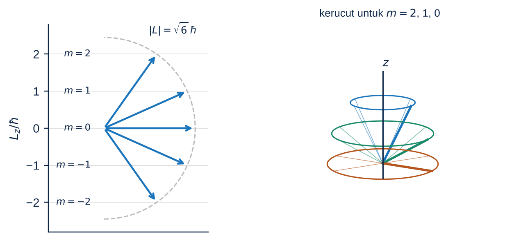

## 6.6 Kuantisasi ruang dan model vektor

### Orientasi yang terkuantisasi

Besar momentum sudut adalah $|\mathbf L| = \sqrt{\ell(\ell + 1)}\,\hbar$ dan komponen $z$-nya $m\hbar$ dengan $m = -\ell, \ldots, \ell$. Bila kita membayangkan momentum sudut sebagai vektor, maka vektor itu hanya boleh membentuk sudut tertentu dengan sumbu $z$:

$$
\cos\theta_m = \frac{m}{\sqrt{\ell(\ell + 1)}} . \qquad \text{(6.18)}
$$

Gejala ini disebut **kuantisasi ruang**. Karena $\sqrt{\ell(\ell+1)} > \ell$ untuk setiap $\ell > 0$, sudut terkecil tidak pernah nol: vektor momentum sudut tidak pernah tepat sejajar dengan sumbu $z$. Ini akibat langsung dari komutator (6.5): seandainya $\mathbf L$ sejajar $z$, maka $L_x = L_y = 0$ tajam bersama $L_z$, padahal tidak ada keadaan (selain $\ell = 0$) dengan ketiga komponen tajam.

### Model vektor

Gambaran semiklasik yang berguna adalah **model vektor** (Gambar 6.3): vektor sepanjang $\sqrt{\ell(\ell+1)}\,\hbar$ terletak di permukaan kerucut yang sumbunya $z$, dengan proyeksi $m\hbar$. Arah vektor di sekeliling kerucut (sudut azimut) sama sekali tidak tentu. Nilai harap komponen tegak lurus adalah nol, tetapi kuadratnya tidak:

$$
\langle L_x\rangle = \langle L_y\rangle = 0, \qquad \langle L_x^2\rangle = \langle L_y^2\rangle = \tfrac12\left[\ell(\ell + 1) - m^2\right]\hbar^2 . \qquad \text{(6.19)}
$$

Hasil kedua mengikuti dari $\langle L^2\rangle = \langle L_x^2\rangle + \langle L_y^2\rangle + \langle L_z^2\rangle$ dan simetri $x \leftrightarrow y$. Model vektor bukan gambaran harfiah (vektor tidak "berputar" di kerucut), tetapi ia menghasilkan semua nilai harap dengan benar dan sangat berguna untuk menggabungkan momentum sudut (Bab 9).

{width=88%}

### Bukti percobaan: Stern–Gerlach

Tahun 1922, Otto Stern dan Walther Gerlach melewatkan berkas atom perak melalui medan magnet yang tidak homogen. Gaya pada momen magnet sebanding dengan komponennya searah gradien medan. Menurut fisika klasik, momen magnet atom terarah acak, sehingga berkas akan melebar menjadi pita malar. Yang teramati adalah **dua** berkas terpisah: komponen momen magnet terkuantisasi. Bahwa jumlahnya dua (bukan bilangan ganjil $2\ell + 1$) ternyata berasal dari **spin** elektron dengan $s = \tfrac12$, yang akan kita bahas di Bab 9. Operator tangga di subbab 6.7 menunjukkan mengapa nilai setengah bulat itu diizinkan oleh aljabar momentum sudut.

::: {.contoh}
**Contoh 6.21 · Sudut-sudut yang diizinkan**

Hitung sudut antara $\mathbf L$ dan sumbu $z$ untuk semua $m$ pada $\ell = 1$, 2, dan 3.

**Penyelesaian.** Dengan (6.18):

| $\ell$ | sudut untuk $m = \ell, \ell - 1, \ldots, -\ell$ |
|---|---|
| 1 | 45,0°; 90°; 135,0° |
| 2 | 35,3°; 65,9°; 90°; 114,1°; 144,7° |
| 3 | 30,0°; 54,7°; 73,2°; 90°; 106,8°; 125,3°; 150,0° |

**Memahami hasil.** Makin besar $\ell$, makin kecil sudut minimum dan makin rapat orientasi yang diizinkan. Untuk $\ell = 100$, sudut minimumnya 5,7°; untuk benda makroskopis dengan $\ell \sim 10^{30}$, orientasinya praktis malar. Ini contoh lain asas korespondensi.
:::

::: {.contoh}
**Contoh 6.22 · Ketidakpastian komponen tegak lurus**

Untuk $\ell = 1$, hitung $\langle L_x^2\rangle$ dan $\Delta L_x$ pada $m = 1$ dan $m = 0$. Periksa relasi ketidakpastian $\Delta L_x\Delta L_y \ge \tfrac12\hbar|\langle L_z\rangle|$.

**Penyelesaian.** $m = 1$: $\langle L_x^2\rangle = \tfrac12(2 - 1)\hbar^2 = \tfrac12\hbar^2$, $\Delta L_x = \hbar/\sqrt2$. Hasil kali $\Delta L_x\Delta L_y = \tfrac12\hbar^2$, sama dengan batas $\tfrac12\hbar\cdot\hbar$. $m = 0$: $\langle L_x^2\rangle = \hbar^2$, $\Delta L_x = \hbar$, hasil kali $\hbar^2 \ge 0$.

**Memahami hasil.** Keadaan dengan $|m| = \ell$ adalah keadaan "paling terarah" dan memenuhi relasi ketidakpastian dengan tanda sama dengan, seperti keadaan dasar osilator untuk $x$ dan $p$. Pada $m = 0$, vektor momentum sudut terletak di bidang $xy$ dengan arah sembarang, sehingga ketidakpastian $L_x$ dan $L_y$ terbesar (Contoh 4.35).
:::

::: {.contoh}
**Contoh 6.23 · Pemisahan Zeeman orbital**

Dalam medan magnet $B$ sepanjang $z$, energi interaksi momen magnet orbital adalah $E = -\mu_zB = m\mu_BB$ menurut (6.3). Untuk elektron $\ell = 1$ dalam medan 1,00 T, hitung selisih energi antara $m = +1$ dan $m = -1$ dalam cm⁻¹, dan pergeseran panjang gelombang untuk garis 500 nm.

**Penyelesaian.** $\Delta E = 2\mu_BB = 1{,}855 \times 10^{-23}$ J $= 0{,}934$ cm⁻¹. Pada 500 nm (20 000 cm⁻¹), pergeseran $\Delta\lambda = \lambda^2\Delta\tilde\nu = (5 \times 10^{-5}\ \text{cm})^2(0{,}467\ \text{cm}^{-1}) = 1{,}17 \times 10^{-9}$ cm $= 0{,}012$ nm untuk setiap komponen terhadap pusat.

**Memahami hasil.** Garis spektrum terpecah menjadi tiga komponen yang terpisah sekitar 0,01 nm: kecil, tetapi terukur dengan spektrometer yang baik. Pecahnya garis inilah yang pertama kali memperlihatkan kuantisasi ruang (Zeeman, 1896). Untuk atom dengan spin, pola pecahnya lebih rumit (efek Zeeman anomal, Bab 9).
:::

::: {.contoh}
**Contoh 6.24 · Sudut kerucut momentum sudut**

Dalam model vektor, sudut antara $\mathbf L$ dan sumbu $z$ memenuhi $\cos\theta = m/\sqrt{\ell(\ell + 1)}$. Hitung semua sudut yang diizinkan untuk $\ell = 1$, 2, dan 3. Berapa sudut terkecil untuk tiap $\ell$?

**Penyelesaian.**

| $\ell$ | sudut yang diizinkan |
|---|---|
| 1 | 45,0°, 90,0°, 135,0° |
| 2 | 35,3°, 65,9°, 90,0°, 114,1°, 144,7° |
| 3 | 30,0°, 54,7°, 73,2°, 90,0°, 106,8°, 125,3°, 150,0° |

Sudut terkecil ($m = \ell$) adalah 45,0°, 35,3°, dan 30,0°.

**Memahami hasil.** Vektor momentum sudut tidak pernah sejajar sumbu $z$, karena itu akan membuat $L_x$ dan $L_y$ sama-sama tepat nol, melanggar asas ketidakpastian untuk komponen yang tidak komut. Makin besar $\ell$, makin kecil sudut terkecilnya: untuk $\ell = 100$ sudut itu tinggal 5,7°, dan pada batas klasik ($\ell$ sangat besar) momentum sudut dapat sejajar sumbu mana pun, seperti gasing biasa.
:::

::: {.kuis}
**Kuis cepat 6.6**

Untuk $\ell = 3$, berapa banyak orientasi yang diizinkan? Berapa $\langle L_x^2\rangle$ pada $m = 3$?
:::

## 6.7 Metode operator tangga

### Operator naik dan turun

Seperti osilator harmonik (subbab 5.6), nilai eigen momentum sudut dapat diperoleh hanya dari komutator, tanpa persamaan diferensial. Definisikan

$$
\hat L_+ = \hat L_x + i\hat L_y, \qquad \hat L_- = \hat L_x - i\hat L_y . \qquad \text{(6.20)}
$$

Dari (6.5) diperoleh $[\hat L_z, \hat L_\pm] = \pm\hbar\hat L_\pm$ dan $[\hat L^2, \hat L_\pm] = 0$. Misalkan $|\lambda, m\rangle$ fungsi eigen bersama dengan $\hat L^2|\lambda, m\rangle = \lambda\hbar^2|\lambda, m\rangle$ dan $\hat L_z|\lambda, m\rangle = m\hbar|\lambda, m\rangle$. Maka

$$
\hat L_z(\hat L_+|\lambda, m\rangle) = (\hat L_+\hat L_z + \hbar\hat L_+)|\lambda, m\rangle = (m + 1)\hbar\,(\hat L_+|\lambda, m\rangle) ,
$$

sedangkan $\hat L^2$ tidak berubah. Jadi $\hat L_+$ menaikkan $m$ satu, dan $\hat L_-$ menurunkannya satu, tanpa mengubah $\lambda$.

### Tangga harus berhenti di kedua ujung

Karena $\langle L_x^2 + L_y^2\rangle \ge 0$, kita mempunyai $\lambda \ge m^2$: untuk $\lambda$ tertentu, $m$ terbatas di atas dan di bawah. Misalkan $m_\text{maks} = \ell$ dan tangga berhenti di sana: $\hat L_+|\lambda, \ell\rangle = 0$. Pakai identitas

$$
\hat L_-\hat L_+ = \hat L_x^2 + \hat L_y^2 + i[\hat L_x, \hat L_y] = \hat L^2 - \hat L_z^2 - \hbar\hat L_z . \qquad \text{(6.21)}
$$

Kenakan pada $|\lambda, \ell\rangle$: ruas kiri nol, ruas kanan $(\lambda - \ell^2 - \ell)\hbar^2$. Jadi $\lambda = \ell(\ell + 1)$. Dengan cara sama, di ujung bawah $m_\text{min}$ memenuhi $\lambda = m_\text{min}(m_\text{min} - 1)$, sehingga $m_\text{min} = -\ell$. Dari $-\ell$ ke $+\ell$ ada sejumlah bulat langkah, $2\ell$ bulat, sehingga

$$
\ell = 0, \tfrac12, 1, \tfrac32, 2, \ldots, \qquad m = -\ell, -\ell + 1, \ldots, \ell . \qquad \text{(6.22)}
$$

Aljabar momentum sudut mengizinkan nilai **setengah bulat**. Untuk momentum sudut orbital, nilai itu ditolak oleh syarat bernilai tunggal ($e^{im\phi}$ dengan $m = \tfrac12$ berubah tanda setelah satu putaran). Tetapi momentum sudut yang tidak berasal dari gerak di ruang, yaitu **spin**, bebas memakai nilai setengah bulat; elektron, proton, dan neutron mempunyai $s = \tfrac12$ (Bab 9).

### Unsur matriks

Dengan normalisasi yang tepat, dan memakai (6.21) untuk menghitung norma $\hat L_\pm|\ell, m\rangle$:

$$
\hat L_\pm|\ell, m\rangle = \hbar\sqrt{\ell(\ell + 1) - m(m \pm 1)}\;|\ell, m \pm 1\rangle . \qquad \text{(6.23)}
$$

Dari sini $\hat L_x = \tfrac12(\hat L_+ + \hat L_-)$ dan $\hat L_y = \tfrac{1}{2i}(\hat L_+ - \hat L_-)$ dapat ditulis sebagai matriks dalam basis $|\ell, m\rangle$.

::: {.contoh}
**Contoh 6.25 · Matriks $L_x$ untuk $\ell = 1$**

Tuliskan matriks $\hat L_x$ dalam basis $\{|1, 1\rangle, |1, 0\rangle, |1, -1\rangle\}$ dan cari nilai eigennya.

**Penyelesaian.** Dari (6.23): $\hat L_+|1, 0\rangle = \sqrt2\hbar|1, 1\rangle$, $\hat L_+|1, -1\rangle = \sqrt2\hbar|1, 0\rangle$, $\hat L_-|1, 1\rangle = \sqrt2\hbar|1, 0\rangle$, $\hat L_-|1, 0\rangle = \sqrt2\hbar|1, -1\rangle$. Maka

$$
\mathbf L_x = \frac{\hbar}{\sqrt2}\begin{pmatrix}0 & 1 & 0\\ 1 & 0 & 1\\ 0 & 1 & 0\end{pmatrix} .
$$

Persamaan karakteristik $-\lambda^3 + \lambda(\tfrac{\hbar^2}{2} + \tfrac{\hbar^2}{2}) = 0$ memberi $\lambda = 0, \pm\hbar$.

**Memahami hasil.** Nilai eigen $L_x$ sama dengan nilai eigen $L_z$, seperti seharusnya: sumbu $x$ tidak istimewa. Vektor eigen untuk $L_x = 0$ adalah $(1, 0, -1)/\sqrt2$, yaitu $(Y_1^1 - Y_1^{-1})/\sqrt2 = -p_x$: orbital $p_x$ adalah keadaan dengan momentum sudut nol terhadap sumbu $x$, sebagaimana $p_z$ terhadap sumbu $z$.
:::

::: {.contoh}
**Contoh 6.26 · $\hat L_+$ dalam koordinat bola**

Dalam koordinat bola, $\hat L_\pm = \hbar e^{\pm i\phi}(\pm\partial_\theta + i\cot\theta\,\partial_\phi)$. Kenakan $\hat L_+$ pada $Y_1^0 = \sqrt{3/4\pi}\cos\theta$ dan bandingkan dengan (6.23).

**Penyelesaian.** $\hat L_+\cos\theta = \hbar e^{i\phi}(-\sin\theta + 0) = -\hbar\sin\theta\,e^{i\phi}$. Jadi $\hat L_+Y_1^0 = -\hbar\sqrt{\tfrac{3}{4\pi}}\sin\theta\,e^{i\phi} = \sqrt2\,\hbar\left(-\sqrt{\tfrac{3}{8\pi}}\sin\theta\,e^{i\phi}\right) = \sqrt2\,\hbar\,Y_1^1$.

**Memahami hasil.** Faktor $\sqrt2 = \sqrt{1 \cdot 2 - 0 \cdot 1}$ cocok dengan (6.23), dan tanda minus dalam $Y_1^1$ (konvensi Condon–Shortley) muncul dengan sendirinya. Seluruh tabel harmonik bola dapat dibangun dari $Y_\ell^{-\ell} \propto \sin^\ell\theta\,e^{-i\ell\phi}$ dengan menerapkan $\hat L_+$ berulang kali.
:::

::: {.contoh}
**Contoh 6.27 · Spin setengah: matriks Pauli**

Untuk $\ell = \tfrac12$ (dua keadaan, $m = \pm\tfrac12$), tuliskan matriks $\hat L_x$, $\hat L_y$, dan $\hat L_z$ dengan (6.23).

**Penyelesaian.** $\hat L_+|\tfrac12, -\tfrac12\rangle = \hbar\sqrt{\tfrac34 + \tfrac14}\,|\tfrac12, \tfrac12\rangle = \hbar|\tfrac12, \tfrac12\rangle$. Dalam basis $\{|{+}\tfrac12\rangle, |{-}\tfrac12\rangle\}$:

$$
\mathbf L_x = \frac\hbar2\begin{pmatrix}0 & 1\\ 1 & 0\end{pmatrix}, \quad \mathbf L_y = \frac\hbar2\begin{pmatrix}0 & -i\\ i & 0\end{pmatrix}, \quad \mathbf L_z = \frac\hbar2\begin{pmatrix}1 & 0\\ 0 & -1\end{pmatrix} .
$$

**Memahami hasil.** Ini adalah $\tfrac\hbar2$ kali matriks Pauli (Contoh 2.30). Matriks-matriks itu memenuhi $[\mathbf L_x, \mathbf L_y] = i\hbar\mathbf L_z$, tetapi tidak dapat diperoleh dari fungsi $\theta$ dan $\phi$. Spin elektron (Bab 9) dan qubit dalam komputasi kuantum adalah sistem dua keadaan semacam ini.
:::

::: {.contoh}
**Contoh 6.28 · $\hat L^2$ dari operator tangga**

Dengan $\hat L^2 = \hat L_+\hat L_- + \hat L_z^2 - \hbar\hat L_z$, hitung $\hat L^2|1, 0\rangle$ hanya dengan (6.23).

**Penyelesaian.** $\hat L_-|1, 0\rangle = \sqrt2\hbar|1, -1\rangle$; lalu $\hat L_+|1, -1\rangle = \sqrt2\hbar|1, 0\rangle$, sehingga $\hat L_+\hat L_-|1, 0\rangle = 2\hbar^2|1, 0\rangle$. Suku $\hat L_z^2 - \hbar\hat L_z$ memberi nol karena $m = 0$. Jadi $\hat L^2|1, 0\rangle = 2\hbar^2|1, 0\rangle$.

**Memahami hasil.** Hasilnya $\ell(\ell + 1)\hbar^2$ dengan $\ell = 1$, konsisten. Dalam program kimia komputasi, nilai harap $\hat S^2$ untuk spin dihitung dengan cara ini dari operator tangga spin, untuk memeriksa apakah fungsi gelombang "tercemar" oleh keadaan spin lain (Bab 9 dan 17).
:::

::: {.kuis}
**Kuis cepat 6.7**

Berapa $\hat L_+|2, 2\rangle$? Berapa $\hat L_-|2, 2\rangle$? Mengapa $\ell = \tfrac12$ tidak mungkin untuk momentum sudut orbital?
:::

## 6.8 Masalah dua benda dan massa tereduksi

### Pemisahan dalam mekanika kuantum

Molekul diatom dan atom hidrogen sama-sama terdiri atas dua partikel yang saling berinteraksi melalui potensial yang hanya bergantung pada jarak. Hamiltoniannya

$$
\hat H = -\frac{\hbar^2}{2m_1}\nabla_1^2 - \frac{\hbar^2}{2m_2}\nabla_2^2 + V(|\mathbf r_1 - \mathbf r_2|) .
$$

Seperti pada mekanika klasik (subbab 5.1 dan soal di Bab 5), ganti koordinat ke pusat massa $\mathbf R = (m_1\mathbf r_1 + m_2\mathbf r_2)/M$ dan koordinat relatif $\mathbf r = \mathbf r_1 - \mathbf r_2$. Dengan aturan rantai, $\nabla_1 = \tfrac{m_1}{M}\nabla_R + \nabla_r$ dan $\nabla_2 = \tfrac{m_2}{M}\nabla_R - \nabla_r$. Masukkan:

$$
\frac{1}{m_1}\nabla_1^2 + \frac{1}{m_2}\nabla_2^2 = \frac{m_1 + m_2}{M^2}\nabla_R^2 + \left(\frac{1}{m_1} + \frac{1}{m_2}\right)\nabla_r^2 + \left(\frac{2}{M} - \frac{2}{M}\right)\nabla_R\cdot\nabla_r .
$$

Suku silang hilang, sehingga

$$
\hat H = -\frac{\hbar^2}{2M}\nabla_R^2 - \frac{\hbar^2}{2\mu}\nabla_r^2 + V(r), \qquad \mu = \frac{m_1m_2}{m_1 + m_2} . \qquad \text{(6.24)}
$$

Hamiltonian adalah jumlah dua bagian yang tidak bergandeng. Fungsi gelombangnya hasil kali $\Psi = \chi(\mathbf R)\psi(\mathbf r)$ (pemisahan variabel, subbab 4.4): $\chi$ adalah gelombang bidang pusat massa (translasi molekul utuh), dan $\psi$ memenuhi persamaan **satu benda** bermassa $\mu$ dalam potensial $V(r)$.

### Potensial sentral: pemisahan sudut

Untuk gerak relatif, (6.8) memberi

$$
-\frac{\hbar^2}{2\mu}\frac{1}{r^2}\frac{\partial}{\partial r}\left(r^2\frac{\partial\psi}{\partial r}\right) + \frac{\hat L^2}{2\mu r^2}\psi + V(r)\psi = E\psi . \qquad \text{(6.25)}
$$

Karena $\hat L^2$ hanya bekerja pada sudut, coba $\psi = R(r)Y_\ell^m(\theta, \phi)$. Ganti $\hat L^2$ dengan $\ell(\ell+1)\hbar^2$, dan yang tersisa adalah persamaan radial satu dimensi dengan **potensial efektif**

$$
V_\text{ef}(r) = V(r) + \frac{\ell(\ell + 1)\hbar^2}{2\mu r^2} . \qquad \text{(6.26)}
$$

Suku kedua adalah energi rotasi, yang bertindak sebagai **penghalang sentrifugal**: ia mendorong partikel menjauhi pusat bila $\ell > 0$. Bagian sudut setiap masalah potensial sentral selalu harmonik bola; seluruh perbedaan antara molekul diatom dan atom hidrogen terletak pada $V(r)$ dan persamaan radialnya. Untuk molekul diatom, jarak hampir tetap ($r \approx r_e$), sehingga energi rotasi $\ell(\ell + 1)\hbar^2/2\mu r_e^2$ dan getaran di sekitar $r_e$ terpisah (subbab 6.9). Untuk atom hidrogen, $V = -e^2/4\pi\varepsilon_0r$ dan persamaan radialnya diselesaikan di Bab 7.

::: {.contoh}
**Contoh 6.29 · Garis Balmer hidrogen dan deuterium**

Tetapan Rydberg untuk inti bermassa $M$ adalah $R_M = R_\infty/(1 + m_e/M)$, karena energi atom sebanding dengan $\mu$. Hitung panjang gelombang (vakum) garis H$_\alpha$ ($n = 3 \to 2$) untuk ¹H dan ²H, dengan $R_\infty = 10\,973\,731{,}6$ m⁻¹.

**Penyelesaian.** $m_e/m_p = 1/1836{,}15$; $m_e/m_d = 1/3670{,}48$. $R_\text{H} = 10\,967\,758$ m⁻¹; $R_\text{D} = 10\,970\,743$ m⁻¹. $\lambda = 1/[R(\tfrac14 - \tfrac19)] = 36/(5R)$: H 656,470 nm; D 656,291 nm. Selisih 0,179 nm.

**Memahami hasil.** Pergeseran 0,18 nm mudah terlihat dengan spektrograf yang baik. Harold Urey menemukan deuterium tahun 1931 dengan mencari garis Balmer lemah yang bergeser tepat sebesar ramalan massa tereduksi ini, dalam hidrogen cair yang telah diperkaya dengan penguapan. Hadiah Nobel 1934 diberikan untuk penemuan yang bertumpu pada satu faktor $1/(1 + m_e/M)$.
:::

::: {.contoh}
**Contoh 6.30 · Positronium**

Positronium adalah "atom" yang terdiri atas elektron dan positron (massa sama, muatan berlawanan). Berapa massa tereduksinya, energi keadaan dasarnya, dan "jari-jari Bohr"-nya?

**Penyelesaian.** $\mu = m_em_e/2m_e = \tfrac12m_e$. Energi atom sebanding dengan $\mu$ dan jari-jari berbanding terbalik dengan $\mu$ (subbab 1.6). Jadi $E_1 = \tfrac12(-13{,}606\ \text{eV}) = -6{,}80$ eV dan jari-jari $2a_0 = 105{,}8$ pm.

**Memahami hasil.** Untuk hidrogen, koreksi massa tereduksi hanya 0,05%; untuk positronium, 50%. Dalam atom hidrogen, "inti diam dan elektron bergerak" hampir benar karena $m_p \gg m_e$; dalam positronium, kedua partikel bergerak setara di sekitar pusat massa di tengah-tengah. Positronium dimanfaatkan dalam tomografi emisi positron (PET) dan spektroskopi anihilasi untuk mengukur rongga dalam polimer.
:::

::: {.contoh}
**Contoh 6.31 · Di mana pusat massa HCl?**

Dengan $r_e = 127{,}46$ pm, tentukan jarak atom H dan atom Cl dari pusat massa, dan bandingkan $\mu r_e^2$ dengan $m_Hr_H^2 + m_{Cl}r_{Cl}^2$.

**Penyelesaian.** $r_H = \tfrac{m_{Cl}}{M}r_e = \tfrac{34{,}969}{35{,}977}(127{,}46) = 123{,}889$ pm; $r_{Cl} = 3{,}571$ pm. Momen inersia terhadap pusat massa: $m_Hr_H^2 + m_{Cl}r_{Cl}^2 = (1{,}00783)(123{,}889)^2 + (34{,}969)(3{,}571)^2 = 15\,469 + 446 = 15\,915$ u pm². $\mu r_e^2 = (0{,}97959)(127{,}46)^2 = 15\,915$ u pm².

**Memahami hasil.** Kedua cara memberi hasil yang sama, seperti dijamin oleh pemisahan (6.24). Dalam HCl, atom Cl hampir diam di pusat massa dan atom H berputar mengelilinginya; 97% momen inersia berasal dari atom hidrogen.
:::

::: {.contoh}
**Contoh 6.32 · Massa tereduksi molekul diatom**

Hitung massa tereduksi (dalam u) untuk ¹H₂, ¹H³⁵Cl, ²H³⁵Cl, dan ¹²C¹⁶O. Massa atom: ¹H 1,007825; ²H 2,014102; ¹²C 12,000000; ¹⁶O 15,994915; ³⁵Cl 34,968853 u.

**Penyelesaian.** $\mu = m_Am_B/(m_A + m_B)$:

| Molekul | $\mu$ (u) |
|---|---|
| ¹H₂ | 0,5039 |
| ¹H³⁵Cl | 0,9796 |
| ²H³⁵Cl | 1,9044 |
| ¹²C¹⁶O | 6,8562 |

**Memahami hasil.** Untuk hidrida dengan atom berat, $\mu$ hampir sama dengan massa hidrogen: atom berat praktis diam, dan yang berputar serta bergetar adalah hidrogen. Mengganti H dengan D hampir menggandakan $\mu$, sehingga konstanta rotasi turun hampir setengahnya dan frekuensi getaran turun dengan faktor hampir $\sqrt2$. Untuk CO, kedua atom berat dan sebanding, sehingga $\mu$ jauh dari massa salah satu atomnya.
:::

::: {.kuis}
**Kuis cepat 6.8**

Mengapa garis spektrum He⁺ tidak tepat empat kali frekuensi garis H yang bersesuaian? Ke arah mana pergeserannya?
:::
