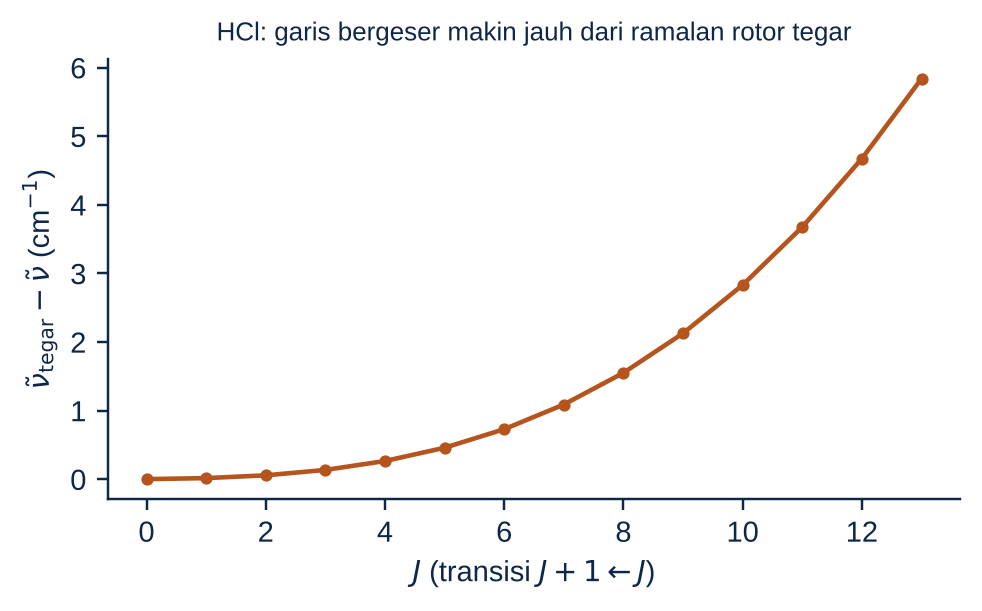

## 6.11 Populasi rotasi dan intensitas

### Sebaran Boltzmann

Pada kesetimbangan termal, jumlah molekul pada tingkat $J$ sebanding dengan degenerasi dikali faktor Boltzmann:

$$
\frac{N_J}{N_0} = (2J + 1)\exp\left[-\frac{hcBJ(J + 1)}{kT}\right] . \qquad \text{(6.31)}
$$

Faktor $2J + 1$ naik dan faktor eksponensial turun, sehingga populasi mencapai maksimum. Dengan memperlakukan $J$ sebagai variabel malar dan menurunkan (6.31) terhadap $J$:

$$
J_\text{maks} \approx \sqrt{\frac{kT}{2hcB}} - \frac12 . \qquad \text{(6.32)}
$$

Gambar 6.5 memperlihatkan sebarannya untuk HCl, CO, dan I₂ pada suhu kamar. Intensitas garis serapan bergantung pada populasi tingkat bawah, tetapi juga pada frekuensi transisi dan pada emisi terangsang dari tingkat atas; itulah sebabnya puncak spektrum rotasi CO di Gambar 6.4 berada pada $J$ yang lebih tinggi (sekitar $J = 12$) daripada puncak populasinya ($J = 7$).

{width=80%}

### Fungsi partisi rotasi

Jumlah semua populasi relatif adalah **fungsi partisi rotasi**. Bila $kT \gg hcB$, penjumlahan dapat diganti integral (dengan $x = J(J+1)$, $dx = (2J+1)dJ$):

$$
q_\text{rot} = \sum_J(2J + 1)e^{-hcBJ(J+1)/kT} \approx \int_0^\infty e^{-hcBx/kT}dx = \frac{kT}{\sigma hcB} . \qquad \text{(6.33)}
$$

Faktor $\sigma$ adalah **bilangan simetri**: 1 untuk molekul heteronuklir dan 2 untuk homonuklir. Ia muncul karena untuk inti identik, hanya separuh tingkat $J$ yang diizinkan, seperti dijelaskan di bawah. Koreksi suku berikutnya adalah $+\tfrac13$ (rumus Mulholland), kecil kecuali untuk H₂ dan hidrida pada suhu rendah.

### Statistik spin inti

Ketika molekul homonuklir berputar 180°, kedua inti bertukar tempat. Menurut asas Pauli dalam bentuk umumnya (Bab 9), fungsi gelombang total harus **antisimetris** terhadap pertukaran dua fermion identik (spin setengah bulat, misalnya proton) dan **simetris** terhadap pertukaran dua boson identik (spin bulat, misalnya ¹⁶O dan deuteron). Fungsi rotasi $Y_J^M$ berubah tanda $(-1)^J$ ketika inti bertukar (pertukaran sama dengan inversi arah sumbu molekul). Akibatnya, untuk H₂ (proton, spin ½):

* tingkat $J$ genap harus berpasangan dengan keadaan spin inti antisimetris (singlet, 1 keadaan): **para-hidrogen** (alasannya, teorema spin–statistik, dibahas di subbab 9.3);
* tingkat $J$ ganjil harus berpasangan dengan keadaan spin inti simetris (triplet, 3 keadaan): **orto-hidrogen**.

Pada suhu tinggi, perbandingan orto : para mendekati 3 : 1. Karena perubahan spin inti sangat lambat tanpa katalis, kedua bentuk berperilaku hampir sebagai dua zat berbeda, dengan kapasitas kalor dan konduktivitas termal yang berbeda. Untuk ¹⁶O₂ (inti spin nol, keadaan elektronik dasar yang antisimetris), hanya tingkat $J$ ganjil yang ada; untuk ¹²C¹⁶O₂ (inti O spin nol), hanya $J$ genap. Dalam spektrum Raman rotasinya, setengah garis yang "seharusnya" ada hilang sama sekali.

::: {.contoh}
**Contoh 6.40 · Tingkat terpadat**

Hitung $J_\text{maks}$ pada 298 K untuk HCl ($B = 10{,}44$ cm⁻¹), CO (1,9225 cm⁻¹), dan I₂ (0,0374 cm⁻¹), serta fraksi molekul HCl dan CO pada tingkat itu.

**Penyelesaian.** $kT/hc = 207{,}2$ cm⁻¹. HCl: $\sqrt{207{,}2/20{,}88} - 0{,}5 = 2{,}65$, jadi $J = 3$; fraksi 0,19. CO: $\sqrt{207{,}2/3{,}845} - 0{,}5 = 6{,}84$, jadi $J = 7$; fraksi 0,083. I₂: $\sqrt{207{,}2/0{,}0748} - 0{,}5 = 52{,}2$, jadi $J = 52$.

**Memahami hasil.** Molekul CO "tipikal" pada suhu kamar berputar dengan $J = 7$ (Contoh 6.2), dan hanya 8% molekul berada di tingkat terpadat itu. Molekul I₂ yang berat tersebar atas lebih dari seratus tingkat; spektrumnya karena itu sangat padat dan memerlukan resolusi tinggi.
:::

::: {.contoh}
**Contoh 6.41 · Fungsi partisi rotasi**

Hitung $q_\text{rot}$ pada 298 K untuk CO, HCl, dan N₂ dengan (6.33) dan koreksi $+\tfrac13$, dan bandingkan untuk CO dengan penjumlahan langsung (hasilnya 108,12).

**Penyelesaian.** CO: $207{,}2/1{,}9225 = 107{,}8$, ditambah $\tfrac13$: 108,1. HCl ($B_e = 10{,}59$): $19{,}56 + 0{,}33 = 19{,}9$. N₂ ($B = 2{,}00$, $\sigma = 2$): $207{,}2/(2 \times 2{,}00) = 51{,}8$.

**Memahami hasil.** Rumus integral dengan koreksi kecil sudah tepat sampai empat angka untuk CO. Fungsi partisi rotasi menentukan entropi rotasi dan sumbangan rotasi pada tetapan kesetimbangan reaksi gas; bilangan simetri $\sigma$ menghasilkan suku $-R\ln\sigma$ dalam entropi, yang terukur dan cocok dengan percobaan.
:::

::: {.contoh}
**Contoh 6.42 · Termometer antarbintang**

Di sebuah awan molekul, perbandingan populasi CO pada $J = 2$ dan $J = 1$, yang ditentukan dari intensitas garis $2 \to 1$ dan $1 \to 0$, adalah 1,20. Berapa suhu rotasi gas?

**Penyelesaian.** $N_2/N_1 = \tfrac53\exp[-hcB(6 - 2)/kT] = 1{,}20$, sehingga $\exp(-4hcB/kT) = 0{,}72$ dan $4hcB/kT = 0{,}3285$. $T = 4(1{,}9225)(1{,}4388\ \text{cm K})/0{,}3285 = 33{,}7$ K.

**Memahami hasil.** Perbandingan populasi tingkat rotasi adalah termometer jarak jauh yang tidak memerlukan kontak apa pun. Dengan cara ini astronom mengukur suhu awan molekul (10–100 K) dan menemukan bahwa CN antarbintang dieksitasi oleh radiasi latar belakang kosmik bersuhu 2,7 K, beberapa dekade sebelum radiasi itu ditemukan secara langsung tahun 1965.
:::

::: {.contoh}
**Contoh 6.43 · Orto- dan para-hidrogen**

Hitung fraksi para-H₂ pada kesetimbangan pada 20 K, 77 K, dan 298 K ($B = 60{,}85$ cm⁻¹). Mengapa hidrogen cair harus dikonversi ke bentuk para sebelum disimpan?

**Penyelesaian.** Fraksi para $= \sum_{J\,\text{genap}}(2J+1)e^{-E_J/kT}/[\sum_{\text{genap}} + 3\sum_{\text{ganjil}}]$. Hasilnya: 20 K: 0,999; 77 K: 0,521; 298 K: 0,251. Konversi orto ($J = 1$) ke para ($J = 0$) melepaskan $2B = 121{,}7$ cm⁻¹ $= 1{,}46$ kJ/mol.

**Memahami hasil.** Hidrogen yang dicairkan dengan cepat masih 75% orto. Konversi spontannya yang lambat melepaskan 1,46 kJ/mol untuk tiap mol orto, lebih besar daripada kalor penguapan hidrogen (0,90 kJ/mol). Tanpa katalis konversi (misalnya oksida besi), hidrogen cair akan menguap dengan sendirinya dalam beberapa hari. Ini akibat teknik yang besar dari simetri satu fungsi $Y_J^M$ terhadap pertukaran dua proton.
:::

::: {.contoh}
**Contoh 6.44 · Entropi rotasi CO**

Entropi rotasi molar gas diatom adalah $S_\text{rot} = R(\ln q_\text{rot} + 1)$ bila $kT \gg hcB$. Hitung untuk CO pada 298 K ($q_\text{rot} = 108{,}1$), dan sumbangan bilangan simetri untuk N₂.

**Penyelesaian.** $S_\text{rot} = 8{,}314(\ln108{,}1 + 1) = 8{,}314(4{,}683 + 1) = 47{,}3$ J K⁻¹ mol⁻¹. Untuk N₂, $q_\text{rot}$ dibagi $\sigma = 2$, sehingga entropinya berkurang $R\ln2 = 5{,}76$ J K⁻¹ mol⁻¹.

**Memahami hasil.** Entropi standar CO (197,7 J K⁻¹ mol⁻¹) terdiri atas translasi (150,4), rotasi (47,3), dan getaran (hampir nol). CO dan N₂ mempunyai massa dan $B$ hampir sama, tetapi entropi standar N₂ (191,6) lebih kecil sekitar $R\ln2$: bukti termodinamika bahwa kedua atom N tidak dapat dibedakan.
:::

::: {.kuis}
**Kuis cepat 6.11**

Molekul mana yang mempunyai $J_\text{maks}$ lebih besar pada suhu yang sama, HCl atau DCl? Mengapa garis rotasi Raman O₂ dengan $J$ genap tidak ada?
:::

## 6.12 Distorsi sentrifugal dan spektrum rotasi–getaran

### Ikatan yang meregang saat berputar

Rotor sungguhan tidak tegar. Ketika molekul berputar cepat, gaya sentrifugal meregangkan ikatan; momen inersia membesar dan tingkat energi rotasi turun sedikit di bawah $BJ(J+1)$. Koreksinya ditulis

$$
F(J) = BJ(J + 1) - DJ^2(J + 1)^2, \qquad \tilde\nu(J + 1 \leftarrow J) = 2B(J + 1) - 4D(J + 1)^3 . \qquad \text{(6.34)}
$$

Tetapan **distorsi sentrifugal** $D$ dapat diperkirakan dengan model klasik: ikatan berpegas $k$ diregangkan oleh gaya sentrifugal $L^2/\mu r^3$ sebesar $\delta r = L^2/(\mu r^3k)$, yang menurunkan energi rotasi sebanding dengan $L^4$. Hasilnya (Kratzer):

$$
D = \frac{4B^3}{\tilde\omega^2} \qquad (\text{semua dalam cm}^{-1}) . \qquad \text{(6.35)}
$$

Karena $B \ll \tilde\omega$, $D$ sangat kecil, tetapi efeknya tumbuh seperti $J^3$ dan jelas terlihat pada $J$ tinggi (Gambar 6.6).

{width=72%}

### Spektrum rotasi–getaran

Molekul yang menyerap foton inframerah dan naik dari $v = 0$ ke $v = 1$ juga mengubah tingkat rotasinya dengan $\Delta J = \pm1$ (subbab 5.8). Suku energi total adalah $G(v) + F_v(J)$, dengan tetapan rotasi yang sedikit bergantung pada tingkat getaran:

$$
B_v = B_e - \alpha_e\left(v + \tfrac12\right) . \qquad \text{(6.36)}
$$

$\alpha_e$ positif: dalam tingkat getaran yang lebih tinggi, ikatan rata-rata lebih panjang (anharmonisitas) dan $\langle 1/r^2\rangle$ lebih kecil. Dengan pusat pita $\tilde\nu_0 = G(1) - G(0)$, garis-garis pita adalah

$$
R(J) = \tilde\nu_0 + B_1(J + 1)(J + 2) - B_0J(J + 1), \qquad P(J) = \tilde\nu_0 + B_1(J - 1)J - B_0J(J + 1), \qquad \text{(6.37)}
$$

dengan $J$ tingkat bawah. Inilah rumus yang dipakai untuk menghitung spektrum HCl di Gambar 5.3 dan Contoh 5.23.

### Selisih kombinasi

Tetapan $B_0$ dan $B_1$ dapat dipisahkan dengan cerdik. Garis $R(J - 1)$ dan $P(J + 1)$ berakhir pada tingkat atas yang **sama** ($v = 1$, $J$), sehingga selisihnya hanya bergantung pada tingkat bawah; sebaliknya $R(J)$ dan $P(J)$ berawal dari tingkat bawah yang sama:

$$
R(J - 1) - P(J + 1) = 4B_0\left(J + \tfrac12\right), \qquad R(J) - P(J) = 4B_1\left(J + \tfrac12\right) . \qquad \text{(6.38)}
$$

Metode **selisih kombinasi** ini dipakai luas dalam spektroskopi untuk menentukan tetapan tiap tingkat secara terpisah.

::: {.contoh}
**Contoh 6.45 · Distorsi sentrifugal HCl dan CO**

Hitung $D$ dengan (6.35) untuk HCl ($B_e = 10{,}593$, $\omega_e = 2990{,}9$ cm⁻¹) dan CO ($B_e = 1{,}9313$, $\omega_e = 2169{,}8$ cm⁻¹). Berapa pergeseran garis $J = 20 \leftarrow 19$ HCl dan $J = 30 \leftarrow 29$ CO?

**Penyelesaian.** HCl: $D = 4(10{,}593)^3/(2990{,}9)^2 = 5{,}32 \times 10^{-4}$ cm⁻¹. Pergeseran $4D(20)^3 = 17{,}0$ cm⁻¹, dari $2B(20) = 423{,}7$ cm⁻¹ (4%). CO: $D = 6{,}12 \times 10^{-6}$ cm⁻¹; pergeseran $4D(30)^3 = 0{,}66$ cm⁻¹, dari 115,9 cm⁻¹ (0,6%).

**Memahami hasil.** Nilai terukur $D$ untuk HCl dan CO sama dengan ramalan Kratzer sampai tiga angka. Molekul ringan yang berputar cepat (hidrida) meregang paling banyak. Sebaliknya, dari $B$ dan $D$ terukur dapat dihitung $\omega_e$ tanpa mengamati getaran sama sekali: spektrum rotasi "mendengar" kekakuan ikatan.
:::

::: {.contoh}
**Contoh 6.46 · Selisih kombinasi HCl**

Garis-garis pita dasar HCl (Contoh 5.23): $R(0) = 2906{,}26$, $R(1) = 2925{,}94$, $P(1) = 2865{,}10$, $P(2) = 2843{,}62$ cm⁻¹. Tentukan $B_0$, $B_1$, $\alpha_e$, $B_e$, dan $r_e$.

**Penyelesaian.** Dengan (6.38) untuk $J = 1$: $R(0) - P(2) = 62{,}64 = 4B_0(1{,}5)$, jadi $B_0 = 10{,}44$ cm⁻¹; $R(1) - P(1) = 60{,}84 = 4B_1(1{,}5)$, jadi $B_1 = 10{,}14$ cm⁻¹. $\alpha_e = B_0 - B_1 = 0{,}30$ cm⁻¹ dan $B_e = B_0 + \tfrac12\alpha_e = 10{,}59$ cm⁻¹. Maka $I_e = h/(8\pi^2cB_e)$ dan $r_e = \sqrt{I_e/\mu} = 127{,}5$ pm.

**Memahami hasil.** Dari empat garis IR, kita memperoleh panjang ikatan kesetimbangan HCl yang cocok dengan nilai terbaik (127,46 pm). Dalam keadaan $v = 1$, $B$ berkurang 3%, yang berarti ikatan rata-rata 1,5% lebih panjang: ikatan yang bergetar lebih kuat meregang lebih jauh ke sisi lunak potensial Morse.
:::

::: {.contoh}
**Contoh 6.47 · Kepala pita**

Dengan $B_0 = 10{,}44$ dan $B_1 = 10{,}14$ cm⁻¹, cabang R HCl mempunyai suku $(B_1 - B_0)J^2$ yang negatif. Pada $J$ berapa garis-garis cabang R berhenti bergerak ke bilangan gelombang lebih tinggi dan berbalik?

**Penyelesaian.** $R(J) = \tilde\nu_0 + 2B_1 + (3B_1 - B_0)J + (B_1 - B_0)J^2$. $dR/dJ = 0$ di $J = (3B_1 - B_0)/[2(B_0 - B_1)] = 19{,}98/0{,}60 = 33{,}3$. Garis-garis menumpuk di sekitar $R(33) \approx 3238{,}9$ cm⁻¹.

**Memahami hasil.** Penumpukan garis ini disebut **kepala pita**. Pada HCl suhu kamar, populasi $J = 33$ praktis nol, sehingga kepala pita tidak teramati. Tetapi dalam spektrum elektronik, tempat $B$ keadaan atas dan bawah dapat sangat berbeda (misalnya ikatan jauh lebih panjang dalam keadaan tereksitasi), kepala pita muncul pada $J$ kecil dan menjadi ciri paling mencolok pita (Bab 15).
:::

::: {.contoh}
**Contoh 6.48 · $r_0$ dan $r_e$ untuk CO**

Untuk CO, $B_e = 1{,}931\,28$ cm⁻¹ dan $\alpha_e = 0{,}017\,50$ cm⁻¹. Hitung $B_0$ dan bandingkan $r_e$ dengan $r_0$ dari Contoh 6.35.

**Penyelesaian.** $B_0 = B_e - \tfrac12\alpha_e = 1{,}922\,53$ cm⁻¹, sesuai dengan nilai dari garis gelombang mikro (1,922 52). $r_e = r_0\sqrt{B_0/B_e} = 113{,}09\sqrt{1{,}92253/1{,}93128} = 112{,}83$ pm.

**Memahami hasil.** Selisih $r_0 - r_e = 0{,}26$ pm (0,2%) adalah efek getaran titik nol. Ketika kita membandingkan panjang ikatan hasil perhitungan kuantum (yang memberi $r_e$, di dasar kurva potensial) dengan percobaan, yang harus dipakai adalah $r_e$; perbandingan dengan $r_0$ bisa meleset beberapa per seribu, cukup untuk menyesatkan perbandingan metode yang teliti (Bab 17).
:::

::: {.kuis}
**Kuis cepat 6.12**

Mengapa $D$ selalu positif? Garis $R(J - 1)$ dan $P(J + 1)$ berbagi tingkat yang mana?
:::

### Menuju bab berikutnya

Harmonik bola dan massa tereduksi adalah dua bahan utama yang kita perlukan untuk atom paling sederhana. Bab 7 menggabungkan keduanya dengan potensial Coulomb dan menyelesaikan atom hidrogen secara tepat.
