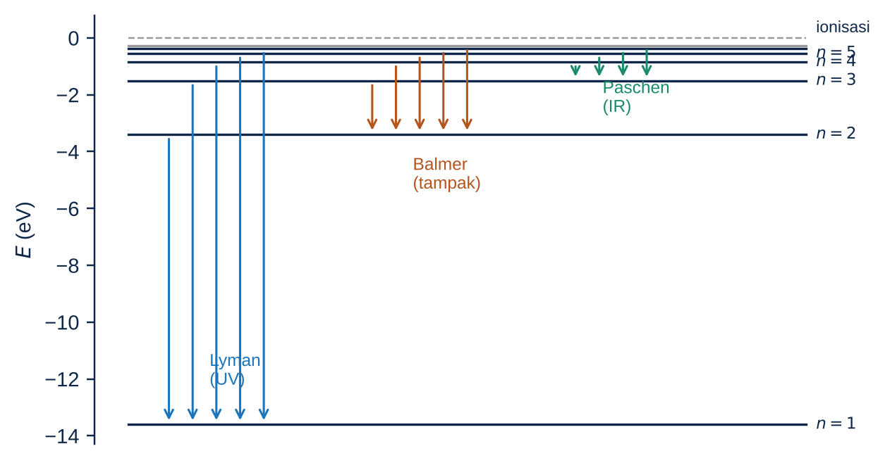
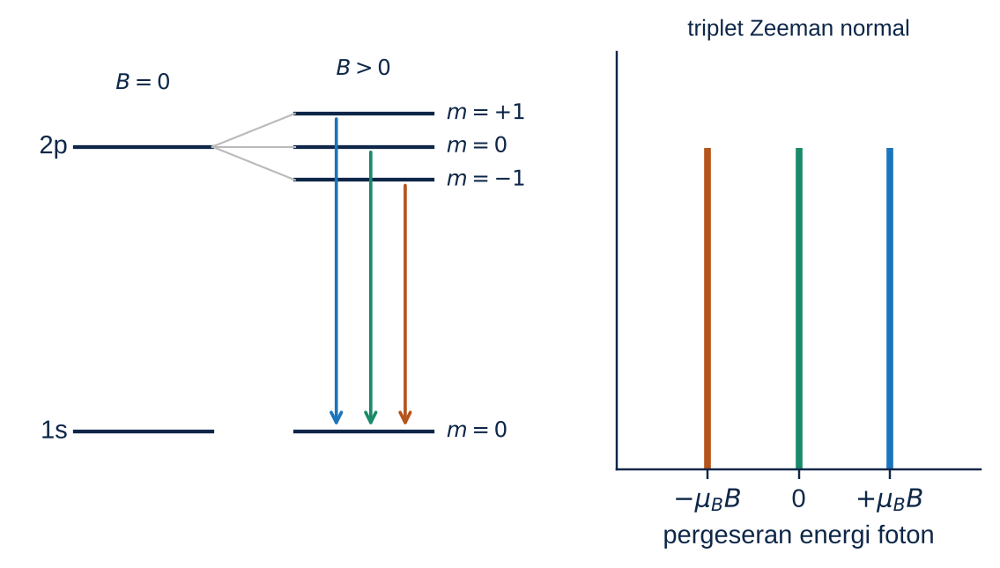

## 7.10 Atom mirip hidrogen

### Skala dengan $Z$

Ion dengan satu elektron, seperti He⁺, Li²⁺, Be³⁺, sampai U⁹¹⁺, mempunyai Hamiltonian (7.2) dengan $Z > 1$. Semua hasil sebelumnya berlaku dengan penskalaan sederhana:

$$
E_n = -\frac{Z^2}{2n^2}E_h, \qquad r \to \frac rZ, \qquad \psi_{n\ell m}(r; Z) = Z^{3/2}\psi_{n\ell m}(Zr; 1) . \qquad \text{(7.19)}
$$

Energi naik dengan $Z^2$ (satu faktor $Z$ dari muatan, satu lagi dari orbital yang lebih dekat ke inti), dan ukuran menyusut dengan $1/Z$. Faktor $Z^{3/2}$ menjaga normalisasi.

### Hukum Moseley

Pada atom berat dengan banyak elektron, elektron 1s hampir tidak disaring oleh elektron lain; satu-satunya penyaring adalah elektron 1s yang lain. Bila satu elektron 1s dikeluarkan (misalnya oleh tumbukan elektron berenergi tinggi dalam tabung sinar-X), elektron 2p turun mengisi lubang itu dan memancarkan sinar-X **Kα**. Energi foton kira-kira sama dengan transisi $2 \to 1$ atom mirip hidrogen dengan muatan efektif $Z - 1$:

$$
E_{K\alpha} \approx \tfrac34(Z - 1)^2 \times 13{,}6\ \text{eV} . \qquad \text{(7.20)}
$$

Henry Moseley mengukur garis Kα belasan unsur tahun 1913 dan menemukan bahwa $\sqrt{\nu}$ naik linear dengan nomor urut unsur, bukan dengan massa atom. Inilah bukti bahwa nomor atom adalah muatan inti, dan bahwa tabel periodik harus diurutkan menurut $Z$. Dari celah dalam garisnya, ia meramalkan unsur 43, 61, 72, dan 75 yang belum ditemukan.

::: {.contoh}
**Contoh 7.32 · He⁺ dan Li²⁺**

Hitung energi ionisasi dan panjang gelombang Lyman-α untuk He⁺ dan Li²⁺, dengan koreksi massa tereduksi.

**Penyelesaian.** $E_I = Z^2(13{,}6057\ \text{eV})(\mu/m_e)$. He⁺: $4 \times 13{,}6057 \times 0{,}999\,863 = 54{,}415$ eV. Li²⁺: $9 \times 13{,}6057 \times 0{,}999\,922 = 122{,}44$ eV. Lyman-α $= 1/[\tfrac34Z^2R_\infty(\mu/m_e)]$: He⁺ 30,380 nm; Li²⁺ 13,501 nm.

**Memahami hasil.** Energi ionisasi kedua helium (54,4 eV) dan ketiga litium (122,4 eV) adalah satu-satunya energi ionisasi yang dapat dihitung secara eksak. Bandingkan dengan energi ionisasi pertama helium, 24,6 eV: elektron kedua menyaring separuh lebih muatan inti dari elektron pertama, dan menghitung efek ini memerlukan metode pendekatan (Bab 8).
:::

::: {.contoh}
**Contoh 7.33 · Deret Pickering: helium yang menyamar sebagai hidrogen**

Hitung panjang gelombang transisi He⁺ $6 \to 4$, $8 \to 4$, dan $5 \to 4$, dan bandingkan dengan H$_\alpha$ (656,47 nm) dan H$_\beta$ (486,27 nm).

**Penyelesaian.** $1/\lambda = 4R_{He}(1/16 - 1/n^2)$: $6 \to 4$: 656,20 nm; $8 \to 4$: 486,08 nm; $5 \to 4$: 1012,7 nm.

**Memahami hasil.** Transisi He⁺ dengan $n$ genap ke $n = 4$ hampir berimpit dengan garis Balmer, karena $4/16 = 1/4$ dan $4/36 = 1/9$. Garis ganjil ($5 \to 4$, $7 \to 4$, ...) tidak punya pasangan hidrogen. Pickering (1896) menemukan deret ini di spektrum bintang dan mengira hidrogen mempunyai deret tambahan; Bohr (1913) menunjukkan bahwa pemancarnya He⁺, dan selisih kecil 0,27 nm (efek massa tereduksi) memastikannya.
:::

::: {.contoh}
**Contoh 7.34 · Sinar-X Kα**

Dengan (7.20), perkirakan energi Kα untuk Fe ($Z = 26$), Cu (29), dan Mo (42). Nilai terukur: 6,40; 8,05; 17,48 keV.

**Penyelesaian.** Fe: $0{,}75 \times 625 \times 13{,}606 = 6{,}38$ keV. Cu: $0{,}75 \times 784 \times 13{,}606 = 8{,}00$ keV. Mo: $0{,}75 \times 1681 \times 13{,}606 = 17{,}15$ keV.

**Memahami hasil.** Model satu elektron yang disaring satu elektron memberi ketelitian 0,3–2%. Kα tembaga (0,154 nm) dan molibdenum (0,071 nm) adalah dua sumber sinar-X standar untuk difraksi kristal. Dalam analisis unsur dengan fluoresensi sinar-X (XRF) atau EDS di mikroskop elektron, garis Kα inilah yang mengenali unsur.
:::

::: {.contoh}
**Contoh 7.35 · Uranium berelektron satu**

Hitung energi ikat 1s U⁹¹⁺ ($Z = 92$) menurut (7.19), dan kecepatan rms elektronnya. Nilai terukur 132 keV.

**Penyelesaian.** $92^2 \times 13{,}606$ eV $= 115{,}2$ keV. Kecepatan $v/c = Z\alpha = 92/137{,}04 = 0{,}67$.

**Memahami hasil.** Teori nonrelativistik meleset 13%, karena elektron bergerak dengan dua pertiga kecepatan cahaya. Persamaan Dirac (relativistik) memberi energi yang hampir tepat. Untuk unsur berat, kimia kuantum harus relativistik, setidaknya untuk elektron dalam (Contoh 7.30 dan Bab 9).
:::

::: {.contoh}
**Contoh 7.36 · Besi berelektron satu di gugus galaksi**

Teleskop sinar-X mengamati garis kuat di sekitar 6,97 keV dari gas sangat panas (puluhan juta kelvin) di gugus galaksi. Tunjukkan bahwa garis ini cocok dengan Lyman-α ion Fe²⁵⁺ ($Z = 26$).

**Penyelesaian.** Dengan (7.19): $\Delta E = \tfrac34Z^2(13{,}606\ \text{eV}) = 0{,}75 \times 676 \times 13{,}606 = 6{,}90$ keV.

**Memahami hasil.** Ramalan nonrelativistik meleset 1%, dan selisihnya (koreksi relativistik, sebanding dengan $(Z\alpha)^2 = 0{,}036$) sesuai besarnya. Garis Fe XXVI (penamaan astronomi untuk Fe²⁵⁺) dan Fe XXV adalah termometer gas panas antargalaksi: perbandingan intensitasnya menentukan derajat ionisasi besi dan dengan itu suhunya.
:::

::: {.kuis}
**Kuis cepat 7.10**

Berapa jari-jari paling mungkin elektron 1s dalam Li²⁺ (pm)? Berapa energi tingkat $n = 2$ He⁺ dalam eV?
:::

## 7.11 Spektrum hidrogen dan aturan seleksi

Aturan seleksi $\Delta\ell = \pm1$ di subbab ini kita pakai sebagai pratinjau. Buktinya memerlukan teori perturbasi bergantung waktu, yang diturunkan di subbab 8.11–8.12; di sini kita fokus pada akibatnya bagi spektrum hidrogen.

### Aturan seleksi dipol

Transisi antara dua keadaan atom dengan memancarkan atau menyerap satu foton (pendekatan dipol listrik) memerlukan momen dipol transisi $\langle n'\ell'm'|\hat{\mathbf r}|n\ell m\rangle$ yang tidak nol. Komponen $z = r\cos\theta$, sehingga

$$
\langle n'\ell'm'|z|n\ell m\rangle = \int_0^\infty R_{n'\ell'}R_{n\ell}r^3dr \times \int Y_{\ell'}^{m'*}\cos\theta\,Y_\ell^m\,d\Omega . \qquad \text{(7.21)}
$$

Integral sudut tidak nol hanya bila $\ell' = \ell \pm 1$ dan $m' = m$ (rekursi harmonik bola, subbab 6.10). Untuk komponen $x \pm iy \propto \sin\theta\,e^{\pm i\phi}$, syaratnya $\ell' = \ell \pm 1$ dan $m' = m \pm 1$. Jadi:

$$
\Delta\ell = \pm1, \qquad \Delta m_\ell = 0, \pm1, \qquad \Delta n\ \text{sembarang} . \qquad \text{(7.22)}
$$

Aturan $\Delta\ell = \pm1$ adalah kekekalan momentum sudut (foton membawa satu satuan $\hbar$) sekaligus aturan paritas (Laporte: keadaan awal dan akhir harus berparitas berbeda). Integral radial tidak memberi larangan, sehingga $n$ boleh berubah berapa saja.

{width=85%}

### Laju peluruhan

Keadaan tereksitasi meluruh secara spontan dengan laju (koefisien Einstein $A$)

$$
A = \frac{\omega^3|\mathbf d|^2}{3\pi\varepsilon_0\hbar c^3}, \qquad \mathbf d = e\langle f|\mathbf r|i\rangle . \qquad \text{(7.23)}
$$

Faktor $\omega^3$ membuat transisi berenergi tinggi jauh lebih cepat; itulah sebabnya keadaan tereksitasi elektronik hidup nanodetik, sedangkan keadaan tereksitasi getaran (frekuensi seratus kali lebih kecil) hidup milidetik dalam gas bila tidak ada tumbukan.

::: {.contoh}
**Contoh 7.37 · Transisi mana yang diizinkan?**

Manakah transisi berikut yang diizinkan dipol: (a) 2p → 1s, (b) 2s → 1s, (c) 3d → 2p, (d) 3d → 2s, (e) 3s → 2p, (f) 4f → 3d, (g) 4f → 2p?

**Penyelesaian.** Diizinkan bila $\Delta\ell = \pm1$: (a) ya; (b) tidak ($\Delta\ell = 0$); (c) ya; (d) tidak ($\Delta\ell = 2$); (e) ya; (f) ya; (g) tidak ($\Delta\ell = 2$).

**Memahami hasil.** Dalam atom hidrogen, garis H$_\alpha$ ($3 \to 2$) sebenarnya gabungan tiga transisi: 3s → 2p, 3p → 2s, dan 3d → 2p, yang hampir berimpit. Dalam atom natrium, keadaan-keadaan ini terpisah, dan aturan seleksi menentukan garis mana yang muncul: garis D (3p → 3s) sangat kuat, sedangkan 3d → 3s tidak ada.
:::

::: {.contoh}
**Contoh 7.38 · Umur keadaan 2p**

Unsur matriks $\langle 1s|z|2p_0\rangle = \tfrac{128\sqrt2}{243}a_0 = 0{,}745\,a_0$. Hitung $A$ dan umur 2p, dengan $\hbar\omega = \tfrac38E_h$.

**Penyelesaian.** $|\mathbf d|^2 = (0{,}745ea_0)^2$ (untuk $2p_0$ hanya komponen $z$; hasilnya sama untuk $2p_{\pm1}$). $\omega = 0{,}375E_h/\hbar = 1{,}550 \times 10^{16}$ s⁻¹. $A = \omega^3|\mathbf d|^2/(3\pi\varepsilon_0\hbar c^3) = 6{,}27 \times 10^8$ s⁻¹, umur $\tau = 1/A = 1{,}60$ ns.

**Memahami hasil.** Nilai terukur 1,596 ns: kesepakatan sempurna, karena fungsi gelombang hidrogen eksak. Umur nanodetik ini menetapkan lebar alami garis Lyman-α: $\Delta\nu = 1/2\pi\tau = 100$ MHz. Integral radial $\int R_{10}R_{21}r^3dr$ dihitung dengan (2.8) dalam beberapa baris (soal di akhir bab).
:::

::: {.contoh}
**Contoh 7.39 · Keadaan metastabil 2s**

Keadaan 2s tidak dapat meluruh ke 1s dengan satu foton dipol ($\Delta\ell = 0$), dan tidak ada keadaan lain di bawahnya selain 1s (2p hampir berimpit). Ia meluruh dengan memancarkan **dua** foton sekaligus, dengan umur 0,122 s. Berapa kali lebih lama dibandingkan 2p?

**Penyelesaian.** $0{,}122/(1{,}60 \times 10^{-9}) = 7{,}6 \times 10^7$ kali.

**Memahami hasil.** Keadaan yang tidak mempunyai jalan peluruhan yang diizinkan disebut **metastabil**. Atom H(2s) dapat dibuat menjadi berkas dan bertahan cukup lama untuk dimanipulasi; pengukuran pergeseran Lamb (Contoh 7.12) memakai berkas semacam ini. Dalam kimia, keadaan triplet molekul organik (yang peluruhannya ke keadaan dasar singlet terlarang spin) adalah analog metastabil yang menjadi dasar fosforesensi (Bab 15).
:::

::: {.terapan}
**Hidrogen sebagai penanda kosmik**

Tiga garis hidrogen menjadi alat utama astronomi. H$_\alpha$ (656 nm) memetakan gas terionisasi di sekitar bintang panas. Lyman-α (121,6 nm), yang diserap oleh setiap awan hidrogen netral di sepanjang garis pandang ke kuasar jauh, menghasilkan "hutan Lyman-α" yang memetakan sebaran materi di alam semesta muda. Garis 21 cm (1420,406 MHz), transisi hiperhalus keadaan dasar akibat interaksi spin elektron dan spin proton (Bab 16), memetakan hidrogen netral yang dingin di galaksi kita dan galaksi lain. Ketiganya hanya mungkin ditafsirkan karena spektrum hidrogen dapat dihitung secara tepat.
:::

::: {.contoh}
**Contoh 7.40 · Mengenali garis hidrogen**

Spektrum lampu hidrogen memperlihatkan garis ungu di 434,05 nm (udara; 434,17 nm vakum). Tentukan transisinya.

**Penyelesaian.** Untuk deret Balmer, $1/\lambda = R_H(1/4 - 1/n^2)$. Dengan $\lambda = 434{,}17$ nm: $1/(R_H\lambda) = 0{,}2100 = 1/4 - 1/n^2$, sehingga $1/n^2 = 0{,}0400$ dan $n = 5$. Transisinya $5 \to 2$ (H$_\gamma$).

**Memahami hasil.** Dengan satu rumus, setiap garis dapat dikenali dan setiap garis yang tidak cocok segera tampak sebagai pengotor atau unsur lain. Pengenalan garis semacam ini adalah dasar analisis unsur dengan spektroskopi emisi atom (AES, ICP-OES), meskipun untuk atom berelektron banyak "rumus" itu diganti tabel tingkat energi yang diukur.
:::

::: {.kuis}
**Kuis cepat 7.11**

Mengapa garis $3 \to 1$ (Lyman-β) ada, padahal 3s → 1s dan 3d → 1s terlarang? Keadaan $n = 3$ mana yang memancarkannya?
:::

## 7.12 Efek Zeeman

### Interaksi dengan medan magnet

Elektron dengan momentum sudut orbital mempunyai momen magnet $\boldsymbol\mu = -(e/2m_e)\mathbf L$ (6.3). Dalam medan magnet $\mathbf B$ sepanjang $z$, energi interaksinya $-\boldsymbol\mu\cdot\mathbf B$, sehingga Hamiltonian bertambah

$$
\hat H_Z = \frac{\mu_B}{\hbar}B\hat L_z, \qquad E_Z = m_\ell\,\mu_BB . \qquad \text{(7.24)}
$$

Karena orbital kompleks $\psi_{n\ell m}$ adalah fungsi eigen $\hat L_z$, mereka tetap fungsi eigen $\hat H + \hat H_Z$, dan energinya bergeser $m_\ell\mu_BB$. Tingkat $\ell$ yang berdegenerasi $2\ell + 1$ terpecah menjadi $2\ell + 1$ tingkat berjarak sama $\mu_BB$ (Gambar 7.5). Inilah alasan nama "bilangan kuantum magnetik".

### Efek Zeeman normal

Dengan aturan seleksi $\Delta m = 0, \pm1$, setiap garis spektrum terpecah menjadi tepat **tiga** komponen, berjarak $\mu_BB$ dalam energi, tidak peduli berapa $\ell$ tingkat atas dan bawah (karena pemecahan kedua tingkat sama per satuan $m$). Komponen $\Delta m = 0$ (garis π) terpolarisasi linear sejajar medan; komponen $\Delta m = \pm1$ (garis σ) terpolarisasi melingkar bila dilihat sepanjang medan.

Kenyataannya, pola tiga garis ini (efek Zeeman "normal") hanya teramati untuk transisi antara keadaan dengan spin total nol. Atom hidrogen sendiri dan kebanyakan atom menunjukkan pola yang lebih rumit (efek Zeeman "anomal") karena spin elektron mempunyai momen magnet dengan rasio giromagnetik dua kali lipat. Penjelasannya menunggu Bab 9.

{width=85%}

::: {.contoh}
**Contoh 7.41 · Pemecahan H$_\alpha$ dalam 1 T**

Hitung selisih bilangan gelombang dan panjang gelombang antara komponen-komponen triplet Zeeman normal H$_\alpha$ (656,47 nm) dalam medan 1,00 T.

**Penyelesaian.** $\mu_BB/hc = 9{,}274 \times 10^{-24}/(6{,}626 \times 10^{-34} \times 2{,}998 \times 10^{10}) = 0{,}467$ cm⁻¹. $\Delta\lambda = \lambda^2\Delta\tilde\nu = (6{,}5647 \times 10^{-5}\ \text{cm})^2(0{,}467\ \text{cm}^{-1}) = 2{,}01 \times 10^{-9}$ cm $= 0{,}020$ nm.

**Memahami hasil.** Pemecahan berbanding lurus dengan $B$ dan dengan $\lambda^2$, sehingga lebih mudah diukur pada garis inframerah. Frekuensi $\mu_BB/h = 14{,}0$ GHz per tesla disebut frekuensi Larmor elektron (orbital); untuk spin elektron, nilainya hampir dua kali, 28,0 GHz/T, yang menjadi dasar spektrometer EPR pita X (9,5 GHz, sekitar 0,34 T; Bab 16).
:::

::: {.contoh}
**Contoh 7.42 · Medan magnet bintik matahari**

Tahun 1908, George Hale mengamati pemecahan garis spektrum di bintik matahari. Bila sebuah garis triplet normal di 525 nm terpecah 0,0060 nm antara komponen yang bertetangga, berapa kuat medannya?

**Penyelesaian.** $\Delta\tilde\nu = \Delta\lambda/\lambda^2 = 6{,}0 \times 10^{-10}/(5{,}25 \times 10^{-5})^2 = 0{,}218$ cm⁻¹ (semua dalam cm). $B = hc\Delta\tilde\nu/\mu_B = (1{,}986 \times 10^{-23} \times 0{,}218)/9{,}274 \times 10^{-24} = 0{,}47$ T.

**Memahami hasil.** Bintik matahari menyimpan medan magnet ribuan kali medan Bumi (sekitar 50 µT). Ini pengukuran medan magnet pertama di luar Bumi, dilakukan dari jarak 150 juta km hanya dengan spektrometer. Efek Zeeman kini dipakai untuk memetakan medan magnet permukaan bintang dan, dalam laboratorium, untuk menentukan bilangan kuantum $\ell$ dan $j$ tingkat-tingkat atom.
:::

::: {.contoh}
**Contoh 7.43 · Tingkat 3d dalam medan magnet**

Tingkat 3d hidrogen (abaikan spin) ditempatkan dalam medan 2,0 T. Berapa banyak tingkat yang terbentuk, berapa jaraknya, dan berapa komponen garis 3d → 2p yang teramati?

**Penyelesaian.** $2\ell + 1 = 5$ tingkat ($m = -2, \ldots, 2$) berjarak $\mu_BB = 0{,}934$ cm⁻¹. Tingkat 2p terpecah menjadi 3 dengan jarak sama. Transisi dengan $\Delta m = 0, \pm1$ ada sembilan, tetapi energinya hanya tiga macam: $\Delta E_0$ dan $\Delta E_0 \pm \mu_BB$.

**Memahami hasil.** Karena tingkat atas dan bawah terpecah dengan jarak yang sama per satuan $m$, semua transisi dengan $\Delta m$ yang sama berimpit. Inilah sebabnya pola normal selalu triplet. Bila rasio giromagnetik tingkat atas dan bawah berbeda (efek spin, faktor $g$ Landé), garis-garis itu tidak lagi berimpit, dan polanya menjadi anomal (Bab 9).
:::

::: {.kuis}
**Kuis cepat 7.12**

Orbital riil $2\text{p}_x$ apakah mempunyai energi tertentu dalam medan magnet sepanjang $z$? Mengapa tingkat s tidak terpecah dalam efek Zeeman normal?
:::

## 7.13 Penyelesaian numerik persamaan radial

### Mengapa numerik

Atom hidrogen dapat diselesaikan secara eksak, tetapi potensial sedikit saja berbeda dari $-Z/r$ (atom alkali dengan elektron teras, atom terkurung, atom dalam plasma) sudah tidak mempunyai penyelesaian tertutup. Persamaan radial (7.6) berbentuk persis seperti persamaan satu dimensi yang diselesaikan metode Numerov di subbab 5.12, dengan $g(r) = 2[V(r) - E] + \ell(\ell + 1)/r^2$. Di dekat inti, $u \propto r^{\ell+1}$ (Contoh 7.5), sehingga integrasi dimulai dari dua titik pertama dengan $u = r^{\ell+1}$ dan berlanjut ke luar. Nilai eigen adalah energi yang membuat $u$ meluruh di tepi luar (Gambar 7.6).

{width=78%}

```python
import numpy as np

def numerov_radial(E, r, l, V):
    """Integrasi u'' = [2(V - E) + l(l+1)/r^2] u ke luar (satuan atom)."""
    h = r[1] - r[0]
    g = 2 * (V - E) + l * (l + 1) / r**2
    f = 1 - h**2 / 12 * g
    u = np.zeros_like(r)
    u[0], u[1] = r[0]**(l + 1), r[1]**(l + 1)   # u ~ r^(l+1) di dekat inti
    for i in range(1, len(r) - 1):
        u[i+1] = ((12 - 10*f[i]) * u[i] - f[i-1] * u[i-1]) / f[i+1]
    return u

def cari_E(E1, E2, r, l, V, tol=1e-10):
    """Bagi dua pada tanda u di tepi luar."""
    u1 = numerov_radial(E1, r, l, V)[-1]
    while E2 - E1 > tol:
        Em = 0.5 * (E1 + E2)
        um = numerov_radial(Em, r, l, V)[-1]
        if u1 * um < 0:
            E2 = Em
        else:
            E1, u1 = Em, um
    return 0.5 * (E1 + E2)

h = 0.002
r = np.arange(1, 15001) * h                   # 0,002 sampai 30 bohr
V = -1 / r                                   # atom hidrogen
print(cari_E(-0.6, -0.4, r, 0, V))           # 1s
print(cari_E(-0.2, -0.1, r, 0, V))           # 2s
print(cari_E(-0.2, -0.1, r, 1, V))           # 2p
```

Keluarannya $-0{,}499\,984$; $-0{,}124\,998$; $-0{,}125\,000$. Mengganti satu baris (`V = ...`) cukup untuk menyelesaikan potensial lain.

::: {.contoh}
**Contoh 7.44 · Galat di dekat inti**

Program di atas dijalankan dengan beberapa ukuran langkah. Galat energi ($E_\text{num} + E_\text{eksak}$, dengan $E_\text{eksak}$ dalam nilai mutlak) untuk 1s dan 2p:

| $h$ (bohr) | 0,008 | 0,004 | 0,002 | 0,001 |
|---|---|---|---|---|
| galat 1s | $2{,}5 \times 10^{-4}$ | $6{,}3 \times 10^{-5}$ | $1{,}6 \times 10^{-5}$ | $4{,}0 \times 10^{-6}$ |
| galat 2p | $1{,}5 \times 10^{-9}$ | $1{,}4 \times 10^{-9}$ | $1{,}4 \times 10^{-9}$ | $1{,}4 \times 10^{-9}$ |

Bagaimana galat 1s bergantung pada $h$, dan mengapa jauh lebih buruk daripada 2p?

**Penyelesaian.** Perbandingan galat 1s untuk $h$ yang dibagi dua: $2{,}5/0{,}63 = 3{,}9$; $6{,}3/1{,}6 = 3{,}9$; $1{,}6/0{,}40 = 4{,}0$. Galat sebanding dengan $h^2$, bukan $h^4$ seperti pada osilator (Contoh 5.45). Untuk 2p, galatnya hampir tidak bergantung pada $h$ dan berasal dari tepi luar yang terpotong di 30 bohr.

**Memahami hasil.** Fungsi 1s mempunyai **taring** (*cusp*) di inti: $\psi = e^{-r}$ mempunyai turunan yang tidak malar di $r = 0$, dan potensial $-1/r$ tak hingga di sana. Rumus Numerov mengandaikan fungsi yang mulus, sehingga ketelitiannya turun. Untuk orbital p, $u \propto r^2$ dan penghalang sentrifugal menjauhkan fungsi dari inti, sehingga masalah itu hilang. Dalam praktik, persamaan radial diselesaikan pada kisi logaritmik ($r = e^x$) yang rapat di dekat inti; perilaku taring yang sama juga membuat fungsi basis Gauss, yang mulus di inti, kesulitan meniru orbital s (Bab 17).
:::

::: {.contoh}
**Contoh 7.45 · Model potensial litium**

Elektron valensi litium bergerak dalam medan inti ($Z = 3$) yang disaring dua elektron 1s. Model sederhana: $V(r) = -[1 + 2e^{-\alpha r}]/r$, yang menuju $-3/r$ di dekat inti dan $-1/r$ jauh di luar. Parameter $\alpha$ dipilih agar energi 2s sama dengan $-0{,}1981$ hartree (energi ionisasi 5,392 eV); hasilnya $\alpha = 2{,}10$ bohr⁻¹. Dengan program Numerov, energi tingkat-tingkat lain (hartree):

| Keadaan | 2s | 2p | 3s | 3p | 3d |
|---|---|---|---|---|---|
| model | $-0{,}1981$ | $-0{,}1324$ | $-0{,}0743$ | $-0{,}0580$ | $-0{,}0556$ |
| terukur | $-0{,}1981$ | $-0{,}1302$ | $-0{,}0742$ | $-0{,}0572$ | $-0{,}0556$ |
| hidrogen | $-0{,}125$ | $-0{,}125$ | $-0{,}0556$ | $-0{,}0556$ | $-0{,}0556$ |

Jelaskan pola energi ini dan hitung panjang gelombang transisi 2p → 2s menurut model.

**Penyelesaian.** Degenerasi $\ell$ hidrogen pecah: 2s jauh di bawah 2p, dan 3s < 3p < 3d. Tingkat 3d hampir sama dengan hidrogen, karena elektron 3d hampir tidak menembus teras (Contoh 7.19) dan hanya merasakan muatan $+1$. Transisi 2p → 2s: $(0{,}1981 - 0{,}1324)(27{,}211) = 1{,}788$ eV, $\lambda = 693$ nm (terukur 670,8 nm, garis merah nyala litium).

**Memahami hasil.** Satu parameter yang dipaskan pada satu tingkat meramalkan empat tingkat lain sampai beberapa persen. Model ini memperlihatkan langsung bagaimana penembusan (subbab 7.6) memecah degenerasi $\ell$ dan menghasilkan urutan s < p < d. Gagasan "satu elektron dalam potensial rata-rata akibat elektron lain" adalah inti metode medan swakonsisten Hartree–Fock (Bab 9), yang menghitung potensial itu dari fungsi gelombang elektron-elektron lain, bukan dari parameter yang dipaskan.
:::

::: {.contoh}
**Contoh 7.46 · Atom hidrogen di bawah tekanan**

Atom hidrogen dikurung dalam bola berdinding tak tertembus berjari-jari $R_c$ (model atom dalam rongga zeolit atau dalam materi bertekanan sangat tinggi). Syarat batasnya $u(R_c) = 0$. Dengan program Numerov yang diakhiri di $R_c$, energi 1s (hartree) adalah:

| $R_c$ (bohr) | 6 | 4 | 3 | 2 | 1,835 | 1,5 |
|---|---|---|---|---|---|---|
| $E_{1s}$ | $-0{,}4993$ | $-0{,}4833$ | $-0{,}4240$ | $-0{,}1250$ | 0,0000 | $+0{,}437$ |

Tafsirkan hasil ini.

**Penyelesaian.** Untuk $R_c \gtrsim 6$ bohr, dinding hampir tidak terasa (ekor 1s sudah kecil). Makin kecil bola, makin besar energi kinetik pengurungan, dan energi naik tajam. Pada $R_c = 2$ bohr, energi 1s tepat sama dengan energi 2s atom bebas ($-\tfrac18$): fungsi $u = r(1 - r/2)e^{-r/2}$, yaitu 2s bebas, nol tepat di $r = 2$ dan karena itu memenuhi syarat batas. Pada $R_c = 1{,}835$ bohr energinya nol: elektron tidak lagi terikat meskipun terkurung.

**Memahami hasil.** Atom yang dimampatkan kehilangan elektronnya: **ionisasi tekanan**. Di inti Jupiter, hidrogen yang dimampatkan sampai jutaan atmosfer menjadi logam karena elektron-elektronnya tidak lagi terikat pada proton tertentu. Kecocokan tepat di $R_c = 2$ adalah uji yang bagus untuk program numerik: setiap simpul radial suatu orbital bebas memberi jari-jari kurungan dengan energi yang diketahui eksak.
:::

::: {.contoh}
**Contoh 7.47 · Memeriksa fungsi gelombang numerik**

Fungsi $u(r)$ 1s dari program Numerov ($h = 0{,}002$) dinormalisasi secara numerik (aturan Simpson), setelah ekor yang mulai menyimpang di luar $r \approx 8$ dipotong. Hasilnya: $\langle r\rangle = 1{,}500\,05$, $\langle 1/r\rangle = 0{,}999\,94$, dan peluang di dalam $r < 1$ adalah 0,3226. Bandingkan dengan nilai eksak.

**Penyelesaian.** Eksak: $\langle r\rangle = 1{,}5$, $\langle 1/r\rangle = 1$, dan $1 - 5e^{-2} = 0{,}3233$ (Contoh 7.18). Galat relatif $3 \times 10^{-5}$, $6 \times 10^{-5}$, dan $2 \times 10^{-3}$.

**Memahami hasil.** Besaran yang peka terhadap daerah dekat inti ($\langle 1/r\rangle$, peluang di dalam $r < 1$) lebih terpengaruh galat taring daripada $\langle r\rangle$. Pola ini umum dalam kimia komputasi: energi dan geometri mudah dihitung teliti, sedangkan sifat yang bergantung pada rapat elektron di inti (kopling hiperhalus, pergeseran kimia NMR) memerlukan fungsi basis khusus yang rapat di dekat inti (Bab 16 dan 17).
:::

::: {.kuis}
**Kuis cepat 7.13**

Mengapa integrasi radial dimulai dengan $u = r^{\ell+1}$ dan bukan dengan $u = 1$? Dalam model litium, mengapa tingkat 3d hampir sama dengan hidrogen?
:::

### Menuju bab berikutnya

Atom hidrogen adalah sistem terakhir yang dapat diselesaikan tepat. Begitu elektron kedua ditambahkan, kita memerlukan metode pendekatan; Bab 8 memperkenalkan dua yang paling penting, metode variasi dan teori perturbasi.
