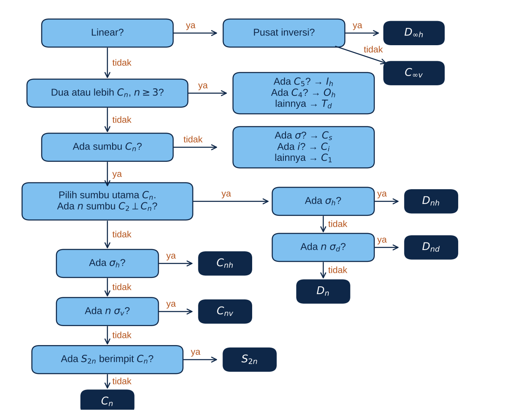

# Bab 10 Simetri Molekul dan Teori Grup

Pada musim panas 1990, Wolfgang Krätschmer dan Donald Huffman menguapkan batang grafit dengan busur listrik dalam helium dan memperoleh beberapa miligram serbuk hitam yang larut dalam benzena menjadi larutan merah anggur. Lima tahun sebelumnya, Kroto, Curl, dan Smalley telah mengusulkan bahwa molekul C₆₀ berbentuk bola sepak: enam puluh atom karbon di sudut-sudut dua belas segi lima dan dua puluh segi enam. Bagaimana memastikan bahwa serbuk itu benar-benar molekul berbentuk bola sepak? Molekul dengan 60 atom mempunyai $3 \times 60 - 6 = 174$ mode getaran, sehingga orang mungkin menduga spektrum inframerahnya berupa hutan pita yang kusut. Ternyata spektrum IR serbuk itu hanya memperlihatkan **empat** pita tajam, di 527, 577, 1183, dan 1429 cm⁻¹. Angka "empat" itu sudah diramalkan bertahun-tahun sebelumnya, tanpa satu pun perhitungan gaya ikatan, hanya dari bentuk molekul.

Alat yang memberikan ramalan itu adalah **teori grup**: matematika simetri. Bab ini memperlihatkan bahwa simetri bukan sekadar keindahan bentuk, tetapi sumber informasi kuantitatif. Simetri menentukan berapa banyak tingkat energi yang berdegenerasi, orbital atom mana yang boleh bergabung membentuk orbital molekul, getaran mana yang tampak di spektrum IR dan Raman, transisi elektronik mana yang terang dan mana yang gelap, serta molekul mana yang mempunyai momen dipol atau memutar bidang polarisasi cahaya. Semua itu dapat diketahui sebelum persamaan Schrödinger diselesaikan, dan sering kali tanpa menyelesaikannya sama sekali.

Gagasan dasarnya sudah kita temui dalam bentuk paling sederhana: paritas (subbab 4.11). Bila potensial tidak berubah oleh pencerminan $x \to -x$, fungsi eigen dapat dipilih genap atau ganjil, dan integral fungsi ganjil lenyap. Teori grup memperluas gagasan ini ke semua operasi simetri sebuah molekul sekaligus: putaran, pencerminan, dan inversi.

::: {.strategi}
**Pertanyaan pembuka**

1. Mengapa C₆₀, dengan 174 mode getaran, hanya memperlihatkan empat pita IR dan sepuluh pita Raman?
2. Mengapa H₂O dan NH₃ mempunyai momen dipol, sedangkan CO₂, BF₃, dan CH₄ tidak, padahal semua ikatannya polar?
3. Mengapa kelima orbital d terpecah menjadi kelompok tiga dan dua dalam kompleks oktahedral, dan bukan menjadi lima tingkat yang berbeda?
4. Mengapa larutan [Co(H₂O)₆]²⁺ berwarna merah muda pucat, sedangkan [CoCl₄]²⁻ biru pekat?
5. Apa syarat geometri sebuah molekul agar kiral, dan mengapa hanya molekul kiral yang memutar bidang polarisasi cahaya?
:::

::: {.tujuan}
**Tujuan belajar**

Setelah mempelajari bab ini, kamu mampu:

1. Mengenali unsur dan operasi simetri molekul serta menuliskan matriks operasinya.
2. Menentukan grup titik molekul dengan diagram alir dan menyimpulkan apakah molekul itu polar atau kiral.
3. Menyusun tabel perkalian grup, menentukan subgrup dan kelas.
4. Membangun representasi matriks dari sebuah basis dan membedakan representasi tereduksi dari representasi tak tereduksi.
5. Membaca tabel karakter: lambang Mulliken, kolom fungsi, dan sifat-sifat ortogonalitas.
6. Mereduksi representasi dengan rumus reduksi, menghitung hasil kali langsung, dan memakai teorema integral lenyap.
7. Menyusun kombinasi linear teradaptasi simetri (SALC) dengan operator proyeksi.
8. Menyusun diagram orbital molekul H₂O, NH₃, CH₄, dan sistem π siklik berdasarkan simetri, lalu membandingkannya dengan spektrum fotoelektron.
9. Menghitung simetri mode getaran dan meramalkan banyak pita IR dan Raman, termasuk aturan saling meniadakan.
10. Menentukan apakah sebuah transisi elektronik diizinkan oleh simetri dan ke arah mana polarisasinya.
11. Menjelaskan syarat simetri kiralitas dan aktivitas optik, serta menghitung rotasi optik dan kelebihan enantiomer.
:::

::: {.mat}
**Prasyarat**

Dari *Fisika Umum*: Bab 8 (gerak rotasi) dan Bab 14 (polarisasi cahaya). Dari buku ini: matriks, determinan, dan matriks rotasi serta pencerminan (subbab 2.7), nilai eigen matriks (subbab 2.8), operator, komutator, dan fungsi eigen bersama (subbab 4.1, 4.2, dan 4.10), paritas dan aturan Laporte (subbab 4.11), momen dipol transisi dan aturan seleksi IR serta Raman (subbab 5.8), mode normal (subbab 5.11), dan harmonik bola riil, yaitu bentuk sudut orbital p dan d (subbab 6.5). Orbital molekul diatom dibahas sesudah bab ini (Bab 11); di sini kita hanya memerlukan gagasan bahwa orbital molekul adalah kombinasi linear orbital atom (subbab 2.8, masalah nilai eigen umum).
:::

## 10.1 Unsur dan operasi simetri

### Mengapa simetri penting dalam mekanika kuantum

Tinjau molekul air. Kedua atom hidrogennya identik, sehingga bila kita memutar molekul 180° terhadap garis bagi sudut H–O–H, kedua hidrogen bertukar tempat dan molekul tampak persis seperti semula. Operator Hamilton molekul, yang hanya bergantung pada jarak antarpartikel dan muatan-muatannya, juga tidak berubah oleh putaran itu: setiap suku tarikan elektron–H₁ berubah menjadi suku tarikan elektron–H₂ yang sama besar, dan sebaliknya. Jika $\hat R$ menyatakan operator yang melakukan putaran tersebut pada fungsi gelombang, pernyataan "Hamiltonian tidak berubah" berarti

$$
\hat R\hat H = \hat H\hat R, \qquad [\hat H, \hat R] = 0 . \qquad \text{(10.1)}
$$

Kita sudah tahu akibat komutasi seperti ini dari subbab 4.10: $\hat H$ dan $\hat R$ mempunyai himpunan fungsi eigen bersama, sehingga setiap keadaan stasioner dapat diberi label menurut perilakunya terhadap $\hat R$. Untuk paritas, labelnya genap atau ganjil. Untuk molekul dengan banyak operasi simetri, labelnya adalah lambang seperti $a_1$, $b_2$, $e$, atau $t_{2g}$ yang akan kita temui sepanjang bab ini. Label itu bukan hiasan. Dari label saja kita dapat menyimpulkan empat hal:

1. **Degenerasi.** Banyaknya fungsi yang berbagi satu label (satu, dua, tiga, ...) menentukan degenerasi tingkat energi yang dipaksakan oleh simetri.
2. **Integral yang lenyap.** Integral tumpang tindih, unsur matriks Hamiltonian, dan momen dipol transisi antara fungsi berlabel "tidak cocok" pasti nol.
3. **Aturan seleksi.** Akibat langsung butir 2: transisi spektroskopi hanya terjadi antara keadaan yang labelnya cocok dengan label operator dipol atau polarisabilitas.
4. **Penyederhanaan perhitungan.** Determinan sekuler pecah menjadi blok-blok kecil, satu blok untuk setiap label.

Untuk memanfaatkan semua itu, langkah pertama adalah mendaftar dengan cermat simetri apa saja yang dimiliki sebuah molekul.

### Unsur simetri dan operasi simetri

**Operasi simetri** adalah gerakan yang membawa molekul ke kedudukan yang tidak dapat dibedakan dari kedudukan semula: setiap atom berpindah ke tempat yang sebelumnya ditempati atom sejenis (atau tetap di tempatnya). **Unsur simetri** adalah benda geometri (titik, garis, atau bidang) yang menjadi acuan operasi itu. Perbedaannya halus tetapi penting: satu unsur dapat menghasilkan beberapa operasi. Sumbu putar lipat tiga pada NH₃ adalah *satu* unsur, tetapi menghasilkan *dua* operasi berbeda, yaitu putaran 120° dan putaran 240°.

Untuk molekul, yang selalu mempunyai satu titik tetap (pusat massanya), hanya ada lima jenis operasi:

| Lambang | Operasi | Unsur | Keterangan |
|---|---|---|---|
| $E$ | identitas: tidak melakukan apa-apa | (seluruh ruang) | dimiliki setiap molekul |
| $C_n$ | putaran sebesar $360°/n$ | sumbu putar sejati lipat $n$ | $C_n^k$: putaran $k \times 360°/n$ |
| $\sigma$ | pencerminan | bidang cermin | $\sigma_h$, $\sigma_v$, $\sigma_d$ |
| $i$ | inversi: $(x, y, z) \to (-x, -y, -z)$ | pusat inversi | atom berpasangan melalui pusat |
| $S_n$ | putaran $360°/n$, lalu pencerminan pada bidang tegak lurus sumbu | sumbu putar tak sejati | $S_1 = \sigma$, $S_2 = i$ |

Beberapa keterangan tentang masing-masing jenis.

**Identitas** $E$ tampak remeh, tetapi diperlukan agar himpunan operasi membentuk grup (subbab 10.3), sama seperti bilangan nol diperlukan dalam penjumlahan.

**Putaran sejati** $C_n$. Sumbu dengan $n$ terbesar disebut **sumbu utama** dan menurut kesepakatan dijadikan sumbu $z$. Putaran $C_n$ yang diulang $k$ kali ditulis $C_n^k$; jelas $C_n^n = E$. Beberapa pangkat dapat disederhanakan: $C_4^2 = C_2$ dan $C_6^2 = C_3$, sehingga sumbu $C_6$ benzena sekaligus memuat sumbu $C_3$ dan $C_2$. Menurut kesepakatan, putaran dilakukan berlawanan arah jarum jam bila dilihat dari ujung positif sumbu.

**Pencerminan** $\sigma$. Bidang cermin diberi indeks menurut letaknya terhadap sumbu utama: $\sigma_h$ (*horizontal*) tegak lurus sumbu utama; $\sigma_v$ (*vertikal*) memuat sumbu utama; $\sigma_d$ (*dihedral*) juga memuat sumbu utama tetapi membagi dua sudut antara dua sumbu $C_2$ yang tegak lurus sumbu utama. Pencerminan dua kali mengembalikan semuanya: $\sigma^2 = E$.

**Inversi** $i$ membawa setiap titik melalui pusat ke sisi seberang dengan jarak yang sama. Molekul yang mempunyai pusat inversi disebut **sentrosimetris**; setiap atom yang tidak terletak di pusat mempunyai pasangan sejenis di seberangnya. Contohnya CO₂, benzena, SF₆, dan etilena; contoh yang tidak sentrosimetris adalah H₂O, NH₃, dan CH₄.

**Putaran tak sejati** $S_n$ adalah gabungan dua langkah: putar $360°/n$ terhadap sebuah sumbu, lalu cerminkan pada bidang yang tegak lurus sumbu itu. Hal yang sering mengejutkan: molekul dapat mempunyai sumbu $S_n$ tanpa mempunyai sumbu $C_n$ maupun bidang $\sigma_h$ secara terpisah. Metana adalah contoh klasiknya (Contoh 10.3). Dua kasus khusus: $S_1$ (putar 360°, lalu cerminkan) sama dengan $\sigma$, dan $S_2$ (putar 180°, lalu cerminkan) sama dengan $i$.

{width=92%}

::: {.contoh}
**Contoh 10.1 · Unsur simetri molekul air**

Daftarlah unsur dan operasi simetri H₂O. Pakai kesepakatan bahwa molekul terletak di bidang $yz$ dengan sumbu $z$ membagi dua sudut H–O–H.

**Penyelesaian.** Sumbu $z$ adalah sumbu $C_2$: putaran 180° menukar kedua H. Tidak ada sumbu lain. Bidang molekul ($yz$) adalah bidang cermin, karena pencerminan pada bidang itu membiarkan semua atom di tempatnya; namakan $\sigma_v'(yz)$. Bidang $xz$, yang memuat sumbu $C_2$ dan tegak lurus bidang molekul, juga bidang cermin karena menukar kedua H; namakan $\sigma_v(xz)$. Tidak ada pusat inversi (O tidak mempunyai pasangan) dan tidak ada sumbu $S_n$ lain. Jadi ada empat operasi: $E$, $C_2$, $\sigma_v(xz)$, dan $\sigma_v'(yz)$ (Gambar 10.1 kiri).

**Memahami hasil.** Keempat operasi itu akan menjadi grup titik $C_{2v}$. Perhatikan bahwa kedua bidang cermin berbeda secara fisis: yang satu menukar atom H, yang lain tidak. Perbedaan ini kelak tampak dalam tabel karakter: orbital yang terletak di bidang molekul berperilaku lain daripada orbital yang tegak lurus bidang molekul.
:::

::: {.contoh}
**Contoh 10.2 · Amonia: satu unsur, dua operasi**

Daftarlah operasi simetri NH₃.

**Penyelesaian.** Sumbu $C_3$ melalui N dan pusat segitiga H₃ menghasilkan dua operasi: $C_3$ (putar 120°) dan $C_3^2$ (putar 240°); $C_3^3 = E$. Ada tiga bidang $\sigma_v$, masing-masing memuat sumbu $C_3$ dan satu ikatan N–H; pencerminan pada bidang yang memuat H₁ menukar H₂ dan H₃. Tidak ada $\sigma_h$ (N tidak sebidang dengan ketiga H), tidak ada $i$, dan tidak ada sumbu $C_2$. Jumlahnya enam operasi: $E$, $C_3$, $C_3^2$, $\sigma_v$, $\sigma_v'$, $\sigma_v''$.

**Memahami hasil.** $C_3^2$ adalah operasi yang berbeda dari $C_3$; ia sama dengan putaran $-120°$, yaitu kebalikan $C_3$. Bila NH₃ datar seperti BF₃, muncul unsur baru: bidang $\sigma_h$ dan tiga sumbu $C_2$, sehingga banyak operasinya menjadi dua belas. Perubahan geometri yang kecil (sudut piramida) mengubah grup simetri secara diskret, dan dengan itu mengubah aturan seleksi spektrumnya (Contoh 10.48).
:::

::: {.contoh}
**Contoh 10.3 · Sumbu $S_4$ metana**

Tempatkan C metana di titik asal dan keempat H di $(1, 1, 1)$, $(-1, -1, 1)$, $(1, -1, -1)$, dan $(-1, 1, -1)$ (sudut-sudut kubus yang berselang-seling). (a) Tunjukkan bahwa sumbu $z$ adalah sumbu $S_4$ tetapi bukan sumbu $C_4$. (b) Hitung banyak operasi simetri metana.

**Penyelesaian.** (a) $C_4(z)$ membawa $(x, y, z) \to (-y, x, z)$. Atom $(1, 1, 1)$ pindah ke $(-1, 1, 1)$, yang bukan posisi atom, jadi $C_4$ bukan operasi simetri. Pencerminan $\sigma_h(xy)$ membawa $(1, 1, 1)$ ke $(1, 1, -1)$, juga bukan posisi atom. Namun gabungan keduanya, $S_4 = \sigma_h C_4$, membawa $(x, y, z) \to (-y, x, -z)$: $(1, 1, 1) \to (-1, 1, -1)$, $(-1, 1, -1) \to (-1, -1, 1)$, $(-1, -1, 1) \to (1, -1, -1)$, dan $(1, -1, -1) \to (1, 1, 1)$. Keempat H berpindah secara siklis ke posisi H lain, jadi $S_4$ adalah operasi simetri.

\(b) Ada empat sumbu $C_3$ (sepanjang setiap ikatan C–H), masing-masing memberi $C_3$ dan $C_3^2$: 8 operasi. Ada tiga sumbu $S_4$ (sepanjang $x$, $y$, $z$), masing-masing memberi $S_4$ dan $S_4^3$: 6 operasi; ketiga sumbu itu sekaligus sumbu $C_2$ karena $S_4^2 = C_2$: 3 operasi. Ada enam bidang cermin, masing-masing memuat C dan dua H: 6 operasi. Ditambah $E$, jumlahnya $1 + 8 + 3 + 6 + 6 = 24$.

**Memahami hasil.** Dua puluh empat operasi ini membentuk grup $T_d$, grup simetri tetrahedron. Sumbu $S_4$ yang "tersembunyi" itu penting: karena metana mempunyai sumbu tak sejati, molekul ini tidak kiral (subbab 10.11), dan karena $S_4$ menukar ikatan-ikatan secara siklis, keempat ikatan C–H setara sempurna.
:::

### Operasi sebagai matriks

Setiap operasi simetri memetakan titik $(x, y, z)$ ke titik baru $(x', y', z')$ secara linear, sehingga dapat ditulis sebagai perkalian dengan matriks 3 × 3 (subbab 2.7). Untuk sumbu utama $z$ dan sudut putar $\theta = 2\pi/n$:

$$
C_n(z) = \begin{pmatrix}\cos\theta & -\sin\theta & 0\\ \sin\theta & \cos\theta & 0\\ 0 & 0 & 1\end{pmatrix}, \qquad
S_n(z) = \begin{pmatrix}\cos\theta & -\sin\theta & 0\\ \sin\theta & \cos\theta & 0\\ 0 & 0 & -1\end{pmatrix} . \qquad \text{(10.2)}
$$

Pencerminan pada bidang $xy$, $xz$, dan $yz$ hanya membalik tanda koordinat yang tegak lurus bidang: $\sigma(xy) = \mathrm{diag}(1, 1, -1)$, $\sigma(xz) = \mathrm{diag}(1, -1, 1)$, $\sigma(yz) = \mathrm{diag}(-1, 1, 1)$. Inversi adalah $i = -\mathbf I$, dan identitas $E = \mathbf I$.

Dua besaran dari matriks ini akan sering dipakai. **Determinan** bernilai $+1$ untuk operasi sejati ($E$, $C_n$) dan $-1$ untuk operasi tak sejati ($\sigma$, $i$, $S_n$); operasi tak sejati mengubah tangan kanan menjadi tangan kiri. **Teras** (jumlah unsur diagonal) bergantung hanya pada sudut putar:

$$
\mathrm{Tr}\,C(\theta) = 1 + 2\cos\theta, \qquad \mathrm{Tr}\,S(\theta) = -1 + 2\cos\theta . \qquad \text{(10.3)}
$$

Untuk $\sigma = S_1$ ($\theta = 360°$) terasnya $+1$, dan untuk $i = S_2$ ($\theta = 180°$) terasnya $-3$. Angka-angka teras ini akan muncul lagi sebagai "sumbangan per atom" dalam analisis getaran (subbab 10.9).

::: {.mat}
**Matematika · Mengapa matriks putaran berbentuk seperti itu**

Titik di bidang $xy$ dengan jarak $\rho$ dan sudut $\phi$ mempunyai $x = \rho\cos\phi$, $y = \rho\sin\phi$. Setelah diputar sebesar $\theta$, sudutnya $\phi + \theta$:

$$
x' = \rho\cos(\phi + \theta) = x\cos\theta - y\sin\theta, \qquad y' = \rho\sin(\phi + \theta) = x\sin\theta + y\cos\theta ,
$$

dengan rumus jumlah sudut. Koordinat $z$ tidak berubah. Itulah baris-baris matriks $C_n$ dalam (10.2). Untuk $S_n$, pencerminan pada bidang $xy$ sesudahnya hanya membalik tanda $z$. Karena teras matriks tidak berubah oleh perubahan sumbu koordinat (sifat yang dibuktikan di subbab 10.5), rumus (10.3) berlaku untuk sumbu putar ke arah mana pun.
:::

::: {.contoh}
**Contoh 10.4 · Pangkat-pangkat $S_4$**

Dengan (10.2), tuliskan matriks $S_4(z)$, lalu hitung $S_4^2$, $S_4^3$, dan $S_4^4$. Operasi apakah masing-masing?

**Penyelesaian.** Untuk $\theta = 90°$, $\cos\theta = 0$ dan $\sin\theta = 1$:

$$
S_4 = \begin{pmatrix}0 & -1 & 0\\ 1 & 0 & 0\\ 0 & 0 & -1\end{pmatrix}, \quad
S_4^2 = \begin{pmatrix}-1 & 0 & 0\\ 0 & -1 & 0\\ 0 & 0 & 1\end{pmatrix}, \quad
S_4^3 = \begin{pmatrix}0 & 1 & 0\\ -1 & 0 & 0\\ 0 & 0 & -1\end{pmatrix}, \quad
S_4^4 = \mathbf I .
$$

$S_4^2$ adalah putaran 180° terhadap $z$, yaitu $C_2$. $S_4^3$ adalah putaran $-90°$ yang disusul pencerminan, yaitu kebalikan $S_4$. $S_4^4 = E$.

**Memahami hasil.** Setiap molekul yang mempunyai sumbu $S_4$ otomatis mempunyai sumbu $C_2$ yang berimpit. Secara umum, untuk $n$ genap $S_n^n = E$, sedangkan untuk $n$ ganjil $S_n^n = \sigma_h$ (pencerminan dilakukan $n$ kali, jumlah ganjil), sehingga sumbu $S_n$ dengan $n$ ganjil selalu disertai $C_n$ dan $\sigma_h$ secara terpisah. Hanya $S_n$ dengan $n$ genap yang dapat "bersembunyi" tanpa $C_n$ dan $\sigma_h$, seperti pada metana.
:::

::: {.contoh}
**Contoh 10.5 · Etana bersilang**

Pada konformasi bersilang (*staggered*) etana, atom-atom H pada kedua karbon berselang-seling bila dilihat sepanjang ikatan C–C. Daftarlah operasi simetrinya.

**Penyelesaian.** Sumbu C–C adalah sumbu $C_3$ ($C_3$, $C_3^2$). Tegak lurus padanya, di titik tengah C–C, ada tiga sumbu $C_2$, masing-masing membagi dua sudut antara proyeksi H depan dan H belakang. Titik tengah C–C adalah pusat inversi: setiap H depan mempunyai pasangan H belakang di seberang pusat. Ada tiga bidang $\sigma_d$, masing-masing memuat sumbu C–C dan satu H depan serta satu H belakang. Sumbu C–C juga sumbu $S_6$: putaran 60° membawa H depan ke posisi yang berada tepat di atas H belakang, lalu pencerminan pada bidang tengah memindahkannya ke posisi H belakang. Operasi $S_6$ dan $S_6^5$ (dua operasi; $S_6^2 = C_3$, $S_6^3 = i$, $S_6^4 = C_3^2$ sudah terhitung). Jumlahnya $1 + 2 + 3 + 1 + 2 + 3 = 12$: $E$, $2C_3$, $3C_2$, $i$, $2S_6$, $3\sigma_d$.

**Memahami hasil.** Pada konformasi tindih (*eclipsed*), H depan tepat di atas H belakang. Pusat inversi dan sumbu $S_6$ hilang, tetapi muncul bidang $\sigma_h$ dan sumbu $S_3$. Banyak operasinya tetap dua belas, tetapi jenisnya lain: $D_{3h}$ untuk konformasi tindih dan $D_{3d}$ untuk bersilang (subbab 10.2). Rotasi internal mengubah simetri molekul, dan karena itu mengubah spektrum getarannya.
:::

::: {.terapan}
**Kaitan kimia · Atom setara dan sinyal NMR**

Atom-atom yang dipertukarkan satu sama lain oleh suatu operasi simetri disebut **setara secara simetri**. Lingkungan elektroniknya identik, sehingga dalam spektrum NMR (Bab 16) inti-inti itu memberikan geseran kimia yang sama. Menghitung kelompok atom setara memberi ramalan banyak sinyal. Benzena mempunyai satu sinyal ¹³C, karena keenam C dipertukarkan oleh sumbu $C_6$. Para-xilena mempunyai tiga: dua C yang membawa metil, empat C–H cincin, dan dua C metil. Toluena mempunyai lima: C ipso, dua C orto, dua C meta, satu C para, dan C metil. Untuk gugus yang berotasi cepat, seperti metil, yang diperhitungkan adalah simetri rata-rata terhadap waktu: ketiga H metil menjadi setara karena rotasi internal jauh lebih cepat daripada skala waktu NMR.
:::

::: {.kuis}
**Kuis cepat 10.1**

\(a) Molekul yang mempunyai sumbu $S_6$ pasti mempunyai unsur simetri apa lagi? (b) Apakah atom yang terletak di pusat inversi ikut berpindah oleh operasi $i$? (c) Berapa banyak operasi yang dihasilkan sebuah sumbu $C_5$?
:::

## 10.2 Grup titik dan cara menentukannya

### Himpunan operasi sebagai grup

Himpunan lengkap operasi simetri sebuah molekul selalu membentuk struktur matematika yang disebut **grup** (definisinya diberikan di subbab 10.3). Karena semua operasi molekul membiarkan sedikitnya satu titik tetap, yaitu pusat massa, grupnya disebut **grup titik**. Grup titik diberi nama dengan **lambang Schoenflies**, seperti $C_{2v}$ untuk H₂O, $C_{3v}$ untuk NH₃, dan $T_d$ untuk CH₄. Ahli kristalografi memakai **lambang Hermann–Mauguin** yang lain (misalnya $mm2$ untuk $C_{2v}$ dan $\bar43m$ untuk $T_d$), tetapi kimia molekul hampir selalu memakai lambang Schoenflies.

Meskipun ada tak hingga banyaknya grup titik, molekul yang nyata hampir selalu masuk ke dalam beberapa keluarga saja:

| Grup | Unsur yang mencirikan | Orde $h$ | Contoh |
|---|---|---|---|
| $C_1$ | hanya $E$ | 1 | CHFClBr |
| $C_s$ | satu bidang cermin | 2 | HOCl, CH₂=CHCl |
| $C_i$ | hanya pusat inversi | 2 | konformer *anti* CHClBr–CHClBr (meso) |
| $C_n$ | satu sumbu $C_n$ | $n$ | H₂O₂ ($C_2$) |
| $C_{nv}$ | $C_n$ dan $n$ bidang $\sigma_v$ | $2n$ | H₂O ($C_{2v}$), NH₃, CHCl₃ ($C_{3v}$) |
| $C_{nh}$ | $C_n$ dan $\sigma_h$ | $2n$ | *trans*-N₂F₂ ($C_{2h}$), B(OH)₃ ($C_{3h}$) |
| $D_n$ | $C_n$ dan $n$ sumbu $C_2$ tegak lurus | $2n$ | [Co(en)₃]³⁺ ($D_3$) |
| $D_{nh}$ | $D_n$ ditambah $\sigma_h$ | $4n$ | BF₃ ($D_{3h}$), [PtCl₄]²⁻ ($D_{4h}$), benzena ($D_{6h}$) |
| $D_{nd}$ | $D_n$ ditambah $n$ bidang $\sigma_d$ | $4n$ | alena ($D_{2d}$), etana bersilang ($D_{3d}$) |
| $S_{n}$ ($n$ genap) | hanya sumbu $S_n$ | $n$ | 1,3,5,7-tetrametilsiklooktatetraena ($S_4$) |
| $C_{\infty v}$ | linear, tanpa pusat inversi | $\infty$ | HCl, HCN, CO |
| $D_{\infty h}$ | linear, dengan pusat inversi | $\infty$ | H₂, CO₂, HC≡CH |
| $T_d$ | 4 sumbu $C_3$, 3 sumbu $S_4$, 6 $\sigma_d$ | 24 | CH₄, P₄, [NiCl₄]²⁻ |
| $O_h$ | 3 sumbu $C_4$, 4 sumbu $C_3$, $i$ | 48 | SF₆, [Co(NH₃)₆]³⁺, kubana |
| $I_h$ | 6 sumbu $C_5$, 10 sumbu $C_3$, $i$ | 120 | C₆₀, [B₁₂H₁₂]²⁻ |

Grup $T_d$, $O_h$, dan $I_h$ disebut **grup kubik** dan grup ikosahedral; ciri khasnya adalah adanya lebih dari satu sumbu berorde tiga atau lebih. Grup $T$, $T_h$, $O$, dan $I$ juga ada tetapi jarang dijumpai pada molekul.

### Diagram alir

Menentukan grup titik adalah pekerjaan yang dapat dibuat sistematis. Pertanyaan-pertanyaan berikut diajukan berurutan (Gambar 10.2):

1. **Apakah molekul linear?** Jika ya: punya pusat inversi → $D_{\infty h}$; tidak → $C_{\infty v}$.
2. **Apakah ada dua atau lebih sumbu $C_n$ dengan $n \ge 3$?** Jika ya, grupnya kubik atau ikosahedral: ada sumbu $C_5$ → $I_h$; ada sumbu $C_4$ dan pusat inversi → $O_h$; hanya sumbu $C_3$ dan $S_4$, tanpa $i$ → $T_d$.
3. **Apakah ada sumbu putar sejati?** Jika tidak ada sama sekali: punya bidang cermin → $C_s$; punya pusat inversi → $C_i$; tidak keduanya → $C_1$.
4. **Pilih sumbu utama $C_n$** (orde terbesar). Apakah ada $n$ sumbu $C_2$ yang tegak lurus padanya? Jika ya, molekul termasuk keluarga $D$: ada $\sigma_h$ → $D_{nh}$; ada $n$ bidang $\sigma_d$ → $D_{nd}$; tidak ada bidang cermin → $D_n$.
5. **Jika tidak ada $C_2$ tegak lurus**: ada $\sigma_h$ → $C_{nh}$; ada $n$ bidang $\sigma_v$ → $C_{nv}$; ada sumbu $S_{2n}$ yang berimpit dengan sumbu utama → $S_{2n}$; tidak ada apa-apa lagi → $C_n$.

{width=88%}

::: {.awas}
**Awas · Pakai geometri tiga dimensi yang sebenarnya**

Grup titik ditentukan oleh geometri kesetimbangan molekul, bukan oleh rumus struktur yang digambar di kertas. Hidrogen peroksida tampak "datar" dalam rumus H–O–O–H, padahal sudut dihedralnya sekitar 112°, sehingga grupnya $C_2$, bukan $C_{2h}$ atau $C_{2v}$. Sikloheksana kursi adalah $D_{3d}$, bukan $D_{6h}$. Bifenil dalam fase gas terpuntir sekitar 44° sehingga grupnya $D_2$, sedangkan dalam kristal hampir datar ($D_{2h}$). Selalu bayangkan atau gambar molekul dalam ruang sebelum mencari unsur simetrinya.
:::

::: {.contoh}
**Contoh 10.6 · Lima molekul, lima grup**

Tentukan grup titik CH₂Cl₂, CHCl₃, PCl₅ (bipiramida segitiga), *trans*-N₂F₂ (datar), dan H₂O₂.

**Penyelesaian.** *CH₂Cl₂.* Tidak linear; hanya satu sumbu berorde lebih dari satu, yaitu $C_2$ yang membagi dua sudut H–C–H dan Cl–C–Cl. Tidak ada $C_2$ tegak lurus. Tidak ada $\sigma_h$. Ada dua bidang $\sigma_v$ (bidang HCH dan bidang ClCCl). Grupnya $C_{2v}$.

*CHCl₃.* Sumbu $C_3$ sepanjang ikatan C–H, tiga bidang $\sigma_v$ (masing-masing memuat C–H dan satu C–Cl), tanpa $C_2$ tegak lurus dan tanpa $\sigma_h$: $C_{3v}$.

*PCl₅.* Sumbu utama $C_3$ melalui kedua Cl aksial. Tiga sumbu $C_2$ tegak lurus, masing-masing sepanjang ikatan P–Cl ekuatorial. Bidang ekuatorial adalah $\sigma_h$. Grupnya $D_{3h}$.

*trans-N₂F₂.* Sumbu $C_2$ tegak lurus bidang molekul melalui titik tengah N=N. Tidak ada $C_2$ lain yang tegak lurus padanya. Bidang molekul adalah $\sigma_h$ (tegak lurus sumbu $C_2$). Grupnya $C_{2h}$; titik tengah N=N otomatis menjadi pusat inversi, karena $i = \sigma_hC_2$.

*H₂O₂.* Satu sumbu $C_2$ yang tegak lurus ikatan O–O dan membagi dua sudut dihedral. Tidak ada bidang cermin dan tidak ada pusat inversi. Grupnya $C_2$.

**Memahami hasil.** Bentuk *cis*-N₂F₂ mempunyai sumbu $C_2$ di bidang molekul dan dua bidang $\sigma_v$, sehingga grupnya $C_{2v}$. Dua isomer dengan rumus yang sama dapat mempunyai grup yang berbeda, dan perbedaan itu muncul di spektrum: *trans*-N₂F₂ yang sentrosimetris mematuhi aturan saling meniadakan (subbab 10.9), sedangkan isomer *cis* tidak.
:::

::: {.contoh}
**Contoh 10.7 · Alena, simetri yang tersembunyi**

Pada alena, H₂C=C=CH₂, kedua gugus CH₂ terletak pada bidang yang saling tegak lurus. Tentukan grup titiknya.

**Penyelesaian.** Molekul tidak linear (atom H keluar dari sumbu C=C=C). Sumbu C=C=C adalah sumbu $C_2$ (putaran 180° membawa setiap CH₂ ke dirinya sendiri dengan H bertukar). Tidak ada sumbu berorde lebih tinggi, karena putaran 90° membawa bidang H–C–H depan ke orientasi bidang H–C–H belakang, tetapi atom depan tetap di depan. Ada dua sumbu $C_2$ tegak lurus sumbu C=C=C, melalui C pusat, masing-masing membentuk sudut 45° dengan kedua bidang CH₂. Karena ada $n = 2$ sumbu $C_2$ tegak lurus, molekul termasuk keluarga $D_2$. Tidak ada $\sigma_h$ (bidang yang tegak lurus C=C=C melalui C pusat akan menukar kedua CH₂, tetapi orientasi keduanya berbeda 90°). Ada dua bidang yang memuat sumbu C=C=C, yaitu kedua bidang H–C–H, dan keduanya membagi dua sudut antara sumbu-sumbu $C_2$ tegak lurus: itulah $\sigma_d$. Grupnya $D_{2d}$, dengan delapan operasi: $E$, $2S_4$, $C_2$, $2C_2'$, $2\sigma_d$.

**Memahami hasil.** Sumbu C=C=C sebenarnya sumbu $S_4$: putar 90° lalu cerminkan pada bidang melalui C pusat yang tegak lurus sumbu, maka CH₂ depan jatuh tepat di posisi CH₂ belakang. Karena ada sumbu tak sejati, alena tak tersubstitusi tidak kiral. Bila setiap ujung membawa dua substituen yang berbeda, seperti pada 1,3-dikloroalena (ClHC=C=CHCl), bidang cermin dan sumbu $S_4$ hilang, tersisa satu sumbu $C_2$, dan molekul menjadi kiral meskipun tidak mempunyai atom karbon asimetris (subbab 10.11).
:::

::: {.contoh}
**Contoh 10.8 · Ferosena tindih dan bersilang**

Ferosena, Fe(C₅H₅)₂, terdiri atas atom Fe yang diapit dua cincin siklopentadienil sejajar. Tentukan grup titik konformasi tindih (atom C cincin atas tepat di atas atom C cincin bawah) dan konformasi bersilang (cincin atas diputar 36°).

**Penyelesaian.** Kedua konformasi mempunyai sumbu utama $C_5$ melalui Fe dan pusat kedua cincin, dan lima sumbu $C_2$ tegak lurus melalui Fe; jadi keduanya keluarga $D_5$. *Tindih:* bidang yang melalui Fe sejajar kedua cincin adalah cermin yang menukar kedua cincin: ada $\sigma_h$, sehingga grupnya $D_{5h}$. *Bersilang:* $\sigma_h$ hilang, tetapi ada lima bidang $\sigma_d$ yang memuat sumbu $C_5$, masing-masing melalui satu C di cincin atas dan titik tengah sisi di cincin bawah. Grupnya $D_{5d}$, yang mempunyai pusat inversi di Fe.

**Memahami hasil.** Kedua grup berorde 20. Dalam fase gas, konformasi tindih sedikit lebih stabil dan penghalang rotasinya hanya beberapa kJ/mol, sehingga cincin berotasi hampir bebas pada suhu kamar. Pembedaan $D_{5h}$ dan $D_{5d}$ menjadi penting dalam spektroskopi dan dalam kristal pada suhu rendah, ketika rotasi membeku.
:::

### Simetri dan momen dipol

Momen dipol $\boldsymbol\mu$ adalah sifat molekul, sehingga vektornya tidak boleh berubah oleh operasi simetri apa pun: setelah operasi, molekul tidak dapat dibedakan dari semula, dan dipolnya pun harus sama. Akibatnya:

- Bila ada sumbu $C_n$ ($n \ge 2$), $\boldsymbol\mu$ harus terletak pada sumbu itu (vektor lain berubah arah oleh putaran).
- Bila ada dua sumbu $C_n$ yang tidak berimpit, atau sumbu $C_n$ dengan $C_2$ tegak lurus, $\boldsymbol\mu = 0$.
- Bila ada bidang cermin, $\boldsymbol\mu$ harus terletak pada bidang itu.
- Bila ada $\sigma_h$ atau pusat inversi, $\boldsymbol\mu = 0$ (inversi membalik setiap vektor).

Hanya grup $C_1$, $C_s$, $C_n$, dan $C_{nv}$ (termasuk $C_{\infty v}$) yang mengizinkan momen dipol permanen. Semua grup lain, termasuk $D_{nh}$, $D_{nd}$, $T_d$, $O_h$, dan $C_{nh}$, memaksa momen dipol nol.

::: {.inti}
**Polar atau nonpolar dari grup titik**

Molekul hanya dapat mempunyai momen dipol permanen bila grupnya $C_1$, $C_s$, $C_n$, atau $C_{nv}$. Pada $C_n$ dan $C_{nv}$, dipol terletak pada sumbu utama; pada $C_s$, dipol terletak di bidang cermin. Simetri tidak mengatakan berapa besar dipolnya; simetri hanya mengatakan kapan dipol itu pasti nol.
:::

::: {.contoh}
**Contoh 10.9 · Mana yang polar?**

Tentukan apakah molekul berikut dapat mempunyai momen dipol: SF₄ (jungkat-jungkit), XeF₄ (bujur sangkar), ClF₃ (bentuk T), PCl₅, CO₂, dan *cis*- serta *trans*-1,2-dikloroetena.

**Penyelesaian.** SF₄ ($C_{2v}$): polar, dipol sepanjang sumbu $C_2$ (terukur 0,63 D). XeF₄ ($D_{4h}$): nonpolar. ClF₃ ($C_{2v}$): polar (0,6 D). PCl₅ ($D_{3h}$): nonpolar. CO₂ ($D_{\infty h}$): nonpolar. *cis*-ClHC=CHCl ($C_{2v}$): polar (1,90 D). *trans*-ClHC=CHCl ($C_{2h}$, mempunyai pusat inversi): nonpolar.

**Memahami hasil.** Pengukuran momen dipol adalah salah satu cara tertua untuk membedakan isomer geometri. Teori VSEPR meramalkan bentuk molekul, teori grup mengubah bentuk itu menjadi ramalan tentang dipol, dan pengukuran tetapan dielektrik menguji ramalan itu. Rantai penalaran yang sama, bentuk → grup → sifat yang teramati, akan kita pakai berulang kali untuk spektrum.
:::

::: {.contoh}
**Contoh 10.10 · Dipol diklorobenzena dari penjumlahan vektor**

Momen dipol klorobenzena 1,69 D, berarah sepanjang ikatan C–Cl. Dengan menganggap momen ikatan dapat dijumlahkan sebagai vektor, perkirakan momen dipol *orto*-, *meta*-, dan *para*-diklorobenzena, lalu bandingkan dengan nilai terukur 2,50 D, 1,72 D, dan 0.

**Penyelesaian.** Dua vektor sama besar $\mu_1$ yang membentuk sudut $\phi$ menghasilkan resultan $2\mu_1\cos(\phi/2)$. Pada cincin heksagonal, sudut antara ikatan C–Cl adalah 60° (*orto*), 120° (*meta*), dan 180° (*para*):

- *orto*: $2(1{,}69)\cos 30° = 2{,}93$ D;
- *meta*: $2(1{,}69)\cos 60° = 1{,}69$ D;
- *para*: $2(1{,}69)\cos 90° = 0$.

**Memahami hasil.** Simetri menjamin hasil *para* tepat nol: isomer *para* termasuk $D_{2h}$ dan mempunyai pusat inversi, sedangkan isomer *orto* dan *meta* termasuk $C_{2v}$. Nilai *meta* cocok dengan pengukuran, tetapi nilai *orto* terlalu besar sekitar 17%. Pada isomer *orto*, kedua atom Cl berdekatan sehingga dipol yang satu menginduksi dipol berlawanan pada yang lain dan awan elektron cincin ikut terpolarisasi; momen ikatan tidak lagi saling bebas. Penjumlahan vektor adalah model; simetri adalah hukum.
:::

::: {.terapan}
**Kaitan kimia · Simetri yang turun dan degenerasi yang pecah**

Ketika satu H metana diganti Cl, simetri turun dari $T_d$ ke $C_{3v}$; dua H diganti, turun lagi ke $C_{2v}$; tiga substituen berbeda, turun ke $C_1$. Grup yang baru selalu **subgrup** dari grup lama (subbab 10.3), karena substitusi hanya dapat menghapus operasi simetri, tidak menambahnya. Penurunan simetri ini punya akibat spektroskopi: getaran yang berdegenerasi tiga kali lipat pada CH₄ terpecah menjadi dua frekuensi pada CH₃Cl dan tiga frekuensi pada CH₂Cl₂. Gejala yang sama muncul pada kompleks logam: distorsi oktahedral memecah tingkat orbital d (efek Jahn–Teller, Bab 14).
:::

::: {.kuis}
**Kuis cepat 10.2**

Tentukan grup titik: (a) NH₄⁺; (b) SO₃ (datar); (c) HCN; (d) [PtCl₄]²⁻; (e) CH₃OH dalam konformasi bersilang. Mana yang dapat mempunyai momen dipol?
:::
