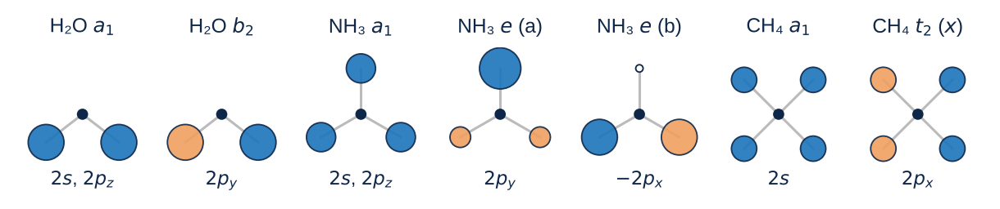

## 10.7 Kombinasi linear teradaptasi simetri (SALC)

### Gagasan

Rumus reduksi memberi tahu bahwa ketiga orbital 1s hidrogen NH₃ membentuk $A_1 + E$, tetapi tidak memberi tahu kombinasinya. Kita ingin menemukan kombinasi linear orbital-orbital setara yang masing-masing bertransformasi menurut satu irrep. Kombinasi seperti itu disebut **kombinasi linear teradaptasi simetri** (*symmetry-adapted linear combination*, SALC). Gunanya jelas dari teorema integral lenyap: bila basis terdiri atas SALC, unsur matriks Hamiltonian antara SALC berbeda irrep pasti nol, sehingga determinan sekuler pecah menjadi blok-blok kecil, satu blok per irrep.

### Operator proyeksi

Alat untuk membuat SALC adalah **operator proyeksi**. Untuk irrep $\Gamma^{(i)}$ berdimensi $d_i$,

$$
\hat P^{(i)} = \frac{d_i}{h}\sum_R \chi_i(R)^*\,\hat O_R . \qquad \text{(10.13)}
$$

Operator ini bekerja seperti saringan. Kenakan pada sembarang fungsi $f$: hasilnya hanyalah bagian $f$ yang bertransformasi menurut $\Gamma^{(i)}$, atau nol bila $f$ tidak memuat bagian itu. Untuk membuktikannya, uraikan $f = \sum_j f^{(j)}$ menjadi bagian-bagian berirrep. Untuk irrep satu dimensi, $\hat O_Rf^{(j)} = \chi_j(R)f^{(j)}$, sehingga $\hat P^{(i)}f^{(j)} = f^{(j)}\cdot\frac1h\sum_R\chi_i(R)^*\chi_j(R) = \delta_{ij}f^{(j)}$ menurut (10.9). Bagian yang irrepnya lain disaring habis.

Arti fisisnya: (10.13) mengenakan semua operasi simetri pada fungsi pembangkit, lalu menjumlahkan hasilnya dengan bobot karakter. Bila karakter semuanya 1, hasilnya rata-rata atas grup, yaitu bagian yang bersimetri total. Bila karakter berganti tanda, bagian-bagian yang tidak cocok saling meniadakan.

::: {.strategi}
**Strategi · Membuat SALC**

1. Pilih satu fungsi pembangkit dari himpunan orbital setara, misalnya $s_1$.
2. Buat tabel: untuk setiap operasi $R$ (bukan per kelas), tulis $\hat O_Rs_1$, yaitu orbital ke mana $s_1$ dipindahkan.
3. Untuk setiap irrep yang muncul dalam reduksi, kalikan setiap isian dengan $\chi_i(R)$ lalu jumlahkan. Faktor $d_i/h$ boleh diabaikan dulu.
4. Normalisasi. Bila tumpang tindih antarorbital pembangkit diabaikan, faktornya $1/\sqrt{\sum c_k^2}$.
5. Untuk irrep berdimensi lebih dari satu, ulangi dengan fungsi pembangkit lain, lalu ortogonalkan, sampai diperoleh $d_i$ kombinasi yang saling ortogonal.
:::

::: {.contoh}
**Contoh 10.31 · SALC hidrogen dalam H₂O**

Buat SALC dari $s_1$ dan $s_2$ dalam H₂O.

**Penyelesaian.** Operasi pada $s_1$: $E$: $s_1$; $C_2$: $s_2$; $\sigma_v(xz)$: $s_2$; $\sigma_v'(yz)$: $s_1$. Reduksi memberi $A_1 + B_2$. Proyeksi:

$$
\hat P^{(A_1)}s_1 \propto (1)s_1 + (1)s_2 + (1)s_2 + (1)s_1 = 2(s_1 + s_2), \qquad \hat P^{(B_2)}s_1 \propto (1)s_1 + (-1)s_2 + (-1)s_2 + (1)s_1 = 2(s_1 - s_2) .
$$

Proyeksi ke $A_2$ dan $B_1$ memberi nol, sesuai reduksi. Setelah dinormalisasi (mengabaikan tumpang tindih): $\phi(a_1) = (s_1 + s_2)/\sqrt2$, $\phi(b_2) = (s_1 - s_2)/\sqrt2$.

**Memahami hasil.** Kombinasi sefase $a_1$ menyerupai cuping $2s$ atau $2p_z$ oksigen yang menunjuk ke arah kedua H; kombinasi berlawanan fase $b_2$ menyerupai $2p_y$ yang bercuping positif di satu H dan negatif di H lain. SALC "meniru" orbital atom pusat yang bersimetri sama, dan itulah sebabnya keduanya dapat bertumpang tindih. Bila tumpang tindih $S_{12} = \langle s_1|s_2\rangle$ diperhitungkan, faktor normalisasinya menjadi $1/\sqrt{2(1 \pm S_{12})}$.
:::

::: {.contoh}
**Contoh 10.32 · SALC hidrogen dalam NH₃**

Buat ketiga SALC dari orbital 1s hidrogen NH₃.

**Penyelesaian.** Dengan pelabelan posisi seperti di subbab 10.3 ($C_3$ memindahkan posisi 1 ke 2; $\sigma_k$ memuat posisi $k$):

| $R$ | $E$ | $C_3$ | $C_3^2$ | $\sigma_1$ | $\sigma_2$ | $\sigma_3$ |
|---|---|---|---|---|---|---|
| $\hat O_Rs_1$ | $s_1$ | $s_2$ | $s_3$ | $s_1$ | $s_3$ | $s_2$ |
| $\chi_{A_1}$ | 1 | 1 | 1 | 1 | 1 | 1 |
| $\chi_E$ | 2 | $-1$ | $-1$ | 0 | 0 | 0 |

Proyeksi $A_1$: $s_1 + s_2 + s_3 + s_1 + s_3 + s_2 = 2(s_1 + s_2 + s_3)$, ternormalisasi $\phi(a_1) = (s_1 + s_2 + s_3)/\sqrt3$. Proyeksi $E$: $2s_1 - s_2 - s_3$, ternormalisasi $\phi_a(e) = (2s_1 - s_2 - s_3)/\sqrt6$. Untuk pasangan kedua, proyeksikan $s_2$ dan $s_3$: $2s_2 - s_3 - s_1$ dan $2s_3 - s_1 - s_2$. Keduanya tidak ortogonal terhadap $\phi_a(e)$, tetapi selisihnya, $3(s_2 - s_3)$, ortogonal. Jadi $\phi_b(e) = (s_2 - s_3)/\sqrt2$.

**Memahami hasil.** Kombinasi $\phi_a(e)$ bercuping besar di H₁ dan bercuping setengahnya dengan tanda berlawanan di H₂ dan H₃: ia meniru orbital $p$ atom N yang mengarah ke H₁. Kombinasi $\phi_b(e)$ bersimpul di H₁ dan meniru orbital $p$ yang tegak lurus arah itu (Gambar 10.4). Ketiga proyeksi $E$ yang diperoleh dari $s_1$, $s_2$, dan $s_3$ saling bergantung linear (jumlahnya nol), sebagaimana mestinya karena irrep $E$ hanya berdimensi dua.
:::

{width=95%}

::: {.awas}
**Awas · Irrep berdimensi lebih dari satu**

Untuk irrep berdimensi dua atau tiga, operator proyeksi dengan satu fungsi pembangkit hanya menghasilkan *satu* kombinasi, bukan seluruh pasangannya. Kombinasi yang diperoleh dari pembangkit-pembangkit lain biasanya tidak ortogonal satu sama lain. Ambil kombinasi linear yang ortogonal (Contoh 10.32), atau pakai proyeksi dalam subgrup yang lebih kecil, atau, cara yang paling praktis, cocokkan pola tanda dengan orbital atom pusat yang sudah diketahui irrepnya (Contoh 10.33).
:::

::: {.contoh}
**Contoh 10.33 · SALC $t_2$ metana tanpa menghitung 24 operasi**

Dengan H₁ di $(1, 1, 1)$, H₂ di $(-1, -1, 1)$, H₃ di $(1, -1, -1)$, dan H₄ di $(-1, 1, -1)$, tentukan keempat SALC hidrogen metana.

**Penyelesaian.** Kombinasi $a_1$ adalah jumlah semuanya: $\tfrac12(s_1 + s_2 + s_3 + s_4)$. Untuk $t_2$, kita tahu bahwa $(p_x, p_y, p_z)$ karbon adalah basis $T_2$. Kombinasi yang meniru $p_x$ harus bertanda sama dengan koordinat $x$ setiap H: $+, -, +, -$. Dengan cara yang sama untuk $y$ ($+, -, -, +$) dan $z$ ($+, +, -, -$):

$$
\phi_x = \tfrac12(s_1 - s_2 + s_3 - s_4), \quad \phi_y = \tfrac12(s_1 - s_2 - s_3 + s_4), \quad \phi_z = \tfrac12(s_1 + s_2 - s_3 - s_4) .
$$

Periksa ortogonalitas: misalnya $\langle\phi_x|\phi_y\rangle = \tfrac14(1 + 1 - 1 - 1) = 0$ (tumpang tindih antar-H diabaikan). Sebagai pemeriksaan lain, operator proyeksi $T_2$ yang dikenakan pada $s_1$ harus menghasilkan $s_1$ dikurangi bagian $a_1$-nya: $s_1 - \tfrac14(s_1 + s_2 + s_3 + s_4) \propto 3s_1 - s_2 - s_3 - s_4$, dan memang $\phi_x + \phi_y + \phi_z = \tfrac12(3s_1 - s_2 - s_3 - s_4)$.

**Memahami hasil.** Setiap SALC $t_2$ bertumpang tindih dengan tepat satu orbital $2p$ karbon dan sama sekali tidak dengan dua yang lain. Determinan sekuler 8 × 8 untuk metana (empat orbital C dan empat orbital H) pecah menjadi satu blok 2 × 2 untuk $a_1$ dan tiga blok 2 × 2 yang identik untuk $t_2$. Itulah kekuatan SALC: masalah besar menjadi beberapa masalah kecil yang serupa.
:::

::: {.contoh}
**Contoh 10.34 · BF₃ dan asal keasaman Lewis**

Dalam BF₃ ($D_{3h}$), tinjau tiga orbital 2p fluorin yang mengarah ke boron (orbital σ). (a) Tentukan SALC-nya. (b) Orbital valensi boron mana yang dapat bergabung dengannya? (c) Apa yang terjadi pada orbital $2p_z$ boron?

**Penyelesaian.** (a) Ketiga orbital σ dipermutasikan persis seperti ketiga H dalam NH₃. Karakternya: $E$: 3; $C_3$: 0; $C_2$: 1 (sumbu melalui satu F); $\sigma_h$: 3 (bidang molekul); $S_3$: 0; $\sigma_v$: 1. Reduksi dalam $D_{3h}$ memberi $A_1' + E'$, dengan SALC berbentuk sama seperti Contoh 10.32. (b) Dari tabel: $2s$ boron adalah $a_1'$ dan $(2p_x, 2p_y)$ adalah $e'$. Ketiganya mendapat pasangan, membentuk tiga orbital ikatan σ. (c) $2p_z$ adalah $a_2''$, tidak ada dalam $A_1' + E'$, sehingga tidak dapat membentuk ikatan σ dengan fluorin.

**Memahami hasil.** Orbital $2p_z$ boron yang tidak terpakai dalam ikatan σ menjadi LUMO berenergi rendah yang tegak lurus bidang molekul: inilah asal keasaman Lewis BF₃, yang menerima pasangan elektron dari NH₃ atau eter tepat di sepanjang sumbu $z$. Orbital $2p_z$ ketiga F, yang juga tegak lurus bidang, membentuk kombinasi $A_2'' + E''$; kombinasi $a_2''$-nya cocok dengan $2p_z$ boron dan memberikan sedikit ikatan π. Sumbangan π dari F ini mengurangi keasaman BF₃ dibandingkan BCl₃, sebuah urutan yang berlawanan dengan dugaan elektronegativitas.
:::

::: {.contoh}
**Contoh 10.35 · Operator proyeksi dengan Python**

Untuk basis yang besar, operator proyeksi paling mudah dijalankan dengan matriks permutasi. Tuliskan program yang menerapkan (10.13) pada $s_1$ dalam NH₃.

**Penyelesaian.**

```python
import numpy as np
# kolom j: posisi baru isi posisi j (indeks 0, 1, 2)
P = {'E': [0, 1, 2], 'C3': [1, 2, 0], 'C3^2': [2, 0, 1],
     's1': [0, 2, 1], 's2': [2, 1, 0], 's3': [1, 0, 2]}
def matriks(p):
    M = np.zeros((3, 3))
    for j, i in enumerate(p): M[i, j] = 1
    return M
chi = {'A1': [1, 1, 1, 1, 1, 1], 'A2': [1, 1, 1, -1, -1, -1],
       'E': [2, -1, -1, 0, 0, 0]}
s1 = np.array([1, 0, 0])
for irrep, c in chi.items():
    v = sum(ck * matriks(P[R]) @ s1 for ck, R in zip(c, P)) * c[0] / 6
    print(irrep, np.round(v, 4))
# A1 [0.3333 0.3333 0.3333]   A2 [0. 0. 0.]   E [ 0.6667 -0.3333 -0.3333]
```

**Memahami hasil.** Hasilnya sama dengan Contoh 10.32: $\tfrac13(s_1 + s_2 + s_3)$, nol untuk $A_2$, dan $\tfrac13(2s_1 - s_2 - s_3)$. Program yang sama, dengan tabel permutasi dan karakter yang diganti, menghasilkan SALC untuk molekul apa pun. Program kimia kuantum memakai cara ini secara otomatis untuk menyusun orbital simetri sebelum perhitungan SCF (Bab 17).
:::

::: {.kuis}
**Kuis cepat 10.7**

\(a) Tuliskan SALC $a_{1g}$ dari enam orbital σ ligan dalam kompleks oktahedral. (b) Mengapa SALC $\phi_b(e) = (s_2 - s_3)/\sqrt2$ pada NH₃ tidak memuat $s_1$? (c) Berapa SALC yang diperlukan untuk empat orbital σ ligan bujur sangkar, dan apa irrepnya?
:::

## 10.8 Orbital molekul berdasar simetri

### Hanya yang sesimetri yang bercampur

Orbital molekul (OM) ditulis sebagai kombinasi linear orbital atom (LCAO), dan koefisiennya diperoleh dari persamaan sekuler $\det(\mathbf H - E\mathbf S) = 0$ (subbab 2.8). Bila fungsi basisnya adalah orbital atom pusat dan SALC ligan, masing-masing dengan irrep tertentu, teorema integral lenyap menjamin $H_{ab} = S_{ab} = 0$ untuk fungsi berirrep berbeda. Matriks $\mathbf H$ dan $\mathbf S$ menjadi diagonal blok, dan setiap blok dapat diselesaikan sendiri. Setiap OM yang dihasilkan membawa label irrep bloknya.

::: {.strategi}
**Strategi · Diagram OM dari simetri**

1. Tentukan grup titik dan pilih sumbu (sumbu utama sebagai $z$).
2. Tentukan irrep orbital valensi atom pusat dari kolom fungsi tabel karakter.
3. Susun SALC orbital ligan dan tentukan irrepnya dengan rumus reduksi.
4. Gabungkan orbital pusat dan SALC yang irrepnya sama. Satu fungsi pusat dengan satu SALC menghasilkan satu OM ikatan dan satu antiikatan; fungsi tanpa pasangan menjadi OM tak mengikat.
5. Urutkan energi secara kualitatif (orbital ikatan di bawah orbital atom penyusunnya, antiikatan di atas), isi elektron, lalu bandingkan dengan spektrum fotoelektron.
:::

### Air

Orbital valensi oksigen dalam $C_{2v}$ adalah $2s$ ($a_1$), $2p_z$ ($a_1$), $2p_x$ ($b_1$), dan $2p_y$ ($b_2$). SALC hidrogen adalah $a_1$ dan $b_2$ (Contoh 10.31). Bloknya:

- **Blok $a_1$** (3 × 3): O $2s$, O $2p_z$, SALC $a_1$ H. Menghasilkan tiga OM: $2a_1$ (sangat mengikat, terutama O $2s$), $3a_1$ (sedikit mengikat, terutama O $2p_z$ yang mengarah menjauhi H), dan $4a_1$ (antiikatan). (Label $1a_1$ dipakai untuk orbital inti O $1s$.)
- **Blok $b_2$** (2 × 2): O $2p_y$ dan SALC $b_2$ H. Menghasilkan $1b_2$ (ikatan) dan $2b_2$ (antiikatan).
- **Blok $b_1$** (1 × 1): O $2p_x$ saja. Tidak ada pasangan, sehingga $1b_1$ adalah orbital tak mengikat murni.

Delapan elektron valensi mengisi $(2a_1)^2(1b_2)^2(3a_1)^2(1b_1)^2$. Spektrum fotoelektron air memperlihatkan tepat empat pita valensi, pada energi ionisasi vertikal 12,6 eV ($1b_1$), 14,7 eV ($3a_1$), 18,5 eV ($1b_2$), dan 32,2 eV ($2a_1$), ditambah satu pita inti O 1s sekitar 540 eV (Gambar 10.5).

{width=90%}

Bentuk pita-pita itu juga cocok dengan diagram. Pita $1b_1$ sempit dengan sedikit struktur getaran, karena melepas elektron tak mengikat hampir tidak mengubah geometri. Pita $1b_2$ lebar dengan deret getaran ulur panjang, karena melepas elektron ikatan O–H melemahkan ikatan. Pita $3a_1$ memperlihatkan deret getaran tekuk yang panjang: orbital ini paling stabil bila molekul bengkok, sehingga melepasnya membuat ion H₂O⁺ cenderung lebih lurus. Hubungan antara energi orbital dan sudut ikatan inilah dasar diagram Walsh (subbab 13.3).

::: {.awas}
**Awas · Dua "pasangan elektron bebas" air tidak setara**

Gambar "telinga kelinci" dalam kimia dasar menampilkan dua pasangan bebas air yang setara, masing-masing dalam orbital hibrida sp³. Diagram OM berdasar simetri justru memberi dua orbital yang sangat berbeda: $1b_1$ (murni $2p$, tegak lurus bidang, 12,6 eV) dan $3a_1$ (campuran $2s$ dan $2p_z$, di bidang molekul, 14,7 eV). Spektrum fotoelektron mendukung gambaran kedua: ada dua pita yang terpisah 2,1 eV, bukan satu. Namun keduanya tidak bertentangan. Jumlah dan selisih $1b_1$ dan $3a_1$ yang dinormalisasi menghasilkan dua orbital setara yang mirip telinga kelinci, dan fungsi gelombang total (determinan Slater) tidak berubah oleh transformasi uniter di antara orbital terisi. Orbital kanonik (berlabel simetri) cocok untuk spektroskopi; orbital terlokalisasi cocok untuk gambaran ikatan dan reaktivitas (subbab 12.13 dan 17.8).
:::

::: {.contoh}
**Contoh 10.36 · Menghitung blok determinan sekuler air**

Basis minimal valensi H₂O terdiri atas enam fungsi. (a) Tanpa simetri, berapa unsur matriks $\mathbf H$ yang harus dihitung (ingat $\mathbf H$ simetris)? (b) Dengan basis simetri, berapa yang tersisa?

**Penyelesaian.** (a) Matriks simetris 6 × 6 mempunyai $6 \cdot 7/2 = 21$ unsur bebas. (b) Blok $a_1$ (3 × 3): 6 unsur; blok $b_2$ (2 × 2): 3; blok $b_1$ (1 × 1): 1. Jumlahnya 10.

**Memahami hasil.** Sebelas unsur dari 21 dinyatakan nol oleh simetri tanpa perhitungan. Lebih penting lagi, diagonalisasi 6 × 6 diganti oleh diagonalisasi 3 × 3, 2 × 2, dan 1 × 1. Untuk molekul besar dengan simetri tinggi, penghematan ini sangat besar: perhitungan C₆₀ dengan ratusan fungsi basis menjadi puluhan blok kecil dalam $I_h$. Dalam praktik, program kimia kuantum memakai subgrup abelian terbesar (misalnya $D_{2h}$ untuk C₆₀) karena irrepnya berdimensi satu dan pemrogramannya sederhana.
:::

::: {.contoh}
**Contoh 10.37 · Blok $b_2$ air dengan angka**

Dalam model sederhana yang mengabaikan tumpang tindih, ambil energi orbital O $2p$ sebesar $-15{,}9$ eV, energi SALC hidrogen $-13{,}6$ eV, dan unsur interaksi $H_{12} = -4{,}0$ eV. Hitung energi $1b_2$ dan $2b_2$, serta persentase karakter oksigen dalam $1b_2$. Bandingkan dengan energi ionisasi 18,5 eV.

**Penyelesaian.** Persamaan sekuler 2 × 2 dengan $\alpha_1 = -15{,}9$, $\alpha_2 = -13{,}6$, $\beta = -4{,}0$ (semua dalam eV):

$$
E_\pm = \frac{\alpha_1 + \alpha_2}{2} \mp \sqrt{\left(\frac{\alpha_1 - \alpha_2}{2}\right)^2 + \beta^2} = -14{,}75 \mp \sqrt{1{,}3225 + 16} = -14{,}75 \mp 4{,}16 .
$$

$E(1b_2) = -18{,}91$ eV dan $E(2b_2) = -10{,}59$ eV. Vektor eigen untuk $1b_2$ memberikan $c_\text{O}^2 = 0{,}638$ dan $c_\text{H}^2 = 0{,}362$: OM ikatan 64% berkarakter oksigen.

**Memahami hasil.** Energi $1b_2$ yang diramalkan, 18,9 eV, dekat dengan pengukuran 18,5 eV (menurut teorema Koopmans, energi ionisasi kira-kira sama dengan minus energi orbital; subbab 17.4). Elektron ikatan lebih banyak berada di oksigen, atom yang lebih elektronegatif: ikatan O–H polar, dan muatan parsial negatif berada di O. Orbital antiikatan $2b_2$ sebaliknya didominasi hidrogen. Model 2 × 2 ini terlalu kasar untuk angka yang teliti, tetapi memberi gambaran yang benar tentang polaritas dan urutan tingkat.
:::

### Amonia dan metana

Pada NH₃ ($C_{3v}$), orbital valensi N adalah $2s$ dan $2p_z$ ($a_1$) serta $(2p_x, 2p_y)$ ($e$); SALC hidrogen adalah $a_1 + e$ (Contoh 10.32). Blok $e$ terdiri atas dua blok 2 × 2 yang identik (satu untuk setiap anggota pasangan), menghasilkan $1e$ (ikatan, berdegenerasi dua) dan $2e$ (antiikatan). Blok $a_1$ 3 × 3 menghasilkan $2a_1$, $3a_1$, dan $4a_1$. Konfigurasi valensinya $(2a_1)^2(1e)^4(3a_1)^2$. HOMO $3a_1$ terutama berasal dari $2p_z$ nitrogen yang menunjuk menjauhi H: inilah pasangan elektron bebas amonia, dengan energi ionisasi vertikal 10,9 eV. Pita $1e$ berada di sekitar 16 eV dan pita $2a_1$ di sekitar 27 eV.

Pada CH₄ ($T_d$), $2s$ karbon ($a_1$) bergabung dengan SALC $a_1$ dan $(2p_x, 2p_y, 2p_z)$ karbon ($t_2$) dengan SALC $t_2$ (Contoh 10.33). Konfigurasi valensinya $(2a_1)^2(1t_2)^6$: delapan elektron dalam **dua** tingkat energi, satu tingkat tunggal dan satu tingkat berdegenerasi tiga. Spektrum fotoelektron metana memang memperlihatkan dua pita, di sekitar 14 eV ($1t_2$) dan 23 eV ($2a_1$), dengan perbandingan intensitas kasar 3 : 1.

::: {.contoh}
**Contoh 10.38 · Spektrum fotoelektron metana dan "empat ikatan setara"**

Model hibrida sp³ menggambarkan metana dengan empat ikatan C–H yang identik. Mengapa spektrum fotoelektronnya memperlihatkan dua pita? Apakah model hibrida salah?

**Penyelesaian.** Fotoionisasi mengeluarkan elektron dari keadaan stasioner molekul, yang harus bertransformasi menurut irrep $T_d$. Empat orbital ikatan terlokalisasi (masing-masing sepanjang satu ikatan C–H) bukan basis irrep; mereka adalah basis representasi tereduksi $A_1 + T_2$ (Contoh 10.26). Kombinasi yang menjadi orbital kanonik adalah $a_1$ (jumlah keempat orbital ikatan) dan $t_2$ (tiga kombinasi bertanda). Kedua jenis berenergi berbeda karena $a_1$ menyertakan $2s$ karbon, yang jauh lebih rendah daripada $2p$. Ion CH₄⁺ dapat terbentuk dengan "lubang" di $t_2$ atau di $a_1$, dan kedua cara itu memerlukan energi berbeda: dua pita.

**Memahami hasil.** Model hibrida tidak salah sebagai gambaran kerapatan elektron total: determinan Slater dari empat orbital terlokalisasi sama dengan determinan dari $2a_1$ dan $1t_2$. Yang tidak dapat dilakukan model terlokalisasi adalah meramalkan energi ionisasi, karena ion yang terbentuk mempunyai lubang yang terdelokalisasi. Metana adalah contoh standar untuk membandingkan teori ikatan valensi dan teori OM (subbab 12.13). Pita $1t_2$ juga lebar dan bertingkat karena ion CH₄⁺ dengan lubang berdegenerasi mengalami distorsi Jahn–Teller.
:::

### Sistem π siklik

Simetri paling bermanfaat untuk cincin. Tinjau cincin $N$ atom yang setara, masing-masing menyumbang satu orbital $p$ yang tegak lurus bidang cincin, seperti benzena ($N = 6$). Untuk sistem π, cukup memakai subgrup putaran $C_N$, yang semua irrepnya berdimensi satu dan karakternya $\chi_k(C_N^j) = e^{2\pi ijk/N}$ dengan $k = 0, \pm1, \pm2, \ldots$ Operator proyeksi (10.13) dengan fungsi pembangkit $p_0$ menghasilkan

$$
\phi_k = \frac{1}{\sqrt N}\sum_{j=0}^{N-1} e^{2\pi ijk/N}\,p_j . \qquad \text{(10.14)}
$$

Karena setiap $\phi_k$ adalah satu-satunya fungsi dengan irrep $k$, ia langsung menjadi OM, tanpa diagonalisasi apa pun. Energinya, dalam pendekatan Hückel (unsur diagonal $\alpha$, unsur antaratom bertetangga $\beta$, lainnya nol; Bab 13):

$$
E_k = \langle\phi_k|\hat H|\phi_k\rangle = \frac1N\sum_{j,l}e^{2\pi i(l - j)k/N}H_{jl} = \alpha + \beta\left(e^{2\pi ik/N} + e^{-2\pi ik/N}\right) = \alpha + 2\beta\cos\frac{2\pi k}{N} . \qquad \text{(10.15)}
$$

Pada langkah ketiga, hanya suku $l = j$ (memberi $N\alpha$) dan $l = j \pm 1$ (memberi $N\beta e^{\pm 2\pi ik/N}$) yang tidak nol. Karena $\beta < 0$, orbital $k = 0$ terendah, dan pasangan $\pm k$ selalu berdegenerasi.

::: {.contoh}
**Contoh 10.39 · Orbital π benzena**

Gunakan (10.15) untuk menentukan energi dan koefisien keenam OM π benzena. Hitung energi π total untuk enam elektron dan bandingkan dengan tiga ikatan rangkap etilena yang terpisah ($\alpha + \beta$ per elektron).

**Penyelesaian.** Dengan $N = 6$ dan $k = 0, \pm1, \pm2, 3$: $E_0 = \alpha + 2\beta$; $E_{\pm1} = \alpha + 2\beta\cos60° = \alpha + \beta$; $E_{\pm2} = \alpha + 2\beta\cos120° = \alpha - \beta$; $E_3 = \alpha - 2\beta$. Koefisiennya: $\phi_0$ semua $1/\sqrt6$; $\phi_3$ bergantian tanda $(-1)^j/\sqrt6$; kombinasi riil $\phi_{\pm1}$ berbanding $\cos(\pi j/3)$ dan $\sin(\pi j/3)$; kombinasi riil $\phi_{\pm2}$ berbanding $\cos(2\pi j/3)$ dan $\sin(2\pi j/3)$ (Gambar 10.6). Enam elektron mengisi $\phi_0$ dan pasangan $\phi_{\pm1}$:

$$
E_\pi = 2(\alpha + 2\beta) + 4(\alpha + \beta) = 6\alpha + 8\beta .
$$

Tiga etilena terpisah: $6(\alpha + \beta) = 6\alpha + 6\beta$. Selisihnya $2\beta$, yaitu **energi delokalisasi**.

**Memahami hasil.** Diagonalisasi numerik matriks Hückel 6 × 6 memberi nilai eigen yang sama persis, $\alpha + \beta x$ dengan $x = 2, 1, 1, -1, -1, -2$. Simetri mengubah masalah diagonalisasi menjadi rumus tertutup. Dalam grup penuh $D_{6h}$, keempat tingkat itu berlabel $a_{2u}$, $e_{1g}$, $e_{2u}$, dan $b_{2g}$; konfigurasi dasar benzena adalah $(a_{2u})^2(e_{1g})^4$. Bila $2|\beta|$ disamakan dengan "energi resonansi" benzena dari kalor hidrogenasi, sekitar 150 kJ/mol, diperoleh $\beta \approx -75$ kJ/mol; inilah nilai "β termokimia" yang sering dipakai dalam perhitungan Hückel (Bab 13).
:::

{width=95%}

::: {.contoh}
**Contoh 10.40 · Kation siklopropenil dan siklobutadiena**

Gunakan (10.15) untuk C₃H₃⁺ (dua elektron π) dan C₄H₄ (empat elektron π). Mana yang diramalkan stabil?

**Penyelesaian.** $N = 3$: $E_0 = \alpha + 2\beta$, $E_{\pm1} = \alpha + 2\beta\cos120° = \alpha - \beta$. Dua elektron mengisi $E_0$: kulit tertutup, $E_\pi = 2\alpha + 4\beta$, lebih rendah $2\beta$ daripada satu ikatan rangkap terlokalisasi ($2\alpha + 2\beta$). $N = 4$: $E_0 = \alpha + 2\beta$, $E_{\pm1} = \alpha$, $E_2 = \alpha - 2\beta$. Dua elektron mengisi $E_0$, dua sisanya masuk pasangan berdegenerasi $E_{\pm1}$ yang menampung empat: menurut aturan Hund, satu elektron di setiap orbital dengan spin sejajar. $E_\pi = 2(\alpha + 2\beta) + 2\alpha = 4\alpha + 4\beta$, sama dengan dua ikatan rangkap terlokalisasi: energi delokalisasi nol.

**Memahami hasil.** Kation siklopropenil adalah karbokation yang luar biasa stabil (garamnya dapat diisolasi), sedangkan siklobutadiena hanya dapat diamati dalam matriks gas mulia pada suhu sangat rendah. Siklobutadiena nyata tidak berbentuk bujur sangkar tetapi persegi panjang ($D_{2h}$): distorsi ini memecah degenerasi $E_{\pm1}$ dan membuat kulit tertutup, contoh lain efek Jahn–Teller. Pola umum (10.15), dengan satu tingkat terendah lalu pasangan-pasangan berdegenerasi, adalah asal aturan $4n + 2$ (subbab 13.7), dan dapat diingat dengan lingkaran Frost: poligon beraturan yang digambar di dalam lingkaran dengan satu titik sudut di bawah.
:::

::: {.terapan}
**Kaitan kimia · Spektroskopi fotoelektron sebagai hakim**

Diagram OM berdasar simetri membuat ramalan yang dapat diuji: banyak pita fotoelektron valensi, degenerasinya, dan karakter ikatannya (dari struktur getaran). Untuk H₂O diramalkan empat pita tak berdegenerasi, untuk NH₃ tiga pita dengan yang tengah berdegenerasi dua, untuk CH₄ dua pita dengan perbandingan 3 : 1. Semuanya cocok dengan pengukuran. Pada molekul yang lebih besar, seperti benzena, tumpukan pita sulit diurai tanpa label simetri; perhitungan orbital dan pengukuran yang memisahkan pita menurut polarisasi atau sudut pancaran dipakai bersama untuk memberi setiap pita labelnya. Spektroskopi fotoelektron adalah bukti eksperimen paling langsung bahwa orbital molekul, dengan label simetrinya, bukan sekadar alat hitung.
:::

::: {.kuis}
**Kuis cepat 10.8**

\(a) Mengapa orbital $1b_1$ air tak mengikat? (b) Menurut (10.15), berapa energi orbital π terendah dan tertinggi anion siklopentadienil, dan berapa elektron π yang menghasilkan kulit tertutup? (c) Berapa pita valensi yang diramalkan dalam spektrum fotoelektron NH₃?
:::
