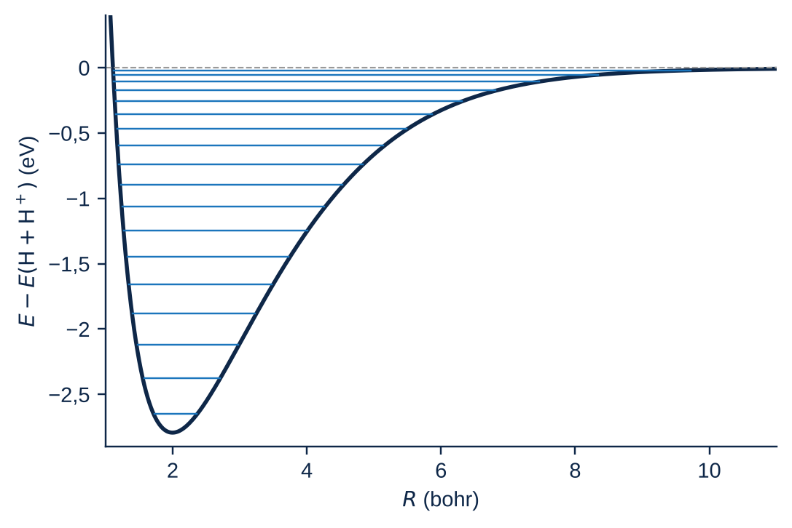

# Bab 11 Struktur Elektronik Molekul Diatom

Tuangkan nitrogen cair perlahan-lahan di antara kutub-kutub magnet yang kuat: cairan itu mengalir lewat begitu saja dan menguap di lantai. Lakukan hal yang sama dengan oksigen cair, dan sesuatu yang mengejutkan terjadi. Cairan biru pucat itu tertahan di antara kedua kutub, menggantung seperti jembatan sampai menguap. Oksigen bersifat **paramagnetik**: molekulnya mempunyai elektron tak berpasangan yang tertarik ke daerah medan magnet kuat. Padahal struktur Lewis O=O, yang begitu berhasil untuk ribuan molekul lain, menempatkan setiap elektron dalam pasangan. Teori ikatan yang paling dikenal mahasiswa kimia gagal pada molekul yang kita hirup setiap detik.

Teori yang menjelaskan magnet oksigen adalah **teori orbital molekul**. Dalam teori ini, elektron tidak ditugaskan ke ikatan atau pasangan bebas tertentu, tetapi menempati orbital yang menyebar ke seluruh molekul, sama seperti elektron menempati orbital atom dalam atom. Dua elektron terluar O₂ menempati sepasang orbital π* yang berdegenerasi, satu elektron di setiap orbital dengan spin sejajar, persis seperti aturan Hund untuk atom. Hasilnya molekul dengan dua elektron tak berpasangan dan keadaan dasar triplet.

Bab ini membangun teori ikatan kimia dari dasar, dengan molekul diatom sebagai laboratoriumnya. Kita mulai dari pendekatan yang memungkinkan kita berbicara tentang "bentuk molekul" sama sekali, yaitu pemisahan gerak elektron dan inti. Lalu kita menyelesaikan molekul paling sederhana, ion H₂⁺ dengan satu elektron, secara pendekatan dan secara eksak. Dari sana kita membangun konfigurasi elektron molekul diatom periode kedua, lambang suku molekul, dua teori ikatan yang bersaing untuk H₂ (orbital molekul dan ikatan valensi), serta molekul heteronuklir yang polar. Bab ini ditutup dengan dua teorema yang menjawab pertanyaan yang paling mendasar: *mengapa* ikatan kimia terbentuk, dan gaya apa yang menahan inti-inti di tempatnya.

::: {.strategi}
**Pertanyaan pembuka**

1. Mengapa oksigen cair tertarik magnet, padahal struktur Lewis O₂ tidak mempunyai elektron tak berpasangan?
2. Satu elektron cukup untuk mengikat dua proton dalam H₂⁺. Dari mana energi ikatnya berasal: dari energi kinetik elektron atau dari energi potensialnya?
3. Mengapa molekul He₂ praktis tidak ada, sedangkan ion He₂⁺ terikat cukup kuat?
4. Mengapa melepas satu elektron melemahkan ikatan N₂ tetapi menguatkan ikatan O₂?
5. Mengapa momen dipol CO sangat kecil, dan mengapa ujung negatifnya justru karbon, atom yang kurang elektronegatif?
:::

::: {.tujuan}
**Tujuan belajar**

Setelah mempelajari bab ini, kamu mampu:

1. Menurunkan pendekatan Born–Oppenheimer, memperkirakan ketelitiannya, dan menjelaskan konsep kurva dan permukaan energi potensial.
2. Menghubungkan kurva energi potensial dengan tetapan spektroskopi: $R_e$, $D_e$, $D_0$, tetapan gaya, dan tingkat getaran–rotasi.
3. Menuliskan Hamiltonian H₂⁺ dan menjelaskan mengapa persamaan Schrödingernya dapat diselesaikan secara eksak dalam koordinat eliptik.
4. Menurunkan energi LCAO H₂⁺ dan menghitung integral tumpang tindih, Coulomb, dan pertukaran.
5. Menjelaskan asal orbital ikatan dan antiikatan, serta mengapa orbital antiikatan lebih tidak stabil daripada kestabilan orbital ikatan.
6. Memberi label $\sigma$, $\pi$, $\delta$, $g$, $u$ pada orbital molekul diatom dan menggambar bentuknya.
7. Menyusun konfigurasi elektron dan orde ikatan diatom homonuklir periode 2, lalu meramalkan panjang ikatan, energi ikatan, dan sifat magnetnya.
8. Menjelaskan pencampuran s–p dan perbedaan urutan orbital N₂ dan O₂.
9. Menurunkan lambang suku molekul dari konfigurasi, termasuk $^3\Sigma_g^-$ oksigen dan keadaan oksigen singlet.
10. Menyusun fungsi gelombang OM dan ikatan valensi Heitler–London untuk H₂ dan membandingkan keduanya.
11. Menjelaskan kegagalan OM sederhana pada disosiasi dan memperbaikinya dengan interaksi konfigurasi.
12. Menyusun diagram OM diatom heteronuklir (HF, CO, LiH) dan menghubungkannya dengan elektronegativitas.
13. Menghitung persen karakter ionik dari momen dipol dan memakai skala elektronegativitas Pauling dan Mulliken.
14. Menurunkan teorema virial molekul dan memakainya untuk menjelaskan peran energi kinetik dan potensial dalam ikatan.
15. Menurunkan teorema Hellmann–Feynman dan menafsirkan gaya pada inti sebagai gaya elektrostatik dari awan elektron.
:::

::: {.mat}
**Prasyarat**

Dari *Fisika Umum*: Bab 12 (potensial Coulomb dan energi potensial listrik) dan Bab 13 (kemagnetan bahan). Dari buku ini: koordinat bola dan elemen volume (subbab 2.5), masalah nilai eigen umum dan persamaan sekuler (subbab 2.8, persamaan (2.37) dan (2.38)), Hamiltonian molekul (subbab 4.4, persamaan (4.7)), paritas (subbab 4.11), getaran diatom, potensial Morse, dan efek isotop (subbab 5.7, 5.9, dan 5.10), masalah dua benda dan rotor tegar (subbab 6.8 dan 6.9), atom hidrogen dan orbitalnya (subbab 7.3 sampai 7.10), teorema variasi dan fungsi variasi linear (subbab 8.2 sampai 8.4), spin, asas Pauli, dan determinan Slater (subbab 9.3 sampai 9.6), lambang suku atom (subbab 9.12), serta simetri dan teori grup (Bab 10). Satuan atom dipakai sejak subbab 11.3: panjang dalam bohr ($a_0 = 52{,}918$ pm), energi dalam hartree ($E_h = 27{,}211$ eV).
:::

## 11.1 Pendekatan Born–Oppenheimer

### Masalah yang terlalu besar

Operator Hamilton molekul (persamaan (4.7)) memuat energi kinetik semua inti dan semua elektron serta semua interaksi Coulomb di antara mereka. Dalam satuan atom ($\hbar = m_e = e = 4\pi\varepsilon_0 = 1$, subbab 2.11):

$$
\hat H = \underbrace{-\sum_A\frac{1}{2M_A}\nabla_A^2}_{\hat T_N} \underbrace{-\sum_i\frac12\nabla_i^2}_{\hat T_e} \underbrace{-\sum_{A,i}\frac{Z_A}{r_{Ai}}}_{\hat V_{eN}} + \underbrace{\sum_{i<j}\frac{1}{r_{ij}}}_{\hat V_{ee}} + \underbrace{\sum_{A<B}\frac{Z_AZ_B}{R_{AB}}}_{\hat V_{NN}} , \qquad \text{(11.1)}
$$

dengan $M_A$ massa inti $A$ dalam satuan massa elektron. Fungsi gelombangnya $\Psi(\mathbf r, \mathbf R)$ bergantung pada koordinat semua elektron ($\mathbf r$) dan semua inti ($\mathbf R$). Bahkan untuk molekul terkecil, H₂⁺ dengan tiga partikel, persamaan ini sudah sulit; untuk benzena dengan 12 inti dan 42 elektron, ia mustahil diselesaikan langsung. Lebih dari itu, fungsi gelombang total ini tidak mengandung "geometri molekul" dalam arti yang dikenal kimiawan: inti-inti juga partikel kuantum yang tersebar.

### Gagasan: inti lambat, elektron cepat

Inti jauh lebih berat daripada elektron: proton 1836 kali, inti karbon sekitar 21 900 kali. Karena gaya yang dialami inti dan elektron sebanding besarnya (keduanya gaya Coulomb antara muatan berorde $e$), inti bergerak jauh lebih lambat. Ketika inti bergeser sedikit, awan elektron punya cukup waktu untuk menyesuaikan diri sepenuhnya dengan posisi inti yang baru, seperti segerombolan lalat yang mengikuti seekor kerbau berjalan. Jadi kita boleh berpikir dalam dua tahap: pertama, bekukan inti di posisi $\mathbf R$ dan hitung keadaan elektron; kedua, biarkan inti bergerak dalam potensial yang dihasilkan elektron. Inilah **pendekatan Born–Oppenheimer** (Max Born dan J. Robert Oppenheimer, 1927).

### Penurunan

**Tahap 1: persamaan elektronik.** Dengan inti dibekukan, $\hat T_N$ dihilangkan dan $\hat V_{NN}$ menjadi tetapan. Hamiltonian elektronik

$$
\hat H_\text{el} = \hat T_e + \hat V_{eN} + \hat V_{ee} + \hat V_{NN}
$$

bekerja hanya pada koordinat elektron, dan bergantung pada $\mathbf R$ sebagai **parameter**. Persamaan eigennya

$$
\hat H_\text{el}\,\psi_n(\mathbf r; \mathbf R) = U_n(\mathbf R)\,\psi_n(\mathbf r; \mathbf R) \qquad \text{(11.2)}
$$

harus diselesaikan untuk setiap susunan inti. Titik koma dalam $\psi_n(\mathbf r; \mathbf R)$ menandai bahwa $\mathbf R$ adalah parameter, bukan variabel. Nilai eigen $U_n(\mathbf R)$, yang sudah mencakup tolakan antarinti, disebut **permukaan energi potensial** keadaan elektronik $n$; untuk molekul diatom ia bergantung hanya pada jarak antarinti $R$ dan disebut **kurva energi potensial**.

**Tahap 2: persamaan inti.** Tulis fungsi gelombang total sebagai hasil kali

$$
\Psi(\mathbf r, \mathbf R) = \psi_n(\mathbf r; \mathbf R)\,\chi(\mathbf R) .
$$

Masukkan ke $\hat H\Psi = E\Psi$. Bagian $\hat H_\text{el}$ memberi $U_n(\mathbf R)\psi_n\chi$. Bagian $\hat T_N$ bekerja pada hasil kali, dan menurut aturan turunan hasil kali,

$$
\nabla_A^2(\psi_n\chi) = \psi_n\nabla_A^2\chi + 2\nabla_A\psi_n\cdot\nabla_A\chi + \chi\nabla_A^2\psi_n .
$$

Pendekatan Born–Oppenheimer adalah mengabaikan dua suku terakhir, yang memuat turunan fungsi gelombang *elektronik* terhadap posisi inti. Dengan itu, $\psi_n$ dapat dikeluarkan dan diperoleh persamaan untuk inti saja:

$$
\left[-\sum_A\frac{1}{2M_A}\nabla_A^2 + U_n(\mathbf R)\right]\chi(\mathbf R) = E\,\chi(\mathbf R) . \qquad \text{(11.3)}
$$

Inti bergerak seolah-olah dalam potensial $U_n(\mathbf R)$. Elektron, dalam pendekatan ini, hanya berperan sebagai "lem" yang menghasilkan potensial itu.

::: {.inti}
**Pendekatan Born–Oppenheimer**

1. Untuk setiap posisi inti $\mathbf R$, selesaikan persamaan elektronik (11.2); nilai eigennya $U_n(\mathbf R)$ adalah permukaan energi potensial.
2. Inti bergerak dalam potensial $U_n(\mathbf R)$ menurut (11.3); penyelesaiannya memberi tingkat getaran dan rotasi.
3. Kesalahan pendekatan ini berorde $m_e/M$ dalam energi, kecuali di dekat titik ketika dua permukaan energi potensial hampir bersentuhan.
:::

::: {.dalam}
**Lebih dalam · Seberapa besar suku yang diabaikan?**

Mengapa suku $\nabla_A\psi_n$ kecil? Fungsi gelombang elektronik berubah cukup besar hanya bila inti bergeser sejauh ukuran awan elektron, sekitar 1 bohr. Fungsi gelombang inti $\chi$, sebaliknya, berubah dalam skala amplitudo getaran inti, yang jauh lebih kecil. Untuk menaksir, tinjau getaran dengan tetapan gaya $k \sim E_\text{el}/a^2$, dengan $E_\text{el}$ energi elektronik khas (sekitar 1 hartree) dan $a$ ukuran molekul (sekitar 1 bohr). Frekuensi getaran $\omega = \sqrt{k/M}$, sehingga dalam satuan atom

$$
\frac{E_\text{vib}}{E_\text{el}} \sim \frac{\omega}{1} \sim \left(\frac{m_e}{M}\right)^{1/2} .
$$

Amplitudo getaran titik nol $\Delta R \sim (1/M\omega)^{1/2} \sim (m_e/M)^{1/4}$ bohr. Energi rotasi $\sim 1/(MR^2) \sim m_e/M$. Jadi ada hierarki

$$
E_\text{el} : E_\text{vib} : E_\text{rot} \approx 1 : \left(\frac{m_e}{M}\right)^{1/2} : \frac{m_e}{M} .
$$

Born dan Oppenheimer menunjukkan, dengan uraian deret dalam parameter $\kappa = (m_e/M)^{1/4}$, bahwa suku-suku yang diabaikan menyumbang pada energi mulai orde $\kappa^4 = m_e/M$, sebanding dengan energi rotasi. Untuk molekul yang inti-intinya lebih berat daripada hidrogen, kesalahan itu jauh di bawah ketelitian kimia.
:::

::: {.contoh}
**Contoh 11.1 · Skala waktu elektron dan inti**

Bandingkan (a) periode orbit elektron 1s dalam atom H menurut model Bohr ($r = 52{,}9$ pm, $v = 2{,}19 \times 10^6$ m/s), (b) periode getaran H₂ ($\tilde\nu = 4401$ cm⁻¹) dan N₂ (2359 cm⁻¹), dan (c) periode rotasi H₂ pada $J = 1$ (sekitar 0,19 ps).

**Penyelesaian.** (a) $T = 2\pi r/v = 2\pi(5{,}29 \times 10^{-11})/(2{,}19 \times 10^6) = 1{,}52 \times 10^{-16}$ s $= 0{,}152$ fs. (b) $T = 1/(c\tilde\nu)$: H₂, $1/(3{,}00 \times 10^{10} \times 4401) = 7{,}58$ fs; N₂, 14,1 fs. (c) 190 fs.

**Memahami hasil.** Selama satu getaran H₂, elektron "mengelilingi" inti sekitar 50 kali; selama satu getaran N₂, hampir seratus kali. Dari sudut pandang elektron, inti nyaris diam. Hierarki waktu inilah yang membenarkan pemisahan Born–Oppenheimer, dan inilah juga yang dimanfaatkan spektroskopi femtodetik untuk "memotret" inti yang bergerak sementara elektron mengikutinya (subbab 15.12).
:::

::: {.contoh}
**Contoh 11.2 · Hierarki energi H₂**

Untuk H₂, energi eksitasi elektronik pertama sekitar 11,2 eV, kuantum getaran 4401 cm⁻¹, dan tetapan rotasi $B = 60{,}85$ cm⁻¹. Hitung perbandingan $E_\text{el} : E_\text{vib} : E_\text{rot}$ (pakai $2B$ untuk rotasi) dan bandingkan dengan perkiraan $(m_e/\mu)^{1/2}$ dan $m_e/\mu$, dengan $\mu = m_p/2$.

**Penyelesaian.** $E_\text{vib} = 4401/8065{,}5 = 0{,}546$ eV; $E_\text{rot} = 121{,}7/8065{,}5 = 0{,}0151$ eV. Perbandingan: $1 : 0{,}049 : 0{,}0013$. Dengan $m_e/\mu = 2/1836 = 1{,}09 \times 10^{-3}$: $(m_e/\mu)^{1/2} = 0{,}033$ dan $m_e/\mu = 0{,}0011$.

**Memahami hasil.** Orde besarannya cocok dengan taksiran di kotak *Lebih dalam*. Pemisahan skala energi ini adalah alasan spektrum molekul tersusun bertingkat: pita elektronik di ultraviolet dan tampak, getaran di inframerah, rotasi di gelombang mikro. H₂ adalah kasus terburuk karena intinya paling ringan; untuk molekul yang lebih berat, celah antarskala makin lebar dan pendekatan Born–Oppenheimer makin baik.
:::

### Kurva energi potensial

Untuk molekul diatom, $U(R)$ adalah fungsi satu variabel yang menyimpan hampir semua informasi kimia molekul itu. Minimumnya menentukan **jarak setimbang** $R_e$; kedalamannya terhadap atom-atom terpisah adalah **energi disosiasi** $D_e$; kelengkungannya di minimum adalah **tetapan gaya** $k = U''(R_e)$. Karena Hamiltonian elektronik tidak memuat massa inti, $U(R)$ sama untuk semua isotopolog (H₂, HD, D₂), sebagaimana sudah dimanfaatkan di subbab 5.10.

Konsep permukaan energi potensial adalah salah satu gagasan terpenting dalam kimia, dan ia sepenuhnya lahir dari pendekatan Born–Oppenheimer. "Struktur molekul" adalah minimum permukaan itu; "keadaan transisi" adalah titik pelananya; "jalur reaksi" adalah lembah yang menghubungkan minimum-minimum. Tanpa pemisahan gerak elektron dan inti, kalimat-kalimat itu tidak bermakna.

### Ketika pendekatan gagal: persilangan yang dihindari

Suku yang diabaikan, $\nabla_A\psi_n$, menjadi besar ketika fungsi gelombang elektronik berubah tajam terhadap $R$, yaitu ketika dua permukaan energi potensial saling mendekat. Untuk molekul diatom berlaku **aturan tak bersilangan** (von Neumann dan Wigner, 1929): dua kurva dengan simetri yang sama (lambang suku yang sama, subbab 11.9) tidak dapat bersilangan. Bila dua keadaan sesimetri "ingin" bersilangan, Hamiltonian mencampurnya, dan kurvanya saling menolak membentuk **persilangan yang dihindari**. Di sekitar titik itu, karakter elektronik berubah cepat, dan inti yang bergerak cepat dapat "melompat" dari satu kurva ke kurva lain. Lompatan seperti itu (proses **nonadiabatik**) adalah inti fotokimia: dalam penglihatan, retinal yang tereksitasi kembali ke keadaan dasar melalui titik di mana dua permukaan energi bersentuhan, dalam waktu sekitar 200 fs.

::: {.contoh}
**Contoh 11.3 · Kurva ionik dan kovalen NaCl**

Pada jarak besar, keadaan dasar NaCl dalam fase gas adalah dua atom netral Na + Cl. Keadaan ionik Na⁺ + Cl⁻ lebih tinggi sebesar $I(\text{Na}) - A(\text{Cl}) = 5{,}139 - 3{,}613$ eV, tetapi tarikan Coulomb menurunkannya ketika jarak berkurang. Pada jarak berapa kurva ionik menyilang energi atom netral? Apa yang terjadi di sana?

**Penyelesaian.** Kurva ionik $\approx 1{,}526\ \text{eV} - e^2/4\pi\varepsilon_0R$. Dengan $e^2/4\pi\varepsilon_0 = 14{,}40$ eV Å, persilangan terjadi pada $R_c = 14{,}40/1{,}526 = 9{,}44$ Å.

**Memahami hasil.** Kedua keadaan mempunyai simetri yang sama ($^1\Sigma^+$), sehingga kurvanya tidak bersilangan tetapi saling menghindari. Di dalam $R_c$, keadaan dasar adalah ionik; di luar, kovalen. Molekul NaCl yang terdisosiasi perlahan berubah menjadi atom netral, bukan ion. Jarak persilangan yang begitu besar menjelaskan **mekanisme harpun** dalam reaksi Na + Cl₂ → NaCl + Cl: atom Na "melemparkan" elektronnya ke Cl₂ dari jarak sekitar 5 Å (dengan afinitas elektron Cl₂ sekitar 2,4 eV, $R_c = 14{,}40/(5{,}14 - 2{,}4) \approx 5{,}2$ Å), jauh sebelum terjadi tumbukan, lalu tarikan Coulomb menarik keduanya. Penampang lintang reaksinya karena itu jauh lebih besar daripada ukuran molekul.
:::

::: {.contoh}
**Contoh 11.4 · Seberapa teliti Born–Oppenheimer untuk H₂?**

Perhitungan yang sangat teliti menunjukkan bahwa koreksi terhadap pendekatan Born–Oppenheimer mengubah energi disosiasi H₂ hanya sekitar 5 cm⁻¹, sedangkan $D_0 = 36\,118$ cm⁻¹. Hitung kesalahan relatifnya, lalu bandingkan dengan perkiraan $m_e/\mu$.

**Penyelesaian.** $5/36\,118 = 1{,}4 \times 10^{-4}$. Perkiraan kasar $m_e/\mu = 1{,}1 \times 10^{-3}$.

**Memahami hasil.** Kesalahan nyata bahkan lebih kecil daripada perkiraan orde besaran, karena sebagian besar koreksi juga ada pada atom-atom terpisah dan saling meniadakan ketika selisihnya diambil. Untuk molekul H₂, molekul dengan inti paling ringan, pendekatan Born–Oppenheimer sudah benar sampai empat angka penting. Pada molekul organik biasa, kesalahan itu tidak berarti, sehingga seluruh kimia komputasi (Bab 17) dibangun di atas (11.2).
:::

::: {.dalam}
**Lebih dalam · Kopling nonadiabatik**

Pendekatan Born–Oppenheimer dapat diperbaiki secara sistematis. Fungsi gelombang eksak selalu dapat diuraikan atas fungsi elektronik semua keadaan, $\Psi = \sum_n\psi_n(\mathbf r; \mathbf R)\chi_n(\mathbf R)$ (uraian Born–Huang). Memasukkan uraian ini ke $\hat H\Psi = E\Psi$ dan memproyeksikan pada $\psi_n$ memberi persamaan inti yang saling terkait:

$$
\left[\hat T_N + U_n(\mathbf R) + \Lambda_{nn}\right]\chi_n + \sum_{m \ne n}\Lambda_{nm}\chi_m = E\chi_n ,
$$

dengan operator kopling $\Lambda_{nm}$ yang memuat $\langle\psi_n|\nabla_A\psi_m\rangle$ dan $\langle\psi_n|\nabla_A^2\psi_m\rangle$, dibagi massa inti. Pendekatan Born–Oppenheimer mengabaikan semua $\Lambda$; **pendekatan adiabatik** mempertahankan suku diagonal $\Lambda_{nn}$ sebagai koreksi kecil pada potensial. Suku nondiagonal dapat ditulis dengan rumus yang mirip teorema Hellmann–Feynman (subbab 11.16):

$$
\langle\psi_n|\nabla_A\psi_m\rangle = \frac{\langle\psi_n|(\nabla_A\hat H_\text{el})|\psi_m\rangle}{U_m - U_n}, \qquad m \ne n .
$$

Penyebut $U_m - U_n$ menjelaskan semuanya: kopling kecil bila keadaan-keadaan elektronik berjauhan energinya, dan meledak bila dua permukaan mendekat. Di situlah inti dapat berpindah dari satu permukaan ke permukaan lain.
:::

::: {.contoh}
**Contoh 11.5 · Satu kurva, tiga molekul**

H₂, HD, dan D₂ berbagi kurva $U(R)$ yang sama dengan $D_e = 4{,}7474$ eV. Tetapan getarannya ($\omega_e$, $\omega_ex_e$ dalam cm⁻¹): H₂ (4401,2; 121,3), HD (3813,1; 91,65), D₂ (3115,5; 61,82). Hitung $D_0$ ketiganya dan bandingkan dengan nilai terukur 4,478, 4,514, dan 4,556 eV.

**Penyelesaian.** $G(0) = \tfrac12\omega_e - \tfrac14\omega_ex_e$: H₂ 2170,3 cm⁻¹ (0,2691 eV); HD 1883,6 cm⁻¹ (0,2335 eV); D₂ 1542,3 cm⁻¹ (0,1912 eV). Maka $D_0$ = 4,478, 4,514, dan 4,556 eV.

**Memahami hasil.** Ketiga nilai cocok dengan pengukuran sampai angka ketiga di belakang koma, padahal satu-satunya masukan elektronik adalah satu angka $D_e$. Kecocokan ini adalah bukti paling langsung bahwa kurva Born–Oppenheimer memang tidak bergantung pada massa inti. Selisih $D_0$ seluruhnya berasal dari energi titik nol, dan selisih inilah yang menimbulkan efek isotop kinetik (subbab 5.10): ikatan C–D lebih sulit diputus daripada C–H karena energi titik nolnya lebih rendah di dasar sumur yang sama.
:::

::: {.kuis}
**Kuis cepat 11.1**

\(a) Mengapa $U(R)$ untuk H₂ dan D₂ sama, padahal energi titik nolnya berbeda? (b) Dalam keadaan apa pendekatan Born–Oppenheimer gagal? (c) Apakah $U(R)$ memuat tolakan antarinti?
:::

## 11.2 Gerak inti dalam molekul diatom

### Dari tiga dimensi ke satu dimensi

Untuk molekul diatom, persamaan inti (11.3) adalah masalah dua benda dengan potensial yang hanya bergantung pada jarak $R$. Di subbab 6.8 kita sudah memisahkan masalah seperti ini menjadi gerak pusat massa (partikel bebas) dan gerak relatif dengan massa tereduksi $\mu = M_AM_B/(M_A + M_B)$. Karena potensialnya sentral, gerak relatif dapat dipisahkan lagi menjadi bagian sudut dan bagian radial, persis seperti atom hidrogen: $\chi = [S(R)/R]\,Y_J^M(\theta, \phi)$, dengan $Y_J^M$ harmonik bola. Fungsi radial $S(R)$ memenuhi

$$
\left[-\frac{\hbar^2}{2\mu}\frac{d^2}{dR^2} + U(R) + \frac{J(J + 1)\hbar^2}{2\mu R^2}\right]S(R) = E\,S(R) . \qquad \text{(11.4)}
$$

Suku ketiga adalah potensial sentrifugal (persamaan (6.26)): molekul yang berputar merasakan potensial efektif yang lebih dangkal dan minimumnya sedikit bergeser ke $R$ yang lebih besar.

### Tingkat getaran–rotasi

Uraikan $U(R)$ di sekitar minimum: $U \approx U(R_e) + \tfrac12k(R - R_e)^2 + \ldots$. Bila suku kubik dan seterusnya diabaikan dan suku sentrifugal dihitung di $R_e$, (11.4) menjadi osilator harmonik yang digeser oleh energi rotor tegar. Dengan koreksi anharmonik dan kopling getaran–rotasi, tingkat-tingkat energinya dalam bilangan gelombang adalah

$$
E(v, J)/hc = T_e + \omega_e\left(v + \tfrac12\right) - \omega_ex_e\left(v + \tfrac12\right)^2 + B_vJ(J + 1) - DJ^2(J + 1)^2 , \qquad \text{(11.5)}
$$

dengan $T_e$ energi minimum kurva, $B_v = B_e - \alpha_e(v + \tfrac12)$, dan $D$ tetapan distorsi sentrifugal. Semua suku ini sudah kita temui di Bab 5 dan 6; yang baru adalah pemahaman bahwa semua tetapan itu adalah sifat satu fungsi, $U(R)$:

| Tetapan | Hubungan dengan $U(R)$ |
|---|---|
| $R_e$, $B_e$ | posisi minimum; $B_e = \hbar/4\pi c\mu R_e^2$ |
| $\omega_e$ | kelengkungan: $k = U''(R_e) = \mu(2\pi c\omega_e)^2$ |
| $\omega_ex_e$, $\alpha_e$ | turunan ketiga dan keempat $U$ di $R_e$ (anharmonisitas) |
| $D_e$ | $U(\infty) - U(R_e)$ |
| $D_0$ | $D_e - G(0)$, dengan $G(0) \approx \tfrac12\omega_e - \tfrac14\omega_ex_e$ |

Arah sebaliknya juga mungkin: dari tingkat getaran dan rotasi yang diukur teliti, kurva $U(R)$ dapat direkonstruksi titik demi titik dengan metode Rydberg–Klein–Rees (RKR), tanpa memilih bentuk fungsi tertentu. Kurva RKR adalah tolok ukur paling langsung untuk menguji perhitungan kimia kuantum.

::: {.contoh}
**Contoh 11.6 · Dari $D_e$ ke $D_0$ untuk H₂**

Perhitungan kuantum yang sangat teliti memberi $D_e = 4{,}7474$ eV untuk H₂. Dengan $\omega_e = 4401{,}2$ cm⁻¹ dan $\omega_ex_e = 121{,}3$ cm⁻¹, hitung energi titik nol dan $D_0$, lalu bandingkan dengan nilai terukur 4,4781 eV.

**Penyelesaian.** $G(0) = \tfrac12(4401{,}2) - \tfrac14(121{,}3) = 2200{,}6 - 30{,}3 = 2170{,}3$ cm⁻¹ $= 0{,}2691$ eV. $D_0 = 4{,}7474 - 0{,}2691 = 4{,}4783$ eV.

**Memahami hasil.** Selisihnya dengan pengukuran hanya 0,0002 eV. Ramalan teoretis $D_0$ H₂ dan pengukurannya kini cocok sampai sekitar $10^{-4}$ cm⁻¹, setelah koreksi Born–Oppenheimer, relativistik, dan elektrodinamika kuantum diperhitungkan; molekul ini menjadi salah satu uji paling teliti bagi fisika dasar. Energi titik nol 0,27 eV adalah hampir 6% dari $D_e$: bagian energi ikat yang tidak pernah dapat "dipakai" karena asas ketidakpastian.
:::

::: {.contoh}
**Contoh 11.7 · Seberapa baik potensial Morse?**

Dengan (5.28), perkirakan $D_e$ H₂ dari $\omega_e$ dan $\omega_ex_e$ di Contoh 11.6, serta banyak tingkat getaran terikat menurut potensial Morse. Kenyataannya, H₂ mempunyai 15 tingkat getaran terikat ($v = 0$ sampai 14).

**Penyelesaian.** $D_e = \omega_e^2/4\omega_ex_e = 4401{,}2^2/(4 \times 121{,}3) = 39\,923$ cm⁻¹ $= 4{,}95$ eV. Bilangan $v$ maksimum: $\omega_e/2\omega_ex_e - \tfrac12 = 17{,}6$, jadi 18 tingkat ($v = 0$ sampai 17).

**Memahami hasil.** Potensial Morse melebih-lebihkan $D_e$ sekitar 4% dan banyak tingkat terikat sekitar 20%. Kurva nyata mendekati asimtotnya lebih lambat daripada fungsi eksponensial Morse, karena di jarak besar interaksi antaratom netral hanya berupa gaya dispersi yang lemah ($\propto R^{-6}$). Potensial Morse cocok di sekitar dasar sumur, tempat sebagian besar kimia terjadi, tetapi tidak di dekat ambang disosiasi.
:::

::: {.contoh}
**Contoh 11.8 · Rotasi meregangkan ikatan**

Tetapan gaya H₂ adalah 575 N/m dan $R_e = 74{,}14$ pm. Dengan menyamakan gaya pemulih $k\,\delta R$ dengan gaya sentrifugal $L^2/\mu R_e^3$, perkirakan pertambahan panjang ikatan pada $J = 5$, 10, dan 20.

**Penyelesaian.** $\delta R = J(J + 1)\hbar^2/(\mu R_e^3k)$, dengan $\mu = 8{,}37 \times 10^{-28}$ kg. Untuk $J = 5$: $\delta R = 30(1{,}0546 \times 10^{-34})^2/[(8{,}37 \times 10^{-28})(7{,}414 \times 10^{-11})^3(575)] = 1{,}70$ pm. Untuk $J = 10$: 6,24 pm. Untuk $J = 20$: 23,8 pm.

**Memahami hasil.** Pada $J = 20$, ikatan H₂ teregang hampir sepertiganya, dan pendekatan "rotor tegar" runtuh total. Pergeseran $R$ inilah yang menimbulkan distorsi sentrifugal $D$ (subbab 6.12). Untuk $J$ sangat besar, potensial efektif (11.4) kehilangan minimumnya sama sekali: molekul yang berputar terlalu cepat terpisah sendiri. Gejala ini penting dalam astrofisika, tempat molekul dapat terbentuk dalam keadaan rotasi sangat tinggi.
:::

::: {.terapan}
**Kaitan kimia · Permukaan energi potensial dan reaksi**

Kurva energi potensial molekul diatom adalah kasus satu dimensi dari permukaan energi potensial. Untuk reaksi H + H₂ → H₂ + H, permukaannya bergantung pada tiga jarak antaratom. Henry Eyring dan Michael Polanyi membangun permukaan itu secara semiempiris pada 1931, dan dari sana lahir teori keadaan transisi: laju reaksi ditentukan oleh tinggi titik pelana pada permukaan energi potensial. Kini permukaan itu dihitung dari persamaan elektronik (11.2) dengan ketelitian lebih baik dari 0,1 kJ/mol, dan simulasi gerak inti di atasnya mereproduksi penampang lintang reaksi yang diukur dengan berkas molekul. Seluruh dinamika reaksi adalah "inti bergerak pada permukaan Born–Oppenheimer".
:::

::: {.contoh}
**Contoh 11.9 · Tingkat getaran H₂⁺ dari kurva eksak**

Kurva eksak H₂⁺ dari Contoh 11.12 (energi pada sekitar 40 nilai $R$) dapat dipakai sebagai $U(R)$ dalam persamaan inti (11.4) dengan $J = 0$. Selesaikan persamaan itu secara numerik dengan metode beda hingga: turunan kedua diganti $[S(R + h) - 2S(R) + S(R - h)]/h^2$, sehingga persamaan menjadi masalah nilai eigen matriks tridiagonal. Hitung tingkat-tingkat getaran, $D_0$, dan jarak rata-rata $\langle R\rangle$ pada $v = 0$.

**Penyelesaian.**

```python
import numpy as np
from scipy.interpolate import CubicSpline
from scipy.linalg import eigh_tridiagonal
U = CubicSpline(R_data, E_data)          # kurva eksak (bohr, hartree)
mu = 1836.15 / 2                         # massa tereduksi dua proton (satuan atom)
R = np.linspace(0.8, 12, 6000); h = R[1] - R[0]
diag = 1 / (mu * h**2) + U(R)            # -(1/2mu) d2/dR2 dengan beda hingga
off = -np.ones(len(R) - 1) / (2 * mu * h**2)
E, S = eigh_tridiagonal(diag, off, select='v', select_range=(-0.7, -0.5))
print((E - E[0])[:6] * 219474.6)         # G(v) - G(0) dalam cm^-1
print((-0.5 - E[0]) * 27.2114)           # D0 dalam eV
```

Hasilnya: $G(v) - G(0) = 0$, 2192, 4257, 6199, 8021, 9726 cm⁻¹, dengan selisih berturut-turut 2192, 2065, 1942, 1822, 1705 cm⁻¹; $D_0 = 2{,}650$ eV. Dari fungsi $v = 0$, $\langle R\rangle = 2{,}063$ bohr $= 109{,}2$ pm, sedangkan $R_e = 105{,}7$ pm. Sebanyak 18 tingkat ditemukan di bawah ambang disosiasi (Gambar 11.1).

**Memahami hasil.** Selisih tingkat pertama, $\Delta G_{1/2} = 2192$ cm⁻¹, cocok dengan nilai spektroskopi 2191 cm⁻¹, dan $D_0$ cocok dengan 2,651 eV. Selisih yang mengecil teratur sekitar 120 cm⁻¹ per tingkat adalah anharmonisitas: $\omega_ex_e \approx 62$ cm⁻¹. Jarak rata-rata $\langle R\rangle$ lebih besar daripada $R_e$ karena sumurnya tidak simetris: dinding luar lebih landai daripada dinding dalam. Rantai perhitungan ini, dari persamaan elektronik ke kurva potensial ke spektrum getaran, adalah resep umum spektroskopi teoretis. Perhitungan teliti memberi satu tingkat lagi yang sangat dekat ambang, sehingga H₂⁺ mempunyai 19 tingkat terikat untuk $J = 0$.
:::

{width=78%}

::: {.dalam}
**Lebih dalam · Kurva potensial dari spektrum: metode RKR**

Bagaimana kurva $U(R)$ dibaca dari spektrum tanpa memilih bentuk fungsinya lebih dahulu? Rydberg, Klein, dan Rees memakai kaidah kuantisasi semiklasik: untuk setiap tingkat getaran dengan energi $E = G(v)$, dua titik balik klasik $R_-(v)$ dan $R_+(v)$ (tempat $U = E$) memenuhi

$$
R_\pm = \sqrt{f^2 + f/g} \pm f ,
$$

dengan dua integral atas bilangan kuantum getaran yang diperlakukan sebagai variabel kontinu,

$$
f = \frac{\hbar}{\sqrt{2\mu}}\int_{-1/2}^{v}\frac{dv'}{\sqrt{G(v) - G(v')}}, \qquad g = \frac{\sqrt{2\mu}}{\hbar}\int_{-1/2}^{v}\frac{B_{v'}\,dv'}{\sqrt{G(v) - G(v')}} ,
$$

(energi $G$ dan $B$ dalam satuan energi). Integral $f$ memberi *lebar* sumur pada energi $G(v)$, $f = \tfrac12(R_+ - R_-)$; integral $g$, yang memuat tetapan rotasi, memberi *posisi* sumur melalui $\langle 1/R^2\rangle$. Masukannya hanyalah $G(v)$ dan $B_v$ yang terukur. Integral itu mempunyai singularitas yang dapat diintegrasikan di ujung atas, dan dihitung dengan mudah secara numerik.
:::

::: {.contoh}
**Contoh 11.10 · Titik balik H₂ dengan RKR**

Dengan $G(v) = \omega_e(v + \tfrac12) - \omega_ex_e(v + \tfrac12)^2$ dan $B_v = B_e - \alpha_e(v + \tfrac12)$ untuk H₂ ($\omega_e = 4401{,}2$, $\omega_ex_e = 121{,}3$, $B_e = 60{,}853$, $\alpha_e = 3{,}062$ cm⁻¹), integrasi numerik rumus RKR memberi titik balik berikut. Bandingkan dengan titik balik osilator harmonik pada $v = 0$, yaitu $R_e \pm \sqrt{2G(0)/k}$.

| $v$ | $G(v)$ (cm⁻¹) | $R_-$ (pm) | $R_+$ (pm) |
|---|---|---|---|
| 0 | 2170 | 63,3 | 88,3 |
| 1 | 6329 | 57,1 | 101,4 |
| 3 | 13 918 | 51,0 | 122,3 |

**Penyelesaian.** Dengan $k = 575$ N/m dan $G(0) = 2170{,}3$ cm⁻¹ $= 4{,}311 \times 10^{-20}$ J: $\sqrt{2G(0)/k} = 12{,}2$ pm, sehingga titik balik harmonik 61,9 dan 86,4 pm, simetris di sekitar 74,1 pm. Titik balik RKR 63,3 dan 88,3 pm.

**Memahami hasil.** Bahkan pada $v = 0$, sumur nyata tidak simetris: dinding dalam lebih curam, dinding luar lebih landai, sehingga kedua titik balik bergeser ke luar sekitar 1,5–2 pm. Ketidaksimetrisan bertambah dengan $v$: pada $v = 3$, $R_+$ berjarak 48 pm dari $R_e$ sedangkan $R_-$ hanya 23 pm. Kurva RKR untuk ratusan molekul diatom adalah data baku yang dipakai untuk menguji perhitungan seperti di bab ini, dan untuk menghitung faktor Franck–Condon (subbab 15.7).
:::

::: {.kuis}
**Kuis cepat 11.2**

\(a) Mengapa molekul yang berputar mempunyai jarak setimbang efektif yang lebih besar? (b) Apa perbedaan $D_e$ dan $D_0$, dan mana yang langsung dihitung oleh kimia kuantum? (c) Besaran apa dari $U(R)$ yang menentukan $\omega_e$?
:::
