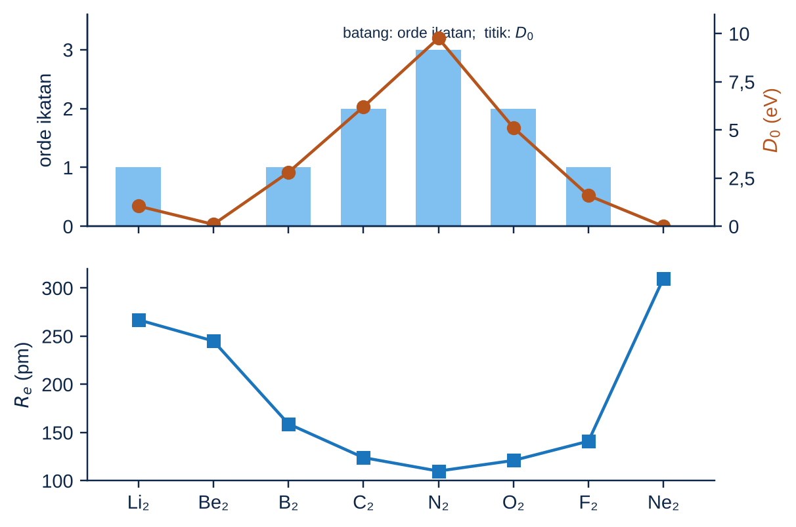

## 11.7 Konfigurasi OM diatom homonuklir periode 2

### Prinsip aufbau untuk molekul

Seperti atom berelektron banyak yang elektronnya diisikan ke orbital mirip hidrogen (subbab 9.9), molekul berelektron banyak dapat dibayangkan sebagai elektron-elektron yang diisikan ke orbital molekul mirip H₂⁺. Tolakan antarelektron mengubah energi dan bentuk orbital, tetapi urutan dan simetrinya umumnya tetap. Untuk molekul periode 2, orbital 1s kedua atom hampir tidak bertumpang tindih (jari-jarinya sekitar $a_0/Z$), sehingga kombinasi $1\sigma_g$ dan $1\sigma_u$ yang dibentuknya berenergi hampir sama dengan orbital 1s atom, terisi penuh, dan praktis tidak mengikat. Keduanya sering disingkat KK (kulit K kedua atom). Elektron valensi mengisi delapan OM yang dibangun dari orbital $2s$ dan $2p$ (Gambar 11.7).

Untuk O₂ dan F₂, urutan energi OM valensinya

$$
\sigma_g2s < \sigma_u^*2s < \sigma_g2p < \pi_u2p < \pi_g^*2p < \sigma_u^*2p , \qquad \text{(11.18)}
$$

sedangkan untuk Li₂ sampai N₂, dua tingkat di tengah bertukar tempat: $\pi_u2p < \sigma_g2p$. Alasan pertukaran itu adalah pencampuran s–p (subbab 11.8). Dalam notasi urutan, dengan orbital inti dihitung, $\sigma_g2s = 2\sigma_g$, $\sigma_u^*2s = 2\sigma_u$, $\sigma_g2p = 3\sigma_g$, $\pi_u2p = 1\pi_u$, $\pi_g^*2p = 1\pi_g$, dan $\sigma_u^*2p = 3\sigma_u$.

### Delapan molekul

Tabel berikut mengisi elektron valensi menurut urutan yang sesuai, menghitung orde ikatan, dan membandingkan dengan data spektroskopi.

| Molekul | Konfigurasi valensi | Orde | Elektron tak berpasangan | $R_e$ (pm) | $D_0$ (eV) | $\omega_e$ (cm⁻¹) |
|---|---|---|---|---|---|---|
| Li₂ | $(2\sigma_g)^2$ | 1 | 0 | 267 | 1,05 | 351 |
| Be₂ | $(2\sigma_g)^2(2\sigma_u)^2$ | 0 | 0 | 245 | 0,1 | 276 |
| B₂ | $\ldots(1\pi_u)^2$ | 1 | 2 | 159 | 2,8 | 1051 |
| C₂ | $\ldots(1\pi_u)^4$ | 2 | 0 | 124 | 6,2 | 1855 |
| N₂ | $\ldots(1\pi_u)^4(3\sigma_g)^2$ | 3 | 0 | 110 | 9,76 | 2359 |
| O₂ | $\ldots(3\sigma_g)^2(1\pi_u)^4(1\pi_g)^2$ | 2 | 2 | 121 | 5,12 | 1580 |
| F₂ | $\ldots(1\pi_u)^4(1\pi_g)^4$ | 1 | 0 | 141 | 1,60 | 917 |
| Ne₂ | $\ldots(1\pi_g)^4(3\sigma_u)^2$ | 0 | 0 | 310 | 0,003 | 14 |

(Titik-titik menandai $(2\sigma_g)^2(2\sigma_u)^2$; untuk O₂ dan F₂ dipakai urutan (11.18).) Pola yang tampak sangat jelas (Gambar 11.8): orde ikatan naik dari Li₂ ke N₂ lalu turun ke Ne₂; energi disosiasi dan bilangan gelombang getaran mengikuti orde ikatan; panjang ikatan bergerak berlawanan arah. Molekul dengan orde nol (Be₂ dan Ne₂) hanya terikat sangat lemah. Teori ini juga meramalkan dengan benar bahwa B₂ dan O₂ paramagnetik, masing-masing dengan dua elektron tak berpasangan di sepasang orbital π berdegenerasi.

{width=82%}

::: {.contoh}
**Contoh 11.30 · Ion-ion oksigen**

Tentukan konfigurasi dan orde ikatan O₂⁺, O₂, O₂⁻ (superoksida), dan O₂²⁻ (peroksida). Data: panjang ikatan 112, 121, sekitar 133, dan sekitar 149 pm; bilangan gelombang ulur O–O 1905, 1580, sekitar 1100, dan sekitar 800 cm⁻¹.

**Penyelesaian.** Elektron ditambahkan atau dikurangi pada orbital $1\pi_g$ (antiikatan). O₂⁺: $(1\pi_g)^1$, orde $\tfrac12(8 - 3) = 2{,}5$. O₂: $(1\pi_g)^2$, orde 2. O₂⁻: $(1\pi_g)^3$, orde 1,5. O₂²⁻: $(1\pi_g)^4$, orde 1.

**Memahami hasil.** Panjang ikatan dan frekuensi mengikuti orde ikatan dengan rapi. Pengukuran frekuensi ulur O–O dengan spektroskopi Raman dipakai untuk mengenali bagaimana O₂ terikat pada protein dan katalis: O₂ yang terikat pada hemoglobin bergetar sekitar 1100–1150 cm⁻¹, ciri superoksida, sehingga ikatan Fe–O₂ lebih tepat digambarkan sebagai Fe(III)–O₂⁻ daripada Fe(II)–O₂. Satu angka dari spektrum memberi tahu muatan formal oksigen.
:::

::: {.contoh}
**Contoh 11.31 · Mengionkan N₂ dan O₂**

Jawab pertanyaan pembuka 4: mengapa ionisasi melemahkan N₂ ($D_0$: 9,76 → 8,71 eV; $R_e$: 109,8 → 111,6 pm) tetapi menguatkan O₂ ($D_0$: 5,12 → 6,66 eV; $R_e$: 120,7 → 111,6 pm)?

**Penyelesaian.** Elektron yang dilepas adalah elektron di HOMO. Pada N₂, HOMO adalah $3\sigma_g$, orbital ikatan: orde turun dari 3 ke 2,5. Pada O₂, HOMO adalah $1\pi_g$, orbital antiikatan: orde naik dari 2 ke 2,5.

**Memahami hasil.** Menarik bahwa N₂⁺ dan O₂⁺, keduanya berorde 2,5, mempunyai panjang ikatan yang hampir sama (sekitar 112 pm). Penurunan energi ikat N₂ hanya sekitar 1 eV, lebih kecil daripada yang diharapkan dari kehilangan "setengah ikatan" (sekitar 3 eV): orbital $3\sigma_g$ N₂ ternyata hanya sedikit mengikat, karena pencampuran s–p telah memberinya karakter mirip pasangan elektron bebas (subbab 11.8).
:::

::: {.contoh}
**Contoh 11.32 · Momen magnet oksigen**

O₂ mempunyai dua elektron tak berpasangan. Hitung momen magnet efektif "spin saja" $\mu_\text{eff} = \sqrt{n(n + 2)}\,\mu_B$ dan kerentanan magnet molar menurut hukum Curie, $\chi_m = N_A\mu_0\mu_\text{eff}^2/3kT$, pada 298 K.

**Penyelesaian.** $\mu_\text{eff} = \sqrt{2 \times 4}\,\mu_B = 2{,}83\,\mu_B$. Dengan $\mu_B = 9{,}274 \times 10^{-24}$ J/T:

$$
\chi_m = \frac{(6{,}022 \times 10^{23})(4\pi \times 10^{-7})(2{,}83 \times 9{,}274 \times 10^{-24})^2}{3(1{,}381 \times 10^{-23})(298)} = 4{,}22 \times 10^{-8}\ \text{m}^3/\text{mol} .
$$

**Memahami hasil.** Nilai terukur sekitar $4{,}3 \times 10^{-8}$ m³/mol (dalam satuan cgs yang masih banyak dipakai, $3{,}4 \times 10^{-3}$ cm³/mol). Kecocokan ini adalah salah satu kemenangan pertama teori orbital molekul atas teori Lewis (Mulliken, Hund, dan Lennard-Jones, sekitar 1929). Oksigen cair, yang jauh lebih rapat, mempunyai kerentanan per volume yang cukup besar untuk ditahan magnet laboratorium, seperti di awal bab ini.
:::

::: {.contoh}
**Contoh 11.33 · C₂: ikatan rangkap dua tanpa ikatan σ?**

Menurut konfigurasi $(2\sigma_g)^2(2\sigma_u)^2(1\pi_u)^4$, C₂ mempunyai orde ikatan 2 yang seluruhnya berasal dari dua ikatan π. Apakah ini masuk akal? Data: $D_0 = 6{,}2$ eV, $R_e = 124$ pm, keadaan triplet $(1\pi_u)^3(3\sigma_g)^1$ hanya 0,09 eV lebih tinggi.

**Penyelesaian.** Ikatan C₂ (124 pm) lebih pendek daripada ikatan C=C etilena (133 pm) dan energi ikatnya mendekati C=C, sehingga orde 2 masuk akal. Orbital $2\sigma_u$ (antiikatan) pada C₂ kuat bercampur dengan $2p_z$ sehingga sifat antiikatannya berkurang, dan orbital $3\sigma_g$ kosong hanya sedikit di atas $1\pi_u$, sehingga keadaan tereksitasi rendah.

**Memahami hasil.** C₂ adalah molekul yang sulit bagi semua model sederhana: perhitungan modern menunjukkan bahwa keadaan dasarnya mempunyai karakter multikonfigurasi yang kuat, dan beberapa peneliti bahkan berargumen bahwa ia mempunyai sesuatu yang dekat dengan "ikatan rangkap empat". C₂ terdapat dalam nyala lilin dan ekor komet; pita Swan-nya yang hijau (transisi antara dua keadaan triplet) memberi warna biru-hijau pada bagian bawah nyala hidrokarbon.
:::

::: {.contoh}
**Contoh 11.34 · Orde ikatan dan panjang ikatan**

Pauling mengusulkan hubungan empiris antara orde ikatan $n$ dan panjang ikatan: $R_n = R_1 - 60\ \text{pm} \times \log_{10}n$. (a) Dengan ikatan tunggal N–N dalam hidrazina (145 pm), ramalkan panjang N=N dan N≡N, lalu bandingkan dengan 125 pm (gugus azo) dan 110 pm (N₂). (b) Dengan ikatan tunggal O–O dalam H₂O₂ (147,5 pm), ramalkan O₂⁻ ($n = 1{,}5$), O₂ ($n = 2$), dan O₂⁺ ($n = 2{,}5$); nilai terukur sekitar 133, 121, dan 112 pm.

**Penyelesaian.** (a) $n = 2$: $145 - 60(0{,}301) = 127$ pm; $n = 3$: $145 - 60(0{,}477) = 116$ pm. (b) $n = 1{,}5$: 137 pm; $n = 2$: 129 pm; $n = 2{,}5$: 124 pm.

**Memahami hasil.** Hubungan Pauling meramalkan arah perubahan dengan benar, tetapi meremehkan pemendekan ikatan rangkap pada unsur periode 2: N₂ dan O₂ nyata lebih pendek 6–8 pm daripada ramalan, dan O₂⁺ lebih pendek 12 pm. Ikatan tunggal N–N dan O–O dalam hidrazina dan peroksida "terlalu panjang" karena tolakan antarpasangan elektron bebas pada atom-atom yang bertetangga; begitu pasangan bebas itu masuk ke orbital ikatan π (pada N₂) atau elektron antiikatan dilepas (pada O₂⁺), tolakan itu hilang. Orde ikatan menurut teori OM adalah parameter yang lebih fundamental daripada panjang ikatan, tetapi hubungan keduanya tidak universal.
:::

::: {.kuis}
**Kuis cepat 11.7**

\(a) Mengapa orbital $1\sigma_g$ dan $1\sigma_u$ (dari 1s) tidak dihitung dalam orde ikatan? (b) Berapa orde ikatan dan elektron tak berpasangan F₂⁺? (c) Ion mana yang mempunyai ikatan lebih panjang: N₂⁻ atau N₂?
:::

## 11.8 Pencampuran s–p dan urutan orbital N₂ vs O₂

### Dua orbital σ$_g$ yang bercampur

Dalam (11.18), orbital $\sigma_g2s$ dan $\sigma_g2p$ dibangun dari orbital atom yang berbeda, seolah-olah keduanya tidak saling mengenal. Padahal keduanya mempunyai simetri yang sama ($\sigma_g$). Menurut teorema integral lenyap (persamaan (10.12)), orbital sesimetri mempunyai unsur matriks Hamiltonian yang umumnya tidak nol, sehingga keduanya bercampur. Demikian pula $\sigma_u^*2s$ dengan $\sigma_u^*2p$. Pencampuran dua tingkat selalu bersifat saling menolak: tingkat yang lebih rendah turun, yang lebih tinggi naik, dengan besar pergeseran yang (pada orde kedua teori perturbasi, subbab 8.7) sebanding dengan kuadrat unsur kopling dibagi selisih energinya:

$$
\Delta E \approx \frac{|H_{12}|^2}{E_2^{(0)} - E_1^{(0)}} . \qquad \text{(11.19)}
$$

Selisih energi itu ditentukan terutama oleh jarak antara orbital $2s$ dan $2p$ atom. Jarak ini bertambah tajam sepanjang periode, karena muatan inti efektif yang naik menurunkan $2s$ jauh lebih cepat daripada $2p$ (orbital $2s$ menembus ke dekat inti, subbab 9.9):

| Atom | B | C | N | O | F | Ne |
|---|---|---|---|---|---|---|
| $E(2p) - E(2s)$ (eV) | 5,8 | 8,8 | 12,4 | 16,5 | 21,5 | 26,9 |

Untuk B, C, dan N, celahnya kecil, pencampurannya kuat, dan $\sigma_g2p$ (yang kini lebih tepat disebut $3\sigma_g$ saja) terdorong naik melewati $\pi_u2p$. Untuk O dan F, celahnya besar, pencampurannya lemah, dan urutan "murni" (11.18) bertahan. Pergantian terjadi di antara N₂ dan O₂ (Gambar 11.9).

{width=95%}

### Bukti dari spektrum fotoelektron

Spektrum fotoelektron N₂ (subbab 1.4) memperlihatkan tiga pita valensi: 15,58, 16,69, dan 18,75 eV. Bila urutan (11.18) berlaku, pita terendah mestinya berasal dari $1\pi_u$ dan berdegenerasi dua. Kenyataannya, pita 15,58 eV sempit dengan sedikit struktur getaran, sedangkan pita 16,69 eV mempunyai deret getaran panjang berjarak sekitar 0,24 eV. Pita yang lebar menandai elektron yang sangat mengikat: melepasnya mengubah panjang ikatan banyak, sehingga banyak tingkat getaran ion tereksitasi (prinsip Franck–Condon, subbab 15.7). Jadi pita 16,69 eV adalah $1\pi_u$ yang mengikat kuat, dan HOMO 15,58 eV adalah $3\sigma_g$ yang hanya sedikit mengikat. Untuk O₂, sebaliknya, pita $3\sigma_g$ berada di bawah pita $1\pi_u$.

::: {.contoh}
**Contoh 11.35 · Model 2 × 2 untuk pencampuran**

Sebagai model sederhana untuk N₂, ambil energi $\sigma_g2s$ dan $\sigma_g2p$ sebelum bercampur $-27{,}5$ eV dan $-16{,}5$ eV, dengan unsur kopling $-3{,}0$ eV, sedangkan $\pi_u2p$ berada di $-16{,}7$ eV. Hitung energi kedua orbital σ$_g$ setelah bercampur. Apakah urutannya terhadap $\pi_u$ berubah?

**Penyelesaian.** Nilai eigen $\begin{pmatrix}-27{,}5 & -3{,}0\\ -3{,}0 & -16{,}5\end{pmatrix}$: $E = -22{,}0 \mp \sqrt{5{,}5^2 + 3{,}0^2} = -22{,}0 \mp 6{,}265$, yaitu $-28{,}26$ eV dan $-15{,}74$ eV. Masing-masing bergeser 0,76 eV. Orbital $3\sigma_g$ naik dari $-16{,}5$ ke $-15{,}7$ eV, melewati $\pi_u$ di $-16{,}7$ eV.

**Memahami hasil.** Pergeseran 0,76 eV cocok dengan perkiraan (11.19): $3{,}0^2/11{,}0 = 0{,}82$ eV. Angka-angka model ini dipilih agar mirip N₂, tetapi pesannya umum: kopling yang tidak terlalu besar sudah cukup untuk membalik urutan dua tingkat yang semula berdekatan. Pada O₂, celah $2s$–$2p$ hampir 50% lebih besar dan $\sigma_g2p$ jauh di bawah $\pi_u2p$, sehingga dorongan yang sama tidak cukup.
:::

::: {.contoh}
**Contoh 11.36 · B₂ paramagnetik: bukti pencampuran**

Ramalkan keadaan dasar B₂ (6 elektron valensi) dengan urutan (11.18) dan dengan urutan N₂. Pengukuran ESR menunjukkan bahwa B₂ mempunyai dua elektron tak berpasangan.

**Penyelesaian.** Dengan (11.18): $(2\sigma_g)^2(2\sigma_u)^2(3\sigma_g)^2$, semua berpasangan, diamagnetik. Dengan urutan N₂: $(2\sigma_g)^2(2\sigma_u)^2(1\pi_u)^2$, dua elektron di dua orbital π berdegenerasi, menurut aturan Hund berspin sejajar: paramagnetik.

**Memahami hasil.** Pengamatan memilih urutan kedua. B₂ menjadi bukti paling langsung bahwa pencampuran s–p mengubah urutan orbital. Keadaan dasarnya, seperti O₂, adalah $^3\Sigma_g^-$ (subbab 11.9): kedua molekul berbagi konfigurasi π² yang sama, hanya saja pada B₂ orbital π-nya mengikat sedangkan pada O₂ antiikatan.
:::

::: {.contoh}
**Contoh 11.37 · Membaca deret getaran ion N₂⁺**

Ketiga keadaan ion N₂⁺ yang terbentuk dalam fotoionisasi mempunyai bilangan gelombang getaran 2207 cm⁻¹ (lubang di $3\sigma_g$), 1903 cm⁻¹ (lubang di $1\pi_u$), dan 2420 cm⁻¹ (lubang di $2\sigma_u$). Bandingkan dengan N₂ netral (2359 cm⁻¹) dan simpulkan sifat ikatan setiap orbital. Berapa jarak antarpuncak dalam eV?

**Penyelesaian.** Dalam eV: 0,274, 0,236, dan 0,300 eV. Melepas elektron $3\sigma_g$ menurunkan frekuensi sedikit (6%): orbital itu sedikit mengikat. Melepas elektron $1\pi_u$ menurunkannya banyak (19%): mengikat kuat. Melepas elektron $2\sigma_u$ justru menaikkannya (3%): orbital itu sedikit antiikatan.

**Memahami hasil.** Spektrum fotoelektron adalah "sidik jari ikatan" setiap orbital. Orbital $2\sigma_u$ yang secara nama antiikatan ternyata hanya lemah antiikatan, dan $3\sigma_g$ yang secara nama ikatan hanya lemah mengikat: pencampuran s–p memindahkan sebagian karakter ikatan dan antiikatan dari keduanya. Kedua orbital ini menjadi mirip "pasangan elektron bebas" di ujung-ujung molekul, yang sesuai dengan struktur Lewis :N≡N: dengan satu pasangan bebas di setiap nitrogen.
:::

::: {.terapan}
**Kaitan kimia · Mengapa N₂ begitu lembam**

Dengan energi ikat 9,76 eV (942 kJ/mol), N₂ adalah salah satu molekul paling stabil. Teori OM menambah alasan kinetik: HOMO-nya ($3\sigma_g$, 15,6 eV) sangat rendah sehingga N₂ adalah donor elektron yang buruk, dan LUMO-nya ($1\pi_g$) sangat tinggi sehingga N₂ adalah akseptor yang buruk. Celah HOMO–LUMO yang besar membuat N₂ hampir tidak bereaksi pada suhu kamar. Proses Haber–Bosch memerlukan katalis besi pada 400–500 °C dan tekanan ratusan atmosfer; enzim nitrogenase melakukannya pada suhu kamar dengan pusat logam Fe–Mo yang menyumbangkan elektron ke orbital $1\pi_g$ N₂ sehingga ikatannya melemah. Sekitar 1–2% energi dunia dipakai untuk memutus ikatan rangkap tiga ini demi pupuk.
:::

::: {.kuis}
**Kuis cepat 11.8**

\(a) Mengapa orbital π tidak ikut bercampur dengan orbital σ? (b) Mengapa celah $2s$–$2p$ makin lebar dari B ke F? (c) Apa HOMO molekul CO, yang isoelektronik dengan N₂, bila urutannya seperti N₂?
:::

## 11.9 Lambang suku molekul

### Bilangan kuantum keadaan

Konfigurasi menyebut orbital mana yang terisi; satu konfigurasi dapat menghasilkan beberapa keadaan dengan energi berbeda, seperti konfigurasi $2p^2$ atom C menghasilkan $^3P$, $^1D$, dan $^1S$ (subbab 9.12). Untuk molekul linear, keadaan diberi label dengan **lambang suku molekul**

$$
^{2S+1}\Lambda_{g/u}^{\pm} . \qquad \text{(11.20)}
$$

- $\Lambda = |\sum_i m_i|$, nilai mutlak komponen momentum sudut orbital total sepanjang sumbu, dalam satuan $\hbar$, dengan $m_i = 0$ untuk σ, $\pm1$ untuk π, $\pm2$ untuk δ. Huruf Yunani besar: Σ ($\Lambda = 0$), Π (1), Δ (2), Φ (3).
- $2S + 1$ adalah multiplisitas spin, seperti pada atom.
- $g$ atau $u$ (hanya untuk molekul homonuklir): hasil kali paritas semua elektron, dengan $g \times g = u \times u = g$ dan $g \times u = u$.
- $+$ atau $-$ (hanya untuk keadaan Σ): sifat fungsi gelombang terhadap pencerminan pada bidang yang memuat sumbu molekul.

Keadaan dasar diberi awalan X, keadaan tereksitasi dengan multiplisitas sama diberi A, B, C, ..., dan dengan multiplisitas berbeda a, b, c, ... Jadi keadaan dasar O₂ ditulis $X\,^3\Sigma_g^-$.

### Aturan cepat

1. **Kulit tertutup** menyumbang $\Lambda = 0$, $S = 0$, $g$, $+$. Molekul yang semua orbitalnya terisi penuh mempunyai keadaan $^1\Sigma_g^+$ (homonuklir) atau $^1\Sigma^+$ (heteronuklir). Contohnya H₂, Li₂, C₂, N₂, F₂, dan CO.
2. **Satu elektron atau satu lubang** di luar kulit tertutup: lambang suku sama dengan lambang orbitalnya. H₂⁺ $(1\sigma_g)^1$: $^2\Sigma_g^+$. O₂⁺ $(1\pi_g)^1$: $^2\Pi_g$. N₂⁺ $(3\sigma_g)^1$: $^2\Sigma_g^+$. NO $(2\pi)^1$: $^2\Pi$. Radikal OH $(1\pi)^3$, satu lubang di π: $^2\Pi$.
3. **Dua elektron di sepasang orbital π** ($\pi^2$): tiga keadaan, $^3\Sigma^-$, $^1\Delta$, dan $^1\Sigma^+$, dengan $^3\Sigma^-$ terendah menurut aturan Hund. Penurunannya di Contoh 11.39.

::: {.contoh}
**Contoh 11.38 · Lambang suku keadaan dasar**

Tentukan lambang suku keadaan dasar H₂, He₂⁺, B₂, C₂, N₂, O₂, F₂, dan CN (9 elektron valensi, urutan seperti N₂).

**Penyelesaian.** H₂, C₂, N₂, F₂: kulit tertutup, $^1\Sigma_g^+$. He₂⁺: $(1\sigma_g)^2(1\sigma_u)^1$, satu elektron $\sigma_u$: $^2\Sigma_u^+$. B₂ dan O₂: konfigurasi $\pi^2$ dengan $\pi$ yang $u$ (B₂) atau $g$ (O₂); paritas dua elektron $u \times u = g \times g = g$; keadaan terendah $^3\Sigma_g^-$. CN: $\ldots(1\pi)^4(5\sigma)^1$, satu elektron σ: $^2\Sigma^+$ (tanpa $g/u$ karena heteronuklir).

**Memahami hasil.** Lambang suku merangkum sifat yang dapat diukur: multiplisitas menentukan sifat magnet dan pemecahan dalam medan magnet, $\Lambda$ menentukan struktur rotasi spektrum, dan $g/u$ menentukan aturan seleksi. Radikal CN, yang berkeadaan dasar $^2\Sigma^+$, adalah salah satu molekul antarbintang pertama yang ditemukan (1940), dan suhu populasi rotasinya memberi pengukuran tidak langsung pertama radiasi latar belakang kosmik, jauh sebelum radiasi itu ditemukan secara langsung.
:::

::: {.contoh}
**Contoh 11.39 · Keadaan-keadaan dari konfigurasi π²**

Turunkan lambang suku dari konfigurasi $(\pi)^2$ dengan mendaftar keadaan mikro.

**Penyelesaian.** Orbital π mempunyai $m = +1$ dan $m = -1$, masing-masing dengan spin $\alpha$ atau $\beta$: empat spin-orbital. Dua elektron dapat ditempatkan dalam $\binom42 = 6$ cara (keadaan mikro):

| Keadaan mikro | $M_L = m_1 + m_2$ | $M_S$ |
|---|---|---|
| $(+1\alpha)(+1\beta)$ | $+2$ | 0 |
| $(-1\alpha)(-1\beta)$ | $-2$ | 0 |
| $(+1\alpha)(-1\alpha)$ | 0 | $+1$ |
| $(+1\beta)(-1\beta)$ | 0 | $-1$ |
| $(+1\alpha)(-1\beta)$ | 0 | 0 |
| $(+1\beta)(-1\alpha)$ | 0 | 0 |

Dua keadaan mikro dengan $M_L = \pm2$, $M_S = 0$ membentuk $^1\Delta$. Dari empat sisanya ($M_L = 0$), tiga dengan $M_S = +1, 0, -1$ membentuk triplet $^3\Sigma$, dan satu sisa membentuk singlet $^1\Sigma$. Untuk tanda ±: fungsi ruang triplet harus antisimetris terhadap pertukaran elektron, $\propto \pi_+(1)\pi_-(2) - \pi_-(1)\pi_+(2)$. Pencerminan pada bidang yang memuat sumbu menukar $\pi_+ \leftrightarrow \pi_-$ (karena mengubah $\phi$ menjadi $-\phi$), sehingga fungsi itu berubah tanda: $^3\Sigma^-$. Fungsi ruang singlet yang simetris berubah menjadi dirinya sendiri: $^1\Sigma^+$.

**Memahami hasil.** Jumlah keadaannya cocok: $^3\Sigma^-$ (3) $+$ $^1\Delta$ (2) $+$ $^1\Sigma^+$ (1) $= 6$. Aturan Hund (multiplisitas terbesar terendah, lalu $\Lambda$ terbesar) memberi urutan $^3\Sigma^- < {}^1\Delta < {}^1\Sigma^+$, sesuai pengamatan untuk O₂. Analisis ini adalah kembaran molekul dari analisis $p^2$ atom yang menghasilkan $^3P$, $^1D$, $^1S$.
:::

::: {.contoh}
**Contoh 11.40 · Oksigen singlet**

Keadaan $a\,^1\Delta_g$ dan $b\,^1\Sigma_g^+$ O₂ berada 7882 cm⁻¹ dan 13 121 cm⁻¹ di atas keadaan dasar (dari tingkat getaran terendah ke terendah). Hitung energinya dalam eV dan panjang gelombang pancarannya ke keadaan dasar.

**Penyelesaian.** $a\,^1\Delta_g$: $7882/8065{,}5 = 0{,}977$ eV, $\lambda = 10^7/7882 = 1269$ nm. $b\,^1\Sigma_g^+$: 1,627 eV, $\lambda = 762{,}1$ nm.

**Memahami hasil.** Pancaran 1270 nm adalah sidik jari "oksigen singlet", spesies reaktif yang terbentuk ketika zat warna yang tereksitasi menyerahkan energinya kepada O₂. Oksigen singlet tidak lagi terhalang aturan spin ketika bereaksi dengan molekul organik singlet, sehingga ia mengoksidasi diena, alkena, dan asam amino dengan cepat. Terapi fotodinamik kanker memanfaatkannya: zat warna yang terkumpul di jaringan tumor disinari, menghasilkan oksigen singlet yang merusak sel-sel di sekitarnya. Pita serapan $b \leftarrow X$ di 762 nm (pita A) sangat lemah karena terlarang ganda (spin dan $g \leftrightarrow g$), tetapi terlihat jelas dalam spektrum matahari karena lintasan cahaya di atmosfer sangat panjang.
:::

::: {.contoh}
**Contoh 11.41 · Mengapa kita tidak terbakar sendiri**

Pembakaran senyawa organik oleh O₂ sangat eksotermik, tetapi kertas, kayu, dan jaringan tubuh dapat bertahan bertahun-tahun di udara. Jelaskan dengan lambang suku.

**Penyelesaian.** Hampir semua molekul organik berkeadaan dasar singlet ($S = 0$), dan hasil pembakarannya (CO₂, H₂O) juga singlet. O₂ berkeadaan dasar triplet ($S = 1$). Reaksi langsung singlet + triplet → singlet + singlet tidak mempertahankan spin total, sehingga terlarang spin dan sangat lambat. Reaksi harus melalui jalan lain: pembentukan radikal (yang dapat bereaksi dengan O₂ triplet tanpa melanggar aturan spin), katalis logam transisi dengan elektron tak berpasangan, atau suhu tinggi yang membuka jalur radikal berantai.

**Memahami hasil.** Kestabilan kinetik bahan organik di atmosfer beroksigen adalah akibat langsung lambang suku $^3\Sigma_g^-$. Enzim oksidase dan oksigenase memakai logam (Fe, Cu) yang dapat menerima elektron satu-satu untuk melewati halangan ini. Tanpa keadaan dasar triplet O₂, kehidupan aerob seperti yang kita kenal mungkin tidak dapat bertahan.
:::

### Aturan seleksi elektronik

Untuk transisi dipol listrik antara keadaan molekul diatom berlaku: $\Delta\Lambda = 0, \pm1$; $\Delta S = 0$; $g \leftrightarrow u$ (homonuklir); dan untuk transisi Σ–Σ, $+ \leftrightarrow +$ serta $- \leftrightarrow -$. Aturan $\Delta\Lambda$ berasal dari komponen momen dipol: komponen sepanjang sumbu ($z$) bersimetri σ dan tidak mengubah $\Lambda$, sedangkan komponen tegak lurus ($x$, $y$) bersimetri π dan mengubah $\Lambda$ satu. Aturan $g \leftrightarrow u$ adalah aturan Laporte (subbab 10.10).

::: {.contoh}
**Contoh 11.42 · Transisi O₂ mana yang terang?**

Dari keadaan dasar $X\,^3\Sigma_g^-$, transisi ke keadaan mana yang diizinkan: $a\,^1\Delta_g$, $b\,^1\Sigma_g^+$, $B\,^3\Sigma_u^-$?

**Penyelesaian.** $X \to a$: $\Delta S \ne 0$, $g \to g$, $\Delta\Lambda = 2$: terlarang tiga kali. $X \to b$: $\Delta S \ne 0$, $g \to g$, $- \to +$: terlarang. $X \to B$: $\Delta S = 0$, $g \to u$, $\Delta\Lambda = 0$, $- \to -$: diizinkan.

**Memahami hasil.** Transisi $B \leftarrow X$ adalah pita Schumann–Runge, yang kuat menyerap ultraviolet di bawah sekitar 200 nm. Keadaan $B$ mempunyai kurva potensial dengan jarak setimbang jauh lebih besar, sehingga penyerapan di bawah 175 nm menghasilkan atom O bebas. Fotolisis inilah yang memulai pembentukan ozon di stratosfer: O + O₂ → O₃. Lambang suku dan aturan seleksi menjelaskan mengapa udara transparan terhadap cahaya tampak tetapi melindungi permukaan Bumi dari ultraviolet jauh.
:::

::: {.contoh}
**Contoh 11.43 · Kopling spin–orbit pada NO**

Keadaan dasar NO, $^2\Pi$, terpecah oleh kopling spin–orbit menjadi $^2\Pi_{1/2}$ (lebih rendah) dan $^2\Pi_{3/2}$, yang berjarak 123 cm⁻¹. Indeks bawah adalah $\Omega = |\Lambda + \Sigma|$, dengan $\Sigma = \pm\tfrac12$ komponen spin sepanjang sumbu. Hitung perbandingan populasi kedua komponen pada 298 K (keduanya berdegenerasi dua).

**Penyelesaian.** $kT/hc = 207{,}2$ cm⁻¹ pada 298 K. $N(^2\Pi_{3/2})/N(^2\Pi_{1/2}) = e^{-123/207{,}2} = 0{,}552$.

**Memahami hasil.** Kedua komponen terisi cukup banyak pada suhu kamar, sehingga spektrum NO memperlihatkan dua sistem garis yang bertumpang tindih. Perbandingan intensitasnya dipakai untuk mengukur suhu nyala dan gas buang mesin, tempat NO terbentuk. Untuk molekul yang mengandung atom berat, kopling spin–orbit menjadi jauh lebih besar dan label $\Omega$ lebih penting daripada $\Lambda$ dan $S$ secara terpisah.
:::

::: {.contoh}
**Contoh 11.44 · Keadaan tereksitasi N₂ dan cahaya aurora**

Eksitasi satu elektron $3\sigma_g \to 1\pi_g$ dalam N₂ menghasilkan konfigurasi $\ldots(1\pi_u)^4(3\sigma_g)^1(1\pi_g)^1$. (a) Tentukan lambang sukunya. (b) Apakah transisi dari $X\,^1\Sigma_g^+$ ke keadaan singlet itu diizinkan dipol listrik?

**Penyelesaian.** (a) Satu elektron σ ($\lambda = 0$) dan satu elektron π ($\lambda = \pm1$): $\Lambda = 1$, keadaan Π. Spin: singlet atau triplet. Paritas: $g \times g = g$. Lambang sukunya $^1\Pi_g$ dan $^3\Pi_g$. (b) $X\,^1\Sigma_g^+ \to {}^1\Pi_g$ memenuhi $\Delta S = 0$ dan $\Delta\Lambda = 1$, tetapi melanggar $g \leftrightarrow u$: terlarang.

**Memahami hasil.** Keadaan $a\,^1\Pi_g$ (8,55 eV) dan $B\,^3\Pi_g$ (7,39 eV) N₂ memang berasal dari konfigurasi ini. Pita Lyman–Birge–Hopfield ($a \to X$, ultraviolet jauh) terlarang dipol listrik dan hanya muncul lemah melalui dipol magnet, tetapi teramati jelas dalam spektrum aurora dan cahaya langit siang karena kolom atmosfernya sangat panjang. Pita "positif pertama" N₂ ($B\,^3\Pi_g \to A\,^3\Sigma_u^+$), yang diizinkan karena $g \to u$ dan spin sama, menyumbang warna merah jambu di tepi bawah tirai aurora. Lambang suku dan aturan seleksi yang kita turunkan di atas meja langsung menjelaskan warna langit kutub.
:::

::: {.kuis}
**Kuis cepat 11.9**

\(a) Apa lambang suku keadaan dasar O₂⁻ dan N₂⁺? (b) Mengapa keadaan Δ tidak diberi tanda ±? (c) Apakah transisi $^1\Sigma_g^+ \to {}^1\Pi_u$ pada N₂ diizinkan?
:::
