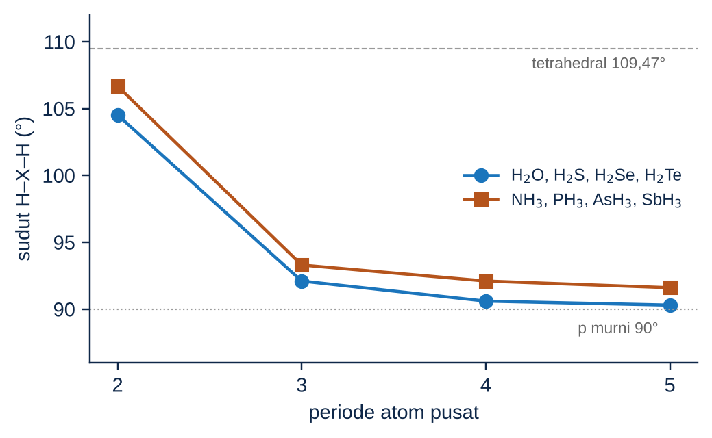

## 12.6 Hibridisasi tak setara: H₂O, NH₃, aturan Bent, persen karakter s

### Hibrida tidak harus setara

Pada CH₄ keempat substituen sama, sehingga keempat hibrida setara. Pada H₂O, NH₃, CH₃F, atau CH₂Cl₂ tidak ada alasan simetri untuk itu. Syarat-syarat di subbab 12.2 tetap berlaku (normalisasi, kekekalan orbital, ortogonalitas), tetapi karakter $s$ boleh berbeda dari satu hibrida ke hibrida lain. Teorema Coulson (12.e16) kemudian menjadi alat ukur: dari sudut ikatan yang terukur, kita dapat menghitung karakter $s$ setiap hibrida.

### Air

Oksigen dalam H₂O mempunyai delapan elektron valensi: dua pasangan ikatan O–H dan dua pasangan bebas. Kedua hibrida ikatan setara (simetri $C_{2v}$), dengan sudut 104,52° di antaranya. Dengan (12.e17):

$$
\alpha_\text{OH} = \frac{-\cos104{,}52°}{1 - \cos104{,}52°} = \frac{0{,}2507}{1{,}2507} = 0{,}200 , \qquad \lambda^2 = \frac{-1}{\cos\theta} = 3{,}99 .
$$

Ikatan O–H memakai hibrida sp⁴ dengan 20% $s$, kurang dari sp³. Kedua ikatan menghabiskan 0,40 dari orbital $2s$; sisanya, 0,60, berada dalam orbital-orbital pasangan bebas.

Bagaimana 60% karakter $s$ itu dibagi ke dua pasangan bebas? Ada dua cara yang sama sah.

* **Dua pasangan bebas setara** ("telinga kelinci"): masing-masing 30% $s$ (sp$^{2{,}33}$), terletak di bidang yang tegak lurus bidang molekul, dengan sudut 115,4° di antara keduanya (Contoh 12.a8).
* **Pasangan bebas σ dan π**: satu pasangan bebas dalam hibrida 60% $s$ (sp$^{0{,}67}$) yang menunjuk sepanjang sumbu $C_2$ menjauhi kedua H, dan satu pasangan bebas dalam orbital $p$ murni yang tegak lurus bidang molekul.

Kedua deskripsi berhubungan melalui transformasi ortogonal $2 \times 2$ di antara kedua orbital pasangan bebas: $n_\pm = (n_\sigma \pm n_\pi)/\sqrt2$. Karena keduanya terisi penuh, kerapatan elektron total dan energi total sama persis (subbab 12.13 membahas alasan umumnya). Yang membedakan hanyalah kegunaan. Untuk ikatan hidrogen, gambaran telinga kelinci menjelaskan susunan tetrahedral molekul air dalam es; untuk spektrum fotoelektron, gambaran σ dan π lebih langsung (subbab 12.13).

::: {.awas}
**Awas · "Air terhibridisasi sp³" adalah penyederhanaan**

Buku-buku pengantar sering menyebut oksigen dalam air terhibridisasi sp³ dengan sudut yang "dimampatkan" oleh pasangan bebas. Perhitungan dari sudut teramati menunjukkan hibrida ikatan sp⁴, dan pasangan bebas jauh lebih kaya $s$ daripada sp³. Lagi pula, pembagian pasangan bebas menjadi dua yang setara tidak lebih "benar" daripada pembagian σ dan π. Hibridisasi adalah alat untuk melukiskan, bukan sifat yang dapat diukur langsung; yang dapat diukur adalah sudut ikatan, kerapatan elektron, dan energi ionisasi.
:::

### Mengapa pasangan bebas menyukai karakter s

Orbital $2s$ jauh lebih rendah energinya daripada $2p$: energi ionisasi orbital valensi oksigen sekitar 32,4 eV untuk $2s$ dan 15,9 eV untuk $2p$. Setiap pasangan elektron "ingin" berada dalam orbital yang banyak mengandung $s$. Untuk pasangan ikatan, keinginan itu diimbangi kebutuhan tumpang tindih dan fakta bahwa elektron ikatan sebagian berada di dekat atom H. Untuk pasangan bebas, tidak ada imbangan: seluruh kerapatannya berada pada oksigen, sehingga ia mendapat manfaat penuh dari energi $s$ yang rendah. Hasilnya, karakter $s$ berpindah dari ikatan ke pasangan bebas, sudut ikatan menyempit di bawah 109,47°, dan sudut antarpasangan bebas melebar.

Selisih energi $2s$–$2p$ bertambah tajam dari kiri ke kanan periode 2: kira-kira 8,8 eV (C), 12,4 eV (N), 16,5 eV (O), 21,5 eV (F). Makin besar selisih ini, makin "mahal" mencampurkan $s$ ke dalam ikatan, dan makin dekat sudut ikatan ke 90°. Urutan sudut CH₄ (109,5°) > NH₃ (106,7°) > H₂O (104,5°) mencerminkan kecenderungan ini.

### Amonia, fosfina, dan hidrida unsur berat

Untuk NH₃ (106,67°), $\alpha_\text{NH} = 0{,}223$ (sp$^{3{,}5}$), dan pasangan bebas mendapat $1 - 3(0{,}223) = 0{,}331$, hampir tepat sp². Untuk PH₃ (93,3°), $\alpha_\text{PH} = 0{,}054$ (sp$^{17}$), dan pasangan bebas mendapat 0,84: hampir murni $3s$. Gambar 12.g5 memperlihatkan sudut ikatan hidrida golongan 15 dan 16. Lompatan dari periode 2 ke periode 3 besar, dan setelah itu sudutnya hampir tetap di dekat 90°.

{width=68%}

Mengapa atom periode 3 dan seterusnya hampir tidak berhibridisasi dalam hidridanya? Ada dua alasan yang saling menguatkan.

1. **Ketidakcocokan ukuran $ns$ dan $np$.** Orbital $2p$ tidak mempunyai orbital $p$ inti di bawahnya yang harus dihindari, sehingga $2p$ relatif kompak dan ukurannya mirip $2s$. Orbital $3p$ harus ortogonal terhadap $2p$ inti, sehingga ia "terdorong" ke luar dan jauh lebih besar daripada $3s$. Hibrida dari dua orbital yang ukurannya berbeda jauh hanya memberikan sedikit keuntungan tumpang tindih (W. Kutzelnigg, 1984).
2. **Ikatan lebih panjang.** P–H (142 pm) dan S–H (134 pm) jauh lebih panjang daripada N–H (101 pm) dan O–H (96 pm); atom-atom H lebih berjauhan dan tolakan H···H, yang mendorong sudut membesar, lebih lemah.

Akibat kimianya besar. Pasangan bebas PH₃ hampir murni $3s$: bulat, tidak terarah, dan rendah energinya. Fosfina karena itu basa yang jauh lebih lemah daripada amonia, dan sudut H–P–H hanya sedikit berubah ketika PH₃ diprotonasi menjadi PH₄⁺ (yang harus tetrahedral). Inversi piramida, yang pada NH₃ hanya memerlukan 24,2 kJ/mol (subbab 3.12), pada PH₃ memerlukan sekitar 130 kJ/mol, karena bentuk datar menuntut pasangan bebas pindah dari $3s$ yang nyaman ke $3p$ murni. Akibatnya fosfina kiral dengan tiga substituen berbeda stabil secara konfigurasi pada suhu kamar dan dipakai sebagai ligan dalam katalisis asimetris, sedangkan amina kiral sejenis berinversi berjuta-juta kali per detik. Kecenderungan pasangan $ns^2$ untuk tidak ikut berikatan pada unsur-unsur berat, yang dikenal sebagai **efek pasangan inert**, adalah perwujudan lain dari fakta yang sama.

### Aturan Bent

Bila substituen-substituen pada atom pusat berbeda, karakter $s$ tidak terbagi rata. H. A. Bent (1961) merangkum polanya dalam satu kalimat:

::: {.inti}
**Aturan Bent.** Karakter $s$ atom pusat terkumpul pada orbital-orbital yang mengarah ke substituen elektropositif (dan ke pasangan bebas); karakter $p$ terkumpul pada orbital-orbital yang mengarah ke substituen elektronegatif.
:::

Alasannya serupa dengan alasan pasangan bebas menyukai $s$. Substituen elektronegatif (F, O, Cl) menarik pasangan elektron ikatan menjauhi atom pusat. Atom pusat hanya sedikit memperoleh manfaat dari menaruh orbital $s$-nya yang berenergi rendah ke arah ikatan yang elektronnya sebagian besar berada di atom lain. Lebih baik ia memakai orbital $p$ (yang memang kurang elektronegatif daripada $s$, subbab 12.7) untuk ikatan itu, dan menghemat karakter $s$ untuk ikatan dengan substituen yang elektronnya tinggal dekat atom pusat.

Akibat aturan Bent tampak pada sudut ikatan:

* **CH₃F**: sudut H–C–H 110,2° (lebih besar dari tetrahedral), H–C–F 108,7°. Hibrida C–H mendapat 25,7% $s$ dan hibrida C–F 23,0%.
* **CH₂F₂**: H–C–H 113,7°, F–C–F 108,5°. Karakter $s$ C–H naik lebih jauh.
* **NF₃ vs NH₃**: 102,2° vs 106,7°; **OF₂ vs H₂O**: 103,1° vs 104,5°. Ikatan ke F mendapat karakter $p$ lebih banyak, dan sudutnya menyempit.

Aturan Bent juga meramalkan letak substituen. Pada molekul bipiramida segitiga seperti PF₅ dan turunannya, kedudukan ekuatorial memakai orbital yang lebih kaya $s$ daripada kedudukan aksial (subbab 12.8). Substituen elektronegatif karena itu memilih kedudukan aksial ("apikofilisitas"): pada CH₃PF₄ gugus metil ekuatorial, dan pada PCl₂F₃ ketiga F menempati dua posisi aksial dan satu ekuatorial. Panjang ikatan juga terpengaruh: ikatan C–F dalam CF₄ (131,9 pm) lebih pendek daripada dalam CH₃F (138,3 pm), salah satu sebabnya karena dalam CF₄ karakter $s$ tidak dapat "dialihkan" ke ikatan lain.

### Persen karakter s: ringkasan rumus

Untuk dua hibrida setara yang membentuk sudut $\theta$:

$$
\alpha = \frac{-\cos\theta}{1 - \cos\theta} , \qquad \lambda^2 = -\sec\theta , \qquad \%s = 100\,\alpha . \qquad \text{(12.e25)}
$$

Untuk hibrida-hibrida yang tidak setara, pakai (12.e16) untuk setiap pasangan, ditambah kekekalan orbital (12.e14).

::: {.contoh}
**Contoh 12.a19 · Air: hibrida ikatan dan pasangan bebas**

Dari sudut 104,52°, hitung (a) karakter $s$ hibrida O–H dan notasi sp$^{\lambda^2}$-nya; (b) karakter $s$ pasangan bebas σ dalam deskripsi σ/π; (c) sudut antara hibrida ikatan dan hibrida pasangan bebas σ.

**Penyelesaian.** (a) $\alpha = 0{,}2005$, $\lambda^2 = 3{,}99$: sp⁴. (b) $n_\sigma$ mendapat seluruh sisa: $1 - 2(0{,}2005) = 0{,}599$, yaitu sp$^{0{,}67}$; $n_\pi$ adalah $p$ murni. (c) Karena $n_\sigma$ menunjuk sepanjang sumbu $C_2$, menjauhi kedua H, sudutnya $180° - 104{,}52°/2 = 127{,}7°$. Periksa dengan (12.e16): $\cos\theta = -\sqrt{(0{,}2005)(0{,}599)/[(0{,}7995)(0{,}401)]} = -0{,}612$, $\theta = 127{,}7°$.

**Memahami hasil.** Pemeriksaan (c) cocok persis, karena ketiga hibrida sebidang ($n_\sigma$ dan kedua hibrida ikatan) memakai $s$, $p_y$, $p_z$ seluruhnya, seperti pada Contoh 12.a13. Pasangan bebas σ air hampir "sp", dengan cuping besar yang menunjuk ke belakang; pasangan bebas inilah yang terutama dipakai air sebagai basa Lewis ketika mengikat ion logam secara searah sumbu $C_2$.
:::

::: {.contoh}
**Contoh 12.a20 · Amonia dan fosfina**

(a) Hitung karakter $s$ hibrida ikatan dan pasangan bebas NH₃ (106,67°) dan PH₃ (93,3°). (b) Hitung sudut antara pasangan bebas dan setiap ikatan pada NH₃. (c) Apa yang terjadi pada hibrida-hibrida itu dalam bentuk datar keadaan transisi inversi?

**Penyelesaian.** (a) NH₃: $\cos106{,}67° = -0{,}2869$, $\alpha_\text{NH} = 0{,}2869/1{,}2869 = 0{,}223$; pasangan bebas $1 - 0{,}669 = 0{,}331$. PH₃: $\cos93{,}3° = -0{,}0576$, $\alpha_\text{PH} = 0{,}054$; pasangan bebas $0{,}837$.

\(b) Dengan (12.e16): $\cos\theta = -\sqrt{(0{,}223)(0{,}331)/[(0{,}777)(0{,}669)]} = -0{,}377$, $\theta = 112{,}1°$.

\(c) Dalam bentuk datar, ketiga ikatan sebidang dengan sudut 120°, sehingga ikatan-ikatan itu memakai sp² (33,3% $s$ masing-masing) dan pasangan bebas berada dalam $p_z$ murni (0% $s$).

**Memahami hasil.** Untuk inversi NH₃, pasangan bebas harus melepaskan karakter $s$ dari 33% ke 0%; untuk PH₃ dari 84% ke 0%. Kehilangan karakter $s$ yang jauh lebih besar inilah sebab penghalang inversi PH₃ (sekitar 130 kJ/mol) lebih dari lima kali NH₃ (24,2 kJ/mol). Sudut 112,1° antara pasangan bebas dan ikatan lebih besar daripada sudut antarikatan, lagi-lagi sesuai dengan VSEPR.
:::

::: {.contoh}
**Contoh 12.a21 · Fluorometana dan aturan Bent**

Pada CH₃F, sudut H–C–H 110,2°. (a) Hitung karakter $s$ hibrida C–H dan C–F. (b) Ramalkan sudut H–C–F dan bandingkan dengan nilai teramati 108,7°.

**Penyelesaian.** (a) $\cos110{,}2° = -0{,}3453$, $\alpha_\text{H} = 0{,}3453/1{,}3453 = 0{,}257$. Kekekalan: $\alpha_\text{F} = 1 - 3(0{,}257) = 0{,}230$.

\(b) $\cos\theta_\text{HCF} = -\sqrt{(0{,}257)(0{,}230)/[(0{,}743)(0{,}770)]} = -0{,}3212$, $\theta = 108{,}7°$.

**Memahami hasil.** Ikatan ke fluor (elektronegatif) mendapat lebih sedikit karakter $s$ (23%) daripada ikatan ke hidrogen (25,7%), sesuai aturan Bent. Kecocokan sudut H–C–F tidak boleh dianggap uji yang independen: untuk molekul $C_{3v}$ dengan empat hibrida yang memakai seluruh $s$ dan $p$, satu sudut menentukan yang lain. Uji yang sebenarnya adalah contoh berikut.
:::

::: {.contoh}
**Contoh 12.a22 · Difluorometana: ketika hibrida tidak menunjuk ke inti**

Pada CH₂F₂, sudut H–C–H 113,7° dan F–C–F 108,5°. (a) Hitung karakter $s$ C–H dari sudut H–C–H dan C–F dari sudut F–C–F secara terpisah. (b) Periksa kekekalan orbital. (c) Bila kekekalan dipaksakan, berapa sudut antarhibrida C–F?

**Penyelesaian.** (a) $\alpha_\text{H} = 0{,}4014/1{,}4014 = 0{,}287$; $\alpha_\text{F} = 0{,}3173/1{,}3173 = 0{,}241$. (b) $2(0{,}287) + 2(0{,}241) = 1{,}055 > 1$. Tidak mungkin! (c) Dengan $\alpha_\text{F} = 0{,}5 - 0{,}287 = 0{,}213$: $\theta = \arccos(-0{,}213/0{,}787) = 105{,}7°$.

**Memahami hasil.** Hibrida-hibrida tidak dapat menunjuk tepat ke arah keempat inti: bila hibrida C–H mengikuti garis C–H, hibrida C–F harus membentuk sudut 105,7°, padahal atom-atom F berada pada 108,5°. Ikatan C–F sedikit **bengkok** (masing-masing sekitar 1,4°), seperti ikatan siklopropana dalam versi yang jauh lebih lunak. Kesimpulan umumnya: arah hibrida dan arah ikatan hanya sama bila simetri memaksanya. Teorema Coulson memberi sudut antar**hibrida**; sudut antar**inti** dapat berbeda sedikit.
:::

::: {.contoh}
**Contoh 12.a23 · NF₃ dan NH₃**

Sudut F–N–F pada NF₃ 102,2°, sedangkan H–N–H pada NH₃ 106,7°. (a) Hitung karakter $s$ pasangan bebas pada kedua molekul. (b) Momen dipol NH₃ 1,47 D, sedangkan NF₃ hanya 0,24 D, padahal ikatan N–F jauh lebih polar. Jelaskan dengan hasil (a).

**Penyelesaian.** (a) NF₃: $\cos102{,}2° = -0{,}2113$, $\alpha = 0{,}1745$; pasangan bebas $1 - 3(0{,}1745) = 0{,}477$. NH₃: pasangan bebas 0,331.

\(b) Pada NH₃, dipol ikatan N–H (N negatif) dan dipol pasangan bebas menunjuk ke arah yang sama, ke puncak piramida, sehingga saling menguatkan. Pada NF₃, dipol ikatan N–F menunjuk ke arah atom F (ke bawah), berlawanan dengan dipol pasangan bebas yang menunjuk ke atas; keduanya hampir saling meniadakan.

**Memahami hasil.** Pasangan bebas NF₃ lebih kaya $s$ (48% vs 33%), sehingga lebih bulat, lebih rapat di dekat inti, dan kurang tersedia untuk didonorkan: NF₃ praktis tidak bersifat basa. Pasangan bebas yang kaya $s$ adalah ciri umum atom pusat dengan substituen elektronegatif, sesuai dengan aturan Bent.
:::

::: {.kuis}
**Kuis cepat 12.6**

Menurut aturan Bent, pada molekul CH₃Cl apakah sudut H–C–H lebih besar atau lebih kecil dari 109,47°? Pada SiH₃Cl, apakah ikatan Si–H lebih kaya atau lebih miskin karakter $s$ dibanding pada SiH₄?
:::

## 12.7 Hibridisasi dan sifat: panjang ikatan, keasaman C–H, kopling ¹³C–H

Karakter $s$ bukan besaran yang dapat diukur langsung, tetapi ia berkorelasi erat dengan banyak sifat yang dapat diukur. Korelasi-korelasi ini memberi isi kimia pada konsep hibridisasi dan memungkinkan kita "membaca" hibridisasi dari data.

### Panjang ikatan

Elektron $2s$ menembus sampai ke dekat inti dan jauh lebih kuat terikat daripada elektron $2p$ (subbab 9.9); dalam atom karbon, orbital $2s$ juga sedikit lebih kompak daripada $2p$. Hibrida dengan karakter $s$ lebih besar karena itu menarik pasangan ikatan lebih dekat ke inti, dan ikatannya lebih pendek. Ikatan C–H: 109,4 pm (etana, sp³), 108,6 pm (etilena, sp²), 106,1 pm (asetilena, sp).

Efeknya lebih jelas lagi pada ikatan tunggal C–C antara karbon-karbon dengan hibridisasi berbeda (Gambar 12.g6b). Ikatan tunggal sp³–sp³ (etana) 153,5 pm, sp³–sp² (propena) 150,1 pm, sp²–sp² (butadiena) 146,7 pm, sp³–sp (propuna) 145,9 pm, sp²–sp (vinilasetilena) 143,1 pm, dan sp–sp (butadiuna) 137,6 pm. Panjang ikatan turun hampir linear terhadap jumlah karakter $s$ kedua hibrida. Akibatnya, "pemendekan" ikatan tunggal dalam butadiena, yang sering dianggap bukti konjugasi π, sebagian besar sudah dijelaskan oleh hibridisasi sp² kedua karbon.

### Kekuatan ikatan dan frekuensi ulur

Ikatan yang lebih kaya $s$ juga lebih kuat. Energi disosiasi ikatan C–H: etana 423 kJ/mol, etilena 463 kJ/mol, asetilena 558 kJ/mol. Frekuensi ulur C–H dalam spektrum IR mengikuti pola yang sama: sekitar 2850–2960 cm⁻¹ untuk C(sp³)–H, 3010–3100 cm⁻¹ untuk C(sp²)–H, dan sekitar 3300 cm⁻¹ untuk ≡C–H. Karena massa tereduksi C–H hampir sama, frekuensi ini mencerminkan tetapan gaya (subbab 5.7): pita ≡C–H yang tajam di 3300 cm⁻¹ adalah tanda pengenal alkuna terminal dalam spektroskopi IR.

### Keasaman C–H

Pengaruh hibridisasi paling dramatis terlihat pada keasaman. pK$_a$ etana sekitar 50, etilena sekitar 44, dan asetilena 25: asetilena **sepuluh pangkat 19 sampai 25 kali** lebih asam daripada alkena dan alkana. Ketika C–H melepas proton, pasangan elektron ikatan tertinggal sebagai pasangan bebas karbanion dalam hibrida yang sama. Pasangan bebas dalam hibrida sp (50% $s$) jauh lebih stabil daripada dalam sp³ (25% $s$), karena elektron $s$ rata-rata lebih dekat ke inti dan lebih terikat. Itulah sebabnya alkuna terminal dapat dideprotonasi dengan NaNH₂ (pK$_a$ NH₃ sekitar 38) untuk menghasilkan ion asetilida, pereaksi penting dalam sintesis, sedangkan alkana tidak.

### Elektronegativitas orbital

Kecenderungan yang sama dapat diringkas dengan konsep **elektronegativitas orbital**: elektronegativitas sebuah atom bergantung pada hibrida yang ia pakai. Nilai yang lazim dikutip (skala Pauling, dari perhitungan Mulliken–Jaffé) untuk karbon adalah 2,48 (sp³), 2,75 (sp²), dan 3,29 (sp). Karbon sp hampir seelektronegatif klor atau nitrogen. Akibatnya, molekul seperti propuna, CH₃–C≡CH, mempunyai momen dipol (0,78 D) dengan ujung negatif di karbon sp, padahal semua atomnya hanya C dan H.

{width=94%}

### Kopling ¹³C–H dalam NMR

Dalam spektrum NMR, inti $^{13}$C dan $^1$H yang terikat langsung saling memecah sinyal dengan tetapan kopling $^1J(^{13}\text{C–H})$ (Bab 16). Kopling ini terutama berasal dari **interaksi kontak Fermi**: spin inti berinteraksi dengan spin elektron yang berada **tepat di inti**. Hanya orbital $s$ yang tidak nol di inti; orbital $p$ bernilai nol di sana. Karena itu kopling sebanding dengan karakter $s$ hibrida karbon yang mengarah ke H. N. Müller dan D. E. Pritchard (1959) menemukan hubungan empiris

$$
^1J(^{13}\text{C–H}) \approx 500\,\alpha\ \text{Hz} , \qquad \text{(12.e26)}
$$

yang mereproduksi metana (125 Hz, $\alpha = 0{,}25$), etilena (156 Hz, $\alpha = 0{,}31$), dan asetilena (249 Hz, $\alpha = 0{,}50$) dengan baik (Gambar 12.g6a). Kopling ini memberi cara yang hampir langsung untuk "mengukur" hibridisasi.

::: {.awas}
**Awas · Hubungan $J \approx 500\alpha$ gagal untuk substituen elektronegatif**

Untuk CHCl₃, $^1J = 209$ Hz, yang menurut (12.e26) berarti 42% $s$, jauh di atas yang mungkin untuk tiga ikatan C–Cl dan satu C–H dengan geometri hampir tetrahedral. Untuk CH₃F, 149 Hz akan berarti 30% $s$, padahal sudut ikatan memberi 25,7% (Contoh 12.a21). Substituen elektronegatif menaikkan kopling melalui jalan lain: mereka mengerutkan orbital $2s$ karbon (menambah kerapatan elektron $s$ di inti) dan mengubah energi eksitasi rata-rata. Hubungan Müller–Pritchard sahih untuk hidrokarbon; di luar itu ia hanya memberi kecenderungan arah.
:::

::: {.contoh}
**Contoh 12.a24 · Membaca karakter s dari kopling NMR**

Pakai (12.e26) untuk menaksir karakter $s$ hibrida C–H dari: benzena (158 Hz), siklopropana (161 Hz), kubana (155 Hz), HCN (269 Hz). Bandingkan nilai siklopropana dengan nilai dari sudut ikatan (Contoh 12.a18).

**Penyelesaian.** Benzena 0,316; siklopropana 0,322; kubana 0,310; HCN 0,538.

**Memahami hasil.** Benzena hampir tepat sp² (33%). Siklopropana (32%) mirip etilena, sedikit di atas nilai dari sudut H–C–H (29,7%); keduanya menegaskan bahwa ikatan C–H cincin beranggota tiga jauh lebih kaya $s$ daripada sp³. Kubana, dengan sudut C–C–C 90°, juga memaksa karakter $p$ ke dalam ikatan cincin dan karakter $s$ ke dalam C–H. HCN melampaui 50%, menunjukkan efek atom N yang elektronegatif, seperti yang diperingatkan kotak di atas.
:::

::: {.contoh}
**Contoh 12.a25 · Panjang ikatan tunggal C–C dan karakter s**

Data ikatan tunggal C–C (dalam pm): sp³–sp³ 153,5; sp³–sp² 150,1; sp³–sp 145,9; sp²–sp² 146,7; sp²–sp 143,1; sp–sp 137,6. (a) Paskan garis lurus $r = a + b\,\Sigma\alpha$, dengan $\Sigma\alpha$ jumlah karakter $s$ kedua hibrida. (b) Ramalkan panjang ikatan tunggal antara karbon sp³ siklopropana (hibrida cincin 20% $s$, tetapi untuk ikatan ke substituen di luar cincin sekitar 30% $s$) dan karbon sp³ biasa.

**Penyelesaian.** (a) Kuadrat terkecil memberi $a = 168{,}1$ pm, $b = -30{,}4$ pm, dengan koefisien korelasi $-0{,}993$; selisih terbesar 1,1 pm (sp²–sp²).

\(b) $\Sigma\alpha = 0{,}30 + 0{,}25 = 0{,}55$: $r = 168{,}1 - 30{,}4(0{,}55) = 151{,}4$ pm.

**Memahami hasil.** Setiap tambahan 10% karakter $s$ memendekkan ikatan tunggal C–C sekitar 3 pm. Ikatan siklopropil–metil yang teramati (sekitar 151 pm) memang lebih pendek daripada C–C biasa. Titik sp²–sp² sedikit di bawah garis, yang dapat ditafsirkan sebagai sumbangan kecil konjugasi π pada butadiena; tetapi bagian terbesar pemendekan dari 153,5 ke 146,7 pm adalah efek hibridisasi.
:::

::: {.contoh}
**Contoh 12.a26 · Hibridisasi dan keasaman**

pK$_a$ etana sekitar 50, etilena sekitar 44, asetilena 25. (a) Hitung selisih energi bebas deprotonasi (pada 298 K) antara etana dan asetilena, dan antara etana dan etilena. (b) Bandingkan dengan selisih energi disosiasi ikatan C–H homolitik (423, 463, 558 kJ/mol). Apa yang dapat disimpulkan?

**Penyelesaian.** (a) $\Delta G = 2{,}303RT\,\Delta\text{p}K_a = 5{,}71\ \text{kJ/mol} \times \Delta\text{p}K_a$. Etana–asetilena: $5{,}71 \times 25 = 143$ kJ/mol. Etana–etilena: $5{,}71 \times 6 = 34$ kJ/mol.

\(b) Energi disosiasi homolitik justru **naik** dari etana ke asetilena (423 → 558 kJ/mol): ikatan C–H asetilena lebih sulit diputus menjadi radikal.

**Memahami hasil.** Ikatan C(sp)–H lebih kuat secara homolitik tetapi jauh lebih mudah putus secara heterolitik. Tidak ada kontradiksi: keasaman ditentukan oleh kestabilan anion, dan pasangan bebas dalam orbital sp (50% $s$) sangat distabilkan karena dekat dengan inti. Afinitas elektron radikal etinil (2,97 eV) jauh lebih besar daripada radikal etil (sekitar −0,3 eV atau tidak terikat), dan selisih inilah yang mengalahkan selisih energi ikatan.
:::

::: {.contoh}
**Contoh 12.a27 · Tetapan gaya ulur C–H**

Hitung tetapan gaya ulur C–H dari frekuensi 2900, 3100, dan 3300 cm⁻¹, dengan massa tereduksi $^{12}$C–$^1$H. Berapa persen ikatan ≡C–H lebih kaku daripada C(sp³)–H?

**Penyelesaian.** $\mu = (12)(1{,}00783)/13{,}00783 = 0{,}9297$ u $= 1{,}5438 \times 10^{-27}$ kg. Dengan $k = \mu(2\pi c\tilde\nu)^2$ (subbab 5.7): 2900 cm⁻¹ → 461 N/m; 3100 cm⁻¹ → 526 N/m; 3300 cm⁻¹ → 597 N/m. Perbandingan $(3300/2900)^2 = 1{,}29$: ikatan ≡C–H sekitar 29% lebih kaku.

**Memahami hasil.** Perbedaan tetapan gaya (29%) lebih besar daripada perbedaan energi ikatan (32% antara 423 dan 558 kJ/mol, hampir sama) dan jauh lebih besar daripada perbedaan panjang ikatan (3%). Spektroskopi IR karena itu sangat peka terhadap hibridisasi: daerah 3000 cm⁻¹ memisahkan C–H jenuh (di bawah 3000) dari C–H tak jenuh (di atas 3000), aturan praktis yang dipakai setiap kimiawan organik.
:::

::: {.kuis}
**Kuis cepat 12.7**

Urutkan menurut keasaman yang bertambah: siklopropana, propana, propuna (H terminal). Urutkan juga menurut $^1J(^{13}\text{C–H})$ yang diharapkan.
:::
