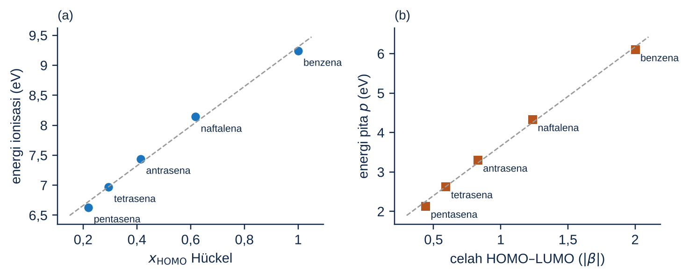
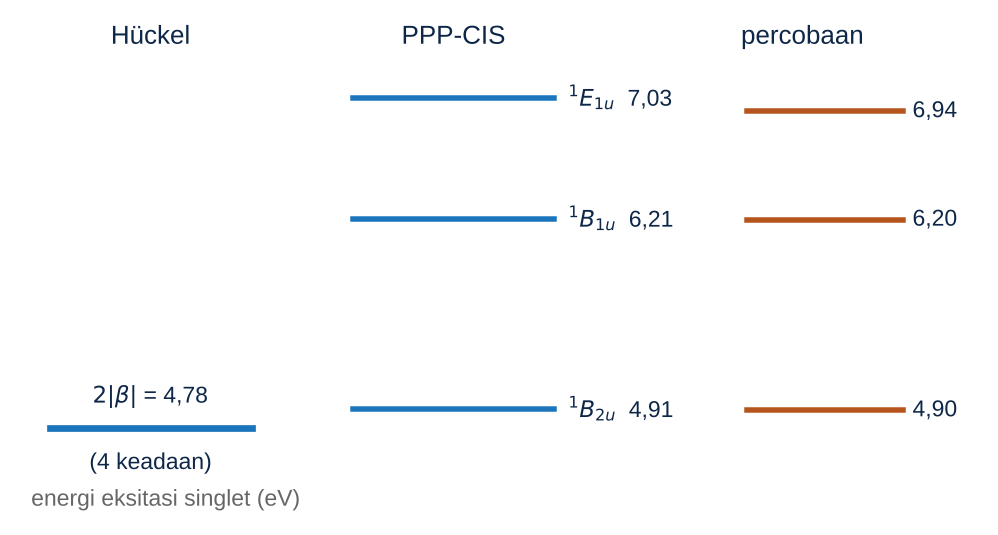

## 13.10 Orbital perbatasan HOMO–LUMO dan reaktivitas

### Gagasan Fukui

Ketika dua molekul saling mendekat, orbital-orbital mereka berinteraksi. Interaksi antara dua orbital terisi menghasilkan tolakan (Contoh 13.3); interaksi antara orbital terisi satu molekul dan orbital kosong molekul lain menghasilkan stabilisasi, karena dua elektron turun ke orbital ikatan baru tanpa ada elektron yang naik ke orbital antiikatan. Teori perturbasi orde kedua (subbab 8.7) memberikan besarnya: untuk orbital terisi $\psi_i$ (energi $\varepsilon_i$) dan orbital kosong $\psi_j$ (energi $\varepsilon_j$) dengan unsur interaksi $H'_{ij}$,

$$
\Delta E \approx -\frac{2|H'_{ij}|^2}{\varepsilon_j - \varepsilon_i} . \qquad \text{(13.20)}
$$

Penyebutnya membuat pasangan orbital dengan selisih energi **terkecil** paling penting. Selisih itu hampir selalu antara orbital terisi tertinggi satu molekul (**HOMO**) dan orbital kosong terendah molekul lain (**LUMO**). K. Fukui (1952) menamai keduanya **orbital perbatasan** dan mengusulkan bahwa reaktivitas dan selektivitas ditentukan terutama oleh interaksi HOMO–LUMO.

Unsur interaksi $H'_{ij}$ sebanding dengan tumpang tindih kedua orbital di tempat ikatan baru terbentuk, sehingga sebanding dengan **koefisien** kedua orbital pada atom-atom yang akan berikatan: $H'_{ij} \approx \sum_{(r,s)}c_{ri}c_{sj}\beta'_{rs}$. Ini menghasilkan aturan praktis:

* **Elektrofil** (yang memberikan LUMO) menyerang atom dengan koefisien **HOMO** terbesar.
* **Nukleofil** (yang memberikan HOMO) menyerang atom dengan koefisien **LUMO** terbesar.
* **Radikal** (dengan SOMO yang dapat bertindak keduanya) menyerang atom dengan valensi bebas atau koefisien perbatasan terbesar.
* Reaksi berlangsung lebih cepat bila celah HOMO–LUMO antara kedua pereaksi lebih kecil.

### Kendali muatan dan kendali orbital

Rumus lengkap untuk energi interaksi dua molekul (G. Klopman dan L. Salem, 1968) memuat tiga suku: tolakan antarorbital terisi, tarik-menarik elektrostatik antara muatan atom kedua molekul, dan suku perturbasi orde kedua (13.20) yang dijumlahkan atas semua pasangan orbital terisi–kosong. Bila pereaksi bermuatan besar dan celah HOMO–LUMO besar (ion kecil yang "keras", seperti H⁺, Li⁺, F⁻, OH⁻), suku elektrostatik dominan: reaksinya **dikendalikan muatan**, dan pereaksi menyerang atom dengan muatan terbesar. Bila celah HOMO–LUMO kecil dan pereaksinya mudah terpolarisasi ("lunak": I⁻, RS⁻, kuprat, alkena), suku orbital dominan: reaksinya **dikendalikan orbital**. Inilah dasar kuantum konsep asam–basa keras–lunak (HSAB) R. G. Pearson.

Contoh klasiknya adalah akrolein, CH₂=CH–CHO. Perhitungan Hückel (Contoh 13.33) memberi muatan π positif terbesar pada karbon karbonil, tetapi koefisien LUMO terbesar pada karbon β (CH₂ ujung). Nukleofil keras (organolitium, LiAlH₄) menyerang karbon karbonil (adisi 1,2); nukleofil lunak (kuprat R₂CuLi, tiolat, enolat) menyerang karbon β (adisi 1,4 atau adisi Michael).

### Reaksi Diels–Alder

Dalam reaksi Diels–Alder, diena dan dienofil membentuk dua ikatan σ baru secara serentak. Interaksi perbatasan utamanya HOMO diena–LUMO dienofil. Untuk butadiena dan etilena, celah Hückel-nya $(0{,}618 + 1)|\beta| = 1{,}618|\beta|$, dan reaksinya memang lambat (memerlukan suhu tinggi dan tekanan). Dengan dienofil penarik elektron seperti akrolein, LUMO turun ke $\alpha - 0{,}347\beta$, celahnya menjadi $0{,}965|\beta|$, dan reaksinya jauh lebih cepat. Diena dengan gugus pemberi elektron (OCH₃, NR₂) menaikkan HOMO dan mempercepat reaksi lebih jauh. Pasangan "diena kaya elektron + dienofil miskin elektron" adalah Diels–Alder dengan **permintaan elektron normal**; kebalikannya (diena miskin elektron, dienofil kaya) juga dikenal, dengan interaksi utama LUMO diena–HOMO dienofil.

Koefisien orbital perbatasan juga meramalkan **regioselektivitas**. Ikatan baru yang lebih kuat terbentuk antara atom-atom dengan koefisien perbatasan terbesar, sehingga 1-metoksibutadiena dan akrolein memberi produk "orto" (Contoh 13.34).

### Energi ionisasi dan afinitas elektron

Menurut teorema Koopmans, energi ionisasi sebanding dengan $-\varepsilon_\text{HOMO}$ dan afinitas elektron dengan $-\varepsilon_\text{LUMO}$. Dalam bahasa Hückel, $\text{IE} \approx -\alpha - x_\text{HOMO}\beta$, sehingga energi ionisasi hidrokarbon alternan seharusnya linear terhadap $x_\text{HOMO}$. Gambar 13.7(a) menunjukkannya untuk deret asena (benzena sampai pentasena): garis lurus $\text{IE} = 6{,}00 + 3{,}31\,x_\text{HOMO}$ eV mereproduksi data dengan galat kurang dari 0,1 eV. Energi pita serapan $p$ (pita kuat yang terkait eksitasi HOMO → LUMO) juga linear terhadap celah Hückel (Gambar 13.7(b)). Pentasena, dengan HOMO tertinggi dan celah terkecil, mudah melepas elektron dan berwarna biru-ungu; ia salah satu semikonduktor organik yang paling banyak diteliti untuk transistor film tipis.

{width=94%}

::: {.contoh}
**Contoh 13.32 · Substitusi elektrofilik pada naftalena**

HOMO naftalena ($x = 0{,}618$) mempunyai koefisien $\pm0{,}425$ pada C1, C4, C5, C8 (posisi α) dan $\pm0{,}263$ pada C2, C3, C6, C7 (posisi β), dan nol pada C4a dan C8a. (a) Hitung kuadrat koefisien pada posisi α dan β. (b) Ramalkan posisi nitrasi naftalena. (c) Bandingkan dengan ramalan valensi bebas (subbab 13.9).

**Penyelesaian.** (a) $c_\alpha^2 = 0{,}181$, $c_\beta^2 = 0{,}069$. (b) Elektrofil NO₂⁺ menyerang posisi dengan koefisien HOMO terbesar: posisi α. Teramati: nitrasi naftalena memberi 1-nitronaftalena hampir secara eksklusif. (c) Valensi bebas juga terbesar pada C1 (0,453 vs 0,404).

**Memahami hasil.** Perbandingan $c^2$ hampir 2,6 : 1, cukup untuk selektivitas yang tinggi bila energi aktivasi sebanding dengan $c^2$. Gambaran resonansi memberi kesimpulan yang sama: kation hasil serangan di C1 dapat digambar dengan dua struktur yang mempertahankan sekstet benzena utuh, sedangkan serangan di C2 hanya satu. Kedua bahasa, sekali lagi, sepakat.
:::

::: {.contoh}
**Contoh 13.33 · Akrolein: keras atau lunak**

Untuk akrolein, C(β)H₂=C(α)H–C(O)H=O, dengan $h_\text{O} = 1$: muatan π C(β) $+0{,}23$, C(α) $-0{,}03$, C(O) $+0{,}33$, O $-0{,}53$; LUMO ($x = -0{,}347$) dengan koefisien C(β) $-0{,}657$, C(α) $0{,}228$, C(O) $0{,}577$, O $-0{,}429$. (a) Di mana nukleofil keras menyerang? (b) Di mana nukleofil lunak menyerang? (c) Mengapa LUMO akrolein lebih rendah daripada LUMO butadiena ($x = -0{,}618$)?

**Penyelesaian.** (a) Pada karbon karbonil, yang bermuatan positif terbesar (+0,33): adisi 1,2. (b) Pada C(β), dengan koefisien LUMO terbesar (0,657): adisi 1,4. (c) Oksigen yang elektronegatif menurunkan semua orbital; LUMO turun dari $-0{,}618$ ke $-0{,}347$ (dalam satuan $x$), sehingga akrolein menjadi penerima elektron yang lebih baik.

**Memahami hasil.** Satu perhitungan Hückel menjelaskan dua jalur reaksi yang bersaing dalam kimia enon. Dalam sintesis, pilihan pereaksi (CH₃Li vs (CH₃)₂CuLi) memilih jalur: CH₃Li memberi alkohol alilik, dan (CH₃)₂CuLi memberi keton jenuh dengan gugus metil di posisi β.
:::

::: {.contoh}
**Contoh 13.34 · Regioselektivitas Diels–Alder**

HOMO 1-metoksibutadiena (O jenis furan, $h = 2$, $k = 0{,}8$) mempunyai koefisien C1 0,513, C2 0,464, C3 $-0{,}290$, C4 $-0{,}603$, O $-0{,}270$ ($x = 0{,}481$). LUMO akrolein mempunyai koefisien terbesar pada C(β). (a) Atom diena mana yang berikatan dengan C(β) akrolein? (b) Gambarkan produk "orto" dan "meta" dan tentukan yang diramalkan. (c) Hitung celah HOMO–LUMO dan bandingkan dengan butadiena–akrolein.

**Penyelesaian.** (a) C4 (koefisien terbesar, 0,603) berikatan dengan C(β); C1 berikatan dengan C(α). (b) Dalam sikloheksena hasil, C1 diena (yang membawa OCH₃) terikat ke C(α) (yang membawa CHO): kedua substituen bersebelahan, produk "orto" (1,2). (c) Celah: $(0{,}481 + 0{,}347)|\beta| = 0{,}828|\beta|$, lebih kecil daripada $0{,}965|\beta|$ untuk butadiena–akrolein.

**Memahami hasil.** Gugus metoksi menaikkan HOMO diena (dari $x = 0{,}618$ ke 0,481) dan mengumpulkan koefisiennya di C4. Kedua efek membuat reaksi lebih cepat dan lebih selektif. "Aturan orto–para" Diels–Alder yang dihafal mahasiswa kimia organik adalah akibat langsung koefisien orbital perbatasan.
:::

::: {.contoh}
**Contoh 13.35 · Energi ionisasi asena**

Dengan IE (eV): benzena 9,24; naftalena 8,14; antrasena 7,44; tetrasena 6,97; pentasena 6,63, dan $x_\text{HOMO}$ = 1; 0,618; 0,414; 0,295; 0,220, (a) paskan garis lurus $\text{IE} = a + b\,x_\text{HOMO}$. (b) Apa makna $a$ dan $b$? (c) Ramalkan IE heksasena ($x_\text{HOMO} = 0{,}171$).

**Penyelesaian.** (a) $a = 6{,}00$ eV, $b = 3{,}31$ eV; ramalan 9,31; 8,04; 7,37; 6,97; 6,73 eV. (b) $a$ adalah $-\alpha$ efektif (IE sebuah orbital nonikatan, $x = 0$), dan $b = |\beta|$ efektif untuk ionisasi. (c) $6{,}00 + 3{,}31(0{,}171) = 6{,}57$ eV.

**Memahami hasil.** Nilai $|\beta| = 3{,}3$ eV dari ionisasi berbeda lagi dari nilai termokimia (0,8 eV) dan spektroskopik (2,5 eV dari Gambar 13.7(b)), sesuai peringatan di subbab 13.4. Tetapi di dalam satu deret yang seragam, model Hückel memberi korelasi yang sangat baik, dan inilah cara ia paling sering dipakai: untuk membandingkan molekul-molekul yang mirip.
:::

::: {.kuis}
**Kuis cepat 13.10**

Pada antrasena, koefisien HOMO terbesar (0,44) berada di C9 dan C10. Di mana antrasena mengalami reaksi Diels–Alder dengan anhidrida maleat?
:::

## 13.11 Reaksi perisiklik dan aturan Woodward–Hoffmann

### Reaksi perisiklik

Reaksi perisiklik adalah reaksi serentak (tanpa zat antara) dengan keadaan transisi siklik: elektron berpindah secara bersamaan mengelilingi lingkaran atom. Ada tiga jenis utama:

* **Elektrosiklik**: sebuah poliena terkonjugasi menutup cincin dengan membentuk ikatan σ antara kedua ujungnya (atau kebalikannya, membuka cincin). Contoh: butadiena ⇌ siklobutena, heksatriena ⇌ sikloheksadiena.
* **Sikloadisi**: dua sistem π bergabung membentuk cincin dengan dua ikatan σ baru. Contoh: Diels–Alder [4 + 2]; dimerisasi alkena [2 + 2].
* **Sigmatropik**: sebuah ikatan σ berpindah sepanjang sistem π. Contoh: geseran [1,5]-H pada siklopentadiena; penataan ulang Cope dan Claisen [3,3].

Reaksi-reaksi ini sangat stereospesifik, dan stereokimianya sering berbeda bila reaksi diinduksi panas atau cahaya. R. B. Woodward dan R. Hoffmann (1965) menjelaskan semua pola ini dengan satu prinsip: **simetri orbital dipertahankan sepanjang reaksi serentak**.

### Reaksi elektrosiklik: analisis orbital perbatasan

Ketika butadiena menutup menjadi siklobutena, kedua karbon ujung (C1 dan C4) harus berputar 90° agar lobus orbital $p$-nya saling menunjuk dan membentuk ikatan σ. Ada dua cara: kedua ujung berputar searah (**konrotasi**) atau berlawanan arah (**disrotasi**). Ikatan σ terbentuk bila lobus yang **sefase** bertemu.

Dalam keadaan dasar, elektron perbatasan berada di HOMO butadiena, $\psi_2$, yang koefisien ujungnya berlawanan tanda ($c_1 = +0{,}602$, $c_4 = -0{,}602$, subbab 13.5). Lobus atas C1 positif dan lobus atas C4 negatif. Agar lobus sefase bertemu, satu ujung harus memutar lobus atasnya ke dalam dan ujung lain memutar lobus bawahnya ke dalam: **konrotasi** (Gambar 13.8(a)). Dalam keadaan tereksitasi (fotokimia), satu elektron berada di $\psi_3$, yang koefisien ujungnya sama tanda ($+0{,}602$, $+0{,}602$): **disrotasi** (Gambar 13.8(b)).

Untuk heksatriena, HOMO keadaan dasar adalah $\psi_3$, yang koefisien ujungnya sama tanda (Contoh 13.18): **disrotasi termal**, dan konrotasi fotokimia. Pola umumnya:

| Elektron π | Termal | Fotokimia |
|---|---|---|
| $4n$ (butadiena, oktatetraena) | konrotasi | disrotasi |
| $4n + 2$ (heksatriena) | disrotasi | konrotasi |

{width=82%}

### Diagram korelasi

Analisis orbital perbatasan cepat, tetapi argumen yang lebih ketat adalah **diagram korelasi orbital** (H. C. Longuet-Higgins dan E. W. Abrahamson, 1965). Selama konrotasi, molekul mempertahankan sumbu $C_2$ (di bidang molekul, membagi dua ikatan C2–C3); selama disrotasi, ia mempertahankan bidang cermin σ (tegak lurus bidang molekul, membagi dua ikatan C2–C3). Setiap orbital pereaksi dan produk diklasifikasikan simetris (S) atau antisimetris (A) terhadap unsur simetri yang dipertahankan.

Untuk orbital $p_z$ butadiena, cermin σ memetakan $p_z$(C1) ke $p_z$(C4) tanpa membalik lobus, sedangkan $C_2$ memetakan $p_z$(C1) ke $-p_z$(C4). Akibatnya:

| | $\psi_1$ | $\psi_2$ | $\psi_3$ | $\psi_4$ | | σ | π | π* | σ* |
|---|---|---|---|---|---|---|---|---|---|
| cermin (disrotasi) | S | A | S | A | | S | S | A | A |
| $C_2$ (konrotasi) | A | S | A | S | | S | A | S | A |

(kolom kanan: orbital siklobutena; σ dan σ* untuk ikatan C1–C4 yang baru, π dan π* untuk ikatan C2=C3.) Orbital dengan simetri yang sama tidak boleh bersilangan, sehingga orbital-orbital pereaksi dan produk dihubungkan menurut urutan energi di dalam setiap kelas simetri:

* **Disrotasi**: kelas S: $\psi_1 \to \sigma$, $\psi_3 \to \pi$; kelas A: $\psi_2 \to \pi^*$, $\psi_4 \to \sigma^*$. Keadaan dasar butadiena $\psi_1^2\psi_2^2$ berkorelasi dengan $\sigma^2\pi^{*2}$, keadaan tereksitasi ganda siklobutena: penghalang yang sangat tinggi. **Terlarang secara termal.**
* **Konrotasi**: kelas A: $\psi_1 \to \pi$, $\psi_3 \to \sigma^*$; kelas S: $\psi_2 \to \sigma$, $\psi_4 \to \pi^*$. Keadaan dasar $\psi_1^2\psi_2^2$ berkorelasi dengan $\pi^2\sigma^2$, keadaan dasar siklobutena. **Diizinkan secara termal.**

Untuk keadaan tereksitasi $\psi_1^2\psi_2^1\psi_3^1$, disrotasi menghubungkannya dengan $\sigma^2\pi^1\pi^{*1}$, keadaan tereksitasi pertama produk: diizinkan secara fotokimia.

### Sikloadisi dan aturan umum

Untuk sikloadisi [4 + 2] suprafasial (kedua komponen bereaksi pada sisi yang sama), HOMO diena ($\psi_2$: ujung $+$ dan $-$) dan LUMO dienofil (π*: $+$ dan $-$) cocok di kedua ujung sekaligus: **diizinkan secara termal**. Untuk [2 + 2] suprafasial, HOMO etilena (π: $+$, $+$) dan LUMO etilena lain (π*: $+$, $-$) cocok di satu ujung dan bertentangan di ujung lain: tumpang tindih total nol, **terlarang secara termal**; dengan cahaya, satu elektron berada di π*, dan interaksi π*–π* cocok di kedua ujung: diizinkan secara fotokimia. Itulah sebabnya fotodimerisasi alkena (dan fotodimerisasi timin dalam DNA oleh sinar UV, penyebab kerusakan DNA akibat sinar matahari) adalah reaksi fotokimia.

Woodward dan Hoffmann merangkum semua kasus dalam satu aturan: **reaksi perisiklik dalam keadaan dasar diizinkan bila banyaknya komponen $(4q + 2)_s$ ditambah banyaknya komponen $(4r)_a$ ganjil**, dengan $s$ suprafasial dan $a$ antarafasial. Dengan bahasa subbab 13.7 (aturan Dewar–Zimmerman): keadaan transisi siklik bersifat "aromatik" bila ia berupa susunan Hückel dengan $4n + 2$ elektron atau susunan Möbius (dengan satu perubahan tanda, yang ditimbulkan oleh komponen antarafasial atau oleh konrotasi) dengan $4n$ elektron (Contoh 13.25).

::: {.inti}
**Aturan Woodward–Hoffmann dalam tiga kalimat.** Simetri orbital dipertahankan selama reaksi serentak. Reaksi termal diizinkan bila keadaan transisinya "aromatik": Hückel dengan $4n + 2$ elektron atau Möbius dengan $4n$ elektron. Reaksi fotokimia mengikuti kebalikannya.
:::

::: {.contoh}
**Contoh 13.36 · Membuka cincin siklobutena**

*cis*-3,4-Dimetilsiklobutena dipanaskan dan membuka cincin. (a) Termal: konrotasi atau disrotasi? (b) Tentukan geometri diena yang terbentuk. (c) Apa yang terbentuk dari isomer *trans*?

**Penyelesaian.** (a) Empat elektron (dua dari ikatan σ C3–C4 dan dua dari π): termal, konrotasi. (b) Pada isomer *cis* kedua metil di sisi yang sama cincin. Konrotasi memutar satu metil ke "luar" dan yang lain ke "dalam", sehingga terbentuk (2*E*,4*Z*)-heksa-2,4-diena. (c) Isomer *trans*: konrotasi dapat memutar kedua metil ke luar, membentuk (2*E*,4*E*)-heksa-2,4-diena (jalur yang memutar keduanya ke dalam juga konrotasi, tetapi sangat terhalang secara sterik).

**Memahami hasil.** Stereospesifisitas reaksi ini (lebih dari 99,9%) adalah salah satu bukti terkuat bagi aturan Woodward–Hoffmann. Pembukaan disrotasi, yang akan menghasilkan (2*Z*,4*Z*) atau (2*E*,4*E*) dari isomer *cis*, tidak teramati secara termal walaupun produk-produknya tidak jauh berbeda energinya.
:::

::: {.contoh}
**Contoh 13.37 · Penutupan cincin heksatriena**

(2*E*,4*Z*,6*E*)-Okta-2,4,6-triena menutup cincin menjadi 5,6-dimetilsikloheksa-1,3-diena. (a) Secara termal, apakah kedua metil *cis* atau *trans*? (b) Secara fotokimia?

**Penyelesaian.** (a) Enam elektron π: termal, disrotasi. Pada triena (*E*,*Z*,*E*), kedua metil ujung sama-sama menunjuk ke "luar". Disrotasi memutar kedua ujung berlawanan arah, sehingga kedua metil berakhir di sisi yang sama cincin: ***cis***-5,6-dimetilsikloheksa-1,3-diena. (b) Fotokimia: konrotasi, ***trans***.

**Memahami hasil.** Bandingkan dengan Contoh 13.36: mengganti 4 dengan 6 elektron membalik aturan, dan mengganti panas dengan cahaya membaliknya lagi. Pola biner ini mengikuti dari satu fakta: tanda relatif koefisien ujung HOMO bergantian antara sama dan berlawanan ketika poliena bertambah satu ikatan rangkap, $(-1)^{k+1}$ untuk HOMO ke-$k$ dalam (13.12).
:::

::: {.contoh}
**Contoh 13.38 · Menerapkan aturan umum**

Tentukan apakah reaksi berikut diizinkan secara termal: (a) Diels–Alder $[\pi4_s + \pi2_s]$; (b) dimerisasi etilena $[\pi2_s + \pi2_s]$; (c) dimerisasi etilena $[\pi2_s + \pi2_a]$; (d) geseran [1,5]-H suprafasial; (e) geseran [1,3]-H suprafasial; (f) penataan ulang Cope $[\sigma2_s + \pi2_s + \pi2_s]$.

**Penyelesaian.** Hitung komponen $(4q + 2)_s$ dan $(4r)_a$. (a) $\pi2_s$ adalah $(4q+2)_s$ dengan $q = 0$; $\pi4_s$ bukan keduanya. Total 1, ganjil: **diizinkan**. (b) Dua $(4q+2)_s$: total 2, genap: **terlarang**. (c) Satu $(4q+2)_s$; $\pi2_a$ bukan keduanya: total 1: **diizinkan** (secara geometri sulit; terjadi pada keten). (d) Komponen $\sigma2_s$ dan $\pi4_s$: total 1: **diizinkan**. (e) $\sigma2_s$ dan $\pi2_s$: total 2: **terlarang**. (f) Tiga komponen $(4q+2)_s$: total 3: **diizinkan**.

**Memahami hasil.** Geseran [1,5]-H mudah terjadi pada siklopentadiena tersubstitusi pada suhu kamar, sedangkan geseran [1,3]-H suprafasial praktis tidak dikenal. Keten bereaksi dengan alkena membentuk siklobutanon secara termal, karena keten dapat bertindak sebagai komponen antarafasial melalui orbital π C=O-nya yang tegak lurus.
:::

::: {.contoh}
**Contoh 13.39 · Vitamin D**

Di kulit, sinar UV-B mengubah 7-dehidrokolesterol menjadi previtamin D₃ melalui pembukaan cincin sikloheksadiena (6 elektron), lalu previtamin D₃ berubah secara termal menjadi vitamin D₃ melalui geseran [1,7]-H. (a) Apakah pembukaan cincin konrotasi atau disrotasi? (b) Geseran [1,7]-H termal: suprafasial atau antarafasial?

**Penyelesaian.** (a) Fotokimia, 6 elektron: **konrotasi**. (b) Geseran [1,7]-H melibatkan $\sigma2$ dan $\pi6$. Agar total komponen $(4q+2)_s$ dan $(4r)_a$ ganjil: dengan $\sigma2_s$ dan $\pi6_a$, hanya $\sigma2_s$ yang dihitung (satu): diizinkan. Jadi geseran [1,7]-H termal **antarafasial**: atom H berpindah dari satu sisi sistem π ke sisi yang lain, yang mungkin karena rantai triena cukup panjang dan lentur untuk berpilin.

**Memahami hasil.** Sintesis vitamin D dalam tubuh adalah reaksi perisiklik fotokimia diikuti reaksi perisiklik termal, keduanya dengan stereokimia yang diramalkan aturan Woodward–Hoffmann. Industri farmasi memakai rute yang sama untuk membuat vitamin D dari ergosterol.
:::

::: {.kuis}
**Kuis cepat 13.11**

Apakah sikloadisi [4 + 4] suprafasial (misalnya fotodimerisasi antrasena) diizinkan secara termal atau fotokimia?
:::

## 13.12 Metode Pariser–Parr–Pople

### Apa yang hilang dalam Hückel

Model Hückel tidak mempunyai tolakan elektron eksplisit. Akibatnya ada tiga kegagalan sistematis yang sudah kita temui: energi eksitasi tidak dapat diramalkan dengan satu $\beta$ (Contoh 13.14), pemisahan muatan dilebih-lebihkan (Contoh 13.31), dan keadaan tereksitasi yang berasal dari orbital berdegenerasi tidak terpisah. Pada benzena, eksitasi dari pasangan HOMO $e_{1g}$ ke pasangan LUMO $e_{2u}$ menghasilkan empat konfigurasi, dan dalam Hückel keempatnya mempunyai energi $2|\beta|$. Spektrum benzena justru menunjukkan tiga pita singlet yang sangat berbeda: lemah di 254 nm (4,90 eV), sedang di sekitar 200 nm (6,2 eV), dan kuat di 180 nm (6,94 eV).

### Persamaan PPP

R. Pariser dan R. G. Parr (1953) serta J. A. Pople (1953) mempertahankan basis satu orbital $2p_z$ per atom dan pendekatan **tumpang tindih diferensial nol** (ZDO): semua integral dua elektron $(\mu\nu|\lambda\sigma)$ yang memuat hasil kali dua orbital berbeda pada elektron yang sama diabaikan, sehingga yang tersisa hanya

$$
(\mu\mu|\nu\nu) \equiv \gamma_{\mu\nu} . \qquad \text{(13.21)}
$$

Dengan pendekatan ini, operator Fock Hartree–Fock (subbab 9.8) untuk sistem π menjadi matriks

$$
F_{\mu\mu} = \alpha_\mu + \tfrac12P_{\mu\mu}\gamma_{\mu\mu} + \sum_{\nu \ne \mu}(P_{\nu\nu} - Z_\nu)\gamma_{\mu\nu} , \qquad F_{\mu\nu} = \beta_{\mu\nu} - \tfrac12P_{\mu\nu}\gamma_{\mu\nu} , \qquad \text{(13.22)}
$$

dengan $P_{\mu\nu} = 2\sum_\text{terisi}c_{\mu i}c_{\nu i}$ matriks kerapatan, $Z_\nu$ muatan inti efektif yang dilihat elektron π (1 untuk karbon), dan $\beta_{\mu\nu}$ integral inti antartetangga. Suku diagonal memuat tolakan dengan elektron pada atom yang sama ($\tfrac12P_{\mu\mu}\gamma_{\mu\mu}$) dan tarikan/tolakan dengan atom-atom lain yang bermuatan bersih $P_{\nu\nu} - Z_\nu$. Suku di luar diagonal memuat pertukaran. Karena $\mathbf F$ bergantung pada $\mathbf P$, persamaan diselesaikan secara iteratif sampai swakonsisten (SCF).

Parameter baku untuk karbon: $\gamma_{\mu\mu} = I - A = 11{,}13$ eV (selisih energi ionisasi dan afinitas elektron orbital $2p$ karbon, yaitu biaya menaruh dua elektron pada satu atom), $\beta = -2{,}39$ eV, dan $\gamma_{\mu\nu}$ untuk atom yang berbeda menurut rumus Mataga–Nishimoto

$$
\gamma_{\mu\nu} = \frac{e^2/4\pi\varepsilon_0}{R_{\mu\nu} + a} , \qquad a = \frac{e^2/4\pi\varepsilon_0}{\gamma_{\mu\mu}} = 1{,}294\ \text{Å} , \qquad \text{(13.23)}
$$

yang menuju $e^2/4\pi\varepsilon_0R$ pada jarak besar dan $\gamma_{\mu\mu}$ pada $R = 0$.

### Keadaan tereksitasi: interaksi konfigurasi tunggal

Setelah SCF, keadaan tereksitasi disusun sebagai kombinasi konfigurasi yang memindahkan satu elektron dari orbital terisi $i$ ke orbital kosong $a$ (**CIS**). Unsur diagonal matriks CIS untuk singlet adalah $\varepsilon_a - \varepsilon_i - J_{ia} + 2K_{ia}$, dan untuk triplet $\varepsilon_a - \varepsilon_i - J_{ia}$, dengan $J_{ia}$ integral Coulomb (tarik-menarik elektron yang tereksitasi dengan "lubang" yang ditinggalkan) dan $K_{ia}$ integral pertukaran. Unsur di luar diagonal mencampur konfigurasi-konfigurasi yang berbeda. Dua hal penting muncul di sini:

1. Energi eksitasi **bukan** selisih energi orbital: tarik-menarik elektron–lubang ($J_{ia}$) menurunkannya, dan inilah asal "titik potong" dalam Contoh 13.19.
2. Konfigurasi yang berdegenerasi dalam Hückel **bercampur dan terpisah** oleh unsur-unsur di luar diagonal.

Untuk benzena, PPP-CIS memberikan $^1B_{2u}$ 4,91 eV, $^1B_{1u}$ 6,21 eV, dan $^1E_{1u}$ 7,03 eV, dibanding nilai teramati 4,90; 6,20; 6,94 eV (Gambar 13.9). Kekuatan osilator yang dihitung nol untuk $^1B_{2u}$ dan $^1B_{1u}$ (terlarang oleh simetri, subbab 10.10) dan besar (sekitar 1,2) untuk $^1E_{1u}$, sesuai dengan intensitas teramati: pita 254 nm benzena lemah (hanya diizinkan melalui kopling getaran) dan pita 180 nm sangat kuat. Untuk naftalena, PPP-CIS memberi 4,14 eV (teramati sekitar 4,0, lemah), 4,48 eV (4,45, sedang), dan 5,80 eV (5,89, sangat kuat).

{width=74%}

Metode PPP adalah metode semiempiris pertama yang meramalkan spektrum UV-tampak molekul terkonjugasi secara kuantitatif. Ia menjadi alat utama perancangan zat warna selama beberapa dasawarsa, dan gagasannya (ZDO, parameter dari data atom, SCF + CI) diteruskan ke metode semiempiris untuk semua elektron valensi (CNDO, INDO, MNDO, AM1, PM3, ZINDO; subbab 17.17).

::: {.contoh}
**Contoh 13.40 · Integral tolakan Mataga–Nishimoto**

Untuk benzena (C–C 139,7 pm), hitung $\gamma$ untuk atom yang sama, tetangga orto, meta (241,97 pm), dan para (279,4 pm). Bandingkan dengan tolakan dua muatan titik pada jarak yang sama.

**Penyelesaian.** $e^2/4\pi\varepsilon_0 = 14{,}397$ eV Å; $a = 14{,}397/11{,}13 = 1{,}294$ Å. $\gamma_{11} = 11{,}13$ eV. Orto: $14{,}397/(1{,}397 + 1{,}294) = 5{,}35$ eV. Meta: $14{,}397/(2{,}420 + 1{,}294) = 3{,}88$ eV. Para: $14{,}397/(2{,}794 + 1{,}294) = 3{,}52$ eV. Muatan titik: 10,31; 5,95; 5,15 eV.

**Memahami hasil.** Tolakan dua elektron yang tersebar dalam orbital $p$ lebih kecil daripada tolakan muatan titik, terutama pada jarak pendek. Nilai-nilai ini besar dibanding $|\beta| = 2{,}39$ eV: tolakan elektron dalam sistem π sama sekali tidak kecil, dan model Hückel bekerja hanya karena sebagian besar efeknya serupa untuk molekul-molekul yang mirip, sehingga dapat diserap ke dalam parameter.
:::

::: {.contoh}
**Contoh 13.41 · PPP-SCF dan CIS dengan Python**

Tulis program PPP-SCF + CIS untuk sistem π dengan koordinat atom dan daftar ikatan, lalu hitung energi singlet benzena.

**Penyelesaian.**

```python
import numpy as np
def ppp(xyz, ikatan, beta=-2.39, g0=11.13):
    xyz = np.array(xyz); n = len(xyz); nocc = n // 2
    R = np.linalg.norm(xyz[:, None] - xyz[None], axis=2)
    G = 14.397 / (R + 14.397 / g0)                     # Mataga-Nishimoto
    Hc = np.zeros((n, n))
    for i, j in ikatan: Hc[i, j] = Hc[j, i] = beta
    P = np.eye(n)
    for _ in range(200):                               # iterasi SCF
        q = np.diag(P)
        F = Hc - 0.5 * P * G * (1 - np.eye(n))
        F += np.diag(0.5 * q * np.diag(G) + (G - np.diag(np.diag(G))) @ (q - 1))
        e, C = np.linalg.eigh(F)
        Pn = 2 * C[:, :nocc] @ C[:, :nocc].T
        if np.abs(Pn - P).max() < 1e-10: break
        P = 0.5 * (P + Pn)
    eri = lambda p, q, r, s: (C[:, p] * C[:, q]) @ G @ (C[:, r] * C[:, s])
    ex = [(i, a) for i in range(nocc) for a in range(nocc, n)]
    A = np.array([[(e[a] - e[i]) * (i == j and a == b) + 2 * eri(i, a, j, b) - eri(i, j, a, b)
                   for (j, b) in ex] for (i, a) in ex])
    return np.linalg.eigvalsh(A)                       # energi eksitasi singlet (eV)

r = 1.397
xyz = [(r * np.cos(k * np.pi / 3), r * np.sin(k * np.pi / 3), 0) for k in range(6)]
print(ppp(xyz, [(k, (k + 1) % 6) for k in range(6)])[:4].round(2))   # [4.91 6.21 7.03 7.03]
```

**Memahami hasil.** Dengan tiga parameter (β, $\gamma_{11}$, dan rumus Mataga–Nishimoto), program sekitar dua puluh baris mereproduksi ketiga pita benzena dalam 0,1 eV. Matriks CIS untuk singlet memuat $2(ia|jb) - (ij|ab)$: suku pertama adalah pertukaran (yang menaikkan singlet di atas triplet), suku kedua tarik-menarik elektron–lubang. Untuk triplet, suku $2(ia|jb)$ hilang; PPP-CIS memberi triplet terendah benzena 2,5 eV, lebih rendah daripada nilai teramati (sekitar 3,7–3,9 eV), karena CIS terlalu menyederhanakan korelasi pada keadaan triplet.
:::

::: {.contoh}
**Contoh 13.42 · Mengapa azulena biru**

PPP-CIS untuk azulena memberikan keadaan singlet terendah pada 1,91 eV dengan kekuatan osilator kecil (0,02), dan keadaan berikutnya pada 3,49 eV. Naftalena (isomer C₁₀H₈) mempunyai keadaan terendah pada sekitar 4,0 eV. (a) Pada panjang gelombang berapa azulena menyerap? (b) Warna apa yang tampak? (c) Mengapa celahnya jauh lebih kecil daripada naftalena?

**Penyelesaian.** (a) $1239{,}8/1{,}91 = 649$ nm (teramati: pita lemah yang lebar, sekitar 580–700 nm). (b) Azulena menyerap merah–jingga, sehingga tampak biru (warna komplementer). (c) Pada hidrokarbon nonalternan, HOMO dan LUMO menempati atom-atom yang berbeda (HOMO terutama pada cincin lima, LUMO pada cincin tujuh dan atom-atom berselang), sehingga integral pertukaran $K_\text{HOMO,LUMO}$ kecil dan singlet tereksitasi tidak naik banyak di atas celah orbital; selain itu celah orbital Hückel azulena sendiri ($0{,}877|\beta|$) lebih kecil daripada naftalena ($1{,}236|\beta|$).

**Memahami hasil.** Azulena juga melanggar aturan Kasha: ia berfluoresensi dari keadaan tereksitasi kedua (S₂), karena celah S₂–S₁ yang besar (1,6 eV menurut PPP) memperlambat konversi internal (Bab 15). Warna dan fotofisika yang tidak biasa ini berasal dari topologi π nonalternannya.
:::

::: {.kuis}
**Kuis cepat 13.12**

Dalam PPP, apa arti fisis $\gamma_{\mu\mu} = I - A$? Mengapa nilai ini (11,13 eV) jauh lebih besar daripada $|\beta|$?
:::
