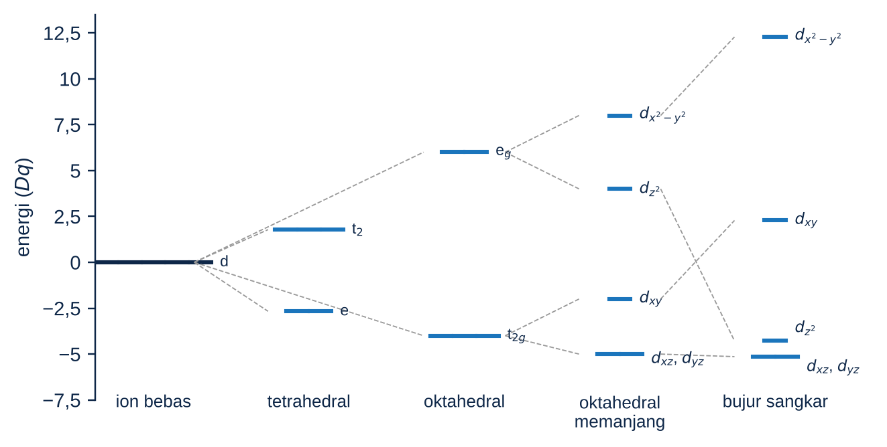

# Bab 14 Kimia Kuantum Senyawa Koordinasi

Rubi berwarna merah tua dan zamrud berwarna hijau. Keduanya batu permata yang hampir tidak berwarna seandainya murni: rubi adalah korundum, Al₂O₃, dan zamrud adalah beril, Be₃Al₂Si₆O₁₈. Warna keduanya berasal dari pengotor yang **sama**, sekitar satu persen ion Cr³⁺ yang menggantikan Al³⁺, dan dalam kedua kristal itu ion krom dikelilingi enam atom oksigen dalam susunan oktahedral. Ion sama, ligan sama, geometri sama, tetapi warnanya bertolak belakang. Teka-teki serupa muncul di laboratorium setiap hari. Larutan kobalt(II) klorida dalam air berwarna merah muda pucat; tambahkan asam klorida pekat dan larutan itu berubah menjadi biru tua, sekitar seratus kali lebih pekat warnanya. Garam besi(II) sulfat bersifat paramagnetik dengan empat elektron tak berpasangan, sedangkan kalium heksasianoferat(II), dengan ion besi yang sama, sama sekali diamagnetik. Mengapa pergantian ligan, atau sedikit perubahan jarak logam–ligan, dapat mengubah warna, intensitas, dan magnetisme sedemikian rupa?

Perubahan warna kobalt(II) ini sudah muncul sekilas di Bab 4 (aturan Laporte) dan Bab 10 (simetri). Di bab ini kita akhirnya dapat menjelaskannya sepenuhnya. Teori medan ligan juga menjadi pelengkap teori ikatan valensi untuk logam transisi di subbab 12.14.

Kuncinya ada pada lima orbital d. Dalam ion bebas kelima orbital itu berenergi sama (Bab 7). Ketika ion logam dikelilingi ligan, kesetangkupan bola itu rusak dan kelima orbital terpecah menjadi beberapa kelompok. Besar pemecahannya, yang kita lambangkan $\Delta$, ternyata sebanding dengan energi foton cahaya tampak dan juga sebanding dengan energi yang diperlukan untuk memasangkan dua elektron dalam satu orbital. Karena itu perubahan kecil pada $\Delta$ menggeser warna, dan persaingan antara $\Delta$ dan energi pemasangan menentukan banyaknya elektron tak berpasangan.

Bab ini menempuh jalan dari model yang paling sederhana ke yang paling lengkap. Kita mulai dengan **teori medan kristal**, yang menganggap ligan sebagai muatan titik, lalu menggantinya dengan **teori medan ligan** yang memakai orbital molekul (Bab 11 dan 13). Setelah itu kita memperlakukan atom berelektron banyak secara jujur: suku-suku Russell–Saunders (subbab 9.12) terpecah dalam medan ligan, dan diagram Tanabe–Sugano yang kita hitung sendiri dengan Python menjelaskan spektrum dan warna kompleks. Bab ditutup dengan transfer muatan dan aturan 18 elektron yang menjadi dasar kimia organologam.

::: {.strategi}
**Pertanyaan pembuka**

1. Mengapa lima orbital d yang berenergi sama dalam ion bebas terpecah dalam kompleks, dan mengapa pola pemecahannya bergantung pada geometri?
2. Mengapa ion sianida, yang bermuatan sama dengan ion klorida, memecah orbital d dua kali lebih besar?
3. Mengapa sebagian kompleks besi(II) paramagnetik dan sebagian lain diamagnetik, dan mengapa ada kompleks yang berganti sifat magnet ketika didinginkan?
4. Mengapa larutan Mn²⁺ hampir tidak berwarna, sedangkan larutan permanganat berwarna ungu pekat walaupun Mn(VII) tidak mempunyai elektron d sama sekali?
5. Mengapa Cr(CO)₆, Fe(CO)₅, dan Ni(CO)₄ stabil, tetapi Fe(CO)₆ tidak ada?
:::

::: {.tujuan}
**Tujuan belajar**

Setelah mempelajari bab ini, kamu mampu:

1. Menurunkan pemecahan orbital d dalam medan oktahedral dari model muatan titik dan dari teori grup.
2. Menjelaskan faktor-faktor yang menentukan $\Delta_o$ dan memakai deret spektrokimia serta rumus Jørgensen.
3. Menurunkan pemecahan dalam medan tetrahedral, tetragonal, dan bujur sangkar, termasuk dengan model tumpang tindih sudut.
4. Menghitung energi stabilisasi medan kristal dan memakainya untuk menjelaskan entalpi hidrasi, struktur spinel, dan deret Irving–Williams.
5. Meramalkan keadaan spin tinggi atau rendah dan menghitung momen magnet spin saja serta koreksinya.
6. Menjelaskan efek Jahn–Teller dan akibat strukturnya, terutama pada senyawa tembaga(II).
7. Membangun diagram orbital molekul kompleks oktahedral dari kombinasi linear teradaptasi simetri.
8. Menjelaskan pengaruh ikatan π pada $\Delta_o$ dan efek nefelauksetik.
9. Menentukan suku-suku ion bebas $d^n$ dan pemecahannya dalam medan oktahedral.
10. Membaca dan menghitung diagram Orgel dan Tanabe–Sugano, lalu menentukan $\Delta_o$ dan $B$ dari spektrum.
11. Menjelaskan aturan seleksi, intensitas, lebar pita, dan warna kompleks.
12. Membedakan transisi d–d, transfer muatan ligan ke logam, logam ke ligan, dan antarvalensi.
13. Menghitung elektron valensi senyawa organologam dan menjelaskan dasar orbital molekul aturan 18 elektron.
:::

::: {.mat}
**Prasyarat**

Dari Bab 7: bentuk orbital d riil dan harmonik bola (subbab 7.7–7.8). Dari Bab 8: perturbasi tingkat terdegenerasi dan momen dipol transisi (subbab 8.9 dan 8.12). Dari Bab 9: lambang suku, aturan Hund, kopling spin–orbit (subbab 9.11–9.13). Dari Bab 10: tabel karakter, rumus reduksi, SALC, aturan seleksi elektronik (subbab 10.5–10.8 dan 10.10). Dari Bab 11 dan 13: metode LCAO dan persamaan sekuler 2 × 2. Dari Bab 12: hibrida d²sp³ dan dsp² serta keterbatasannya (subbab 12.14). Dari Bab 4: paritas dan aturan Laporte (subbab 4.11).
:::

## 14.1 Orbital d dalam medan ligan

### Lima orbital d

Dalam Bab 7 kita menemukan bahwa orbital dengan $\ell = 2$ dapat ditulis sebagai lima fungsi riil. Dengan faktor radial $R_{nd}(r)$ yang sama untuk kelimanya, bagian sudutnya paling mudah dibaca dalam koordinat Kartesius:

$$
\begin{aligned}
d_{z^2} &= \sqrt{\frac{5}{16\pi}}\,\frac{3z^2 - r^2}{r^2}\,R(r), &\qquad d_{x^2-y^2} &= \sqrt{\frac{15}{16\pi}}\,\frac{x^2 - y^2}{r^2}\,R(r),\\
d_{xy} &= \sqrt{\frac{15}{4\pi}}\,\frac{xy}{r^2}\,R(r), & d_{xz} &= \sqrt{\frac{15}{4\pi}}\,\frac{xz}{r^2}\,R(r), \qquad d_{yz} = \sqrt{\frac{15}{4\pi}}\,\frac{yz}{r^2}\,R(r) .
\end{aligned}
\qquad \text{(14.1)}
$$

Kelimanya terbagi menjadi dua keluarga menurut arah cuping (lobus) terhadap sumbu koordinat. $d_{z^2}$ dan $d_{x^2-y^2}$ mempunyai cuping **di sepanjang sumbu**: $d_{z^2}$ dua cuping besar di sumbu $z$ ditambah "cincin" di bidang $xy$, dan $d_{x^2-y^2}$ empat cuping di sumbu $x$ dan $y$. Tiga lainnya, $d_{xy}$, $d_{xz}$, dan $d_{yz}$, mempunyai cuping **di antara sumbu**, tepat pada garis bagi sudut antara dua sumbu. Dalam ion bebas, pembagian ini tidak bermakna apa pun: energi bergantung hanya pada $n$ dan $\ell$, dan kelima orbital berdegenerasi. Arah sumbu $x$, $y$, $z$ kita pilih sesuka hati.

Keadaannya berubah begitu ada ligan. Dalam kompleks oktahedral seperti [Ti(H₂O)₆]³⁺, enam molekul air menempati keenam ujung sumbu, pada jarak sekitar 2,0 Å dari logam. Kini arah sumbu tidak lagi bebas, dan kedua keluarga orbital mengalami lingkungan yang berbeda: keluarga pertama menunjuk **ke arah** ligan, keluarga kedua menunjuk **di antara** ligan (Gambar 14.1).

{width=92%}

### Medan ligan sebagai perturbasi

Tuliskan Hamiltonian elektron d dalam kompleks sebagai

$$
\hat H = \hat H_\text{ion} + \hat V_L , \qquad \text{(14.2)}
$$

dengan $\hat H_\text{ion}$ Hamiltonian ion bebas dan $\hat V_L$ energi potensial elektron akibat ligan. Kelima orbital d adalah fungsi eigen $\hat H_\text{ion}$ yang berdegenerasi. Jika $\hat V_L$ cukup kecil dibanding selisih energi ke kulit lain (misalnya 3d ke 4s atau 4p), teori perturbasi tingkat terdegenerasi orde pertama (subbab 8.9) menyatakan bahwa energi baru diperoleh dengan mendiagonalkan matriks 5 × 5

$$
V_{ij} = \langle d_i|\hat V_L|d_j\rangle , \qquad i, j = z^2, x^2 - y^2, xy, xz, yz . \qquad \text{(14.3)}
$$

Nilai eigen matriks ini adalah pergeseran energi kelima orbital, dan vektor eigennya menunjukkan kombinasi orbital d mana yang menjadi "orbital yang benar" dalam kompleks. Untuk menghitungnya kita memerlukan model $\hat V_L$.

### Model muatan titik

Model paling sederhana, yang diusulkan Bethe (1929) dan dikembangkan Van Vleck untuk menjelaskan magnetisme garam logam transisi, menganggap setiap ligan sebagai **muatan titik** negatif $-Ze$ (untuk ion seperti F⁻) atau ujung negatif sebuah dipol (untuk molekul netral seperti H₂O). Logam diletakkan di pusat koordinat dan enam ligan di $(\pm a, 0, 0)$, $(0, \pm a, 0)$, $(0, 0, \pm a)$. Energi potensial elektron di $\mathbf r$ adalah tolakan Coulomb dari keenam muatan:

$$
V_L(\mathbf r) = \sum_{i=1}^{6}\frac{Ze^2}{4\pi\varepsilon_0|\mathbf r - \mathbf R_i|} . \qquad \text{(14.4)}
$$

Hasil penguraiannya, yang diturunkan di kotak "Lebih dalam" di bawah, adalah

$$
V_L = \frac{6Ze^2}{4\pi\varepsilon_0a} + \frac{35Ze^2}{4(4\pi\varepsilon_0)a^5}\left(x^4 + y^4 + z^4 - \tfrac35r^4\right) + \cdots . \qquad \text{(14.5)}
$$

Suku pertama adalah tetapan: ia menaikkan kelima orbital sama banyak, beberapa elektronvolt, karena elektron d ditolak oleh muatan negatif di sekelilingnya. Suku itu tidak memecah apa pun. Yang memecah adalah suku kedua, yang berpangkat empat dalam koordinat dan mempunyai kesetangkupan kubus: ia sama bila $x$, $y$, $z$ dipertukarkan atau diubah tandanya.

::: {.dalam}
**Penguraian potensial oktahedral**

Untuk $r < a$ berlaku penguraian fungsi pembangkit polinom Legendre (subbab 6.5):

$$
\frac{1}{|\mathbf r - \mathbf R|} = \sum_{\ell=0}^{\infty}\frac{r^\ell}{a^{\ell+1}}P_\ell(\cos\gamma) ,
$$

dengan $\gamma$ sudut antara $\mathbf r$ dan $\mathbf R$. Untuk ligan di sumbu $+x$, $\cos\gamma = x/r$; untuk ligan di $-x$, $\cos\gamma = -x/r$; dan seterusnya. Kita jumlahkan setiap suku $\ell$ atas keenam ligan.

*$\ell = 1$ dan semua $\ell$ ganjil.* $P_\ell$ ganjil, dan ligan-ligan berpasangan di $\pm\mathbf R$, sehingga kontribusinya saling meniadakan. Ini akibat langsung pusat inversi.

*$\ell = 2$.* $P_2(u) = \tfrac12(3u^2 - 1)$. Jumlah $u^2$ atas keenam ligan adalah $2(x^2 + y^2 + z^2)/r^2 = 2$, sehingga $\sum P_2 = \tfrac12(3 \cdot 2 - 6) = 0$. Suku kuadrupol lenyap karena kubus tidak membedakan sumbu $x$, $y$, dan $z$.

*$\ell = 4$.* $P_4(u) = \tfrac18(35u^4 - 30u^2 + 3)$. Dengan $\sum u^4 = 2(x^4 + y^4 + z^4)/r^4$, $\sum u^2 = 2$, dan $\sum 1 = 6$:

$$
\sum_{i=1}^6P_4(u_i) = \frac18\left[\frac{70(x^4 + y^4 + z^4)}{r^4} - 60 + 18\right] = \frac{35}{4}\left[\frac{x^4 + y^4 + z^4}{r^4} - \frac35\right] .
$$

Kalikan dengan $Ze^2r^4/4\pi\varepsilon_0a^5$ dan diperoleh suku kedua (14.5).

*$\ell \ge 6$.* Suku-suku ini memang ada, tetapi unsur matriksnya di antara dua orbital d nol. Hasil kali dua fungsi $\ell = 2$ hanya memuat harmonik bola berderajat 0, 2, dan 4 (aturan segitiga penjumlahan momentum sudut, subbab 9.11), sehingga integral $\langle d_i|r^\ell P_\ell|d_j\rangle$ lenyap untuk $\ell > 4$. Penguraian (14.5) karena itu **tepat** sejauh menyangkut orbital d.
:::

### Unsur matriks dan parameter $Dq$

Suku pemecah (14.5) diagonal dalam basis orbital riil (14.1); semua unsur di luar diagonal lenyap karena kesetangkupan. Integral sudut dapat dihitung secara analitik atau numerik. Untuk $d_{z^2}$ dan $d_{x^2-y^2}$, rata-rata $(x^4 + y^4 + z^4)/r^4 - \tfrac35$ atas rapat sudutnya adalah $+\tfrac{4}{35}$; untuk $d_{xy}$, $d_{xz}$, dan $d_{yz}$ hasilnya $-\tfrac{8}{105}$. Bagian radialnya menyumbang $\langle r^4\rangle = \int_0^\infty R^2r^4\,r^2dr$. Dengan mendefinisikan

$$
Dq = \frac{Ze^2\langle r^4\rangle}{6(4\pi\varepsilon_0)a^5} , \qquad \text{(14.6)}
$$

pergeseran energinya menjadi

$$
E(e_g) = +6Dq , \qquad E(t_{2g}) = -4Dq , \qquad \Delta_o \equiv 10Dq . \qquad \text{(14.7)}
$$

Nama $e_g$ dan $t_{2g}$ adalah lambang representasi tak tereduksi grup $O_h$ (subbab 10.5): $e$ untuk dua dimensi, $t$ untuk tiga dimensi, dan $g$ (*gerade*) karena orbital d genap terhadap inversi. Huruf $o$ pada $\Delta_o$ berarti oktahedral. Lambang huruf kecil dipakai untuk orbital satu elektron; huruf besar kelak dipakai untuk keadaan banyak elektron.

Perhatikan bahwa $2(+6Dq) + 3(-4Dq) = 0$. Pergeseran rata-rata berbobot kelima orbital sama dengan nol, sehingga pemecahan mempertahankan **pusat berat** (barisentrum) energi. Ini bukan kebetulan: jumlah nilai eigen sama dengan teras matriks, dan teras $\langle d_i|x^4 + y^4 + z^4 - \tfrac35r^4|d_i\rangle$ atas kelima orbital adalah rata-rata fungsi itu atas seluruh bola dikalikan lima, yang nol karena rata-rata $x^4$ di permukaan bola sama dengan $\tfrac15r^4$.

::: {.inti}
**Pemecahan oktahedral**

Dalam medan oktahedral, orbital d terpecah menjadi $e_g$ ($d_{z^2}$, $d_{x^2-y^2}$; cuping menunjuk ke ligan) di $+6Dq = +0{,}6\Delta_o$ dan $t_{2g}$ ($d_{xy}$, $d_{xz}$, $d_{yz}$; cuping di antara ligan) di $-4Dq = -0{,}4\Delta_o$. Pusat berat dipertahankan. Besar pemecahan $\Delta_o = 10Dq$ adalah parameter utama kimia kompleks.
:::

### Teori grup: pemecahan tanpa menghitung integral

Model muatan titik memberi besaran $\Delta_o$, tetapi **pola** pemecahannya ditentukan sepenuhnya oleh kesetangkupan. Kelima fungsi $\ell = 2$ membentuk representasi grup rotasi penuh; dalam grup oktahedral representasi itu umumnya tereduksi. Karakter rotasi sebesar $\alpha$ untuk himpunan $2\ell + 1$ fungsi dengan momentum sudut $\ell$ adalah (kotak "Matematika" di bawah)

$$
\chi_\ell(\alpha) = \frac{\sin\left(\ell + \tfrac12\right)\alpha}{\sin\tfrac12\alpha}, \qquad \chi_\ell(0) = 2\ell + 1 . \qquad \text{(14.8)}
$$

Grup rotasi $O$ (bagian rotasi murni $O_h$) mempunyai lima kelas: $E$, $8C_3$ ($\alpha = 120°$), $6C_2'$ ($\alpha = 180°$ di sekitar garis bagi sudut dua sumbu), $6C_4$ ($\alpha = 90°$), dan $3C_2 = C_4^2$ ($\alpha = 180°$). Untuk $\ell = 2$, (14.8) memberi karakter 5, −1, 1, −1, 1. Rumus reduksi (subbab 10.6) dengan tabel karakter $O$ menghasilkan $E + T_2$, dan karena orbital d genap terhadap inversi, dalam $O_h$ menjadi $e_g + t_{2g}$. Tanpa menghitung satu integral pun, kita tahu bahwa d harus terpecah menjadi dua tingkat dengan degenerasi 2 dan 3. Teori grup tidak dapat mengatakan tingkat mana yang lebih tinggi atau berapa selisihnya; itu tugas model fisis.

::: {.mat}
**Karakter rotasi untuk momentum sudut $\ell$**

Pilih sumbu rotasi sebagai sumbu $z$. Rotasi sebesar $\alpha$ mengalikan $Y_\ell^m$ dengan $e^{-im\alpha}$, sehingga matriksnya diagonal dan karakternya adalah jumlah deret ukur

$$
\chi_\ell(\alpha) = \sum_{m=-\ell}^{\ell}e^{-im\alpha} = \frac{e^{i(\ell+\frac12)\alpha} - e^{-i(\ell+\frac12)\alpha}}{e^{i\alpha/2} - e^{-i\alpha/2}} = \frac{\sin(\ell + \frac12)\alpha}{\sin\frac12\alpha} .
$$

Karakter tidak bergantung pada pilihan basis, sehingga rumus ini berlaku pula untuk orbital riil dan untuk rotasi di sekitar sumbu mana pun. Rumus yang sama berlaku untuk suku atom dengan $L$ (subbab 14.9) dan, dengan $J$ setengah bulat, untuk keadaan dengan kopling spin–orbit.
:::

::: {.contoh}
**Contoh 14.1 · Ke mana cuping menunjuk**

Hitung nilai bagian sudut kelima orbital d (14.1) di arah ligan $+z$ dan $+x$. Lalu hitung jumlah kuadratnya atas keenam ligan oktahedral untuk setiap orbital. Apa yang ditunjukkan hasilnya?

**Penyelesaian.** Konstanta normalisasinya $\sqrt{5/16\pi} = 0{,}3154$, $\sqrt{15/16\pi} = 0{,}5463$, dan $\sqrt{15/4\pi} = 1{,}0925$. Di arah $+z$ ($x = y = 0$, $z = r$): $d_{z^2} = 0{,}3154 \times 2 = 0{,}6308$, sedangkan keempat orbital lain nol. Di arah $+x$: $d_{z^2} = 0{,}3154 \times (-1) = -0{,}3154$, $d_{x^2-y^2} = +0{,}5463$, dan $d_{xy}$, $d_{xz}$, $d_{yz}$ nol.

Jumlah kuadrat atas enam ligan:

- $d_{z^2}$: $2(0{,}6308)^2 + 4(0{,}3154)^2 = 0{,}7958 + 0{,}3979 = 1{,}194$.
- $d_{x^2-y^2}$: $4(0{,}5463)^2 = 1{,}194$.
- $d_{xy}$, $d_{xz}$, $d_{yz}$: 0.

**Memahami hasil.** Tiga orbital $t_{2g}$ tepat nol di semua arah ligan: simpul sudutnya menempel pada sumbu. Dua orbital $e_g$ memberikan jumlah kuadrat yang **sama persis**, $15/4\pi = 1{,}194$, walaupun bentuknya sangat berbeda. Kesamaan itulah yang membuat keduanya berdegenerasi: $d_{z^2}$ menunjuk kuat ke dua ligan aksial dan lemah ke empat ligan ekuator, sedangkan $d_{x^2-y^2}$ menunjuk sedang ke empat ligan ekuator, dan keduanya "melihat" ligan sama banyak. Besaran jumlah kuadrat ini akan muncul lagi sebagai dasar model tumpang tindih sudut (subbab 14.3).
:::

::: {.contoh}
**Contoh 14.2 · Menaksir $\Delta_o$ dengan muatan titik**

Taksir $\Delta_o$ untuk [CrF₆]³⁻ dengan model muatan titik. Pakai orbital Slater 3d, $R \propto r^2e^{-\zeta r}$, dengan muatan inti efektif menurut aturan Slater, jarak Cr–F 1,93 Å, dan $Z = 1$. Bandingkan dengan nilai teramati 15 060 cm⁻¹.

**Rencana.** Hitung $\zeta$, lalu $\langle r^4\rangle$ dalam satuan atom, lalu $Dq$ dari (14.6) dalam satuan atom ($e^2/4\pi\varepsilon_0 = 1$).

**Penyelesaian.** Cr³⁺ ($Z = 24$) berkonfigurasi [Ar]3d³. Bagi elektron 3d, 18 elektron di dalam menyaring masing-masing 1,00 dan dua elektron 3d lain masing-masing 0,35: $Z_\text{ef} = 24 - 18 - 0{,}70 = 5{,}30$, $\zeta = Z_\text{ef}/3 = 1{,}767$ bohr⁻¹. Untuk orbital Slater dengan $n = 3$,

$$
\langle r^k\rangle = \frac{(2n + k)!}{(2n)!\,(2\zeta)^k}, \qquad \langle r^4\rangle = \frac{10!}{6!\,(3{,}533)^4} = 32{,}3\ \text{bohr}^4 .
$$

Jarak $a = 1{,}93/0{,}5292 = 3{,}647$ bohr, $a^5 = 646$. Maka $Dq = 32{,}3/(6 \times 646) = 8{,}35 \times 10^{-3}$ hartree $= 1830$ cm⁻¹, dan $\Delta_o \approx 18\,300$ cm⁻¹.

**Memahami hasil.** Hasilnya hanya 20% di atas nilai teramati, kecocokan yang mengesankan untuk model sekasar ini. Sayangnya kecocokan itu sebagian besar kebetulan. Orbital Slater meluruh terlalu lambat sehingga $\langle r^4\rangle$-nya terlalu besar; fungsi gelombang Hartree–Fock yang lebih tepat memberi $\langle r^4\rangle$ beberapa kali lebih kecil, dan model muatan titik lalu meramalkan $\Delta_o$ yang jauh terlalu kecil. Kita akan melihat di subbab 14.7 bahwa sebagian besar $\Delta_o$ berasal dari kovalensi, yaitu tumpang tindih orbital d dengan orbital ligan, bukan dari tolakan elektrostatik. Model muatan titik tetap berguna karena memberikan **pola** yang benar dengan cara yang mudah dibayangkan.
:::

::: {.contoh}
**Contoh 14.3 · Reduksi representasi d dalam $O$**

Tunjukkan dengan rumus reduksi bahwa $\Gamma_d$ dalam grup $O$ tereduksi menjadi $E + T_2$. Tabel karakter $O$ (urutan kelas $E$, $8C_3$, $6C_2'$, $6C_4$, $3C_2$): $A_1$: 1, 1, 1, 1, 1; $A_2$: 1, 1, −1, −1, 1; $E$: 2, −1, 0, 0, 2; $T_1$: 3, 0, −1, 1, −1; $T_2$: 3, 0, 1, −1, −1.

**Penyelesaian.** Dari (14.8) dengan $\ell = 2$: $\chi(120°) = \sin 300°/\sin 60° = -1$; $\chi(180°) = \sin 450°/\sin 90° = 1$; $\chi(90°) = \sin 225°/\sin 45° = -1$. Jadi $\Gamma_d$ = 5, −1, 1, −1, 1. Rumus reduksi $n_i = \tfrac1h\sum_k g_k\chi(k)\chi_i(k)$ dengan $h = 24$:

$$
\begin{aligned}
n(A_1) &= \tfrac{1}{24}[5 - 8 + 6 - 6 + 3] = 0, & n(A_2) &= \tfrac{1}{24}[5 - 8 - 6 + 6 + 3] = 0,\\
n(E) &= \tfrac{1}{24}[10 + 8 + 0 + 0 + 6] = 1, & n(T_1) &= \tfrac{1}{24}[15 + 0 - 6 - 6 - 3] = 0,\\
n(T_2) &= \tfrac{1}{24}[15 + 0 + 6 + 6 - 3] = 1 .
\end{aligned}
$$

**Memahami hasil.** $\Gamma_d = E + T_2$, atau $e_g + t_{2g}$ dalam $O_h$. Perhitungan yang sama untuk $\ell = 0$ dan $\ell = 1$ memberi $A_1$ dan $T_1$: orbital s dan p **tidak** terpecah dalam medan oktahedral, karena kubus terlalu setangkup untuk membedakan $p_x$, $p_y$, dan $p_z$. Pemecahan baru muncul mulai $\ell = 2$, dan itulah sebabnya kimia medan ligan adalah kimia unsur d dan f.
:::

::: {.contoh}
**Contoh 14.4 · Orbital f dan lantanida**

(a) Tentukan pemecahan tujuh orbital f ($\ell = 3$) dalam medan oktahedral. (b) Dalam ion Ln³⁺, pemecahan orbital 4f oleh ligan hanya sekitar 100–500 cm⁻¹, jauh lebih kecil daripada $\Delta_o$ logam 3d. Jelaskan dan sebutkan akibatnya.

**Penyelesaian.** (a) Dari (14.8) dengan $\ell = 3$: $\chi(120°) = \sin 420°/\sin 60° = 1$, $\chi(180°) = \sin 630° = -1$, $\chi(90°) = \sin 315°/\sin 45° = -1$. Jadi $\Gamma_f$ = 7, 1, −1, −1, −1. Reduksinya: $n(A_2) = \tfrac{1}{24}[7 + 8 + 6 + 6 - 3] = 1$, $n(T_1) = \tfrac{1}{24}[21 + 0 + 6 - 6 + 3] = 1$, $n(T_2) = \tfrac{1}{24}[21 + 0 - 6 + 6 + 3] = 1$, dan yang lain nol. Karena orbital f ganjil terhadap inversi, $\Gamma_f = a_{2u} + t_{1u} + t_{2u}$.

(b) Orbital 4f terletak jauh di dalam ion, terlindung oleh kulit 5s² dan 5p⁶ yang lebih luas. Rata-rata $\langle r^4\rangle$-nya kecil dibanding jarak ke ligan, dan tumpang tindihnya dengan orbital ligan hampir nol.

**Memahami hasil.** Akibatnya ion lantanida berperilaku hampir seperti ion bebas. Spektrum serapannya berupa garis-garis tajam yang posisinya hampir tidak bergantung pada ligan, sehingga Nd³⁺ dan Ho³⁺ dipakai untuk kalibrasi spektrofotometer dan Eu³⁺ serta Tb³⁺ untuk luminofor layar dan lampu. Momen magnetnya mengikuti $J$ ion bebas (subbab 9.13), bukan rumus spin saja. Ikatan Ln–ligan hampir murni ionik, sehingga kimia larutan lantanida ditentukan terutama oleh ukuran ion: kontraksi lantanida, bukan medan ligan.
:::

### Makna kimia

Nilai $\Delta_o$ kompleks logam 3d berkisar dari sekitar 7000 cm⁻¹ untuk Mn²⁺ dengan ligan lemah sampai lebih dari 30 000 cm⁻¹ untuk sianida dan karbonil; untuk logam 4d dan 5d dapat mencapai 40 000 cm⁻¹ lebih. Dalam satuan lain, 1–5 eV atau 80–540 kJ/mol. Rentang ini menimpa tiga skala penting sekaligus. Pertama, cahaya tampak meliputi sekitar 14 000–25 000 cm⁻¹, sehingga eksitasi elektron dari $t_{2g}$ ke $e_g$ menyerap warna tertentu. Kedua, energi yang diperlukan untuk memasangkan dua elektron dalam satu orbital besarnya 15 000–30 000 cm⁻¹, sehingga $\Delta_o$ dapat menang atau kalah dalam persaingan itu. Ketiga, $\Delta_o$ sebanding dengan selisih energi ikatan dan energi hidrasi antarunsur, sehingga ikut menentukan sifat termodinamika. Warna, magnetisme, dan kestabilan senyawa koordinasi semuanya berakar pada satu pemecahan orbital ini.

::: {.kuis}
**Kuis cepat 14.1**

Seandainya enam muatan titik negatif diletakkan di pusat keenam sisi sebuah kubus (yaitu di sumbu, seperti oktahedron) tetapi diganti muatan **positif**, bagaimana urutan $e_g$ dan $t_{2g}$? Apakah pusat berat tetap dipertahankan?
:::

## 14.2 Teori medan kristal oktahedral

### Isi teori

**Teori medan kristal** (TMK) adalah nama untuk pendekatan subbab 14.1 yang dipakai secara sistematis: ikatan logam–ligan dianggap murni ionik, ligan hanya menyediakan medan listrik, dan yang diperhatikan hanyalah elektron d logam. Dari pemecahan satu elektron (14.7), TMK membangun konfigurasi elektron kompleks dengan mengisi $t_{2g}$ dan $e_g$, persis seperti kita mengisi orbital atom dengan prinsip Aufbau. Walaupun asumsi ioniknya keliru, kerangka ini tetap dipakai karena semua kesimpulan yang bergantung pada simetri dan banyaknya elektron tetap berlaku ketika kita kelak mengganti muatan titik dengan orbital molekul (subbab 14.7). Yang berubah hanyalah tafsir fisis $\Delta_o$.

### Mengisi $t_{2g}$ dan $e_g$

Konfigurasi kompleks oktahedral ditulis $t_{2g}^xe_g^y$ dengan $x + y = n$, banyaknya elektron d. Untuk menghitung banyaknya elektron d, kurangkan muatan ion dari nomor golongan: Ti³⁺ dan V⁴⁺ adalah d¹, Cr³⁺ dan V²⁺ d³, Fe²⁺ dan Co³⁺ d⁶, Ni²⁺ d⁸, Cu²⁺ d⁹. Elektron 4s ion bebas logam transisi selalu hilang lebih dulu daripada elektron 3d (subbab 9.9).

Untuk d¹, d², dan d³ hanya ada satu pilihan: elektron menempati $t_{2g}$ dengan spin sejajar sesuai aturan Hund. Demikian pula untuk d⁸, d⁹, dan d¹⁰: $t_{2g}^6e_g^2$, $t_{2g}^6e_g^3$, dan $t_{2g}^6e_g^4$. Untuk d⁴ sampai d⁷ ada dua pilihan. Elektron keempat dapat masuk $e_g$ dengan spin sejajar (membayar $\Delta_o$) atau berpasangan di $t_{2g}$ (membayar energi pemasangan). Pilihan pertama memberi kompleks **spin tinggi**, pilihan kedua **spin rendah**. Persaingan ini kita bahas di subbab 14.5.

Energi elektron d relatif terhadap pusat berat disebut **energi stabilisasi medan kristal** (ESMK):

$$
\text{ESMK} = (-0{,}4x + 0{,}6y)\Delta_o = (-4x + 6y)Dq . \qquad \text{(14.9)}
$$

Untuk d³, ESMK $= -1{,}2\Delta_o$; untuk d⁸, $-1{,}2\Delta_o$ juga; untuk d⁵ spin tinggi dan d¹⁰, nol. ESMK mengukur seberapa besar elektron d "diuntungkan" oleh pemecahan dibanding seandainya kelima orbital tetap berdegenerasi pada pusat beratnya. Subbab 14.4 memakainya untuk menjelaskan sifat termodinamika.

### Mengukur $\Delta_o$: kompleks d¹

Kompleks d¹ adalah satu-satunya kasus ketika $\Delta_o$ dapat dibaca langsung dari spektrum. Dengan satu elektron, keadaan dasar $t_{2g}^1$ dan keadaan tereksitasi $e_g^1$ hanya berbeda dalam letak satu elektron, tanpa tolakan antarelektron d yang perlu diperhitungkan. Energi foton yang diserap sama dengan $\Delta_o$. Untuk kompleks dengan banyak elektron d, setiap konfigurasi menghasilkan beberapa keadaan yang dipisahkan tolakan elektron, dan $\Delta_o$ harus dipisahkan dari parameter tolakan itu dengan analisis suku (subbab 14.10).

::: {.contoh}
**Contoh 14.5 · Warna ion titanium(III)**

Larutan Ti³⁺ dalam asam encer berwarna ungu dengan serapan maksimum pada 493 nm. (a) Hitung $\Delta_o$ untuk [Ti(H₂O)₆]³⁺ dalam cm⁻¹, eV, dan kJ/mol. (b) Jelaskan warnanya.

**Penyelesaian.** (a) $\tilde\nu = 1/(493 \times 10^{-7}\ \text{cm}) = 20\,280$ cm⁻¹. Dengan $hc = 1{,}2398 \times 10^{-4}$ eV cm, energinya 2,51 eV, dan dengan 1 cm⁻¹ $= 0{,}011\,963$ kJ/mol, energinya 243 kJ/mol. Jadi $\Delta_o \approx 20\,300$ cm⁻¹.

(b) Serapan di 493 nm berada di daerah hijau-biru. Mata menerima sisa spektrum, campuran merah dan biru-ungu, yang tampak sebagai ungu kemerahan.

**Memahami hasil.** $\Delta_o$ sebesar 243 kJ/mol, kira-kira separuh energi ikatan C–C. Pita serapan ini lebar (sekitar 6000 cm⁻¹) dan lemah ($\varepsilon \approx 4$ L mol⁻¹ cm⁻¹); keduanya akan dijelaskan di subbab 14.6 dan 14.11. Bahwa satu pita d–d tunggal cukup untuk menentukan $\Delta_o$ menjadikan Ti³⁺ "kompleks percontohan" yang dipakai Ilse dan Hartmann pada 1951 untuk menghidupkan kembali teori medan kristal dalam kimia.
:::

### Deret spektrokimia

Jika kita membandingkan banyak kompleks dengan logam yang sama, $\Delta_o$ ternyata berubah menurut urutan ligan yang hampir tidak bergantung pada logam. Urutan ini, yang disusun Tsuchida pada 1938 dari spektrum kompleks kobalt(III), disebut **deret spektrokimia**:

$$
\text{I}^- < \text{Br}^- < \text{S}^{2-} < \text{SCN}^- < \text{Cl}^- < \text{F}^- < \text{OH}^- < \text{C}_2\text{O}_4^{2-} < \text{H}_2\text{O} < \text{NCS}^- < \text{py} < \text{NH}_3 < \text{en} < \text{bpy} < \text{phen} < \text{NO}_2^- < \text{PPh}_3 < \text{CN}^- < \text{CO} . \qquad \text{(14.10)}
$$

(SCN⁻ yang terikat lewat S berada di ujung lemah, sedangkan NCS⁻ yang terikat lewat N lebih kuat.) Ligan di kiri disebut **ligan medan lemah**, ligan di kanan **ligan medan kuat**.

Deret ini adalah kegagalan terbesar model muatan titik. Menurut (14.6), ligan bermuatan seharusnya menimbulkan medan lebih kuat daripada ligan netral, dan F⁻ seharusnya jauh di atas H₂O dan NH₃. Kenyataannya terbalik: halida adalah ligan terlemah, amonia netral lebih kuat daripada air, dan CO yang netral dan hampir tanpa momen dipol adalah yang terkuat. Urutan ini baru masuk akal setelah kita memperhitungkan ikatan σ dan π (subbab 14.8): halida adalah donor π yang **memperkecil** $\Delta_o$, CO dan CN⁻ adalah akseptor π yang **memperbesar** $\Delta_o$.

### Logam, bilangan oksidasi, dan periode

Untuk ligan yang sama, $\Delta_o$ bergantung pada logam menurut beberapa pola yang teratur:

1. **Bilangan oksidasi.** Ion M³⁺ memberi $\Delta_o$ sekitar 40–100% lebih besar daripada M²⁺. Muatan yang lebih besar menarik ligan lebih dekat dan meningkatkan kovalensi.
2. **Periode.** Berpindah dari 3d ke 4d menaikkan $\Delta_o$ sekitar 50%, dan dari 4d ke 5d sekitar 25% lagi. Orbital 4d dan 5d lebih luas, sehingga tumpang tindih dengan orbital ligan lebih besar. Akibatnya hampir semua kompleks logam 4d dan 5d berspin rendah.
3. **Letak dalam periode.** Dalam satu periode dan satu bilangan oksidasi, perubahannya lebih kecil dan kurang teratur.

Jørgensen merangkum pola-pola ini dalam rumus empiris yang memisahkan pengaruh ligan dan logam:

$$
\Delta_o \approx f(\text{ligan}) \times g(\text{logam}) . \qquad \text{(14.11)}
$$

Faktor $f$ dinormalkan sehingga $f(\text{H}_2\text{O}) = 1$; beberapa nilainya: Br⁻ 0,72; Cl⁻ 0,78; F⁻ 0,90; C₂O₄²⁻ 0,99; H₂O 1,00; NH₃ 1,25; en 1,28; CN⁻ 1,7. Faktor $g$ (dalam 1000 cm⁻¹): Mn²⁺ 8,0; Ni²⁺ 8,7; Co²⁺ 9,0; V²⁺ 12,0; Fe³⁺ 14,0; Cr³⁺ 17,4; Co³⁺ 18,2; Rh³⁺ 27,0; Ir³⁺ 32,0; Pt⁴⁺ 36,0.

Tabel 14.1 mengumpulkan nilai $\Delta_o$ beberapa kompleks dari spektrumnya. Nilai-nilai ini akan kita pakai berulang kali dalam bab ini.

| Kompleks | Konfigurasi | $\Delta_o$ (cm⁻¹) | $\Delta_o$ (kJ/mol) |
|---|---|---|---|
| [Ti(H₂O)₆]³⁺ | d¹ | 20 300 | 243 |
| [V(H₂O)₆]³⁺ | d² | 19 100 | 228 |
| [V(H₂O)₆]²⁺ | d³ | 12 400 | 148 |
| [Cr(H₂O)₆]³⁺ | d³ | 17 400 | 208 |
| [Cr(NH₃)₆]³⁺ | d³ | 21 550 | 258 |
| [Cr(CN)₆]³⁻ | d³ | 26 600 | 318 |
| [CrF₆]³⁻ | d³ | 15 060 | 180 |
| [Mn(H₂O)₆]²⁺ | d⁵ | 8 500 | 102 |
| [Fe(H₂O)₆]²⁺ | d⁶ | 10 400 | 124 |
| [Fe(H₂O)₆]³⁺ | d⁵ | 14 000 | 167 |
| [Fe(CN)₆]⁴⁻ | d⁶ | 33 800 | 404 |
| [Co(H₂O)₆]²⁺ | d⁷ | 9 300 | 111 |
| [Co(H₂O)₆]³⁺ | d⁶ | 18 200 | 218 |
| [Co(NH₃)₆]³⁺ | d⁶ | 22 900 | 274 |
| [Ni(H₂O)₆]²⁺ | d⁸ | 8 500 | 102 |
| [Ni(NH₃)₆]²⁺ | d⁸ | 10 800 | 129 |
| [Cu(H₂O)₆]²⁺ | d⁹ | 12 600 | 151 |
| [Rh(NH₃)₆]³⁺ | d⁶ | 34 100 | 408 |
| [Ir(NH₃)₆]³⁺ | d⁶ | 41 200 | 493 |

: Tabel 14.1 Nilai $\Delta_o$ beberapa kompleks oktahedral (dibulatkan). Untuk kompleks dengan lebih dari satu elektron d, $\Delta_o$ diperoleh dari analisis suku (subbab 14.10).

::: {.contoh}
**Contoh 14.6 · Menguji rumus Jørgensen**

Ramalkan $\Delta_o$ dengan (14.11) untuk [Cr(NH₃)₆]³⁺, [Co(en)₃]³⁺, [Ni(en)₃]²⁺, [CrF₆]³⁻, [Ir(NH₃)₆]³⁺, dan [Cr(CN)₆]³⁻. Nilai teramati berturut-turut 21 550, 23 200, 11 500, 15 060, 41 200, dan 26 600 cm⁻¹.

**Penyelesaian.**

| Kompleks | $f \times g$ (cm⁻¹) | Teramati | Selisih |
|---|---|---|---|
| [Cr(NH₃)₆]³⁺ | 1,25 × 17 400 = 21 750 | 21 550 | +0,9% |
| [Co(en)₃]³⁺ | 1,28 × 18 200 = 23 300 | 23 200 | +0,4% |
| [Ni(en)₃]²⁺ | 1,28 × 8 700 = 11 140 | 11 500 | −3,2% |
| [CrF₆]³⁻ | 0,90 × 17 400 = 15 660 | 15 060 | +4,0% |
| [Ir(NH₃)₆]³⁺ | 1,25 × 32 000 = 40 000 | 41 200 | −2,9% |
| [Cr(CN)₆]³⁻ | 1,70 × 17 400 = 29 580 | 26 600 | +11% |

**Memahami hasil.** Untuk ligan σ biasa, rumus sederhana ini meramalkan $\Delta_o$ dalam beberapa persen, cukup untuk menaksir warna atau keadaan spin kompleks yang belum pernah diukur. Penyimpangan terbesar terjadi pada sianida: kekuatan ligan akseptor π bergantung pada logam, karena ikatan balik π membutuhkan elektron $t_{2g}$ yang cukup tinggi energinya (subbab 14.8). Faktor $f$ yang "universal" memang hanya pendekatan.
:::

::: {.contoh}
**Contoh 14.7 · Pengaruh muatan dan periode**

Dari Tabel 14.1, hitung perbandingan $\Delta_o$ untuk pasangan (a) [Fe(H₂O)₆]³⁺/[Fe(H₂O)₆]²⁺, [V(H₂O)₆]³⁺/[V(H₂O)₆]²⁺, [Co(H₂O)₆]³⁺/[Co(H₂O)₆]²⁺; (b) [Rh(NH₃)₆]³⁺/[Co(NH₃)₆]³⁺ dan [Ir(NH₃)₆]³⁺/[Rh(NH₃)₆]³⁺.

**Penyelesaian.** (a) 14 000/10 400 = 1,35; 19 100/12 400 = 1,54; 18 200/9 300 = 1,96. (b) 34 100/22 900 = 1,49; 41 200/34 100 = 1,21.

**Memahami hasil.** Kenaikan muatan dari +2 ke +3 menaikkan $\Delta_o$ 35–100%. Lonjakan terbesar terjadi pada kobalt, karena Co³⁺ (d⁶) berspin rendah: tanpa elektron di $e_g$ antiikatan, ion itu dapat mendekatkan ligan lebih jauh, dan jarak Co–O memendek sekitar 0,2 Å. Lonjakan 3d → 4d (49%) dan 4d → 5d (21%) cocok dengan pola umum. Untuk [Ir(NH₃)₆]³⁺, $\Delta_o$ setara dengan foton ultraviolet 243 nm: kompleks ini tidak berwarna, dan ESMK-nya ($-2{,}4\Delta_o \approx -1180$ kJ/mol) menjadikannya salah satu kompleks paling lembam secara kinetik.
:::

### $\Delta_o$ sangat peka terhadap jarak

Menurut (14.6), $\Delta_o \propto a^{-5}$. Model muatan titik keliru dalam banyak hal, tetapi ketergantungan pangkat lima ini ternyata cukup tepat dan dikonfirmasi oleh percobaan tekanan tinggi. Dengan mengambil logaritma dan turunannya,

$$
\frac{d\Delta_o}{\Delta_o} = -5\,\frac{da}{a} . \qquad \text{(14.12)}
$$

Pemendekan ikatan sebesar 1% menaikkan $\Delta_o$ sekitar 5%. Kepekaan ekstrem ini menjelaskan mengapa ion yang sama dalam kristal yang berbeda, dengan jarak logam–oksigen yang berbeda beberapa pikometer saja, dapat berwarna sangat berbeda (subbab 14.11), dan mengapa perubahan keadaan spin, yang mengubah jarak logam–ligan, dapat memicu dirinya sendiri (subbab 14.5).

::: {.contoh}
**Contoh 14.8 · Tekanan, jarak, dan $\Delta_o$**

(a) Kristal yang dimampatkan sehingga jarak logam–ligan memendek 2,0%. Berapa persen kenaikan $\Delta_o$? (b) Dalam kompleks besi(II) dengan ligan nitrogen, jarak Fe–N sekitar 2,18 Å pada keadaan spin tinggi dan 1,98 Å pada keadaan spin rendah. Berapa perbandingan $\Delta_o$ kedua keadaan menurut $a^{-5}$?

**Penyelesaian.** (a) $(1/0{,}980)^5 = 1{,}106$; kenaikannya 10,6%. Pendekatan linear (14.12) memberi 10%.

(b) $(2{,}18/1{,}98)^5 = 1{,}62$.

**Memahami hasil.** Ketika kompleks berpindah dari spin tinggi ke spin rendah, dua elektron meninggalkan orbital $e_g$ yang antiikatan, ikatan memendek, dan $\Delta_o$ naik sekitar 60%. Kenaikan itu justru menstabilkan keadaan spin rendah lebih lanjut. Umpan balik positif inilah yang membuat transisi spin dalam padatan sering berlangsung tajam (subbab 14.5). Dalam rubi, tekanan beberapa gigapascal menggeser garis pendar Cr³⁺ dengan teratur; geseran itu dipakai sebagai manometer baku dalam sel landasan intan.
:::

::: {.awas}
**$\Delta_o$ bukan selisih energi yang selalu terlihat langsung**

Hanya untuk d¹ (dan d⁹, dengan lubang tunggal) energi pita serapan sama dengan $\Delta_o$. Untuk konfigurasi lain, satu konfigurasi orbital menghasilkan beberapa keadaan yang dipisahkan tolakan elektron, dan pita pertama tidak harus sama dengan $\Delta_o$. Untuk [V(H₂O)₆]³⁺, misalnya, pita pertama berada di 17 800 cm⁻¹, padahal $\Delta_o = 19\,100$ cm⁻¹ (subbab 14.10). Selain itu, $\Delta_o$ sendiri bukan besaran yang dapat diamati menurut postulat mekanika kuantum: ia parameter model yang ditentukan dengan mencocokkan beberapa pita sekaligus.
:::

::: {.terapan}
**Pigmen dari medan ligan**

Banyak pigmen anorganik yang dipakai sejak zaman kuno berwarna karena transisi d–d. Hijau krom oksida, Cr₂O₃, menyerap ungu dan merah-jingga melalui dua pita spin diizinkan Cr³⁺ dalam lingkungan oktahedral oksida, sehingga hanya hijau yang diteruskan; pigmen ini sangat tahan cuaca karena Cr³⁺ (d³, ESMK $-1{,}2\Delta_o$) lembam. Biru kobalt, CoAl₂O₄, berwarna biru pekat karena Co²⁺ menempati lubang **tetrahedral** dalam struktur spinel: tanpa pusat inversi, transisi d–d jauh lebih kuat (subbab 14.11). Biru Mesir, CaCuSi₄O₁₀, memakai Cu²⁺ dalam lingkungan bujur sangkar. Dalam ketiga kasus, rancangan pigmen adalah rancangan medan ligan.
:::

::: {.kuis}
**Kuis cepat 14.2**

Urutkan $\Delta_o$ untuk [Co(NH₃)₆]²⁺, [Co(NH₃)₆]³⁺, dan [Rh(NH₃)₆]³⁺ tanpa melihat tabel, lalu jelaskan dengan dua alasan.
:::

## 14.3 Medan tetrahedral dan bujur sangkar

### Medan tetrahedral

Empat ligan tetrahedral dapat diletakkan pada empat sudut berselang-seling sebuah kubus yang berpusat di logam, misalnya $(1, 1, 1)$, $(1, -1, -1)$, $(-1, 1, -1)$, dan $(-1, -1, 1)$ (dikalikan $a/\sqrt3$). Sumbu koordinat menembus pusat sisi-sisi kubus, jauh dari ligan. Orbital $d_{z^2}$ dan $d_{x^2-y^2}$ yang cupingnya di sumbu kini menunjuk ke **pusat sisi** kubus, sedangkan $d_{xy}$, $d_{xz}$, $d_{yz}$ menunjuk ke **titik tengah rusuk** kubus. Titik tengah rusuk lebih dekat ke sudut daripada pusat sisi: garis dari logam ke titik tengah rusuk membentuk sudut 35,3° dengan arah ligan, sedangkan garis ke pusat sisi membentuk sudut 54,7°. Jadi urutannya terbalik dari oktahedron: tiga orbital $t_2$ naik dan dua orbital $e$ turun.

Model muatan titik memberi hasil kuantitatif. Kotak "Lebih dalam" di bawah menunjukkan bahwa suku pemecah untuk delapan muatan di sudut kubus sama dengan $-\tfrac89$ kali suku oktahedral dengan jarak dan muatan yang sama, dan tetrahedron, yang hanya memakai separuh sudut kubus, memberi separuhnya:

$$
V_4^\text{tet} = -\tfrac49V_4^\text{okt}, \qquad \Delta_t = \tfrac49\Delta_o . \qquad \text{(14.13)}
$$

Pusat berat tetap dipertahankan: $e$ berada di $-0{,}6\Delta_t$ dan $t_2$ di $+0{,}4\Delta_t$. Karena tetrahedron tidak mempunyai pusat inversi, label $g$ dan $u$ tidak dipakai: orbitalnya disebut $e$ dan $t_2$ saja.

::: {.dalam}
**Faktor $-\tfrac89$ untuk kubus**

Untuk sudut kubus, $\cos\gamma = u = (\pm x \pm y \pm z)/\sqrt3r$. Suku ganjil $\ell = 1, 3$ lenyap untuk kubus (ada pusat inversi); untuk tetrahedron saja, suku $\ell = 3$ memang ada, tetapi unsur matriksnya di antara dua orbital d nol karena paritas, sehingga tidak memengaruhi pemecahan d. Suku $\ell = 2$ lenyap karena $\sum u^2 = 8/3$ dan $\sum P_2 = \tfrac12(3 \cdot \tfrac83 - 8) = 0$.

Untuk $\ell = 4$, uraikan $(a + b + c)^4$ dan jumlahkan atas kedelapan kombinasi tanda. Suku-suku berpangkat ganjil saling meniadakan, sehingga tersisa $8[x^4 + y^4 + z^4 + 6(x^2y^2 + y^2z^2 + z^2x^2)]$. Dengan $s = x^4 + y^4 + z^4$ dan $x^2y^2 + y^2z^2 + z^2x^2 = \tfrac12(r^4 - s)$, jumlahnya $8(3r^4 - 2s)$. Bagi dengan $(\sqrt3r)^4 = 9r^4$:

$$
\sum u^4 = \tfrac89\left(3 - \tfrac{2s}{r^4}\right), \qquad \sum P_4 = \tfrac18\left[35 \cdot \tfrac89\left(3 - \tfrac{2s}{r^4}\right) - 30 \cdot \tfrac83 + 24\right] = -\frac{70}{9}\left(\frac{s}{r^4} - \frac35\right) .
$$

Untuk oktahedron, $\sum P_4 = \tfrac{35}{4}(s/r^4 - \tfrac35) = \tfrac{70}{8}(s/r^4 - \tfrac35)$. Perbandingannya $-\tfrac{70}{9}\big/\tfrac{70}{8} = -\tfrac89$. Tanda negatif membalik urutan, faktor $\tfrac89$ mencerminkan delapan ligan yang letaknya "kurang tepat" dibanding enam ligan oktahedral. Tetrahedron memberi separuhnya, $-\tfrac49$.
:::

Pemecahan tetrahedral yang kecil berakibat langsung pada kimia. Dengan $\Delta_t$ kurang dari separuh $\Delta_o$, pemecahan hampir selalu kalah dari energi pemasangan, sehingga kompleks tetrahedral hampir selalu **berspin tinggi**. ESMK-nya juga kecil, sehingga ion dengan ESMK oktahedral besar (Cr³⁺, Ni²⁺, Co³⁺) jarang tetrahedral, sedangkan ion dengan ESMK kecil atau nol (Zn²⁺, Mn²⁺, Fe³⁺, Co²⁺) relatif mudah membentuk kompleks tetrahedral, terutama dengan ligan besar seperti Cl⁻, Br⁻, dan I⁻ yang sulit berdesakan enam di sekitar logam.

::: {.contoh}
**Contoh 14.9 · Biru kobalt klorida**

Taksir $\Delta_t$ untuk [CoCl₄]²⁻ memakai rumus Jørgensen untuk kompleks oktahedral hipotetis [CoCl₆]⁴⁻ dan faktor $\tfrac49$. Nilai teramati sekitar 3300 cm⁻¹.

**Penyelesaian.** $\Delta_o \approx f(\text{Cl}^-)g(\text{Co}^{2+}) = 0{,}78 \times 9000 = 7020$ cm⁻¹. Maka $\Delta_t \approx \tfrac49 \times 7020 = 3120$ cm⁻¹.

**Memahami hasil.** Taksiran ini hanya 5% di bawah nilai teramati, walaupun faktor $\tfrac49$ diturunkan dari model muatan titik dan jarak Co–Cl dalam tetrahedron sedikit lebih pendek daripada dalam oktahedron hipotetis. Pemecahan sekecil 3300 cm⁻¹ (40 kJ/mol) jauh di bawah energi pemasangan, sehingga [CoCl₄]²⁻ berspin tinggi dengan tiga elektron tak berpasangan. Warna birunya tidak berasal dari pita $e \to t_2$ (yang ada di inframerah dekat) tetapi dari transisi lain di sekitar 15 000 cm⁻¹ yang akan kita kenali di subbab 14.10.
:::

### Distorsi tetragonal

Bayangkan kompleks oktahedral yang dua ligan aksialnya (di sumbu $z$) ditarik menjauh, sementara empat ligan ekuator mendekat sedikit. Kesetangkupan turun dari $O_h$ ke $D_{4h}$, dan degenerasi $e_g$ serta $t_{2g}$ sebagian pecah:

- $e_g$ terpecah menjadi $a_{1g}$ ($d_{z^2}$, turun karena ligan di sumbunya menjauh) dan $b_{1g}$ ($d_{x^2-y^2}$, naik karena ligan ekuator mendekat).
- $t_{2g}$ terpecah menjadi $e_g$ ($d_{xz}$, $d_{yz}$, turun karena keduanya mempunyai komponen $z$) dan $b_{2g}$ ($d_{xy}$, naik sedikit).

Dalam setiap pasangan, pusat berat tetap. Pemampatan aksial memberi urutan sebaliknya. Distorsi tetragonal muncul karena ligan yang berbeda (misalnya trans-[CoCl₂(NH₃)₄]⁺) atau karena efek Jahn–Teller (subbab 14.6).

### Kompleks bujur sangkar

Jika kedua ligan aksial ditarik sampai tak hingga, kita sampai pada kompleks **bujur sangkar**, $D_{4h}$. Orbital $d_{x^2-y^2}$, satu-satunya orbital yang menunjuk tepat ke keempat ligan, kini jauh di atas yang lain. Di bawahnya $d_{xy}$, lalu $d_{z^2}$, dan paling bawah pasangan $d_{xz}$, $d_{yz}$ (urutan ketiga yang terbawah bergantung pada ligan dan logam, karena $d_{z^2}$ juga bercampur dengan orbital 4s). Kompleks d⁸ spin rendah sangat cocok dengan pola ini: delapan elektron mengisi empat orbital bawah dan $d_{x^2-y^2}$ kosong. Gambar 14.2 merangkum urutan orbital untuk semua geometri yang dibahas. Karena itu hampir semua kompleks Pd²⁺, Pt²⁺, Au³⁺, Rh⁺, dan Ir⁺ berbentuk bujur sangkar dan diamagnetik, misalnya [PtCl₄]²⁻, cisplatin, dan kompleks Vaska. Untuk Ni²⁺ (3d, $\Delta$ lebih kecil), ligan medan kuat menghasilkan bujur sangkar ([Ni(CN)₄]²⁻, diamagnetik), sedangkan ligan lemah yang besar menghasilkan tetrahedron ([NiCl₄]²⁻, dua elektron tak berpasangan).

{width=94%}

### Model tumpang tindih sudut

Model muatan titik untuk geometri bujur sangkar atau piramida memerlukan dua parameter radial ($\langle r^2\rangle$ dan $\langle r^4\rangle$) dan hasilnya sering tidak cocok dengan percobaan. Pendekatan yang lebih berguna, **model tumpang tindih sudut** (*angular overlap model*, AOM), dikembangkan Jørgensen dan Schäffer dari teori orbital molekul (subbab 14.7). Gagasannya: setiap ligan menaikkan energi setiap orbital d sebanding dengan **kuadrat tumpang tindih** orbital itu dengan orbital σ ligan, dan tumpang tindih itu sebanding dengan nilai fungsi sudut orbital d di arah ligan. Untuk interaksi σ,

$$
E(d_i) = e_\sigma\sum_{\text{ligan }L}F_i(\theta_L, \phi_L)^2 , \qquad \text{(14.14)}
$$

dengan $e_\sigma$ parameter energi satu ligan dan $F_i$ fungsi sudut orbital $d_i$ yang diskalakan sehingga $F = 1$ untuk $d_{z^2}$ di arah sumbunya sendiri:

$$
F_{z^2} = \tfrac12(3\cos^2\theta - 1), \quad F_{x^2-y^2} = \tfrac{\sqrt3}{2}\sin^2\theta\cos2\phi, \quad F_{xy} = \tfrac{\sqrt3}{2}\sin^2\theta\sin2\phi, \quad F_{xz} = \sqrt3\sin\theta\cos\theta\cos\phi, \quad F_{yz} = \sqrt3\sin\theta\cos\theta\sin\phi . \qquad \text{(14.15)}
$$

Fungsi-fungsi ini sama dengan bagian sudut (14.1) dibagi $\sqrt{5/4\pi}$, sehingga jumlah kuadrat kelimanya di arah mana pun sama dengan 1. (Dalam Contoh 14.1, jumlah 1,194 untuk $d_{z^2}$ atas enam ligan, dikalikan $4\pi/5$, memberi tepat 3.) Akibatnya ada **aturan jumlah**: setiap ligan σ menaikkan jumlah energi kelima orbital d tepat sebesar $e_\sigma$.

Untuk oktahedron, $d_{z^2}$ mendapat $2(1)^2 + 4(\tfrac12)^2 = 3$ dan $d_{x^2-y^2}$ mendapat $4(\tfrac{\sqrt3}{2})^2 = 3$, sedangkan $t_{2g}$ mendapat 0. Jadi $\Delta_o = 3e_\sigma$. Untuk tetrahedron, arah ligan $\cos\theta = 1/\sqrt3$ memberi $F_{xy}^2 = \tfrac13$ untuk setiap ligan, sehingga $t_2$ mendapat $\tfrac43e_\sigma$ dan $e$ mendapat 0: $\Delta_t = \tfrac43e_\sigma = \tfrac49\Delta_o$. AOM mereproduksi faktor $\tfrac49$ dengan cara yang sama sekali berbeda dari model muatan titik. Interaksi π ditambahkan dengan parameter $e_\pi$ (subbab 14.8).

::: {.contoh}
**Contoh 14.10 · AOM untuk berbagai geometri**

Tulis program Python yang menghitung energi σ kelima orbital d (dalam satuan $e_\sigma$) untuk geometri oktahedral, tetrahedral, bujur sangkar, piramida bujur sangkar, bipiramida trigonal, dan linear.

**Penyelesaian.**

```python
import numpy as np

def F(th, ph):
    """Fungsi sudut d yang diskalakan, persamaan (14.15)."""
    c, s = np.cos(th), np.sin(th)
    return {'z2': (3*c*c - 1)/2,
            'x2-y2': np.sqrt(3)/2 * s*s * np.cos(2*ph),
            'xy': np.sqrt(3)/2 * s*s * np.sin(2*ph),
            'xz': np.sqrt(3) * s*c * np.cos(ph),
            'yz': np.sqrt(3) * s*c * np.sin(ph)}

def aom_sigma(ligan):
    """ligan: daftar (theta, phi) dalam derajat. Hasil: E/e_sigma."""
    E = dict.fromkeys(['z2', 'x2-y2', 'xy', 'xz', 'yz'], 0.0)
    for th, ph in ligan:
        f = F(np.radians(th), np.radians(ph))
        for k in E:
            E[k] += f[k]**2
    return E

tt = np.degrees(np.arccos(1/np.sqrt(3)))       # 54,74 derajat
geometri = {
    'oktahedral':  [(0,0), (180,0), (90,0), (90,90), (90,180), (90,270)],
    'tetrahedral': [(tt,45), (tt,225), (180-tt,135), (180-tt,315)],
    'bujur sangkar': [(90,0), (90,90), (90,180), (90,270)],
    'piramida bujur sangkar': [(0,0), (90,0), (90,90), (90,180), (90,270)],
    'bipiramida trigonal': [(0,0), (180,0), (90,0), (90,120), (90,240)],
    'linear': [(0,0), (180,0)]}
for nama, L in geometri.items():
    print(nama, {k: round(v, 3) for k, v in aom_sigma(L).items()})
```

Hasilnya (dalam satuan $e_\sigma$):

| Geometri | $d_{z^2}$ | $d_{x^2-y^2}$ | $d_{xy}$ | $d_{xz}$, $d_{yz}$ | Jumlah |
|---|---|---|---|---|---|
| Oktahedral | 3 | 3 | 0 | 0 | 6 |
| Tetrahedral | 0 | 0 | 4/3 | 4/3 | 4 |
| Bujur sangkar | 1 | 3 | 0 | 0 | 4 |
| Piramida bujur sangkar | 2 | 3 | 0 | 0 | 5 |
| Bipiramida trigonal | 2,75 | 1,125 | 1,125 | 0 | 5 |
| Linear | 2 | 0 | 0 | 0 | 2 |

**Memahami hasil.** Setiap baris memenuhi aturan jumlah: total sama dengan banyaknya ligan. Program pendek ini menggantikan halaman-halaman integral model muatan titik dan dapat dipakai untuk geometri apa pun, termasuk yang terdistorsi. Untuk bujur sangkar, AOM σ saja meramalkan $d_{x^2-y^2}$ di $3e_\sigma$ dan $d_{z^2}$ di $e_\sigma$; pencampuran $d_{z^2}$ dengan 4s dalam kompleks nyata menurunkan $d_{z^2}$ lebih jauh. Bipiramida trigonal, geometri Fe(CO)₅, mempunyai $d_{z^2}$ tertinggi dan pasangan ($d_{x^2-y^2}$, $d_{xy}$) di tengah.
:::

::: {.contoh}
**Contoh 14.11 · Mengapa d⁸ suka bujur sangkar**

Dengan AOM σ saja dan $e_\sigma = 7000$ cm⁻¹, bandingkan energi σ total elektron d untuk ion d⁸ dalam (a) geometri oktahedral, (b) bujur sangkar spin rendah, dan (c) tetrahedral. Abaikan dulu energi pemasangan dan perbedaan banyaknya ligan.

**Penyelesaian.** (a) Oktahedral $t_{2g}^6e_g^2$: dua elektron di $e_g$, masing-masing $3e_\sigma$: total $6e_\sigma = 42\,000$ cm⁻¹. (b) Bujur sangkar spin rendah: delapan elektron mengisi $d_{xz}$, $d_{yz}$, $d_{xy}$ (energi 0) dan $d_{z^2}$ ($e_\sigma$); $d_{x^2-y^2}$ kosong. Total $2e_\sigma = 14\,000$ cm⁻¹. (c) Tetrahedral $e^4t_2^4$: empat elektron di $t_2$, masing-masing $\tfrac43e_\sigma$: total $\tfrac{16}{3}e_\sigma = 37\,300$ cm⁻¹.

**Memahami hasil.** Energi σ elektron d adalah "biaya" antiikatan yang dibayar logam karena orbital d-nya terdorong naik oleh ligan. Untuk d⁸, bujur sangkar spin rendah meminimalkan biaya itu dengan mengosongkan satu-satunya orbital yang sangat antiikatan. Jika dihitung per ligan, biaya bujur sangkar $0{,}5e_\sigma$ per ligan, jauh di bawah oktahedral ($1e_\sigma$) dan tetrahedral ($1{,}33e_\sigma$). Pemasangan elektron di $d_{z^2}$ memang harus dibayar, tetapi untuk logam 4d dan 5d dengan $e_\sigma$ besar, keuntungan ini selalu menang. Untuk Ni²⁺, keputusannya bergantung pada ligan.
:::

::: {.contoh}
**Contoh 14.12 · Paramagnetik atau diamagnetik**

[Ni(CN)₄]²⁻ diamagnetik, sedangkan [NiCl₄]²⁻ mempunyai momen magnet sekitar 3,9 µ_B. Tentukan geometri keduanya dan jelaskan perbedaannya.

**Penyelesaian.** Ni²⁺ adalah d⁸. Dalam geometri tetrahedral, konfigurasi $e^4t_2^4$ mempunyai dua elektron tak berpasangan di $t_2$, dengan momen spin saja $\sqrt{2(2 + 2)} = 2{,}83$ µ_B; nilai teramati lebih besar karena keadaan dasar $T$ masih membawa momentum sudut orbital (subbab 14.5). Dalam geometri bujur sangkar spin rendah, semua elektron berpasangan. Jadi [Ni(CN)₄]²⁻ bujur sangkar dan [NiCl₄]²⁻ tetrahedral.

**Memahami hasil.** CN⁻ adalah ligan medan kuat: $e_\sigma$ besar ditambah ikatan balik π membuat selisih energi antara $d_{x^2-y^2}$ dan orbital lain jauh melampaui energi pemasangan. Cl⁻ adalah ligan lemah dan besar; empat ion klorida lebih suka menjauh satu sama lain dalam tetrahedron (sudut 109,5° alih-alih 90°), dan keuntungan medan ligan bujur sangkar tidak cukup untuk membayar pemasangan elektron. Pengukuran momen magnet dengan neraca Gouy atau metode Evans adalah cara cepat membedakan kedua geometri.
:::

::: {.kuis}
**Kuis cepat 14.3**

Dalam AOM σ saja, berapa energi $d_{z^2}$ untuk kompleks linear L–M–L, dan mengapa senyawa Cu⁺ dan Ag⁺ (d¹⁰) dengan koordinasi linear tidak memperoleh ESMK sama sekali?
:::
