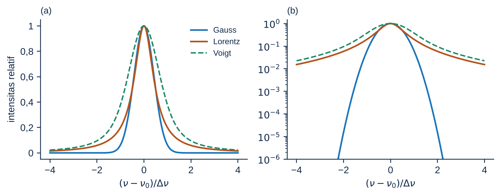

# Bab 15 Spektroskopi Molekul

Di rasi Taurus, sekitar 450 tahun cahaya dari Bumi, terdapat awan gelap yang tidak memancarkan cahaya tampak sama sekali. Teleskop radio yang diarahkan ke sana menangkap sinyal sangat lemah pada frekuensi 115,271 GHz, panjang gelombang 2,6 mm. Dari satu garis spektrum ini saja, astronom menyimpulkan bahwa awan itu mengandung molekul karbon monoksida, bersuhu sekitar 10 K, bergerak menjauhi kita beberapa kilometer per detik, diaduk oleh turbulensi, dan mengandung hidrogen molekul ribuan kali massa Matahari. Bagaimana satu garis membawa begitu banyak keterangan? Lebih aneh lagi: molekul CO yang berada di tingkat rotasi $J = 1$ rata-rata harus menunggu hampir setengah tahun sebelum memancarkan foton itu secara spontan, padahal atom natrium yang tereksitasi di lampu jalan memancarkan cahaya kuningnya dalam enam belas nanodetik. Mengapa perbedaannya sampai lima belas orde besaran?

Garis rotasi CO ini sudah kita temui di Bab 6. Bab ini membawa cerita itu lebih jauh: mengapa garis mempunyai lebar, bagaimana getaran dan transisi elektronik muncul dalam spektrum, dan mengapa intensitasnya mengikuti asas Franck–Condon.

**Spektroskopi** adalah cara kimia mendengarkan molekul. Setiap molekul mempunyai tangga tingkat energi elektronik, getaran, dan rotasi yang menjadi sidik jarinya, dan setiap anak tangga dapat dipindahi dengan menyerap atau memancarkan foton yang energinya tepat. Bab-bab sebelumnya telah memberi kita tangga-tangga itu: rotor tegar (Bab 6), osilator harmonik dan anharmonik (Bab 5), atom hidrogen (Bab 7), orbital molekul (Bab 11–13), dan spektrum kompleks logam (Bab 14). Bab ini menjawab pertanyaan yang tersisa: **seberapa kuat** suatu transisi, **seberapa lebar** garisnya, **mengapa** sebagian transisi terlarang, dan bagaimana semua itu dipakai untuk mengukur struktur, dinamika, dan konsentrasi.

Kita mulai dengan dasar yang sama untuk semua spektroskopi: koefisien Einstein, hukum Beer–Lambert, dan lebar garis. Lalu kita menaiki skala energi: rotasi lanjut, getaran inframerah dan Raman, transisi elektronik dengan asas Franck–Condon, pendaran, spektrum UV-tampak senyawa organik, laser, spektroskopi fotoelektron, dan akhirnya spektroskopi resolusi waktu yang memotret molekul ketika ikatannya sedang putus.

::: {.strategi}
**Pertanyaan pembuka**

1. Mengapa emisi spontan sangat lambat di daerah gelombang mikro tetapi sangat cepat di daerah ultraviolet?
2. Bagaimana koefisien ekstingsi molar yang diukur di laboratorium berhubungan dengan momen dipol transisi yang dihitung dari fungsi gelombang?
3. Mengapa garis spektrum gas mempunyai lebar, dan apa yang dapat dipelajari dari lebar itu?
4. Mengapa CO₂ menyerap inframerah walaupun tidak mempunyai momen dipol permanen, dan mengapa getaran yang terlihat di spektrum inframerahnya tidak terlihat di spektrum Ramannya?
5. Mengapa pita serapan elektronik molekul berupa deretan puncak getaran, dan puncak mana yang paling tinggi?
6. Mengapa stabilo berpendar tetapi kebanyakan zat warna tidak, dan mengapa jam bercahaya dalam gelap tetap menyala lama setelah lampu dimatikan?
7. Bagaimana spektroskopi fotoelektron menguji teori orbital molekul secara langsung?
:::

::: {.tujuan}
**Tujuan belajar**

Setelah mempelajari bab ini, kamu mampu:

1. Menurunkan hubungan antara koefisien Einstein dan menghitungnya dari momen dipol transisi.
2. Menurunkan hukum Beer–Lambert dan menghubungkan koefisien ekstingsi, penampang lintang, kekuatan osilator, dan momen dipol transisi.
3. Menghitung lebar garis alami, Doppler, dan tekanan, serta memakai profil Voigt.
4. Menganalisis spektrum rotasi rotor simetris, efek Stark, dan spektrum Raman rotasi.
5. Menentukan aktivitas IR dan Raman mode normal molekul poliatom serta menafsirkan nada atas, pita gabungan, dan resonansi Fermi.
6. Menjelaskan asal hamburan Raman, aturan larangan bersama, dan rasio depolarisasi.
7. Menghitung faktor Franck–Condon dan menafsirkan progresi getaran dalam spektrum elektronik.
8. Memakai diagram Jablonski untuk menghitung hasil kuantum, umur pendaran, pemadaman, dan transfer energi.
9. Menafsirkan spektrum UV-tampak senyawa organik dengan teori orbital dan aturan Woodward–Fieser.
10. Menjelaskan syarat kerja laser dan sifat-sifat cahayanya.
11. Menafsirkan spektrum fotoelektron dengan teorema Koopmans dan struktur getarannya.
12. Menjelaskan prinsip spektroskopi resolusi waktu dan menghitung gerak paket gelombang.
:::

::: {.mat}
**Prasyarat**

Dari Bab 1: radiasi benda hitam dan rumus Planck (subbab 1.3). Dari Bab 5: aturan seleksi inframerah, Raman, dan potensial Morse (subbab 5.8–5.9, 5.11). Dari Bab 6: rotor tegar, populasi rotasi, dan spektrum rotasi–getaran (subbab 6.9–6.12). Dari Bab 7: laju peluruhan atom hidrogen (subbab 7.11). Dari Bab 8: perturbasi bergantung waktu, momen dipol transisi, dan aturan emas Fermi (subbab 8.11–8.12). Dari Bab 10: aktivitas IR dan Raman dari teori grup (subbab 10.9–10.10). Dari Bab 11 dan 13: lambang suku molekul dan orbital molekul π (subbab 11.9, 13.5–13.7). Dari Bab 9: keadaan singlet dan triplet (subbab 9.4). Dari Bab 14: spektrum kompleks logam transisi.
:::

## 15.1 Koefisien Einstein

Dasar subbab ini adalah momen dipol transisi dan aturan emas Fermi dari subbab 8.11–8.12; di sini keduanya dihubungkan dengan besaran yang diukur di laboratorium.

### Tiga proses

Bayangkan sekumpulan molekul dengan dua tingkat energi, $E_1$ (bawah) dan $E_2$ (atas), dengan $E_2 - E_1 = h\nu$ dan degenerasi $g_1$ dan $g_2$. Molekul-molekul itu berada dalam medan radiasi dengan rapat energi spektral $\rho(\nu)$, yaitu energi per satuan volume per satuan selang frekuensi. Pada 1916, sepuluh tahun sebelum persamaan Schrödinger, Einstein menyadari bahwa agar molekul dan radiasi dapat mencapai kesetimbangan termal, harus ada **tiga** proses:

1. **Serapan.** Molekul di tingkat 1 menyerap foton dan naik ke tingkat 2. Laju per satuan volume sebanding dengan banyaknya molekul di bawah dan dengan rapat radiasi: $B_{12}\rho(\nu)N_1$.
2. **Emisi terangsang.** Foton yang lewat memicu molekul di tingkat 2 untuk turun dan memancarkan foton kedua yang identik dengan foton pemicu (frekuensi, arah, fase, dan polarisasi sama). Lajunya $B_{21}\rho(\nu)N_2$.
3. **Emisi spontan.** Molekul di tingkat 2 turun dengan sendirinya, tanpa pemicu, dan memancarkan foton ke arah acak. Lajunya $A_{21}N_2$.

$B_{12}$, $B_{21}$, dan $A_{21}$ disebut **koefisien Einstein**. Ketiganya sifat molekul, tidak bergantung pada suhu atau medan radiasi.

### Hubungan antarkoefisien

Dalam kesetimbangan termal pada suhu $T$, laju naik sama dengan laju turun:

$$
B_{12}\rho(\nu)N_1 = A_{21}N_2 + B_{21}\rho(\nu)N_2 . \qquad \text{(15.1)}
$$

Populasi mengikuti sebaran Boltzmann, $N_2/N_1 = (g_2/g_1)e^{-h\nu/kT}$. Selesaikan (15.1) untuk $\rho$:

$$
\rho(\nu) = \frac{A_{21}}{B_{12}(N_1/N_2) - B_{21}} = \frac{A_{21}/B_{21}}{\dfrac{g_1B_{12}}{g_2B_{21}}e^{h\nu/kT} - 1} . \qquad \text{(15.2)}
$$

Hasil ini harus sama dengan rumus Planck untuk radiasi benda hitam (subbab 1.3),

$$
\rho(\nu) = \frac{8\pi h\nu^3}{c^3}\,\frac{1}{e^{h\nu/kT} - 1} ,
$$

untuk **semua** suhu. Itu hanya mungkin bila

$$
g_1B_{12} = g_2B_{21}, \qquad \frac{A_{21}}{B_{21}} = \frac{8\pi h\nu^3}{c^3} . \qquad \text{(15.3)}
$$

Hubungan pertama menyatakan bahwa serapan dan emisi terangsang adalah proses yang sama dilihat dari dua arah. Hubungan kedua mengaitkan emisi spontan dengan emisi terangsang, dan faktor $\nu^3$-nya mempunyai akibat yang luas.

::: {.inti}
**Koefisien Einstein**

Untuk transisi $1 \leftrightarrow 2$ dengan momen dipol transisi $\boldsymbol\mu_{21}$ (rata-rata atas orientasi, dengan $\rho$ per satuan frekuensi):

$$
B_{21} = \frac{|\boldsymbol\mu_{21}|^2}{6\varepsilon_0\hbar^2}, \qquad A_{21} = \frac{8\pi h\nu^3}{c^3}B_{21} = \frac{\omega^3|\boldsymbol\mu_{21}|^2}{3\pi\varepsilon_0\hbar c^3}, \qquad g_1B_{12} = g_2B_{21} .
$$

Umur tingkat atas terhadap emisi spontan adalah $\tau = 1/\sum A$, dengan jumlah atas semua tingkat yang lebih rendah.
:::

### Dari aturan emas ke koefisien $B$

Einstein memperoleh hubungan (15.3) tanpa mengetahui nilai mutlak koefisien-koefisiennya. Mekanika kuantum memberikan $B$ melalui perturbasi bergantung waktu (subbab 8.11–8.12). Untuk medan listrik sinusoidal yang berinteraksi dengan momen dipol, $\hat H' = -\hat{\boldsymbol\mu} \cdot \boldsymbol{\mathcal E}(t)$, laju transisi menurut aturan emas Fermi sebanding dengan $|\boldsymbol\mu_{21} \cdot \hat{\mathbf e}|^2$ dan dengan rapat energi radiasi pada frekuensi resonansi. Untuk radiasi isotropik dan tak terpolarisasi, rata-rata $|\boldsymbol\mu_{21} \cdot \hat{\mathbf e}|^2$ atas semua arah adalah $\tfrac13|\boldsymbol\mu_{21}|^2$, dan hasilnya adalah rumus $B_{21}$ di kotak di atas.

::: {.dalam}
**Faktor $\tfrac13$ dan asal rumus $B$**

Dalam subbab 8.12 laju transisi untuk medan $\mathcal E_0\cos\omega t$ yang terpolarisasi sepanjang $\hat{\mathbf e}$ dan berspektrum lebar dengan rapat energi $\rho(\omega)$ per satuan frekuensi sudut adalah

$$
W = \frac{\pi}{\varepsilon_0\hbar^2}|\boldsymbol\mu_{21} \cdot \hat{\mathbf e}|^2\rho(\omega) .
$$

Dengan $\boldsymbol\mu_{21}$ yang membentuk sudut $\theta$ terhadap $\hat{\mathbf e}$, rata-rata $\cos^2\theta$ atas bola adalah $\tfrac13$. Jadi $W = \pi|\boldsymbol\mu_{21}|^2\rho(\omega)/3\varepsilon_0\hbar^2$. Karena $\rho(\omega)\,d\omega = \rho(\nu)\,d\nu$ dan $d\omega = 2\pi\,d\nu$, $\rho(\omega) = \rho(\nu)/2\pi$, sehingga $W = |\boldsymbol\mu_{21}|^2\rho(\nu)/6\varepsilon_0\hbar^2 \equiv B_{21}\rho(\nu)$. Mengalikannya dengan $8\pi h\nu^3/c^3$ memberikan $A_{21}$. Rumus $A$ yang dipakai di subbab 7.11 untuk atom hidrogen adalah rumus yang sama.

Emisi spontan tidak dapat diturunkan dengan memperlakukan medan elektromagnetik secara klasik: tanpa medan, perturbasi klasik nol dan tidak ada transisi. Elektrodinamika kuantum menjelaskannya sebagai emisi terangsang oleh fluktuasi titik nol medan elektromagnetik, "osilator harmonik" medan yang, seperti osilator Bab 5, tidak pernah diam. Hubungan Einstein memberikan jawaban yang tepat tanpa teori itu.
:::

::: {.contoh}
**Contoh 15.1 · Mengapa CO di ruang antarbintang menunggu setengah tahun**

Molekul CO mempunyai momen dipol $\mu_0 = 0{,}110$ D dan transisi rotasi $J = 1 \to 0$ pada 115,271 GHz. Untuk transisi rotasi $J + 1 \to J$ molekul linear, $|\boldsymbol\mu_{21}|^2 = \mu_0^2(J + 1)/(2J + 3)$. Hitung $A_{10}$ dan umur tingkat $J = 1$.

**Penyelesaian.** Untuk $J = 0$, $|\boldsymbol\mu_{21}|^2 = \mu_0^2/3$. Dengan $\mu_0 = 0{,}110 \times 3{,}336 \times 10^{-30}$ C m $= 3{,}67 \times 10^{-31}$ C m dan $\omega = 2\pi \times 1{,}1527 \times 10^{11}$ s⁻¹:

$$
A_{10} = \frac{\omega^3\mu_0^2/3}{3\pi\varepsilon_0\hbar c^3} = 7{,}2 \times 10^{-8}\ \text{s}^{-1} ,
$$

sehingga $\tau = 1/A_{10} = 1{,}4 \times 10^7$ s, sekitar 0,44 tahun.

**Memahami hasil.** Bandingkan dengan atom natrium (umur 16 ns): frekuensi CO sekitar 4400 kali lebih kecil, sehingga $\nu^3$ memberi faktor $8{,}6 \times 10^{10}$, dan momen dipol transisinya sekitar seratus kali lebih kecil. Di awan antarbintang dengan kerapatan H₂ sekitar $10^3$ molekul per cm³, tumbukan terjadi kira-kira sekali dalam beberapa bulan, sebanding dengan umur radiatif. Inilah sebabnya CO menjadi "termometer" awan gelap: tumbukan menjaga populasi rotasinya mengikuti suhu gas, dan pancaran spontannya yang lambat tetap cukup banyak karena jumlah molekulnya sangat besar.
:::

::: {.contoh}
**Contoh 15.2 · Momen dipol transisi getaran CO**

Koefisien emisi spontan pita dasar CO ($v = 1 \to 0$, 2143,3 cm⁻¹) sekitar 33 s⁻¹. Hitung $|\boldsymbol\mu_{10}|$ dalam debye.

**Penyelesaian.** Dari rumus $A$, $|\boldsymbol\mu_{10}|^2 = 3\pi\varepsilon_0\hbar c^3A/\omega^3$. Dengan $\omega = 2\pi c\tilde\nu = 2\pi(2{,}998 \times 10^{10}\ \text{cm/s})(2143{,}3\ \text{cm}^{-1}) = 4{,}04 \times 10^{14}$ s⁻¹ diperoleh $|\boldsymbol\mu_{10}| = 3{,}4 \times 10^{-31}$ C m $= 0{,}10$ D.

**Memahami hasil.** Menurut subbab 5.8, $\boldsymbol\mu_{10} = (d\mu/dx)_0\sqrt{\hbar/2\mu_\text{red}\omega}$: yang menentukan intensitas inframerah adalah **turunan** momen dipol terhadap panjang ikatan, bukan momen dipol itu sendiri. Bahwa $|\boldsymbol\mu_{10}| \approx \mu_0$ untuk CO hanyalah kebetulan. Molekul HCl, misalnya, mempunyai $\mu_0 = 1{,}1$ D tetapi momen transisi getaran yang hanya beberapa persen dari itu. Umur getaran $\tau = 30$ ms jauh lebih panjang daripada selang antartumbukan dalam gas pada tekanan atmosfer (sekitar 0,1 ns), sehingga dalam atmosfer molekul yang tereksitasi getaran hampir selalu melepaskan energinya melalui tumbukan, bukan cahaya.
:::

### Faktor $\nu^3$: kapan emisi spontan penting

Perbandingan laju emisi terangsang dan spontan dalam medan radiasi termal pada suhu $T$ adalah

$$
\frac{B_{21}\rho(\nu)}{A_{21}} = \frac{1}{e^{h\nu/kT} - 1} , \qquad \text{(15.4)}
$$

yang tidak lain adalah banyaknya foton rata-rata per mode medan radiasi. Untuk $h\nu \gg kT$ emisi spontan menang mutlak; untuk $h\nu \ll kT$ emisi terangsang menang.

::: {.contoh}
**Contoh 15.3 · Terangsang atau spontan?**

Hitung perbandingan (15.4) untuk transisi gelombang mikro 115 GHz, inframerah 2143 cm⁻¹, tampak 500 nm, dan ultraviolet 200 nm, masing-masing pada 300 K dan 6000 K (suhu permukaan Matahari).

**Penyelesaian.** Dengan $h\nu/kT$ yang dihitung untuk setiap kasus:

| Transisi | 300 K | 6000 K |
|---|---|---|
| 115 GHz | 54 | 1090 |
| 2143 cm⁻¹ | $3{,}4 \times 10^{-5}$ | 1,5 |
| 500 nm | $2 \times 10^{-42}$ | 0,0083 |
| 200 nm | $7 \times 10^{-105}$ | $6 \times 10^{-6}$ |

**Memahami hasil.** Pada gelombang mikro, emisi terangsang oleh radiasi termal di sekitar molekul jauh lebih penting daripada emisi spontan; itulah sebabnya maser alami (pancaran OH dan H₂O yang diperkuat) ditemukan di ruang angkasa dan maser amonia pertama dibuat pada 1954, beberapa tahun sebelum laser. Pada cahaya tampak dan ultraviolet, emisi spontan menang telak, sehingga untuk membuat laser diperlukan inversi populasi yang besar dan cermin pemantul (subbab 15.10). Faktor $\nu^3$ juga menjelaskan mengapa laser sinar-X sangat sulit dibuat.
:::

::: {.contoh}
**Contoh 15.4 · Sistem dua tingkat tidak dapat dibalik populasinya**

Sinari sistem dua tingkat ($g_1 = g_2$) dengan cahaya yang sangat terang sehingga $B\rho \gg A$. Tunjukkan bahwa $N_2/N_1$ mendekati 1 tetapi tidak pernah melampauinya.

**Penyelesaian.** Dalam keadaan tunak, $B\rho N_1 = (A + B\rho)N_2$, sehingga

$$
\frac{N_2}{N_1} = \frac{B\rho}{A + B\rho} < 1 ,
$$

yang mendekati 1 bila $B\rho \to \infty$.

**Memahami hasil.** Cahaya kuat hanya menyamakan populasi kedua tingkat (keadaan **jenuh**): setiap foton yang menaikkan satu molekul diimbangi foton yang menurunkan molekul lain melalui emisi terangsang. Inversi populasi, syarat penguatan cahaya, mustahil dicapai dengan memompa langsung sistem dua tingkat. Laser memerlukan tiga atau empat tingkat, dengan tingkat penyimpan yang diisi secara tidak langsung (subbab 15.10).
:::

::: {.contoh}
**Contoh 15.5 · Memeriksa umur 2p hidrogen**

Untuk atom hidrogen, $|\langle 1s|z|2p_0\rangle| = 0{,}745\,a_0$ dan transisi Lyman-α berenergi $\tfrac34 \times 13{,}606$ eV. Hitung $A$ dan umur 2p, lalu bandingkan dengan subbab 7.11.

**Penyelesaian.** Dari keadaan $2p_0$, satu-satunya tujuan adalah 1s, dengan $|\boldsymbol\mu_{21}|^2 = e^2(0{,}745a_0)^2$ (hanya komponen $z$ yang tidak nol). Dengan $\omega = 10{,}20\ \text{eV}/\hbar = 1{,}55 \times 10^{16}$ s⁻¹, rumus $A$ memberi $A = 6{,}27 \times 10^8$ s⁻¹ dan $\tau = 1{,}60$ ns.

**Memahami hasil.** Hasilnya sama dengan subbab 7.11, seperti seharusnya. Keadaan $2p_{\pm1}$ mempunyai umur yang sama karena komponen $x \pm iy$ memberikan $|\boldsymbol\mu|^2$ yang sama. Umur nanodetik adalah khas transisi elektronik yang diizinkan penuh di daerah ultraviolet dan tampak; transisi terlarang mempunyai umur milidetik sampai detik.
:::

::: {.kuis}
**Kuis cepat 15.1**

Jika momen dipol transisi tetap tetapi frekuensi transisi diduakalikan, berapa kali $A$ dan $B$ berubah? Mengapa?
:::

## 15.2 Hukum Beer–Lambert dan kekuatan osilator

### Penurunan hukum Beer–Lambert

Seberkas cahaya monokromatik berintensitas $I$ melewati lapisan tipis setebal $dx$ yang mengandung $n$ molekul penyerap per satuan volume. Setiap molekul menampilkan "luas sasaran" efektif $\sigma(\nu)$, yang disebut **penampang lintang serapan**. Fraksi cahaya yang diserap dalam lapisan itu sama dengan fraksi luas yang tertutup sasaran:

$$
\frac{dI}{I} = -\sigma n\,dx \quad\Longrightarrow\quad I = I_0e^{-\sigma nl} . \qquad \text{(15.5)}
$$

Kimiawan memakai logaritma basis sepuluh dan konsentrasi molar $c$ (mol/L). Dengan **absorbans** $A = \log_{10}(I_0/I)$:

$$
A = \varepsilon cl, \qquad \varepsilon = \frac{\sigma N_A}{1000\ln10} , \qquad \sigma\ (\text{cm}^2) = 3{,}82 \times 10^{-21}\,\varepsilon\ (\text{L mol}^{-1}\,\text{cm}^{-1}) . \qquad \text{(15.6)}
$$

Inilah **hukum Beer–Lambert**. Penurunannya menunjukkan kapan hukum ini berlaku: molekul menyerap secara bebas satu sama lain (tidak ada asosiasi, dimerisasi, atau interaksi antarmolekul yang berubah dengan konsentrasi), cahaya cukup monokromatik dibanding lebar pita, dan intensitasnya cukup lemah agar populasi tingkat bawah tidak berkurang (tidak jenuh, Contoh 15.4).

Emisi terangsang sebenarnya juga terjadi dalam sampel, dan yang diukur adalah serapan bersih $\sigma(N_1 - (g_1/g_2)N_2)$. Untuk transisi elektronik pada suhu kamar $N_2$ dapat diabaikan, tetapi untuk gelombang mikro tidak (Contoh 15.3), dan inilah sebabnya serapan gelombang mikro lemah: koreksi emisi terangsang mengurangi serapan dengan faktor $1 - e^{-h\nu/kT} \approx h\nu/kT$, sekitar 2% untuk CO pada suhu kamar.

### Kekuatan osilator

Koefisien ekstingsi bergantung pada frekuensi dan pada lebar pita; ukuran yang tidak bergantung pada lebar adalah **intensitas terintegrasi** $\int\varepsilon(\tilde\nu)\,d\tilde\nu$ atas seluruh pita. Dengan menghubungkan laju serapan $B_{12}\rho$ dengan berkurangnya energi berkas, diperoleh $\int\sigma(\nu)\,d\nu = h\nu B_{12}/c$. Untuk menghilangkan satuan, intensitas ini dibandingkan dengan intensitas sebuah elektron yang diikat pegas secara klasik, yang menghasilkan besaran tak berdimensi yang disebut **kekuatan osilator**:

$$
f = \frac{4\varepsilon_0m_ec^2\ln10}{N_Ae^2}\int\varepsilon\,d\tilde\nu = 4{,}32 \times 10^{-9}\int\varepsilon\,d\tilde\nu , \qquad \text{(15.7)}
$$

dengan $\varepsilon$ dalam L mol⁻¹ cm⁻¹ dan $\tilde\nu$ dalam cm⁻¹. Dalam bahasa mekanika kuantum,

$$
f = \frac{8\pi^2m_ec\tilde\nu}{3he^2}|\boldsymbol\mu_{12}|^2 = \frac23\Delta E\,|\langle 2|\mathbf r|1\rangle|^2\ \ (\text{satuan atom}) . \qquad \text{(15.8)}
$$

Satu elektron yang terikat pegas secara klasik memberi $f = 1$. Transisi yang diizinkan penuh mempunyai $f$ sekitar 0,1–1; transisi terlarang beberapa orde lebih kecil. **Aturan jumlah Thomas–Reiche–Kuhn** menyatakan bahwa jumlah kekuatan osilator semua transisi dari satu keadaan sama dengan banyaknya elektron: kekuatan osilator adalah "anggaran" serapan yang dibagi di antara semua transisi.

Untuk pita berbentuk Gauss dengan puncak $\varepsilon_\text{maks}$ dan lebar setengah (lebar penuh pada setengah tinggi) $\Delta\tilde\nu_{1/2}$, integralnya $\int\varepsilon\,d\tilde\nu = 1{,}0645\,\varepsilon_\text{maks}\Delta\tilde\nu_{1/2}$.

::: {.contoh}
**Contoh 15.6 · Kekuatan osilator dari spektrum**

Hitung $f$ dan $|\boldsymbol\mu_{12}|$ (dalam debye) untuk pita-pita berikut, dengan menganggap bentuk Gauss:

| Pita | $\tilde\nu$ (cm⁻¹) | $\varepsilon_\text{maks}$ | $\Delta\tilde\nu_{1/2}$ (cm⁻¹) |
|---|---|---|---|
| β-karotena, π→π* | 22 200 | 139 000 | 4500 |
| [Ru(bpy)₃]²⁺, MLCT | 22 100 | 14 600 | 5000 |
| MnO₄⁻, LMCT | 18 900 | 2400 | 3500 |
| Benzena, 254 nm | 39 200 | 204 | 2000 |
| Aseton, n→π* | 36 000 | 15 | 4000 |

**Penyelesaian.** Dengan (15.7), lalu $|\boldsymbol\mu_{12}| = \sqrt{3he^2f/(8\pi^2m_ec\tilde\nu)}$:

| Pita | $f$ | $|\boldsymbol\mu_{12}|$ (D) |
|---|---|---|
| β-karotena | 2,9 | 16,6 |
| [Ru(bpy)₃]²⁺ | 0,34 | 5,7 |
| MnO₄⁻ | 0,039 | 2,1 |
| Benzena 254 nm | $1{,}9 \times 10^{-3}$ | 0,32 |
| Aseton n→π* | $2{,}8 \times 10^{-4}$ | 0,13 |

**Memahami hasil.** Rentang kekuatan osilatornya empat orde besaran. β-karotena, dengan sebelas ikatan rangkap terkonjugasi, mempunyai momen transisi 16,6 D, setara dengan memindahkan satu elektron sejauh 3,5 Å: itulah "antena" yang dipakai tumbuhan untuk menangkap cahaya biru. Pita benzena 254 nm dan aseton n→π* lemah karena terlarang simetri; keduanya teramati hanya karena getaran merusak kesetangkupan (subbab 15.9). Bilangan-bilangan ini adalah jembatan antara spektrofotometer dan fungsi gelombang: $|\boldsymbol\mu_{12}|$ dapat dihitung oleh program kimia kuantum (Bab 17) dan dibandingkan langsung dengan $\int\varepsilon\,d\tilde\nu$.
:::

::: {.contoh}
**Contoh 15.7 · Seberapa besar "sasaran" molekul?**

Hitung penampang lintang serapan β-karotena pada puncaknya dan bandingkan dengan luas geometris molekul (panjang sekitar 3 nm, lebar sekitar 0,5 nm). Berapa tebal lapisan larutan $10^{-5}$ M yang meneruskan hanya 10% cahaya 450 nm?

**Penyelesaian.** $\sigma = 3{,}82 \times 10^{-21} \times 139\,000 = 5{,}3 \times 10^{-16}$ cm². Luas geometris $3 \times 0{,}5$ nm² $= 1{,}5 \times 10^{-14}$ cm², sekitar 30 kali lebih besar. Untuk $T = 0{,}10$, $A = 1$, sehingga $l = 1/(139\,000 \times 10^{-5}) = 0{,}72$ cm.

**Memahami hasil.** Bahkan molekul penyerap terkuat hanya "menutup" beberapa persen luas geometrisnya, karena foton yang datang dengan orientasi atau frekuensi yang kurang pas tidak diserap. Larutan seencer 10 µM sudah tampak jingga pekat dalam kuvet 1 cm. Sebaliknya, untuk pita aseton n→π* ($\varepsilon = 15$) diperlukan konsentrasi hampir 10 000 kali lebih besar untuk absorbans yang sama.
:::

### Campuran dan titik isosbestik

Absorbans bersifat aditif: dalam campuran beberapa zat yang tidak saling bereaksi,

$$
A(\lambda) = l\sum_i\varepsilon_i(\lambda)c_i . \qquad \text{(15.9)}
$$

Mengukur absorbans pada sebanyak-banyaknya panjang gelombang dan menyelesaikan sistem persamaan linear ini (secara kuadrat terkecil bila persamaan lebih banyak daripada zat) adalah dasar analisis multikomponen. Bila dua zat saling berubah, misalnya bentuk asam dan basa suatu indikator, dan jumlah konsentrasinya tetap, semua spektrum melewati titik-titik dengan absorbans sama, yaitu panjang gelombang tempat $\varepsilon_\text{asam} = \varepsilon_\text{basa}$. **Titik isosbestik** seperti itu adalah bukti bahwa hanya dua spesies yang terlibat.

::: {.contoh}
**Contoh 15.8 · Analisis dua komponen**

Campuran dua zat warna X dan Y diukur dalam kuvet 1,00 cm. Koefisien ekstingsinya: X 15 000 pada $\lambda_1$ dan 2000 pada $\lambda_2$; Y 3000 pada $\lambda_1$ dan 12 000 pada $\lambda_2$ (L mol⁻¹ cm⁻¹). Absorbans terukur 0,684 pada $\lambda_1$ dan 0,552 pada $\lambda_2$. Tentukan konsentrasi keduanya.

**Penyelesaian.**

```python
import numpy as np
E = np.array([[15000, 3000],     # baris: panjang gelombang, kolom: zat X, Y
              [ 2000, 12000]])
A = np.array([0.684, 0.552])
print(np.linalg.solve(E, A))     # lebih banyak panjang gelombang: lstsq
```

Hasilnya $c_X = 3{,}77 \times 10^{-5}$ M dan $c_Y = 3{,}97 \times 10^{-5}$ M.

**Memahami hasil.** Pemilihan $\lambda_1$ dan $\lambda_2$ di dekat puncak masing-masing zat membuat matriks koefisien "jauh dari singular", sehingga galat absorbans kecil tidak membesar ketika persamaan diselesaikan. Spektrofotometer modern mengukur ratusan panjang gelombang sekaligus, dan analisis kuadrat terkecil atas seluruh spektrum jauh lebih tahan galat daripada dua panjang gelombang saja.
:::

::: {.contoh}
**Contoh 15.9 · Aturan jumlah untuk atom hidrogen**

Untuk hidrogen 1s, kekuatan osilator Lyman-α adalah 0,416, dan jumlah semua garis deret Lyman (1s → np, $n = 2$ sampai ∞) adalah 0,564. Berapa kekuatan osilator yang tersisa untuk serapan ke kontinuum (ionisasi)? Periksa nilai 0,416 dengan (15.8).

**Penyelesaian.** Aturan Thomas–Reiche–Kuhn untuk satu elektron: $\sum f = 1$. Sisa untuk kontinuum $1 - 0{,}564 = 0{,}436$. Dengan $\Delta E = 0{,}375$ hartree dan $\sum_m|\langle 2p_m|\mathbf r|1s\rangle|^2 = 3(0{,}745)^2 = 1{,}665$ bohr²: $f = \tfrac23(0{,}375)(1{,}665) = 0{,}416$.

**Memahami hasil.** Hampir separuh "anggaran" serapan atom hidrogen dibelanjakan untuk fotoionisasi, yang menghasilkan serapan kontinu di bawah 91,2 nm. Aturan jumlah sangat berguna untuk memeriksa perhitungan: bila program kimia kuantum menghasilkan kekuatan osilator total yang jauh dari banyaknya elektron, basis atau metodenya tidak memadai.
:::

::: {.kuis}
**Kuis cepat 15.2**

Mengapa absorbans larutan zat yang membentuk dimer (misalnya metilena biru dalam air) tidak sebanding dengan konsentrasi totalnya? Apa yang terjadi pada titik isosbestik bila ada tiga spesies?
:::

## 15.3 Lebar garis

### Mengapa garis mempunyai lebar

Seandainya tingkat-tingkat energi tajam sempurna dan molekul diam, setiap transisi akan menyerap tepat pada satu frekuensi. Kenyataannya setiap garis mempunyai lebar. Ada dua jenis pelebaran yang berbeda sifat:

- **Pelebaran homogen**: setiap molekul mempunyai profil yang sama lebarnya. Penyebabnya umur tingkat yang terbatas, baik karena emisi spontan maupun tumbukan. Profilnya Lorentz.
- **Pelebaran tak homogen**: setiap molekul mempunyai garis tajam, tetapi frekuensi pusatnya berbeda dari molekul ke molekul. Penyebabnya efek Doppler dalam gas, atau lingkungan yang berbeda-beda dalam larutan dan padatan. Profilnya biasanya Gauss.

### Pelebaran alami: Lorentz

Keadaan tereksitasi yang meluruh dengan umur $\tau$ mempunyai amplitudo yang bergantung waktu sebagai $e^{-i\omega_0t}e^{-t/2\tau}$ (populasi, kuadrat amplitudo, meluruh sebagai $e^{-t/\tau}$). Sinyal yang tidak berlangsung selamanya tidak mempunyai frekuensi tunggal. Transformasi Fourier amplitudo itu memberikan spektrum

$$
I(\nu) \propto \frac{1}{(\nu - \nu_0)^2 + (\Gamma/2)^2}, \qquad \Gamma = \frac{1}{2\pi\tau} , \qquad \text{(15.10)}
$$

yaitu **profil Lorentz** dengan lebar penuh pada setengah tinggi $\Gamma$ (dalam Hz). Dalam bilangan gelombang, $\Delta\tilde\nu = 1/2\pi c\tau = 5{,}31\ \text{cm}^{-1}/\tau(\text{ps})$. Hubungan $\Gamma\tau = 1/2\pi$ adalah bentuk tepat hubungan ketidakpastian energi–waktu $\Delta E\,\tau \approx \hbar$ (subbab 1.9). Lebar yang ditentukan oleh emisi spontan saja disebut **lebar alami**; ia batas bawah yang tidak dapat dikurangi.

Jika kedua tingkat transisi mempunyai umur terbatas, lebarnya dijumlahkan: $\Gamma = (1/\tau_1 + 1/\tau_2)/2\pi$. Peluruhan apa pun memperpendek umur. Bila keadaan tereksitasi molekul dapat terurai tanpa radiasi menjadi fragmen (**pradisosiasi**), umurnya dapat hanya beberapa pikodetik, dan garis rotasi pita elektroniknya melebar menjadi pita kabur.

### Pelebaran tumbukan

Dalam gas, tumbukan mengganggu fase osilasi dipol molekul. Bila selang rata-rata antartumbukan $\tau_\text{tb}$, profilnya juga Lorentz dengan lebar $\Gamma = 1/\pi\tau_\text{tb}$. Karena $\tau_\text{tb}$ berbanding terbalik dengan tekanan, lebar ini sebanding dengan tekanan; untuk garis rotasi–getaran molekul kecil dalam udara, setengah lebarnya sekitar 0,05–0,1 cm⁻¹ per atmosfer. Dalam cairan, molekul pelarut terus-menerus menumbuk, dan garis rotasi lenyap sama sekali: spektrum IR dan UV-tampak cairan hanya memperlihatkan pita.

### Pelebaran Doppler: Gauss

Molekul yang bergerak dengan komponen kecepatan $v_x$ menuju pengamat menyerap pada frekuensi $\nu_0(1 + v_x/c)$. Dalam gas, $v_x$ tersebar menurut distribusi Maxwell $\propto \exp(-mv_x^2/2kT)$, sehingga profil garisnya

$$
I(\nu) \propto \exp\left[-\frac{mc^2(\nu - \nu_0)^2}{2kT\nu_0^2}\right], \qquad \Delta\nu_D = \frac{\nu_0}{c}\sqrt{\frac{8kT\ln2}{m}} . \qquad \text{(15.11)}
$$

Lebar Doppler sebanding dengan $\nu_0$ dan dengan $\sqrt{T/m}$. Ia penting untuk garis elektronik dan getaran gas, dan relatif kecil untuk gelombang mikro.

### Profil Voigt dan perbandingan

Bila kedua mekanisme bekerja bersamaan, profilnya adalah konvolusi Gauss dan Lorentz, yang disebut **profil Voigt**. Lebar penuhnya dapat ditaksir dengan rumus empiris yang teliti sampai 0,02%:

$$
\Delta\nu_V \approx 0{,}5346\,\Delta\nu_L + \sqrt{0{,}2166\,\Delta\nu_L^2 + \Delta\nu_G^2} . \qquad \text{(15.12)}
$$

Perbedaan terpenting kedua profil ada di "sayap": profil Gauss jatuh sangat cepat, sedangkan profil Lorentz jatuh hanya sebanding dengan $1/(\nu - \nu_0)^2$ (Gambar 15.1). Pada jarak tiga kali lebar dari pusat, profil Lorentz masih 2,7% dari puncaknya, sedangkan profil Gauss tinggal $10^{-11}$. Sayap Lorentz garis-garis H₂O dan CO₂ yang dilebarkan tekanan inilah yang mengisi "jendela" spektrum atmosfer dan ikut menentukan efek rumah kaca.

{width=92%}

::: {.contoh}
**Contoh 15.10 · Garis D natrium**

Keadaan 3p natrium berumur 16,2 ns. (a) Hitung lebar alami garis D (589 nm). (b) Hitung lebar Doppler dalam uap natrium pada 500 K. (c) Mana yang menentukan bentuk garis?

**Penyelesaian.** (a) $\Gamma = 1/(2\pi \times 16{,}2 \times 10^{-9}) = 9{,}8$ MHz. (b) Dengan $\nu_0 = c/589\ \text{nm} = 5{,}09 \times 10^{14}$ Hz dan $m = 22{,}99$ u, (15.11) memberi $\Delta\nu_D = 1{,}70$ GHz. (c) Lebar Doppler 170 kali lebih besar: garisnya hampir Gauss di bagian tengah, dengan sayap Lorentz jauh di luar.

**Memahami hasil.** Lebar alami adalah sifat atom; lebar Doppler sifat gas. Untuk melihat lebar alami, spektroskopis harus menyingkirkan efek Doppler, misalnya dengan berkas atom yang bergerak tegak lurus berkas laser, dengan spektroskopi penjenuhan (hanya atom dengan $v_x \approx 0$ yang berinteraksi dengan dua berkas laser yang berlawanan arah), atau dengan mendinginkan atom sampai mikrokelvin. Pendinginan laser natrium (Hadiah Nobel Fisika 1997) memakai tepat garis ini.
:::

::: {.contoh}
**Contoh 15.11 · Garis inframerah dalam atmosfer**

Untuk garis rotasi–getaran HCl di sekitar 2886 cm⁻¹ pada 300 K: (a) hitung lebar Doppler dalam cm⁻¹; (b) bila setengah lebar tekanan 0,07 cm⁻¹ per atm, hitung lebar penuh tekanan pada 1 atm dan selang antartumbukan; (c) taksir lebar Voigt pada 0,01 atm (sekitar ketinggian 30 km).

**Penyelesaian.** (a) $\Delta\nu_D = 178$ MHz $= 0{,}0059$ cm⁻¹. (b) Lebar penuh tekanan $0{,}14$ cm⁻¹ (4,2 GHz); $\tau_\text{tb} = 1/\pi\Gamma = 1/(2\pi c \times 0{,}07\ \text{cm}^{-1}) = 76$ ps. (c) Pada 0,01 atm, $\Delta\nu_L = 0{,}0014$ cm⁻¹; dengan (15.12), $\Delta\nu_V = 0{,}0014 \times 0{,}5346 + \sqrt{0{,}2166(0{,}0014)^2 + 0{,}0059^2} = 0{,}0067$ cm⁻¹.

**Memahami hasil.** Di permukaan Bumi, garis-garis inframerah dilebarkan tumbukan dan 24 kali lebih lebar daripada lebar Doppler. Di stratosfer, lebar Doppler menang. Satelit yang mengukur profil suhu dan kadar gas atmosfer memanfaatkan perubahan bentuk garis ini: bagian tengah garis yang sempit berasal dari ketinggian besar, sayapnya yang lebar dari lapisan bawah yang lebih padat.
:::

::: {.contoh}
**Contoh 15.12 · Turbulensi di awan antarbintang**

Garis CO $J = 1 \to 0$ dari awan gelap pada 20 K mempunyai lebar teramati sekitar 1,5 km/s (dinyatakan sebagai kecepatan, $\Delta v = c\Delta\nu/\nu_0$). (a) Hitung lebar Doppler termal dalam kHz dan km/s. (b) Pusat garis bergeser 260 kHz ke frekuensi lebih rendah. Berapa kecepatan radial awan?

**Penyelesaian.** (a) $\Delta\nu_D = (115{,}271\ \text{GHz}/c)\sqrt{8k(20)\ln2/28\,\text{u}} = 70$ kHz, setara $0{,}18$ km/s. (b) Satu km/s setara dengan $115{,}271 \times 10^9/c = 385$ kHz, sehingga $v = 260/385 = 0{,}68$ km/s menjauhi kita.

**Memahami hasil.** Garis teramati delapan kali lebih lebar daripada gerak termal. Kelebihannya menunjukkan gerak makroskopik gas, yaitu turbulensi dan keruntuhan gravitasi, yang menentukan bagaimana bintang baru terbentuk. Dengan teleskop radio yang memetakan pergeseran Doppler di seluruh awan, astronom dapat melihat awan berputar atau runtuh. Semua ini adalah analisis bentuk garis yang diterapkan pada skala galaksi.
:::

::: {.contoh}
**Contoh 15.13 · Umur dari lebar garis**

Dalam pita elektronik suatu molekul diatom, garis-garis rotasi mulai kabur di atas tingkat getaran tertentu, dengan lebar sekitar 1,0 cm⁻¹, padahal di bawahnya garis tajam (lebar instrumen 0,05 cm⁻¹). Taksir umur tingkat yang kabur itu dan jelaskan.

**Penyelesaian.** $\tau = 1/(2\pi c\Delta\tilde\nu) = 5{,}31\ \text{ps}/1{,}0 = 5{,}3$ ps.

**Memahami hasil.** Umur 5 ps jauh lebih pendek daripada umur radiatif (nanodetik), sehingga yang memperpendeknya adalah pradisosiasi: di atas tingkat itu, keadaan elektronik terikat bersilangan dengan keadaan tolak-menolak dan molekul terurai dalam beberapa getaran. Titik mulainya kekaburan memberi batas atas energi disosiasi, dan pengukuran lebar garis memberi laju reaksi unimolekular tanpa jam sama sekali. Kebalikan dari kasus ini, garis sangat tajam, menandakan keadaan yang berumur panjang: misalnya, garis R rubi (subbab 14.11).
:::

::: {.contoh}
**Contoh 15.14 · Profil Voigt numerik**

Hitung lebar penuh profil Voigt bila lebar Gauss dan Lorentz sama-sama 1, secara numerik dengan `scipy.special.voigt_profile`, dan bandingkan dengan (15.12).

**Penyelesaian.**

```python
import numpy as np
from scipy.special import voigt_profile
fG, fL = 1.0, 1.0
sigma = fG / (2*np.sqrt(2*np.log(2)))     # simpangan baku Gauss
gamma = fL / 2                            # setengah lebar Lorentz
x = np.linspace(-10, 10, 200001)
y = voigt_profile(x, sigma, gamma)
i = np.where(y >= y.max()/2)[0]
print(x[i[-1]] - x[i[0]], 0.5346*fL + np.sqrt(0.2166*fL**2 + fG**2))
```

Keduanya memberi 1,637.

**Memahami hasil.** Lebar Voigt lebih kecil daripada jumlah kedua lebar (2) tetapi lebih besar daripada akar jumlah kuadratnya (1,414). Dalam analisis spektrum gas modern, setiap garis dicocokkan dengan profil Voigt, sehingga suhu (dari bagian Gauss) dan tekanan atau laju tumbukan (dari bagian Lorentz) dapat diperoleh sekaligus.
:::

::: {.kuis}
**Kuis cepat 15.3**

Mengapa lebar Doppler garis rotasi gelombang mikro jauh lebih kecil daripada garis elektronik molekul yang sama? Apakah pendinginan sampel mengurangi lebar alami?
:::
