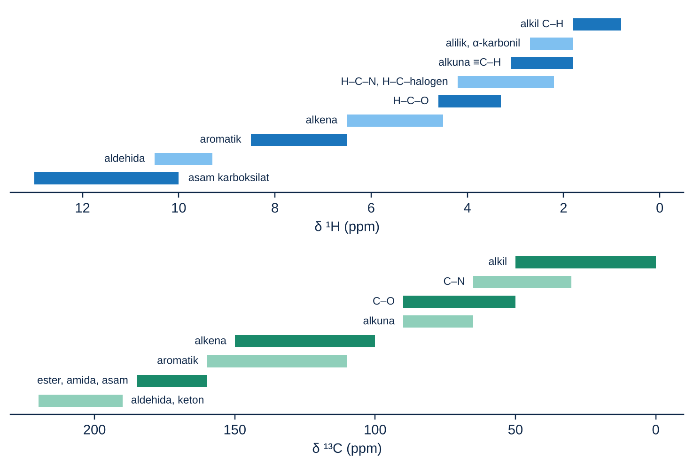

## 16.4 Perisai dan geseran kimia

### Elektron melindungi inti

Seandainya setiap proton dalam sampel merasakan medan $B_0$ yang sama persis, NMR hanya akan memberi satu garis untuk semua proton dan tidak berguna bagi kimia. Kenyataannya, medan yang dirasakan inti sedikit lebih kecil daripada medan luar. Medan $B_0$ memaksa awan elektron di sekitar inti bersirkulasi, dan sirkulasi muatan ini menghasilkan medan magnet imbas yang, di tempat inti, umumnya berlawanan arah dengan $B_0$. Karena medan imbas sebanding dengan $B_0$, kita menulis

$$
B_\text{lok} = (1 - \sigma)B_0, \qquad \nu = \frac{\gamma B_0}{2\pi}(1 - \sigma) , \qquad \text{(16.e17)}
$$

dengan $\sigma$ **tetapan perisai** (*shielding constant*), bilangan tak berdimensi yang kecil: untuk proton beberapa puluh per sejuta (ppm), untuk inti berat sampai beberapa ribu ppm. Nilai $\sigma$ bergantung pada rapat elektron di sekitar inti dan cara elektron itu dapat bersirkulasi, sehingga membawa informasi kimia.

### Perisai diamagnetik: rumus Lamb

Untuk atom yang bersimetri bola, perisai dapat dihitung dengan cara yang hampir klasik. Medan magnet membuat seluruh awan elektron berpresesi dengan frekuensi Larmor elektron $\omega_L = eB_0/2m_e$ (subbab 6.1 dan 7.12). Awan bermuatan negatif yang berputar adalah arus melingkar, dan arus ini menghasilkan medan di pusat yang berlawanan dengan $B_0$. Hasilnya, yang diturunkan Willis Lamb pada tahun 1941, adalah

$$
\sigma_d = \frac{\mu_0e^2}{12\pi m_e}\left\langle\sum_i\frac1{r_i}\right\rangle . \qquad \text{(16.e18)}
$$

Perisai diamagnetik sebanding dengan nilai harap $1/r$ elektron, yaitu dengan potensial listrik yang diciptakan elektron di inti. Elektron yang dekat inti melindungi lebih kuat. Rumus ini menjelaskan pola yang sangat penting: **substituen elektronegatif menarik rapat elektron menjauh dari proton, mengurangi perisai, dan menggeser resonansi ke frekuensi yang lebih tinggi**.

::: {.dalam}
**Menurunkan rumus Lamb (16.e18)**

Menurut teorema Larmor, pengaruh orde pertama medan $\mathbf B$ pada awan elektron adalah rotasi seluruh awan dengan kecepatan sudut $\boldsymbol\omega_L = e\mathbf B/2m_e$. Elektron dengan rapat $n(\mathbf r)$ yang berputar menghasilkan rapat arus $\mathbf j = -en\,(\boldsymbol\omega_L \times \mathbf r)$. Menurut hukum Biot–Savart, medan di titik asal (inti) adalah

$$
\mathbf B_\text{imb} = \frac{\mu_0}{4\pi}\int\frac{\mathbf j \times (-\mathbf r)}{r^3}\,d\tau .
$$

Dengan $\boldsymbol\omega_L = \omega_L\hat{\mathbf z}$ dan identitas $(\mathbf a \times \mathbf b) \times \mathbf c = \mathbf b(\mathbf a\cdot\mathbf c) - \mathbf a(\mathbf b\cdot\mathbf c)$, komponen-$z$ dari $(\boldsymbol\omega_L \times \mathbf r) \times \mathbf r$ adalah $\omega_Lz^2 - \omega_Lr^2 = -\omega_L(x^2 + y^2)$. Jadi

$$
B_{\text{imb},z} = -\frac{\mu_0e\omega_L}{4\pi}\int n(\mathbf r)\,\frac{x^2 + y^2}{r^3}\,d\tau .
$$

Untuk rapat bersimetri bola, rata-rata $x^2 + y^2$ atas arah adalah $\tfrac23r^2$, sehingga integralnya menjadi $\tfrac23\int n/r\,d\tau = \tfrac23\langle\sum_i1/r_i\rangle$. Dengan $\omega_L = eB_0/2m_e$: $B_{\text{imb},z} = -\dfrac{\mu_0e^2}{12\pi m_e}\langle\sum1/r_i\rangle B_0$, dan $\sigma_d = -B_{\text{imb},z}/B_0$ adalah (16.e18).
:::

### Perisai paramagnetik

Rumus Lamb tepat untuk atom bersimetri bola dalam keadaan $S$, tetapi dalam molekul sirkulasi elektron terhambat oleh inti-inti lain. Medan magnet kemudian juga **mencampurkan** sedikit keadaan tereksitasi ke dalam keadaan dasar (perturbasi orde kedua, subbab 8.7), melalui operator momentum sudut orbital $\hat L$. Campuran ini menghasilkan arus yang menguatkan medan di inti, sehingga memberi sumbangan perisai bertanda negatif, $\sigma_p$, yang dinamai **suku paramagnetik** (Norman Ramsey, 1950):

$$
\sigma = \sigma_d + \sigma_p, \qquad \sigma_p \propto -\left\langle\frac1{r^3}\right\rangle_{np}\frac{1}{\Delta E} . \qquad \text{(16.e19)}
$$

Suku paramagnetik besar bila ada elektron p atau d di dekat inti (faktor $\langle r^{-3}\rangle$) dan bila ada keadaan tereksitasi yang rendah dan dapat dicampurkan oleh $\hat L$ (faktor $1/\Delta E$). Orbital s tidak mempunyai momentum sudut, sehingga untuk proton, yang hanya memiliki elektron 1s di sekitarnya, suku ini kecil dan perisai didominasi suku diamagnetik. Rentang geseran proton karena itu hanya sekitar 12 ppm. Untuk ¹³C, ¹⁵N, ¹⁹F, dan inti berat, suku paramagnetik dominan, dan rentang geserannya jauh lebih lebar: sekitar 220 ppm untuk ¹³C, 800 ppm untuk ¹⁹F, dan lebih dari 10 000 ppm untuk ¹⁹⁵Pt. Karbon karbonil, dengan transisi n → π* yang rendah (Δ*E* kecil), adalah karbon yang paling tak terperisai, di sekitar 200 ppm.

### Geseran kimia dan skala δ

Perisai mutlak sulit diukur karena kita tidak dapat menyingkirkan elektron dari inti. Yang diukur adalah frekuensi relatif terhadap senyawa rujukan. Untuk ¹H, ¹³C, dan ²⁹Si, rujukan bakunya **tetrametilsilana** (TMS), Si(CH₃)₄. **Geseran kimia** didefinisikan

$$
\delta = \frac{\nu - \nu_\text{ref}}{\nu_\text{ref}} \times 10^6\ \text{ppm} \approx (\sigma_\text{ref} - \sigma) \times 10^6 . \qquad \text{(16.e20)}
$$

Pembagian dengan $\nu_\text{ref}$ membuat $\delta$ **tidak bergantung pada kuat medan**: proton kloroform berada pada $\delta = 7{,}26$ ppm di spektrometer mana pun. Dalam satuan Hz, selisih frekuensinya sebanding dengan medan: 1 ppm = 400 Hz pada spektrometer 400 MHz, tetapi 600 Hz pada 600 MHz.

TMS dipilih karena alasan yang semuanya kimiawi: dua belas protonnya setara sehingga memberi satu garis tajam yang kuat; silikon kurang elektronegatif daripada karbon, sehingga protonnya sangat terperisai dan garisnya berada di ujung kanan spektrum, jauh dari hampir semua sinyal lain; senyawanya lembam dan mudah diuapkan (titik didih 27 °C).

Proton yang **kurang terperisai** (*deshielded*) beresonansi pada frekuensi lebih tinggi dan mempunyai $\delta$ lebih besar; dalam spektrum yang digambar dengan $\delta$ naik ke kiri, sinyalnya di sebelah kiri. Istilah lama "medan rendah" (*downfield*) untuk sinyal di kiri dan "medan tinggi" (*upfield*) untuk sinyal di kanan berasal dari spektrometer gelombang malar yang menyapu medan pada frekuensi tetap: inti yang kurang terperisai memerlukan medan luar yang lebih rendah untuk beresonansi.

{width=96%}

### Faktor-faktor yang menentukan geseran proton

**Keelektronegatifan.** Makin elektronegatif atom yang terikat pada karbon pembawa proton, makin sedikit rapat elektron di sekitar proton dan makin besar $\delta$. Untuk deret CH₃X, $\delta$ naik dari CH₄ (0,23) melalui CH₃I (2,16), CH₃Br (2,68), CH₃Cl (3,05), CH₃OH (3,40) sampai CH₃F (4,26). Pengaruhnya berkurang cepat dengan jarak: proton pada karbon β hanya sedikit tergeser.

**Anisotropi magnet dan arus cincin.** Sirkulasi elektron tidak selalu bulat. Dalam benzena, medan yang tegak lurus cincin menggerakkan elektron π mengelilingi seluruh cincin (subbab 6.3). Arus cincin ini menghasilkan medan imbas yang, seperti medan sebuah magnet batang kecil yang berlawanan arah dengan $B_0$, melemahkan medan di atas dan di bawah pusat cincin tetapi **menguatkan** medan di tepi cincin, tempat proton aromatik berada. Akibatnya proton benzena ($\delta \approx 7{,}3$) beresonansi sekitar 1,7 ppm di sebelah kiri proton alkena biasa (sekitar 5,3–5,7 ppm). Pada [18]anulena, enam proton di dalam cincin beresonansi pada $\delta \approx -3$, sedangkan dua belas proton di luar pada $\delta \approx 9{,}3$. Pergeseran kimia karena itu dipakai sebagai kriteria percobaan aromatisitas: molekul aromatik bersifat **diatropik** (arus cincin diamagnetik), sedangkan molekul antiaromatik bersifat **paratropik** dan menggeser proton luar ke kanan. Ikatan rangkap tiga dan ikatan rangkap dua C=O juga anisotrop: proton asetilena terperisai ($\delta \approx 1{,}8$) karena terletak pada sumbu arus silinder ikatan π, sedangkan proton aldehida sangat tak terperisai ($\delta \approx 9{,}5$–10).

**Ikatan hidrogen dan pertukaran.** Proton OH dan NH yang terlibat dalam ikatan hidrogen kehilangan sebagian rapat elektronnya ke akseptor dan bergeser ke kiri. Geserannya bergantung pada konsentrasi, pelarut, dan suhu: OH alkohol di antara 1 dan 5 ppm, OH asam karboksilat 10–13 ppm. Proton yang dapat dipertukarkan juga hilang bila sampel dikocok dengan D₂O, cara sederhana untuk mengenali sinyal OH dan NH.

::: {.terapan}
**Menghitung geseran kimia dari kimia kuantum**

Geseran kimia adalah sifat orde kedua: energi yang bergantung pada medan luar $B_0$ dan momen magnet inti sekaligus. Program kimia komputasi (Bab 17) menghitung tensor perisai dengan metode GIAO (*gauge-including atomic orbitals*), yang mengatasi masalah ketidakbebasan hasil dari pilihan titik asal potensial vektor. Dengan teori fungsional kerapatan yang baik dan basis yang memadai, geseran ¹H dapat dihitung dengan galat sekitar 0,1–0,2 ppm dan geseran ¹³C sekitar 2–3 ppm. Perbandingan geseran terhitung dan terukur kini menjadi cara rutin untuk menentukan struktur bahan alam, misalnya memilih stereoisomer yang benar di antara beberapa calon.
:::

::: {.contoh}
**Contoh 16.c14 · Perisai atom hidrogen dan helium**

Hitung $\sigma_d$ untuk atom hidrogen ($\langle 1/r\rangle = 1/a_0$) dan untuk helium dengan fungsi gelombang muatan efektif $\zeta = 1{,}6875$ (subbab 8.3), yang memberi $\langle 1/r\rangle = \zeta/a_0$ untuk setiap elektron.

**Penyelesaian.** Untuk H:

$$
\sigma_d = \frac{\mu_0e^2}{12\pi m_ea_0} = \frac{(1{,}2566 \times 10^{-6})(1{,}6022 \times 10^{-19})^2}{12\pi(9{,}1094 \times 10^{-31})(5{,}2918 \times 10^{-11})} = 1{,}775 \times 10^{-5} = 17{,}75\ \text{ppm} .
$$

Untuk He dengan dua elektron: $\sigma_d = 2 \times 1{,}6875 \times 17{,}75 = 59{,}9$ ppm.

**Memahami hasil.** Perhitungan paling teliti untuk helium memberi 59,9 ppm, sama dengan hasil fungsi uji sederhana ini sampai tiga angka. Perisai bergantung pada $\langle 1/r\rangle$, besaran yang "rata-rata" dan tidak peka terhadap rincian fungsi gelombang. Gas ³He kini dipakai sebagai rujukan mutlak magnetometri NMR, justru karena perisainya diketahui begitu teliti.
:::

::: {.contoh}
**Contoh 16.c15 · Dari ppm ke Hz**

Proton kloroform (CHCl₃) mempunyai $\delta = 7{,}26$. (a) Berapa selisih frekuensinya terhadap TMS pada spektrometer 400 MHz dan 600 MHz? (b) Dua proton yang geserannya berbeda 0,02 ppm terpisah berapa Hz pada kedua spektrometer?

**Penyelesaian.** (a) $\Delta\nu = \delta \times 10^{-6} \times \nu_\text{ref}$: 2904 Hz pada 400 MHz dan 4356 Hz pada 600 MHz. (b) 8 Hz dan 12 Hz.

**Memahami hasil.** Seluruh rentang geseran proton (sekitar 12 ppm) hanya 4,8 kHz pada spektrometer 400 MHz, kecil sekali dibandingkan frekuensi pembawanya. Spektrometer modern harus menjaga medannya tetap sampai beberapa bagian per miliar selama perekaman; untuk itu dipakai **kunci deuterium**: sinyal ²H pelarut (misalnya CDCl₃) dipantau terus-menerus, dan medan dikoreksi otomatis bila sinyal itu bergeser.
:::

::: {.contoh}
**Contoh 16.c16 · Keelektronegatifan dan geseran metil**

Data: CH₃F 4,26; CH₃OH 3,40; CH₃Cl 3,05; CH₃Br 2,68; CH₃I 2,16; CH₄ 0,23 ppm. Keelektronegatifan Pauling: F 3,98; O 3,44; Cl 3,16; Br 2,96; I 2,66; H 2,20. Cocokkan garis lurus $\delta = a\chi + b$ untuk kelima senyawa CH₃X dengan X ≠ H, lalu ramalkan $\delta$ untuk X = H dengan garis itu.

**Penyelesaian.** Regresi kuadrat terkecil lima titik memberi $a = 1{,}57$ ppm per satuan keelektronegatifan dan $b = -1{,}98$ ppm, dengan koefisien korelasi 0,999. Untuk $\chi = 2{,}20$: $\delta = 1{,}57(2{,}20) - 1{,}98 = 1{,}48$ ppm, jauh di atas nilai terukur 0,23 ppm.

**Memahami hasil.** Untuk substituen halogen dan oksigen, keelektronegatifan menerangkan geseran dengan sangat baik. Metana menyimpang karena "substituennya" hanya proton keempat; tidak ada pasangan elektron bebas, tidak ada ikatan polar, dan anisotropi ikatan C–X yang ikut menyumbang pada CH₃X tidak ada. Korelasi empiris seperti ini berguna di dalam satu keluarga senyawa, tetapi bukan hukum alam.
:::

::: {.contoh}
**Contoh 16.c17 · Model arus cincin untuk benzena**

Dalam model sederhana Pople, enam elektron π benzena beredar pada cincin berjari-jari $a$ (sama dengan panjang ikatan C–C, 1,39 Å), dan medan imbasnya dihitung sebagai medan dipol titik di pusat cincin. Setelah dirata-ratakan atas semua orientasi molekul dalam larutan, pergeseran perisai pada proton yang berjarak $R$ dari pusat dalam bidang cincin adalah

$$
\Delta\sigma = -\frac{\mu_0}{4\pi}\,\frac{e^2a^2}{2m_eR^3} .
$$

Hitung $\Delta\sigma$ untuk $R = 1{,}39 + 1{,}09 = 2{,}48$ Å.

**Penyelesaian.** $\dfrac{\mu_0}{4\pi}\dfrac{e^2a^2}{2m_eR^3} = \dfrac{(10^{-7})(1{,}602 \times 10^{-19})^2(1{,}39 \times 10^{-10})^2}{2(9{,}109 \times 10^{-31})(2{,}48 \times 10^{-10})^3} = 1{,}78 \times 10^{-6}$. Jadi $\Delta\sigma = -1{,}8$ ppm: proton aromatik bergeser sekitar 1,8 ppm ke kiri.

**Memahami hasil.** Selisih terukur antara benzena (7,3) dan proton alkena siklik seperti sikloheksena (5,7) sekitar 1,6 ppm, sangat dekat dengan taksiran ini. Faktor $\tfrac13$ dari perataan orientasi sudah termasuk dalam rumus: hanya komponen medan yang tegak lurus cincin yang menggerakkan arus cincin. Model yang sama meramalkan bahwa proton yang berada **di atas** cincin, misalnya proton metilena dalam siklofana, terperisai kuat dan muncul pada $\delta$ negatif, sesuai pengamatan.
:::

::: {.contoh}
**Contoh 16.c18 · Mengapa karbon karbonil jauh di kiri**

Geseran ¹³C khas: CH₃ alkana 10–30 ppm, C–O 50–80 ppm, alkena dan aromatik 110–150 ppm, karbonil keton 200–215 ppm. Dengan (16.e19), jelaskan urutan ini. Mengapa rentang ¹³C sekitar dua puluh kali rentang ¹H?

**Penyelesaian.** Perisai paramagnetik sebanding dengan $\langle r^{-3}\rangle_{2p}/\Delta E$. Karbon sp³ alkana hanya mempunyai transisi σ → σ* yang tinggi (ΔE besar), sehingga $\sigma_p$ kecil dan karbonnya terperisai. Alkena dan aromatik mempunyai transisi π → π* yang lebih rendah. Karbonil mempunyai transisi n → π* yang paling rendah (keton menyerap di sekitar 280 nm), sehingga $|\sigma_p|$ terbesar dan karbonnya paling tak terperisai. Karbon yang terikat pada oksigen juga kehilangan rapat elektron (faktor keelektronegatifan), yang mengecilkan $\sigma_d$ dan menaikkan $\langle r^{-3}\rangle$ elektron 2p-nya. Untuk ¹H, elektron di sekitar proton hampir semuanya berkarakter s, sehingga suku paramagnetik yang besar tidak tersedia.

**Memahami hasil.** Rentang lebar ini membuat spektrum ¹³C jauh lebih "lapang" daripada ¹H: hampir setiap karbon dalam molekul berukuran sedang memberi garis tersendiri. Dengan dekopling proton, spektrum ¹³C menjadi daftar garis tunggal, satu untuk setiap karbon yang tidak setara, sehingga menghitung jenis karbon sering semudah menghitung garis.
:::

::: {.kuis}
**Kuis cepat 16.4**

Pada spektrometer 500 MHz, sinyal pada $\delta = 2{,}00$ berjarak berapa Hz dari TMS? Mengapa proton di atas pusat cincin aromatik terperisai, sedangkan proton di tepi cincin tak terperisai?
:::
