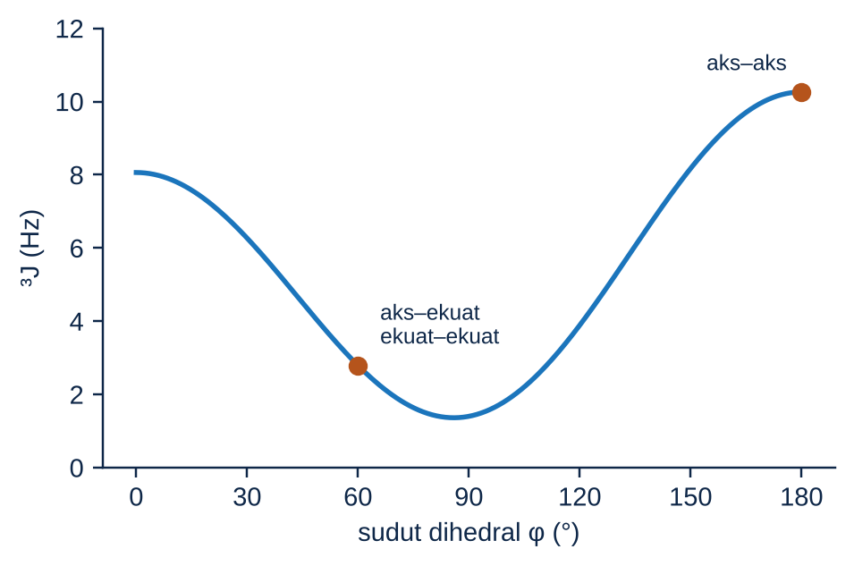
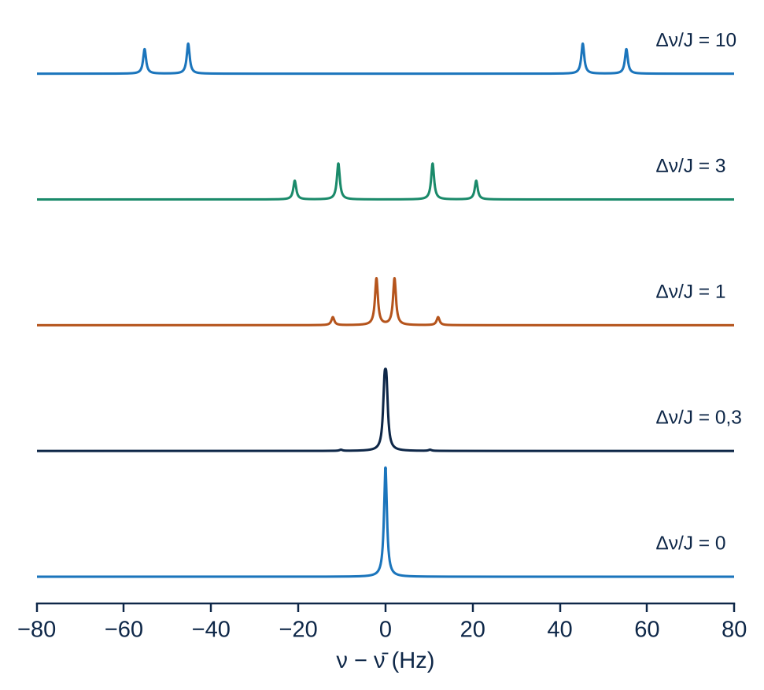
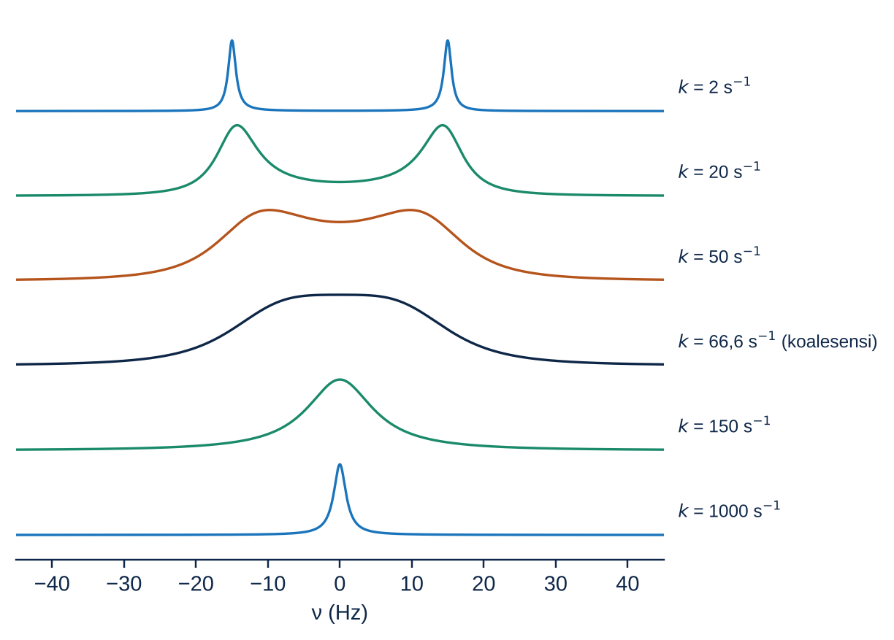

## 16.5 Kopling spin–spin: spektrum AX

### Garis yang terpecah

Spektrum etanol resolusi tinggi tidak terdiri atas tiga garis tunggal (OH, CH₂, CH₃), melainkan tiga kelompok: CH₃ muncul sebagai tiga garis berjarak sama dengan perbandingan intensitas 1 : 2 : 1, dan CH₂ sebagai empat garis 1 : 3 : 3 : 1 (bila OH bertukar cepat). Jarak antargaris sama di kedua kelompok, sekitar 7 Hz, dan, berbeda dengan geseran kimia, **jarak itu dalam Hz tidak berubah bila kuat medan diganti**. Pemecahan ini berasal dari interaksi antara spin-spin inti yang disebut **kopling spin–spin** atau **kopling $J$**.

### Hamiltonian dua spin

Untuk dua inti berspin $\tfrac12$, A dan X, dengan frekuensi resonansi $\nu_A$ dan $\nu_X$ (sudah termasuk perisai), Hamiltonian spin dalam satuan frekuensi ($\hat H/h$, operator spin tak berdimensi) adalah

$$
\frac{\hat H}{h} = -\nu_A\hat I_{zA} - \nu_X\hat I_{zX} + J\,\hat{\mathbf I}_A\cdot\hat{\mathbf I}_X . \qquad \text{(16.e21)}
$$

Suku terakhir adalah kopling skalar dengan **tetapan kopling** $J$ (dalam Hz). Bentuk $\hat{\mathbf I}_A\cdot\hat{\mathbf I}_X$ tidak bergantung pada arah medan dan tidak berubah bila molekul berputar, karena itu bertahan dalam cairan yang molekulnya berputar cepat. Uraikan hasil kali skalar dengan operator tangga:

$$
\hat{\mathbf I}_A\cdot\hat{\mathbf I}_X = \hat I_{zA}\hat I_{zX} + \tfrac12\left(\hat I_{+A}\hat I_{-X} + \hat I_{-A}\hat I_{+X}\right) . \qquad \text{(16.e22)}
$$

Suku dalam kurung menukar spin: ia mengubah $\alpha\beta$ menjadi $\beta\alpha$ dan sebaliknya. Bila selisih frekuensi jauh lebih besar daripada kopling, $|\nu_A - \nu_X| \gg |J|$, kedua keadaan itu terpisah jauh dalam energi, dan menurut teori perturbasi suku penukar hanya menggeser energinya sebesar orde $J^2/(\nu_A - \nu_X)$, yang dapat diabaikan. Inilah **spektrum orde satu**, yang ditandai dengan huruf yang berjauhan dalam abjad: **AX**. Dalam hampiran ini hanya $J\hat I_{zA}\hat I_{zX}$ yang tersisa, dan keadaan $\alpha\alpha$, $\alpha\beta$, $\beta\alpha$, $\beta\beta$ (spin A ditulis lebih dulu) adalah keadaan eigen dengan energi

$$
\frac{E(m_A, m_X)}{h} = -\nu_Am_A - \nu_Xm_X + Jm_Am_X . \qquad \text{(16.e23)}
$$

Transisi yang diizinkan membalik satu spin saja. Membalik A ($m_A$: $+\tfrac12 \to -\tfrac12$) sambil X tetap memberi frekuensi $\nu_A - Jm_X$, yaitu

$$
\nu = \nu_A \pm \tfrac12J \quad\text{dan}\quad \nu = \nu_X \pm \tfrac12J . \qquad \text{(16.e24)}
$$

Spektrum AX terdiri atas dua doblet, masing-masing berpusat di frekuensi geseran kimianya dan terpecah sebesar $J$. Tafsirannya sederhana: inti A "merasakan" dua kemungkinan medan lokal, bergantung pada apakah tetangganya X berada dalam keadaan $\alpha$ atau $\beta$. Karena hampir separuh molekul mempunyai X dalam $\alpha$ dan separuh dalam $\beta$, kedua garis doblet sama kuat.

### Mekanismenya melalui elektron ikatan

Dua momen magnet inti juga berinteraksi langsung melalui ruang (interaksi dipol–dipol), tetapi interaksi ini sebanding dengan $3\cos^2\theta - 1$, dengan $\theta$ sudut antara vektor penghubung inti dan medan. Rata-rata $3\cos^2\theta - 1$ atas semua arah adalah nol (Contoh 6.17), sehingga dalam cairan interaksi langsung terhapus oleh gerak rotasi molekul. Kopling $J$ yang tersisa diteruskan oleh **elektron ikatan**. Mekanisme utamanya adalah **interaksi kontak Fermi**: spin inti A sedikit mempolarisasi spin elektron yang berada tepat di inti (hanya elektron dengan karakter s yang mempunyai rapat tidak nol di inti, subbab 7.5); pasangan elektron ikatan, menurut asas Pauli, berspin berlawanan, sehingga elektron di dekat inti X sedikit terpolarisasi ke arah sebaliknya; elektron itu kemudian berinteraksi dengan spin inti X. Rantai ini menjelaskan tiga kenyataan:

1. **Kopling melemah dengan banyaknya ikatan**: kopling langsung ¹J sangat besar (¹J_CH = 125–250 Hz), kopling vicinal ³J_HH = 0–12 Hz, dan kopling melalui empat ikatan atau lebih biasanya di bawah 3 Hz.
2. **Kopling sebanding dengan karakter s ikatan**: ¹J_CH metana (sp³, 25% s) 125 Hz, etilena (sp², 33% s) 156 Hz, asetilena (sp, 50% s) 249 Hz; aturan kasar ¹J_CH ≈ 500 Hz × (fraksi s) sudah dikenal sejak 1959.
3. **Kopling tidak bergantung pada medan luar**: rantai polarisasi hanya melibatkan interaksi di dalam molekul. Inilah cara praktis membedakan pemecahan karena kopling dari dua sinyal yang kebetulan berdekatan: rekam pada dua kuat medan; jarak dalam Hz yang tetap adalah $J$.

Tanda $J$ juga bermakna. Bila keadaan dengan kedua spin inti berlawanan berenergi lebih rendah, $J > 0$ (kebanyakan ¹J dan ³J); kopling geminal ²J_HH pada karbon sp³ umumnya negatif, sekitar −12 Hz. Tanda ini tidak mempengaruhi spektrum orde satu, tetapi dapat dibaca dari spektrum orde dua yang lebih rumit.

### Multiplet: aturan $n + 1$

Bila inti A bertetangga dengan $n$ inti X **yang setara** berspin $\tfrac12$ dengan kopling yang sama, medan lokal A bergantung pada jumlah $M_X = \sum m_X$, yang dapat bernilai $n/2, n/2 - 1, \ldots, -n/2$: ada $n + 1$ kemungkinan. Banyaknya cara menyusun spin untuk tiap $M_X$ adalah koefisien binomial. Jadi sinyal A terpecah menjadi $n + 1$ garis dengan intensitas mengikuti segitiga Pascal:

| $n$ | Pola | Intensitas |
|---|---|---|
| 0 | singlet | 1 |
| 1 | doblet | 1 : 1 |
| 2 | triplet | 1 : 2 : 1 |
| 3 | kuartet | 1 : 3 : 3 : 1 |
| 4 | kuintet | 1 : 4 : 6 : 4 : 1 |
| 6 | septet | 1 : 6 : 15 : 20 : 15 : 6 : 1 |

Untuk tetangga berspin $I$, banyaknya garis $2nI + 1$. Bila A bertetangga dengan beberapa kelompok yang berbeda kopling, pemecahan dilakukan bertahap (diagram pohon): mula-mula oleh kopling terbesar, lalu setiap garis dipecah lagi oleh kopling berikutnya. Proton dengan dua tetangga tak setara memberi **doblet dari doblet** (dd), empat garis sama kuat.

Satu aturan lagi sangat penting, dan alasannya akan menjadi jelas di subbab 16.6: **inti yang setara tidak memecah sinyal satu sama lain**. Tiga proton CH₃ dalam etanol saling berkopling, tetapi kopling ini tidak tampak; yang tampak hanya kopling ke CH₂.

{width=96%}

### Hubungan Karplus

Kopling vicinal ³J antara proton pada dua karbon yang bertetangga, H–C–C–H, bergantung kuat pada **sudut dihedral** $\phi$ di antara kedua ikatan C–H. Martin Karplus (1959) menunjukkan, dengan perhitungan ikatan valensi sederhana, bahwa ketergantungannya berbentuk

$$
{}^3J(\phi) = A\cos^2\phi + B\cos\phi + C , \qquad \text{(16.e25)}
$$

dengan $A$, $B$, $C$ tetapan empiris yang sedikit bergantung pada substituen; satu parameterisasi yang lazim adalah $A = 7{,}76$, $B = -1{,}10$, $C = 1{,}40$ Hz. Kopling terbesar pada $\phi = 180°$ (antiperiplanar), cukup besar pada $\phi = 0°$, dan paling kecil di dekat $90°$ (Gambar 16.g04). Alasannya kembali ke tumpang tindih: polarisasi spin diteruskan paling efisien bila orbital-orbital ikatan C–H sejajar (tumpang tindih "punggung ke punggung" pada 180° dan "sisi ke sisi" pada 0°), dan hampir tidak diteruskan bila keduanya tegak lurus.

{width=72%}

Hubungan Karplus adalah jembatan antara spektrum dan geometri. Dalam cincin kursi sikloheksana, proton aksial–aksial yang bertetangga ($\phi \approx 180°$) berkopling 8–13 Hz, sedangkan pasangan aksial–ekuatorial dan ekuatorial–ekuatorial ($\phi \approx 60°$) hanya 2–5 Hz. Kimiawan karbohidrat memakai ini untuk membedakan anomer, dan ahli biologi struktur memakai versi untuk H–N–C–H guna menentukan sudut putar rantai utama protein.

::: {.contoh}
**Contoh 16.c19 · Tingkat energi dan garis sistem AX**

Dalam satuan frekuensi relatif terhadap pembawa, $\nu_A = 400$ Hz, $\nu_X = 200$ Hz, $J = 10$ Hz. Hitung keempat energi menurut (16.e23) dan frekuensi keempat transisi.

**Penyelesaian.** $E/h = -400m_A - 200m_X + 10m_Am_X$:
$\alpha\alpha$: $-200 - 100 + 2{,}5 = -297{,}5$ Hz; $\alpha\beta$: $-200 + 100 - 2{,}5 = -102{,}5$ Hz; $\beta\alpha$: $200 - 100 - 2{,}5 = 97{,}5$ Hz; $\beta\beta$: $200 + 100 + 2{,}5 = 302{,}5$ Hz.

Transisi A: $\alpha\alpha \to \beta\alpha$: 395 Hz; $\alpha\beta \to \beta\beta$: 405 Hz. Transisi X: $\alpha\alpha \to \alpha\beta$: 195 Hz; $\beta\alpha \to \beta\beta$: 205 Hz.

**Memahami hasil.** Setiap pusat doblet tepat di $\nu_A$ atau $\nu_X$, dan setiap doblet terpecah 10 Hz. Garis A yang lebih rendah (395 Hz) adalah transisi ketika X berada dalam $\alpha$. Dengan $J > 0$, keadaan $\alpha\beta$ dan $\beta\alpha$ (spin berlawanan) turun $J/4$ dan keadaan sejajar naik $J/4$; spektrum orde satu tidak dapat membedakan tanda ini, karena membalik tanda $J$ hanya menukar garis mana yang berasal dari X-$\alpha$.
:::

::: {.contoh}
**Contoh 16.c20 · Etil asetat**

Ramalkan spektrum ¹H etil asetat, CH₃COOCH₂CH₃, pada 400 MHz bila $\delta$(OCH₂) = 4,12, $\delta$(CH₃CO) = 2,05, $\delta$(CH₂CH₃) = 1,26, dan ³J = 7,1 Hz. Berapa luas relatif ketiga kelompok, dan di mana letak garis-garis kuartet dalam Hz?

**Penyelesaian.** Asetil: tiga proton, tanpa tetangga berproton dalam jarak tiga ikatan: singlet, luas 3. OCH₂: tiga tetangga setara: kuartet 1 : 3 : 3 : 1, luas 2. CH₃ etil: dua tetangga: triplet 1 : 2 : 1, luas 3. Pusat kuartet di $4{,}12 \times 400 = 1648$ Hz; garis-garisnya di $1648 \pm 3{,}55$ dan $1648 \pm 10{,}65$ Hz, yaitu 1637,4; 1644,5; 1651,6; 1658,7 Hz.

**Memahami hasil.** Pola "kuartet + triplet dengan luas 2 : 3" adalah sidik jari gugus etil yang dikenal setiap mahasiswa kimia organik (Gambar 16.g03). Luas sinyal sebanding dengan banyaknya proton, karena setiap proton menyumbang magnetisasi yang sama; inilah yang membuat NMR ¹H juga alat analisis kuantitatif (qNMR).
:::

::: {.contoh}
**Contoh 16.c21 · Kopling dengan deuterium**

(a) Sinyal ¹³C pelarut CDCl₃ muncul di 77,16 ppm sebagai tiga garis sama kuat. Mengapa? Bila ¹J_CH kloroform 209 Hz, taksir ¹J_CD. (b) Ramalkan pola sinyal proton molekul HD.

**Penyelesaian.** (a) Deuterium berspin 1, dengan $m = +1, 0, -1$ yang hampir sama berpeluang: triplet 1 : 1 : 1. Kopling sebanding dengan hasil kali rasio giromagnetik kedua inti (struktur elektronnya sama): ¹J_CD = $209 \times \gamma_\text{D}/\gamma_\text{H} = 209 \times 0{,}1535 = 32$ Hz.

\(b) Proton dipecah oleh satu deuteron: triplet 1 : 1 : 1. Nilai terukurnya $J_\text{HD} = 43$ Hz.

**Memahami hasil.** Perbandingan $J$ antara isotopolog hanya mengikuti $\gamma$, karena mekanisme kontak Fermi melibatkan spin inti tetapi tidak massanya. Dari $J_\text{HD}$ dapat ditaksir kopling H–H dalam H₂ ($43/0{,}1535 \approx 280$ Hz), yang tidak dapat diamati langsung karena kedua proton H₂ setara.
:::

::: {.contoh}
**Contoh 16.c22 · Karakter s dari ¹J_CH**

Kopling ¹J_CH terukur: sikloheksana 123 Hz, benzena 158 Hz, siklopropana 161 Hz, asetilena 249 Hz. Dengan aturan ¹J_CH ≈ 500 Hz × $s$, taksir fraksi s orbital karbon dalam ikatan C–H. Apa yang aneh pada siklopropana?

**Penyelesaian.** $s = J/500$: sikloheksana 0,25; benzena 0,32; siklopropana 0,32; asetilena 0,50.

**Memahami hasil.** Sikloheksana sesuai dengan sp³ dan asetilena dengan sp. Ikatan C–H siklopropana mempunyai karakter s seperti karbon sp², padahal karbonnya jenuh. Ini konsisten dengan model ikatan "pisang" (ikatan Walsh) siklopropana: orbital karbon yang menunjuk ke cincin kaya karakter p untuk mengakomodasi sudut 60°, sehingga orbital ke arah H menjadi kaya s (subbab 12.7). Akibat kimianya, proton siklopropana lebih asam daripada proton alkana biasa.
:::

::: {.contoh}
**Contoh 16.c23 · Anomer glukosa dari Karplus**

Dalam β-D-glukopiranosa, H1 dan H2 keduanya aksial; dalam α, H1 ekuatorial dan H2 aksial. Taksir ³J(H1,H2) untuk kedua anomer dengan (16.e25), mengambil $\phi = 180°$ dan $60°$. Data terukur: 7,9 Hz (β) dan 3,7 Hz (α).

**Penyelesaian.** $\phi = 180°$: $7{,}76 + 1{,}10 + 1{,}40 = 10{,}3$ Hz. $\phi = 60°$: $7{,}76(0{,}25) - 1{,}10(0{,}5) + 1{,}40 = 2{,}8$ Hz.

**Memahami hasil.** Urutan dan besarnya cocok: anomer β mempunyai kopling H1–H2 yang besar, α yang kecil. Nilai terukur β lebih kecil daripada taksiran karena substituen oksigen yang elektronegatif menurunkan kopling vicinal; parameterisasi Karplus yang lebih halus memasukkan koreksi keelektronegatifan. Satu angka kopling ini cukup untuk menetapkan konfigurasi anomer gula dalam glikosida alam.
:::

::: {.kuis}
**Kuis cepat 16.5**

Ramalkan pola sinyal proton CH dalam gugus isopropil, (CH₃)₂CH–. Mengapa jarak garis multiplet dalam Hz tidak berubah bila spektrometer 300 MHz diganti 600 MHz?
:::

## 16.6 Spektrum orde dua (AB)

### Ketika hampiran orde satu gagal

Aturan $n + 1$ hanya berlaku bila selisih geseran $\Delta\nu = \nu_A - \nu_B$ (dalam Hz) jauh lebih besar daripada $J$. Bila keduanya sebanding, suku penukar dalam (16.e22) tidak dapat diabaikan, dan spektrum berubah: intensitas garis tidak lagi sama dalam satu multiplet, garis-garis bergeser dari posisi orde satu, dan bahkan garis baru dapat muncul. Sistem dua spin semacam ini ditandai **AB**, dengan huruf yang berdekatan untuk menunjukkan geseran yang berdekatan.

### Diagonalisasi Hamiltonian AB

Tuliskan Hamiltonian lengkap (16.e21) dalam basis hasil kali $|1\rangle = \alpha\alpha$, $\alpha\beta$, $\beta\alpha$, $|4\rangle = \beta\beta$. Dengan (16.e22) dan aturan $\hat I_+\beta = \alpha$, $\hat I_-\alpha = \beta$ (untuk spin $\tfrac12$, unsur matriksnya 1), satu-satunya unsur di luar diagonal adalah

$$
\langle\beta\alpha|J\,\hat{\mathbf I}_A\cdot\hat{\mathbf I}_B|\alpha\beta\rangle = \tfrac12J .
$$

Keadaan $\alpha\alpha$ dan $\beta\beta$ tidak bercampur dengan apa pun (keduanya mempunyai $M = m_A + m_B$ yang berbeda dari keadaan lain, dan Hamiltonian kekal $M$). Energinya $E_1/h = -\bar\nu + \tfrac14J$ dan $E_4/h = \bar\nu + \tfrac14J$, dengan $\bar\nu = \tfrac12(\nu_A + \nu_B)$. Keadaan $\alpha\beta$ dan $\beta\alpha$ membentuk blok 2 × 2:

$$
\frac{\hat H}{h} = \begin{pmatrix}-\tfrac12\Delta\nu - \tfrac14J & \tfrac12J\\[2pt] \tfrac12J & \tfrac12\Delta\nu - \tfrac14J\end{pmatrix} . \qquad \text{(16.e26)}
$$

Nilai eigennya (subbab 2.8)

$$
\frac{E_{2,3}}{h} = -\tfrac14J \mp \tfrac12D, \qquad D = \sqrt{\Delta\nu^2 + J^2} , \qquad \text{(16.e27)}
$$

dengan vektor eigen

$$
|2\rangle = \cos\theta\,|\alpha\beta\rangle - \sin\theta\,|\beta\alpha\rangle, \qquad |3\rangle = \sin\theta\,|\alpha\beta\rangle + \cos\theta\,|\beta\alpha\rangle, \qquad \sin2\theta = \frac JD . \qquad \text{(16.e28)}
$$

Bila $J \ll \Delta\nu$, $\theta \to 0$ dan kita kembali ke keadaan hasil kali AX. Bila $\Delta\nu \to 0$, $\theta \to 45°$, dan keadaan eigen menjadi $(\alpha\beta \mp \beta\alpha)/\sqrt2$: **singlet** dan komponen $M = 0$ dari **triplet**, persis seperti spin dua elektron dalam atom helium (subbab 9.4).

### Letak dan intensitas garis

Transisi dideteksi melalui $\hat F_x = \hat I_{xA} + \hat I_{xB}$. Dengan (16.e27) dan (16.e28), keempat transisi adalah (relatif terhadap $\bar\nu$):

| Transisi | Frekuensi $- \bar\nu$ | Intensitas relatif |
|---|---|---|
| $1 \to 2$ | $-\tfrac12(D + J)$ | $1 - \sin2\theta$ |
| $3 \to 4$ | $-\tfrac12(D - J)$ | $1 + \sin2\theta$ |
| $1 \to 3$ | $+\tfrac12(D - J)$ | $1 + \sin2\theta$ |
| $2 \to 4$ | $+\tfrac12(D + J)$ | $1 - \sin2\theta$ |

Spektrum AB tetap terdiri atas dua "doblet" dengan pemisahan $J$ di dalam masing-masing pasangan, tetapi:

1. **Efek atap**: garis dalam lebih kuat daripada garis luar, dengan perbandingan $(1 + J/D)/(1 - J/D)$. Kedua doblet "condong" satu sama lain seperti atap rumah. Efek ini berguna dalam praktik: ia menunjukkan pasangan multiplet mana yang saling berkopling.
2. **Geseran kimia tidak di pusat doblet**: pusat setiap pasangan terletak di $\bar\nu \pm \tfrac12D$, bukan di $\nu_A$ dan $\nu_B$. Geseran sebenarnya diperoleh dari $\Delta\nu = \sqrt{(\nu_1 - \nu_4)(\nu_2 - \nu_3)}$, dengan $\nu_1$ sampai $\nu_4$ garis-garis berurutan.
3. **Batas A₂**: bila $\Delta\nu \to 0$, $\sin2\theta \to 1$, garis luar hilang dan dua garis dalam menyatu di $\bar\nu$. Dua inti setara memberi satu garis saja, tanpa tanda kopling.

{width=82%}

### Mengapa inti setara tidak saling memecah

Pada batas A₂, Hamiltonian kopling $J\hat{\mathbf I}_A\cdot\hat{\mathbf I}_B$ dapat ditulis dengan spin total $\hat{\mathbf F} = \hat{\mathbf I}_A + \hat{\mathbf I}_B$: $\hat{\mathbf I}_A\cdot\hat{\mathbf I}_B = \tfrac12(\hat F^2 - \hat I_A^2 - \hat I_B^2)$. Keadaan triplet ($F = 1$) dan singlet ($F = 0$) mempunyai energi kopling berbeda, tetapi operator deteksi $\hat F_x$ adalah komponen spin **total**, yang komut dengan $\hat F^2$. Akibatnya $\hat F_x$ tidak dapat menghubungkan triplet dengan singlet; transisi hanya terjadi di dalam triplet, antara tingkat $M = 1, 0, -1$, dan semua transisi itu mempunyai selisih energi kopling nol. Jadi $J$ di antara inti-inti setara **ada**, tetapi tidak muncul dalam spektrum. Argumen yang sama berlaku untuk kelompok berapa pun inti setara (misalnya tiga proton metil). Kopling antara proton setara dapat diukur hanya dengan memecah kesetaraannya, misalnya melalui substitusi isotop seperti pada HD (Contoh 16.c21).

### Spektrum berubah dengan medan

Karena $\Delta\nu$ (dalam Hz) sebanding dengan $B_0$ sedangkan $J$ tetap, perbandingan $\Delta\nu/J$ naik bila medan dinaikkan. Spektrum yang rumit dan "orde dua" pada spektrometer lama 60 MHz dapat menjadi orde satu yang mudah dibaca pada 600 MHz. Inilah alasan kedua, selain kepekaan, mengapa medan tinggi sangat diinginkan.

::: {.contoh}
**Contoh 16.c24 · Spektrum AB**

Dua proton dengan $\Delta\nu = 20$ Hz dan $J = 10$ Hz. Hitung $D$, $\theta$, letak keempat garis relatif terhadap $\bar\nu$, dan perbandingan intensitas garis dalam dan luar.

**Penyelesaian.** $D = \sqrt{20^2 + 10^2} = 22{,}36$ Hz. $\sin2\theta = 10/22{,}36 = 0{,}447$, $\theta = 13{,}3°$. Garis: $\pm\tfrac12(22{,}36 + 10) = \pm16{,}18$ Hz dan $\pm\tfrac12(22{,}36 - 10) = \pm6{,}18$ Hz. Intensitas dalam : luar $= 1{,}447 : 0{,}553 = 2{,}62$.

**Memahami hasil.** Dalam spektrum orde satu, garis akan berada di $\pm10 \pm 5$, yaitu $\pm15$ dan $\pm5$ Hz, dengan intensitas sama. Pada $\Delta\nu/J = 2$, posisi garis bergeser lebih dari 1 Hz dan intensitasnya berbeda hampir tiga kali. Membaca spektrum ini seolah-olah orde satu akan memberi geseran kimia yang salah: pusat doblet berjarak 22,4 Hz, bukan 20 Hz.
:::

::: {.contoh}
**Contoh 16.c25 · Membaca balik spektrum AB**

Empat garis teramati pada 1234,0; 1226,0; 1212,0; dan 1204,0 Hz (dari spektrometer 400 MHz, relatif terhadap TMS). Tentukan $J$, $\Delta\nu$, dan geseran kimia kedua proton dalam ppm.

**Penyelesaian.** $J = \nu_1 - \nu_2 = \nu_3 - \nu_4 = 8{,}0$ Hz. $\Delta\nu = \sqrt{(\nu_1 - \nu_4)(\nu_2 - \nu_3)} = \sqrt{(30{,}0)(14{,}0)} = 20{,}49$ Hz. Pusat $\bar\nu = 1219{,}0$ Hz, sehingga $\nu_{A,B} = 1219{,}0 \pm 10{,}25 = 1229{,}25$ dan $1208{,}75$ Hz, yaitu $\delta = 3{,}073$ dan $3{,}022$ ppm.

**Memahami hasil.** Pusat-pusat "doblet" yang tampak adalah 1230,0 dan 1208,0 Hz; memakainya langsung akan salah 0,75 Hz (0,002 ppm). Kesalahan sekecil ini tidak berarti untuk penentuan struktur, tetapi pada $\Delta\nu/J$ yang lebih kecil kesalahannya membesar dengan cepat.
:::

::: {.contoh}
**Contoh 16.c26 · Singlet dan triplet dua proton setara**

Untuk dua proton setara ($\Delta\nu = 0$) dengan kopling $J$, tuliskan keempat keadaan eigen dan energinya. Tunjukkan bahwa $\langle\text{S}|\hat F_x|\text{T}_{+1}\rangle = 0$, dengan $|\text{S}\rangle = (\alpha\beta - \beta\alpha)/\sqrt2$ dan $|\text{T}_{+1}\rangle = \alpha\alpha$.

**Penyelesaian.** Triplet: $\alpha\alpha$, $(\alpha\beta + \beta\alpha)/\sqrt2$, $\beta\beta$ dengan energi kopling $+J/4$ (ditambah Zeeman $-\nu$, 0, $+\nu$); singlet: $(\alpha\beta - \beta\alpha)/\sqrt2$ dengan energi $-3J/4$. $\hat F_x\alpha\alpha = \tfrac12(\beta\alpha + \alpha\beta)$, sehingga $\langle\text{S}|\hat F_x|\alpha\alpha\rangle = \tfrac12\cdot\tfrac1{\sqrt2}(\langle\alpha\beta| - \langle\beta\alpha|)(\beta\alpha + \alpha\beta) = \tfrac1{2\sqrt2}(1 - 1) = 0$.

**Memahami hasil.** $\hat F_x$ simetris terhadap pertukaran kedua spin, sedangkan singlet antisimetris; unsur matriks antara keadaan simetris dan antisimetris oleh operator simetris selalu nol. Keadaan singlet dua proton bahkan tidak dapat "dilihat" oleh NMR sama sekali, sehingga ia tidak berelaksasi melalui banyak mekanisme biasa. Para-hidrogen, H₂ dalam keadaan spin singlet, memanfaatkan sifat ini: ia dapat disimpan berhari-hari dan dipakai sebagai sumber hiperpolarisasi (subbab 16.3).
:::

::: {.contoh}
**Contoh 16.c27 · Simulasi spektrum dengan Python**

Tuliskan program yang menyusun Hamiltonian (16.e21) untuk $n$ spin $\tfrac12$ dengan kopling sembarang, mendiagonalkannya, dan mendaftar frekuensi serta intensitas transisi. Ujilah pada sistem AB Contoh 16.c24.

**Penyelesaian.** Operator spin ke-$k$ dalam sistem $n$ spin dibangun dengan hasil kali Kronecker matriks Pauli (Contoh 16.c08) dan matriks satuan. Frekuensi pembawa besar $\nu_0$ ditambahkan agar semua frekuensi transisi bertanda sama.

```python
import numpy as np
sx = np.array([[0, 1], [1, 0]]) / 2
sy = np.array([[0, -1j], [1j, 0]]) / 2
sz = np.array([[1, 0], [0, -1]]) / 2

def op(s, k, n):                     # operator spin ke-k dalam sistem n spin
    m = np.array([[1.0]])
    for i in range(n):
        m = np.kron(m, s if i == k else np.eye(2))
    return m

def spektrum(nu, J, nu0=1e4):        # nu: geseran tiap spin (Hz), J: matriks kopling (Hz)
    n = len(nu)
    X, Y, Z = ([op(s, k, n) for k in range(n)] for s in (sx, sy, sz))
    H = sum(-(nu0 + nu[k]) * Z[k] for k in range(n))
    for i in range(n):
        for j in range(i + 1, n):
            H = H + J[i][j] * (X[i] @ X[j] + Y[i] @ Y[j] + Z[i] @ Z[j])
    E, V = np.linalg.eigh(H)
    F = V.conj().T @ sum(X) @ V      # I_x total dalam basis keadaan eigen
    garis = {}
    for a in range(2**n):
        for b in range(a + 1, 2**n):
            if abs(F[a, b])**2 > 1e-6:
                f = round(E[b] - E[a] - nu0, 2)
                garis[f] = garis.get(f, 0) + abs(F[a, b])**2
    return garis

for f, I in sorted(spektrum([10, -10], [[0, 10], [10, 0]]).items()):
    print(f'{f:8.2f} Hz   {I:.3f}')
```

Keluarannya: garis di $-16{,}18$; $-6{,}18$; $6{,}18$; $16{,}18$ Hz dengan intensitas 0,138; 0,362; 0,362; 0,138.

**Memahami hasil.** Hasil numerik sama dengan rumus analitis, dan perbandingan intensitas $0{,}362/0{,}138 = 2{,}62$ adalah efek atap. Program yang sama, tanpa perubahan, menangani sistem tiga, empat, atau delapan spin; ukuran matriks $2^n \times 2^n$ membatasinya pada sekitar dua belas spin, cukup untuk hampir semua fragmen molekul organik. Program simulasi spektrum komersial bekerja dengan prinsip yang sama, ditambah pemanfaatan simetri dan kekekalan $M$ untuk memecah matriks menjadi blok-blok kecil. Gambar 16.g05 dibuat dengan fungsi ini.
:::

::: {.contoh}
**Contoh 16.c28 · Gugus etil pada 60 MHz dan 400 MHz**

Dengan program Contoh 16.c27, spektrum gugus etil etanol ($\delta$ CH₂ 3,69 dan CH₃ 1,22, $J = 7$ Hz) disimulasikan pada 60 MHz dan 400 MHz. Hitung $\Delta\nu/J$ untuk kedua kasus dan jelaskan perbedaan hasilnya.

**Penyelesaian.** $\Delta\nu = 2{,}47$ ppm $\times\ \nu_0$: 148 Hz pada 60 MHz ($\Delta\nu/J = 21$) dan 988 Hz pada 400 MHz ($\Delta\nu/J = 141$). Simulasi 400 MHz memberi kuartet dan triplet dengan intensitas binomial yang hampir sempurna (1 : 2,00 : 1 untuk triplet). Simulasi 60 MHz memberi garis-garis yang sedikit terbelah dan intensitas yang condong: garis triplet yang menghadap kuartet sekitar 20% lebih kuat daripada garis di sisi jauh (perbandingan 0,91 : 2 : 1,10).

**Memahami hasil.** Bahkan pada $\Delta\nu/J = 21$ efek orde dua masih terlihat sebagai atap kecil. Aturan praktis: pola orde satu dapat dipercaya bila $\Delta\nu/J \gtrsim 10$. Pada spektrometer modern, kebanyakan gugus alkil memenuhinya, tetapi proton-proton cincin aromatik bersubstituen atau gula, yang geserannya berdekatan, sering tetap orde dua.
:::

::: {.kuis}
**Kuis cepat 16.6**

Dalam spektrum AB, apa yang terjadi pada intensitas garis luar bila $\Delta\nu$ dikecilkan menuju nol dengan $J$ tetap? Apakah spektrum AB berubah bila tanda $J$ dibalik?
:::

## 16.7 Kesetaraan kimia dan magnetik

### Dua jenis kesetaraan

Aturan "inti setara tidak saling memecah" memerlukan definisi kesetaraan yang cermat.

**Kesetaraan kimia.** Dua inti setara secara kimia bila keduanya dapat dipertukarkan oleh suatu operasi simetri molekul (rotasi, pencerminan; subbab 10.1) atau oleh proses dinamis yang cepat dibandingkan skala waktu NMR (misalnya rotasi gugus metil). Inti yang setara secara kimia mempunyai geseran kimia yang sama persis.

**Kesetaraan magnetik.** Dua inti setara secara magnetik bila keduanya setara secara kimia **dan** masing-masing berkopling dengan kopling yang sama ke **setiap** inti lain di luar kelompoknya. Hanya kelompok yang setara secara magnetik yang benar-benar berperilaku seperti satu "inti besar" dan tidak menampakkan kopling internalnya.

Contoh klasiknya adalah perbedaan CH₂F₂ dan CH₂=CF₂. Dalam difluorometana, kedua proton dan kedua fluor masing-masing setara secara kimia, dan setiap proton berkopling sama dengan kedua fluor (geometrinya simetris), sehingga sistemnya **A₂X₂**: spektrum ¹H berupa triplet sederhana. Dalam 1,1-difluoroetena, setiap proton mempunyai satu fluor *cis* dan satu fluor *trans* dengan kopling yang sangat berbeda (sekitar 1 dan 34 Hz). Kedua proton setara secara kimia, tetapi **tidak** setara secara magnetik, dan sistemnya ditulis **AA′XX′**. Spektrumnya jauh lebih rumit daripada triplet, bahkan bila $\Delta\nu$ besar.

### Notasi Pople

Sistem spin dinamai dengan huruf: huruf yang berdekatan dalam abjad (A, B, C) untuk inti dengan $\Delta\nu$ sebanding dengan $J$; huruf yang berjauhan (A, M, X) untuk inti dengan $\Delta\nu \gg J$. Indeks bawah menyatakan banyaknya inti yang setara secara magnetik, dan tanda aksen (A, A′) menandai inti yang setara secara kimia tetapi tidak secara magnetik. Jadi etanol (dengan OH bertukar cepat) adalah A₃X₂, difluorometana A₂X₂, benzena bersubstituen para dengan dua substituen berbeda AA′BB′ atau AA′XX′, dan 1,1-difluoroetena AA′XX′.

### Homotopik, enantiotopik, diastereotopik

Untuk dua proton pada karbon yang sama (gugus CH₂), cara cepat menentukan kesetaraannya adalah **uji substitusi**: ganti setiap proton bergantian dengan gugus uji Z, lalu bandingkan kedua hasilnya.

- Bila kedua hasil identik, kedua proton **homotopik** dan setara dalam segala keadaan (misalnya CH₂Cl₂).
- Bila kedua hasil enansiomer, keduanya **enantiotopik**: setara dalam pelarut akiral, tetapi dapat dibedakan dalam lingkungan kiral (pelarut kiral, enzim).
- Bila kedua hasil diastereomer, keduanya **diastereotopik**: tidak setara secara kimia, sehingga mempunyai geseran berbeda dan saling berkopling (²J sekitar −12 Hz).

Proton CH₂ yang bertetangga dengan pusat kiral selalu diastereotopik, tidak peduli seberapa cepat rotasi ikatannya, karena tidak ada operasi simetri yang mempertukarkannya. Banyak kebingungan dalam membaca spektrum bermula di sini: gugus CH₂ dalam molekul kiral sering muncul sebagai dua multiplet terpisah, bukan satu.

### Pertukaran dan skala waktu NMR

Bila suatu proses kimia mempertukarkan dua lingkungan dengan laju $k$, apa yang terlihat dalam spektrum bergantung pada perbandingan $k$ dengan selisih frekuensi $\Delta\nu$ kedua lingkungan:

- **Pertukaran lambat** ($k \ll \Delta\nu$): dua garis terpisah, masing-masing sedikit melebar.
- **Koalesensi**: kedua garis melebur menjadi satu puncak datar.
- **Pertukaran cepat** ($k \gg \Delta\nu$): satu garis tajam di frekuensi rata-rata berbobot populasi.

Gagasan ini adalah versi NMR dari asas ketidakpastian energi–waktu: dua frekuensi yang berbeda $\Delta\nu$ hanya dapat dibedakan bila inti tinggal di setiap lingkungan cukup lama, lebih dari sekitar $1/\Delta\nu$. Untuk dua lingkungan berpopulasi sama tanpa kopling, analisis persamaan Bloch dengan pertukaran memberi laju pada suhu koalesensi $T_c$

$$
k_c = \frac{\pi\Delta\nu}{\sqrt2} . \qquad \text{(16.e29)}
$$

Dengan persamaan Eyring, $k = (k_BT/h)\,e^{-\Delta G^\ddagger/RT}$, energi bebas pengaktifan proses pertukaran diperoleh dari $T_c$:

$$
\Delta G^\ddagger = RT_c\ln\frac{k_BT_c}{hk_c} . \qquad \text{(16.e30)}
$$

**NMR dinamis** semacam ini mengukur penghalang 25–100 kJ/mol, rentang yang meliputi rotasi ikatan amida, pembalikan cincin, inversi nitrogen, dan pertukaran ligan pada kompleks logam: proses-proses yang terlalu cepat untuk diikuti dengan pencampuran biasa, tetapi terlalu lambat untuk spektroskopi optik.

{width=78%}

::: {.contoh}
**Contoh 16.c29 · Menamai sistem spin**

Tentukan notasi Pople sistem spin proton (dan fluor, bila ada) dalam: (a) asetaldehida CH₃CHO; (b) 1-kloro-4-nitrobenzena; (c) CH₂F₂; (d) 1,1-difluoroetena; (e) 1,1,2-trikloroetana CHCl₂CH₂Cl.

**Penyelesaian.** (a) A₃X: tiga proton metil setara dan proton aldehida jauh (9,8 terhadap 2,2 ppm). (b) AA′XX′ atau AA′BB′: dua pasang proton setara secara kimia, tetapi proton H2 berkopling *orto* dengan H3 dan *para* dengan H5, jadi H2 dan H6 tidak setara secara magnetik. (c) A₂X₂. (d) AA′XX′. (e) AX₂: proton CHCl₂ (5,8 ppm) dan dua proton CH₂Cl (4,0 ppm) yang setara secara magnetik; spektrumnya triplet dan doblet.

**Memahami hasil.** Huruf A dan X cukup untuk sebagian besar gugus alifatik pada medan tinggi. Sistem dengan aksen hampir selalu muncul pada cincin aromatik bersubstituen dan alkena; pola "dua doblet" yang tampak pada senyawa para-disubstitusi sebenarnya adalah spektrum AA′XX′ yang garis-garis tambahannya lemah.
:::

::: {.contoh}
**Contoh 16.c30 · Proton diastereotopik**

Dalam 2-butanol, CH₃CH(OH)CH₂CH₃, terapkan uji substitusi pada kedua proton CH₂. Apakah mereka setara? Bagaimana pola sinyalnya?

**Penyelesaian.** Mengganti H_a atau H_b dengan Z menghasilkan molekul dengan dua pusat kiral (C2 yang sudah ada dan C3 yang baru). Kedua hasil mempunyai konfigurasi C2 sama tetapi C3 berlawanan: diastereomer. Jadi H_a dan H_b diastereotopik dan tidak setara. Masing-masing berkopling dengan CH₃ (³J), dengan CH (³J), dan satu sama lain (²J), sehingga sinyal CH₂ berupa dua multiplet rumit yang tumpang tindih, bukan kuintet sederhana.

**Memahami hasil.** Rotasi bebas di sekitar ikatan C2–C3 tidak menolong: dalam setiap konformasi, lingkungan H_a dan H_b berbeda, dan rata-rata atas konformasi tidak menyamakannya karena pusat kiral C2 tidak berubah. Perbedaan geseran diastereotopik sering hanya 0,01–0,1 ppm, tetapi cukup untuk membuat pola multiplet "aneh" bagi pemula.
:::

::: {.contoh}
**Contoh 16.c31 · Pembalikan cincin sikloheksana**

Pada suhu kamar, sikloheksana-$d_{11}$ (satu proton) memberi satu garis. Pada suhu rendah dan 60 MHz, garis itu terpisah menjadi sinyal aksial dan ekuatorial yang berbeda 0,48 ppm, dan koalesensi teramati pada 212 K. Hitung $k_c$, $\Delta G^\ddagger$, dan laju pembalikan cincin pada 298 K.

**Penyelesaian.** $\Delta\nu = 0{,}48 \times 60 = 28{,}8$ Hz, $k_c = \pi(28{,}8)/\sqrt2 = 64$ s⁻¹. $k_BT_c/h = 4{,}42 \times 10^{12}$ s⁻¹, sehingga

$$
\Delta G^\ddagger = (8{,}314)(212)\ln\frac{4{,}42 \times 10^{12}}{64} = 44{,}0\ \text{kJ/mol} .
$$

Pada 298 K, $k = (6{,}21 \times 10^{12})\,e^{-44\,000/(8{,}314 \times 298)} = 1{,}2 \times 10^5$ s⁻¹.

**Memahami hasil.** Cincin sikloheksana membalik sekitar seratus ribu kali per detik pada suhu kamar, terlalu cepat untuk NMR sehingga proton aksial dan ekuatorial tampak setara. Pemakaian sikloheksana yang terdeuterasi sebagian menghapus kopling H–H yang akan memperumit bentuk garis. Nilai 44 kJ/mol ini (10,5 kkal/mol) adalah salah satu angka termasyhur dalam analisis konformasi.
:::

::: {.contoh}
**Contoh 16.c32 · Rotasi ikatan amida dalam DMF**

Dalam N,N-dimetilformamida, dua gugus metil memberi dua singlet pada suhu kamar (selisih 0,08 ppm pada 400 MHz) yang berkoalesensi pada sekitar 393 K. Hitung penghalang rotasi C–N dan umur rata-rata satu rotamer pada 298 K.

**Penyelesaian.** $\Delta\nu = 32$ Hz, $k_c = 71$ s⁻¹. $\Delta G^\ddagger = (8{,}314)(393)\ln\dfrac{(1{,}381 \times 10^{-23})(393)}{(6{,}626 \times 10^{-34})(71)} = 83$ kJ/mol. Pada 298 K: $k = (6{,}21 \times 10^{12})\,e^{-83\,200/(8{,}314 \times 298)} = 0{,}016$ s⁻¹, umur $1/k \approx 60$ s.

**Memahami hasil.** Penghalang sekitar 80 kJ/mol berasal dari karakter ikatan rangkap parsial C–N: pasangan elektron bebas nitrogen berkonjugasi dengan C=O (resonansi amida, subbab 12.10). Pada suhu kamar satu rotamer bertahan sekitar satu menit, sehingga kedua gugus metil, satu *cis* dan satu *trans* terhadap oksigen, terlihat terpisah. Kekakuan yang sama membuat ikatan peptida datar dan menentukan bentuk rantai utama protein.
:::

::: {.kuis}
**Kuis cepat 16.7**

Apakah dua proton dalam CH₂Cl₂ setara secara magnetik? Bagaimana dengan proton orto dalam klorobenzena? Bila $\Delta\nu$ dua tapak dinaikkan dengan memakai magnet lebih kuat, apakah suhu koalesensi naik atau turun?
:::
