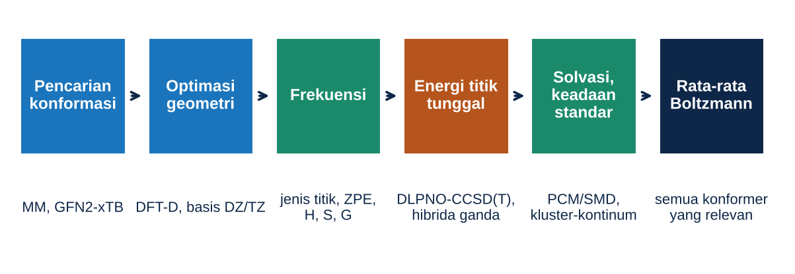

## 17.17 Metode semiempiris dan mekanika molekul

### Mengabaikan tumpang tindih diferensial

Biaya HF didominasi oleh $K^4/8$ integral dua elektron. Metode **semiempiris** memotong biaya ini dengan pendekatan **pengabaian tumpang tindih diferensial nol** (ZDO): hasil kali dua fungsi basis yang berbeda, $\phi_\mu(\mathbf r)\phi_\nu(\mathbf r)$ dengan $\mu \neq \nu$, dianggap nol di dalam integral dua elektron. Akibatnya

$$
(\mu\nu|\lambda\sigma) \approx \delta_{\mu\nu}\delta_{\lambda\sigma}(\mu\mu|\lambda\lambda) , \qquad \text{(17.59)}
$$

dan matriks tumpang tindih menjadi matriks satuan. Hanya elektron valensi yang diperlakukan, dalam basis minimal. Hierarki hampirannya:

- **CNDO** (Pople, 1965): ZDO untuk semua pasangan; integral $(\mu\mu|\lambda\lambda)$ hanya bergantung pada atom tempat $\mu$ dan $\lambda$ berada, $\gamma_{AB}$.
- **INDO**: integral pertukaran satu pusat dipertahankan, sehingga aturan Hund dan keadaan spin dapat dibedakan.
- **NDDO**: semua integral yang $\mu, \nu$ berada pada atom yang sama dan $\lambda, \sigma$ pada atom yang sama dipertahankan. Ini dasar MNDO (Dewar, 1977), AM1 (1985), PM3 (1989), PM6 (2007), dan PM7 (2013).

Integral yang tersisa tidak dihitung dari fungsi basis, melainkan dinyatakan dengan rumus berparameter yang dicocokkan dengan data percobaan: entalpi pembentukan, geometri, momen dipol, dan energi ionisasi. Dengan cara ini sebagian korelasi elektron ikut "terserap" ke dalam parameter. Metode NDDO modern memberi entalpi pembentukan molekul organik dengan galat rata-rata sekitar 15–25 kJ/mol, ribuan kali lebih cepat daripada DFT, tetapi dapat gagal tanpa peringatan untuk jenis ikatan yang tidak terwakili dalam data pencocokan.

Generasi yang lebih baru berangkat dari DFT, bukan HF: **DFT ikatan ketat** (DFTB) dan metode **GFN-xTB** (Grimme, 2017–2019) menguraikan energi DFT di sekitar kerapatan atom-atom netral, memakai basis minimal dan parameter untuk hampir semua unsur tabel periodik, ditambah koreksi dispersi. GFN2-xTB kini menjadi alat baku untuk pencarian konformasi, geometri awal, dan penyaringan senyawa dalam jumlah besar. Teori Hückel (subbab 13.4) dan metode Pariser–Parr–Pople (subbab 13.12) adalah leluhur seluruh keluarga ini: keduanya adalah ZDO yang diterapkan pada elektron π saja.

### Mekanika molekul

**Mekanika molekul** (MM) meninggalkan elektron sama sekali. Molekul dimodelkan sebagai bola-bola (atom) yang dihubungkan pegas, dan energinya dihitung dengan **medan gaya**:

$$
E = \sum_\text{ikatan}k_r(r - r_0)^2 + \sum_\text{sudut}k_\theta(\theta - \theta_0)^2 + \sum_\text{torsi}\frac{V_n}{2}[1 + \cos(n\phi - \gamma)] + \sum_{i<j}\left[\frac{A_{ij}}{r_{ij}^{12}} - \frac{B_{ij}}{r_{ij}^6} + \frac{q_iq_j}{4\pi\varepsilon_0r_{ij}}\right] . \qquad \text{(17.60)}
$$

Tiga suku pertama adalah suku **terikat** (ikatan, sudut, torsi), suku terakhir **tak terikat** (van der Waals Lennard-Jones dan Coulomb antara muatan parsial atom). Parameter bergantung pada **jenis atom** (karbon sp³, karbon karbonil, nitrogen amida, dan seterusnya) dan dicocokkan dengan data percobaan dan perhitungan kuantum: tetapan gaya dari spektrum getaran (Bab 5), penghalang torsi dari perhitungan ab initio, dan muatan dari potensial elektrostatik (subbab 17.7). Medan gaya yang banyak dipakai: AMBER dan CHARMM (biomolekul), OPLS (cairan organik), GAFF dan MMFF (molekul organik umum).

Medan gaya baku tidak dapat memutus atau membentuk ikatan, tidak menggambarkan polarisasi (kecuali medan gaya terpolarisasi), dan tidak memberi informasi elektronik. Namun ia cukup cepat untuk menghitung jutaan atom selama mikrodetik dalam **dinamika molekul**, yang menyelesaikan persamaan Newton untuk semua atom dengan langkah waktu sekitar 1–2 fs. Inilah alat utama untuk lipatan protein, membran, dan pengikatan obat.

**QM/MM** (Warshel dan Levitt, 1976; Hadiah Nobel Kimia 2013 bersama Karplus) menggabungkan keduanya: daerah kecil tempat reaksi terjadi (misalnya tapak aktif enzim, 50–200 atom) diperlakukan dengan kimia kuantum, sisanya (protein dan pelarut) dengan mekanika molekul, dan kedua daerah berinteraksi secara elektrostatik. Generasi terbaru adalah **potensial pembelajaran mesin**, jaringan saraf yang dilatih dengan ribuan perhitungan DFT atau CCSD(T), yang memberi ketelitian mendekati metode kuantum dengan kecepatan mendekati medan gaya.

::: {.contoh}
**Contoh 17.69 · Berapa integral yang dihemat ZDO?**

Benzena dalam basis minimal valensi mempunyai 30 fungsi (4 pada setiap C, 1 pada setiap H); dengan elektron inti, basis STO-3G mempunyai 36 fungsi. Hitung banyaknya integral dua elektron berbeda untuk HF/STO-3G, dan banyaknya integral NDDO yang tidak nol untuk basis valensi.

**Penyelesaian.** HF/STO-3G: $M = 36 \cdot 37/2 = 666$ pasangan, $666 \cdot 667/2 = 222\,111$ integral. NDDO: distribusi satu pusat $\phi_\mu\phi_\nu$ dengan $\mu, \nu$ pada atom yang sama: 10 per C ($4 \cdot 5/2$) dan 1 per H, jadi $6 \times 10 + 6 \times 1 = 66$ distribusi; integral $(\mu\nu|\lambda\sigma)$ antara dua distribusi: paling banyak $66 \cdot 67/2 = 2211$.

**Memahami hasil.** NDDO memerlukan sekitar seratus kali lebih sedikit integral, dan rumus berparameternya lebih murah daripada integral Gauss. Lebih penting, banyaknya integral NDDO tumbuh sebagai kuadrat banyaknya atom, bukan pangkat empat banyaknya fungsi basis, sehingga molekul ribuan atom dapat dihitung.
:::

::: {.contoh}
**Contoh 17.70 · Torsi etana**

Dalam medan gaya, torsi H–C–C–H etana dimodelkan dengan suku $\tfrac{V_3}{2}(1 + \cos3\phi)$ yang dijumlahkan sedemikian rupa sehingga penghalang totalnya 12,0 kJ/mol (nilai percobaan). Hitung energi torsi pada $\phi = 0°$, 30°, dan 60°, dan bandingkan dengan model rotor terhambat di subbab 6.3.

**Penyelesaian.** $E(0°) = 12{,}0$ kJ/mol (eklips); $E(30°) = 6{,}0$ kJ/mol; $E(60°) = 0$ (goyang).

**Memahami hasil.** Fungsi kosinus periode tiga adalah deret Fourier paling sederhana yang memenuhi simetri gugus metil. Asal penghalangnya (tolakan Pauli antarikatan C–H atau hiperkonjugasi σ → σ*) masih diperdebatkan dalam kimia kuantum, tetapi medan gaya tidak perlu mengetahuinya: ia cukup meniru bentuk kurva. Inilah kekuatan dan kelemahan MM sekaligus: cepat dan teliti dalam daerah yang dikalibrasi, buta terhadap fisika di baliknya.
:::

::: {.contoh}
**Contoh 17.71 · Potensial Lennard-Jones argon**

Dengan parameter Lennard-Jones argon $\varepsilon/k_B = 119{,}8$ K dan $\sigma = 3{,}405$ Å, hitung letak minimum $r_\text{min} = 2^{1/6}\sigma$ dan kedalaman sumur dalam kJ/mol dan cm⁻¹. Bandingkan dengan dimer Ar₂ yang sebenarnya ($r_e = 3{,}76$ Å, $D_e = 99{,}5$ cm⁻¹).

**Penyelesaian.** $r_\text{min} = 1{,}1225 \times 3{,}405 = 3{,}82$ Å. $\varepsilon = 119{,}8 \times 8{,}314 = 996$ J/mol $= 0{,}996$ kJ/mol $= 83{,}3$ cm⁻¹.

**Memahami hasil.** Parameter ini dicocokkan dengan sifat argon **cair dan gas** (viskositas, koefisien virial), sehingga ia adalah potensial "efektif" yang menyerap rata-rata efek tiga benda; itulah sebabnya ia lebih dangkal dan lebih lebar daripada potensial dimer sebenarnya. Pelajaran umumnya: parameter medan gaya tidak dapat dipindahkan begitu saja ke situasi yang berbeda dari tempat ia dikalibrasi.
:::

::: {.contoh}
**Contoh 17.72 · Harga meregangkan satu ikatan**

Dalam medan gaya AMBER, ikatan C–C sp³ mempunyai $k_r = 310$ kkal mol⁻¹ Å⁻² (dengan bentuk $k_r(r - r_0)^2$, tanpa faktor $\tfrac12$) dan $r_0 = 1{,}526$ Å. Berapa energi yang diperlukan untuk meregangkan ikatan 0,05 Å? Bandingkan dengan energi termal $RT$.

**Penyelesaian.** $E = 310 \times 0{,}05^2 = 0{,}78$ kkal/mol $= 3{,}2$ kJ/mol, sekitar $1{,}3RT$ pada 298 K.

**Memahami hasil.** Perhatikan konvensi: tetapan gaya fisika (subbab 5.1) adalah $k = 2k_r = 620$ kkal mol⁻¹ Å⁻² $= 431$ N/m, sesuai dengan getaran ulur C–C sekitar 1000 cm⁻¹. Kebingungan faktor $\tfrac12$ antara medan gaya yang berbeda adalah sumber kesalahan yang lazim ketika parameter dipindahkan antarprogram.
:::

::: {.kuis}
**Kuis cepat 17.17**

Mengapa metode semiempiris dapat memberi entalpi pembentukan yang lebih baik daripada HF/6-31G*, meskipun hampirannya jauh lebih kasar? Mengapa medan gaya biasa tidak dapat dipakai untuk mempelajari reaksi pemutusan ikatan?
:::

## 17.18 Program kimia kuantum dan alur kerja perhitungan

### Perangkat lunak

Banyak program kimia kuantum tersedia, sebagian komersial dan sebagian bebas: **Gaussian** (komersial, paling lama dan paling banyak dikutip), **ORCA** (gratis untuk akademisi, kuat dalam DFT, DLPNO-CCSD(T), dan spektroskopi), **Psi4** dan **PySCF** (sumber terbuka; PySCF sepenuhnya dalam Python dan cocok untuk belajar dan mengembangkan metode), **NWChem**, **GAMESS**, **Q-Chem**, **Molpro** dan **CFOUR** (metode korelasi tingkat tinggi), **xtb** (GFN-xTB), serta **VASP**, **Quantum ESPRESSO**, dan **CP2K** untuk sistem periodik dengan basis gelombang datar. Program visualisasi seperti Avogadro, Jmol, VMD, dan Chemcraft dipakai untuk membangun struktur awal dan melihat orbital, getaran, dan permukaan potensial elektrostatik.

### Anatomi berkas masukan

Semua program memerlukan informasi yang sama: **metode** dan **basis**, **muatan** dan **multiplisitas spin** ($2S + 1$), **geometri** (koordinat Kartesius dalam Å atau matriks-Z), **jenis pekerjaan** (energi titik tunggal, optimasi, frekuensi, IRC), dan **pilihan tambahan** (pelarut, koreksi dispersi, kisi integrasi, kriteria konvergensi). Sebagai contoh, masukan ORCA untuk optimasi dan frekuensi air dengan B3LYP-D3(BJ)/def2-TZVP dalam pelarut air implisit:

```
! B3LYP D3BJ def2-TZVP Opt Freq CPCM(Water)
* xyz 0 1
O    0.000000    0.000000    0.000000
H    0.000000    0.757000    0.586000
H    0.000000   -0.757000    0.586000
*
```

Baris pertama berisi kata kunci; "0 1" berarti muatan 0 dan multiplisitas singlet. Perhitungan yang sama, tanpa pelarut, dengan PySCF dari dalam Python:

```python
from pyscf import gto, scf, mp
mol = gto.M(atom='O 0 0 0; H 0 0.757 0.586; H 0 -0.757 0.586', basis='6-31g*')
mf = scf.RHF(mol).run()        # Hartree-Fock
mp.MP2(mf).run()               # koreksi MP2
```

### Membaca keluaran dengan kritis

Keluaran program biasanya panjang. Daftar periksa berikut menangkap sebagian besar masalah:

1. **Apakah perhitungan selesai normal?** Cari pesan akhir program; jangan memakai angka dari perhitungan yang terputus.
2. **Apakah SCF konvergen ke keadaan yang benar?** Periksa banyaknya siklus, energi orbital (yang terisi harus di bawah yang virtual), dan, untuk kasus yang meragukan, lakukan **analisis kestabilan** fungsi gelombang. Untuk UHF, periksa $\langle\hat S^2\rangle$.
3. **Apakah muatan, multiplisitas, dan simetri benar?** Multiplisitas yang salah (misalnya O₂ sebagai singlet) memberi energi yang sama sekali salah.
4. **Apakah optimasi konvergen?** Periksa kriteria gaya dan perpindahan, dan bahwa geometri akhir masuk akal.
5. **Apakah frekuensi sesuai jenis titik stasioner?** Minimum tidak boleh mempunyai frekuensi imajiner; keadaan transisi tepat satu. Frekuensi imajiner kecil (di bawah sekitar 50i cm⁻¹) sering berasal dari kisi integrasi atau optimasi yang longgar.
6. **Apakah energi yang dibandingkan konsisten?** Semua spesies dalam satu reaksi harus dihitung dengan metode, basis, dan kisi yang sama. Pastikan pula yang dibandingkan adalah besaran yang setara: energi elektronik, energi dengan ZPE, entalpi, atau energi bebas.
7. **Satuan.** Program mencetak energi dalam hartree; 1 $E_h$ = 2625,50 kJ/mol = 627,51 kkal/mol = 27,2114 eV = 219 474,6 cm⁻¹.

### Membaca blok termokimia

Setelah perhitungan frekuensi, program mencetak blok termokimia. Untuk H₂O dengan HF/6-31G* (frekuensi tanpa skala, 298,15 K, 1 bar), program pendamping memberi ringkasan berikut; susunannya mirip dengan keluaran program besar:

```
Frekuensi harmonik (cm-1):     1826.4    4070.8    4189.9
Energi elektronik                     -76.010747 Eh
Koreksi titik nol (ZPE)                 0.022980 Eh    60.33 kJ/mol
Koreksi termal energi                   0.025813 Eh    67.77 kJ/mol
Koreksi termal entalpi                  0.026757 Eh    70.25 kJ/mol
Koreksi termal energi bebas Gibbs       0.005370 Eh    14.10 kJ/mol
E + ZPE                               -75.987767 Eh
H (298 K)                             -75.983990 Eh
G (298 K)                             -76.005377 Eh
Entropi total   188.33 J/(mol K): translasi 144.91, rotasi 43.41, getaran 0.01
```

"Koreksi termal energi" adalah ZPE ditambah energi termal translasi, rotasi, dan getaran ($\tfrac32RT + \tfrac32RT$ untuk molekul tak linear, getaran hampir nol pada suhu kamar); "koreksi termal entalpi" menambahkan $RT$; dan "koreksi energi bebas" mengurangkan $TS$. Untuk energi reaksi, besaran yang tepat untuk dibandingkan dengan data kalorimetri adalah $\Delta H$ dari baris "H", dan untuk tetapan kesetimbangan $\Delta G$ dari baris "G", setelah koreksi keadaan standar (Contoh 17.75) bila reaksi terjadi dalam larutan.

### Alur kerja baku

{width=96%}

Untuk menghitung energi reaksi atau penghalang dengan ketelitian tinggi, alur kerja yang lazim adalah:

1. **Pencarian konformasi** dengan mekanika molekul atau GFN2-xTB; molekul lentur dapat mempunyai puluhan konformer dalam rentang beberapa kJ/mol.
2. **Optimasi geometri** konformer terbaik dengan DFT (hibrida atau GGA dengan dispersi, basis double- atau triple-zeta).
3. **Analisis frekuensi** pada tingkat yang sama: memastikan jenis titik stasioner dan menghitung ZPE serta koreksi termal (subbab 17.9).
4. **Energi titik tunggal** dengan metode lebih tinggi (hibrida ganda, DLPNO-CCSD(T), atau metode komposit) dan basis lebih besar.
5. **Solvasi** dengan model kontinum atau kluster–kontinum.
6. **Koreksi keadaan standar** dan rata-rata Boltzmann atas konformer.

Setiap langkah menyumbang galat, dan galat terbesar sering bukan pada metode elektronik yang paling dikhawatirkan, melainkan pada langkah yang paling diabaikan: konformer yang terlewat, mode getaran frekuensi rendah yang diperlakukan sebagai osilator harmonik, atau keadaan standar yang keliru. Untuk keterulangan, laporkan program dan versinya, metode, basis, kisi, model pelarut, dan koordinat semua struktur.

### Studi kasus: HCN dan HNC

Untuk melihat seluruh alur dalam satu contoh kecil, bandingkan dua isomer, hidrogen sianida HCN dan hidrogen isosianida HNC. HNC adalah molekul yang hampir tidak dikenal di laboratorium, tetapi melimpah di awan antarbintang yang dingin, sehingga selisih energinya dan penghalang isomerisasinya menarik bagi astrokimia. Program pendamping dijalankan pada geometri percobaan kedua isomer (HCN: C–H 1,0655 Å, C≡N 1,1532 Å; HNC: N–H 0,9940 Å, N≡C 1,1689 Å):

| Besaran | HCN | HNC |
|---|---|---|
| $E$ HF/STO-3G ($E_h$) | $-91{,}675191$ | $-91{,}644097$ |
| $E$ HF/6-31G* ($E_h$) | $-92{,}874008$ | $-92{,}854741$ |
| Korelasi MP2/6-31G* ($E_h$) | $-0{,}291833$ | $-0{,}278052$ |
| Momen dipol HF/6-31G* (D) | 3,23 | 2,79 |
| Muatan Mulliken H (6-31G*) | +0,32 | +0,43 |

Selisih energi HNC − HCN: HF/STO-3G 81,6 kJ/mol; HF/6-31G* 50,6 kJ/mol; MP2/6-31G* 86,8 kJ/mol. Nilai terbaik (perhitungan *coupled-cluster* dengan basis besar, sesuai data percobaan dalam ketidakpastiannya) sekitar 62 kJ/mol.

Tiga pelajaran tampak dari tabel kecil ini. Pertama, basis minimal memberi selisih yang jauh meleset (82 terhadap 62 kJ/mol), karena STO-3G menggambarkan ikatan rangkap tiga dan pasangan elektron bebas karbon dalam HNC dengan buruk. Kedua, menambah korelasi dengan MP2 tidak otomatis memperbaiki hasil: di sini MP2/6-31G* melampaui jauh ke arah berlawanan, karena MP2 melebih-lebihkan korelasi ikatan rangkap tiga C≡N dalam HCN yang mempunyai orbital π* rendah. Ketiga, momen dipol HF/6-31G* HCN (3,23 D) lebih besar daripada nilai percobaan (2,98 D), sesuai pola HF yang terlalu ionik (subbab 17.7), sedangkan muatan Mulliken memperlihatkan bahwa proton HNC, yang terikat pada nitrogen, lebih positif: HNC adalah donor ikatan hidrogen yang lebih kuat. Untuk menetapkan selisih energi dengan ketelitian 4 kJ/mol, alur kerja yang benar adalah optimasi geometri dengan DFT atau MP2, koreksi ZPE dari frekuensi, dan energi titik tunggal CCSD(T) dengan ekstrapolasi CBS.

::: {.contoh}
**Contoh 17.73 · Afinitas proton amonia dari keluaran program**

Program pendamping memberi energi HF/6-31G* NH₃ ($r = 1{,}012$ Å, $\angle = 106{,}67°$) $-56{,}184127\ E_h$ dan NH₄⁺ ($r = 1{,}022$ Å, $T_d$) $-56{,}530521\ E_h$; dengan MP2, koreksi korelasinya $-0{,}173197$ dan $-0{,}172928\ E_h$. Dari frekuensi getaran percobaan, ZPE NH₃ sekitar 86,3 kJ/mol dan NH₄⁺ sekitar 119,8 kJ/mol. Hitung afinitas proton (entalpi reaksi $\text{NH}_4^+ \to \text{NH}_3 + \text{H}^+$ pada 298 K, dengan suku termal translasi proton dan perubahan $PV$ sebesar $\tfrac52RT$) dan bandingkan dengan nilai percobaan 853,6 kJ/mol.

**Penyelesaian.** Energi elektronik: HF $(-56{,}184127 + 56{,}530521) \times 2625{,}50 = 909{,}5$ kJ/mol; MP2 $908{,}7$ kJ/mol. Koreksi ZPE: $86{,}3 - 119{,}8 = -33{,}5$ kJ/mol. Suku termal $\tfrac52RT = 6{,}2$ kJ/mol. Afinitas proton HF: $909{,}5 - 33{,}5 + 6{,}2 = 882{,}1$ kJ/mol; MP2: 881,4 kJ/mol.

**Memahami hasil.** Galat sekitar 28 kJ/mol (3%) hampir tidak berubah dari HF ke MP2: penyebab utamanya bukan korelasi, melainkan basis 6-31G* yang tidak berfungsi difus untuk menggambarkan pasangan elektron bebas NH₃ (molekul netral lebih dirugikan basis kecil daripada kation yang kompak). Dengan basis yang memadai, metode korelasi memberi afinitas proton dalam beberapa kJ/mol. Koreksi ZPE di sini lebih besar daripada efek korelasi, contoh betapa setiap suku dalam alur kerja perlu diperhitungkan.
:::

::: {.contoh}
**Contoh 17.74 · Konversi satuan energi**

Penghalang H + H₂ pada UHF/6-31G** adalah $0{,}028495\ E_h$ (Contoh 17.66). Nyatakan dalam kJ/mol, kkal/mol, eV, dan cm⁻¹.

**Penyelesaian.** $0{,}028495 \times 2625{,}50 = 74{,}81$ kJ/mol; $\times 627{,}51 = 17{,}88$ kkal/mol; $\times 27{,}2114 = 0{,}7754$ eV; $\times 219\,474{,}6 = 6254$ cm⁻¹.

**Memahami hasil.** Komunitas yang berbeda memakai satuan berbeda: kimiawan organik kkal/mol, kimiawan fisik kJ/mol, fisikawan dan kimiawan permukaan eV, spektroskopis cm⁻¹. Kesalahan konversi adalah salah satu sumber kesalahan paling memalukan dalam publikasi komputasi; selalu tuliskan satuannya, dan simpan faktor konversi dari tabel tetapan (Lampiran A).
:::

::: {.contoh}
**Contoh 17.75 · Keadaan standar**

Program menghitung energi bebas dalam keadaan standar gas ideal 1 atm. Untuk reaksi asosiasi A + B → AB dalam larutan, keadaan standar yang sesuai adalah 1 mol/L. Koreksinya $RT\ln(24{,}465)$ per zat terlarut, dengan 24,465 L/mol volume molar gas ideal pada 298,15 K dan 1 atm. Hitung koreksi itu dan pengaruhnya pada $\Delta G$ asosiasi.

**Penyelesaian.** $RT\ln24{,}465 = (8{,}314)(298{,}15)(3{,}197) = 7{,}93$ kJ/mol. Untuk A + B → AB, reaksi kehilangan satu spesies bebas, sehingga $\Delta G^\circ(1\ \text{M}) = \Delta G^\circ(1\ \text{atm}) - 7{,}93$ kJ/mol.

**Memahami hasil.** Koreksi 8 kJ/mol, lebih besar daripada ketelitian kimia, sering terlupa. Untuk pengikatan ligan pada protein atau kesetimbangan kompleksasi, kelalaian ini mengubah tetapan kesetimbangan sekitar 25 kali. Keadaan standar adalah konvensi, tetapi konvensi yang harus konsisten.
:::

::: {.contoh}
**Contoh 17.76 · Rata-rata Boltzmann konformer**

Dua konformer suatu molekul berbeda energi bebas 3,0 kJ/mol. Hitung populasi masing-masing pada 298 K. Bila sifat yang diukur (misalnya geseran kimia ¹³C suatu karbon) bernilai 72,0 ppm untuk konformer stabil dan 65,0 ppm untuk konformer lain, berapa nilai teramati?

**Penyelesaian.** Perbandingan populasi $e^{-3000/(8{,}314 \times 298{,}15)} = 0{,}298$, sehingga populasi $1/1{,}298 = 77\%$ dan 23%. Nilai teramati $0{,}77(72{,}0) + 0{,}23(65{,}0) = 70{,}4$ ppm.

**Memahami hasil.** Selisih 3 kJ/mol, di bawah ketelitian kebanyakan metode, sudah membuat konformer kedua menyumbang hampir seperempat. Sifat teramati adalah rata-rata, dan membandingkan percobaan hanya dengan konformer terendah dapat menyesatkan, misalnya dalam penentuan stereokimia dengan geseran kimia terhitung (subbab 16.4). Untuk molekul lentur, pencarian konformasi yang menyeluruh sering lebih menentukan daripada pilihan fungsional.
:::

::: {.kuis}
**Kuis cepat 17.18**

Mengapa satu frekuensi imajiner pada struktur yang seharusnya minimum adalah tanda bahaya? Sebutkan tiga informasi yang harus dilaporkan agar perhitungan dapat diulang orang lain.
:::
