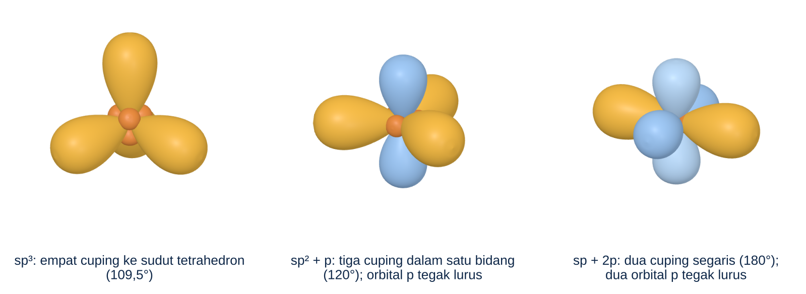
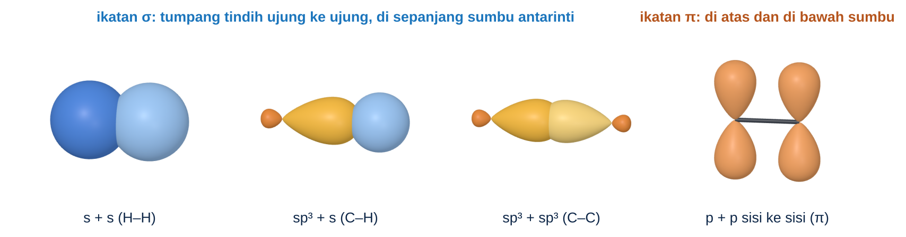
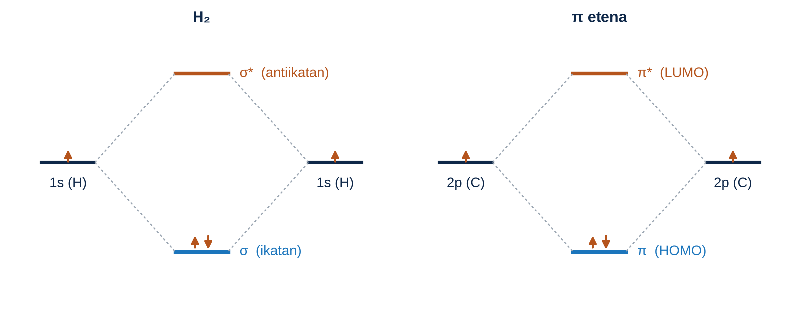

## 1.5 Hibridisasi dan bentuk molekul

Struktur Lewis memberi tahu atom mana yang tersambung dan berapa elektron yang dipakai bersama. Struktur Lewis tidak memberi tahu **bentuk** molekul di ruang. Padahal bentuk itu sangat penting. Bentuk menentukan apakah sebuah molekul polar, bagaimana molekul itu menempel pada enzim, dan dari arah mana sebuah pereaksi dapat menyerangnya.

### Menebak bentuk dari tolakan pasangan elektron

Cara paling cepat untuk menebak bentuk adalah gagasan **tolakan pasangan elektron** (VSEPR). Pasangan elektron di sekitar sebuah atom, baik pasangan ikatan maupun pasangan bebas, saling menolak karena sama-sama bermuatan negatif. Pasangan-pasangan itu karena itu mengatur diri sejauh mungkin satu sama lain. Yang dihitung adalah **kelompok elektron**: setiap atom tetangga dihitung satu kelompok (tidak peduli ikatannya tunggal, rangkap dua, atau rangkap tiga), dan setiap pasangan bebas juga dihitung satu kelompok.

* **Empat kelompok** mengatur diri ke arah sudut-sudut tetrahedron, dengan sudut 109,5° di antara setiap pasangan. Contohnya karbon dalam metana.
* **Tiga kelompok** mengatur diri dalam satu bidang dengan sudut 120°, membentuk segitiga datar. Contohnya karbon dalam etena atau karbon karbonil dalam metanal.
* **Dua kelompok** mengatur diri segaris, dengan sudut 180°. Contohnya karbon dalam etuna (asetilena) atau karbon pusat dalam CO₂.

Angka 109,5° bukan angka sembarang. Angka itu adalah sudut di antara dua garis yang ditarik dari pusat sebuah tetrahedron ke dua sudutnya, dan nilainya tepat $\cos^{-1}(-1/3) = 109{,}47°$. Pasangan bebas juga ikut menempati arah. Itulah sebabnya molekul air, dengan dua ikatan O–H dan dua pasangan bebas pada oksigen, berbentuk bengkok dan bukan lurus. Keempat kelompok elektron pada oksigen mengarah kira-kira ke sudut tetrahedron, tetapi hanya dua di antaranya yang mengikat atom hidrogen.

{width=90%}

### Mengapa orbital harus berbaur

VSEPR berhasil menebak bentuk, tetapi menimbulkan teka-teki. Atom karbon dalam keadaan dasar mempunyai elektron valensi 2s² 2p². Orbital 2p mengarah sepanjang sumbu *x*, *y*, dan *z*, saling tegak lurus pada 90°. Kalau karbon membentuk ikatan dengan orbital-orbital itu apa adanya, ikatan-ikatannya seharusnya membentuk sudut 90°, bukan 109,5°. Selain itu, orbital 2s dan 2p berbeda energi dan bentuk, sehingga keempat ikatan C–H dalam metana seharusnya tidak setara. Kenyataannya, keempat ikatan C–H dalam metana identik: panjangnya sama, energinya sama, dan sudutnya semua 109,5°.

Linus Pauling memecahkan teka-teki ini dengan gagasan **hibridisasi** (dibahas lengkap di *Kimia Kuantum*, subbab 12.2–12.5). Orbital atom bukanlah benda yang kaku. Secara matematis, kita boleh membentuk kombinasi linear orbital-orbital atom yang energinya berdekatan, dan hasilnya tetap merupakan orbital yang sah. Dengan mencampur satu orbital 2s dan tiga orbital 2p, kita memperoleh empat orbital baru yang sama bentuknya dan mengarah ke sudut-sudut tetrahedron. Orbital campuran ini disebut **orbital hibrida sp³**. Nama "sp³" menunjukkan resepnya: satu bagian s dan tiga bagian p.

Bentuk orbital hibrida berbeda dari orbital asalnya. Setiap orbital sp³ mempunyai satu cuping besar dan satu cuping kecil di arah sebaliknya. Cuping besar itu menjorok jauh dari inti ke arah atom tetangga, sehingga dapat bertumpang tindih dengan orbital tetangga lebih baik daripada orbital p biasa. Tumpang tindih yang lebih baik berarti ikatan yang lebih kuat. Jadi hibridisasi bukan sekadar trik untuk mencocokkan sudut. Hibridisasi menjelaskan mengapa karbon lebih suka membentuk empat ikatan yang kuat ke arah tetrahedron.

### Tiga jenis hibridisasi karbon

Karbon tidak selalu mencampur keempat orbitalnya. Bila karbon hanya terikat pada tiga atom, seperti dalam etena, ia mencampur satu orbital s dengan dua orbital p menjadi tiga **orbital sp²** yang terletak dalam satu bidang dengan sudut 120°. Satu orbital p tersisa tidak dicampur dan berdiri tegak lurus terhadap bidang itu. Bila karbon hanya terikat pada dua atom, seperti dalam etuna, ia mencampur satu orbital s dengan satu orbital p menjadi dua **orbital sp** yang segaris (180°), dan dua orbital p tersisa tegak lurus satu sama lain.

{width=92%}

Ada cara cepat untuk menentukan hibridisasi tanpa menggambar orbital. Hitung kelompok elektron di sekitar atom itu, seperti pada VSEPR: empat kelompok berarti sp³, tiga kelompok berarti sp², dua kelompok berarti sp. Cara yang lebih cepat lagi untuk karbon: karbon dengan empat ikatan tunggal adalah sp³; karbon dengan satu ikatan rangkap dua adalah sp²; karbon dengan satu ikatan rangkap tiga atau dua ikatan rangkap dua adalah sp.

| Hibridisasi | Kelompok elektron | Geometri | Sudut | Karakter s | Contoh |
|---|---|---|---|---|---|
| sp³ | 4 | tetrahedral | 109,5° | 25% | CH₄, CH₃OH |
| sp² | 3 | segitiga datar | 120° | 33% | C₂H₄, H₂C=O |
| sp | 2 | linear | 180° | 50% | C₂H₂, CH₃C≡N |

Kolom "karakter s" perlu dijelaskan karena akan sering dipakai. Orbital sp³ adalah seperempat s, orbital sp² sepertiga s, dan orbital sp separuh s. Orbital s lebih dekat ke inti daripada orbital p, sehingga elektron dalam orbital yang karakter s-nya lebih besar dipegang lebih erat dan berada lebih dekat ke inti. Akibatnya ada dua kecenderungan yang dapat diramalkan. Pertama, ikatan C–H menjadi makin pendek dari sp³ ke sp² ke sp (sekitar 109, 108, dan 106 pm). Kedua, karbon sp lebih "elektronegatif" daripada karbon sp³. Kecenderungan kedua ini akan menjelaskan di Bab 3 mengapa hidrogen pada etuna jauh lebih asam daripada hidrogen pada etana.

### Hibridisasi nitrogen dan oksigen

Gagasan yang sama berlaku untuk nitrogen dan oksigen, dengan pasangan bebas dihitung sebagai kelompok elektron. Nitrogen dalam amonia mempunyai tiga ikatan dan satu pasangan bebas: empat kelompok, jadi sp³, dan bentuk molekulnya piramida segitiga. Oksigen dalam air atau metanol mempunyai dua ikatan dan dua pasangan bebas: empat kelompok, jadi sp³, dan bentuknya bengkok. Sudut H–N–H amonia (107°) dan H–O–H air (104,5°) sedikit lebih kecil daripada 109,5°. Penyebabnya, pasangan bebas hanya ditarik oleh satu inti sehingga lebih "gemuk" daripada pasangan ikatan, dan pasangan bebas itu mendesak ikatan-ikatan di dekatnya untuk merapat.

::: {.contoh}
**Contoh 1.6 · Hibridisasi atom dalam asetonitril dan aseton**

Tentukan hibridisasi, geometri, dan sudut ikatan perkiraan untuk setiap atom bukan hidrogen dalam asetonitril (CH₃C≡N) dan aseton (CH₃COCH₃).

**Penyelesaian.** *Asetonitril.* Karbon CH₃ membentuk empat ikatan tunggal: sp³, tetrahedral, sekitar 109,5°. Karbon nitril terikat pada dua atom (C dan N) dengan satu ikatan rangkap tiga: dua kelompok elektron, jadi sp, linear, 180°. Nitrogen mempunyai satu ikatan rangkap tiga dan satu pasangan bebas: dua kelompok, jadi sp. Ketiga atom C–C≡N terletak pada satu garis lurus.

*Aseton.* Kedua karbon CH₃ adalah sp³. Karbon karbonil terikat pada tiga atom (dua C dan satu O): tiga kelompok, jadi sp², segitiga datar dengan sudut sekitar 120°. Oksigen karbonil mempunyai satu ikatan rangkap dua dan dua pasangan bebas: tiga kelompok, jadi sp².

**Memahami hasil.** Satu molekul dapat mengandung atom dengan hibridisasi berbeda-beda. Bagian molekul di sekitar gugus fungsi rangkap (C=O, C≡N) datar atau linear, sedangkan bagian alkil tetap tetrahedral. Bentuk datar karbon karbonil membuat karbon itu terbuka untuk diserang dari atas atau bawah bidangnya, seperti yang akan kita lihat di Bab 11.
:::

::: {.kuis}
**Kuis cepat 1.5** Tentukan hibridisasi setiap atom karbon dalam propena (CH₂=CH–CH₃) dan dalam propuna (HC≡C–CH₃). Atom karbon mana saja yang terletak pada satu garis lurus dalam propuna?
:::

## 1.6 Ikatan σ dan π

Hibridisasi menjelaskan arah ikatan, tetapi apa sebenarnya ikatan rangkap? Mengapa ikatan C=C lebih pendek daripada ikatan C–C, tetapi energinya tidak dua kali lipat? Dan mengapa molekul seperti but-2-ena dapat berada dalam dua bentuk yang tidak dapat berubah satu menjadi yang lain pada suhu kamar? Untuk menjawabnya, kita perlu membedakan dua cara orbital bertumpang tindih.

### Tumpang tindih ujung ke ujung: ikatan σ

Bila dua orbital bertemu ujung ke ujung, tepat di sepanjang garis yang menghubungkan kedua inti, tumpang tindihnya menghasilkan **ikatan sigma (σ)**. Rapat elektronnya terkumpul di antara kedua inti dan simetris terhadap sumbu ikatan. Penampang ikatan σ yang dipotong tegak lurus sumbu berbentuk lingkaran, seperti penampang sebuah sosis. Semua ikatan tunggal adalah ikatan σ: ikatan C–H dalam metana terbentuk dari orbital sp³ karbon dan orbital 1s hidrogen, ikatan C–C dalam etana terbentuk dari dua orbital sp³.

Karena rapat elektronnya simetris terhadap sumbu, ikatan σ tidak berubah bila salah satu atom diputar mengelilingi sumbu itu. Tumpang tindihnya tetap sama besar pada sudut putar berapa pun. Inilah sebabnya gugus CH₃ dalam etana dapat berputar hampir bebas terhadap gugus CH₃ lainnya. Penghalang putarnya hanya sekitar 12 kJ mol⁻¹, jauh lebih kecil daripada energi gerak termal yang tersedia pada suhu kamar, sehingga putaran itu terjadi miliaran kali setiap detik. Bentuk-bentuk berbeda yang dihasilkan oleh putaran ini, yang disebut konformasi, dibahas di Bab 4.

### Tumpang tindih sisi ke sisi: ikatan π

Sekarang lihat etena. Setiap karbon adalah sp², dan kedua karbon dihubungkan oleh ikatan σ dari tumpang tindih dua orbital sp². Setiap karbon masih mempunyai satu orbital p yang tidak dicampur, tegak lurus terhadap bidang molekul. Bila kedua orbital p itu sejajar, keduanya dapat bertumpang tindih secara **sisi ke sisi**: cuping atas bertemu cuping atas, cuping bawah bertemu cuping bawah. Tumpang tindih ini menghasilkan **ikatan pi (π)**, dengan rapat elektron di atas dan di bawah bidang molekul, bukan di sepanjang sumbu ikatan.

Jadi ikatan rangkap dua terdiri atas **satu ikatan σ dan satu ikatan π**. Ikatan rangkap tiga dalam etuna terdiri atas satu ikatan σ dan dua ikatan π. Kedua ikatan π itu terbentuk dari dua pasang orbital p yang saling tegak lurus, sehingga rapat elektronnya membentuk semacam tabung yang mengelilingi sumbu C≡C.

Tumpang tindih sisi ke sisi kurang efektif daripada tumpang tindih ujung ke ujung, karena cuping-cuping p hanya bersinggungan di pinggirnya. Akibatnya ikatan π lebih lemah daripada ikatan σ. Data energi ikatan menunjukkannya dengan jelas:

| Ikatan | Panjang (pm) | Energi (kJ mol⁻¹) | Susunan |
|---|---|---|---|
| C–C | 154 | 347 | σ |
| C=C | 134 | 614 | σ + π |
| C≡C | 120 | 839 | σ + 2π |

Energi C=C bukan dua kali energi C–C. Selisihnya, $614 - 347 = 267$ kJ mol⁻¹, dapat dianggap sebagai perkiraan energi ikatan π, sekitar tiga perempat energi ikatan σ. Kelemahan relatif ini punya akibat kimia yang besar. Elektron π berada di luar sumbu ikatan, lebih jauh dari inti, dan lebih mudah dijangkau pereaksi. Itulah sebabnya alkena bereaksi dengan banyak pereaksi yang tidak menyentuh alkana sama sekali. Ikatan π yang putus, sedangkan ikatan σ tetap utuh. Bab 8 membahas reaksi-reaksi ini.

{width=94%}

### Mengapa ikatan rangkap tidak dapat diputar

Ikatan π hanya terbentuk bila kedua orbital p sejajar. Bayangkan salah satu karbon etena diputar 90° mengelilingi sumbu C=C. Orbital p-nya kini tegak lurus terhadap orbital p karbon lainnya, sehingga tumpang tindihnya menjadi nol dan ikatan π putus. Memutar ikatan rangkap berarti memutus ikatan π, dan itu memerlukan energi sekitar 260 kJ mol⁻¹. Energi sebesar itu jauh di atas energi termal pada suhu kamar. Karena itu ikatan rangkap C=C **tidak berputar** pada suhu kamar.

{width=88%}

Akibatnya muncul bentuk isomer yang tidak ada pada alkana. But-2-ena dapat mempunyai kedua gugus CH₃ di sisi yang sama dari ikatan rangkap (cis-but-2-ena) atau di sisi yang berlawanan (trans-but-2-ena). Keduanya adalah zat yang berbeda, dengan titik didih yang berbeda (4 °C dan 1 °C). Keduanya dapat disimpan dalam botol terpisah tanpa saling berubah. Bab 5 membahas penamaan isomer seperti ini.

::: {.inti}
**Ringkasan ikatan.** Ikatan tunggal = 1σ. Ikatan rangkap dua = 1σ + 1π. Ikatan rangkap tiga = 1σ + 2π. Ikatan σ dapat berputar bebas; ikatan π mengunci putaran. Elektron π lebih lemah terikat dan lebih mudah dijangkau, sehingga menjadi tempat reaksi pada alkena, alkuna, dan senyawa aromatik.
:::

::: {.contoh}
**Contoh 1.7 · Menghitung ikatan σ dan π**

Hitung jumlah ikatan σ dan π dalam akrilonitril, CH₂=CH–C≡N, bahan baku serat akrilik.

**Penyelesaian.** Hitung setiap ikatan satu per satu. Ada tiga ikatan C–H (masing-masing σ). Ikatan C=C memberi 1σ + 1π. Ikatan C–C tunggal memberi 1σ. Ikatan C≡N memberi 1σ + 2π. Jumlahnya: σ = $3 + 1 + 1 + 1 = 6$, π = $1 + 2 = 3$.

**Memahami hasil.** Setiap pasangan atom yang tersambung, apa pun jenis ikatannya, dihubungkan oleh tepat satu ikatan σ. Jadi jumlah ikatan σ sama dengan jumlah sambungan antaratom. Ikatan π adalah "tambahan" di atas kerangka σ itu.
:::

### Teori orbital molekul: ikatan dan antiikatan

Gambaran ikatan σ dan π sebagai tumpang tindih dua orbital disebut **teori ikatan valensi**. Teori ini sangat berguna untuk menggambar bentuk molekul, tetapi tidak menjelaskan beberapa hal penting, misalnya mengapa elektron dalam benzena tersebar di seluruh cincin, atau ke mana elektron masuk ketika sebuah molekul diserang pereaksi. Untuk itu kimiawan memakai cara pandang kedua, **teori orbital molekul** (OM), yang dibahas lengkap di *Kimia Kuantum*, Bab 11 dan 13.

Gagasan pokok teori OM adalah ini: ketika dua orbital atom bergabung, keduanya tidak hilang, tetapi berubah menjadi **dua orbital molekul** yang tersebar di kedua atom. Satu orbital terbentuk bila kedua orbital atom bergabung **sefase**, sehingga gelombang elektronnya saling menguatkan di antara kedua inti. Rapat elektron yang tinggi di antara inti menarik kedua inti sekaligus, sehingga energinya lebih rendah daripada orbital atom asalnya. Orbital ini disebut **orbital ikatan**. Orbital lainnya terbentuk bila kedua orbital atom bergabung **berlawanan fase**, sehingga gelombangnya saling meniadakan di tengah dan terdapat **simpul** (bidang tanpa elektron) di antara kedua inti. Energinya lebih tinggi daripada orbital atom asalnya. Orbital ini disebut **orbital antiikatan** dan diberi tanda bintang: σ* atau π*.

{width=86%}

Elektron mengisi orbital molekul dari energi terendah, dua elektron per orbital. Dalam molekul H₂, kedua elektron masuk ke orbital σ ikatan, sehingga energi molekul lebih rendah daripada dua atom H yang terpisah: ikatan terbentuk. Jumlah ikatan dapat dihitung sebagai **orde ikatan**:

$$
\text{orde ikatan} = \frac{(\text{elektron di orbital ikatan}) - (\text{elektron di orbital antiikatan})}{2} \qquad \text{(1.3)}
$$

Untuk H₂, orde ikatannya $(2 - 0)/2 = 1$, sesuai dengan satu ikatan tunggal. Untuk He₂ yang hipotetis, empat elektron mengisi σ dan σ*, sehingga orde ikatannya $(2 - 2)/2 = 0$. Itulah sebabnya helium tidak membentuk molekul diatom.

### HOMO dan LUMO: tempat reaksi terjadi

Dalam etena, kedua orbital p yang sejajar membentuk orbital π ikatan dan π* antiikatan. Dua elektron π mengisi orbital π, dan π* tetap kosong. Dua orbital ini diberi nama khusus karena sangat menentukan kereaktifan. Orbital terisi yang energinya paling tinggi disebut **HOMO** (*highest occupied molecular orbital*), dan orbital kosong yang energinya paling rendah disebut **LUMO** (*lowest unoccupied molecular orbital*). Pada etena, HOMO adalah π dan LUMO adalah π*.

Mengapa dua orbital ini penting? Dalam reaksi, elektron mengalir dari molekul yang memberi elektron ke molekul yang menerima elektron. Elektron yang paling mudah diberikan adalah elektron di HOMO, karena energinya paling tinggi di antara elektron yang ada. Tempat yang paling mudah menerima elektron adalah LUMO, karena orbital kosong yang paling rendah. Jadi sebuah reaksi organik dapat dibayangkan sebagai aliran elektron **dari HOMO nukleofil ke LUMO elektrofil**. Gambaran ini akan kita pakai ketika membahas mekanisme di Bab 6. Panah lengkung yang kita gambar sebenarnya adalah ringkasan visual dari aliran elektron HOMO ke LUMO itu.

::: {.contoh}
**Contoh 1.8 · Orde ikatan dari diagram orbital molekul**

Gunakan diagram orbital molekul seperti Gambar 1.10 (kiri) untuk menentukan orde ikatan (a) H₂⁺, (b) H₂⁻. Mana yang lebih stabil daripada atom dan ion terpisahnya, dan mana yang ikatannya paling kuat di antara H₂, H₂⁺, dan H₂⁻?

**Penyelesaian.** (a) H₂⁺ hanya mempunyai satu elektron, di orbital σ: orde ikatan $(1 - 0)/2 = 0{,}5$. (b) H₂⁻ mempunyai tiga elektron: dua di σ, satu di σ*. Orde ikatan $(2 - 1)/2 = 0{,}5$. Keduanya mempunyai orde ikatan positif, sehingga keduanya terikat. H₂, dengan orde ikatan 1, mempunyai ikatan terkuat.

**Memahami hasil.** Orde ikatan setengah adalah sesuatu yang tidak dapat digambarkan dengan struktur Lewis, karena garis ikatan hanya dapat berjumlah bulat. Teori OM tidak terikat pada pasangan elektron, sehingga dapat menangani elektron tunggal dan ikatan pecahan. Kemampuan yang sama membuat teori OM dapat menjelaskan resonansi: elektron π dalam ion asetat menempati orbital yang tersebar di tiga atom sekaligus.
:::

::: {.kuis}
**Kuis cepat 1.6** Mengapa ikatan C=C lebih pendek daripada ikatan C–C? Berikan dua alasan: satu dari jumlah elektron di antara inti, satu dari hibridisasi karbon.
:::

## 1.7 Kepolaran ikatan dan momen dipol

Sampai di sini kita menganggap elektron ikatan dipakai bersama secara adil. Itu benar hanya bila kedua atom sama, seperti dalam ikatan C–C. Bila kedua atom berbeda, salah satu biasanya menarik elektron ikatan lebih kuat. Kemampuan sebuah atom menarik elektron ikatan ke arahnya disebut **keelektronegatifan**. Skala Pauling yang paling banyak dipakai memberi nilai berikut untuk unsur-unsur yang penting dalam kimia organik:

| Unsur | H | C | N | O | F | Cl | Br | I | Li | Mg |
|---|---|---|---|---|---|---|---|---|---|---|
| Keelektronegatifan | 2,20 | 2,55 | 3,04 | 3,44 | 3,98 | 3,16 | 2,96 | 2,66 | 0,98 | 1,31 |

### Ikatan polar dan muatan parsial

Bila dua atom yang keelektronegatifannya berbeda berikatan, elektron ikatan bergeser ke arah atom yang lebih elektronegatif. Atom itu mendapat sedikit kelebihan elektron dan bermuatan **parsial negatif** (δ−), sedangkan pasangannya bermuatan **parsial positif** (δ+). Ikatan seperti ini disebut **ikatan kovalen polar**. Lambang δ ("delta") menegaskan bahwa muatannya hanya sebagian, jauh lebih kecil daripada muatan satu elektron.

Untuk ikatan dengan karbon, selisih keelektronegatifan memberi gambaran yang jelas:

* **C–H** (selisih 0,35): hampir tidak polar. Inilah sebabnya hidrokarbon tidak larut dalam air.
* **C–O** (0,89), **C–N** (0,49), dan **C–halogen** (0,11 sampai 1,43): karbon menjadi δ+. Karbon yang terikat pada atom elektronegatif kekurangan elektron, sehingga menjadi sasaran pereaksi yang kaya elektron. Gagasan ini adalah inti dari reaksi substitusi di Bab 7 dan adisi pada karbonil di Bab 11.
* **C–Li** (−1,57) dan **C–Mg** (−1,24): arah kepolarannya terbalik. Karbon yang terikat pada logam menjadi δ− dan kaya elektron. Senyawa organologam seperti pereaksi Grignard memanfaatkan karbon "terbalik" ini untuk membentuk ikatan C–C baru (Bab 11).

Kalimat terakhir menunjukkan mengapa kepolaran ikatan begitu penting. Hampir semua reaksi organik adalah pertemuan antara bagian molekul yang kaya elektron dan bagian molekul yang miskin elektron. Kepolaran ikatan memberi tahu kita di mana bagian-bagian itu berada, bahkan sebelum kita mempelajari reaksinya.

### Momen dipol molekul

Kepolaran sebuah ikatan diukur dengan **momen dipol**, hasil kali besar muatan parsial dan jarak antara kedua muatan: $\mu = q \times d$. Satuan yang lazim adalah debye (D), dengan 1 D = 3,336 × 10⁻³⁰ C m. Momen dipol adalah besaran vektor: mempunyai besar dan arah. Arahnya biasanya digambar sebagai panah dari ujung δ+ ke ujung δ−, dengan tanda tambah kecil di pangkal panah.

Sebuah molekul dengan beberapa ikatan polar belum tentu polar. Momen dipol molekul adalah **jumlah vektor** semua momen dipol ikatannya, sehingga bentuk molekul ikut menentukan hasilnya. Dua contoh menunjukkan hal ini dengan jelas. Dalam CO₂, kedua ikatan C=O sangat polar, tetapi molekulnya linear. Kedua momen dipol ikatan sama besar dan berlawanan arah, sehingga saling meniadakan: momen dipol CO₂ nol. Dalam air, kedua ikatan O–H juga polar, tetapi molekulnya bengkok. Kedua momen dipol ikatan mengarah ke sisi yang sama dan tidak saling meniadakan. Hasilnya, air mempunyai momen dipol yang besar, 1,85 D. Sifat ini menjadi sumber kemampuan air melarutkan garam dan zat polar.

{width=96%}

::: {.contoh}
**Contoh 1.9 · Momen dipol klorometana**

Momen dipol klorometana (CH₃Cl) adalah 1,87 D, dan panjang ikatan C–Cl 178 pm. Bila seluruh momen dipol dianggap berasal dari muatan parsial +*q* pada C dan −*q* pada Cl, berapa *q* dinyatakan sebagai pecahan muatan elektron?

**Penyelesaian.** Ubah momen dipol ke satuan SI: $\mu = 1{,}87 \times 3{,}336 \times 10^{-30}\ \text{C m} = 6{,}24 \times 10^{-30}$ C m. Dari $\mu = qd$:
$$
q = \frac{\mu}{d} = \frac{6{,}24 \times 10^{-30}\ \text{C m}}{178 \times 10^{-12}\ \text{m}} = 3{,}50 \times 10^{-20}\ \text{C} .
$$
Bagi dengan muatan elektron, 1,602 × 10⁻¹⁹ C: $q/e = 0{,}22$.

**Memahami hasil.** Atom klorin dalam klorometana hanya membawa sekitar seperlima muatan elektron. Ikatan C–Cl jelas polar, tetapi jauh dari ionik. Kalau ikatan itu ionik penuh (C⁺Cl⁻), momen dipolnya akan sekitar 8,6 D, lebih dari empat kali nilai yang terukur. Angka 0,22 ini adalah perkiraan kasar, karena ikatan C–H juga sedikit menyumbang pada momen dipol molekul.
:::

::: {.contoh}
**Contoh 1.10 · Molekul polar atau tidak polar?**

Ramalkan apakah molekul berikut mempunyai momen dipol: (a) CCl₄, (b) CHCl₃, (c) CH₂Cl₂, (d) aseton.

**Penyelesaian.** (a) CCl₄ tetrahedral dengan empat ikatan C–Cl yang sama. Keempat vektor saling meniadakan karena simetri tetrahedron: μ = 0. (b) CHCl₃ juga tetrahedral, tetapi salah satu ikatan diganti C–H yang hampir tidak polar. Simetri rusak dan vektor tidak saling meniadakan: polar (terukur 1,04 D). (c) CH₂Cl₂: dua ikatan C–Cl tidak berlawanan arah dalam tetrahedron, sehingga polar (1,60 D). (d) Aseton mempunyai ikatan C=O yang sangat polar, dan tidak ada ikatan lain yang dapat mengimbanginya: sangat polar (2,88 D).

**Memahami hasil.** Molekul tidak polar hanya bila ikatan-ikatan polarnya tersusun begitu simetris sehingga semua vektornya saling meniadakan. Itu jarang terjadi. Sebagian besar molekul dengan gugus fungsi, karena itu, bersifat polar.
:::

::: {.kuis}
**Kuis cepat 1.7** Urutkan ikatan berikut dari yang paling polar: C–Br, C–O, C–N, C–H. Ke arah mana elektron ikatan bergeser pada setiap ikatan?
:::
