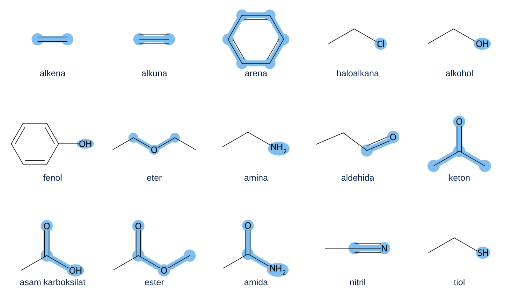
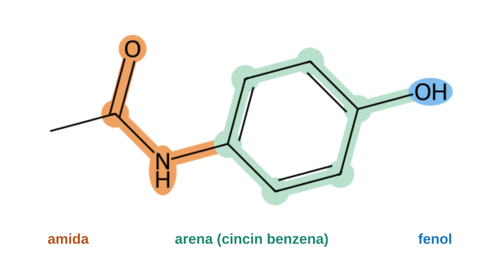
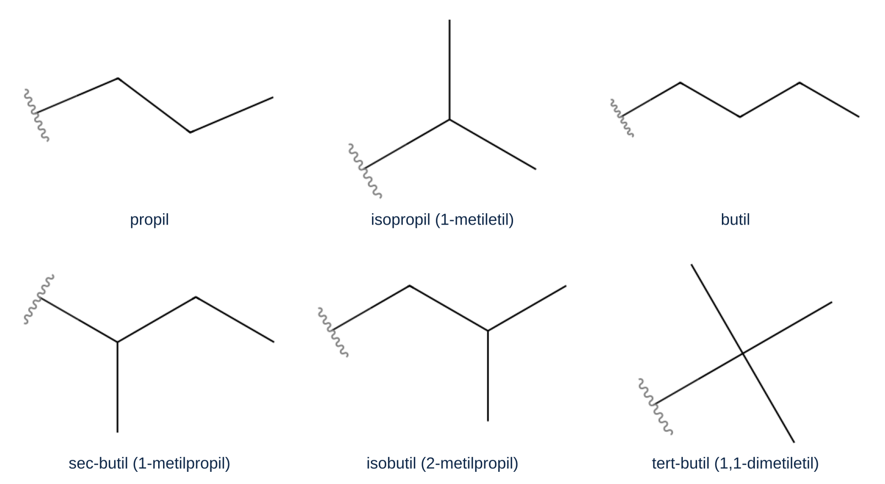
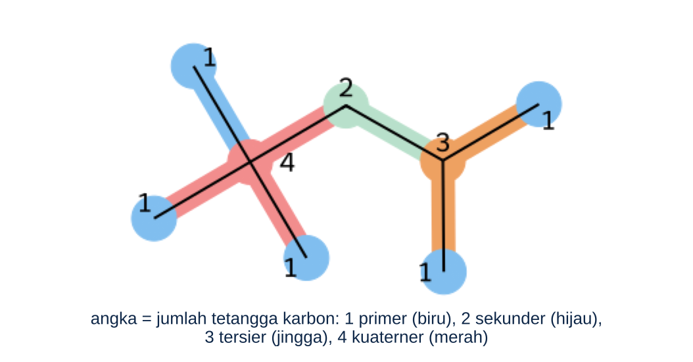
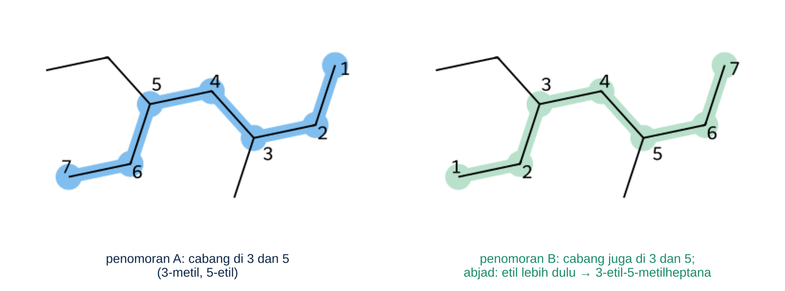
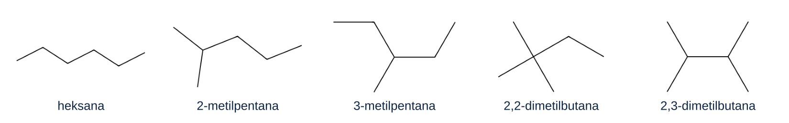
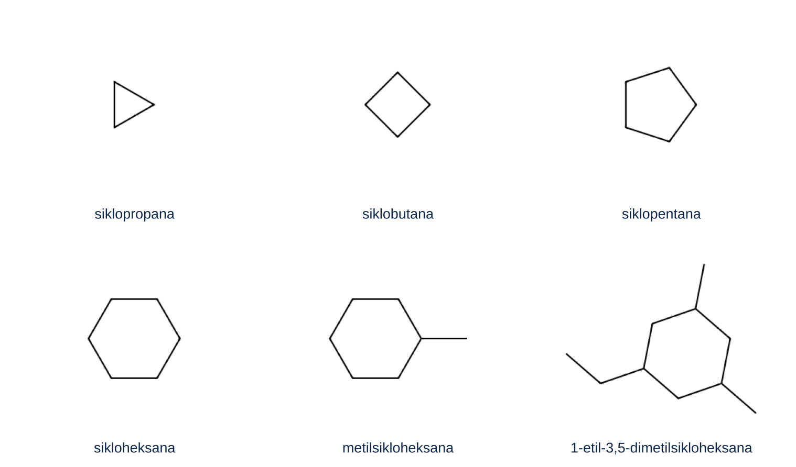
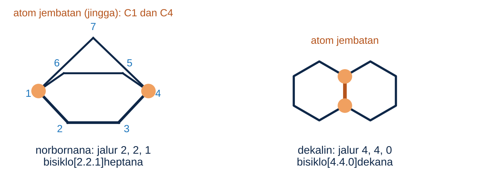

# Bab 2 Gugus Fungsi dan Tata Nama IUPAC

Pada label botol obat flu di apotek, kamu mungkin membaca "parasetamol". Di katalog bahan kimia, zat yang sama tertulis "N-(4-hidroksifenil)asetamida", dan di Amerika Serikat orang menyebutnya "acetaminophen". Tiga nama untuk satu molekul. Sebaliknya, kata "alkohol" dalam percakapan sehari-hari berarti etanol, tetapi dalam kimia kata itu menunjuk ribuan senyawa yang berbeda, dari metanol yang beracun sampai kolesterol. Bagaimana kimiawan di seluruh dunia dapat berbicara tentang jutaan senyawa tanpa salah paham?

Jawabannya adalah sistem tata nama yang disepakati bersama, yaitu tata nama **IUPAC** (International Union of Pure and Applied Chemistry). Gagasan dasarnya sederhana. Sebuah nama IUPAC bukan label yang harus dihafal, melainkan **deskripsi struktur** yang ditulis dengan aturan tetap. Nama itu dapat dibaca kembali menjadi struktur, seperti alamat yang dapat dibaca menjadi letak rumah. Siapa pun yang memahami aturannya dapat menggambar "4-etil-2-metilheksana" tanpa pernah melihat senyawa itu sebelumnya.

Bab ini dimulai dari gugus fungsi, yaitu bagian molekul yang menentukan sifat kimianya dan sekaligus menentukan akhiran namanya. Setelah itu kita membangun aturan penamaan selangkah demi selangkah: dari alkana yang paling sederhana, ke sikloalkana, alkena dan alkuna, lalu senyawa dengan gugus fungsi. Di akhir bab kita berlatih ke arah sebaliknya: membaca nama menjadi struktur.

::: {.kuis}
**Pertanyaan pembuka**

1. Mengapa sebuah nama IUPAC dapat dibaca kembali menjadi tepat satu struktur?
2. Mengapa "2-etilbutana" adalah nama yang salah, padahal strukturnya dapat digambar?
3. Bila sebuah molekul mempunyai gugus –OH dan C=O sekaligus, gugus mana yang menentukan akhiran nama?
4. Mengapa nama umum seperti aseton, asam asetat, dan toluena masih dipakai walaupun ada nama IUPAC?
5. Berapa banyak alkana berbeda yang mempunyai rumus C₁₀H₂₂, dan mengapa jumlahnya bertambah begitu cepat?
:::

::: {.tujuan}
**Tujuan belajar**

Setelah mempelajari bab ini, kamu mampu:

1. Mengenali gugus fungsi utama dalam sebuah struktur dan menyebutkan golongan senyawanya.
2. Membedakan karbon primer, sekunder, tersier, dan kuaterner, serta menamai gugus alkil sederhana.
3. Menamai alkana bercabang dan sikloalkana dengan aturan IUPAC.
4. Menamai alkena dan alkuna, termasuk menentukan letak ikatan rangkap.
5. Menentukan gugus fungsi utama menurut urutan prioritas dan memberi akhiran yang benar.
6. Mengenali nama umum yang masih banyak dipakai.
7. Menggambar struktur dari nama IUPAC dan memeriksa apakah sebuah nama benar.
:::

::: {.mat}
**Prasyarat**

Bab 1: rumus garis dan rumus kondensasi (subbab 1.4), derajat ketidakjenuhan (subbab 1.4), dan ikatan σ dan π (subbab 1.6).
:::

## 2.1 Gugus fungsi: bagian molekul yang bereaksi

Di Bab 1 kita melihat bahwa kerangka C–C dan C–H hampir tidak polar dan tidak mudah bereaksi. Kalau kerangka itu "diam", di mana reaksi terjadi? Reaksi terjadi di bagian-bagian molekul yang berbeda dari kerangka biasa: ikatan rangkap, atau atom selain karbon dan hidrogen. Bagian-bagian ini disebut **gugus fungsi**.

Mengapa gugus fungsi menjadi tempat reaksi? Ada dua alasan, keduanya sudah kita kenal dari Bab 1. Pertama, ikatan π lebih lemah dan elektronnya lebih mudah dijangkau daripada ikatan σ, sehingga alkena dan alkuna mudah diserang. Kedua, atom seperti O, N, dan halogen membuat ikatan menjadi polar. Atom-atom itu juga membawa pasangan elektron bebas. Kepolaran menciptakan atom yang miskin elektron (δ+), sedangkan pasangan bebas adalah sumber elektron. Pertemuan keduanya adalah inti hampir setiap reaksi organik.

Kegunaan gagasan ini sangat besar. Gugus –OH pada etanol, pada mentol, dan pada kolesterol bereaksi dengan cara yang hampir sama, walaupun kerangka karbon ketiga molekul itu sangat berbeda. Jadi kita tidak perlu mempelajari reaksi setiap senyawa. Cukup mempelajari reaksi setiap gugus fungsi. Tabel berikut memuat gugus fungsi yang akan kita temui di buku ini.

| Golongan | Gugus fungsi | Contoh | Nama contoh | Bab |
|---|---|---|---|---|
| Alkana | hanya C–C dan C–H | CH₃CH₃ | etana | 4 |
| Alkena | C=C | CH₂=CH₂ | etena | 8 |
| Alkuna | C≡C | HC≡CH | etuna | 8 |
| Arena | cincin benzena | C₆H₅CH₃ | metilbenzena (toluena) | 10 |
| Haloalkana | C–X (X = F, Cl, Br, I) | CH₃CH₂Br | bromoetana | 7 |
| Alkohol | C–OH | CH₃CH₂OH | etanol | 9 |
| Eter | C–O–C | CH₃OCH₃ | metoksimetana | 9 |
| Amina | C–N | CH₃NH₂ | metanamina | 13 |
| Aldehida | –CHO | CH₃CHO | etanal | 11 |
| Keton | C–CO–C | CH₃COCH₃ | propanon | 11 |
| Asam karboksilat | –COOH | CH₃COOH | asam etanoat | 12 |
| Ester | –COO–C | CH₃COOCH₃ | metil etanoat | 12 |
| Amida | –CONH₂ | CH₃CONH₂ | etanamida | 12 |
| Nitril | –C≡N | CH₃CN | etananitril | 12 |

Ada satu gugus yang muncul berkali-kali di tabel itu: **gugus karbonil**, C=O. Aldehida, keton, asam karboksilat, ester, dan amida semuanya mengandung C=O. Yang membedakan mereka adalah atom yang terikat pada karbon karbonil. Pada aldehida, paling sedikit satu tetangganya H. Pada keton, kedua tetangganya C. Pada asam karboksilat, satu tetangganya OH. Pada ester, satu tetangganya OR. Pada amida, satu tetangganya N. Perbedaan tetangga ini, seperti yang akan kita lihat di Bab 11 dan 12, menentukan seberapa mudah karbon karbonil diserang.

::: {.awas}
**Kesalahan umum: alkohol, eter, dan keton dari rumus molekul**

Rumus molekul tidak cukup untuk menentukan gugus fungsi. C₃H₈O dapat berupa propan-1-ol, propan-2-ol (keduanya alkohol), atau metoksietana (eter). C₃H₆O dapat berupa propanal (aldehida), propanon (keton), prop-2-en-1-ol (alkohol dengan C=C), atau oksetana (eter siklik). Selalu periksa **sambungan** atom: oksigen yang terikat pada H adalah alkohol; oksigen yang terjepit di antara dua karbon tanpa C=O adalah eter.
:::

{width=96%}

::: {.contoh}
**Contoh 2.1 · Mengenali gugus fungsi dalam obat**

Parasetamol mempunyai rumus HO–C₆H₄–NH–CO–CH₃, dengan gugus OH dan gugus NH terikat pada cincin benzena di posisi yang berseberangan. Sebutkan semua gugus fungsinya.

**Penyelesaian.** Telusuri molekul dari kiri ke kanan. Gugus –OH terikat langsung pada cincin benzena. Gugus –OH pada cincin aromatik diberi nama khusus, **fenol**, karena sifatnya berbeda dari alkohol biasa (lebih asam, Bab 3). Cincin C₆H₄ adalah **arena**. Gugus –NH–CO–CH₃ mengandung nitrogen yang terikat pada karbon karbonil: itu **amida**.

**Memahami hasil.** Satu molekul obat sering mengandung beberapa gugus fungsi. Setiap gugus memberi sifat tertentu: gugus fenol dan amida membentuk ikatan hidrogen dengan air dan dengan protein di tubuh, sedangkan cincin benzena memberi bagian yang tidak polar. Ketika menamai molekul seperti ini, kita harus memilih satu gugus sebagai gugus utama. Subbab 2.6 menjelaskan caranya.
:::

::: {.kuis}
**Kuis cepat 2.1** Sebutkan gugus fungsi dalam (a) CH₃CH₂COOCH₃; (b) CH₃CH(NH₂)COOH (alanina); (c) CH₂=CHCHO.
:::

{width=72%}

## 2.2 Rantai karbon dan gugus alkil

Sebelum menamai molekul, kita perlu kosakata untuk menggambarkan kerangka karbon. Kosakata itu terdiri atas dua bagian: nama rantai berdasarkan jumlah karbon, dan nama potongan rantai yang menempel sebagai cabang.

### Nama dasar menurut jumlah karbon

Nama setiap senyawa organik dibangun di atas nama rantai karbonnya. Empat nama pertama berasal dari nama lama yang sudah terlanjur dipakai luas (met-, et-, prop-, but-). Mulai lima karbon, namanya diambil dari angka Yunani, sehingga mudah diingat.

| Jumlah C | Akar | Alkana | Jumlah C | Akar | Alkana |
|---|---|---|---|---|---|
| 1 | met- | metana | 6 | heks- | heksana |
| 2 | et- | etana | 7 | hept- | heptana |
| 3 | prop- | propana | 8 | okt- | oktana |
| 4 | but- | butana | 9 | non- | nonana |
| 5 | pent- | pentana | 10 | dek- | dekana |

Akar ini akan dipakai untuk semua golongan senyawa. Akar menyatakan jumlah karbon, sedangkan akhiran menyatakan gugus fungsi: etana (–ana, alkana), etena (–ena, alkena), etanol (–ol, alkohol), etanal (–al, aldehida), dan seterusnya. Dengan memisahkan "berapa karbon" dari "gugus apa", sistem IUPAC dapat menamai jutaan senyawa dengan sedikit akar dan sedikit akhiran.

### Gugus alkil

Bila satu atom hidrogen diambil dari sebuah alkana, sisanya dapat menempel pada molekul lain sebagai cabang. Potongan seperti ini disebut **gugus alkil**, dan namanya dibentuk dengan mengganti akhiran –ana menjadi **–il**: metana menjadi metil (CH₃–), etana menjadi etil (CH₃CH₂–), propana menjadi propil (CH₃CH₂CH₂–). Lambang umum untuk gugus alkil adalah **R**, sehingga R–OH berarti "alkohol apa saja".

Mulai dari propana, hidrogen dapat diambil dari lebih dari satu jenis karbon, sehingga ada lebih dari satu gugus alkil. Untuk menggambarkannya, kita perlu cara menggolongkan atom karbon menurut jumlah karbon tetangganya:

* **Karbon primer (1°)** terikat pada satu karbon lain. Contohnya karbon ujung dalam rantai.
* **Karbon sekunder (2°)** terikat pada dua karbon lain. Contohnya karbon tengah propana.
* **Karbon tersier (3°)** terikat pada tiga karbon lain, misalnya titik cabang.
* **Karbon kuaterner (4°)** terikat pada empat karbon lain.

Penggolongan ini bukan sekadar istilah. Kita akan melihat di Bab 6 dan 7 bahwa karbokation tersier jauh lebih stabil daripada karbokation primer, sehingga alkil halida tersier bereaksi dengan mekanisme yang sama sekali berbeda dari alkil halida primer. Istilah yang sama juga dipakai untuk hidrogen (hidrogen primer terikat pada karbon primer), untuk alkohol, dan untuk alkil halida.

{width=92%}

Gugus alkil yang paling sering dijumpai adalah gugus tiga dan empat karbon pada Gambar 2.3. Nama-nama umumnya perlu dihafal, karena dipakai di mana-mana, juga dalam nama IUPAC:

* **Propil** (CH₃CH₂CH₂–): menempel lewat karbon ujung (primer).
* **Isopropil** ((CH₃)₂CH–): menempel lewat karbon tengah (sekunder). Awalan "iso" menunjukkan percabangan dua metil di ujung yang jauh dari titik tempel.
* **Butil** (CH₃CH₂CH₂CH₂–): rantai lurus, menempel lewat karbon ujung.
* **sec-Butil** (CH₃CH₂CH(CH₃)–): menempel lewat karbon sekunder.
* **Isobutil** ((CH₃)₂CHCH₂–): rantai bercabang, menempel lewat karbon primer.
* **tert-Butil** ((CH₃)₃C–): menempel lewat karbon tersier. Gugus ini besar dan bulat, dan sering dipakai untuk menghalangi serangan pereaksi.

Awalan "sec-" dan "tert-" ditulis miring dan diabaikan ketika mengurutkan nama menurut abjad, sedangkan awalan "iso" bukan awalan terpisah sehingga ikut dihitung. Jadi isobutil diurutkan di bawah huruf "i", tetapi *tert*-butil di bawah huruf "b".

::: {.contoh}
**Contoh 2.2 · Karbon primer, sekunder, tersier, kuaterner**

Golongkan setiap atom karbon dalam 2,2,4-trimetilpentana, (CH₃)₃CCH₂CH(CH₃)₂, komponen acuan bilangan oktana bensin.

**Penyelesaian.** Hitung tetangga karbon setiap atom. Tiga gugus CH₃ pada C2 masing-masing terikat pada satu karbon: primer. C2 terikat pada tiga CH₃ dan pada CH₂: empat tetangga karbon, jadi kuaterner. CH₂ (C3) terikat pada C2 dan C4: sekunder. C4 (CH) terikat pada C3 dan pada dua CH₃: tersier. Dua CH₃ pada C4: primer.

Jumlahnya: 5 karbon primer, 1 sekunder, 1 tersier, 1 kuaterner, total 8 karbon, sesuai rumus C₈H₁₈.

**Memahami hasil.** Molekul ini sangat bercabang. Percabangan membuat bahan bakar terbakar lebih teratur di dalam mesin dan tidak mudah "mengetuk". Itulah sebabnya 2,2,4-trimetilpentana diberi bilangan oktana 100, sedangkan heptana yang berantai lurus diberi bilangan oktana 0.
:::

::: {.kuis}
**Kuis cepat 2.2** Gambar gugus isopropil dan *tert*-butil. Berapa atom hidrogen primer, sekunder, dan tersier dalam 2-metilbutana?
:::

{width=66%}

## 2.3 Tata nama alkana

Alkana rantai lurus mudah dinamai: cukup hitung karbonnya. Kesulitan muncul ketika rantai bercabang. Bahkan alkana yang kecil sudah mempunyai banyak bentuk. Butana (C₄H₁₀) mempunyai dua struktur yang berbeda, pentana (C₅H₁₂) tiga, heksana (C₆H₁₄) lima, dan dekana (C₁₀H₂₂) tujuh puluh lima. Senyawa-senyawa yang rumus molekulnya sama tetapi sambungan atomnya berbeda disebut **isomer struktur** (isomer konstitusi). Jumlahnya meledak dengan cepat: C₂₀H₄₂ mempunyai 366 319 isomer struktur. Mustahil memberi nama khusus untuk masing-masing. Karena itu kita memerlukan aturan.

Mengapa jumlahnya bertambah begitu cepat? Setiap karbon tambahan dapat ditempelkan di banyak tempat yang berbeda pada setiap isomer yang lebih kecil. Jumlah pilihan berlipat di setiap langkah, sama seperti jumlah cara menyusun cabang pohon yang bertambah sangat cepat bila pohonnya diberi satu cabang lagi.

### Aturan menamai alkana bercabang

Tata nama IUPAC untuk alkana bercabang dapat dikerjakan dalam lima langkah. Setiap langkah menjawab satu pertanyaan, dan urutannya penting.

::: {.strategi}
**Strategi: menamai alkana**

1. **Cari rantai induk.** Rantai induk adalah rantai karbon **terpanjang** yang tersambung, walaupun rantai itu berbelok-belok dalam gambar. Bila ada dua rantai sama panjang, pilih yang mempunyai cabang lebih banyak.
2. **Beri nomor rantai induk** dari ujung yang membuat cabang pertama mendapat nomor terkecil. Bila kedua ujung sama, bandingkan cabang kedua, lalu ketiga, dan seterusnya.
3. **Namai setiap cabang** sebagai gugus alkil dan tentukan nomornya.
4. **Kelompokkan cabang yang sama** dengan awalan di- (2), tri- (3), tetra- (4). Setiap cabang tetap mendapat nomornya sendiri: 2,2-dimetil, bukan 2-dimetil.
5. **Susun nama**: cabang diurutkan menurut abjad (awalan di-, tri-, *sec*-, *tert*- diabaikan), nomor dipisahkan dari kata dengan tanda hubung dan nomor dipisahkan satu sama lain dengan koma, lalu nama rantai induk ditulis di akhir tanpa spasi.
:::

Langkah pertama paling sering salah. Rumus garis atau rumus kondensasi biasanya menggambar molekul dengan satu rantai mendatar, dan mata kita cenderung menganggap rantai mendatar itu sebagai rantai induk. Padahal rantai terpanjang bisa saja berbelok masuk ke salah satu cabang. Kebiasaan yang baik: sebelum menamai, telusuri **setiap** jalur dari satu ujung ke ujung lainnya dan hitung karbonnya.

::: {.contoh}
**Contoh 2.3 · Menamai alkana bercabang**

Namai senyawa CH₃CH₂CH(CH₃)CH₂CH(CH₂CH₃)CH₂CH₃.

**Rencana.** Ikuti lima langkah. Perhatikan baik-baik gugus etil di karbon kelima dari kiri, karena gugus itu dapat menjadi bagian dari rantai induk.

**Penyelesaian.** *Langkah 1.* Rantai mendatar yang ditulis berisi tujuh karbon: CH₃–CH₂–CH–CH₂–CH–CH₂–CH₃. Namun di karbon kelima ada cabang etil. Jika rantai berbelok ke etil itu, jumlah karbonnya tetap tujuh (lima karbon pertama ditambah dua karbon etil). Jadi ada dua rantai tujuh karbon. Menurut langkah 1, pilih yang cabangnya lebih banyak. Kedua pilihan sama-sama mempunyai dua cabang (satu metil dan satu etil), sehingga keduanya sama dan kita bebas memilih salah satu. Ambil rantai mendatar.

*Langkah 2.* Dari kiri, cabang pertama (metil) di C3. Dari kanan, cabang pertama (etil) juga di C3. Seri. Bandingkan cabang kedua: dari kiri, etil di C5; dari kanan, metil di C5. Seri lagi. Bila semua nomor sama, IUPAC memberi nomor kecil pada cabang yang **lebih dahulu menurut abjad**. "Etil" mendahului "metil", sehingga etil harus mendapat nomor 3. Itu berarti penomoran dari kanan.

*Langkah 3–5.* Cabang: 3-etil dan 5-metil. Rantai induk: heptana. Nama: **3-etil-5-metilheptana**.

**Memahami hasil.** Aturan abjad hanya dipakai bila penomoran dari kedua ujung memberi himpunan nomor yang sama, dalam contoh ini {3, 5}. Kasus seperti itu jarang, tetapi menunjukkan bahwa setiap aturan IUPAC dirancang supaya setiap struktur mendapat **tepat satu** nama.
:::

{width=90%}

::: {.contoh}
**Contoh 2.4 · Memeriksa nama yang salah**

Seorang mahasiswa menamai sebuah senyawa "2-etilbutana". Gambar struktur yang dimaksud, lalu berikan nama yang benar.

**Penyelesaian.** Butana: C1–C2–C3–C4. Etil di C2: CH₃CH(CH₂CH₃)CH₂CH₃. Sekarang cari rantai terpanjang. Dari karbon CH₃ etil, lewat C2, C3, sampai C4, ada lima karbon tanpa cabang lain selain CH₃ (C1 yang semula). Rantai induknya pentana, dengan satu cabang metil. Nomor dari ujung yang dekat cabang: metil di C3 dari kedua ujung (rantai simetris). Nama yang benar: **3-metilpentana**.

**Memahami hasil.** Nama yang menyebut "etil" di C2 atau "propil" di C2 hampir selalu salah, karena cabang itu pasti dapat diperpanjang ke dalam rantai induk. Ini pemeriksaan cepat yang berguna: cabang di C2 hanya boleh metil, cabang di C3 paling panjang etil, dan seterusnya.
:::

### Cabang yang bercabang

Kadang-kadang cabangnya sendiri bercabang, dan tidak mempunyai nama umum. Dalam kasus itu cabang dinamai seperti molekul kecil: karbon yang menempel pada rantai induk diberi nomor 1, rantai terpanjang cabang itu menjadi akar namanya, dan nama lengkap cabang ditulis dalam kurung. Contohnya –CH₂CH(CH₃)CH₂CH₃ disebut (2-metilbutil). Aturan ini jarang diperlukan di tingkat awal, tetapi berguna untuk mengenali nama-nama seperti 5-(1,1-dimetiletil)nonana, yang tidak lain adalah 5-*tert*-butilnonana.

### Mencari semua isomer secara sistematis

Soal yang sering muncul berbunyi: "Gambar dan namai semua isomer C₆H₁₄." Tanpa cara yang teratur, kita mudah melewatkan satu isomer atau menggambar isomer yang sama dua kali dengan bentuk yang berbeda. Nama IUPAC justru menjadi alat pemeriksa yang ampuh: dua gambar yang bernama sama adalah senyawa yang sama, betapa pun berbeda tampilannya.

Cara yang teratur adalah **memendekkan rantai induk selangkah demi selangkah**, lalu menempatkan karbon sisanya sebagai cabang di semua posisi yang mungkin:

1. Mulai dari rantai lurus terpanjang (tanpa cabang).
2. Pendekkan rantai induk satu karbon. Karbon yang tersisa menjadi satu cabang metil. Tempatkan cabang itu di setiap karbon yang mungkin, mulai dari C2. Cabang di C1 tidak dihitung, karena itu hanya memperpanjang rantai.
3. Pendekkan lagi. Sekarang dua karbon sisa dapat menjadi dua metil atau satu etil. Coba semua penempatan.
4. Setelah setiap gambar, **namai** strukturnya. Bila namanya sudah muncul sebelumnya, gambar itu duplikat dan dibuang.

::: {.contoh}
**Contoh 2.5 · Semua isomer C₆H₁₄**

Temukan semua alkana C₆H₁₄ dengan cara sistematis.

**Penyelesaian.** *Rantai enam:* heksana. *Rantai lima + satu metil:* metil di C2 memberi 2-metilpentana; metil di C3 memberi 3-metilpentana. Metil di C4 sama dengan di C2 (dinomori dari ujung lain), jadi tidak ada yang baru. *Rantai empat + dua karbon:* dua metil di C2 dan C2 memberi 2,2-dimetilbutana; di C2 dan C3 memberi 2,3-dimetilbutana. Satu etil di C2 akan memperpanjang rantai menjadi lima (3-metilpentana yang sudah ada). *Rantai tiga:* empat karbon sisa harus menempel pada C2 saja, padahal C2 hanya dapat mengikat dua cabang. Dua cabang di C2 yang jumlah karbonnya empat (misalnya dua etil) selalu membentuk rantai yang lebih panjang. Tidak ada isomer baru.

Jumlahnya lima: heksana, 2-metilpentana, 3-metilpentana, 2,2-dimetilbutana, 2,3-dimetilbutana.

**Memahami hasil.** Cara ini menjamin kelengkapan, karena setiap isomer mempunyai satu rantai induk tertentu dan pasti terlewati ketika kita sampai pada panjang rantai itu. Langkah penamaan menjamin tidak ada duplikat. Untuk C₇H₁₆ cara yang sama memberi sembilan isomer.
:::

Cara yang sama berlaku untuk senyawa dengan gugus fungsi. Untuk C₄H₉Cl, mulai dari kerangka karbon (butana dan 2-metilpropana), lalu tempatkan Cl di setiap jenis karbon yang berbeda. Butana mempunyai dua jenis karbon (ujung dan tengah), sehingga memberi 1-klorobutana dan 2-klorobutana. 2-Metilpropana juga mempunyai dua jenis karbon (tiga CH₃ yang setara dan satu CH), sehingga memberi 1-kloro-2-metilpropana dan 2-kloro-2-metilpropana. Jumlahnya empat. Kata kuncinya adalah **jenis karbon yang setara**: karbon-karbon yang tidak dapat dibedakan karena simetri molekul memberi produk yang sama.

::: {.kuis}
**Kuis cepat 2.3** Namai (CH₃)₂CHCH₂C(CH₃)₂CH₂CH₃. Pastikan kamu mencari rantai terpanjang dan memberi nomor terkecil pada cabang.
:::

{width=96%}

## 2.4 Sikloalkana

Rantai karbon dapat menutup menjadi cincin. Alkana yang berbentuk cincin disebut **sikloalkana**, dan rumus umumnya CₙH₂ₙ: dua hidrogen lebih sedikit daripada alkana rantai terbuka, karena dua ujung rantai bersambung. Menurut subbab 1.4, satu cincin berarti satu derajat ketidakjenuhan. Sikloalkana sangat umum di alam. Steroid seperti kolesterol mempunyai empat cincin yang menyatu, dan banyak senyawa wangi seperti mentol mempunyai cincin enam karbon.

Penamaannya mengikuti aturan alkana dengan tiga tambahan:

1. **Cincin diberi awalan siklo-**: siklopropana, siklobutana, siklopentana, sikloheksana.
2. **Cincin menjadi induk.** Bila sebuah rantai alkil menempel pada cincin, cincin dijadikan induk dan rantai menjadi cabang: metilsikloheksana, pentilsiklopropana. Ini aturan IUPAC 2013. Buku-buku yang lebih lama menjadikan rantai sebagai induk bila rantai itu lebih panjang daripada cincin, sehingga kamu juga dapat menjumpai nama seperti 1-siklopropilpentana untuk senyawa yang sama.
3. **Penomoran cincin** dimulai dari salah satu karbon bercabang dan berjalan ke arah yang memberi nomor terkecil pada cabang berikutnya. Bila hanya ada satu cabang, nomor 1 tidak perlu ditulis: metilsikloheksana, bukan 1-metilsikloheksana.

{width=84%}

::: {.contoh}
**Contoh 2.6 · Menamai sikloalkana tersubstitusi**

Namai sikloheksana yang mengikat gugus etil pada satu karbon dan dua gugus metil pada karbon ketiga dan kelima dari karbon etil itu (bila dihitung di sepanjang cincin, karbon etil sebagai karbon pertama).

**Penyelesaian.** Ada tiga cabang di cincin: etil, metil, metil. Kemungkinan penomoran: mulai dari karbon etil, cabang berada di {1, 3, 5}. Mulai dari salah satu karbon metil dan berjalan ke arah yang terdekat, cabang juga berada di {1, 3, 5}. Himpunannya sama dari arah mana pun, sehingga kita memakai aturan abjad: etil diberi nomor 1. Nama: **1-etil-3,5-dimetilsikloheksana**.

**Memahami hasil.** Pola penalarannya sama dengan Contoh 2.3: bandingkan dulu himpunan nomor; hanya bila himpunannya sama, pakai abjad. Pada sikloalkana, ada lebih banyak cara memulai penomoran (setiap karbon bercabang, dua arah), tetapi aturannya tidak berubah.
:::

Sikloalkana juga memperkenalkan sesuatu yang tidak ada pada alkana rantai terbuka. Cincin tidak dapat berputar bebas seperti rantai, sehingga dua cabang pada cincin dapat berada di sisi yang sama dari bidang cincin (**cis**) atau di sisi yang berlawanan (**trans**). cis-1,2-Dimetilsikloheksana dan trans-1,2-dimetilsikloheksana adalah dua senyawa yang berbeda dengan sambungan atom yang sama. Isomer seperti ini disebut **stereoisomer** dan dibahas di Bab 4 dan Bab 5.

### Senyawa bisiklik

Dua cincin dapat berbagi atom. Bila dua cincin berbagi dua atom yang bersebelahan, seperti dalam dekalin, atau berbagi dua atom yang tidak bersebelahan, seperti dalam norbornana, senyawa itu disebut **bisiklik**. Banyak bahan alam yang penting berbentuk bisiklik, misalnya kamfer (kapur barus) dan pinena (zat wangi minyak terpentin).

Kedua atom yang dimiliki bersama oleh kedua cincin disebut **atom jembatan** (*bridgehead*). Dari satu atom jembatan ke atom jembatan lainnya selalu ada tiga jalur. Nama bisiklik dibentuk dari jumlah atom karbon di setiap jalur:

$$
\text{bisiklo}[a.b.c]\text{alkana}, \qquad a \geq b \geq c ,
$$

dengan *a*, *b*, dan *c* jumlah karbon di setiap jalur, **tidak termasuk** kedua atom jembatan. Angka ditulis dari yang terbesar dan dipisahkan dengan titik. Nama alkana di akhir menyatakan jumlah **semua** karbon, termasuk atom jembatan: $a + b + c + 2$.

Penomoran dimulai dari salah satu atom jembatan (C1), berjalan lewat jalur terpanjang ke atom jembatan kedua, lalu kembali lewat jalur kedua terpanjang, dan terakhir jalur terpendek.

{width=86%}

::: {.contoh}
**Contoh 2.7 · Norbornana dan dekalin**

(a) Norbornana mempunyai tujuh karbon. Dua atom jembatan dihubungkan oleh dua jalur dua karbon dan satu jalur satu karbon. (b) Dekalin mempunyai sepuluh karbon: dua cincin enam yang berbagi satu ikatan. Namai keduanya.

**Penyelesaian.** (a) Jalur: 2, 2, 1. Jumlah karbon $2 + 2 + 1 + 2 = 7$, heptana. Nama: **bisiklo[2.2.1]heptana**.

(b) Kedua atom jembatan bersebelahan, sehingga salah satu jalurnya tidak berisi karbon sama sekali (ikatan langsung). Dua jalur lainnya masing-masing empat karbon. Jalur: 4, 4, 0. Jumlah $4 + 4 + 0 + 2 = 10$, dekana. Nama: **bisiklo[4.4.0]dekana**.

**Memahami hasil.** Angka 0 dalam nama dekalin menandai cincin yang **menyatu** (berbagi ikatan), sedangkan angka bukan nol pada ketiga jalur norbornana menandai cincin yang **berjembatan**. Perbedaan bentuk ini berakibat pada kekakuan molekul. Norbornana sangat kaku, sehingga sering dipakai untuk mempelajari bagaimana bentuk tiga dimensi mempengaruhi kereaktifan.
:::

::: {.kuis}
**Kuis cepat 2.4** Gambar 1,1-dimetilsiklopentana dan 1,3-dimetilsiklopentana. Berapa derajat ketidakjenuhan masing-masing?
:::
