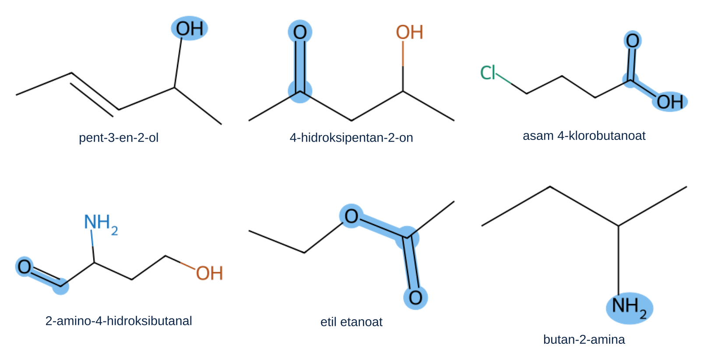

## 2.5 Alkena dan alkuna

Alkena mempunyai ikatan rangkap dua C=C, dan alkuna ikatan rangkap tiga C≡C. Namanya dibentuk dari akar alkana dengan mengganti akhiran –ana menjadi **–ena** untuk alkena dan **–una** untuk alkuna. Jadi etana menjadi etena dan etuna, propana menjadi propena dan propuna.

Mulai dari empat karbon, ikatan rangkap dapat berada di tempat yang berbeda, dan letaknya harus disebut. CH₂=CHCH₂CH₃ dan CH₃CH=CHCH₃ adalah dua senyawa yang berbeda: but-1-ena dan but-2-ena. Angka letak ditulis tepat sebelum akhiran yang ditunjuknya, karena angka itu menjelaskan akhiran tersebut. Ikatan rangkap disebut dengan nomor karbon **pertama** (yang lebih kecil) dari kedua karbon yang diikatnya: ikatan di antara C2 dan C3 disebut "2".

Aturan penamaan alkena dan alkuna adalah aturan alkana dengan satu perubahan penting pada penomoran:

1. **Rantai induk.** Pilih rantai terpanjang. Bila beberapa rantai sama panjang, pilih yang memuat ikatan rangkap paling banyak.
2. **Penomoran.** Beri nomor dari ujung yang membuat ikatan rangkap mendapat nomor **terkecil**, walaupun cabang lalu mendapat nomor lebih besar. Ikatan rangkap lebih penting daripada cabang alkil dalam menentukan arah penomoran.
3. **Lebih dari satu ikatan rangkap.** Pakai –diena, –triena, –diuna, dan sisipkan huruf "a" pada akar supaya mudah diucapkan: buta-1,3-diena, bukan but-1,3-diena.
4. **Rangkap dua dan rangkap tiga bersama.** Nama berakhiran –en–una, misalnya pent-1-en-4-una (CH₂=CHCH₂C≡CH). Nomor terkecil diberikan pada ikatan rangkap mana pun yang lebih dekat ke ujung. Hanya bila keduanya seri, ikatan rangkap dua mendapat nomor terkecil.

Mengapa ikatan rangkap diberi hak menentukan arah penomoran? Karena ikatan rangkap adalah gugus fungsi, bagian molekul yang bereaksi. Nama yang baik menonjolkan bagian yang paling penting secara kimia, dan aturan penomoran IUPAC selalu mengikuti prinsip itu: gugus yang lebih penting mendapat nomor lebih kecil.

::: {.awas}
**Catatan: aturan rantai induk alkena**

Rekomendasi IUPAC 2013 memilih rantai induk yang **terpanjang** lebih dulu, baru kemudian yang memuat ikatan rangkap terbanyak. Banyak buku yang lebih lama memakai urutan sebaliknya: rantai induk **harus** memuat ikatan rangkap, walaupun lebih pendek. Untuk sebagian besar molekul kedua aturan memberi nama yang sama. Contoh di buku ini dipilih sehingga kedua aturan sepakat, tetapi bila kamu membaca nama seperti 2-etilbut-1-ena di buku lain, ketahuilah bahwa itu nama menurut aturan lama untuk senyawa yang menurut aturan 2013 bernama 3-metilidenapentana.
:::

::: {.contoh}
**Contoh 2.8 · Menamai alkena dan alkuna**

Namai (a) CH₃CH₂CH=C(CH₃)CH₃; (b) CH₃C≡CCH(CH₃)CH₂CH₃; (c) CH₂=CHCH=CHCH₃.

**Penyelesaian.** (a) Rantai lima karbon memuat C=C (di antara karbon ketiga dan keempat dari kiri). Dari kanan, ikatan rangkap di C2; dari kiri, di C3. Pilih dari kanan: ikatan rangkap di 2, metil di C2. Nama: **2-metilpent-2-ena**.

(b) Rantai terpanjang yang memuat C≡C: CH₃–C≡C–CH–CH₂–CH₃, enam karbon. Dari kiri, ikatan rangkap tiga di C2 dan metil di C4. Dari kanan, ikatan rangkap tiga di C4. Pilih dari kiri. Nama: **4-metilheks-2-una**.

(c) Lima karbon dengan dua ikatan rangkap dua. Dari kiri: C1 dan C3. Dari kanan: C2 dan C4. Himpunan {1, 3} lebih kecil. Nama: **penta-1,3-diena**.

**Memahami hasil.** Pada (a), cabang metil dan ikatan rangkap kebetulan sama-sama di C2. Pada (b), metil mendapat nomor 4 walaupun dari arah sebaliknya ia akan mendapat nomor 3. Ikatan rangkap menang atas cabang alkil.
:::

Dua alkena yang sering muncul mempunyai nama gugus khusus: CH₂=CH– disebut **etenil** atau **vinil**, dan CH₂=CHCH₂– disebut **prop-2-enil** atau **alil**. Nama vinil dan alil dipakai sangat luas, misalnya dalam vinil klorida (bahan baku plastik PVC) dan alil isotiosianat (zat pedas dalam mustard dan wasabi).

::: {.kuis}
**Kuis cepat 2.5** Gambar struktur but-1-ena, but-2-una, dan 3-metilbut-1-ena. Mengapa nama "2-metilbut-3-ena" salah?
:::

## 2.6 Senyawa dengan gugus fungsi: prioritas dan akhiran

Sekarang kita sampai pada senyawa yang mengandung gugus fungsi selain ikatan rangkap. Prinsipnya tetap sama: akar menyatakan jumlah karbon rantai induk, akhiran menyatakan gugus fungsi utama, dan awalan menyatakan semua hal lain. Masalah baru muncul ketika satu molekul mengandung beberapa gugus fungsi. Nama hanya mempunyai satu akhiran. Gugus mana yang mendapat akhiran?

### Urutan prioritas

IUPAC menyusun gugus fungsi menurut **urutan prioritas**. Gugus dengan prioritas tertinggi menjadi **gugus utama**: ia menentukan akhiran, ia harus termasuk dalam rantai induk, dan ia mendapat nomor terkecil. Gugus lainnya ditulis sebagai awalan. Secara kasar, urutan ini mengikuti tingkat oksidasi karbon: gugus dengan lebih banyak ikatan karbon–heteroatom diberi prioritas lebih tinggi.

| Prioritas | Golongan | Akhiran | Awalan |
|---|---|---|---|
| 1 (tertinggi) | asam karboksilat | asam …-oat | karboksi- |
| 2 | ester | alkil …-oat | (alkoksikarbonil-) |
| 3 | amida | -amida | karbamoil- |
| 4 | nitril | -nitril | siano- |
| 5 | aldehida | -al | okso- (formil-) |
| 6 | keton | -on | okso- |
| 7 | alkohol | -ol | hidroksi- |
| 8 | amina | -amina | amino- |
| — | alkena, alkuna | -ena, -una | (dalam akar) |
| hanya awalan | eter, halogen, nitro | — | alkoksi-, fluoro-, kloro-, bromo-, iodo-, nitro- |

Baris terakhir penting. Halogen, gugus nitro, dan gugus alkoksi (eter) **tidak pernah** mendapat akhiran. Mereka selalu ditulis sebagai awalan, sama seperti cabang alkil, dan diurutkan menurut abjad bersama cabang alkil. Itulah sebabnya CH₃CH₂Br bernama bromoetana dan CH₃OCH₂CH₃ bernama metoksietana.

### Membentuk nama

Dengan tabel itu, nama senyawa monofungsi dibentuk dengan mengganti huruf "a" terakhir dari nama alkana dengan akhiran gugus fungsi, dan menyebut letaknya:

* **Alkohol**: propana → propan-1-ol (CH₃CH₂CH₂OH) dan propan-2-ol (CH₃CH(OH)CH₃).
* **Aldehida**: gugus –CHO selalu di ujung rantai, sehingga karbonnya selalu C1 dan nomornya tidak perlu ditulis: butanal (CH₃CH₂CH₂CHO).
* **Keton**: gugus C=O di tengah rantai, nomornya ditulis: butan-2-on (CH₃COCH₂CH₃), pentan-3-on.
* **Asam karboksilat**: karbon –COOH adalah C1: asam butanoat (CH₃CH₂CH₂COOH).
* **Ester**: nama bagian alkil yang terikat pada oksigen ditulis lebih dulu, lalu nama bagian asam dengan akhiran –oat: etil etanoat (CH₃COOCH₂CH₃).
* **Amina**: etanamina (CH₃CH₂NH₂). Nama gugus alkil + amina juga diterima: etilamina.
* **Amida dan nitril**: karbon gugus fungsi termasuk dalam rantai: etanamida (CH₃CONH₂), propananitril (CH₃CH₂CN).

Dua aturan tambahan untuk penomoran. Pertama, **gugus utama mendapat nomor terkecil**, mengalahkan ikatan rangkap dan cabang. Kedua, bila gugus utama sudah ditentukan, ikatan rangkap mendapat nomor terkecil berikutnya, baru kemudian awalan.

::: {.contoh}
**Contoh 2.9 · Gugus utama dan penomoran**

Namai (a) CH₃CH=CHCH(OH)CH₃; (b) CH₃COCH₂CH(OH)CH₃; (c) ClCH₂CH₂CH₂COOH.

**Penyelesaian.** (a) Gugus fungsi: –OH dan C=C. Alkohol lebih tinggi daripada alkena, jadi akhiran –ol. Rantai lima karbon. Dari kanan, –OH di C2 dan C=C mulai di C3. Dari kiri, –OH di C4. Pilih dari kanan. Nama: **pent-3-en-2-ol**. Perhatikan cara menulisnya: "pent-3-en" menyatakan ikatan rangkap, "-2-ol" menyatakan gugus utama, dan huruf "a" pada "pentena" dihilangkan karena diikuti akhiran yang dimulai huruf vokal.

(b) Gugus fungsi: keton dan alkohol. Keton lebih tinggi, jadi akhiran –on dan –OH menjadi awalan hidroksi-. Dari kiri, C=O di C2; dari kanan, di C4. Pilih dari kiri. Nama: **4-hidroksipentan-2-on**.

(c) Asam karboksilat adalah gugus utama, dan karbonnya menjadi C1. Klorin berada di karbon terjauh, C4. Nama: **asam 4-klorobutanoat**.

**Memahami hasil.** Dalam setiap nama, urutannya selalu: awalan (menurut abjad) + akar + ikatan rangkap + akhiran gugus utama. Bila kamu membaca nama dari kiri ke kanan, kamu mendapat daftar lengkap isi molekul.
:::

{width=95%}

::: {.contoh}
**Contoh 2.10 · Senyawa dengan tiga gugus fungsi**

Namai HOCH₂CH₂CH(NH₂)CHO.

**Rencana.** Tentukan gugus utama dari tabel prioritas, lalu nomori rantai dari karbon gugus utama.

**Penyelesaian.** Gugus fungsi: aldehida (–CHO), alkohol (–OH), amina (–NH₂). Aldehida tertinggi, sehingga akhiran –al, dan karbon –CHO menjadi C1. Rantai: C1 (CHO), C2 (CH–NH₂), C3 (CH₂), C4 (CH₂–OH). Awalan: amino di C2, hidroksi di C4. Urutkan menurut abjad: amino sebelum hidroksi. Nama: **2-amino-4-hidroksibutanal**.

**Memahami hasil.** Begitu gugus utama adalah aldehida atau asam karboksilat, penomoran tidak perlu dipilih lagi: karbon gugus itu otomatis C1. Pilihan arah penomoran hanya muncul untuk gugus yang dapat berada di tengah rantai, seperti keton, alkohol, dan amina.
:::

### Haloalkana dan eter

Haloalkana dinamai sebagai alkana dengan awalan halogen: fluoro-, kloro-, bromo-, iodo-. Halogen diperlakukan persis seperti cabang alkil, diurutkan menurut abjad bersama cabang lainnya, dan mendapat nomor menurut aturan nomor terkecil yang sama. Contohnya CH₃CHBrCH(CH₃)₂ bernama 2-bromo-3-metilbutana. Penomoran dari kiri memberi {2, 3}; dari kanan juga {2, 3}; abjad memberi bromo nomor 2.

Eter dinamai dengan menganggap satu bagian sebagai alkana induk (bagian yang lebih panjang) dan bagian lainnya, bersama oksigennya, sebagai awalan **alkoksi**: metoksi (CH₃O–), etoksi (CH₃CH₂O–), propoksi, isopropoksi. Jadi CH₃OCH₂CH₂CH₃ adalah 1-metoksipropana, dan (CH₃)₃COCH₃ adalah 2-metoksi-2-metilpropana, zat aditif bensin yang dikenal dengan singkatan MTBE. Eter siklik mempunyai nama khusus: oksirana (cincin tiga, disebut juga epoksida, Bab 9) dan oksolana, yang lebih dikenal sebagai tetrahidrofuran (THF), pelarut yang sangat banyak dipakai di laboratorium organik.

### Alkohol dengan lebih dari satu gugus –OH

Bila sebuah molekul mempunyai dua atau tiga gugus –OH, akhirannya menjadi **-diol** atau **-triol**, dan huruf "a" dari nama alkana tetap ditulis karena akhiran itu diawali konsonan. Etilena glikol, zat antibeku di radiator mobil, bernama etana-1,2-diol (HOCH₂CH₂OH). Gliserol, tulang punggung lemak dan minyak, bernama propana-1,2,3-triol.

### Amina: primer, sekunder, tersier

Amina digolongkan menurut **jumlah karbon yang terikat pada nitrogen**, bukan menurut jenis karbonnya. Ini berbeda dari penggolongan alkohol, jadi perlu diperhatikan. Amina primer (RNH₂) mempunyai satu gugus alkil pada N, amina sekunder (R₂NH) dua, dan amina tersier (R₃N) tiga. Jadi *tert*-butilamina, (CH₃)₃CNH₂, adalah amina **primer**, walaupun nitrogennya terikat pada karbon tersier.

Untuk amina sekunder dan tersier, gugus alkil terpanjang dipilih sebagai induk, dan gugus lain pada nitrogen ditulis sebagai awalan dengan huruf ***N*** untuk menandai bahwa gugus itu menempel pada nitrogen, bukan pada karbon:

* CH₃CH₂NHCH₃: *N*-metiletanamina.
* (CH₃)₂NCH₂CH₂CH₃: *N*,*N*-dimetilpropan-1-amina.

Huruf *N* berperan seperti nomor letak, dan setiap gugus pada nitrogen mendapat satu *N* sendiri, sama seperti 2,2-dimetil memerlukan dua angka.

### Turunan asam karboksilat

Asam karboksilat mempunyai beberapa turunan, yaitu senyawa yang terbentuk bila gugus –OH pada –COOH diganti gugus lain. Nama turunan-turunan ini selalu dibentuk dari nama asamnya, sehingga cukup mengubah akhiran:

| Turunan | Gugus | Pola nama | Contoh |
|---|---|---|---|
| ester | –COOR' | alkil …-oat | metil butanoat, CH₃CH₂CH₂COOCH₃ |
| asil halida | –COCl | …-oil klorida | etanoil klorida (asetil klorida), CH₃COCl |
| anhidrida | –CO–O–CO– | anhidrida …-oat | anhidrida etanoat (anhidrida asetat), (CH₃CO)₂O |
| amida | –CONH₂ | …-amida | butanamida, CH₃CH₂CH₂CONH₂ |
| amida tersubstitusi | –CONHR' | *N*-alkil…-amida | *N*-metiletanamida, CH₃CONHCH₃ |
| nitril | –C≡N | …-nitril | butananitril, CH₃CH₂CH₂CN |

Ester sering keliru dinamai karena urutan katanya terbalik dari urutan rumusnya. Dalam CH₃COOCH₂CH₃, rumus ditulis dengan bagian asam (CH₃CO–) di depan, tetapi nama dimulai dengan bagian alkil yang terikat pada oksigen: **etil** etanoat. Cara memeriksanya: bagian yang terikat pada oksigen tunggal (–O–) adalah "alkil", dan bagian yang mengandung C=O adalah "-oat".

### Gugus fungsi pada cincin

Bila gugus utama terikat pada cincin, ada dua kemungkinan. Bila atom gugus fungsi adalah bagian dari cincin itu sendiri atau terikat langsung tanpa karbon tambahan (–OH, C=O di dalam cincin, –NH₂), cincin menjadi induk dan akhirannya ditambahkan langsung: sikloheksanol, sikloheksanon, sikloheksanamina. Atom karbon yang mengikat gugus utama otomatis C1.

Bila karbon gugus fungsi berada **di luar** cincin, seperti –CHO atau –COOH yang menempel pada cincin, karbon itu tidak dapat menjadi bagian dari nama cincin. Untuk kasus ini IUPAC memakai akhiran khusus: **-karbaldehida** untuk –CHO dan **asam …-karboksilat** untuk –COOH. Contohnya C₆H₁₁CHO adalah sikloheksanakarbaldehida, dan C₆H₁₁COOH adalah asam sikloheksanakarboksilat.

::: {.contoh}
**Contoh 2.11 · Amina, ester, dan amida**

Namai (a) (CH₃CH₂)₂NH; (b) CH₃CH₂COOCH(CH₃)₂; (c) HCON(CH₃)₂; (d) 3-metilsikloheksanon (gambar dan periksa namanya).

**Penyelesaian.** (a) Dua gugus etil pada N: amina sekunder. Induk etanamina, satu etil lain sebagai *N*-etil. Nama: ***N*-etiletanamina** (nama umum: dietilamina).

(b) Bagian yang terikat pada O tunggal: isopropil, (CH₃)₂CH–. Bagian yang mengandung C=O: CH₃CH₂CO–, tiga karbon, propanoat. Nama: **isopropil propanoat** (atau propan-2-il propanoat).

(c) Turunan asam metanoat (HCOOH) dengan –OH diganti –N(CH₃)₂: amida dengan dua metil pada N. Nama: ***N*,*N*-dimetilmetanamida**. Nama umumnya dimetilformamida (DMF), pelarut polar yang sangat sering dipakai.

(d) Cincin enam dengan C=O di dalam cincin; karbon C=O adalah C1. Metil di C3. Arah penomoran dipilih supaya metil bernomor 3, bukan 5. Nama **3-metilsikloheksan-1-on**; angka 1 boleh dihilangkan: 3-metilsikloheksanon.

**Memahami hasil.** Pada (a) dan (c), huruf *N* menyelamatkan nama dari kerancuan. Tanpa *N*, "metilmetanamida" dapat diartikan sebagai metil yang menempel pada karbon. Pada (b), urutan kata dalam nama ester selalu "alkil lalu -oat", walaupun rumus kondensasinya biasanya ditulis dengan bagian asam lebih dulu.
:::

::: {.kuis}
**Kuis cepat 2.6** Namai (a) CH₃CH₂CH₂CHO; (b) CH₃CH(CH₃)COOH; (c) CH₂=CHCH₂OH; (d) CH₃CH(Br)COCH₃.
:::

## 2.7 Nama umum yang masih dipakai

Sistem IUPAC baru disepakati pada akhir abad ke-19. Sebelumnya banyak senyawa sudah mempunyai nama, biasanya menurut asal-usulnya: asam format dari semut (*formica* dalam bahasa Latin), asam asetat dari cuka (*acetum*), asam butirat dari mentega busuk (*butyrum*). Sebagian nama ini begitu meluas sehingga tetap dipakai di laboratorium, di katalog bahan kimia, dan di industri. IUPAC sendiri menerima sebagian di antaranya sebagai nama yang sah.

Kamu perlu mengenali nama-nama berikut, karena akan sering kamu jumpai di buku ini, di laboratorium, dan di label botol.

| Nama umum | Nama IUPAC sistematik | Struktur |
|---|---|---|
| formaldehida | metanal | HCHO |
| asetaldehida | etanal | CH₃CHO |
| aseton | propanon | CH₃COCH₃ |
| asam format | asam metanoat | HCOOH |
| asam asetat | asam etanoat | CH₃COOH |
| etil asetat | etil etanoat | CH₃COOCH₂CH₃ |
| asetonitril | etananitril | CH₃CN |
| isopropil alkohol | propan-2-ol | (CH₃)₂CHOH |
| *tert*-butil alkohol | 2-metilpropan-2-ol | (CH₃)₃COH |
| dietil eter | etoksietana | (CH₃CH₂)₂O |
| etilena | etena | CH₂=CH₂ |
| asetilena | etuna | HC≡CH |
| toluena | metilbenzena | C₆H₅CH₃ |
| fenol | fenol (hidroksibenzena) | C₆H₅OH |
| anilina | anilina (benzenamina) | C₆H₅NH₂ |
| kloroform | triklorometana | CHCl₃ |

Ada pola dalam nama umum yang membantu mengingatnya. Akar "form-" berarti satu karbon (formaldehida, asam format), dan akar "aset-" berarti dua karbon (asetaldehida, asam asetat, asetonitril). Nama umum ester dibentuk seperti nama IUPAC-nya, hanya dengan nama asam yang umum: etil asetat.

Nama umum juga dipakai untuk gugus fungsi dengan cara lain, yaitu **nama gugus + golongan**. Dalam sistem ini CH₃CH₂OH disebut etil alkohol, CH₃CH₂Cl etil klorida, dan CH₃COCH₂CH₃ etil metil keton (gugus diurutkan menurut abjad). Cara ini praktis untuk molekul kecil, tetapi tidak dapat diperluas ke molekul yang rumit.

::: {.terapan}
**Nama dagang, nama generik, dan nama IUPAC**

Obat mempunyai tiga nama. Nama IUPAC menggambarkan strukturnya, misalnya asam 2-(asetiloksi)benzoat. Nama generik, misalnya asam asetilsalisilat atau aspirin, lebih pendek dan dipakai di resep dan di buku farmakologi. Nama dagang dipilih perusahaan dan dilindungi merek. Di laboratorium dan dalam laporan ilmiah, nama IUPAC atau nama generik yang dipakai, karena hanya keduanya yang menunjuk satu zat yang sama di seluruh dunia.
:::

::: {.kuis}
**Kuis cepat 2.7** Tulis nama IUPAC untuk aseton, asam asetat, dan etil asetat. Mengapa ketiga nama umum itu masih lebih sering dipakai di laboratorium?
:::

## 2.8 Menamai turunan benzena

Benzena, C₆H₆, adalah cincin enam karbon yang datar dengan enam elektron π yang terdelokalisasi. Sifatnya yang istimewa dibahas di Bab 10. Untuk sekarang, kita cukup belajar menamai turunannya, karena cincin benzena muncul di sangat banyak obat, pewarna, plastik, dan bahan alam.

### Benzena dengan satu substituen

Benzena dengan satu substituen dinamai dengan menambahkan awalan pada kata "benzena": klorobenzena, nitrobenzena, etilbenzena. Beberapa turunan mempunyai nama umum yang diterima IUPAC dan jauh lebih sering dipakai daripada nama sistematiknya:

| Nama | Struktur | Nama sistematik |
|---|---|---|
| toluena | C₆H₅CH₃ | metilbenzena |
| fenol | C₆H₅OH | benzenol |
| anilina | C₆H₅NH₂ | benzenamina |
| asam benzoat | C₆H₅COOH | asam benzenakarboksilat |
| benzaldehida | C₆H₅CHO | benzenakarbaldehida |
| anisol | C₆H₅OCH₃ | metoksibenzena |
| stirena | C₆H₅CH=CH₂ | etenilbenzena |
| asetofenon | C₆H₅COCH₃ | 1-feniletanon |

Bila cincin benzena sendiri menjadi cabang pada molekul lain, gugus C₆H₅– disebut **fenil** (disingkat Ph), dan gugus C₆H₅CH₂– disebut **benzil**. Jangan keliru: benzil mempunyai satu karbon tambahan di antara cincin dan titik tempelnya.

### Dua substituen: orto, meta, para

Pada benzena dengan dua substituen, ada tiga kemungkinan letak relatif: bersebelahan (posisi 1,2), berselang satu karbon (1,3), dan berseberangan (1,4). Ketiga letak ini mempunyai nama tradisional yang masih sangat sering dipakai:

* ***orto*** (*o*-) untuk 1,2;
* ***meta*** (*m*-) untuk 1,3;
* ***para*** (*p*-) untuk 1,4.

Jadi 1,2-dimetilbenzena disebut juga *o*-xilena, dan 1,4-diklorobenzena disebut *p*-diklorobenzena (kamper yang dipakai di lemari pakaian). Bila salah satu substituen mempunyai nama khusus bersama cincin (toluena, fenol, anilina, asam benzoat), nama khusus itu menjadi induk dan substituen itu otomatis di posisi 1: *p*-nitrofenol, *m*-kloroanilina.

### Tiga substituen atau lebih

Untuk tiga substituen atau lebih, istilah orto, meta, dan para tidak cukup, sehingga dipakai angka. Cincin dinomori sehingga substituen mendapat nomor sekecil mungkin. Bila ada nama induk khusus (fenol, anilina, asam benzoat), gugusnya menjadi C1. Contohnya 2,4,6-trinitrotoluena (TNT): metil di C1, tiga nitro di C2, C4, dan C6.

::: {.contoh}
**Contoh 2.12 · Menamai turunan benzena**

Namai (a) benzena dengan –Br dan –Cl di posisi 1,3; (b) fenol dengan –NO₂ di posisi 4; (c) benzena dengan dua –CH₃ di posisi 1,2 dan satu –Br di posisi 4; (d) C₆H₅CH₂OH.

**Penyelesaian.** (a) Dua halogen, tidak ada nama induk khusus. Posisi 1,3 adalah meta. Abjad: bromo sebelum kloro, sehingga bromo di C1. Nama: **1-bromo-3-klorobenzena** (atau *m*-bromoklorobenzena).

(b) Fenol menjadi induk, –OH di C1, nitro di C4. Nama: **4-nitrofenol** (*p*-nitrofenol).

(c) Tiga substituen. Penomoran yang mungkin: dua metil di {1, 2} dan bromo di 4, memberi {1, 2, 4}. Bila mulai dari bromo, kita mendapat {1, 3, 4}. Himpunan {1, 2, 4} lebih kecil. Di antara kedua metil, pilih arah yang membuat bromo bernomor 4, bukan 5. Nama: **4-bromo-1,2-dimetilbenzena**.

(d) Gugus –CH₂OH terikat pada cincin; –OH berada pada karbon di luar cincin, sehingga ini bukan fenol, melainkan alkohol. Induknya metanol dengan gugus fenil: **fenilmetanol**, nama umumnya benzil alkohol.

**Memahami hasil.** Contoh (d) menunjukkan mengapa membedakan fenil dan benzil penting. Fenol (–OH langsung pada cincin) dan benzil alkohol (–OH satu karbon jauhnya) mempunyai sifat yang sangat berbeda: fenol sekitar seratus ribu kali lebih asam. Bab 3 menjelaskan alasannya.
:::

::: {.kuis}
**Kuis cepat 2.8** Gambar struktur *o*-kresol (2-metilfenol), asam *p*-aminobenzoat, dan 1,3,5-trimetilbenzena. Mengapa "1,2,6-triklorobenzena" bukan nama yang benar?
:::

## 2.9 Membaca nama menjadi struktur

Menamai struktur hanyalah separuh keterampilan. Separuh lainnya adalah membaca nama, misalnya dalam resep percobaan atau katalog bahan kimia, lalu menggambar strukturnya dengan benar. Untungnya, karena nama IUPAC adalah deskripsi struktur, membaca nama jauh lebih mudah daripada menyusunnya. Kita hanya perlu membongkar nama itu dari belakang.

::: {.strategi}
**Strategi: dari nama ke struktur**

1. **Baca akhir nama** untuk menemukan rantai induk dan gugus utama. "…heks-2-en-1-ol" berarti enam karbon, ikatan rangkap dua di C2–C3, dan –OH di C1.
2. **Gambar rantai induk** dan beri nomor 1, 2, 3, … dari satu ujung.
3. **Tempatkan gugus utama dan ikatan rangkap** pada nomor yang disebut.
4. **Tempatkan semua awalan** pada nomor masing-masing.
5. **Lengkapi hidrogen** sehingga setiap karbon membentuk empat ikatan, lalu periksa rumus molekul atau derajat ketidakjenuhan.
6. **Periksa nama**: namai kembali struktur yang kamu gambar. Bila hasilnya berbeda dari nama awal, salah satunya keliru.
:::

Langkah 6 sering dilewatkan, padahal langkah itu menangkap nama yang tidak sesuai aturan. Nama "2-etilbutana" dapat digambar tanpa masalah, tetapi ketika strukturnya dinamai kembali, hasilnya 3-metilpentana (Contoh 2.4). Nama yang salah tetap dapat menunjuk sebuah struktur, tetapi bukan dengan nama resminya.

::: {.contoh}
**Contoh 2.13 · Menggambar dari nama**

Gambar struktur 4-etil-2,2-dimetilheks-5-en-3-on dan tentukan rumus molekulnya.

**Penyelesaian.** *Langkah 1.* Akhir nama: "heks-5-en-3-on". Enam karbon, ikatan rangkap dua di C5–C6, keton di C3.

*Langkah 2–3.* C1–C2–C3(=O)–C4–C5=C6.

*Langkah 4.* Dua metil di C2, etil di C4.

*Langkah 5.* C1: CH₃. C2: terikat pada C1, C3, dan dua metil, jadi tanpa H. C3: C=O, tanpa H. C4: terikat pada C3, C5, dan etil, jadi CH. C5: =CH–. C6: =CH₂. Struktur kondensasinya CH₃C(CH₃)₂COCH(CH₂CH₃)CH=CH₂, atau (CH₃)₃CCOCH(C₂H₅)CH=CH₂.

Hitung atom: karbon 6 (rantai) + 2 (metil) + 2 (etil) = 10. Hidrogen: C1 3, metil 6, C4 1, etil 5, C5 1, C6 2, jumlahnya 18. Rumus: C₁₀H₁₈O. Pemeriksaan: derajat ketidakjenuhan $(20 + 2 - 18)/2 = 2$, cocok dengan satu C=O dan satu C=C.

*Langkah 6.* Namai kembali: rantai terpanjang yang memuat keton dan C=C adalah enam karbon tadi (gugus *tert*-butil di sebelah kiri hanya mempunyai tiga metil yang sama). Keton diberi nomor kecil: dari kiri C3, dari kanan C4. Pilih dari kiri. Nama sama dengan nama awal.

**Memahami hasil.** Gugus C1 dan dua metil pada C2 bersama-sama membentuk gugus *tert*-butil. Nama IUPAC tidak memakai "*tert*-butil" di sini karena C1 dan C2 termasuk rantai induk. Satu struktur dapat terlihat sangat berbeda bergantung pada cara kita membagi rantai dan cabang, tetapi namanya hanya satu.
:::

::: {.kuis}
**Kuis cepat 2.9** Gambar struktur (a) 3-etil-2-metilheksana; (b) sikloheks-2-en-1-ol; (c) asam 3-metilbut-2-enoat. Apakah nama (a) sesuai aturan?
:::

## Menuju bab berikutnya

Sekarang kita dapat mengenali gugus fungsi, menamai senyawa monofungsi, dan menggambar struktur dari namanya. Gugus fungsi tidak hanya menentukan nama; gugus fungsi juga menentukan perilaku kimia. Salah satu perilaku yang paling mendasar adalah kemampuan sebuah gugus untuk memberi atau menerima proton. Asam karboksilat melepas proton di dalam air, amina menangkap proton, dan bahkan alkohol dan keton dapat bertindak sebagai asam atau basa dalam keadaan tertentu. Bab 3 membahas asam dan basa organik, dan memperkenalkan cara meramalkan kekuatannya dari struktur, memakai gagasan muatan, resonansi, dan keelektronegatifan dari Bab 1.
