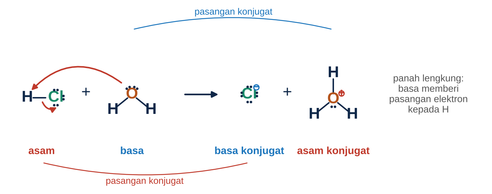
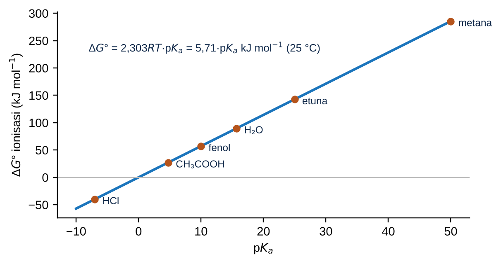

# Bab 3 Asam dan Basa Organik

Cuka dan arak sama-sama mengandung molekul dengan gugus O–H. Cuka berisi asam asetat, CH₃COOH, sedangkan arak berisi etanol, CH₃CH₂OH. Kedua gugus O–H itu tampak serupa: oksigen yang sama, hidrogen yang sama, ikatan yang sama. Namun cuka terasa asam dan mengubah warna kertas lakmus, sedangkan etanol tidak. Pengukuran menunjukkan bahwa asam asetat melepas protonnya sekitar seratus miliar kali lebih mudah daripada etanol. Dari mana datangnya perbedaan sebesar itu, padahal ikatan yang putus sama-sama ikatan O–H?

Jawaban pertanyaan ini adalah salah satu gagasan terpenting dalam kimia organik: **kekuatan sebuah asam ditentukan oleh kestabilan basa konjugatnya**. Proton yang lepas sama saja. Yang berbeda adalah apa yang tertinggal. Dalam ion asetat, muatan negatif yang tertinggal tersebar di dua atom oksigen oleh resonansi. Dalam ion etoksida, muatan negatif terkurung di satu oksigen. Muatan yang tersebar lebih stabil, dan basa konjugat yang lebih stabil berarti asam yang lebih kuat.

Bab ini membangun gagasan itu menjadi alat yang dapat dipakai untuk hampir semua molekul organik. Kita mulai dengan definisi asam dan basa, skala pKa, dan cara meramalkan arah reaksi asam–basa. Lalu kita mempelajari empat faktor struktur yang menentukan kestabilan basa konjugat: atom pembawa muatan, resonansi, efek induktif, dan orbital. Dengan keempat faktor itu, kamu akan dapat mengurutkan kekuatan asam dari strukturnya saja, tanpa menghafal tabel. Bab ini ditutup dengan basa organik, asam dan basa Lewis, dan penerapan yang sangat praktis: memisahkan campuran dengan ekstraksi asam–basa dan memahami nasib obat di dalam tubuh.

Mengapa asam–basa dipelajari sedini ini? Karena transfer proton adalah langkah yang paling sering muncul dalam mekanisme reaksi organik. Hampir setiap reaksi di Bab 6 sampai 13 mempunyai paling sedikit satu langkah pemberian atau penerimaan proton. Siapa yang menguasai asam–basa sudah menguasai sepertiga mekanisme organik.

::: {.kuis}
**Pertanyaan pembuka**

1. Mengapa asam asetat jauh lebih asam daripada etanol, padahal keduanya melepas proton dari ikatan O–H?
2. Bagaimana kita tahu apakah natrium bikarbonat dapat melarutkan sebuah asam organik di dalam air?
3. Mengapa HF asam lemah, sedangkan HI asam kuat, padahal fluorin jauh lebih elektronegatif daripada iodin?
4. Mengapa hidrogen pada asetilena dapat dilepas oleh basa kuat, sedangkan hidrogen pada etana hampir tidak dapat?
5. Mengapa anilina jauh kurang basa daripada sikloheksilamina, padahal keduanya amina primer?
6. Mengapa aspirin diserap terutama di lambung dan usus halus bagian atas, dan bagaimana kimiawan memisahkan asam benzoat dari naftalena dengan corong pisah?
:::

::: {.tujuan}
**Tujuan belajar**

Setelah mempelajari bab ini, kamu mampu:

1. Mengenali asam, basa, asam konjugat, dan basa konjugat, serta menggambar transfer proton dengan panah lengkung.
2. Mengubah Ka menjadi pKa dan sebaliknya, serta membaca kekuatan asam dari pKa.
3. Meramalkan arah dan tetapan kesetimbangan reaksi asam–basa dari tabel pKa.
4. Menghubungkan pKa dengan ΔG° reaksi ionisasi.
5. Memakai empat faktor (atom, resonansi, induktif, orbital) untuk mengurutkan kekuatan asam dan memilih proton yang paling asam dalam sebuah molekul.
6. Mengurutkan kebasaan amina, anilina, amida, dan heterosiklik nitrogen.
7. Menjelaskan efek leveling dan memilih basa yang cukup kuat untuk sebuah deprotonasi.
8. Mengenali asam dan basa Lewis dan menggambar reaksinya.
9. Memakai persamaan Henderson–Hasselbalch untuk menghitung bagian zat yang terionisasi, merancang ekstraksi asam–basa, dan menjelaskan penyerapan obat.
:::

::: {.mat}
**Prasyarat**

Bab 1: muatan formal (subbab 1.3), hibridisasi dan karakter s (subbab 1.5), kepolaran dan keelektronegatifan (subbab 1.7), resonansi, lima pola resonansi, dan pasangan bebas terdelokalisasi (subbab 1.8). Dari Kimia Dasar: kesetimbangan, Ka, pH, dan log. Dari *Termodinamika Kimia*: ΔG° = −RT ln K (subbab 12.2). Bab ini mengulang bagian yang diperlukan.
:::

## 3.1 Asam dan basa Brønsted–Lowry

Ada beberapa definisi asam dan basa, masing-masing berguna untuk keperluan yang berbeda. Untuk kimia organik, definisi yang paling sering dipakai adalah definisi **Brønsted–Lowry**, yang dirumuskan secara terpisah oleh Johannes Brønsted dan Thomas Lowry pada 1923:

* **Asam** adalah zat yang **memberikan proton** (H⁺).
* **Basa** adalah zat yang **menerima proton**.

Definisi ini memusatkan perhatian pada satu peristiwa saja, yaitu perpindahan proton dari satu molekul ke molekul lain. Kata "proton" di sini berarti inti atom hidrogen, H⁺, yang hanyalah sebuah proton tanpa elektron. Proton telanjang seperti ini tidak pernah berkeliaran bebas di dalam larutan. Ia selalu berpindah langsung dari asam ke basa dalam satu langkah. Karena itu reaksi asam–basa Brønsted selalu melibatkan dua pihak sekaligus: yang memberi dan yang menerima.

### Pasangan konjugat

Lihat reaksi asam asetat dengan ion hidroksida:

$$
\text{CH}_3\text{COOH} + \text{OH}^- \rightleftharpoons \text{CH}_3\text{COO}^- + \text{H}_2\text{O}
$$

Asam asetat memberikan proton, jadi asam asetat adalah asam. Ion hidroksida menerima proton, jadi hidroksida adalah basa. Setelah reaksi, ion asetat yang terbentuk dapat menerima proton kembali (reaksi balik), sehingga ion asetat adalah basa. Air yang terbentuk dapat memberikan proton kembali, sehingga air adalah asam. Setiap asam yang kehilangan proton berubah menjadi **basa konjugat**-nya, dan setiap basa yang menerima proton berubah menjadi **asam konjugat**-nya. Asam asetat dan ion asetat adalah satu **pasangan konjugat**; hidroksida dan air adalah pasangan konjugat lainnya.

Gagasan pasangan konjugat adalah kunci seluruh bab ini. Asam dan basa konjugatnya hanya berbeda satu proton, tetapi kekuatannya berbanding terbalik: asam yang kuat mempunyai basa konjugat yang lemah, dan asam yang lemah mempunyai basa konjugat yang kuat. Alasannya sederhana. Asam kuat melepas proton dengan mudah; itu berarti basa konjugatnya tidak terlalu ingin mengambil proton itu kembali.

### Panah lengkung untuk transfer proton

Di subbab 1.8, panah lengkung dipakai untuk memindahkan elektron dalam resonansi. Panah yang sama dipakai untuk reaksi asam–basa, dan inilah pertama kali kita memakainya untuk reaksi yang sesungguhnya. Aturannya tetap: **panah menunjukkan gerak sepasang elektron, dari sumber elektron ke tujuan elektron**. Yang berpindah dalam transfer proton adalah proton, tetapi yang kita gambar adalah elektron.

Transfer proton memerlukan dua panah:

1. **Panah pertama** berpangkal pada pasangan elektron bebas basa dan berujung pada atom hidrogen asam. Panah ini menggambarkan basa yang memakai pasangan bebasnya untuk membentuk ikatan baru dengan proton.
2. **Panah kedua** berpangkal pada ikatan H–A di asam dan berujung pada atom A. Panah ini menggambarkan ikatan lama yang putus, dengan kedua elektronnya tinggal pada A dan menjadi pasangan bebas baru.

Urutan menggambar ini sengaja dibuat begitu. Basa yang "menyerang" proton; proton tidak lepas lebih dulu lalu ditangkap. Kedua panah terjadi bersamaan dalam satu langkah.

::: {.awas}
**Kesalahan umum: panah dari proton ke basa**

Banyak mahasiswa menggambar panah dari H⁺ ke basa, seolah-olah proton yang bergerak menuju basa. Panah lengkung **tidak pernah** berpangkal pada atom hidrogen atau pada muatan positif, karena keduanya tidak membawa pasangan elektron. Panah selalu berpangkal pada pasangan bebas atau ikatan. Bila kamu terbiasa menggambar dengan benar sejak sekarang, mekanisme di Bab 6 sampai 13 akan jauh lebih mudah.
:::

{width=96%}

::: {.contoh}
**Contoh 3.1 · Panah lengkung untuk transfer proton**

Gambar mekanisme reaksi metilamina dengan asam klorida, CH₃NH₂ + HCl → CH₃NH₃⁺ + Cl⁻. Tunjukkan muatan formal setiap atom yang berubah.

**Penyelesaian.** Nitrogen metilamina mempunyai satu pasangan bebas (subbab 1.4). Panah pertama berpangkal pada pasangan bebas itu dan berujung pada atom H dari HCl. Panah kedua berpangkal pada ikatan H–Cl dan berujung pada Cl.

Setelah reaksi, nitrogen mempunyai empat ikatan dan tanpa pasangan bebas: muatan formal $5 - 0 - 4 = +1$. Klorin mempunyai empat pasangan bebas dan tanpa ikatan: muatan $7 - 8 - 0 = -1$. Muatan total tetap nol.

**Memahami hasil.** Pasangan bebas nitrogen "dipakai" untuk membentuk ikatan N–H yang baru. Elektron ikatan H–Cl yang lama menjadi pasangan bebas keempat pada Cl⁻. Tidak ada elektron yang hilang atau muncul. Inilah yang dijamin oleh panah lengkung yang digambar dengan benar: elektron hanya berpindah tempat.
:::

::: {.contoh}
**Contoh 3.2 · Mengenali pasangan konjugat**

Untuk setiap reaksi, tentukan asam, basa, asam konjugat, dan basa konjugat: (a) CH₃OH + NH₂⁻ ⇌ CH₃O⁻ + NH₃; (b) CH₃COCH₃ + H₂SO₄ ⇌ CH₃C(OH⁺)CH₃ + HSO₄⁻.

**Penyelesaian.** (a) Metanol memberikan proton: asam. Ion amida menerima proton: basa. Ion metoksida adalah basa konjugat metanol, dan amonia adalah asam konjugat ion amida.

(b) Asam sulfat memberikan proton: asam. Aseton menerima proton pada oksigen karbonilnya: basa. Aseton terprotonasi adalah asam konjugat aseton, dan HSO₄⁻ adalah basa konjugat asam sulfat.

**Memahami hasil.** Pada (a), metanol bertindak sebagai asam; pada reaksi lain metanol dapat bertindak sebagai basa (misalnya menerima proton dari H₂SO₄). Pada (b), aseton yang biasanya tidak dianggap basa ternyata dapat menerima proton bila asamnya cukup kuat. Peran asam atau basa bukan sifat tetap sebuah molekul, melainkan perannya dalam satu reaksi tertentu. Langkah protonasi karbonil seperti (b) adalah langkah pertama dalam banyak reaksi di Bab 11 dan 12.
:::

::: {.kuis}
**Kuis cepat 3.1** Gambar panah lengkung untuk reaksi fenol (C₆H₅OH) dengan ion hidroksida. Tentukan basa konjugat dan asam konjugat yang terbentuk.
:::

## 3.2 Ka, pKa, dan skala kekuatan asam

Untuk membandingkan kekuatan asam, kita perlu ukuran yang dapat dihitung. Ukuran itu berasal dari kesetimbangan asam dengan air. Bila asam HA dilarutkan dalam air, sebagian molekulnya memberikan proton kepada air:

$$
\text{HA} + \text{H}_2\text{O} \rightleftharpoons \text{A}^- + \text{H}_3\text{O}^+
$$

Makin kuat asamnya, makin jauh kesetimbangan bergeser ke kanan. Tetapan kesetimbangannya, dengan air sebagai pelarut yang konsentrasinya praktis tetap, disebut **tetapan keasaman** atau **tetapan disosiasi asam**:

$$
K_\text{a} = \frac{[\text{A}^-][\text{H}_3\text{O}^+]}{[\text{HA}]} \qquad \text{(3.1)}
$$

Masalahnya, nilai Ka asam organik membentang sangat lebar: dari sekitar 10¹⁰ untuk HI sampai sekitar 10⁻⁵⁰ untuk metana, enam puluh orde besaran. Bilangan seperti itu sulit dibandingkan dengan mata. Karena itu kimiawan memakai logaritmanya:

$$
\text{p}K_\text{a} = -\log K_\text{a} \qquad \text{(3.2)}
$$

Tanda minus dipilih supaya asam yang biasa dijumpai mempunyai pKa positif. Akibatnya ada satu hal yang perlu selalu diingat: **makin kecil pKa, makin kuat asamnya**. Asam asetat (pKa 4,76) lebih kuat daripada etanol (pKa 16), dan HCl (pKa −7) lebih kuat lagi.

Karena pKa adalah logaritma, selisih satu satuan pKa berarti selisih **sepuluh kali** dalam Ka. Selisih lima satuan berarti sepuluh pangkat lima, seratus ribu kali. Ini skala yang sama dengan pH, dan logikanya sama: setiap langkah satu satuan adalah satu kali lipat sepuluh.

{width=96%}

Gambar 3.2 dan Lampiran A memuat nilai pKa yang perlu diketahui. Kamu tidak harus menghafal semua angka, tetapi sebaiknya mengingat beberapa patokan, karena patokan inilah yang dipakai untuk menaksir nilai lainnya:

| Golongan | Contoh | pKa kira-kira |
|---|---|---|
| asam mineral kuat | HCl, H₂SO₄ | < 0 |
| asam karboksilat | CH₃COOH | 4–5 |
| ion amonium | R–NH₃⁺ | 9–11 |
| fenol | C₆H₅OH | 10 |
| air, alkohol | H₂O, CH₃CH₂OH | 15–18 |
| alkuna terminal | HC≡CH | 25 |
| amina (sebagai asam) | NH₃, R₂NH | 35–40 |
| alkena, alkana | CH₂=CH₂, CH₄ | 44–50 |

::: {.contoh}
**Contoh 3.3 · Dari Ka ke pKa dan sebaliknya**

(a) Ka asam kloroasetat adalah 1,38 × 10⁻³. Berapa pKa-nya? (b) pKa fenol 10,0. Berapa Ka-nya? (c) Berapa kali lebih kuat asam kloroasetat daripada fenol?

**Penyelesaian.** (a) $\text{p}K_\text{a} = -\log(1{,}38 \times 10^{-3}) = 2{,}86$.

(b) $K_\text{a} = 10^{-\text{p}K_\text{a}} = 10^{-10{,}0} = 1{,}0 \times 10^{-10}$.

(c) Perbandingan Ka sama dengan 10 dipangkatkan selisih pKa: $10^{10{,}0 - 2{,}86} = 10^{7{,}14} = 1{,}4 \times 10^7$. Asam kloroasetat sekitar empat belas juta kali lebih kuat.

**Memahami hasil.** Selisih pKa sekitar 7 satuan terasa kecil bila dilihat sebagai angka, tetapi artinya sepuluh juta kali. Selalu terjemahkan selisih pKa menjadi faktor kali lipat, supaya terasa seberapa besar perbedaannya.
:::

::: {.awas}
**Kesalahan umum: pKa bukan pH**

pKa adalah sifat **molekul**: seberapa kuat molekul itu sebagai asam. pH adalah sifat **larutan**: seberapa banyak ion H₃O⁺ yang ada saat ini. Asam asetat selalu mempunyai pKa 4,76, tetapi pH larutannya bisa 2,9 (larutan 0,1 M), 7 (bila dinetralkan sebagian besar), atau berapa pun, bergantung pada konsentrasi dan zat lain yang ada. Subbab 3.13 menghubungkan keduanya dengan persamaan Henderson–Hasselbalch.
:::

::: {.kuis}
**Kuis cepat 3.2** Urutkan dari asam terkuat: etanol (pKa 16), asam format (3,75), fenol (10,0), ion amonium (9,25). Berapa kali lebih kuat asam format daripada etanol?
:::

## 3.3 Arah kesetimbangan asam–basa

Tabel pKa bukan hanya daftar angka. Tabel pKa adalah alat untuk meramalkan reaksi. Pertanyaan yang sangat sering muncul di laboratorium adalah: bila asam X dicampur dengan basa Y, apakah proton akan berpindah? Misalnya, dapatkah natrium bikarbonat melarutkan fenol? Dapatkah natrium hidroksida mengubah asetilena menjadi ion asetilida? Jawabannya dapat dibaca langsung dari pKa.

### Aturan arah

Setiap reaksi asam–basa mempunyai dua asam: satu di kiri dan satu di kanan (asam konjugat dari basa yang bereaksi). Proton akan berpindah ke arah yang membuat proton itu terikat lebih kuat. Ini sama dengan mengatakan bahwa kesetimbangan bergeser ke arah **asam yang lebih lemah**, yaitu asam yang pKa-nya lebih besar.

::: {.inti}
**Arah reaksi asam–basa.** Kesetimbangan berpihak pada sisi yang mengandung asam yang lebih lemah (pKa lebih besar) dan basa yang lebih lemah. Tetapan kesetimbangannya
$$
K_\text{eq} = 10^{\,\text{p}K_\text{a}(\text{asam kanan}) - \text{p}K_\text{a}(\text{asam kiri})} . \qquad \text{(3.3)}
$$
:::

Rumus (3.3) dapat diturunkan dalam dua baris. Reaksi HA + B⁻ ⇌ A⁻ + HB dapat dipandang sebagai ionisasi HA ditambah kebalikan ionisasi HB. Tetapan reaksi gabungan adalah hasil kali tetapan masing-masing, yaitu $K_\text{a}(\text{HA}) \times 1/K_\text{a}(\text{HB})$. Bila diambil logaritmanya, kita mendapat selisih pKa. Air sebagai pelarut saling meniadakan, sehingga tidak muncul.

Dengan rumus ini, kita tidak hanya tahu arah, tetapi juga seberapa jauh reaksi berjalan. Selisih pKa 2 satuan berarti Keq = 100: kira-kira 99% bereaksi bila jumlah asam dan basanya sama. Selisih 5 satuan atau lebih berarti reaksi praktis sempurna.

::: {.contoh}
**Contoh 3.4 · Asam asetat dan natrium hidroksida**

Hitung tetapan kesetimbangan untuk CH₃COOH + OH⁻ ⇌ CH₃COO⁻ + H₂O.

**Penyelesaian.** Asam di kiri: CH₃COOH, pKa 4,76. Asam di kanan: H₂O, pKa 15,7. Asam di kanan lebih lemah, sehingga kesetimbangan berpihak ke kanan. Dari (3.3):
$$
K_\text{eq} = 10^{15{,}7 - 4{,}76} = 10^{10{,}94} = 8{,}7 \times 10^{10} .
$$

**Memahami hasil.** Tetapan hampir 10¹¹ berarti reaksi berjalan sempurna. Inilah dasar titrasi asam asetat dengan NaOH: setiap tetes basa habis bereaksi dengan asam sampai titik ekivalen.
:::

::: {.contoh}
**Contoh 3.5 · Dapatkah bikarbonat melarutkan fenol?**

Natrium bikarbonat (NaHCO₃) adalah basa lemah yang aman dipakai di laboratorium. Asam konjugatnya, H₂CO₃, mempunyai pKa 6,35. Ramalkan apakah larutan NaHCO₃ dapat mengubah (a) asam benzoat (pKa 4,20) dan (b) fenol (pKa 10,0) menjadi anionnya.

**Penyelesaian.** (a) Asam di kiri: asam benzoat, pKa 4,20. Asam di kanan: H₂CO₃, pKa 6,35. $K_\text{eq} = 10^{6{,}35 - 4{,}20} = 10^{2{,}15} = 1{,}4 \times 10^2$. Berpihak ke kanan: asam benzoat diubah menjadi ion benzoat. Selain itu H₂CO₃ terurai menjadi CO₂ dan air, sehingga kesetimbangan terdorong lebih jauh lagi ke kanan, dan gelembung gas terlihat.

(b) Asam di kiri: fenol, pKa 10,0. Asam di kanan: H₂CO₃, pKa 6,35. $K_\text{eq} = 10^{6{,}35 - 10{,}0} = 10^{-3{,}65} = 2{,}2 \times 10^{-4}$. Berpihak ke kiri: fenol hampir tidak bereaksi.

**Memahami hasil.** Perbedaan ini sangat berguna. Larutan bikarbonat dapat membedakan asam karboksilat dari fenol: asam karboksilat larut sambil berbuih, fenol tidak. Subbab 3.13 memakai fakta ini untuk memisahkan campuran keduanya.
:::

::: {.contoh}
**Contoh 3.6 · Memilih basa untuk deprotonasi asetilena**

Untuk membuat ion asetilida (HC≡C⁻), kita perlu basa yang cukup kuat. Apakah NaOH cukup? Apakah NaNH₂ cukup? (pKa: HC≡CH 25; H₂O 15,7; NH₃ 38.)

**Penyelesaian.** *Dengan OH⁻:* asam di kiri HC≡CH (25), asam di kanan H₂O (15,7). $K_\text{eq} = 10^{15{,}7 - 25} = 10^{-9{,}3} = 5 \times 10^{-10}$. Praktis tidak terjadi.

*Dengan NH₂⁻:* asam di kiri HC≡CH (25), asam di kanan NH₃ (38). $K_\text{eq} = 10^{38 - 25} = 10^{13}$. Sempurna.

**Memahami hasil.** Aturan praktis untuk memilih basa: **asam konjugat basa itu harus lebih lemah daripada asam yang akan dideprotonasi**, sebaiknya selisih beberapa satuan pKa. Hidroksida terlalu lemah karena asam konjugatnya (air) lebih kuat daripada asetilena. Amida cukup kuat karena asam konjugatnya (amonia) jauh lebih lemah. Bab 8 memakai ion asetilida untuk membentuk ikatan C–C baru.
:::

::: {.kuis}
**Kuis cepat 3.3** Apakah reaksi berikut berpihak ke kanan? (a) CH₃CH₂OH + NH₂⁻ ⇌ CH₃CH₂O⁻ + NH₃; (b) CH₃COOH + Cl⁻ ⇌ CH₃COO⁻ + HCl. Hitung Keq masing-masing.
:::

## 3.4 Termodinamika asam–basa

Mengapa kesetimbangan berpihak pada asam yang lebih lemah? Jawaban terdalamnya datang dari termodinamika. Setiap tetapan kesetimbangan berhubungan dengan perubahan energi Gibbs standar (*Termodinamika Kimia*, subbab 12.2):

$$
\Delta G^\circ = -RT\ln K = -2{,}303\,RT\log K .
$$

Untuk ionisasi asam, $K = K_\text{a}$ dan $\log K_\text{a} = -\text{p}K_\text{a}$, sehingga

$$
\Delta G^\circ_\text{ionisasi} = 2{,}303\,RT \cdot \text{p}K_\text{a} . \qquad \text{(3.4)}
$$

Pada 25 °C, $2{,}303 RT = 2{,}303 \times 8{,}314 \times 298{,}15 = 5{,}71$ kJ mol⁻¹. Jadi **setiap satuan pKa bernilai 5,71 kJ mol⁻¹** energi Gibbs. Asam dengan pKa positif mempunyai ΔG° ionisasi positif: ionisasinya "menanjak", sehingga hanya sebagian kecil molekul yang terionisasi. Asam dengan pKa negatif mempunyai ΔG° negatif: ionisasinya "menurun", sehingga hampir semuanya terionisasi.

Persamaan (3.4) memberi makna fisis pada skala pKa. Perbedaan kekuatan asam adalah perbedaan energi. Asam asetat lebih kuat daripada etanol sebesar $16 - 4{,}76 = 11{,}24$ satuan pKa, yang berarti ionisasinya $11{,}24 \times 5{,}71 = 64$ kJ mol⁻¹ lebih mudah. Energi sebesar itu kira-kira setara dengan tiga ikatan hidrogen. Sumbernya, seperti yang akan kita lihat di subbab 3.6, adalah kestabilan tambahan ion asetat karena resonansi.

{width=78%}

::: {.contoh}
**Contoh 3.7 · ΔG° ionisasi asam asetat**

(a) Hitung ΔG° ionisasi asam asetat pada 25 °C. (b) ΔH° ionisasinya hampir nol (sekitar −0,4 kJ mol⁻¹). Berapa ΔS°-nya, dan apa artinya?

**Penyelesaian.** (a) Dari (3.4): $\Delta G^\circ = 5{,}71 \times 4{,}76 = 27{,}2$ kJ mol⁻¹.

(b) Dari $\Delta G^\circ = \Delta H^\circ - T\Delta S^\circ$:
$$
\Delta S^\circ = \frac{\Delta H^\circ - \Delta G^\circ}{T} = \frac{(-0{,}4 - 27{,}2) \times 10^3\ \text{J mol}^{-1}}{298\ \text{K}} = -93\ \text{J K}^{-1}\,\text{mol}^{-1} .
$$

**Memahami hasil.** Ionisasi asam asetat tidak terhambat oleh energi ikatan (ΔH° hampir nol), melainkan oleh entropi yang turun. Ketika satu molekul netral pecah menjadi dua ion, molekul-molekul air di sekitarnya harus menata diri dengan rapi mengelilingi kedua ion itu (solvasi). Penataan ini mengurangi kebebasan molekul air, sehingga entropi turun. Hal ini mengingatkan bahwa pelarut ikut menentukan kekuatan asam. Subbab 3.11 membahas pengaruh pelarut lebih lanjut.
:::

Dalam praktik, kita jarang menghitung ΔH° dan ΔS° setiap asam. Yang lebih berguna adalah prinsip yang muncul dari (3.4): **faktor apa pun yang menstabilkan basa konjugat (menurunkan energinya) akan menurunkan ΔG° ionisasi, sehingga menurunkan pKa dan memperkuat asam**. Empat subbab berikutnya membahas faktor-faktor struktur yang menstabilkan basa konjugat.

::: {.kuis}
**Kuis cepat 3.4** Dua asam berbeda pKa-nya 3 satuan. Berapa selisih ΔG° ionisasinya pada 25 °C? Berapa kali lipat perbedaan Ka-nya?
:::
