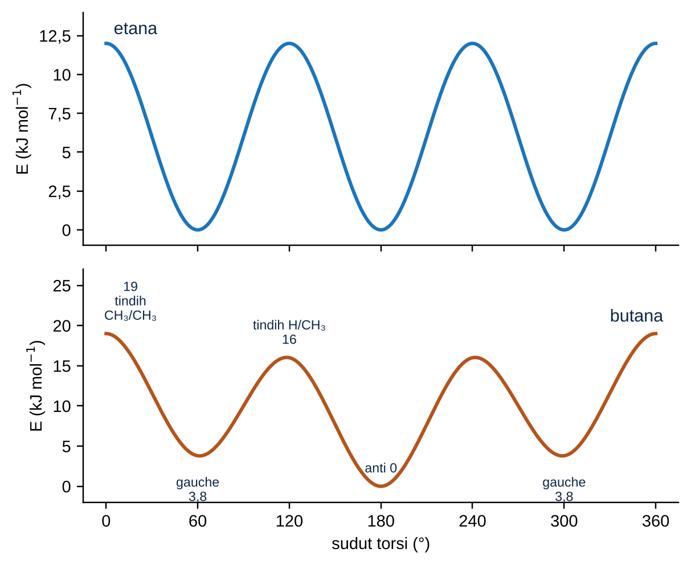

# Bab 4 Alkana, Sikloalkana, dan Konformasi

Gula yang paling melimpah di bumi, glukosa, berbentuk cincin enam atom: lima karbon dan satu oksigen. Di dalam air, glukosa terdapat dalam dua bentuk cincin yang hanya berbeda pada arah satu gugus –OH, yang disebut α dan β. Keduanya terus-menerus berubah satu menjadi yang lain, dan pada kesetimbangan sekitar 64% berada dalam bentuk β. Selulosa, bahan penyusun kayu dan kapas, dibangun dari glukosa β. Pati, bahan makanan pokok kita, dibangun dari glukosa α. Mengapa bentuk β lebih disukai? Dan mengapa perbedaan arah satu gugus –OH saja cukup untuk membuat satu polimer menjadi kayu yang keras dan polimer lainnya menjadi makanan yang mudah dicerna?

Jawabannya terletak pada sesuatu yang tidak terlihat dari rumus garis: **bentuk tiga dimensi molekul yang terus berubah**. Ikatan tunggal C–C dapat berputar, sehingga sebuah molekul dapat mengambil banyak bentuk yang berbeda tanpa memutus satu ikatan pun. Bentuk-bentuk ini disebut **konformasi**. Energinya tidak sama: sebagian bentuk nyaman, sebagian lain tegang. Molekul menghabiskan sebagian besar waktunya dalam bentuk yang paling nyaman. Cincin enam seperti glukosa ternyata melipat menjadi bentuk "kursi" yang hampir bebas tegangan, dan dalam bentuk kursi itu setiap gugus dapat mengarah ke atas-bawah (aksial) atau ke samping (ekuatorial). Gugus yang besar lebih suka mengarah ke samping. Pada glukosa β, semua gugus besar dapat mengarah ke samping sekaligus.

Bab ini memakai alkana dan sikloalkana, molekul yang paling sederhana, untuk mempelajari konformasi. Kita mulai dari sifat alkana, lalu memutar ikatan C–C pada etana, propana, dan butana sambil mencatat perubahan energinya. Setelah itu kita melihat cincin: mengapa cincin tiga dan empat tegang, mengapa cincin enam tidak, dan bagaimana menggambar serta membaca bentuk kursi sikloheksana. Bab ini ditutup dengan cincin yang menyatu seperti pada steroid, dan dengan pembakaran alkana, reaksi yang memberi tenaga pada hampir semua kendaraan di dunia.

Keterampilan menggambar konformasi bukan sekadar keterampilan menggambar. Di Bab 7 kita akan melihat bahwa reaksi eliminasi hanya berjalan bila atom-atom yang bereaksi berada pada konformasi tertentu. Di Bab 5 dan dalam biokimia, bentuk tiga dimensi menentukan bagaimana molekul obat menempel pada enzim. Konformasi adalah jembatan antara rumus di kertas dan perilaku molekul yang sebenarnya.

::: {.kuis}
**Pertanyaan pembuka**

1. Mengapa minyak bumi yang terdiri atas alkana mengapung di atas air dan tidak larut di dalamnya?
2. Jika ikatan C–C dapat berputar, mengapa ada bentuk molekul yang lebih disukai daripada yang lain?
3. Mengapa siklopropana jauh lebih reaktif daripada propana, padahal keduanya hanya mempunyai ikatan C–C dan C–H?
4. Mengapa sikloheksana tidak datar, dan mengapa cincin enam begitu umum di alam?
5. Mengapa gugus *tert*-butil pada sikloheksana hampir selalu mengarah ke samping (ekuatorial)?
6. Mengapa 2,2,4-trimetilpentana dan oktana, yang rumus molekulnya sama, melepaskan kalor pembakaran yang sedikit berbeda?
:::

::: {.tujuan}
**Tujuan belajar**

Setelah mempelajari bab ini, kamu mampu:

1. Menjelaskan sifat fisika alkana dari gaya antarmolekulnya.
2. Menggambar konformasi dengan proyeksi Newman dan proyeksi kuda-kuda, dan mengenali konformasi goyang (staggered), tindih (eclipsed), anti, dan gauche.
3. Menghitung tegangan torsi dan tegangan sterik suatu konformasi dari nilai energi interaksi, dan menggambar diagram energi putaran ikatan.
4. Menghitung tegangan cincin dari kalor pembakaran dan menjelaskan sumber tegangan pada cincin kecil.
5. Menggambar sikloheksana dalam bentuk kursi, menandai ikatan aksial dan ekuatorial, dan menggambar hasil pembalikan kursi.
6. Memakai nilai A untuk menghitung perbandingan konformer sikloheksana tersubstitusi.
7. Menentukan konformasi paling stabil sikloheksana tersubstitusi ganda dan membandingkan kestabilan isomer cis dan trans.
8. Menjelaskan bentuk dekalin dan kerangka steroid.
9. Menulis persamaan pembakaran alkana, membandingkan kalor pembakaran, dan memakainya untuk membandingkan kestabilan isomer.
:::

::: {.mat}
**Prasyarat**

Bab 1: hibridisasi sp³ dan sudut 109,5° (subbab 1.5), ikatan σ yang dapat berputar (subbab 1.6), gaya dispersi (subbab 1.9). Bab 2: tata nama alkana dan sikloalkana (subbab 2.3–2.4). Dari *Termodinamika Kimia*: entalpi pembakaran dan hukum Hess (Bab 4), serta hubungan ΔG° dan K (subbab 12.2).
:::

## 4.1 Sumber dan sifat fisika alkana

Alkana adalah hidrokarbon yang hanya mengandung ikatan tunggal. Sumber utamanya adalah **gas alam** dan **minyak bumi**. Gas alam sebagian besar berupa metana, dengan sedikit etana, propana, dan butana. Minyak bumi adalah campuran ribuan hidrokarbon, sebagian besar alkana dan sikloalkana, dengan rantai satu sampai lebih dari empat puluh karbon. Campuran ini dipisahkan di kilang minyak dengan **distilasi bertingkat**: minyak dipanaskan dan uapnya naik di menara tinggi, dan setiap komponen mengembun pada ketinggian yang suhunya sesuai dengan titik didihnya.

| Fraksi | Jumlah karbon | Titik didih (°C) | Kegunaan |
|---|---|---|---|
| gas | C₁–C₄ | di bawah 20 | LPG, bahan bakar gas |
| bensin | C₅–C₁₂ | 30–200 | bahan bakar kendaraan |
| minyak tanah, avtur | C₁₂–C₁₆ | 175–275 | bahan bakar pesawat |
| solar | C₁₅–C₁₈ | 250–375 | bahan bakar diesel |
| pelumas, parafin | C₁₈ ke atas | di atas 350 | pelumas, lilin |
| aspal | sangat panjang | residu | pengeras jalan |

Mengapa minyak bumi dapat dipisahkan dengan cara sesederhana ini? Karena titik didih alkana hampir sepenuhnya ditentukan oleh jumlah karbonnya. Alkana tidak polar dan tidak mempunyai ikatan hidrogen, sehingga satu-satunya gaya antarmolekulnya adalah gaya dispersi London (subbab 1.9). Gaya dispersi bertambah dengan ukuran molekul, sehingga titik didih naik teratur dengan panjang rantai, sekitar 20–30 derajat untuk setiap CH₂ tambahan pada alkana kecil.

### Sifat fisika yang lain

Tiga sifat fisika alkana lainnya dapat dijelaskan dengan gagasan yang sama:

* **Wujud.** Pada suhu kamar, C₁–C₄ berupa gas, C₅–C₁₇ cair, dan C₁₈ ke atas padat seperti lilin. Batas ini muncul karena gaya dispersi bertambah dengan panjang rantai.
* **Kelarutan.** Alkana tidak larut dalam air. Untuk melarutkan alkana, jaringan ikatan hidrogen air harus diputus tanpa ada pengganti (subbab 1.9). Sebaliknya, alkana larut baik dalam pelarut tidak polar seperti heksana atau dietil eter.
* **Massa jenis.** Alkana cair mempunyai massa jenis sekitar 0,6–0,8 g mL⁻¹, lebih kecil daripada air. Molekul alkana yang panjang dan berbentuk tidak beraturan tidak dapat tersusun serapat molekul air yang diikat oleh ikatan hidrogen. Akibatnya tumpahan minyak mengapung di permukaan laut dan menyebar membentuk lapisan tipis yang luas.

### Pengaruh percabangan

Di subbab 1.9 kita melihat bahwa percabangan menurunkan titik didih: pentana (36 °C), 2-metilbutana (28 °C), 2,2-dimetilpropana (9,5 °C). Molekul yang lebih bulat mempunyai luas permukaan kontak yang lebih kecil, sehingga gaya dispersinya lebih lemah. Titik leleh tidak selalu mengikuti pola yang sama. 2,2-Dimetilpropana justru meleleh pada −16 °C, jauh di atas pentana (−130 °C). Molekul yang sangat simetris dapat tersusun rapi dalam kisi kristal, sehingga lebih sulit dilelehkan. Titik leleh bergantung pada seberapa baik molekul **tersusun** dalam padatan, sedangkan titik didih bergantung pada seberapa kuat molekul **saling menempel** dalam cairan.

::: {.contoh}
**Contoh 4.1 · Membandingkan titik didih dan titik leleh**

Oktana dan 2,2,3,3-tetrametilbutana mempunyai rumus C₈H₁₈. Titik didihnya 126 °C dan 106 °C; titik lelehnya −57 °C dan 101 °C. Jelaskan mengapa urutan titik didih dan urutan titik leleh berlawanan.

**Penyelesaian.** *Titik didih:* oktana berantai lurus dan panjang, sehingga molekul-molekulnya dapat saling menempel di sepanjang rantai. 2,2,3,3-Tetrametilbutana hampir bulat, sehingga luas kontaknya kecil dan gaya dispersinya lemah. Oktana mendidih lebih tinggi.

*Titik leleh:* 2,2,3,3-tetrametilbutana sangat simetris, (CH₃)₃C–C(CH₃)₃, sehingga molekul-molekulnya tersusun rapat dan teratur dalam kristal. Untuk meruntuhkan kisi yang teratur itu diperlukan suhu tinggi. Oktana yang lentur sulit tersusun rapi. 2,2,3,3-Tetrametilbutana meleleh lebih tinggi, bahkan pada suhu di atas titik didih air.

**Memahami hasil.** Selisih titik leleh dan titik didih 2,2,3,3-tetrametilbutana hanya 5 derajat, sehingga zat ini hampir langsung menyublim. Kimiawan memanfaatkan perbedaan antara "bentuk" (untuk titik leleh) dan "ukuran dan luas kontak" (untuk titik didih) ketika merancang lilin, pelumas, dan bahan bakar.
:::

::: {.kuis}
**Kuis cepat 4.1** Urutkan titik didih heksana, 2-metilpentana, dan 2,2-dimetilbutana. Mengapa tumpahan bensin di jalan menguap jauh lebih cepat daripada tumpahan oli mesin?
:::

## 4.2 Konformasi etana: proyeksi Newman dan kuda-kuda

Di subbab 1.6 kita melihat bahwa ikatan σ simetris terhadap sumbunya, sehingga dapat berputar tanpa memutus ikatan. Sekarang kita perhatikan akibat putaran itu dengan teliti. Bila gugus CH₃ di satu ujung etana diputar terhadap gugus CH₃ di ujung lainnya, letak atom hidrogen di kedua ujung berubah satu terhadap yang lain. Setiap susunan yang dapat dicapai hanya dengan memutar ikatan tunggal disebut **konformasi**. Konformasi-konformasi sebuah molekul bukan isomer yang berbeda; semuanya adalah molekul yang sama dalam pose yang berbeda, seperti satu orang yang berdiri, duduk, atau membungkuk.

### Dua cara menggambar konformasi

Untuk membandingkan konformasi, kita perlu cara menggambar yang memperlihatkan letak atom di kedua ujung ikatan dengan jelas. Ada dua cara yang paling sering dipakai.

**Proyeksi kuda-kuda** (*sawhorse*) menggambar ikatan C–C dari samping dan sedikit dari atas, seperti melihat kuda-kuda kayu tukang. Karbon depan digambar di kiri bawah dan karbon belakang di kanan atas, masing-masing dengan tiga ikatan ke hidrogen.

**Proyeksi Newman** menggambar molekul dengan memandang **lurus sepanjang ikatan C–C**. Karbon depan digambar sebagai titik, dengan tiga ikatan yang bertemu di pusat. Karbon belakang tertutup oleh karbon depan, sehingga digambar sebagai lingkaran, dan ketiga ikatannya muncul dari pinggir lingkaran. Proyeksi Newman sangat berguna karena sudut di antara ikatan depan dan ikatan belakang langsung terlihat. Sudut ini disebut **sudut torsi** atau **sudut dihedral**.

{width=80%}

### Goyang dan tindih

Bila karbon belakang diputar sedikit demi sedikit, ada dua konformasi istimewa. Pada konformasi **goyang** (*staggered*), setiap ikatan C–H belakang berada tepat di tengah-tengah dua ikatan C–H depan; sudut torsinya 60°, 180°, dan 300°. Pada konformasi **tindih** (*eclipsed*), setiap ikatan belakang berada tepat di belakang satu ikatan depan; sudut torsinya 0°, 120°, dan 240°. Di antara keduanya ada konformasi tak terhingga banyaknya, yang disebut konformasi miring (*skew*).

Pengukuran menunjukkan bahwa konformasi tindih etana **12 kJ mol⁻¹ lebih tinggi energinya** daripada konformasi goyang. Energi tambahan ini disebut **tegangan torsi**. Mengapa konformasi tindih kurang stabil? Penjelasan lama menyebut tolakan antar-atom hidrogen, tetapi atom-atom hidrogen pada etana tindih sebenarnya masih cukup jauh (sekitar 230 pm) untuk tidak saling bertabrakan. Penjelasan yang diterima sekarang lebih halus. Pada konformasi goyang, setiap orbital ikatan C–H di satu karbon sejajar dengan orbital antiikatan σ* C–H di karbon lainnya, sehingga elektron dapat sedikit tersebar ke orbital kosong itu dan menurunkan energi. Interaksi ini, salah satu bentuk **hiperkonjugasi**, hanya optimal pada konformasi goyang. Pada konformasi tindih, susunan orbitalnya tidak sejajar, sehingga keuntungan itu hilang, dan pasangan-pasangan elektron ikatan juga berada lebih dekat sehingga saling menolak.

Karena ada tiga pasang C–H yang bertindih, setiap pasangan H/H tindih menyumbang sekitar $12/3 = 4{,}0$ kJ mol⁻¹. Angka ini akan kita pakai sebagai "harga" untuk menghitung energi konformasi molekul lain.

### Diagram energi putaran

Bila energi digambar terhadap sudut torsi, kita mendapat kurva bergelombang dengan tiga puncak (konformasi tindih) dan tiga lembah (konformasi goyang) dalam satu putaran penuh 360°. Molekul berada sebagian besar waktunya di lembah, dan sesekali melompati puncak untuk berpindah ke lembah berikutnya.

Seberapa sering lompatan itu terjadi? Penghalang 12 kJ mol⁻¹ jauh lebih kecil daripada energi termal yang tersedia untuk tumbukan molekul pada suhu kamar. Perkiraan laju dari teori keadaan transisi memberi sekitar 5 × 10¹⁰ lompatan per detik. Putaran etana berlangsung puluhan miliar kali setiap detik. Karena itu konformasi goyang dan tindih tidak dapat dipisahkan menjadi dua zat. Kita hanya dapat mengatakan bahwa pada setiap saat sebagian besar molekul berada dalam konformasi goyang.

::: {.contoh}
**Contoh 4.2 · Berapa banyak etana yang tindih?**

Menurut sebaran Boltzmann, perbandingan jumlah molekul dalam dua keadaan yang energinya berbeda ΔE adalah $e^{-\Delta E/RT}$. Pada 25 °C, berapa perbandingan jumlah molekul etana dalam konformasi tindih terhadap konformasi goyang?

**Penyelesaian.** $RT = 8{,}314 \times 298{,}15 = 2479$ J mol⁻¹. Maka
$$
\frac{N_\text{tindih}}{N_\text{goyang}} = e^{-12\,000/2479} = e^{-4{,}84} = 7{,}9 \times 10^{-3} .
$$

**Memahami hasil.** Kurang dari satu persen molekul berada pada puncak tindih pada setiap saat. Ini hanya perkiraan kasar, karena konformasi tindih adalah puncak yang dilewati, bukan lembah tempat molekul berdiam. Namun kesimpulannya jelas: walaupun putarannya sangat cepat, molekul "menghindari" konformasi tindih dan hampir selalu berada dalam bentuk goyang.
:::

::: {.kuis}
**Kuis cepat 4.2** Gambar proyeksi Newman kloroetana (CH₃CH₂Cl) dalam konformasi goyang dan tindih, dengan memandang sepanjang ikatan C–C. Berapa konformasi goyang yang berbeda energinya?
:::

## 4.3 Tegangan torsi dan tegangan sterik: propana dan butana

Etana hanya mempunyai atom hidrogen di kedua ujung, sehingga semua konformasi goyangnya setara. Bila salah satu hidrogen diganti gugus yang lebih besar, keadaannya berubah. Ada sumber energi kedua yang ikut berperan: **tegangan sterik**, yaitu tolakan yang terjadi bila dua gugus didesak lebih dekat daripada jumlah jari-jari van der Waals-nya. Tegangan sterik dapat dibayangkan sebagai dua orang gemuk yang dipaksa duduk di kursi yang terlalu sempit.

### Propana

Pandang propana sepanjang salah satu ikatan C–C. Karbon depan membawa tiga H; karbon belakang membawa dua H dan satu CH₃. Pada konformasi tindih, ada dua pasangan H/H yang bertindih dan satu pasangan H/CH₃ yang bertindih. Pasangan H/CH₃ lebih mahal daripada H/H, sekitar 6,0 kJ mol⁻¹, karena gugus metil lebih besar. Energi konformasi tindih propana dapat dihitung dengan menjumlahkan harga setiap interaksi:

$$
E_\text{tindih} = 2(4{,}0) + 1(6{,}0) = 14\ \text{kJ mol}^{-1} ,
$$

sesuai dengan penghalang putaran propana yang terukur (14 kJ mol⁻¹). Cara menjumlahkan "harga interaksi" ini berguna karena memungkinkan kita menaksir energi konformasi molekul apa pun dari daftar kecil nilai interaksi.

| Interaksi | Jenis tegangan | Energi (kJ mol⁻¹) |
|---|---|---|
| H/H tindih | torsi | 4,0 |
| H/CH₃ tindih | torsi + sedikit sterik | 6,0 |
| CH₃/CH₃ tindih | torsi + sterik | 11 |
| CH₃/CH₃ gauche (goyang, 60°) | sterik | 3,8 |

### Butana: anti dan gauche

Butana memberi gambaran yang lebih kaya. Pandang butana sepanjang ikatan C2–C3, ikatan tengahnya. Setiap karbon membawa satu gugus metil dan dua hidrogen. Bila karbon belakang diputar satu putaran penuh, kita menjumpai enam konformasi istimewa, tetapi energinya tidak lagi sama:

1. **Anti** (sudut torsi CH₃–C–C–CH₃ 180°): goyang, kedua metil saling berjauhan. Energi terendah; kita pakai sebagai titik nol.
2. **Tindih H/CH₃** (120°): dua pasangan H/CH₃ dan satu pasangan H/H bertindih. Energi $2(6{,}0) + 4{,}0 = 16$ kJ mol⁻¹.
3. **Gauche** (60°): goyang, tetapi kedua metil bersebelahan pada sudut 60°. Tidak ada tegangan torsi, tetapi kedua metil cukup dekat untuk saling mendesak. Tegangan sterik 3,8 kJ mol⁻¹.
4. **Tindih CH₃/CH₃** atau *syn* (0°): kedua metil tepat bertindih, ditambah dua pasangan H/H. Energi $11 + 2(4{,}0) = 19$ kJ mol⁻¹. Ini konformasi dengan energi tertinggi.

Setelah itu urutannya berulang dalam arah sebaliknya: gauche lagi (300°), tindih H/CH₃ lagi (240°), dan kembali ke anti.

{width=82%}

::: {.contoh}
**Contoh 4.3 · Berapa persen butana dalam bentuk anti?**

Pada 25 °C, butana berada dalam kesetimbangan antara satu konformasi anti dan dua konformasi gauche (60° dan 300°) yang setara, dengan selisih energi 3,8 kJ mol⁻¹. Hitung persentase masing-masing.

**Rencana.** Ada dua konformasi gauche untuk setiap satu konformasi anti, sehingga faktor Boltzmann harus dikalikan dua.

**Penyelesaian.**
$$
\frac{N_\text{gauche}}{N_\text{anti}} = 2\,e^{-3800/2479} = 2 \times 0{,}216 = 0{,}43 .
$$
Bagian anti $= 1/(1 + 0{,}43) = 0{,}70$, yaitu 70%; gauche 30%.

**Memahami hasil.** Walaupun anti lebih stabil, hampir sepertiga molekul butana berada dalam bentuk gauche pada suhu kamar, karena selisih energinya kecil dan ada dua bentuk gauche. Dalam rantai alkana panjang, setiap ikatan C–C mempunyai peluang yang sama untuk menjadi gauche. Inilah sebabnya rantai panjang dalam cairan tidak lurus seperti dalam gambar zig-zag, tetapi melingkar acak seperti mi.
:::

::: {.awas}
**Kesalahan umum: konformasi bukan isomer**

Anti-butana dan gauche-butana **bukan** dua senyawa. Keduanya saling berubah jutaan kali per detik pada suhu kamar, dan tidak dapat dipisahkan dalam botol. Bandingkan dengan cis- dan trans-but-2-ena, yang memerlukan pemutusan ikatan π untuk saling berubah, sehingga merupakan dua senyawa yang dapat disimpan terpisah (subbab 1.6). Kata kuncinya adalah besar penghalangnya: di bawah sekitar 80 kJ mol⁻¹, perubahan terlalu cepat untuk memisahkan kedua bentuk pada suhu kamar.
:::

::: {.kuis}
**Kuis cepat 4.3** Gambar proyeksi Newman 2-metilpropana sepanjang ikatan C1–C2. Hitung energi konformasi tindihnya dengan tabel harga interaksi.
:::
