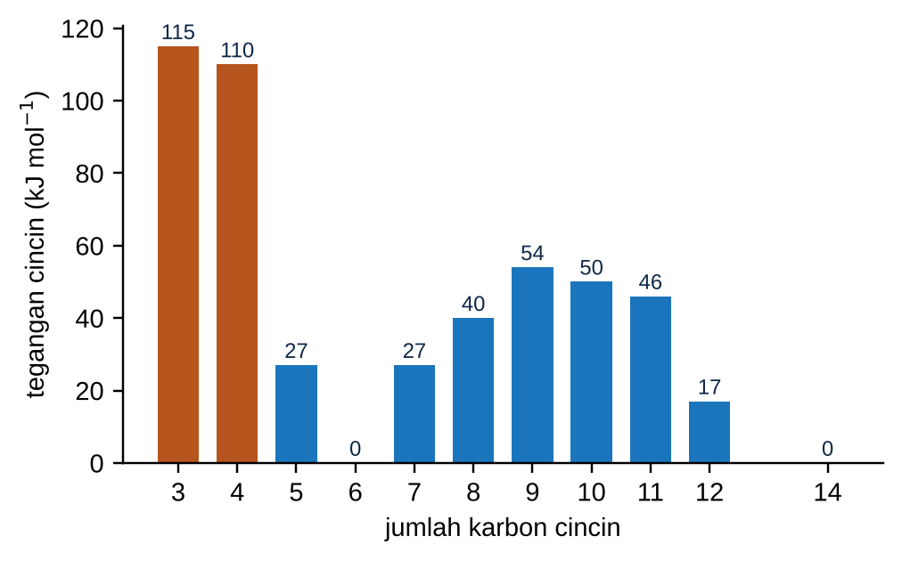
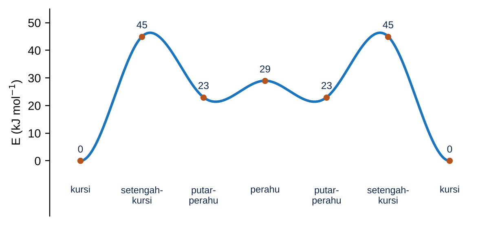

## 4.4 Tegangan cincin dan kalor pembakaran

Pada pertengahan abad ke-19, kimiawan sudah mengenal cincin lima dan enam karbon, tetapi cincin tiga dan empat sangat jarang dan tampak reaktif. Adolf von Baeyer mengusulkan penjelasan pada 1885. Ia menganggap semua cincin datar. Sudut dalam segitiga datar adalah 60°, bujur sangkar 90°, segi lima 108°, dan segi enam 120°. Karbon sp³ lebih suka sudut 109,5°, sehingga cincin yang sudutnya jauh dari 109,5° akan "tegang", seperti pegas yang dibengkokkan. Menurut Baeyer, cincin lima seharusnya hampir bebas tegangan, dan cincin enam sedikit tegang.

Gagasan Baeyer benar untuk cincin kecil, tetapi keliru untuk cincin enam ke atas. Untuk mengujinya, kita perlu cara mengukur tegangan. Cara itu ternyata sederhana: bakar sikloalkananya dan ukur kalor yang dilepaskan.

### Mengukur tegangan dengan kalor pembakaran

Setiap sikloalkana (CH₂)ₙ terbakar menjadi n CO₂ dan n H₂O. Bila cincin tidak tegang, setiap gugus CH₂ seharusnya melepaskan kalor yang sama, yaitu kalor pembakaran per CH₂ pada alkana rantai panjang yang tidak tegang: sekitar 658,6 kJ mol⁻¹. Bila cincin tegang, molekulnya menyimpan energi tambahan, seperti pegas yang ditekan. Energi tambahan itu ikut dilepaskan ketika cincin terbakar, sehingga kalor pembakaran per CH₂ lebih besar. Selisihnya adalah ukuran tegangan:

$$
\text{tegangan cincin} = n \times \left(\frac{\Delta H_\text{c}}{n} - 658{,}6\ \text{kJ mol}^{-1}\right) \qquad \text{(4.1)}
$$

dengan $\Delta H_\text{c}$ besaran kalor pembakaran (positif, dalam kJ mol⁻¹) dan *n* jumlah karbon cincin.

| Sikloalkana | *n* | ΔH_c (kJ mol⁻¹) | per CH₂ | Tegangan (kJ mol⁻¹) |
|---|---|---|---|---|
| siklopropana | 3 | 2091 | 697,0 | 115 |
| siklobutana | 4 | 2744 | 686,0 | 110 |
| siklopentana | 5 | 3320 | 664,0 | 27 |
| sikloheksana | 6 | 3952 | 658,7 | 0 |
| sikloheptana | 7 | 4637 | 662,4 | 27 |

{width=74%}

Tabel dan Gambar 4.3 menunjukkan dua hal. Pertama, siklopropana dan siklobutana memang sangat tegang, seperti ramalan Baeyer. Kedua, sikloheksana **sama sekali tidak tegang**, bertentangan dengan ramalan Baeyer bahwa cincin enam datar bersudut 120°. Pertentangan ini hanya dapat dijelaskan bila sikloheksana **tidak datar**. Subbab 4.6 menunjukkan bentuk yang sebenarnya.

::: {.contoh}
**Contoh 4.4 · Tegangan siklobutana dari kalor pembakaran**

Kalor pembakaran siklobutana 2744 kJ mol⁻¹. Hitung tegangan cincinnya. Lalu bandingkan: berapa kalor yang dilepaskan oleh 1,00 g siklobutana dan 1,00 g sikloheksana (ΔH_c 3952 kJ mol⁻¹)?

**Penyelesaian.** Per CH₂: $2744/4 = 686{,}0$ kJ mol⁻¹. Tegangan: $4 \times (686{,}0 - 658{,}6) = 110$ kJ mol⁻¹.

Massa molar siklobutana (C₄H₈) 56,1 g mol⁻¹; sikloheksana (C₆H₁₂) 84,2 g mol⁻¹. Kalor per gram: $2744/56{,}1 = 48{,}9$ kJ g⁻¹ dan $3952/84{,}2 = 46{,}9$ kJ g⁻¹.

**Memahami hasil.** Per gram, siklobutana melepas sekitar 4% lebih banyak kalor. Selisih kecil itu adalah energi tegangan yang tersimpan dalam cincinnya. Energi tegangan seperti ini juga menjadi pendorong reaksi pembukaan cincin: cincin yang tegang "ingin" terbuka, seperti pegas yang ditekan ingin memanjang.
:::

### Tiga sumber tegangan

Tegangan cincin berasal dari tiga sumber yang sudah kita kenal:

1. **Tegangan sudut** (tegangan Baeyer): sudut ikatan menyimpang dari 109,5°.
2. **Tegangan torsi**: ikatan C–H pada karbon bertetangga terpaksa tindih karena cincin tidak dapat berputar bebas.
3. **Tegangan sterik**: atom-atom yang tidak terikat langsung didesak terlalu dekat, misalnya atom hidrogen di bagian dalam cincin berukuran sedang.

Cincin yang paling stabil adalah cincin yang dapat melipat sehingga ketiga tegangan itu sekecil mungkin.

::: {.kuis}
**Kuis cepat 4.4** Kalor pembakaran siklooktana 5309 kJ mol⁻¹. Hitung tegangan cincinnya.
:::

## 4.5 Siklopropana, siklobutana, dan siklopentana

### Siklopropana: ikatan pisang

Tiga titik selalu terletak pada satu bidang, sehingga siklopropana pasti datar. Sudut C–C–C-nya 60°, menyimpang hampir 50° dari 109,5°. Selain itu, semua ikatan C–H pada karbon bertetangga bertindih sempurna, karena cincin datar tidak dapat memutar ikatannya sama sekali. Kedua tegangan bergabung menjadi 115 kJ mol⁻¹.

Bagaimana orbital karbon dapat membentuk ikatan dengan sudut 60°? Orbital sp³ mengarah pada sudut 109,5°, sehingga tidak dapat menunjuk langsung ke karbon tetangga. Orbital-orbital itu bertumpang tindih **di luar garis** yang menghubungkan kedua inti, membentuk ikatan yang melengkung ke luar seperti pisang. Ikatan seperti ini disebut **ikatan pisang** (*bent bond*). Tumpang tindihnya kurang efektif, sehingga ikatan C–C siklopropana lemah, sekitar 270 kJ mol⁻¹ dibandingkan 347 kJ mol⁻¹ untuk ikatan C–C biasa. Elektron dalam ikatan pisang juga berada di luar sumbu, lebih mudah dijangkau pereaksi, sehingga siklopropana bereaksi seperti alkena: ia dapat dibuka oleh H₂, Br₂, dan HBr.

### Siklobutana: lipatan kupu-kupu

Bila siklobutana datar, sudutnya 90° dan delapan ikatan C–H bertindih. Siklobutana mengurangi tegangan torsinya dengan **melipat** sedikit, sehingga satu karbon terangkat sekitar 25° dari bidang tiga karbon lainnya, seperti sayap kupu-kupu. Lipatan ini membuat ikatan C–H tidak lagi bertindih sempurna. Harganya, sudut C–C–C sedikit mengecil menjadi sekitar 88°. Siklobutana menyeimbangkan dua tegangan: sedikit lebih banyak tegangan sudut untuk jauh lebih sedikit tegangan torsi. Tegangan totalnya hampir sama dengan siklopropana.

### Siklopentana: amplop

Segi lima datar mempunyai sudut 108°, sangat dekat dengan 109,5°. Kalau datar, siklopentana hampir tidak mempunyai tegangan sudut, tetapi sepuluh ikatan C–H-nya akan bertindih, menimbulkan tegangan torsi sekitar 40 kJ mol⁻¹. Siklopentana mengurangi tegangan torsi itu dengan mengangkat satu karbon keluar dari bidang empat karbon lainnya, membentuk bentuk **amplop** (seperti amplop yang tutupnya setengah terbuka). Tegangan yang tersisa sekitar 27 kJ mol⁻¹. Karbon yang terangkat terus berganti-ganti, sehingga lipatan itu "berjalan" mengelilingi cincin dengan sangat cepat.

::: {.contoh}
**Contoh 4.5 · Mengapa siklopropana dapat dibuka oleh hidrogen**

Siklopropana bereaksi dengan H₂ di atas katalis nikel pada 120 °C menghasilkan propana, sedangkan sikloheksana tidak bereaksi pada kondisi yang sama. Jelaskan dengan tegangan cincin dan ikatan pisang.

**Penyelesaian.** Membuka cincin siklopropana menjadi propana melepaskan seluruh tegangan cincin, 115 kJ mol⁻¹, yang membuat reaksi jauh lebih menguntungkan secara energi. Selain itu, elektron ikatan pisang berada di luar sumbu C–C sehingga mudah berinteraksi dengan permukaan logam katalis, mirip elektron π alkena. Sikloheksana tidak tegang dan ikatan C–C-nya biasa, sehingga tidak ada pendorong maupun jalan yang mudah untuk membuka cincinnya.

**Memahami hasil.** Tegangan cincin adalah energi yang tersimpan, siap dilepaskan. Siklopropana karena itu menjadi gugus yang menarik dalam kimia obat dan bahan alam: cincin kecil yang kaku dan berenergi tinggi dapat dipakai untuk mengunci bentuk molekul atau sebagai "pegas" yang memicu reaksi.
:::

::: {.kuis}
**Kuis cepat 4.5** Mengapa siklobutana tidak datar walaupun melipat menambah tegangan sudut? Tegangan apa yang dikurangi?
:::

## 4.6 Sikloheksana: kursi, perahu, dan putar-perahu

Sekarang kita kembali ke teka-teki dari subbab 4.4: mengapa sikloheksana tidak tegang sama sekali? Jawabannya ditemukan oleh Hermann Sachse pada 1890 dan dipastikan oleh Ernst Mohr pada 1918: sikloheksana melipat menjadi bentuk yang disebut **kursi**.

### Bentuk kursi

Bayangkan enam karbon sikloheksana bergantian naik dan turun: karbon 1, 3, dan 5 sedikit di atas bidang rata-rata cincin, dan karbon 2, 4, dan 6 sedikit di bawahnya. Bila dilihat dari samping, bentuk ini menyerupai kursi santai: satu ujung terangkat seperti sandaran kepala, satu ujung turun seperti sandaran kaki. Bentuk kursi mempunyai dua keistimewaan sekaligus:

1. **Semua sudut C–C–C sekitar 111°**, sangat dekat dengan 109,5°. Tidak ada tegangan sudut.
2. **Semua ikatan C–H pada karbon bertetangga goyang sempurna**. Bila sikloheksana kursi dipandang sepanjang salah satu ikatan C–C dalam proyeksi Newman, setiap ikatan terlihat goyang, dan rantai cincin membentuk susunan gauche. Tidak ada tegangan torsi.

Tanpa tegangan sudut, tanpa tegangan torsi, dan tanpa atom yang berdesakan, sikloheksana kursi benar-benar bebas tegangan. Inilah sebabnya cincin enam begitu umum di alam: gula, steroid, terpena, dan banyak obat dibangun dari cincin enam.

{width=90%}

### Bentuk perahu dan putar-perahu

Sikloheksana juga dapat melipat menjadi bentuk **perahu**, dengan karbon 1 dan 4 sama-sama terangkat ke atas, seperti haluan dan buritan perahu. Sudut ikatannya juga mendekati 109,5°, tetapi bentuk perahu mempunyai dua kelemahan. Ikatan C–H pada empat karbon di dasar perahu bertindih, sehingga ada tegangan torsi. Selain itu, dua atom hidrogen yang menunjuk ke dalam pada karbon 1 dan 4, yang disebut hidrogen **tiang bendera**, saling berdekatan sampai sekitar 180 pm, lebih dekat daripada jumlah jari-jari van der Waals-nya. Bentuk perahu sekitar 29 kJ mol⁻¹ lebih tinggi energinya daripada kursi.

Bentuk perahu dapat sedikit memuntir diri untuk mengurangi kedua masalah itu, menjadi bentuk **putar-perahu** (*twist-boat*) yang sekitar 23 kJ mol⁻¹ di atas kursi. Bentuk putar-perahu adalah lembah energi yang dangkal, sedangkan perahu adalah puncak kecil di antara dua putar-perahu.

### Pembalikan kursi

Sikloheksana dapat berubah dari satu bentuk kursi ke bentuk kursi lainnya. Satu ujung kursi yang terangkat turun, dan ujung yang turun terangkat. Perubahan ini disebut **pembalikan kursi** (*ring flip*). Jalannya melewati bentuk setengah-kursi (puncak energi, sekitar 45 kJ mol⁻¹ di atas kursi), lalu putar-perahu, lalu setengah-kursi lagi, dan akhirnya kursi yang baru.

{width=82%}

Penghalang 45 kJ mol⁻¹ lebih tinggi daripada penghalang putaran etana, tetapi masih kecil dibanding energi termal. Pada suhu kamar, setiap molekul sikloheksana membalik sekitar 10⁵ kali per detik. Pembalikan kursi itu penting karena mengubah arah setiap ikatan, seperti yang dijelaskan di subbab berikutnya.

::: {.contoh}
**Contoh 4.6 · Berapa banyak sikloheksana dalam bentuk putar-perahu?**

Bentuk putar-perahu 23 kJ mol⁻¹ di atas bentuk kursi. Pada 25 °C, berapa perbandingan jumlah molekul putar-perahu terhadap kursi (abaikan perbedaan jumlah bentuk setara)? Berapa molekul putar-perahu dalam satu mol sikloheksana?

**Penyelesaian.**
$$
\frac{N_\text{putar-perahu}}{N_\text{kursi}} = e^{-23\,000/2479} = e^{-9{,}28} = 9{,}3 \times 10^{-5} .
$$
Dalam satu mol: $9{,}3 \times 10^{-5} \times 6{,}02 \times 10^{23} = 5{,}6 \times 10^{19}$ molekul.

**Memahami hasil.** Hanya sekitar satu dari sepuluh ribu molekul berada dalam bentuk putar-perahu. Untuk hampir semua keperluan, sikloheksana dapat dianggap sepenuhnya kursi. Namun dalam angka mutlak jumlahnya tetap sangat besar, dan bentuk minor seperti ini kadang menjadi jalan reaksi bila reaksi itu hanya dapat terjadi dari bentuk tersebut.
:::

::: {.kuis}
**Kuis cepat 4.6** Sebutkan dua alasan bentuk perahu kurang stabil daripada bentuk kursi. Mengapa bentuk kursi tidak mempunyai tegangan torsi?
:::
