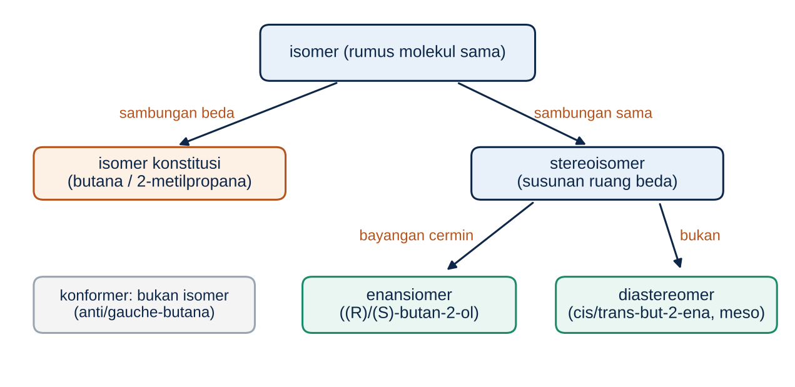

# Bab 5 Stereokimia

Hancurkan sehelai daun mint dan cium baunya. Lalu gerus beberapa biji jintan dan cium baunya. Kedua bau itu sangat berbeda: mint tajam dan segar, jintan hangat dan berempah. Yang mengejutkan, zat utama penyebab kedua bau itu adalah zat yang **sama**, yaitu karvon, C₁₀H₁₄O. Karvon dari daun mint dan karvon dari biji jintan mempunyai rumus molekul, rumus struktur, nama dasar, titik didih, kerapatan, dan spektrum inframerah yang sama persis. Hidung kita membedakan dua zat yang tidak dapat dibedakan oleh termometer, timbangan, atau corong pisah. Bagaimana mungkin?

Jawabannya adalah salah satu gagasan paling halus sekaligus paling penting dalam kimia: **molekul dapat merupakan bayangan cermin satu sama lain tanpa dapat ditumpangkan**, persis seperti tangan kiri dan tangan kanan. Kedua tangan mempunyai jari yang sama, tersambung dengan cara yang sama, tetapi sarung tangan kanan tidak muat di tangan kiri. Molekul yang mempunyai sifat ini disebut **kiral**, dari kata Yunani *cheir*, tangan. Dua bentuk bayangan cermin sebuah molekul kiral mempunyai sifat fisika yang sama dalam lingkungan yang simetris, tetapi berperilaku berbeda ketika bertemu sesuatu yang juga kiral, seperti reseptor bau di hidung, enzim di dalam sel, atau cahaya terpolarisasi.

Bab ini membangun cara berpikir dan bahasa untuk membicarakan susunan atom di ruang, yang disebut **stereokimia**. Kita mulai dengan peta besar jenis-jenis isomer, lalu belajar mengenali molekul kiral dan pusat kiral. Setelah itu kita mempelajari aturan Cahn–Ingold–Prelog untuk memberi nama R dan S, satu-satunya cara memberi nama yang tidak bergantung pada gambar. Kita membahas aktivitas optik, molekul dengan lebih dari satu pusat kiral (diastereomer dan senyawa meso), proyeksi Fischer, stereokimia cincin, kiralitas tanpa pusat kiral, dan penamaan E/Z untuk alkena. Bab ditutup dengan cara memisahkan pasangan bayangan cermin dan dengan kisah-kisah obat yang menunjukkan bahwa stereokimia bukan sekadar soal menggambar, melainkan soal hidup dan mati.

::: {.kuis}
**Pertanyaan pembuka**

1. Mengapa tangan kiri tidak dapat ditumpangkan pada tangan kanan, dan molekul seperti apa yang mempunyai sifat yang sama?
2. Bagaimana kita memberi nama yang berbeda pada dua molekul yang hanya berbeda seperti bayangan cermin?
3. Mengapa dua enansiomer mempunyai titik didih yang sama, tetapi memutar bidang cahaya terpolarisasi ke arah yang berlawanan?
4. Asam tartarat mempunyai dua pusat kiral. Mengapa hanya ada tiga stereoisomer, bukan empat?
5. Mengapa sebagian molekul kiral tidak mempunyai satu pun atom karbon dengan empat gugus yang berbeda?
6. Bagaimana kimiawan memisahkan dua enansiomer yang semua sifat fisikanya sama?
:::

::: {.tujuan}
**Tujuan belajar**

Setelah mempelajari bab ini, kamu mampu:

1. Membedakan isomer konstitusi, enansiomer, diastereomer, dan konformer.
2. Mengenali molekul kiral, pusat kiral, dan unsur simetri (bidang cermin, pusat inversi) yang membuat molekul akiral.
3. Menetapkan prioritas gugus dengan aturan Cahn–Ingold–Prelog dan menentukan konfigurasi R atau S dari gambar baji.
4. Menghitung rotasi jenis, kemurnian optik, dan kelebihan enansiomer dari data polarimeter.
5. Menentukan jumlah stereoisomer, mengenali diastereomer dan senyawa meso.
6. Menggambar dan membaca proyeksi Fischer serta menentukan R/S darinya.
7. Menentukan kiralitas sikloalkana tersubstitusi dan hubungan cis/trans dengan R/S.
8. Mengenali kiralitas aksial pada alena dan biaril.
9. Memberi nama E/Z pada alkena.
10. Menjelaskan resolusi enansiomer dan peran stereokimia dalam obat dan enzim.
:::

::: {.mat}
**Prasyarat**

Bab 1: struktur tiga dimensi dengan baji (subbab 1.4), hibridisasi sp³ tetrahedral (subbab 1.5), ikatan π yang tidak berputar (subbab 1.6). Bab 2: tata nama (seluruhnya). Bab 4: konformasi dan sikloheksana kursi (subbab 4.2–4.9).
:::

## 5.1 Peta isomer: konstitusi dan stereoisomer

Kita sudah bertemu beberapa jenis isomer di bab-bab sebelumnya. Sebelum membahas jenis baru, ada baiknya menyusun semuanya dalam satu peta, karena istilah-istilah ini sering tertukar.

**Isomer** adalah senyawa-senyawa berbeda yang mempunyai rumus molekul sama. Isomer terbagi menjadi dua golongan besar menurut pertanyaan pertama yang kita ajukan: **apakah atom-atomnya tersambung dengan urutan yang sama?**

* Bila tidak, senyawa-senyawa itu adalah **isomer konstitusi** (isomer struktur). Contohnya butana dan 2-metilpropana, atau etanol dan dimetil eter (Bab 1 dan 2).
* Bila ya, tetapi susunan atom-atomnya di ruang berbeda, senyawa-senyawa itu adalah **stereoisomer**. Contohnya cis- dan trans-but-2-ena (subbab 1.6), atau cis- dan trans-1,2-dimetilsikloheksana (subbab 4.9).

Stereoisomer terbagi lagi menurut pertanyaan kedua: **apakah keduanya bayangan cermin satu sama lain?**

* Bila ya, keduanya adalah **enansiomer**. Enansiomer selalu datang berpasangan, seperti tangan kiri dan kanan.
* Bila tidak, keduanya adalah **diastereomer**. cis- dan trans-but-2-ena adalah diastereomer: keduanya stereoisomer, tetapi yang satu bukan bayangan cermin yang lain.

{width=88%}

Satu hal lagi perlu ditegaskan. Konformer, seperti anti- dan gauche-butana, **bukan isomer** dalam arti senyawa yang dapat disimpan terpisah, karena saling berubah jutaan kali per detik (subbab 4.3). Stereoisomer yang dibahas di bab ini dapat dipisahkan dan disimpan dalam botol berbeda, karena untuk saling berubah diperlukan pemutusan ikatan.

::: {.contoh}
**Contoh 5.1 · Menggolongkan pasangan molekul**

Golongkan setiap pasangan sebagai isomer konstitusi, enansiomer, diastereomer, atau senyawa yang sama: (a) butan-1-ol dan butan-2-ol; (b) cis- dan trans-1,2-diklorosiklopropana; (c) dua gambar proyeksi Newman butana, yang satu anti dan yang lain gauche.

**Penyelesaian.** (a) Gugus –OH di karbon yang berbeda, jadi sambungannya berbeda: isomer konstitusi. (b) Sambungannya sama; hanya letak Cl terhadap bidang cincin yang berbeda. Keduanya stereoisomer. Bentuk cis mempunyai bidang cermin (subbab 5.2), sedangkan bentuk trans tidak; karena itu keduanya bukan bayangan cermin satu sama lain: diastereomer. (c) Keduanya konformasi molekul yang sama: senyawa yang sama.

**Memahami hasil.** Selalu ajukan kedua pertanyaan berurutan: sambungan dulu, bayangan cermin kemudian. Urutan ini mencegah kekeliruan yang paling umum, yaitu menyebut dua konformasi sebagai isomer atau menyebut diastereomer sebagai enansiomer.
:::

::: {.kuis}
**Kuis cepat 5.1** Apa hubungan antara cis-but-2-ena dan but-1-ena? Antara cis- dan trans-but-2-ena?
:::

## 5.2 Kiralitas dan pusat kiral

### Bayangan cermin yang tidak dapat ditumpangkan

Setiap benda mempunyai bayangan cermin. Pertanyaannya adalah apakah bayangan itu sama dengan benda aslinya. Sebuah gelas polos, sebuah bola, atau sebuah garpu: bayangan cerminnya dapat diputar dan ditumpangkan tepat di atas benda aslinya. Benda seperti ini disebut **akiral**. Sebaliknya, tangan, sepatu, sekrup, dan rumah siput: bayangan cerminnya berbeda dan tidak dapat ditumpangkan, betapa pun diputar. Benda seperti ini disebut **kiral**.

Molekul juga demikian. Lihat 2-butanol, CH₃CH(OH)CH₂CH₃. Karbon kedua (C2) terikat pada empat gugus yang berbeda: –H, –OH, –CH₃, dan –CH₂CH₃. Bila kita membuat model 2-butanol dan bayangan cerminnya, lalu mencoba menumpangkan keduanya, kita selalu gagal. Bila –OH dan –H berimpit, maka –CH₃ dari satu molekul berimpit dengan –CH₂CH₃ dari molekul lain. Kedua molekul itu adalah sepasang **enansiomer**.

{width=78%}

### Pusat kiral

Karbon C2 pada 2-butanol disebut **pusat kiral** (juga disebut pusat stereogenik atau karbon asimetris). Syaratnya sederhana: **atom karbon sp³ yang terikat pada empat gugus yang berbeda**. Mengapa empat gugus berbeda? Karena bila dua gugus sama, molekul mempunyai bidang yang membelah kedua gugus yang sama itu, dan bidang itu adalah bidang cermin internal. Molekul dengan bidang cermin internal adalah bayangan cerminnya sendiri, sehingga akiral.

Mencari pusat kiral adalah keterampilan yang sangat sering dipakai. Untuk setiap karbon, tanyakan: apakah keempat gugusnya berbeda? Beberapa jalan pintas membantu:

* Karbon CH₃ dan CH₂ tidak pernah pusat kiral, karena mempunyai dua atau tiga H yang sama.
* Karbon sp² dan sp tidak pernah pusat kiral, karena tidak mempunyai empat gugus.
* "Berbeda" berarti berbeda **sampai ke ujung**. Pada 3-metilheksana, C3 terikat pada H, CH₃, CH₂CH₃, dan CH₂CH₂CH₃: empat gugus berbeda, walaupun dua di antaranya sama-sama diawali CH₂.
* Pada cincin, bandingkan dua arah mengelilingi cincin dari karbon yang diperiksa. Bila kedua arah identik sampai kembali, kedua "gugus" itu sama.

### Simetri dan kiralitas

Pusat kiral adalah cara cepat, tetapi definisi yang sebenarnya adalah tentang simetri: **sebuah molekul akiral bila mempunyai bidang cermin internal (bidang simetri) atau pusat inversi**. Molekul yang tidak mempunyai keduanya kiral. Untuk molekul dengan satu pusat kiral, kedua cara selalu memberi jawaban yang sama. Untuk molekul dengan dua pusat kiral atau lebih, hanya cara simetri yang selalu benar. Subbab 5.7 menunjukkan molekul yang mempunyai pusat kiral tetapi akiral.

::: {.contoh}
**Contoh 5.2 · Mencari pusat kiral**

Tandai semua pusat kiral dalam (a) 2-bromopentana; (b) 3-bromopentana; (c) ibuprofen, (CH₃)₂CHCH₂–C₆H₄–CH(CH₃)COOH; (d) mentol (subbab 4.9).

**Penyelesaian.** (a) C2 terikat pada H, Br, CH₃, dan CH₂CH₂CH₃: pusat kiral. Tidak ada yang lain. Satu pusat kiral.

(b) C3 terikat pada H, Br, CH₂CH₃, dan CH₂CH₃: dua gugus sama. Bukan pusat kiral. Molekulnya akiral.

(c) Karbon CH yang mengikat –CH₃ dan –COOH terikat pada H, CH₃, COOH, dan cincin aril: pusat kiral. Karbon CH gugus isobutil terikat pada dua CH₃ yang sama: bukan. Satu pusat kiral.

(d) Pada cincin mentol, karbon yang mengikat –OH, karbon yang mengikat isopropil, dan karbon yang mengikat metil masing-masing terikat pada H, gugus substituen, dan dua jalur cincin yang berbeda. Tiga pusat kiral.

**Memahami hasil.** Ibuprofen dijual sebagai campuran kedua enansiomernya, padahal hanya satu yang aktif sebagai obat antinyeri (subbab 5.13). Mentol dengan tiga pusat kiral mempunyai $2^3 = 8$ stereoisomer, dan hanya satu yang memberi rasa dingin yang khas.
:::

::: {.kuis}
**Kuis cepat 5.2** Mana yang kiral: 2-kloropropana, 2-klorobutana, 1-kloro-1-feniletana, klorosikloheksana?
:::

## 5.3 Aturan prioritas Cahn–Ingold–Prelog

Dua enansiomer adalah dua senyawa yang berbeda, sehingga perlu nama yang berbeda. Nama itu tidak boleh bergantung pada cara menggambar atau sudut pandang. Pada 1956, Robert Cahn, Christopher Ingold, dan Vladimir Prelog mengusulkan sistem yang sekarang dipakai di seluruh dunia. Langkah pertama sistem itu adalah memberi **peringkat prioritas** pada keempat gugus di pusat kiral. Langkah kedua (subbab 5.4) memakai peringkat itu untuk menentukan arah putar.

### Aturan peringkat

::: {.inti}
**Aturan Cahn–Ingold–Prelog (CIP).**

1. **Nomor atom.** Bandingkan atom yang langsung terikat pada pusat kiral. Nomor atom lebih besar, prioritas lebih tinggi: I > Br > Cl > S > F > O > N > C > H. Untuk isotop, massa lebih besar lebih tinggi (D > H).
2. **Titik perbedaan pertama.** Bila atom pertama sama, bandingkan himpunan atom yang terikat padanya (di luar jalan yang dari pusat kiral), disusun dari nomor atom terbesar. Bandingkan atom demi atom; perbedaan pertama yang menentukan. Bila masih seri, maju satu langkah lagi ke atom berikutnya di cabang yang prioritasnya lebih tinggi.
3. **Ikatan rangkap.** Atom yang berikatan rangkap dihitung dua kali (rangkap tiga: tiga kali). Jadi –CH=O dihitung seperti C yang terikat pada (O, O, H), dan –C≡N seperti C yang terikat pada (N, N, N).
:::

Aturan 2 adalah aturan yang paling sering membingungkan, jadi kita jabarkan lebih teliti. Misalkan kita membandingkan –CH₂OH dan –CH(CH₃)₂. Keduanya diawali C, jadi aturan 1 seri. Sekarang tulis atom-atom yang terikat pada C pertama itu, dari yang terbesar: –CH₂OH memberi (O, H, H); –CH(CH₃)₂ memberi (C, C, H). Bandingkan atom pertama dari masing-masing himpunan: O lawan C. O lebih besar, sehingga –CH₂OH menang. Kita **tidak** menjumlahkan atom; dua karbon tidak mengalahkan satu oksigen. Yang dibandingkan adalah atom tertinggi lebih dulu.

::: {.contoh}
**Contoh 5.3 · Menetapkan prioritas**

Urutkan prioritas gugus-gugus berikut: (a) –OH, –CH₃, –H, –Br; (b) –CH₂CH₃, –CH(CH₃)₂, –C(CH₃)₃, –CH₃; (c) –CH=CH₂, –CH(CH₃)₂, –C≡CH, –CH₂OH; (d) –CHO, –COOH, –CH₂OH, –COOCH₃.

**Penyelesaian.** (a) Atom pertama: Br (35) > O (8) > C (6) > H (1). Urutan: –Br > –OH > –CH₃ > –H.

(b) Semua diawali C. Himpunan pada C pertama: –C(CH₃)₃ (C, C, C); –CH(CH₃)₂ (C, C, H); –CH₂CH₃ (C, H, H); –CH₃ (H, H, H). Urutan: –C(CH₃)₃ > –CH(CH₃)₂ > –CH₂CH₃ > –CH₃.

(c) –CH₂OH (O, H, H) paling tinggi karena O. –C≡CH dihitung (C, C, C). –CH=CH₂ dihitung (C, C, H). –CH(CH₃)₂ (C, C, H). Seri antara vinil dan isopropil: maju ke atom berikutnya. Pada vinil, cabang C kedua (=CH₂) membawa duplikat C dan dua H: (C, H, H). Pada isopropil, setiap CH₃ membawa (H, H, H). Vinil menang. Urutan: –CH₂OH > –C≡CH > –CH=CH₂ > –CH(CH₃)₂.

(d) Semua diawali C. –COOH: (O, O, O) karena C=O dihitung dua O ditambah O dari OH. –COOCH₃: (O, O, O) juga. –CHO: (O, O, H). –CH₂OH: (O, H, H). Seri antara –COOH dan –COOCH₃: maju ke oksigen tunggal. Pada –COOH, O terikat pada H; pada –COOCH₃, O terikat pada C. C > H, jadi –COOCH₃ menang. Urutan: –COOCH₃ > –COOH > –CHO > –CH₂OH.

**Memahami hasil.** Pada (c) dan (d), keputusannya terjadi satu langkah lebih jauh dari atom pertama. Biasakan menulis himpunan atom dalam kurung pada setiap langkah; menebak dengan "gugus mana yang tampak lebih besar" sering keliru.
:::

::: {.kuis}
**Kuis cepat 5.3** Urutkan prioritas: –NH₂, –CH₂NH₂, –CH₂CH₂Br, –CH₂Br.
:::

## 5.4 Konfigurasi R dan S

Dengan prioritas di tangan, konfigurasi ditentukan dengan cara yang dapat dibayangkan sebagai memegang setir mobil.

::: {.strategi}
**Strategi: menentukan R atau S**

1. **Beri prioritas** 1 (tertinggi) sampai 4 (terendah) pada keempat gugus.
2. **Arahkan gugus prioritas 4 menjauhi kamu**, seperti batang setir yang menjauh dari pengemudi.
3. **Telusuri 1 → 2 → 3** pada ketiga gugus lainnya, yang kini terlihat seperti lingkaran setir.
4. **Searah jarum jam: R** (*rectus*, kanan). **Berlawanan arah jarum jam: S** (*sinister*, kiri).
:::

Langkah 2 sering menjadi kesulitan, karena gambar di kertas tidak selalu menempatkan gugus terendah di belakang. Ada dua jalan keluar:

* **Bila gugus prioritas 4 berada pada baji putus-putus** (menjauhi kamu), langsung telusuri 1 → 2 → 3 dan baca arahnya.
* **Bila gugus prioritas 4 berada pada baji tebal** (mendekati kamu), telusuri 1 → 2 → 3 seperti biasa, lalu **balik jawabannya**. Kamu sedang melihat setir dari depan mobil, sehingga arah putarnya terbalik.
* **Bila gugus prioritas 4 berada di bidang kertas**, tukar dua gugus apa saja sehingga gugus 4 berada di belakang, tentukan R/S, lalu balik jawabannya. Menukar dua gugus selalu menghasilkan enansiomer, sehingga jawabannya berbalik.

Ada satu hal penting tentang huruf R dan S. Huruf itu hanya menyatakan susunan di ruang menurut aturan CIP. Huruf itu **tidak** menyatakan arah putar cahaya terpolarisasi (subbab 5.5), dan tidak selalu berubah ketika sebuah reaksi terjadi. Bila sebuah reaksi mengganti gugus tanpa menyentuh pusat kiral, huruf R dapat berubah menjadi S hanya karena prioritas gugus berubah.

::: {.contoh}
**Contoh 5.4 · Menentukan R/S dari gambar baji**

Gambar baji (R)-butan-2-ol dengan –H pada baji putus-putus. Lalu tentukan konfigurasi molekul yang sama bila digambar dengan –H pada baji tebal dan urutan –OH, –CH₂CH₃, –CH₃ searah jarum jam.

**Penyelesaian.** Prioritas: –OH (1), –CH₂CH₃ (2), –CH₃ (3), –H (4).

*Gambar pertama:* –H di belakang. Untuk R, susun –OH → –CH₂CH₃ → –CH₃ searah jarum jam.

*Gambar kedua:* –H di depan, dan 1 → 2 → 3 searah jarum jam. Karena gugus terendah mendekati kita, jawaban dibalik: S.

**Memahami hasil.** Molekul pada gambar kedua adalah enansiomer dari molekul pertama, (S)-butan-2-ol. Banyak kesalahan R/S terjadi karena lupa membalik jawaban ketika gugus terendah berada di depan. Biasakan selalu menanyakan "di mana gugus 4?" sebelum membaca arah putar.
:::

::: {.contoh}
**Contoh 5.5 · Konfigurasi alanina alami**

Asam amino alanina, CH₃CH(NH₂)COOH, di dalam protein mempunyai satu bentuk saja. Bila digambar dengan –H pada baji putus-putus, –NH₂ di kiri, –CH₃ di kanan atas, dan –COOH di kanan bawah, apa konfigurasinya?

**Penyelesaian.** Prioritas: –NH₂ (N, nomor atom 7) = 1. –COOH: C dengan (O, O, O) = 2. –CH₃: C dengan (H, H, H) = 3. –H = 4. Dengan –H di belakang, telusuri dari –NH₂ (kiri, posisi jam 9) ke –COOH (kanan bawah, jam 4) ke –CH₃ (kanan atas, jam 1). Gerakan 9 → 4 → 1 melewati bagian bawah lalu naik di kanan: berlawanan arah jarum jam. Konfigurasi: **S**.

**Memahami hasil.** Hampir semua asam amino dalam protein makhluk hidup mempunyai konfigurasi S (kecuali sistein, yang menjadi R karena atom belerang mengubah urutan prioritas, dan glisina yang tidak kiral). Kehidupan di bumi memakai hanya satu "tangan" dari asam amino. Mengapa demikian masih menjadi salah satu pertanyaan besar tentang asal-usul kehidupan.
:::

::: {.kuis}
**Kuis cepat 5.4** Bila dua gugus pada pusat kiral ditukar tempatnya dalam gambar, apa yang terjadi pada konfigurasinya? Bila ditukar dua kali?
:::

## 5.5 Aktivitas optik, rotasi jenis, dan kelebihan enansiomer

Kita sekarang sampai pada cara percobaan yang pertama kali menunjukkan adanya enansiomer. Pada awal abad ke-19, Jean-Baptiste Biot menemukan bahwa larutan beberapa zat alam, seperti gula dan asam tartarat, **memutar bidang getar cahaya terpolarisasi**.

### Cahaya terpolarisasi dan polarimeter

Cahaya biasa adalah gelombang elektromagnetik yang medan listriknya bergetar ke segala arah tegak lurus terhadap arah rambatnya. Bila cahaya itu dilewatkan melalui filter polarisasi, hanya getaran dalam satu bidang yang lolos. Cahaya seperti ini disebut **cahaya terpolarisasi bidang**. Alat yang mengukur pemutaran bidang ini disebut **polarimeter**: cahaya terpolarisasi dilewatkan melalui tabung berisi larutan sampel, lalu filter kedua diputar sampai cahaya yang lolos paling terang (atau paling gelap). Sudut putar filter kedua adalah **rotasi teramati**, α.

Zat yang memutar bidang cahaya terpolarisasi disebut **aktif optik**. Zat yang memutar ke kanan (searah jarum jam, dilihat oleh pengamat yang menghadap sumber cahaya) disebut **dekstrorotatori** dan diberi tanda (+). Zat yang memutar ke kiri disebut **levorotatori** dan diberi tanda (−).

Mengapa hanya zat kiral yang aktif optik? Cahaya terpolarisasi bidang dapat dipandang sebagai gabungan dua gelombang yang berputar seperti sekrup, satu ke kiri dan satu ke kanan. Dalam medium akiral, kedua gelombang merambat sama cepat. Dalam medium kiral, salah satu gelombang "pas" dengan molekul dan merambat sedikit lebih lambat, seperti sekrup kanan yang lebih mudah masuk ke mur kanan. Akibatnya bidang gabungannya berputar. Enansiomer memutar dengan besar yang sama dan arah yang berlawanan.

### Rotasi jenis

Rotasi teramati bergantung pada berapa banyak molekul yang dilewati cahaya: makin pekat larutan dan makin panjang tabung, makin besar α. Supaya dapat dibandingkan, kimiawan memakai **rotasi jenis**:

$$
[\alpha] = \frac{\alpha}{l \cdot c} \qquad \text{(5.1)}
$$

dengan α rotasi teramati (derajat), *l* panjang tabung dalam **desimeter**, dan *c* konsentrasi dalam **g mL⁻¹**. Satuan yang aneh ini (dm dan g mL⁻¹) adalah warisan sejarah, tetapi tetap dipakai di semua katalog. Rotasi jenis juga bergantung pada suhu, pelarut, dan panjang gelombang cahaya, sehingga biasanya ditulis lengkap, misalnya $[\alpha]_\text{D}^{20} = +13{,}5$ untuk garis D natrium (589 nm) pada 20 °C.

::: {.awas}
**Kesalahan umum: R/S dan (+)/(−) tidak berhubungan langsung**

Huruf R/S ditentukan dengan aturan di atas kertas. Tanda (+)/(−) diukur dengan polarimeter. Tidak ada aturan sederhana yang menghubungkan keduanya. (S)-Butan-2-ol dan (S)-asam laktat sama-sama (+), tetapi (S)-gliseraldehida dan (S)-asam malat sama-sama (−). Satu-satunya hubungan yang pasti: kedua enansiomer selalu mempunyai tanda yang berlawanan.
:::

### Campuran rasemik dan kelebihan enansiomer

Campuran 50:50 kedua enansiomer disebut **campuran rasemik** (atau rasemat), ditulis dengan awalan (±) atau *rac*-. Rotasinya nol, karena pemutaran ke kanan oleh setengah molekul tepat dibatalkan oleh pemutaran ke kiri oleh setengah lainnya. Campuran rasemik selalu terbentuk bila molekul kiral dibuat dari bahan akiral tanpa bantuan katalis atau pereaksi kiral, karena tidak ada yang menyukai satu tangan dibanding tangan lainnya.

Bila campuran tidak 50:50, kemurniannya dinyatakan dengan **kelebihan enansiomer** (*enantiomeric excess*, ee):

$$
\text{ee} = \frac{|[\text{R}] - [\text{S}]|}{[\text{R}] + [\text{S}]} \times 100\% = \frac{[\alpha]_\text{campuran}}{[\alpha]_\text{murni}} \times 100\% \qquad \text{(5.2)}
$$

Ungkapan kedua, yang disebut **kemurnian optik**, sama dengan ee karena rotasi sebanding dengan kelebihan satu enansiomer atas enansiomer lainnya. Campuran 75% R dan 25% S mempunyai ee 50%: setengah sampel adalah R "berlebih", dan setengah lainnya adalah pasangan rasemik.

::: {.contoh}
**Contoh 5.6 · Rotasi jenis dan kelebihan enansiomer**

(a) Larutan (S)-butan-2-ol 0,200 g mL⁻¹ dalam tabung 1,00 dm memberi α = +2,70°. Hitung rotasi jenisnya. (b) Sampel butan-2-ol lain mempunyai rotasi jenis +6,76. Berapa ee-nya, dan berapa persen masing-masing enansiomer?

**Penyelesaian.** (a) Dari (5.1): $[\alpha] = 2{,}70/(1{,}00 \times 0{,}200) = +13{,}5$.

(b) Dari (5.2): $\text{ee} = 6{,}76/13{,}5 = 0{,}50$, yaitu 50%. Kelebihan 50% adalah enansiomer S (tanda +). Sisanya 50% berupa campuran rasemik, setengah R dan setengah S. Jadi S $= 50 + 25 = 75\%$, R $= 25\%$.

**Memahami hasil.** Industri farmasi biasanya menuntut ee di atas 98–99% untuk obat kiral. Sampel dengan ee 50% masih mengandung seperempat enansiomer yang tidak diinginkan, terlalu banyak untuk obat yang enansiomernya berbahaya.
:::

::: {.kuis}
**Kuis cepat 5.5** Campuran 90% R dan 10% S mempunyai ee berapa? Bila [α] R murni −20, berapa [α] campuran itu?
:::
